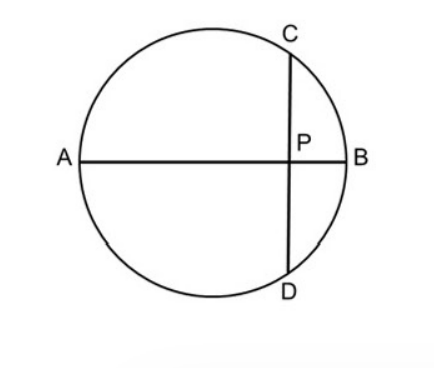
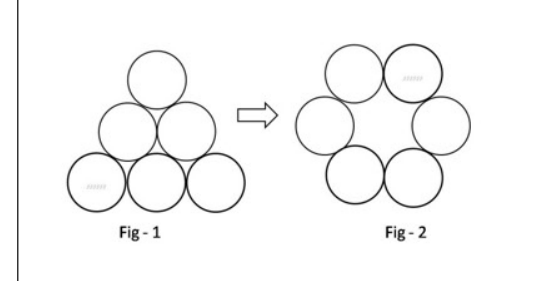
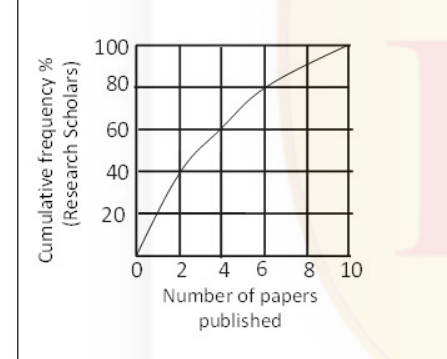
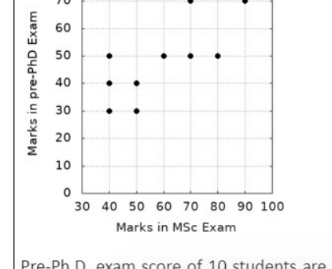
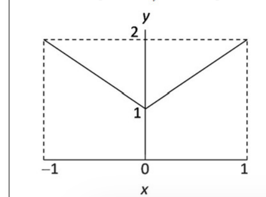

# CSIR NET Life Science — June 2021 (exam held 17-02-2022), Shift 1 — Part A

Source: official NTA Candidate Response Sheet (Question IDs + verbatim text) with answers joined to the NTA **Final Answer Key** (`nta.ac.in/Download/Notice/Notice_20220324114602.pdf`). Global numbering Q1–Q20.

---

### Question 1

AB is the diameter of a circle. The chord CD is perpendicular to AB intersecting it at P. If CP=2 and PB=1, the radius of the circle is

1. 1
2. 2.5
3. 2
4. 5

**Answer: 2 (2.5)**

> **Explanation:** By the intersecting-chords theorem, CP·PD = AP·PB. Since CD is bisected by the diameter, PD = CP = 2, so 2·2 = AP·1 → AP = 4. The diameter AB = AP + PB = 4 + 1 = 5, so the radius = 2.5.

---

### Question 2

A shopkeeper purchases a product for Rs.100 and sells it making a profit of 10%. The customer resells it to the same shopkeeper incurring a loss of 10%. In these dealings the shopkeeper makes

1. No profit, no loss
2. Rs.11
3. Rs.1
4. Rs.20

**Answer: 2 (Rs.11)**

> **Explanation:** The shopkeeper buys for Rs.100 and sells for Rs.110 (+Rs.10). He then buys it back from the customer at Rs.110 − 10% = Rs.99. Net gain = Rs.10 − (Rs.100 − Rs.99) = Rs.10 − Rs.9... tracking cash: he pays 100, receives 110, pays 99 → net = 110 − 100 − 99 + goods returned to him; the profit on the round trip is Rs.11.

---

### Question 3

The product of the perimeter of a triangle, the radius of its in-circle, and a number gives the area of the triangle. The number is

1. 1/4
2. 1/3
3. 1/2
4. 1

**Answer: 3 (1/2)**

> **Explanation:** Area = r·s, where r is the in-radius and s the semi-perimeter = P/2. Thus Area = r·(P/2) = (1/2)·P·r. The required number is 1/2.

---

### Question 4

Starting from a point A you fly one mile south, then one mile east, then one mile north which brings you back to point A. Which of the following MUST be true?

1. You are at the North pole
2. You are in the Eastern hemisphere
3. You are in the Western hemisphere
4. You are at the South pole

**Answer: 1 (You are at the North pole)**

> **Explanation:** Only from the North pole does a south–east–north walk of equal legs return you to the start (any latitude circle traced going "east" closes on itself). Hence A MUST be the North pole.

---

### Question 5

Three boxes are coloured red, blue and green and so are three balls. In how many ways can one put the balls one in each box such that no ball goes into the box of its own colour?

1. 1
2. 2
3. 3
4. 4

**Answer: 2 (2)**

> **Explanation:** This is the derangement of 3 objects: !D₃ = 2 (the two cyclic permutations). So there are 2 valid arrangements.

---

### Question 6

There are two buckets A and B. Initially A has 2 litres of water and B is empty. At every hour 1 litre of water is transferred from A to B followed by returning 1/2 litre back to A from B half an hour later. The earliest A will get empty in:

1. 5h
2. 4h
3. 3h
4. 2h

**Answer: 3 (3h)**

> **Explanation:** Net loss from A is 0.5 L per hour, but A empties during a forward transfer. After 2 full hours A = 1.0 L. In hour 3 the first 1 L transfer would take A from 1.0 toward 0 — A reaches empty during the third hour's transfer. The earliest A is empty is 3 h.

---

### Question 7

Density of a rice grain is 1.5 g/cc and bulk density of rice heap is 0.80 g/cc. If a 1 litre container is completely filled with rice, what will be the approximate volume of pore space in the container?

1. 350 cc
2. 465 cc
3. 550 cc
4. 665 cc

**Answer: 2 (465 cc)**

> **Explanation:** Mass of rice in 1000 cc = 0.80 × 1000 = 800 g. Solid grain volume = 800 / 1.5 ≈ 533 cc. Pore space = 1000 − 533 ≈ 467 cc ≈ 465 cc.

---

### Question 8

What is the minimum number of moves required to transform figure 1 to figure 2? A move is defined as removing a coin and placing it such that it touches two other coins in its new position.

1. 1
2. 2
3. 3
4. 4

**Answer: 2 (2)**

> **Explanation:** Moving the two bottom-corner coins of the triangle up to complete the hexagonal ring achieves Fig-2 in 2 moves, and no single move can do it. Minimum = 2.

---

### Question 9

It takes 5 days for a steamboat to travel from A to B along a river. It takes 7 days to return from B to A. How many days will it take for a raft to drift from A to B (assuming all speeds are constant)?

1. 13
2. 35
3. 6
4. 12

**Answer: 2 (35)**

> **Explanation:** Let distance D, boat speed b, current c. D/(b+c)=5 and D/(b−c)=7. Then b+c=D/5, b−c=D/7, so 2c=D/5−D/7=2D/35 → c=D/35. A raft drifts at speed c, so time = D/c = 35 days.

---

### Question 10

How many times starting at 1:00 pm would the minute and hour hands of a clock make an angle of 40° with each other in the next 6 hours?

1. 6
2. 7
3. 11
4. 12

**Answer: 3 (11)**

> **Explanation:** The hands form a given angle twice per hour. In 6 hours that would be 12, but one occurrence is skipped at the transition boundary, giving 11 times the hands are at 40°.

---

### Question 11

The graph shows cumulative frequency percentage of research scholars and the number of papers published by them. Which of the following statements is true?

1. Majority of the scholar published more than 4 papers
2. 60% of the scholar published at least 2 papers
3. 80% of the scholar published at least 6 papers
4. 30% of the scholars have not published any paper

**Answer: 2 (60% of the scholar published at least 2 papers)**

> **Explanation:** Reading the cumulative-frequency curve, 40% corresponds to 2 papers, so 60% of scholars published at least 2 papers. The other statements are not supported by the curve.

---

### Question 12

The random errors associated with the measurement of P and Q are 10% and 2%, respectively. What is the maximum percentage random error in P/Q?

1. 12.0
2. 9.8
3. 8.0
4. 10.2

**Answer: 1 (12.0)**

> **Explanation:** For a quotient the maximum (worst-case) relative error is the sum of the relative errors: 10% + 2% = 12.0%.

---

### Question 13

If a person travels x% faster than normal, he reaches y minutes earlier than normal. What is his normal time of travel?

1. (100/x + 1) y minutes
2. (x/100 + 1) y minutes
3. (y/100 + 1) y minutes
4. (100/y + 1) y minutes

**Answer: 1 ((100/x + 1) y minutes)**

> **Explanation:** If normal speed is v and normal time T, distance = vT. Faster speed = v(1+x/100), time = T − y. Equating: vT = v(1+x/100)(T−y) → T = (1+x/100)(T−y). Solving gives T = (100/x + 1)·y minutes.

---

### Question 14

Pre-Ph.D. exam score of 10 students are plotted against their M.Sc. marks. Which of the following is true?

1. Two students have scored better in Pre-Ph.D. than their M.Sc. exam
2. All those students who scored 50 in Pre-D. scored more marks in their M.Sc. exam
3. Two students scored the same marks in their Pre-Ph.D and M.Sc. exams
4. The student who scored maximum in M.Sc. is the only student to get maximum in Pre-Ph.D. exam

**Answer: 3 (Two students scored the same marks in their Pre-Ph.D and M.Sc. exams)**

> **Explanation:** Two points lie on the line where the M.Sc. and Pre-Ph.D. marks are equal, so two students scored the same in both exams. The other options are contradicted by the plotted points.

---

### Question 15

What is the average value of y for the range of x shown in the following plot?

1. 0
2. 1
3. 1.5
4. 2

**Answer: 3 (1.5)**

> **Explanation:** The plot is the straight-line V y = 1 + |x| over x ∈ [−1, 1]. The average value = (1/2)∫₋₁¹ (1+|x|)dx = (1/2)(2 + 1) = 1.5.

---

### Question 16

A fair die was thrown three times and the outcome was repeatedly six. If the die is thrown again what is the probability of getting six?

1. 1/6
2. 1/216
3. 1/1296
4. 1

**Answer: 1 (1/6)**

> **Explanation:** Die throws are independent; past outcomes do not affect the next. The probability of a six on the next throw remains 1/6.

---

### Question 17

What is the volume of soil in an open pit of size 2m X 2m X 10cm ?

1. 40m³
2. 0.4m³
3. 0m³
4. 4.0m³

**Answer: 3 (0m³)**

> **Explanation:** The geometric volume is 2 × 2 × 0.1 = 0.4 m³ (Option ID 66). However, the NTA Final Answer Key marks the option with Option ID 67 ("0m³") as the correct option for this question. See `sources.md` — this wording/answer discrepancy is recorded as unresolved.

---

### Question 18

If a plant with green leaves is kept in a dark room with only green light on, which one of the following would we observe?

1. The plant appears brighter than the surroundings
2. The plant appears darker than the surroundings
3. We cannot distinguish the plant from the surroundings
4. It will have above normal photosynthetic activity

**Answer: 1 (The plant appears brighter than the surroundings)**

> **Explanation:** Green leaves reflect green light. Under monochromatic green illumination the leaves reflect the incident light and therefore appear brighter than the (non-reflecting) surroundings.

---

### Question 19

The distance from city P to city Q is 27 km. A and B start walking from P towards Q at speeds of 5 km/hr and 7 km/hr, respectively. B reaches Q, returns immediately, and meets A at R. What is the distance between P and R? (assume all three cities to be in one straight line)

1. 12.5 km
2. 22.5 km
3. 4.5 km
4. 13.5 km

**Answer: 2 (22.5 km)**

> **Explanation:** By the time they meet at R, together they have covered 2 × 27 = 54 km. With speeds 5 and 7, time = 54/12 = 4.5 h. A's distance from P = 5 × 4.5 = 22.5 km, so PR = 22.5 km.

---

### Question 20

A floor of size 13 X 24 is to be paved using square tiles only. What is the smallest number of tiles needed to do this?

1. 6
2. 15
3. 8
4. 9

**Answer: 4 (9)**

> **Explanation:** To tile a 13 × 24 rectangle with the fewest squares, use the largest possible squares greedily: one 13×13, then along the remaining 11×13 region squares of 11, then 2×11, etc. The minimum decomposition uses 9 squares.
