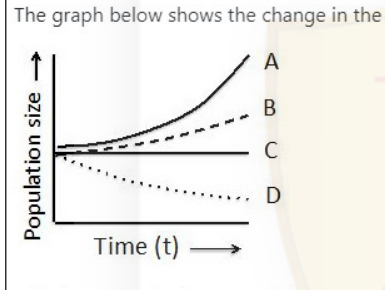

# CSIR NET Life Science — June 2021 (exam held 17-02-2022), Shift 1 — Part B

Verbatim from the official NTA Candidate Response Sheet; answers joined to the NTA **Final Answer Key** (see `sources.md`). Global numbering Q21–Q70.

---

### Question 21

Following statements are made about uncompetitive inhibition of an enzyme:

A. Uncompetitive inhibitor binds to both free enzyme as well as an enzyme-substrate complex.
B. Addition of uncompetitive inhibitor lowers the Vmax of the reaction.
C. Apparent Km of the enzyme is lowered.
D. Apparent Km of the enzyme remains unchanged.

Which one of the following option represents the correct combination of the statements?

1. B and C
2. A and C
3. A and B
4. A and D

**Answer: 1 (B and C)**

> **Explanation:** An uncompetitive inhibitor binds only the enzyme–substrate complex (so A is false), lowering Vmax (B true) and lowering the apparent Km (C true, D false). Correct combination = B and C.

---

### Question 22

Following are the pKa's of the ionizable groups in lysine

pKa₁ = 2.16 (α - carboxylic group)
pKa₂ = 9.06 (α - amino group)
pKa₃ = 10.54 (ε - amino group)

Which one of the following options represents the pI of lysine?

1. 7.25
2. 5.61
3. 6.35
4. 9.8

**Answer: 4 (9.8)**

> **Explanation:** Lysine is basic; the pI is the average of the two highest pKa values (α-amino 9.06 and ε-amino 10.54): (9.06 + 10.54)/2 = 9.8.

---

### Question 23

The enzyme alkaline phosphatase was tested for its catalytic activity using the substrate para-nitrophenylphosphate. The Km obtained was 10 mM and Vmax was 100 μmol/min. Which one of the following options represents the initial velocity of the reaction at a substrate concentration of 10 mM?

1. 50 μmol/min
2. 100 μmol/min
3. 500 μmol/min
4. 20 μmol/min

**Answer: 1 (50 μmol/min)**

> **Explanation:** At [S] = Km, the Michaelis–Menten equation gives v = Vmax/2 = 100/2 = 50 μmol/min.

---

### Question 24

How many hydrogen bonds involving the backbone CO and NH can be observed in an α-helix consisting of 15 amino acid residues?

1. 10
2. 11
3. 12
4. 13

**Answer: 2 (11)**

> **Explanation:** In an α-helix, residue i's CO H-bonds to residue i+4's NH. For n residues the number of such H-bonds is n − 4 = 15 − 4 = 11.

---

### Question 25

Progression across G1/S boundary followed by entry into S-phase is promoted by the activation of which one of the following protein complexes?

1. Cdk4/Cyclin D
2. Cdk2/Cyclin E
3. Cdk4,6/Cyclin
4. Cdk4,6/Cyclin D, E

**Answer: 2 (Cdk2/Cyclin E)**

> **Explanation:** The G1→S transition is driven by Cdk2 bound to Cyclin E, which fires replication origins at the G1/S boundary.

---

### Question 26

In eukaryotic cells, covalently attached lipids help to anchor some water soluble proteins to the plasma membrane. One group of cytosolic proteins are anchored to the cytosolic face of membrane by a fatty acyl group (e.g. myristate or palmitate). These groups are generally covalently attached to which amino acids present at the N-terminus of the polypeptide chain?

1. Glycine
2. Tyrosine
3. Serine
4. Lysine

**Answer: 1 (Glycine)**

> **Explanation:** N-terminally myristoylated/palmitoylated cytosolic proteins carry the acyl group on an N-terminal glycine residue.

---

### Question 27

The movement of proteins bigger than 50 kDa across the nuclear envelope requires:

1. Sec 61
2. Tom 20
3. Importin β
4. Tim 44

**Answer: 3 (Importin β)**

> **Explanation:** Nucleocytoplasmic transport of large cargoes (>~40–50 kDa) is mediated by karyopherins; Importin β drives translocation through the nuclear pore.

---

### Question 28

Iron-sulphur clusters [Fe-S] are the key prosthetic groups that carry electrons in all of the below EXCEPT:

1. NADH - CoQ reductase
2. Succinate - CoQ reductase
3. Cytochrome C oxidase
4. CoQH2 -Cytochrome C reductase

**Answer: 3 (Cytochrome C oxidase)**

> **Explanation:** Complexes I, II and III all contain Fe–S clusters; Cytochrome c oxidase (Complex IV) transfers electrons via Cu and heme centres, not Fe–S clusters.

---

### Question 29

In bacteria many of the tRNA genes do not contain the CCA sequence found at the 3' end of tRNA. In this context which one of the following statements represents the correct explanation?

1. In these tRNAs amino acylation occurs at the 3' end of the tRNA irrespective of the presence of the - CCA sequence.
2. CCA sequence is added to these tRNA transcripts in a DNA template independent manner.
3. These tRNAs exploit the process of trans- splicing to include a CCA sequence at their 3' end.
4. The absence of CCA sequence occurred only in the last common ancestor (LCA) during the course of evolution and the current day tRNA genes always possess a sequence to encode the CCA end of the tRNA.

**Answer: 2 (CCA sequence is added to these tRNA transcripts in a DNA template independent manner.)**

> **Explanation:** CCA-adding nucleotidyltransferase appends the CCA terminus post-transcriptionally without a nucleic-acid template.

---

### Question 30

Some cells possess peptides which contain D- form of amino acids. How do they arise?

1. These peptides are produced by ribosomes by incorporating D- amino acids at specific positions.
2. Ribosome makes peptides with L-amino acids only. However, some of the amino acids in the peptides are replaced by D- amino acids by a pathway that involves excision of the L- amino acids.
3. The peptides with the D-amino acids are produced in a ribosome-independent manner.
4. Peptides with D-amino acids exist only in archaean where they are made by the presence of racemases.

**Answer: 3 (The peptides with the D-amino acids are produced in a ribosome-independent manner.)**

> **Explanation:** Many D-amino-acid-containing peptides (e.g. nonribosomal peptides/antibiotics) are assembled by nonribosomal peptide synthetases, independent of the ribosome.

---

### Question 31

All of the following statements about bacterial transcription termination are true EXCEPT

1. some terminator sequences require Rho protein for termination.
2. inverted repeat and 'T' rich non- template strand define intrinsic terminators.
3. Rho-dependent terminators may possess inverted repeat elements.
4. Nus A is necessary for intrinsic transcription termination.

**Answer: 4 (Nus A is necessary for intrinsic transcription termination.)**

> **Explanation:** Intrinsic (Rho-independent) termination needs the GC hairpin + U-tract, not NusA. NusA stimulates pausing/Rho-dependent termination, so statement 4 is the false one.

---

### Question 32

Which one of the following proteins is essential for both the initiation of DNA replication as well as the continued advance of the replication fork?

1. ORC
2. Geminin
3. Cdc45
4. Cdc6

**Answer: 3 (Cdc45)**

> **Explanation:** Cdc45 is a component of the CMG helicase; it is loaded at initiation and remains required for ongoing fork progression, unlike ORC/Cdc6 (licensing only) or Geminin (inhibitor).

---

### Question 33

Which one of the following combinations represents the major protein or protein complex involved in chromatin condensation in yeast and human, respectively?

1. HP1 and SIR Complex
2. SIR complex and HP1
3. HP1 and Su(var)
4. SIR complex and Su(var)

**Answer: 2 (SIR complex and HP1)**

> **Explanation:** Yeast heterochromatin/condensation is established by the SIR complex, while in humans the hallmark condensation protein is HP1.

---

### Question 34

Which of the following is the causative agent of filariasis?

1. *Listeria monocytogenes*
2. *Cryptococcus neoformans*
3. *Francisella tularensis*
4. *Brugiya malayi*

**Answer: 4 (Brugiya malayi)**

> **Explanation:** Lymphatic filariasis is caused by nematodes such as *Brugia malayi* (and *Wuchereria bancrofti*). The other organisms are bacterial/fungal pathogens.

---

### Question 35

The cytoplasmic domain of the receptor of which of the following proteins does NOT function as tyrosine kinase?

1. Epidermal growth factor
2. Platelet derived growth factor
3. Insulin
4. Asialoglycoprotein

**Answer: 4 (Asialoglycoprotein)**

> **Explanation:** EGFR, PDGFR and insulin-receptor are receptor tyrosine kinases. The asialoglycoprotein receptor is a lectin endocytic receptor with no intrinsic tyrosine-kinase activity.

---

### Question 36

Tumors are generally classified by

1. the virus which caused them
2. the person who discovered them
3. their metastatic ability
4. the tissue or cell of origin

**Answer: 4 (the tissue or cell of origin)**

> **Explanation:** Tumour classification (carcinoma, sarcoma, leukemia, etc.) is based on the tissue/cell of origin.

---

### Question 37

A breakthrough in cancer therapy is expected where T- cells are taken from a patient are modified in the laboratory to attack cancer cells before re-infusion in the patient. These T cells are called

1. cancer associated receptor T cells
2. chimeric antigen-receptor T cells
3. chimeric B and T cell
4. cancer antigens recognition T cells

**Answer: 2 (chimeric antigen-receptor T cells)**

> **Explanation:** This describes CAR-T therapy: patient T cells engineered to express a chimeric antigen receptor.

---

### Question 38

Which one of the following statements with respect to development in amphibians is correct?

1. Gastrulation begins with the invagination of bottle cells, followed by coordinated involution of the mesodermal precursors and the epiboly of the prospective ectoderm
2. The organizer induces the Nieuwkoop centre
3. The organizer is formed by the accumulation of β-catenin
4. In the absence of BMP inhibitors ectodermal cells form neural tube

**Answer: 1 (Gastrulation begins with the invagination of bottle cells, followed by coordinated involution of the mesodermal precursors and the epiboly of the prospective ectoderm)**

> **Explanation:** Amphibian gastrulation starts with bottle-cell invagination at the blastopore, with mesodermal involution and ectodermal epiboly. (The Nieuwkoop centre induces the organizer, not vice versa; statement 1 is the correct one.)

---

### Question 39

During normal development of sea urchin, β-catenin accumulates predominantly in the micromeres, which are fated to become endoderm and mesoderm. If GSK- 3 is blocked in the developing embryo:

1. β-catenin accumulation in the nuclei of large micromeres will be inhibited leading to formation of ectodermal ball.
2. β-catenin will accumulate in the nuclei of all blastula cells leading to an ectodermal ball.
3. β-catenin will accumulate in the nuclei of all blastula cells leading to animal cells getting specified as endoderm and mesoderm.
4. β-catenin which accumulate in the nuclei of large micromeres will be inhibited leading to animal cells getting specified as endoderm and mesoderm.

**Answer: 3 (β-catenin will accumulate in the nuclei of all blastula cells leading to animal cells getting specified as endoderm and mesoderm.)**

> **Explanation:** GSK-3 normally degrades β-catenin. Blocking it stabilises β-catenin throughout the embryo, so animal-half nuclei accumulate β-catenin and are respecified toward endoderm/mesoderm.

---

### Question 40

In which of the following stages of Arabidopsis embryogenesis do the visible distinctions between the adaxial and abaxial tissues of the cotyledons become initially apparent?

1. Globular stage
2. Zygotic stage
3. Torpedo stage
4. Mature stage

**Answer: 3 (Torpedo stage)**

> **Explanation:** Adaxial/abaxial identity of the cotyledons becomes morphologically apparent at the torpedo stage of Arabidopsis embryogenesis.

---

### Question 41

In a transplantation experiment, the area of presumptive ectoderm from an early frog gastrula was transplanted to a region of the newt gastrula destined to become parts of the mouth. The resulting salamander larvae had frog like mouth parts (frog tadpole suckers) instead of balancers as observed during development of wild type newt embryo. This is an example of

1. Determination
2. Genetic specificity of interaction
3. Regional specificity of interaction
4. Autonomous specification

**Answer: 2 (Genetic specificity of interaction)**

> **Explanation:** The transplanted frog ectoderm responded by forming frog-specific structures, showing that the tissue's genetic (species) background dictates the response — genetic specificity of interaction.

---

### Question 42

Which of the following 'R' gene products do not contain NBS-LRR domain?

1. RPS2 protein of Arabidopsis
2. Xa1 protein of rice
3. N protein of tobacco
4. Mlo protein of barley

**Answer: 4 (Mlo protein of barley)**

> **Explanation:** RPS2, Xa1 and N are classic NBS-LRR resistance proteins; MLO is a seven-transmembrane protein, not an NBS-LRR R protein.

---

### Question 43

Photochemically generated ATP is consumed in which one of the following phases of Calvin-Benson cycle?

1. Only carboxylation
2. Only regeneration
3. Carboxylation and reduction
4. Reduction and regeneration

**Answer: 4 (Reduction and regeneration)**

> **Explanation:** ATP is used in the reduction phase (1,3-BPG→G3P) and in the regeneration of RuBP; carboxylation itself consumes no ATP.

---

### Question 44

Dirigent proteins predominantly play an important role in biosynthesis of:

1. lignans
2. alkaloids
3. terpenoids
4. amino acids

**Answer: 1 (lignans)**

> **Explanation:** Dirigent proteins control the stereoselective coupling of monolignols in lignan biosynthesis.

---

### Question 45

Which one of the following is used in organification of tyrosine residues in thyroglobulin protein, during thyroid hormone biosynthesis?

1. Iodine
2. Reduced iodine
3. Oxidized iodine
4. Hydrogen iodide

**Answer: 3 (Oxidized iodine)**

> **Explanation:** Thyroid peroxidase oxidises iodide to a reactive (oxidised) iodine species that iodinates tyrosyl residues of thyroglobulin.

---

### Question 46

The dark current in retina is due to

1. Closing of Na⁺ channels in the outer segment of photoreceptors
2. Opening of K⁺ channels in the inner segment of photoreceptors
3. Opening of Na⁺ channels in the outer segment of photoreceptors
4. Closing of K⁺ channels in the outer segment of photoreceptors

**Answer: 3 (Opening of Na⁺ channels in the outer segment of photoreceptors)**

> **Explanation:** In darkness, cGMP-gated Na⁺ channels in the photoreceptor outer segment stay open, producing the inward "dark current".

---

### Question 47

Which one of the following is not present in the filtration slit diaphragm?

1. NEPH1
2. Paxillin
3. Nephrin
4. NEPH2

**Answer: 2 (Paxillin)**

> **Explanation:** Nephrin, NEPH1 and NEPH2 are slit-diaphragm proteins; paxillin is a cytoplasmic focal-adaptor protein, not a component of the filtration slit diaphragm.

---

### Question 48

DNA was isolated from a strain of bacterium with genotype a⁺ b⁺ c⁺ d⁺ e⁺ and transformed into a bacterial strain a⁻ b⁻ c⁻ d⁻ e⁻. The transformants were tested for the presence of the donated genes. The cotransformed genes were found as follows: a⁺ and b⁺; c⁺ and e⁺; d⁺ and c⁺; b⁺ and d⁺.

What is the order of genes on the bacterial chromosome?

1. a b c d e
2. a c b e d
3. a b c e d
4. a b d c e

**Answer: 4 (a b d c e)**

> **Explanation:** Cotransformation links neighbours: a–b, b–d, d–c, c–e. Chaining these gives the order a–b–d–c–e.

---

### Question 49

A fly with apricot coloured eye was crossed with a sepia eyed fly of opposite sex. In F1 all flies were wild type. The genes responsible for the two phenotypes were

1. allelic
2. non-allelic
3. pseudo- allelic
4. paralogous genes

**Answer: 2 (non-allelic)**

> **Explanation:** Complementation to wild type in the F1 shows the two mutations lie in different genes — they are non-allelic.

---

### Question 50

Human polydactyly traits having extra fingers or toes are caused by a dominant allele. In a screening it was found that out of 42 individuals having an allele for polydactyly, only 38 of them were polydactylus. Which of the following is the correct interpretation of the observation?

1. The penetrance of polydactyly is estimated to be 90%
2. The expressivity of polydactyly is 90%
3. This is an example of variable expressivity
4. The polydactyly trait is showing complete penetrance

**Answer: 1 (The penetrance of polydactyly is estimated to be 90%)**

> **Explanation:** 38/42 ≈ 90% of allele-carriers show the trait — this is penetrance, not expressivity.

---

### Question 51

The basic difference between direct repair and base excision repair is

1. Direct repair restores original structure of altered nucleotide without replacement, while in base excision repair the section of DNA containing the distortion is removed, the correct base is added and resealed.
2. In direct repair, homologous recombination repairs the broken region while base excision repair restores original structure of altered nucleotide by modification.
3. Direct repair restores original structure by non-homologous end joining without using homologous template while in base excision repair the section of DNA containing the distortion is repaired by using homologous recombination.
4. In direct repair, an exonuclease, a DNA polymerase and a ligase are used, while in base excision repair a translesion polymerase that bypasses the bulky lesions is used by the cell.

**Answer: 1 (Direct repair restores original structure of altered nucleotide without replacement, while in base excision repair the section of DNA containing the distortion is removed, the correct base is added and resealed.)**

> **Explanation:** Direct repair chemically reverses the lesion in place; base-excision repair removes the damaged base/segment and resynthesises.

---

### Question 52

Eukaryotes are classified into 5-6 super groups based on phylogenomic studies. Which one of the following statements about eurkaryotic supergroups is FALSE?

1. Fungi and animals are more closely related to each other than either group is to plants.
2. Amoebozoa and opisthokonts are unikonts.
3. Land plants and green algae belong to Archaeplastida.
4. Alveolates and amoeba belong to same super group.

**Answer: 4 (Alveolates and amoeba belong to same super group.)**

> **Explanation:** Alveolates belong to SAR (Chromalveolata) while amoeboids belong to Amoebozoa — they are not the same supergroup, so statement 4 is false.

---

### Question 53

What is the pattern of cleavage observed in mammals?

1. Radial
2. Spiral
3. Rotational
4. Bilateral

**Answer: 3 (Rotational)**

> **Explanation:** Mammalian (and nematode) cleavage is rotational, distinct from the radial cleavage of deuterostomes and spiral of many protostomes.

---

### Question 54

Which of the following combinations would best characterize the dominant phase of the life cycle of a pteridophyte?

1. Diploid gametophyte
2. Haploid gametophyte
3. Diploid sporophyte
4. Haploid sporophyte

**Answer: 3 (Diploid sporophyte)**

> **Explanation:** In pteridophytes the dominant, long-lived phase is the diploid sporophyte.

---

### Question 55

Which one of the following gases is present in the stratosphere at a concentration higher than its concentration in troposphere?

1. Nitrogen
2. Oxygen
3. Ozone
4. Carbon dioxide

**Answer: 3 (Ozone)**

> **Explanation:** The ozone layer resides in the stratosphere, so ozone concentration is higher there than in the troposphere.

---

### Question 56

The graph below shows the change in the size of four populations (A-D) over time.

Which among the four populations (A, B, C, and D) would have the lowest intrinsic rate of population growth (r)?

1. A
2. B
3. C
4. D

**Answer: 4 (D)**

> **Explanation:** The intrinsic rate of increase r is lowest for the population whose size declines over time — curve D.

---

### Question 57

Consider the following ecosystems.

A. Tropical rain forests
B. Open ocean
C. Algal beds and Coral reefs
D. Marshes and Swamps

Which one of the following options represents these ecosystems in an increasing order of their contribution to annual world net primary production?

1. B, C, D and A
2. C, D, B and A
3. D, C, A and B
4. C, D, A and B

**Answer: 4 (C, D, A and B)**

> **Explanation:** Ranked by contribution to global annual NPP the order (increasing) is algal beds/coral reefs, marshes/swamps, tropical rain forest, open ocean.

---

### Question 58

Historical frequencies of fires in an area can be determined by

1. radioactive dating of the tree remains.
2. examining the fire scars in growth rings of living trees.
3. measuring carbon content on the soil surface after fire.
4. examining records of evacuation history of the nearby villages.

**Answer: 2 (examining the fire scars in growth rings of living trees.)**

> **Explanation:** Fire-scar analysis in tree rings gives a dated record of historical fire frequency. (NTA Final Key changed this answer from the provisional option to Option ID 230.)

---

### Question 59

Given below are statements on 'living fossils'. Select the correct statements.

1. Living fossils are impressions of extant organisms in old rocks.
2. Living fossils show high morphological divergence from fossil records.
3. Living fossils are always an evolutionary link between two classes of organisms.
4. Living fossils are organisms that have remained unchanged for millions of years.

**Answer: 4 (Living fossils are organisms that have remained unchanged for millions of years.)**

> **Explanation:** A living fossil is an extant organism essentially unchanged over long geological time (e.g. coelacanth, ginkgo).

---

### Question 60

Mimicry where deceptiveness of the mimic's signal is high and fitness consequences signaled to the receiver by the mimic is also high (and negative) is

1. Batesian mimicry
2. Müllerian mimicry
3. Fisheriean mimicry
4. Millerian mimicry

**Answer: 1 (Batesian mimicry)**

> **Explanation:** Batesian mimicry is a palatable mimic deceiving a receiver by resembling an unpalatable model — high deceptiveness with negative consequences for the duped receiver.

---

### Question 61

Consider the following four geological periods.

A. Quaternary
B. Cretaceous
C. Jurassic
D. Cambrian

Which one of the following options represents the correct arrangement of these geological periods from earliest to recent:

1. A-B-D-C
2. D-C-B-A
3. C-B-D-A
4. B-A-C-D

**Answer: 2 (D-C-B-A)**

> **Explanation:** From oldest to youngest: Cambrian (D) → Jurassic (C) → Cretaceous (B) → Quaternary (A).

---

### Question 62

Select the correct statement related to phylogeny of primates.

1. Lemurs are more closely related to lorises than to gibbons.
2. Orangutans are closer to lorises than to gibbons.
3. Tarsiers are same as old world monkeys.
4. Humans are closer to new world monkeys than to orangutans.

**Answer: 1 (Lemurs are more closely related to lorises than to gibbons.)**

> **Explanation:** Lemurs and lorises are both strepsirrhines and thus more closely related to each other than either is to the haplorhine gibbons.

---

### Question 63

Which one of the following combinations of terms is matched INCORRECTLY?

1. Nanopore : DNA sequencing
2. Pyrosequencing : Protein primary structure
3. Homologous recombination : chloroplast transformation
4. SSRs : Co-dominant markers

**Answer: 2 (Pyrosequencing : Protein primary structure)**

> **Explanation:** Pyrosequencing is a DNA-sequencing method, not a protein-structure technique — this pairing is incorrect.

---

### Question 64

Which one of the following statements is correct?

1. If a transgenic plant heterozygous for an insert segregates into 1:1 ratio for the transgenic phenotype on back- crossing then it contains two unlinked copies of the insert.
2. ANOVA allows a plant breeder to test whether measurements from three or more treatments show statistically significant differences.
3. Comparative genomics allows scientists to identify regions of collinearity but not synteny between different species.
4. For genetic mapping of a quantitative trait in plants, an RIL mapping population comprising of individuals that are heterozygous at most loci is preferred.

**Answer: 2 (ANOVA allows a plant breeder to test whether measurements from three or more treatments show statistically significant differences.)**

> **Explanation:** ANOVA compares means across three or more groups. The other statements misstate segregation, synteny/collinearity, or RIL homozygosity.

---

### Question 65

Which one of the following regions of the target gene is NOT used for making an RNAi construct to knock down its expression?

1. 5′ UTR of the mature transcript
2. 3′ UTR of the mature transcript
3. Exonic region
4. Intronic region

**Answer: 4 (Intronic region)**

> **Explanation:** RNAi targets the mature mRNA, so hairpins are designed from exonic/UTR sequences; introns are spliced out and are not used.

---

### Question 66

Which one of the following options represents a combination of terms that are matched INCORRECTLY?

1. ddNTPs : Chain termination
2. South Western blot: Physical interaction between DNA and proteins
3. 5′ – 3′ exonuclease activity : Proof reading polymerase for PCR
4. Yeast two hybrid system: Interaction between proteins

**Answer: 3 (5′ – 3′ exonuclease activity : Proof reading polymerase for PCR)**

> **Explanation:** Polymerase proofreading is the 3′→5′ exonuclease activity; 5′→3′ exonuclease is not proofreading, so this pairing is incorrect.

---

### Question 67

For a nuclear spin of spin quantum no. (I = 1/2), precessing in a magnetic field at a Larmor frequency of 300 MHz, the wavelength of incident radiation required to excite the nuclear spins must be approximately

1. 1 nm
2. 1 cm
3. 1 m
4. 10 m

**Answer: 3 (1 m)**

> **Explanation:** λ = c/ν = (3×10⁸ m/s)/(300×10⁶ Hz) = 1 m.

---

### Question 68

Widal test, a widely used serological test for enteric fever, is a type of

1. precipitation reaction
2. agglutination reaction
3. complement fixation test
4. immunofluorescence detection

**Answer: 2 (agglutination reaction)**

> **Explanation:** The Widal test detects agglutination of *Salmonella* O and H antigens with patient serum — an agglutination reaction.

---

### Question 69

Fluorescence microscope that requires photoactivatable probes to obtain super-resolution is

1. Structured illumination microscope (SIM)
2. dSTORM – stochastic optical reconstruction microscopy
3. Stimulated emission depletion microscopy (STED)
4. Laser scanning confocal microscope

**Answer: 2 (dSTORM – stochastic optical reconstruction microscopy)**

> **Explanation:** dSTORM relies on photoswitchable/photoactivatable fluorophores localised stochastically to reach super-resolution.

---

### Question 70

A protein solution (0.2 ml) of unknown concentration was diluted with 0.8 ml of water. To 0.5 ml of this diluted solution 4.5 ml of biuret reagent was added and the color allowed to develop. The absorbance of this mixture taken in a test tube of 1cm diameter at 540 nm was observed to be 0.20. 0.5 ml of BSA (4 mg/ml) solution plus 4.5 ml of biuret gave an absorbance of 0.20 when measured as above. What is the protein concentration (mg/ml) in the undiluted unkown solution?

1. 20
2. 40
3. 50
4. 80

**Answer: 1 (20)**

> **Explanation:** Equal absorbance means the diluted sample had the same concentration as the BSA standard in the measured aliquot. The measured solution came from 0.5 ml of a 1:5 dilution (0.2 ml→1.0 ml). Working back: standard 4 mg/ml corresponds to the diluted sample, so the undiluted concentration = 4 × 5 = 20 mg/ml.
