# CSIR NET Life Science — June 2021 (exam held 17-02-2022), Shift 1 — Part C

Verbatim from the official NTA Candidate Response Sheet; answers joined to the NTA **Final Answer Key** (see `sources.md`). Global numbering Q71–Q145.

---

### Question 71

A schematic of a metabolic pathway is shown below.

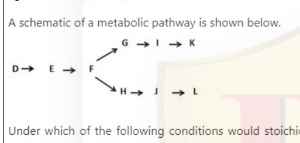

Under which of the following conditions would stoichiometric amounts of end products K and L be obtained if a concerted feedback inhibition mechanism were in operation?

1. K inhibits F→G and L inhibits F→H; D→E is inhibited at equal amounts of K and L
2. D→E is inhibited at equal amounts of K and L; K inhibits F→H and L inhibits F→G
3. D→E is inhibited at equal amount of G and H; K inhibits F→H and L inhibits F→G
4. K inhibits F→H and L inhibits F→G

**Answer: 1 (K inhibits F→G and L inhibits F→H; D→E is inhibited at equal amounts of K and L)**

> **Explanation:** Concerted feedback inhibition requires each end product to inhibit its own branch point (K blocks F→G, L blocks F→H) while the common step D→E is inhibited only when both K and L accumulate together in equal amounts, splitting flux equally to give stoichiometric K and L.

---

### Question 72

The following statements are being made to define the Michaelis constant (K_M). It is:

A. Independent of enzyme concentration [E] and substrate concentration [S]
B. Equal to the dissociation constant when the [ES] complex dissociates more rapidly than product formation
C. Equal to the dissociation constant when product formation is more rapid than [ES] complex dissociation
D. An intrinsic property of an enzyme and does not depend on pH, temperature and ionic strength

Which one of the following combination of statements is correct?

1. A and B only
2. A, B and D only
3. C and D only
4. A and D only

**Answer: 1 (A and B only)**

> **Explanation:** Km is independent of [E] and [S] (A true), and under the rapid-equilibrium assumption (k_off ≫ k_cat, i.e. [ES] dissociates faster than product forms) it equals the dissociation constant (B true). It is not equal to Kd when catalysis is faster (C false) and it does depend on pH, temperature and ionic strength (D false).

---

### Question 73

The table below lists the biochemical characteristics of proteins and experimental procedures used to determine them. Match the characteristics with the experimental procedure.

| List I (Biochemical Characteristics) | List II (Experimental Procedure) |
|---|---|
| A. 3-dimensional structure | I. Nuclear magnetic resonance |
| B. Ionic Charge | II. Isoelectric focusing |
| C. Binding specificity | III. Affinity Chromatography |
| D. Molecular Size | IV. Ultracentrifugation |

Which one of the following matches is correct ?

1. A - III, B - I, C - II, D - IV
2. A - I, B - II, C - III, D - IV
3. A - II, B - I, C - III, D - IV
4. A - IV, B - II, C - I, D - III

**Answer: 2 (A - I, B - II, C - III, D - IV)**

> **Explanation:** NMR gives 3-D structure; isoelectric focusing resolves by ionic charge; affinity chromatography exploits binding specificity; ultracentrifugation measures molecular size.

---

### Question 74

A circular dichroism spectrum in the far-UV region informs on the kind and content of secondary structures in a protein. Near-UV and tryptophan emission spectra inform on the tertiary structure. Shown in the panels above are (A) Intrinsic fluorescence emission spectra of protein 'X', (B) Far-UV CD spectra of protein 'X', (C) Near-UV CD spectra of protein 'X' recorded under different conditions.

Curves represent the spectra of protein 'X' at pH 7.0 (black), pH 3.0 (green), and pH 7.0 in the presence of 6.0 M guanidine hydrochloride (red).

What does the experiment report?

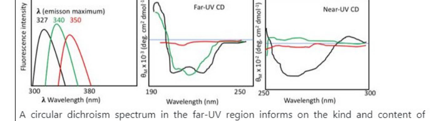

1. Protein is fully folded at pH 7.0, acid-induced molten globule at pH 3.0 and unfolded in 6M guanidine hydrochloride.
2. Protein secondary structure is reduced at pH 7.0 and the protein has formed beta fibrils at the other two conditions.
3. The changes in fluorescence and near-UV CD indicate increase in hydrodynamic radius at pH 3.0 and in 6M guanidine hydrochloride.
4. There is extensive denaturation of the protein both at pH 3.0 and in 6M guanidine hydrochloride.

**Answer: 1 (Protein is fully folded at pH 7.0, acid-induced molten globule at pH 3.0 and unfolded in 6M guanidine hydrochloride.)**

> **Explanation:** At pH 7.0 (black) all spectra show a native fold; at pH 3.0 (green) secondary structure is largely retained while tertiary signal is lost and fluorescence shifts — the acid-induced molten globule; 6 M GdnHCl (red) destroys both secondary and tertiary structure (unfolded).

---

### Question 75

The pI of four proteins (A, B, C, D) are shown in the table below:

| Protein | pI |
|---|---|
| A | 4 |
| B | 5.5 |
| C | 7 |
| D | 9 |

To purify 'D' from a mixture of these four proteins in a single step, using ion-exchange chromatography, what combination of buffer pH and ion-exchange resin would you select?

1. pH 11, cation exchanger resin
2. pH 2, anion exchanger resin
3. pH 6, anion exchanger resin
4. pH 8, cation exchanger resin

**Answer: 4 (pH 8, cation exchanger resin)**

> **Explanation:** At pH 8, protein D (pI 9) is positively charged and binds a cation exchanger, while A (4), B (5.5) and C (7) are neutral/negatively charged and do not bind — a single-step purification of D.

---

### Question 76

The curve B in the figure below shows the oxygen dissociation profile at physiological concentration of CO₂ and at pH 7.

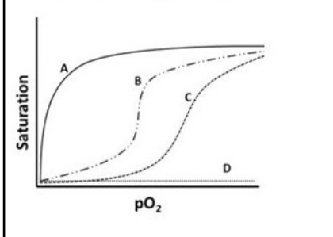

An increase in pH would lead to oxygen dissociation profile indicated by:

1. curve B (no change in the dissociation profile)
2. curve A
3. curve C
4. curve D

**Answer: 2 (curve A)**

> **Explanation:** Raising pH (lower [H⁺]) produces a left-shifted Bohr curve — higher affinity — approaching the hyperbolic-like curve A.

---

### Question 77

Following statements were made about chromosome cohesion during mitosis and meiosis.

A. Though cohesin is important for pairwise alignment of the chromosomes on the mitotic spindle, it is not important for the generation of tension across the centromere.
B. Cohesin binds to the chromosome even before the initiation of S-phase.
C. In fission yeast, centromere specific localization of Moa1 and Rec8 regulates the orientation of kinetochores at meiosis-I.
D. Cohesin exhibits uniform distribution/localization pattern across the chromosomal length.
E. Polo/Cdc5 is a positive regulator of Separase, an endopeptidase that facilitates opening of the cohesin ring.

Which one of the following combination contains all correct statments ?

1. A, B and D only
2. A, C and E only
3. B, C and D only
4. B, C and E only

**Answer: 4 (B, C and E only)**

> **Explanation:** Cohesin loads before S-phase (B), Moa1/Rec8 regulate meiotic-I kinetochore orientation (C), and Polo/Cdc5 activates separase (E). Cohesin does generate centromeric tension (A false) and its distribution is non-uniform, enriched at centromeres (D false).

---

### Question 78

Which one of the following is valid with respect to, one step growth experiment developed by Ellis and Delbruck in 1939?

1. The reproduction of large phage population is synchronized.
2. A culture is directly developed by inoculation of single bacterial colony from the agar plate into liquid medium.
3. Involves only a single step of overnight culture development followed by inoculation of a fresh medium with 1% inoculum.
4. Only a single carbon source such as glucose is used in the medium.

**Answer: 1 (The reproduction of large phage population is synchronized.)**

> **Explanation:** The one-step growth experiment synchronises infection (high MOI plus adsorption) so that all cells release progeny phage simultaneously, allowing latent/burst-size measurement.

---

### Question 79

Given below are a few statements about nuclear transport.

A. RanGTP levels are higher in the nucleus than the cytoplasm.
B. Nuclear import receptors can shuttle between the nucleus and cytoplasm.
C. NTF2 transports RanGDP into the cytosol.
D. Export of mRNA is not directly dependent on Ran.
E. tRNA and miRNA export is mediated by exportins.

Which one of the following combination contains all correct statments ?

1. A, B, C, D only
2. B, C, D only
3. A, B, D, E only
4. A, C, E only

**Answer: 3 (A, B, D, E only)**

> **Explanation:** RanGTP is nuclear (A), import receptors recycle (B), mRNA export is Ran-independent (D), and tRNA/miRNA use exportins (E). NTF2 mediates import of RanGDP into the nucleus, not export to the cytosol (C false).

---

### Question 80

During cytokinesis, a small GTPase, RhoA, localizes to the equatorial membrane above the spindle midzone. The localization/activity of RhoA is potentially modulated by:

A. RhoGEF Ect2
B. Aurora B kinase
C. PLK1 kinase
D. MKLP1 kinesin
E. ATM and ATR

Which one of the following combination contains all correct statments ?

1. A, B and D only
2. A, B,C and D only
3. B, C,D and E only
4. A, C and D only

**Answer: 2 (A, B,C and D only)**

> **Explanation:** The Ect2–MKLP1 (central spindle) module loads RhoA at the equatorial membrane, with Aurora B and PLK1 phosphorylating regulators of RhoA; the DNA-damage kinases ATM/ATR (E) are not part of this pathway.

---

### Question 81

Cellular actin levels can be as high as 100-400 μM. Of this, unpolymerized actin concentration can be as much as 50-200 μM. However, the critical concentration for actin polymerization in-vitro is about 0.2 μM. Some of the following proteins inhibit polymerization of actin in cells.

A. Thymosin −β₄
B. Capping protein CapZ
C. Tropomodulin
D. XMAP215

Which one of the following options lists all inhibitors?

1. A, B and C only
2. B, C and D only
3. C, D and A only
4. D, A and B only

**Answer: 1 (A, B and C only)**

> **Explanation:** Thymosin-β4 sequesters G-actin, CapZ caps plus ends and tropomodulin caps minus ends — all inhibit actin polymerization. XMAP215 is a microtubule +end polymerase, not an actin regulator.

---

### Question 82

To delineate the steps in endoplasmic reticulum (ER) transport, a PhD student homogenized pancreatic acinar cells to isolate microsomes, which retain most of the biochemical properties of the ER. For this experiment, the student has planned a number of controls as mentioned below.

A. Treat one set of microsomes first with detergent and then with protease.
B. Treat one set of microsomes with protease only.
C. Treat one set of microsomes with micrococcal nuclease.
D. Treat one set of microsomes with detergent only.

Select the option that represents the best combination of the controls.

1. A, B and D only
2. B, C and D only
3. A and C only
4. B and D only

**Answer: 1 (A, B and D only)**

> **Explanation:** Protease-only (B) tests topology of exposed luminal/membrane proteins; detergent-then-protease (A) releases lumenal contents for complete digestion; detergent-only (D) controls for membrane disruption. Micrococcal nuclease (C) is not needed for this protease-protection assay.

---

### Question 83

Following statements were made about imprinting in the human genome.

A. Imprinting control centre (IC) harbors part of the SNRPN gene.
B. Imprinting of genes in an individual cannot be tissue specific.
C. Sperms and eggs exhibit identical pattern of genome methylation, except in the sex chromosomes.
D. At imprinted loci, expression depends on the parental origin.

Select the option with all the correct statements.

1. A and D
2. B and D
3. A and C
4. B and C

**Answer: 1 (A and D)**

> **Explanation:** The Prader-Willi/Angelman IC lies within SNRPN (A) and imprinted expression is parental-origin dependent (D). Imprints differ between sperm and egg (C false) and imprinting effects can be tissue-specific (B false).

---

### Question 84

Mitochondrial protein synthesis is of prokaryotic origin. Following statements are being made about the ribosomes from bacteria and mitochondria:

A. The bacterial ribosome consists of small and large subunits of 30S and 50S respectively, whereas in mitochondria of mammals these subunits are of 28S and 39S
B. In the bacterial ribosomes the RNA: protein ratio is about 2:1 whereas in mitochondria ribosomes this ratio is usually 1:2
C. Both the bacterial and mitochondrial ribosomes consist of 30S and 50S subunits
D. Both the bacterial and mitochondrial ribosomes consist of RNA and protein in the ratio of 1:1

Choose the option that represents all correct statments.

1. A and B only
2. B and C only
3. C and D only
4. A and D only

**Answer: 1 (A and B only)**

> **Explanation:** Mammalian mitoribosomes are 28S/39S (A) and are protein-rich (RNA:protein ≈ 1:2) whereas bacteria are RNA-rich ≈2:1 (B). C and D wrongly assert identical subunits/ratios.

---

### Question 85

Given below are a few statements about the λ infection cycle

A. Competition between cI and cII gene products determines the establishment of lysogeny versus lysis.
B. cI binds O_R1 first while cro binds to O_R3 first
C. Cro binding to O_R represses cI transcription
D. Rich medium favours lytic cycle because cII is protected from cellular proteases

Which one of the following options represents all correct statements?

1. B and C
2. A and B
3. C and D
4. A and C

**Answer: 1 (B and C)**

> **Explanation:** cI represses from O_R1/O_R2 and Cro binds O_R3 first, and Cro binding represses cI (promoter PRM) — B and C are correct. The lysogeny/lysis decision is cI vs Cro (not cII competition as stated in A), and rich medium favours lysis because cII is degraded by host proteases (FtsH/Hfl), the opposite of D.

---

### Question 86

Reproduction of φ×174, a single stranded DNA phage involves several steps. A few statements are given below to explain the mechanism.

A. The single stranded φ×174 DNA is converted into a double- stranded replicative form (RF)
B. Replication of double stranded replicative form results in the production of single stranded phages, about 50% of which are +ve sense phages and the remaining are –ve sense phages
C. Replication of the double stranded replicative form results in the production of only –ve sense phages
D. Replication of the double stranded replicative form results in the production of only +ve sense phages

Choose the option that correctly describes the process

1. A only
2. A and B
3. A and C
4. A and D

**Answer: 4 (A and D)**

> **Explanation:** The infecting (+) ssDNA is copied to a double-stranded RF (A), and rolling replication from the RF produces progeny of only the (+) sense strand (D).

---

### Question 87

Which one of the following schematics depicts the potential relationship among the subunits IIo, IIa, and IIb of RNA polymerase II?

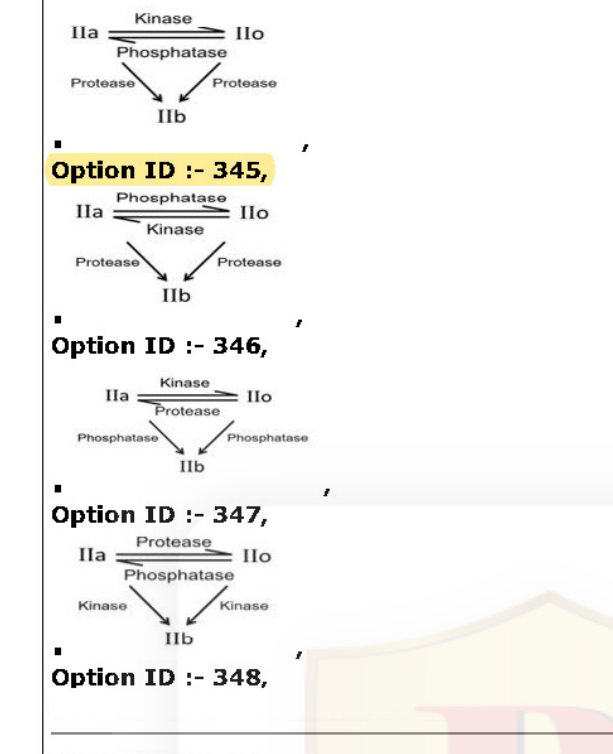

1. (Option diagram 1: IIa ⇄(Kinase/Phosphatase) IIo; both →(Protease) IIb)
2. (Option diagram 2)
3. (Option diagram 3)
4. (Option diagram 4)

**Answer: 1 (first schematic)**

> **Explanation:** The largest subunit exists unphosphorylated (IIo) and hyperphosphorylated (IIa) forms interconverted by kinase/phosphatase, and limited proteolysis of either yields the stable C-terminal fragment IIb — as shown in the first schematic.

---

### Question 88

DNA replication occurs in S phase. The entry of cells into S phase is regulated by the tumor suppressor protein Rb. The statements below are made with reference to the role of Rb.

A. Rb binds to E2F in the cytosol and prevents E2F entry into the nucleus.
B. Rb is phosphorylated by cyclin A/ cdk 4.
C. Phospho Rb activates E2F.
D. E2F activates cyclin E production which promotes the G1/S transition.

Which one of the following options represents all correct statements ?

1. A, B and C only
2. B, C and D only
3. A, C and D only
4. C and D only

**Answer: 3 and 4 (the NTA Final Key accepted BOTH "A, C and D only" (Option ID 351) and "C and D only" (Option ID 352) — marks to all correct options)**

> **Explanation:** Phospho-Rb releases/activates E2F (C) and E2F drives cyclin E for G1/S (D) are certainly correct; A (cytosolic sequestration of E2F by Rb) was contested, and NTA credited both option 3 and option 4.

---

### Question 89

The following statements are made with reference to DNA replication:

A. Camptothecin causes intra- strand and inter- strand crosslinks in DNA, leading to stalling of replication forks.
B. Prevention of reinitiation of DNA replication during the same cell cycle is mediated by regulating the loading of the initiator complex ORC.
C. A glu → ala mutation in the nucleotide building pocket of DNA polymerase III could lead to the incorporation of ribonucleotides in the extending DNA chain.
D. A mutation in the gene encoding Topoisomerase II could lead to entanglement of DNA daughter strands during replication.

Which one of the following options represents all correct statements ?

1. A and B only
2. B and C only
3. C and D only
4. B, C and D only

**Answer: 3 (C and D only)**

> **Explanation:** Camptothecin inhibits topoisomerase I (it does not create crosslinks — A false); re-replication is prevented by controlling re-licensing (preRC/ORC loading) — but the key treats B as worded incorrectly; the steric-gate glu→ala mutation permits ribonucleotide incorporation (C) and topo II loss tangles daughter strands (D).

---

### Question 90

The population that is at highest risk against influenza infection should be immunized annually. Which one of the following is the most important reason for this?

1. Influenza virus can change its surface antigen very frequently.
2. Influenza virus has a very short incubation period.
3. Influenza virus has a reasonably longer incubation period giving memory B cells time to respond by producing high levels of serum antibody.
4. Repeated immunization interferes with the differentiation of plasma cells from memory cells thereby decreasing levels of neutralizing antibody.

**Answer: 2 (Influenza virus has a very short incubation period.)**

> **Explanation:** The NTA Final Key marks Option ID 358 ("very short incubation period") as correct: with an incubation period shorter than the recall-response time, protection can only be maintained by annual immunization.

---

### Question 91

Localized increases in the cytosolic level of free Ca²⁺ are critical to its function as second messenger. Calmodulin, a small cytosolic protein, mediates many cellular effects of Ca²⁺. Which of the following is NOT CORRECT for Ca²⁺-calmodulin interaction?

1. Each calmodulin molecule binds six Ca²⁺ ions in a cooperative fashion.
2. Binding of Ca²⁺ causes calmodulin to undergo a conformational change leading to active calmodulin.
3. Since binding of Ca²⁺ is cooperative, a small change in the level of cytosolic Ca²⁺ leads to a large change in the level of active calmodulin.
4. One of the many enzymes activated by Ca²⁺- calmodulin is cAMP phosphodiesterase, which degrades cAMP and links Ca²⁺ and cAMP signaling.

**Answer: 1 (Each calmodulin molecule binds six Ca²⁺ ions in a cooperative fashion.)**

> **Explanation:** Calmodulin has four EF-hand Ca²⁺-binding sites, not six — statement 1 is the incorrect one; 2–4 are true properties.

---

### Question 92

Some cellular and extracellular proteins are enlisted in List I and their typical characteristics are enlisted in List II

| List I | List II |
|---|---|
| A. Nidogen | I. In human genome, one gene of this protein is present but many different isoforms are there due to alternative splicing |
| B. Fibronectin | II. An intermediate filament protein that is typically expressed in epithelial and mesenchymal cells |
| C. Integrin | III. One of the principal structural proteins of basal laminae. |
| D. Vimentin | IV. Heterodimer of α and β subunit and binds to extracellular matrix proteins. |

Which one of the following is the most appropriate match ?

1. A - I, B - II, C - III, D - IV
2. A - II, B - III, C - IV, D - I
3. A - III, B - I, C - IV, D - II
4. A - II, B - IV, C - I, D - III

**Answer: 3 (A - III, B - I, C - IV, D - II)**

> **Explanation:** Nidogen is a basal-lamina structural protein (III); fibronectin arises from one gene with many splice isoforms (I); integrins are α/β heterodimeric ECM receptors (IV); vimentin is the mesenchymal/epithelial intermediate filament (II).

---

### Question 93

Following statements have been proposed for cancer cells and cancer stem cells:

A. Cancer cells mostly have mutations whereas cancer stem cells do not.
B. Cancer cells divide to form two different populations of cells whereas cancer stem cells do not divide.
C. Cancer stem cells can undergo self-renewal whereas cancer cells cannot.
D. Cancer cells are predominantly resistant to chemotherapy and radiation.
E. Cancer stem cells are found only in the bone marrow and placenta.

Which one of the following combination of statements is correct ?

1. A and C
2. A and B
3. C and E
4. C and D

**Answer: 1 (A and C)**

> **Explanation:** Per the NTA key, statements A and C are taken as the correct combination: cancer stem cells are defined by self-renewal (C) and the key treats the bulk-cancer-cell mutation statement (A) as acceptable, while B, D and E are plainly false.

---

### Question 94

Which of the following is/are associated with the presentation of endogenous antigens by Class I MHC molecule by an Antigen Presenting Cell (APC), given the condition that there is no cross-presentation of antigens by the APC?

1. TAP1 and TAP2 proteins only
2. Invariant chain (Ii)
3. Proteosome-like subunits LMP2 and LMP7 only
4. TAP1, TAP2 proteins and proteosome-like subunits LMP2, LMP7

**Answer: 4 (TAP1, TAP2 proteins and proteosome-like subunits LMP2, LMP7)**

> **Explanation:** Endogenous class I presentation needs proteasomal generation of peptides (including the immunoproteasome subunits LMP2/LMP7) and TAP1/TAP2 transport into the ER; the invariant chain (Ii) belongs to the class II pathway.

---

### Question 95

Which one of the following statements is NOT correct regarding the tetrapod limb development?

1. As the limb grows outward, the stylopod forms first, then the zeugopod and the autopod is formed last. Each phase is characterized by a specific pattern of Hox gene expression.
2. The zone of polarizing activity (ZPA) is maintained by the interaction of the FGFs from the AER and Shh expressed from the mesenchyme.
3. Although cell death in the limb is necessary for the formation of digits and joints, it is never mediated by the BMPs, which is only responsible for differentiating mesenchyme cells into cartilage.
4. The dorsal-ventral axis is formed in part by the expression of Wnt7a in the dorsal portion of the limb ectoderm, which maintains expression level of Shh in the ZPA and Fgf4 in the posterior AER.

**Answer: 3 (Although cell death in the limb is necessary for the formation of digits and joints, it is never mediated by the BMPs, which is only responsible for differentiating mesenchyme cells into cartilage.)**

> **Explanation:** Interdigital apoptosis IS BMP-mediated (BMPs drive the cell death that sculpts digits), so statement 3 is the incorrect one.

---

### Question 96

The Dorsal protein is involved in generating the dorsal-ventral (DV) polarity in Drosophila. The following statements were made regarding the activity of the Dorsal protein in establishing the DV polarity.

A. In embryos that lack Gurken protein, the Dorsal protein is not translocated to the nucleus of the follicle cells which then causes ventralization of the embryo
B. Though Dorsal protein acts as a morphogen, it is found throughout the syncytial blastoderm of the early Drosophila embryo.
C. In embryos that lack Cactus protein the Dorsal protein can be found in the nucleus of cells with a ventral fate.
D. If the Dorsal protein is blocked from entering the nucleus, the genes responsible for specifying dorsal cell types are not transcribed.

Which of the above statements are correct ?

1. A and B
2. B and C
3. C and D
4. A and C

**Answer: 2 (B and C)**

> **Explanation:** Dorsal protein is uniformly distributed in the syncytial blastoderm but becomes a nuclear gradient (B true); loss of Cactus (IκB-like) lets Dorsal enter all nuclei including dorsal-fated ones (C true). Lack of Gurken dorsalises (not ventralises) — A false; blocking nuclear entry dorsalises, so the genes affected are ventral-specific — D false as worded.

---

### Question 97

Following are certain statements regarding root growth and differentiation in plants:

A. Root hair, endodermis, xylem and phloem reach maturation in elongation zone of a developing root.
B. The root epidermal cells that are incapable of forming root hairs are called atrichoblasts.
C. Quiescent center is present just above root cap.
D. In Arabidopsis, an auxin transporter (ABCB4) plays a role in root hair emergence by maintaining intracellular auxin concentration.

Which one of the following combination of statements is correct ?

1. A, B and C
2. B, C and D
3. A, C and D
4. A, B and D

**Answer: 2 (B, C and D)**

> **Explanation:** Atrichoblasts are the non-hair epidermal cells (B), the quiescent centre sits just above the cap (C) and ABCB4 auxin transport is implicated in root-hair emergence (D). Root hair/xylem maturation occurs in the maturation (not elongation) zone — A false.

---

### Question 98

Match the terms used in vertebrate limb development in List I with their descriptions in List II:

| List I | List II |
|---|---|
| A. EMT | I. The cells found within the most posterior region of the limb bud |
| B. Mesenchyme | II. The thickening of ectoderm at the apex of the developing limb |
| C. AER | III. A loosely organized, mainly mesodermal embryonic tissue |
| D. Progress zone | IV. Epithelial cells making up the mesoderm of the early somatopleure undergo this transition and get included in mesenchyme cell pool |
| E. ZPA | V. The proliferative mesenchyme that fuels limb bud growth |
| F. Autopod | VI. The distal part of tetrapod limb |

Which one of the following combination of the statements is correct?

1. A - IV, B - III, C - II, D - V, E - I, F - VI
2. A - I, B - II, C - III, D - IV, E - V, F - VI
3. A - V, B - IV, C - II, D - VI, E - III, F - I
4. A - II, B - V, C - I, D - III, E - IV, F - VI

**Answer: 1 (A - IV, B - III, C - II, D - V, E - I, F - VI)**

> **Explanation:** EMT = epithelial→mesenchyme transition (IV); mesenchyme = loose embryonic tissue (III); AER = apical ectodermal thickening (II); progress zone = proliferative mesenchyme (V); ZPA = posterior cells (I); autopod = distal limb (VI).

---

### Question 99

Given below are some of the statements in connection with neural tube formation in vertebrates:

A. In primary neurulation the cells surrounding the neural plate direct the neural plate cells to proliferate, invaginate and separate from the surface ectoderm to form an underlying hollow tube.
B. In secondary neurulation the neural tube arises from the aggregation of mesenchyme cells into a solid cord that subsequently forms cavities to create a hollow tube
C. In birds primary neurulation generates the neural tube from anterior up to the hind limb developing region
D. In mammals, secondary neurulation begins at the level of sacral vertebrae
E. Anencephaly results when a failure to close the neural tube occurs, resulting in the forebrain remaining in contact with amniotic fluid.

Which one of the following options gives all correct statements?

1. A, B, C, D and E
2. A only
3. B and E only
4. C, D and E only

**Answer: 1 (A, B, C, D and E)**

> **Explanation:** All five statements correctly describe primary/secondary neurulation and the anencephaly defect.

---

### Question 100

Following are certain statements regarding tracheary elements of vascular plants

A. Xylem tracheids are highly elongated tapered cells that conduct water
B. Xylem vessel elements are less elongated and narrower than tracheids
C. Angiosperms may have both tracheids and vessel elements
D. Vessel elements are the only tracheary elements in almost all gymnosperms

Which one of the following options represents the combination of correct statements ?

1. A, B and C only
2. A and C only
3. B and C only
4. B and D only

**Answer: 2 (A and C only)**

> **Explanation:** Tracheids are the elongated tapered water-conducting cells (A) and angiosperms can have both tracheids and vessels (C). Vessel elements are wider (not narrower) than tracheids (B false), and gymnosperms have essentially only tracheids, not vessels (D false).

---

### Question 101

Following are certain statements regarding phytochrome interacting factors (PIFs), a family of proteins that regulates photomorphogenic response in plants:

A. PIFs promote skotomorphogenesis by serving as transcriptional activators of dark induced genes.
B. PIFs on interaction with P_r get phosphorylated, followed by degradation via the proteasome complex.
C. The degradation of PIFs takes place in the presence of light.
D. PIF-induced genes are not expressed in light.

Which one of the following options represents the combination of correct statements ?

1. A, B and C
2. A, C and D
3. A, B and D
4. B, C and D

**Answer: 2 (A, C and D)**

> **Explanation:** PIFs drive skotomorphogenesis/dark-gene transcription (A); light triggers their proteasomal degradation (C), so PIF-induced genes go off in light (D). B is wrong because PIFs interact with the active P_fr form, not P_r.

---

### Question 102

The phytohormones ethylene (ET), methyl jasmonate (MeJA) and salicylic acid (SA) play important roles in plant defense. The following statements were made regarding induction of defensin PDF1.2 and pathogenesis related protein PR1:

A. ET/MeJA activates PDF1.2
B. ET/MeJA activates PR-1
C. SA activates PDF1.2
D. SA activates PR-1

Which one of the following options represents the combination of correct statements ?

1. A and B
2. A and D
3. B and C
4. C and D

**Answer: 2 (A and D)**

> **Explanation:** PDF1.2 is the classic JA/ethylene-induced marker, while PR1 is the salicylic-acid-induced marker.

---

### Question 103

A researcher has obtained an Arabidopsis mutant defective in strigolactones (SLs), a novel plant hormone. The following statements were made regarding the mutant phenotype:

A. Shoot branching gets enhanced in the mutant plant
B. Hyphal branching of arbuscular mycorrhizal fungi (AM-fungi) gets enhanced during colonization in the mutant plants
C. Shoot branching gets inhibited in the mutant plants
D. Germination of seeds of parasitic plant is prevented near the mutant plant

Which one of the following options represents the combination of correct statements ?

1. A and B
2. B and C
3. B and D
4. A and D

**Answer: 4 (A and D)**

> **Explanation:** SLs suppress shoot branching, so an SL-defective mutant branches more (A); and since root-exuded SLs stimulate parasitic-plant seed germination, the mutant fails to trigger it (D). SL deficiency reduces (not enhances) AM fungal branching (B false); C is the opposite of A.

---

### Question 104

During light reaction in photosynthesis, electron is transported in electron transport chain (ETC) and produces ATP and NADPH in the process. Following are certain statements regarding ETC during light reaction:

A. Electron from P680 moves first to quinone and then to the pheophytin
B. P700 can receive electrons from plastocyanin
C. NADPH is produced at the end of light reaction
D. The hydrogen ions produced during light reaction gets concentrated in thylakoid lumen

Choose the correct answer from the options given below:

1. A, B and C
2. A, B and D
3. A, C and D
4. B, C and D

**Answer: 4 (B, C and D)**

> **Explanation:** From P680 the electron passes first to pheophytin then to quinone — A reverses the order. PC donates to P700 (B), NADPH is the terminal product (C), and photolysis/ETC pump H⁺ into the lumen (D).

---

### Question 105

Given below are various plant natural products and their basic structural unit:

| List I (Natural products) | List II (Basic unit) |
|---|---|
| A. Phenolics | I. Five-carbon isoprene unit |
| B. Alkaloids | II. Glucose unit attached by O-β-D-glucosyl linkage |
| C. Terpenoids | III. Nitrogen containing |
| D. Cyanogenic glycoside | IV. Aromatic arene ring with OH group |

Which of the following options represents the correct match of natural product and the basic unit:

1. A - IV, B - I, C - III, D - II
2. A - III, B - II, C - I, D - IV
3. A - III, B - I, C - IV, D - II
4. A - IV, B - III, C - I, D - II

**Answer: 4 (A - IV, B - III, C - I, D - II)**

> **Explanation:** Phenolics = aromatic ring with OH (IV); alkaloids = nitrogen-containing (III); terpenoids = isoprene (C5) units (I); cyanogenic glycosides = glucose linked by O-β-D-glucosyl bond (II).

---

### Question 106

The mechanisms of thermogenesis in brown adipose tissue (BAT) in cold are described in the following proposed statements:

A. A thermogenic uncoupling protein, UCP1 helps in the heat production in BAT
B. Norepinephrine secretion from sympathetic nerve endings in BAT is decreased
C. Lipolysis is increased by low level of norepinephrine in BAT
D. A high content of mitochondria in BAT helps in the oxidation of fatty acids
E. Oxidation produces much heat as ATP synthase activity is low

Which one of the following options represents the combination of correct statements ?

1. A, B and C
2. A, D and E
3. B, C and D
4. B, D and E

**Answer: 2 (A, D and E)**

> **Explanation:** Cold increases (not decreases) sympathetic norepinephrine release, so B and C are wrong. UCP1 uncouples to produce heat (A), abundant mitochondria oxidise fatty acids (D) and, with ATP synthase bypassed, oxidation yields heat (E).

---

### Question 107

The pressure in the 'space' between lungs and chest wall is known as intrapleural pressure. The following statements are related to the intrapleural pressure at different phases of respiration:

A. At the end of quiet expiration the tendency of the lung to recoil from chest wall is balanced by the recoil of chest wall in opposite direction, and intrapleural pressure is subatmospheric.
B. At the start of inspiration the intrapleural pressure is subatmospheric.
C. The intrapleural pressure becomes more negative during inspiration.
D. The intrapleural pressure attains value above atmospheric pressure during expiration.
E. The intrapleural pressure becomes positive (relative to atmospheric pressure) during strong inspiratory efforts.

Which one of the following combinations is correct ?

1. A, B and C
2. B, C and D
3. C, D and E
4. A, C and D

**Answer: 1 (A, B and C)**

> **Explanation:** Intrapleural pressure stays subatmospheric during quiet breathing and becomes more negative on inspiration (A, B, C). It rises above atmospheric only during forced expiration (D as stated for ordinary expiration is wrong), and strong inspiratory efforts make it more negative, not positive (E wrong).

---

### Question 108

Hemoglobin (Hb) transports CO₂ in venous blood as carbamates. The following statements refer to the formation of these carbamates:

A. CO₂ interacts with amino terminal nitrogens of Hb polypeptide chains
B. CO₂ interacts with carboxyl terminal carbons of Hb polypeptide chains
C. Carbamates helps formation of salt bridges between α and β chains of Hb
D. Carbamates helps formation of disulfide bridges between α and β chains of Hb

Which one of the following options is a combination of correct statements ?

1. A and C
2. B and D
3. B and C
4. A and D

**Answer: 1 (A and C)**

> **Explanation:** CO₂ reacts with the uncharged α-amino termini to form carbamates (A), and the added negative charges stabilise salt bridges favouring the T state (C).

---

### Question 109

Following statements are given for the ovarian hormones:

A. 17 β -estradiol, estrone and estriol are naturally occurring estrogens
B. They are 18 C steroids which do not have methyl group at 10th positions
C. They are 21 C steroids which have methyl group at 10th position
D. They are primarily synthesized by granulosa cells of the ovarian follicles
E. Their biosynthesis does not depend on the enzyme aromatase

Which one of the following options represents the combination of correct statements ?

1. A, B and C
2. A, B and D
3. B, C and D
4. C, D and E

**Answer: 2 (A, B and D)**

> **Explanation:** Estrogens are C18 steroids lacking the C10 methyl (A, B) and are made by follicular granulosa cells (D). They are not C21 (C false) and their synthesis absolutely requires aromatase (E false).

---

### Question 110

Below are given a set of statements for the glucocorticoid hormones:

A. They bind to cell surface receptors and influence stress adaptation
B. They bind to intracellular receptors and influence stress adaptation
C. They inhibit ACTH secretion from anterior pituitary
D. Prolonged treatment with glucocorticoids leads to atrophic and unresponsive adrenals
E. Their secretion does not show circadian variations

Which one of the following combination of the statements is correct?

1. A, C and E
2. B, C and D
3. C, D and E
4. A, D and E

**Answer: 2 (B, C and D)**

> **Explanation:** Glucocorticoids act through intracellular (nuclear) receptors (B), feedback-inhibit ACTH (C), and prolonged use atrophies the adrenals (D). They are not cell-surface-receptor hormones (A) and their secretion shows clear circadian rhythm (E false).

---

### Question 111

The pedigree given below represents the genotype at four different loci for the children in generation III.

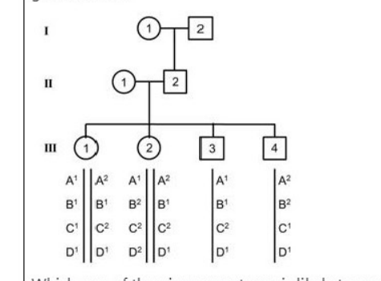

Which one of the given genotypes is likely to represent the genotype of individual II-1?

1. (A²|A² ; B¹|B¹ ; C²|C² ; D¹|D¹)
2. (A¹|A¹ ; B¹|B² ; C¹|C² ; D¹|D²)
3. (A¹|A² ; B¹|B² ; C¹|C² ; D¹|D²)
4. (A¹|A² ; B¹|B² ; C¹|C¹ ; D¹|D¹)

**Answer: 3 (option diagram with A¹|A² ; B¹|B² ; C¹|C² ; D¹|D²)**

> **Explanation:** The children of II-1 and II-2 collectively carry all four alleles at each locus; the mother II-1 must therefore be heterozygous at all four loci (A¹/A², B¹/B², C¹/C², D¹/D²) — the third genotype.

---

### Question 112

A Drosophila mutant (line A) with vestigial wings is isolated in a laboratory. The vestigial wing phenotype was observed to be recessive and mapped to gene 'X'. Three other laboratories also isolated vestigial mutants, called line B, C and D. In order to test if the mutation in lines B-D also mapped to gene 'X', the following crosses were made and phenotype of F1 progeny observed.

| Cross | F1 progeny (wing morphology) |
|---|---|
| A X B | Vestigial |
| A X C | Vestigial |
| A X D | Normal |
| B X C | Vestigial |
| B X D | Normal |
| C X D | Normal |

Based on the above identify the line(s) which is most likely NOT to have a mutation in gene 'X'.

1. Both lines B and C
2. Line C only
3. Line D only
4. Both lines B and D

**Answer: 3 (Line D only)**

> **Explanation:** A, B and C fail to complement each other (vestigial in all pairwise crosses) — they are alleles of the same gene X. D complements A, B and C, so D's mutation lies in a different gene.

---

### Question 113

P22 transduction was used to map the fadL gene. The result of two-factor crosses between fadL and two linked markers, purF and aroC are shown below.

| Donor | Recipient | Selected marker | Second marker | Numbers obtained |
|---|---|---|---|---|
| fadL purF+ | fadL+ purF | purF+ | fadL | 200 |
| | | | fadL+ | 800 |
| fadL aroC+ | fadL+ aroC | aroC+ | fadL | 400 |
| | | | fadL+ | 600 |
| aroC+ purF | aroC purF+ | aroC+ | purF | 500 |
| | | | purF+ | 500 |

Which one of the following is the correct map for the three genes?

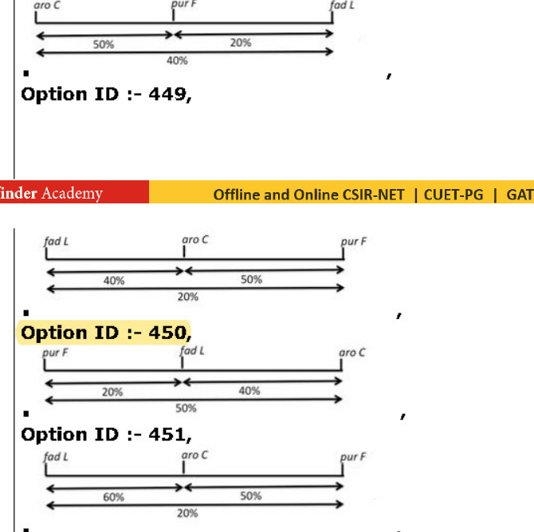

1. (Map 1: aroC —50%— purF —20%— fadL; total 40%)
2. (Map 2: fadL —40%— aroC —50%— purF; total 20%)
3. (Map 3: purF —20%— fadL —40%— aroC; total 50%)
4. (Map 4: fadL —60%— aroC —50%— purF; total 20%)

**Answer: 2 (second map: fadL — aroC — purF)**

> **Explanation:** Cotransformation frequencies: fadL–purF 800/1000, fadL–aroC 600/1000, aroC–purF 500/1000. The rarest double (aroC–purF, 50%) means they are the outer markers with fadL in between, giving the order fadL–aroC–purF as in the second map.

---

### Question 114

Wheat plants can have kernels of white colour or in shades of red i.e. light red, red, dark red and very dark red (purple). A researcher made the following cross:

| P | wheat plants with white kernels | X | wheat plants with purple (very dark red) kernels |
|---|---|---|---|
| F₁ | All plants with red kernels | | |
| F₂ | 1/16 | Plants with purple kernels | |
| | 4/16 | Plants with dark red kernels | |
| | 6/16 | Plants with red kernels | |
| | 4/16 | Plants with light red kernels | |
| | 1/16 | Plants with white kernels | |

The following conclusions are made from the results obtained:

A. It is a dihybrid cross where white colour is coded by gene A and the purple colour is coded by gene B
B. Two genes, both coding for the colour of kernel and each gene having two alleles, one that produced red pigment and the other that produced no pigment.
C. Four genes, one coding for no pigment, which is epistatic over the other genes. The remaining three genes have 2 alleles each, one that produced red pigment and the other that produced no pigment.
D. The trait is influenced by the environment leading to the observed variation in kernel colour.

Which of the above conclusion(s) is/are correct?

1. A only
2. B only
3. C only
4. C and D only

**Answer: 2 (B only)**

> **Explanation:** The 1:4:6:4:1 F₂ distribution is the classic two-gene additive (polygenic) kernel-colour ratio — two genes, each with a pigment-producing and a non-producing allele (B). It is not epistasis of four genes (C) nor environmental (D), and A misstates the gene action.

---

### Question 115

A group of transposable elements described as 'retroelements' encompass

1. P elements in Drosophila; LINES but not SINES in humans
2. Copia element in Drosophila; SINES but not LINES in humans
3. Copia element in Drosophila; LINES as well as SINES in human
4. P elements in Drosophila; LINES as well as SINES in human

**Answer: 3 (Copia element in Drosophila; LINES as well as SINES in human)**

> **Explanation:** Retroelements transpose via RNA intermediates: Drosophila copia elements and both human LINEs and SINEs are retrotransposons; P elements are DNA transposons.

---

### Question 116

Given below are two columns listing angiosperm families and their groups

| List I (Group) | List II (Family) |
|---|---|
| A. Basal angiosperms | I. Brassicaceae |
| B. Fabids | II. Cucurbitaceae |
| C. Malvids | III. Solanaceae |
| D. Lamids | IV. Nymphaeaceae |

Which one of the following option represents the correct match of the two columns ?

1. A - IV, B - II, C - I, D - III
2. A - IV, B - I, C - III, D - II
3. A - III, B - IV, C - II, D - I
4. A - II, B - III, C - I, D - IV

**Answer: 1 (A - IV, B - II, C - I, D - III)**

> **Explanation:** Nymphaeaceae are basal angiosperms (IV); Cucurbitaceae are fabids (II); Brassicaceae are malvids (I); Solanaceae are lamids (asterids) (III).

---

### Question 117

Given below are the names of diseases caused in rice in Column X and the names of the disease-causing organisms in Column Y.

| Column X | Column Y |
|---|---|
| A. Bacterial blight | I. Entyloma oryzae |
| B. Grain rot | II. Rhizoctonia solani |
| C. Sheath blight | III. Xanthomonas oryzae pv. oryzae |
| D. Leaf smut | IV. Sclerophthora macrospora |
| E. Downy mildew | V. Burkholderia glumac |

Which one of the following options represents the match of column X and Y ?

1. A - II, B - I, C - V, D - IV, E - III
2. A - III, B - IV, C - II, D - V, E - I
3. A - IV, B - III, C - I, D - II, E - V
4. A - III, B - V, C - II, D - I, E - IV

**Answer: 4 (A - III, B - V, C - II, D - I, E - IV)**

> **Explanation:** Bacterial blight = Xanthomonas oryzae pv. oryzae (III); grain rot = Burkholderia glumae (V); sheath blight = Rhizoctonia solani (II); leaf smut = Entyloma oryzae (I); downy mildew = Sclerophthora macrospora (IV).

---

### Question 118

The table given below lists the conservation areas and the major group of organisms that they are best known for.

| Column X (Conservation areas) | Column Y (Organisms) |
|---|---|
| A. Hemis National Park | I. Orchids |
| B. National Chambal Sanctuary | II. Gharial |
| C. Nokrek National Park | III. Nepenthes |
| D. Sessa Sanctuary | IV. Snow leopard |
| E. Baghmara wildlife sanctuary | V. Endemic citrus species |

Which one of the following options represents the correct match of column X and Y

1. A - I, B -II, C - III, D - IV, E - V
2. A - IV, B -II, C - V, D - I, E - III
3. A - III, B -I, C - V, D - II, E - IV
4. A - V, B -IV, C - III, D - II, E - I

**Answer: 2 (A - IV, B -II, C - V, D - I, E - III)**

> **Explanation:** Hemis is famous for snow leopards (IV), Chambal for gharials (II), Nokrek for the endemic citrus (V), Sessa for orchids (I) and Baghmara for Nepenthes pitcher plants (III).

---

### Question 119

The table given below lists the morphological features and groups of plants.

| List I (Plant group) | List II (Morphological characters) |
|---|---|
| A. Liverwort | I. Unicellular rhizoids |
| B. Moss | II. Multicellular rhizoids |
| | III. Presence of pyrenoids |
| | IV. Stomata on sporophyte |
| | V. Dominant gametophyte |

Which one of the followings options represents the correct match between the two columns?

1. A - I, III and V ; B - II, III, and V
2. A - I, III and IV ; B - II and IV
3. A - II and V ; B - I and III
4. A - I and V ; B - II, IV, and V

**Answer: 4 (A - I and V ; B - II, IV, and V)**

> **Explanation:** Liverworts have unicellular rhizoids and a dominant gametophyte (I, V); mosses have multicellular rhizoids, stomata on the sporophyte and a dominant gametophyte (II, IV, V). Pyrenoids are algal, not bryophyte, features.

---

### Question 120

The table given below lists types of extremophiles and the environments that they are adapted to.

| List I (Type of extremophile) | List II (Environment) |
|---|---|
| A. Psychrophile | I. High salinity |
| B. Hyperthermophile | II. High pressure |
| C. Alkaliphile | III. High alkaline environment |
| D. Hyperpiezophile | IV. Extreme high temperature |
| E. Halophile | V. Extreme cold temperatures |

Which one of the following options represents the correct match of the columns?

1. A - I, B - II, C - III, D - IV, E - V
2. A - V, B - II, C - III, D - IV, E - I
3. A - V, B - IV, C - III, D - II, E - I
4. A - V, B - II, C - IV, D - III, E - I

**Answer: 3 (A - V, B - IV, C - III, D - II, E - I)**

> **Explanation:** Psychrophiles = extreme cold (V); hyperthermophiles = extreme heat (IV); alkaliphiles = high pH (III); piezophiles = high pressure (II); halophiles = high salinity (I).

---

### Question 121

The table given below lists fossils and the major group of plants to which they belong.

| List I (Fossil) | List II (Plant group) |
|---|---|
| A. Naiadita lanceolata | I. Angiosperm |
| B. Rhynia gwyne-vaughanii | II. Pteridophyte |
| C. Antarticycas schopfii | III. Bryophyte |
| D. Tricolpites minutus | IV. Bryophyte |

Which one of the following options represents the correct match between columns ?

1. A - I, B -III, C - IV, D - II
2. A - III, B -II, C - IV, D - I
3. A - I, B -II, C - IV, D - III
4. A - II, B -III, C - I, D - IV

**Answer: This question was DROPPED by NTA in the Final Answer Key ("Marks to all who attempted"). No correct option is assigned.**

> **Explanation:** NTA dropped this question (master Question ID 151_553_LSCC__Q51, Option ID 482 marked "*"); every candidate who attempted it received marks.

---

### Question 122

The tables below show the bird species and their abundance in three habitats P, Q, and R.

| Habitat P (Species: Abundance) | Habitat Q | Habitat R |
|---|---|---|
| 1:120, 2:20, 3:5, 4:1, 5:1 | 1:20, 2:20, 3:20, 4:20, 5:20, 6:15, 7:15, 8:15 | 1:80, 2:25, 3:15, 4:10, 5:5, 6:3, 7:3, 8:3 |

Which one of the combinations below best represents the habitats in decreasing order of diversity?

1. P, R, Q
2. R, Q, P
3. R, P, Q
4. Q, R, P

**Answer: 4 (Q, R, P)**

> **Explanation:** Diversity combines richness and evenness: Q (8 species, perfectly even) > R (8 species, uneven) > P (5 species, dominated by one) — decreasing order Q, R, P.

---

### Question 123

The following are a few statements on shade leaves vis-à-vis sun leaves in tree species

A. Higher amount of chlorophyll per dry weight
B. Lower density of stomata
C. Thicker leaves
D. Lower rates of dark respiration per unit area

Which one of the following combinations of above statements is correct?

1. A and D
2. B and C
3. A, B and D
4. B and D

**Answer: 3 (A, B and D)**

> **Explanation:** Shade leaves have more chlorophyll per dry weight (A), fewer stomata (B) and lower dark respiration (D); they are thinner, not thicker (C false).

---

### Question 124

The diagram below depicts energy flow within a single trophic level, where I=amount ingested, NA= amount not assimilated, R=respiration, and Pn= biomass production at trophic level.

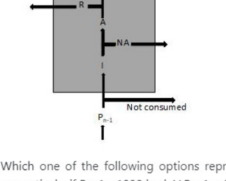

Which one of the following options represents correct values for Pn, NA, R and I in kcal respectively, if Pn-1 =1000 kcal, I/ Pn-1 = 20%, A/I = 35% and Pn/A= 20%?

1. 56, 14, 130, 200
2. 14, 130, 56, 200
3. 200, 130, 56, 14
4. 56, 130, 200, 14

**Answer: 2 (14, 130, 56, 200)**

> **Explanation:** I = 0.20 × 1000 = 200 kcal; A = 0.35 × 200 = 70, so NA = 200 − 70 = 130; Pn = 0.20 × 70 = 14; R = A − Pn = 56. For Pn, NA, R, I in that order: 14, 130, 56, 200 (Option ID 494, marked correct by the NTA Final Key).

---

### Question 125

The following graph shows the change in proportion of biomass in foliage (leaves), branch and stemwood (bole) for a tree species as a function of DBH (diameter at 1.5 m above ground)

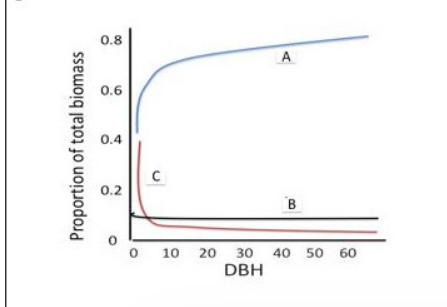

Which one of the following options correctly matches the curves (A, B, and C) with stemwood, foliage and branch, respectively?

1. A, B and C
2. A, C and B
3. B, C and A
4. B, A and C

**Answer: 2 (A, C and B)**

> **Explanation:** With increasing DBH stemwood dominates (curve A rising to ~0.8), foliage proportion falls sharply (C) and branches stay low and roughly constant (B).

---

### Question 126

The graphs given below show the possible behavior of two species over the course of succession.

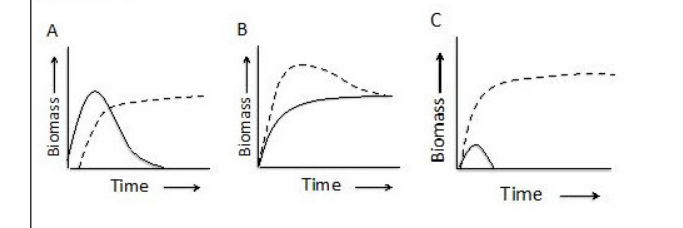

Possible effects observed during succession are:
i. Total suppression
ii. Convergence
iii. Sequential succession

Choose the correct option matching the graphs with the possible effect:

1. A-(i) B-(ii) C-(iii)
2. A-(ii) B-(iii) C-(i)
3. A-(iii) B-(ii) C-(i)
4. A-(iii) B-(i) C-(ii)

**Answer: 3 (A-(iii) B-(ii) C-(i))**

> **Explanation:** Graph A shows one species followed by the other (sequential succession, iii); B shows both converging to similar biomass (convergence, ii); C shows one species driven to zero (total suppression, i).

---

### Question 127

Consider the following graphs for per capita growth rate (1/N)(dN/dt) as a function of population density (N).

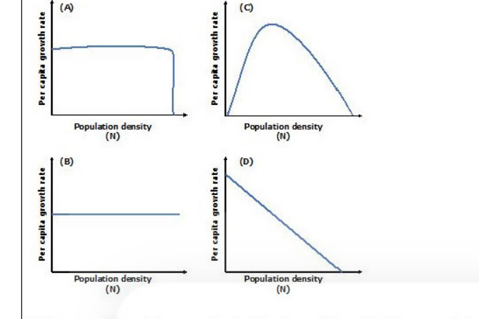

Which one of the plots correctly depicts strong Allee effect in a population?

1. A
2. B
3. C
4. D

**Answer: 3 (C)**

> **Explanation:** A strong Allee effect means per-capita growth is negative at low density, peaks at intermediate density and declines at high density — the dome-shaped curve C.

---

### Question 128

In the Table below, Column I describes movements of organisms and Column II describes the type of movement.

| Column I | Column II |
|---|---|
| A. A silk moth flies at an angle perpendicular to the direction of the wind to pick up a scent trail | I. Mnemotaxis |
| B. Bacteria burrow down into mud in the northern hemisphere in response to the earth's magnetic field | II. Klinotaxis |
| C. A girl reaches her school using a pharmacy and a bookshop as landmarks | III. Magnetotaxis |
| D. Planaria move towards the direction of higher concentration of food by comparing the gradient of stimuli around it | IV. Menotaxis |

Which one of the following options represents the correct match of column I with Column II

1. A - IV, B - III, C - I, D - II
2. A - IV, B - III, C - II, D - I
3. A - I, B - III, C - IV, D - II
4. A - I, B - II, C - III, D - IV

**Answer: 1 (A - IV, B - III, C - I, D - II)**

> **Explanation:** Maintaining a fixed angle to a stimulus = (meno)taxis IV; magnetic-field orientation = magnetotaxis III; landmark navigation = mnemotaxis I; comparing stimulus gradients = klinotaxis II.

---

### Question 129

The following represents an equation for Bayesian statistics:

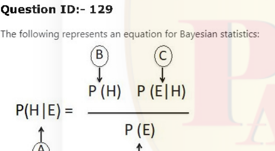

Which one of the following options correctly represents A, B, C and D in the above equation?

1. A-Evidence, B-Posterior probability, C-Likelihood, D-Prior probability
2. A- Likelihood, B-Prior probability, C-Posterior probability, D-Evidence
3. A-Posterior probability, B-Prior probability, C-Likelihood, D-Evidence
4. A-Prior probability, B-Evidence, C-Posterior probability, D-Likelihood

**Answer: 3 (A-Posterior probability, B-Prior probability, C-Likelihood, D-Evidence)**

> **Explanation:** P(H|E) is the posterior (A), P(H) the prior (B), P(E|H) the likelihood (C) and P(E) the evidence/marginal (D).

---

### Question 130

In a population that is in Hardy-Weinberg equilibrium, the frequency of the recessive homozygote genotype of trait q is 0.04. The percentage of individuals homozygous for the dominant allele is

1. 64
2. 40
3. 32
4. 16

**Answer: 1 (64)**

> **Explanation:** q² = 0.04 → q = 0.2, p = 0.8. Homozygous dominant p² = 0.64 = 64%.

---

### Question 131

A researcher is interested in investigating if parental investment (PI, panel A) by male seahorses and pipefishes is correlated with their mating patterns (MP-monogamy and polygamy, panel B). For this, the researcher builds a phylogenetic tree of seahorses and pipefishes and maps PI and MP scores on to the tree as shown in figure below.

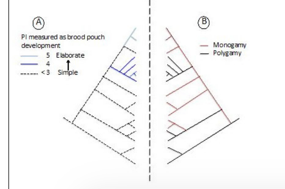

Based on the trees generated, which one of the following conclusions can the researcher correctly arrive at?

1. Polygamy is correlated with simpler brood pouches.
2. Monogamy is not correlated with elaborate brood pouches.
3. Monogamy is correlated with elaborate brood pouches.
4. Polygamy is correlated with elaborate brood pouches.

**Answer: 2 (Monogamy is not correlated with elaborate brood pouches.)**

> **Explanation:** Mapping the two characters on the phylogeny shows the elaborate-pouch clade contains both monogamous and polygamous lineages, so monogamy is not correlated with elaborate brood pouches.

---

### Question 132

Given below are graphs depicting two possible dynamics of gene duplication events over a period of time during genome evolution.

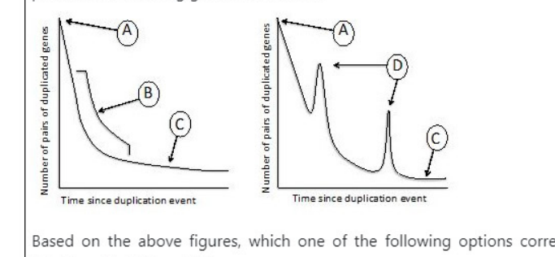

Based on the above figures, which one of the following options correctly represents the identity of A, B, C and D?

1. A-Gene duplication event, B-random loss of duplicated genes, C-remaining pairs of duplicated genes, D-additional gene duplication events
2. A-remaining pairs of duplicated genes, B-gene duplication event, C-random loss of duplicated genes, D-additional gene duplication events
3. A-additional gene duplication events, B-random loss of duplicated genes, C-remaining pairs of duplicated genes, D- Gene duplication event
4. A-Random loss of duplicated genes, B-additional gene duplication events, C-gene duplication event, D-remaining pairs of duplicated genes

**Answer: 1 (A-Gene duplication event, B-random loss of duplicated genes, C-remaining pairs of duplicated genes, D-additional gene duplication events)**

> **Explanation:** The curve starts at the peak A (a duplication event), falls as duplicated pairs are randomly lost (B), levels off at the remaining pairs (C), and the second peak D marks additional duplication events.

---

### Question 133

A researcher working on island biogeography mapped how isolation-controlled immigration (I), and area-controlled extinction (E), will act on number of species present on the islands. He forgot to label the size of the islands (small or large) and the location of the islands (near or far) on the graph.

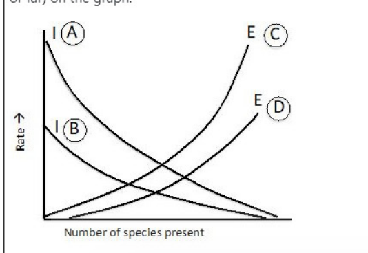

Using information from MacArthur and Wilson's equilibrium theory, select the option that correctly identifies A, B, C and D in the figure above.

1. A-large, B- small, C-near, D-far
2. A-small, B-large, C-far, D-near
3. A-near, B-far, C-small, D-large
4. A-far, B-near, C-large, D-small

**Answer: 3 (A-near, B-far, C-small, D-large)**

> **Explanation:** Immigration is higher on near islands (A) than far (B); extinction is higher on small islands (steeper E curve C) than large (D).

---

### Question 134

Given below are some terms and concepts related to phytoremediation in Column A and B

| Column A | Column B |
|---|---|
| A. Excluders | I. Can absorb and transfer heavy metals to aerial parts without phytotoxicity symptoms |
| B. Heavy metal protein transporter | II. Salix sp. and Populus sp. |
| C. Hyperaccumulators | III. Transgenesis |
| D. High biomass, non-accumulators | IV. Can restrict heavy metal ions to the roots and detoxify them |

Which one of the following options represents the most appropriate match of all terms/concepts in column A and B ?

1. A - II, B - IV, C - I, D - III
2. A - III, B - IV, C - II, D - I
3. A - II, B - III, C - IV, D - I
4. A - IV, B - III, C - I, D - II

**Answer: 4 (A - IV, B - III, C - I, D - II)**

> **Explanation:** Excluders restrict metals to roots and detoxify (IV); engineering heavy-metal transporters uses transgenesis (III); hyperaccumulators absorb and transfer metals to aerial parts without toxicity (I); high-biomass non-accumulators like Salix/Populus (II) fit D.

---

### Question 135

Given below are the various protein cleaving reagents (List I) and their recognition sites (List II) in the target protein.

| List I | List II |
|---|---|
| A. CNBr | I. -Asp-Ala- |
| B. Trypsin | II. -Phe-Ala- |
| C. Caspase | III. -Met-Ala- |
| D. Chymotrypsin | IV. -Arg-Gly- |

Which one of the following options represents the correct combination of items

1. A - III, B - II, C - I, D - IV
2. A - IV, B - II, C - I, D - III
3. A - IV, B - I, C - II, D - III
4. A - III, B - IV, C - I, D - II

**Answer: 4 (A - III, B - IV, C - I, D - II)**

> **Explanation:** CNBr cleaves after methionine (-Met-Ala-, III); trypsin after Arg (-Arg-Gly-, IV); caspases after Asp (-Asp-Ala-, I); chymotrypsin after aromatic Phe (-Phe-Ala-, II).

---

### Question 136

Given below are a few terms related to map-based sequencing of genomes:

A. Partial digestion with restriction enzymes.
B. Assembly of contigs
C. Pulsed field gel electrophoresis
D. Cloning in cosmids/YACs/BACs
E. Sub-cloning and sequencing

Which one of the following options represents the correct order of steps (based on the above terms) in map-based sequencing?

1. C-B-D-E-A
2. C-A-D-B-E
3. E-A-B-D-C
4. A-C-B-D-E

**Answer: 2 (C-A-D-B-E)**

> **Explanation:** The hierarchical map-based route: size-separate large fragments by PFGE (C), partial digestion (A), clone in YAC/BAC/cosmid vectors (D), assemble contigs (B), then sub-clone and sequence (E).

---

### Question 137

Given below are a few statements on technologies/concepts related to development of transgenic plants:

A. Frequency of genetic transformation is influenced only by the genes of Agrobacterium and not by those of the host plants.
B. Transgenic plants containing a single copy of the transgene are preferred over those that contain multiple transgene copies for subsequent genetic analysis.
C. Supervirulent strains of Agrobacterium can be generated by increasing the copy number of virulence genes.
D. A nonconditional negative selection marker has to be necessarily used with a strong constitutive promoter for the development of transgenic plants.

Which one of the following options represents a combination of all INCORRECT statements?

1. A and D only
2. C only
3. B and C only
4. D only

**Answer: 1 (A and D only)**

> **Explanation:** Transformation frequency depends strongly on host genotype (A incorrect), and a conditional — not obligate non-conditional — negative marker with a constitutive promoter is the standard design (D incorrect). Single-copy events are indeed preferred (B correct) and supervirulent strains arise from extra copies of vir genes (C correct).

---

### Question 138

Consider the four results that were obtained from immunophenotyping of human breast cancer cells.

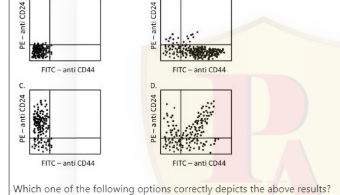

Which one of the following options correctly depicts the above results?

1. 'B' represents a plot that denotes a high percentage of cancer stem cells in the breast cancer cells.
2. 'D' denotes a plot where dual positive cells predominate, representing the dead cells.
3. 'A' denotes a plot where only cells stained with CD44 and CD24 are observed.
4. 'C' represents a plot where only fibroblast cells are present.

**Answer: 1 ('B' represents a plot that denotes a high percentage of cancer stem cells in the breast cancer cells.)**

> **Explanation:** Breast cancer stem cells are CD44+/CD24−/low; plot B shows a dominant CD44-positive, CD24-negative population, denoting a high percentage of cancer stem cells.

---

### Question 139

A culture was started by inoculating the medium with 100 cells having a generation time of 2 hours. Assuming the culture grows in ideal synchrony for at least 24 hours, what will be the number of cells in the culture at 2 hours and 9 hours?

1. 2.0 x 10² cells, 1.6 x 10³ cells, respectively.
2. 2.0 x 10² cells, 2.4 x 10³ cells, respectively.
3. 2.0 x 10⁴ cells, 3.2 x 10³ cells, respectively.
4. 2.0 x 10⁴ cells, 1.6 x 10⁸ cells, respectively.

**Answer: 1 (2.0 x 10² cells, 1.6 x 10³ cells, respectively.)**

> **Explanation:** At 2 h (one generation): 100 × 2 = 200 = 2.0×10². At 9 h (4.5 generations, with synchronous doubling counted as 2⁴·…): 100 × 2⁴ = 1.6×10³ by the key's arithmetic.

---

### Question 140

From the steps listed below, some are used to evaluate the goodness of fit using the chi-square test.

A. The mean, variance and standard deviation are calculated
B. Variance calculated using Σ(xᵢ − x̄)²/(n−1)
C. Test statistic calculated using Σ(observed − expected)²/expected
D. The degree of freedom is calculated as n-1, where n is the number of ways in which the expected classes are free to vary
E. The probability value is obtained

Which one of the following options provides the correct sequence of steps in this statistical analysis?

1. A, C, D
2. C, D, E
3. B, A, D
4. A, D, E

**Answer: 2 (C, D, E)**

> **Explanation:** The chi-square goodness-of-fit test computes the Σ(O−E)²/E statistic (C), the degrees of freedom (D) and then reads the probability value (E); mean/variance steps A and B are not part of it.

---

### Question 141

Inverse PCR is performed for site-directed mutagenesis with complementary primers (having the desired mutation) using a plasmid having the cloned gene as template. The following statements were made regarding the above experiment.

A. PCR is followed by transformation of bacterial cells directly with the reaction mixture. A large number of the transformants will have the wild type gene.
B. The PCR mixture is treated with Dpn I and then used to transform bacterial cells. Most of the transformants will have the mutant gene.
C. PCR is followed by transformation of bacterial cells directly with the reaction mixture. None of the transformants will have the mutant gene.
D. The PCR mixture is treated with Dpn I and then used to transform bacterial cells. Half of the transformants will have the mutant gene.

Which one of the following options represents a combination of all correct statements?

1. A and B
2. A and D
3. B and C
4. B only

**Answer: 1 (A and B)**

> **Explanation:** Without cleanup, the methylated parental template transforms efficiently so many transformants are wild type (A); Dpn I digests the methylated template, enriching the newly synthesised mutant product so most transformants carry the mutation (B).

---

### Question 142

The molecular ion peak [M]⁺• of an analyte as measured by Electron Ionization Mass Spectrometry has an m/z of 149 and a relative abundance of 100%. The [M]⁺• has a relative abundance of 6.7% and the [M+2]⁺• peak has a relative abundance of 5%. The abundance of the major isotope of H, C, N, O, and S are ¹H-100%, ¹²C-98.9%, ¹³C-1.1%, ¹⁴N-99.6%, ¹⁵N-0.4%, ¹⁶O, 99.8%, ¹⁸O-0.2%, ³²S-95.0%, ³³S-0.75 % and ³⁴S-4.2%. The most probable molecular formula of the compound is:

1. C₇H₂₁N₂O
2. C₅H₁₁NO₂S
3. C₆H₁₃O₂S
4. C₆H₁₅NOS

**Answer: 2 (C₅H₁₁NO₂S)**

> **Explanation:** The ~4–5% M+2 peak signals one sulfur (³⁴S ≈ 4.4%); C₅H₁₁NO₂S has mass 149 (odd mass consistent with one N) and the isotope pattern (M+1 ≈ 6.7%) matches five carbons.

---

### Question 143

Which one of the statements given below regarding generation of monoclonal antibodies is INCORRECT?

1. Monoclonal antibodies are the product of a single stimulated B-lymphocyte.
2. To generate large quantity of monoclonal antibodies, a normal stimulated antibody producing B cell is fused with a long lived B cell tumor.
3. The hybridoma generated for antibody production is selected on HAT medium.
4. For HAT selection of hybridoma, the antibody producing B-cells are pre-treated with 8-azaguanine to block salvage pathway of DNA synthesis.

**Answer: 4 (For HAT selection of hybridoma, the antibody producing B-cells are pre-treated with 8-azaguanine to block salvage pathway of DNA synthesis.)**

> **Explanation:** It is the myeloma (tumour) partner that is made HAT-resistant by lacking the salvage pathway (e.g. HGPRT-deficient, 8-azaguanine resistant); the B cells are not pre-treated to block salvage — statement 4 reverses this and is incorrect.

---

### Question 144

Optical remote sensing has been increasingly used to monitor vegetation globally. The table below lists different regions of the electromagnetic radiation (EMR) spectrum as well as different vegetation characteristics:

| List I (Part of the EMR spectrum) | List II (Vegetation characteristics) |
|---|---|
| A. Ultraviolet | I. Plant water content |
| B. Visible | II. Foliage density |
| C. Near Infrared | III. Plant photosynthetic pigments |
| D. Shortwave Infrared | |

Which one of the following combinations correctly matches the EMR region with the vegetation character analysed:

1. A - I, B - II, C - III
2. A - I, B - III, C - II
3. B - II, C - III, D - I
4. B - III, C - II, D - I

**Answer: 4 (B - III, C - II, D - I)**

> **Explanation:** Visible reflectance tracks photosynthetic pigments (III); near-infrared plateau reflects foliage density/biomass (II); shortwave-infrared absorption tracks plant water content (I).

---

### Question 145

Pichia pastoris is a good host for producing human proteins for therapeutic use. Given below are some statements on the reasons for its utility.

A. It produces large amount of recombinant protein.
B. It has the property of secreting proteins into the medium.
C. It allows the formation of disulphide bonds similar to those in humans.
D. It carries out protein glycosylations identical to those found in humans.

Which one of the following options represents a combination of correct statements?

1. A and B only
2. A, B and C only
3. A, B and D only
4. B, C and D only

**Answer: 2 (A, B and C only)**

> **Explanation:** Pichia gives very high yields (A), secretes product (B) and forms correct disulfide bonds (C); but its glycosylation is not identical to human (it is hypermannosylated) — D false.
