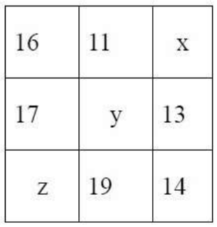
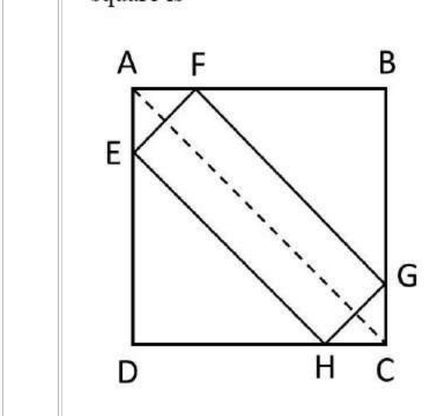
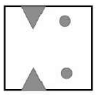
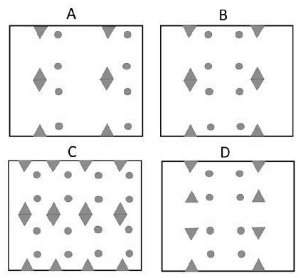
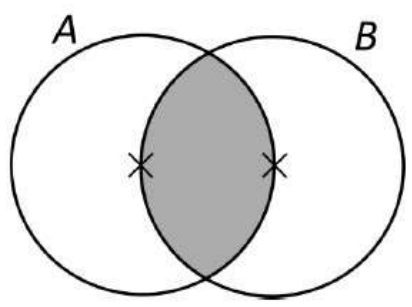
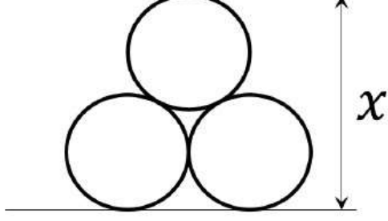
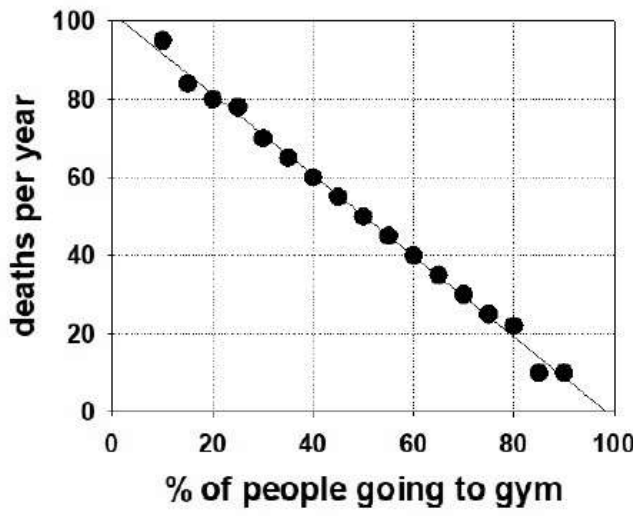

# CSIR NET Life Sciences — December 2022 (merged Dec-2022/June-2023 cycle; paper held 06-06-2023, Shift-I)

## Part A — General Aptitude (Questions 1–20; printed Client Question IDs 702001–702020)

Transcribed verbatim from the official NTA **"PREVIEW QUESTION BANK (Dual)"** scan (Module Name: LIFE SCIENCES, Exam Date: 06-Jun-2023, Batch: 09:00-12:00). English text only; the Hindi text of each question was ignored as instructed.

All answers below are taken from the **NTA Final Answer Key** (two independent official copies, see `sources.md`). No answer on this page is derived by reasoning alone.

---

### Question 1

If 6 students occupy a bench, one bench will be left completely unoccupied. If 5 students occupy each bench, instead, one student will not find a seat. The number of students is

1. 30
2. 31
3. 36
4. 42

**Answer: 3 (36)**

> **Explanation:** Let `b` benches and `s` students. Six per bench leaves one bench empty → `s = 6(b − 1)`. Five per bench leaves one student without a seat → `s = 5b + 1`. So `6b − 6 = 5b + 1`, `b = 7`, and `s = 6 × 6 = 36`.

---

### Question 2

Four villages **A**, **B**, **C** and **D** are connected in that order by a circular road. A car traveling with a uniform speed covers the distance between **A** and **B** in 43 minutes, **B** and **C** in 23 minutes, **C** and **D** in 19 minutes and **D** and **A** in 47 minutes. Which of the following will be closest to the time (in minutes) taken to travel from **A** to **C** with the same speed along a straight road?

1. 42
2. 66
3. 45
4. 21

**Answer: 1 (42)**

> **Explanation:** Circumference = 43 + 23 + 19 + 47 = 132 minutes of travel. Arc A→B→C = 66 min and arc A→D→C = 66 min; the arcs are equal, so AC is a diameter. Straight-line AC = half the circumference in distance = 132/2 = 66 minute-units of *arc*, but the chord is `2r` where the full circumference corresponds to 132, so `2r = 132/π ≈ 42` minutes.

---

### Question 3

A test consists of 20 questions and the students are awarded 4 marks for a correct answer, −1 mark for a wrong answer and 0 mark for an unattempted question. Which of the following could be a possible number of questions attempted by a student who secured 27 marks?

1. 15
2. 16
3. 17
4. 18

**Answer: 4 (18)**

> **Explanation:** With `c` correct and `w` wrong: `4c − w = 27`, attempted `= c + w`. Adding the two relations gives `5c = 27 + (c + w)`, so `c = (27 + attempted)/5` must be a whole number. Only attempted = 18 works: `c = 9`, `w = 9`, and 4·9 − 9 = 27. For 15, 16 and 17 the value of `c` is 8.4, 8.6 and 8.8 — not integers.

---

### Question 4

**A**, **B**, **C**, **D** and **E** are members of a family. **A** is a doctor and wife of a lawyer. **B** is the brother of **C** and husband of a teacher. **C** is an engineer and daughter of the lawyer. Which of the following inferences can be definitely made?

1. **D** is the lawyer
2. **E** is the teacher
3. **A** is the wife of **D**
4. **B** is the son of **A**

**Answer: 4 (B is the son of A)**

> **Explanation:** A is female and the lawyer's wife; C is the lawyer's daughter — hence A is C's mother. B is C's brother, so B is likewise A's child, and B is male: **B is the son of A** follows necessarily. Nothing in the data forces D to be the lawyer or E to be the teacher, and option 3 depends on the unestablished identity in option 1.

---

### Question 5

Which of the following correspond to x,y and z, respectively in the following square where sum of elements in each column, row, and diagonal is the same?

1. (17,15,13)
2. (18,15,12)
3. (12,15,17)
4. (17,16,14)

**Answer: 2 (18,15,12)**

> **Explanation:** The middle column fixes the common sum once `y` is known; use the two complete diagonals/rows. Taking x = 18 gives row 1 = 16 + 11 + 18 = 45. Then column 2 requires `y = 45 − 11 − 19 = 15`, and row 2 checks: 17 + 15 + 13 = 45. Column 3: 18 + 13 + 14 = 45. Row 3 gives `z = 45 − 19 − 14 = 12`, and column 1 checks: 16 + 17 + 12 = 45. Both diagonals also sum to 45 (16+15+14 and 12+15+18). Hence (x, y, z) = (18, 15, 12).

---

### Question 6

**P** starts a business with an investment of Rs. 30 lakh. Two months later **Q** joined with Rs.90 lakh. Subsequently **R** joined with Rs. 180 lakh. The year-end profit of Rs. 1.2 crore was distributed in proportion of the investment and duration in the partnership. If the profit received by **R** was Rs. 60 lakh, how many months after **Q**, did **R** join?

1. 3
2. 4
3. 5
4. 7

**Answer: 1 (3)**

> **Explanation:** Profit share ∝ investment × months. P: 30 × 12 = 360; Q: 90 × 10 = 900 (Q invested for 10 of the 12 months). R received 60 of the 120 lakh total, i.e. exactly half, so R's share-units equal P + Q = 1260. With 180 lakh invested, R's duration = 1260/180 = 7 months, so R joined 12 − 7 = 5 months after the start of the year. Q had joined at month 2, therefore R joined 5 − 2 = **3 months after Q**.

---

### Question 7

If the difference between the two-digit numbers made from digits *a* and *b* is 27, the difference between *a* and *b* is

1. 2
2. 1
3. 4
4. 3

**Answer: 4 (3)**

> **Explanation:** The two numbers are `10a + b` and `10b + a`. Their difference is `9(a − b) = 27`, so `a − b = 3`.

---

### Question 8

Two cards are drawn together at random from a deck of 52 playing cards. What is the probability to get one red and one black card?

1. 1/2
2. 13/51
3. 26/51
4. (26×25)/(52×51)

**Answer: 3 (26/51)**

> **Explanation:** Favourable draws = 26 red × 26 black = 26². Total draws = C(52,2) = (52 × 51)/2. Probability = 26² / [(52 × 51)/2] = (2 × 26 × 26)/(52 × 51) = 26/51.

---

### Question 9

ABCD is a square. EFGH is a rectangle inscribed within the square with its sides parallel to the diagonal AC of the square. The perimeter of the rectangle EFGH is 16. The side of the square is

1. 8/√2
2. 8
3. 4
4. 8√2

**Answer: 1 (8/√2)**

> **Explanation:** Because EFGH's sides are parallel and perpendicular to the diagonal AC, the corner pieces cut off at B and D are right isosceles triangles. If the rectangle's sides are `l` (parallel to AC) and `b`, the projections on the diagonal direction give `l + b = AC` while the perimeter gives `2(l + b) = 16`, so the diagonal `AC = 8`. The side of the square is then `AC/√2 = 8/√2`.

---

### Question 10

A square paper is folded twice to a square shape one-fourth in area to the original square. Then equilateral triangles and circles are cut as shown in the figure.

Which one of the following is a possible pattern on the fully unfolded paper?

1. A
2. B
3. C
4. D

**Answer: 2 (B)**

> **Explanation:** Folding twice to a quarter-size square means the unfolded sheet is the quarter pattern reflected once about each fold line. Each of the two edge notches must therefore appear four times on the boundary (two on the top edge, two on the bottom edge), and the two punched circles must appear four times as single round holes, not as merged diamonds. Option B is the only one with the correct number of holes (four circles) and the correct mirror placement of the four edge notches; A and C show diamond (merged) holes and D misplaces the notches.

---

### Question 11

Two cylindrical candles **A** and **B** are of the same height. The radius of **A** is twice that of **B**. If **A** takes 120 minutes to completely burn, how long does **B** take to burn half its initial height?

1. 60 min
2. 30 min
3. 15 min
4. 10 min

**Answer: 3 (15 min)**

> **Explanation:** Fuel volume is `πr²h`; with equal heights and `r_A = 2 r_B`, candle A holds 4 times as much wax as B. A burns out in 120 min, so B burns out in 120/4 = 30 min. A cylinder burns at a constant cross-section, so height falls linearly with time: half the height takes half of 30 min = **15 min**.

---

### Question 12

*A* and *B* are circles of unit radius. Their centres are marked by ×. The area of the shaded region is (hint: area of an equilateral triangle of unit side length is √3/4)

1. 2π/3 − √3/2
2. (2√3/4 + π)
3. 2π/3 + √3/2
4. 2π/3 − √3/4

**Answer: 1 (2π/3 − √3/2)**

> **Explanation:** Each centre lies on the other circle, so the two intersection points together with a centre form an equilateral triangle of side 1; the chord subtends 120° = 2π/3 at each centre. Each of the two equal circular segments has area `(1/2)r²(θ − sin θ) = (1/2)(2π/3 − sin 120°) = (1/2)(2π/3 − √3/2)`. The shaded lens is two such segments: `2π/3 − √3/2`.

---

### Question 13

Three identical rings of radius 1 unit are stacked as shown in the figure. The length *x* is

1. 2 + √3
2. 2 + √2
3. 2 + 2√(2/3)
4. 3

**Answer: 1 (2 + √3)**

> **Explanation:** The three centres form an equilateral triangle whose sides are `1 + 1 = 2` (external tangency). Its altitude is `2 × (√3/2) = √3`. The total height `x` = bottom radius + altitude + top radius = 1 + √3 + 1 = `2 + √3`.

---

### Question 14

Given graph depicts the data of people going to gym and deaths per year in different cities. Which of the following can be definitely concluded from the graph?

1. Gym makes people fit and improves their health.
2. None will die if all go to gym.
3. Gym helps people to save their lives in cities.
4. In the city where on the average 50% people go to gym, 50 people die per year.

**Answer: 4 (In the city where on the average 50% people go to gym, 50 people die per year.)**

> **Explanation:** The plotted line runs from (0, 100) to (100, 0), i.e. deaths = 100 − (% going to gym), so at 50% the reading is exactly 50 deaths per year — a direct reading off the data. Options 1, 2 and 3 assert a causal effect (or zero mortality), which a correlation graph between two variables cannot establish.

---

### Question 15

Which of the following is INCORRECT?

1. 3^(1/2) + 3^(1/2) + 3^(1/2) = 3^(1/2) × 3^(1/2) × 3^(1/2)
2. 4^(1/3) + 4^(1/3) + 4^(1/3) + 4^(1/3) = 4^(1/3) × 4^(1/3) × 4^(1/3) × 4^(1/3)
3. 5^(1/4) + 5^(1/4) + 5^(1/4) + 5^(1/4) + 5^(1/4) = 5^(1/4) × 5^(1/4) × 5^(1/4) × 5^(1/4) × 5^(1/4)
4. 6^(1/6) + 6^(1/6) + 6^(1/6) + 6^(1/6) + 6^(1/6) + 6^(1/6) = 6^(1/6) × 6^(1/6) × 6^(1/6) × 6^(1/6) × 6^(1/6) × 6^(1/6)

**Answer: 4**

> **Explanation:** For `n` copies of `a^(1/k)`: sum = `n·a^(1/k)` and product = `a^(n/k)`. Options 1–3 have `n = a` and `k = n − 1`, so `n·a^(1/k) = a^(a/(a−1)) = a^(n/k)` — they hold (e.g. option 1: 3·3^(1/2) = 3^(3/2) = 3√3 on both sides). Option 4 has `n = 6`, `k = 6`: sum = 6·6^(1/6) = 6^(7/6) but product = 6^(6/6) = 6. Since 6^(7/6) ≠ 6, option 4 is the **incorrect** statement.

---

### Question 16

Choose the option that will make the following statement correct:

THE NUMBER OF TIMES THE LETTER "T" OCCURS IN THIS SENTENCE IS ___ .

1. FOUR
2. FIVE
3. SIX
4. SEVEN

**Answer: 3 (SIX)**

> **Explanation:** Counting the letter T in the sentence "THE NUMBER OF TIMES THE LETTER 'T' OCCURS IN THIS SENTENCE IS ___": TH**E**(1) → **T**IMES(2) → **T**HE(3) → LE**T**TER(4) → **T**(5) in the quoted letter → **T**HIS(6). The answer word itself must add no further T, and "SIX" contains no T, so the sentence becomes self-consistent only with **SIX**.

---

### Question 17

Mary and Mike are married to each other. John is Mary's brother while Douglas is Mike's brother. In a gathering of 2 children of Mary and Mike, 3 of John and 2 of Douglas, the number of first-cousin pairs (sibling's children are first-cousins to each other) is

1. 3
2. 6
3. 10
4. 21

**Answer: 3 (10)**

> **Explanation:** First cousins arise only across the two sibling lines. John's 3 children are first cousins of Mary and Mike's 2 children → 3 × 2 = 6 pairs. Douglas's 2 children are first cousins of Mary and Mike's 2 children → 2 × 2 = 4 pairs. John's children and Douglas's children are unrelated by blood (brothers-in-law's children), contributing nothing. Total = 6 + 4 = **10**.

---

### Question 18

In a round-robin tournament (each team plays with all other teams once) between 8 teams, a win fetched 3 points and a draw, 1. After each team had played 4 matches, the total of the points of the teams was 34. The number of drawn games among those played till then was

1. 7
2. 2
3. 6
4. 14

**Answer: 4 (14)**

> **Explanation:** Games completed = (8 teams × 4 games)/2 = 16. A decisive game contributes 3 points in total to the table; a draw contributes 1 + 1 = 2 points. Had all 16 been decisive the total would be 48. Each draw reduces the total by exactly 1, and 48 − 34 = 14, so **14 drawn games** (and 2 decisive ones).

---

### Question 19

Suppose (729)^(22/3) (81)^(x/2) = 3. The value of *x* is

1. −21
2. −21.5
3. −22
4. −20.5

**Answer: 2 (−21.5)**

> **Explanation:** 729 = 3⁶ and 81 = 3⁴, so the left side is `3^(6·22/3) · 3^(4·x/2) = 3^44 · 3^(2x) = 3^(44+2x)`. Setting the exponent equal to 1: `44 + 2x = 1` → `x = −43/2 = −21.5`.

---

### Question 20

The possible number of integers between 1000 and 10000 containing two 2`s, one 0 and one 3 (for example, 2023 is such an integer) is

1. 6
2. 9
3. 12
4. 24

**Answer: 2 (9)**

> **Explanation:** Permutations of the multiset {2, 2, 0, 3} = 4!/2! = 12. Those that start with 0 are not four-digit numbers; fixing 0 in the thousands place leaves {2, 2, 3} to arrange in 3!/2! = 3 ways. Hence 12 − 3 = **9** valid integers.
