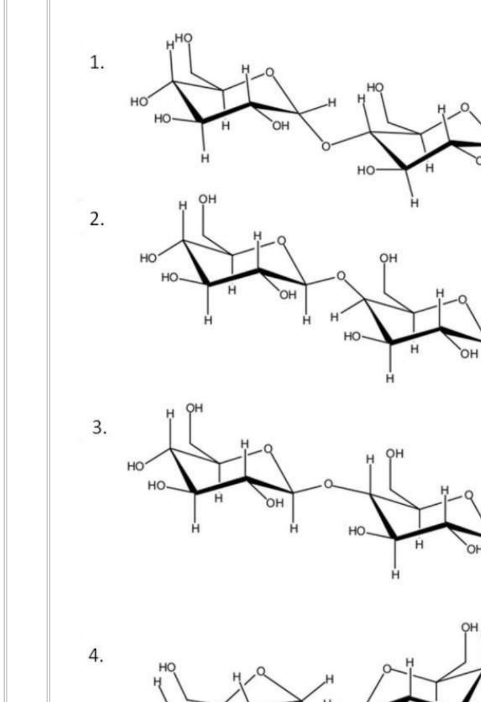
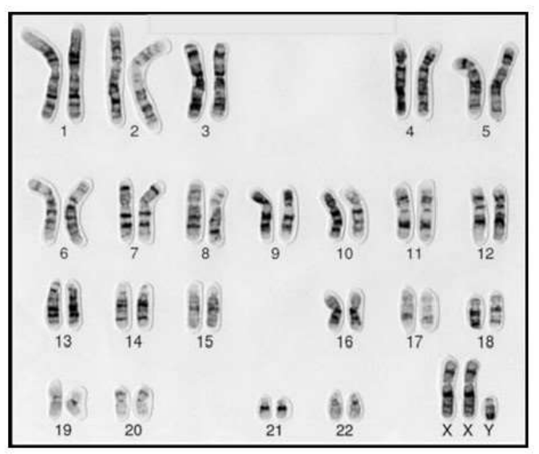

# CSIR NET Life Sciences — December 2022 (merged Dec-2022/June-2023 cycle; paper held 06-06-2023, Shift-I)

## Part B — Questions 21–70 (printed Client Question IDs 703021–703070)

Transcribed verbatim from the official NTA "PREVIEW QUESTION BANK (Dual)" scan; English text only. All answers are the **NTA Final Answer Key** values.

---

### Question 21

Which one of the following sugars will not reduce Tollen's reagent?

1. (structure 1)
2. (structure 2)
3. (structure 3)
4. (structure 4)

**Answer: 4**

> **Explanation:** Tollen's reagent (ammoniacal Ag⁺) is reduced only by a sugar with a free anomeric carbon (a hemiacetal, i.e. a reducing end). In structure 4 both anomeric carbons are tied up in the glycosidic linkage, so no ring can open to the free aldehyde form and the sugar is non-reducing.

---

### Question 22

The solubility of NaCl is greater in water than ethanol. What physical property of the solvent governs this difference?

1. Surface tension
2. Viscosity
3. Dielectric constant
4. Boiling point

**Answer: 3 (Dielectric constant)**

> **Explanation:** Dissolution of an ionic solid requires the solvent to screen the Coulombic attraction between Na⁺ and Cl⁻. The screening ability is measured by the dielectric constant: water (≈80) is far higher than ethanol (≈25), so the lattice energy is overcome much more readily in water.

---

### Question 23

In mature erythrocytes, the end-product of glycolysis that contains the carbons of glucose is:

1. ethanol
2. pyruvate
3. acetaldehyde
4. lactate

**Answer: 4 (lactate)**

> **Explanation:** Mature erythrocytes lack mitochondria, so pyruvate cannot be oxidised aerobically. To regenerate NAD⁺ for continued glycolysis, lactate dehydrogenase reduces pyruvate to lactate, which is the end product carrying the glucose carbons.

---

### Question 24

The standard free energy (kJ mol⁻¹) of hydrolysis of glucose-1-phosphate is:

1. -40.3
2. -35.8
3. -7.7
4. -20.9

**Answer: 4 (-20.9)**

> **Explanation:** Glucose-1-phosphate is a low-energy phosphate ester; its hydrolysis ΔG°′ is about −20.9 kJ mol⁻¹ (compare glucose-6-phosphate ≈ −13.8 kJ mol⁻¹ and the high-energy phospho-enol pyruvate ≈ −61.9 kJ mol⁻¹).

---

### Question 25

Which one of the following statements about LINEs present in the human genome is TRUE?

1. LINEs preferentially localize to AT-rich DNA.
2. LINEs cannot transpose independently.
3. By parasitizing on the SINE element transposition machinery, LINEs can attain very high copy number.
4. The Alu family is the most prominent LINE family in terms of copy number.

**Answer: 1 (LINEs preferentially localize to AT-rich DNA.)**

> **Explanation:** LINE-1 elements insert preferentially into AT-rich sequences (L1 endonuclease nicks at 5′-TTAAAA-type sites). LINEs *are* autonomous (they encode their own reverse transcriptase), so 2 is false; it is the SINEs that parasitise the LINE machinery, so 3 reverses the relationship; and Alu is a SINE, not a LINE, so 4 is false.

---

### Question 26

Which one of the following changes is energetically favorable and occurs spontaneously in an aqueous solution?

1. Formation of a bilayer from phospholipid molecules
2. Dispersion of one oil droplet into many small ones
3. Tearing of the lipid bilayer
4. Conversion of a membrane vesicle to a flat bilayer

**Answer: 1 (Formation of a bilayer from phospholipid molecules)**

> **Explanation:** Amphipathic phospholipids spontaneously assemble into bilayers because sequestering the hydrocarbon tails away from water releases ordered water molecules — a large favourable entropy gain. Dispersing an oil droplet *increases* hydrophobic surface exposed to water, tearing a bilayer exposes tails, and a flat bilayer leaves hydrophobic edges in contact with water; all are unfavourable.

---

### Question 27

A temperature sensitive *S. pombe* mutant exhibits cell cycle arrest both, at the G1 to S, as well as at the G2 to M transition phases. This is possibly a mutant of:

1. Clb1
2. Cyclin B
3. Cdc2 only
4. Cdc2 and Clb3

**Answer: 3 (Cdc2 only)**

> **Explanation:** In *S. pombe* a single CDK, Cdc2 (the homolog of vertebrate Cdk1), drives *both* the G1→S and the G2→M transitions. Loss of Cdc2 therefore blocks at both boundaries, whereas a cyclin-specific mutation (Cyclin B / Clb) would remove only one transition.

---

### Question 28

In the context of protein import in the nucleus, which molecule is responsible for releasing the cargo from the importing receptor?

1. Ras
2. RhoA
3. Ran
4. Rock

**Answer: 3 (Ran)**

> **Explanation:** Importin binds cargo in the cytoplasm and releases it in the nucleus on binding Ran-GTP, whose concentration is high in the nucleus because of the nuclear RanGEF. The small GTPases Ras, RhoA and the kinase ROCK are not part of this reaction.

---

### Question 29

Which one of the following mRNAs is most likely to be exported out of the nucleus?

1. Spliced RNA associated with the poly A binding and cap binding complex.
2. Mis-spliced RNA with multiple stop codons, for degradation in cytosol.
3. Spliced RNA with the associated spliceosomal complex.
4. Uncapped and unspliced RNA.

**Answer: 1 (Spliced RNA associated with the poly A binding and cap binding complex.)**

> **Explanation:** Only a fully processed mRNA — 5′ cap bound by CBC/eIF4E and a poly(A) tail bound by PABP, with the exon-junction complex deposited — is licensed for TAP/NXF1-mediated export. Retained spliceosomal complexes, mis-spliced transcripts and uncapped/unspliced RNA are held in the nucleus or routed to decay.

---

### Question 30

Which one of the following translation factors is used at the step of translation initiation and defined as anti-association factor for 30S and 50S subunit interactions?

1. IF1
2. IF2
3. IF3
4. RRF

**Answer: 3 (IF3)**

> **Explanation:** IF3 is the bacterial anti-association factor: it binds the 30S subunit and prevents premature 30S–50S joining, and it also checks codon–anticodon fidelity at the start codon. IF1 covers the A site, IF2 is the initiator-tRNA GTPase, and RRF (ribosome recycling factor) acts after termination.

---

### Question 31

Which one of the following codons is used to code for selenocysteine in *Escherichia coli*?

1. UGA
2. UAA
3. UAG
4. UCC

**Answer: 1 (UGA)**

> **Explanation:** Selenocysteine has no dedicated codon; it is inserted co-translationally at an in-frame **UGA** codon that is read as "sense" because of the downstream SECIS element (in bacteria a SECIS-like stem-loop immediately following the UGA) plus the specific tRNA[Ser]Sec and its factors.

---

### Question 32

Which of the following statements about site-specific recombinases is NOT true?

1. The Cre recombinase is believed to mediate the circularization of the P1 phage genome during infection of the bacterial host.
2. The λ integrase cannot mediate integration of the λ genome into the host genome without the help of accessory proteins.
3. The Hin invertase-mediated recombination event is stimulated by protein-DNA interactions at a 60 bp enhancer sequence.
4. In Xer recombinase-mediated monomerization of chromosomal dimers, the interaction of FtsK with XerCD activates XerC and initiates the recombination process.

**Answer: 4**

> **Explanation:** In XerC/XerD-mediated resolution of chromosome dimers at *dif*, FtsK (SftA) recruits and **activates XerD**, not XerC — XerD performs the first strand exchange; XerC is activated subsequently by DNA strand exchange itself. Statements 1, 2 and 3 are correct descriptions of Cre, λ Int (which needs IHF and Xis) and Hin (60-bp enhancer with Hin-bound sites).

---

### Question 33

The mode of action of cholera toxin in causing diarrhoea is by:

1. inactivating G₁ protein.
2. continuous activation of adenylyl cyclase.
3. locking Gₛ protein in an inactive state.
4. rapidly hydrolyzing GTP to GDP.

**Answer: 2 (continuous activation of adenylyl cyclase.)**

> **Explanation:** The A₁ subunit of cholera toxin ADP-ribosylates the α subunit of Gₛ and blocks its intrinsic GTPase, so Gₛ is locked in the persistent GTP-bound active state and **adenylyl cyclase runs continuously**. The resulting cAMP surge opens CFTR chloride channels, sodium and water follow, and secretory diarrhoea results. Options 1 and 3 describe the opposite (inactive Gₛ) and option 4 (rapid GTP hydrolysis) is exactly what the toxin prevents.

---

### Question 34

Which one of the following is the communicating junction linking adjacent cells in plants, which permits small molecules to pass from cell to cell while blocking the passage of most large molecules?

1. Adherens junction
2. Gap junction
3. Plasmodesmata
4. Hemidesmosome

**Answer: 3 (Plasmodesmata)**

> **Explanation:** Plasmodesmata are the membrane-lined cytoplasmic channels traversing plant cell walls that allow symplastic passage of small molecules with a size exclusion limit. Gap junctions are the (animal) equivalent built of connexons; adherens junctions and hemidesmosomes are anchoring, not communicating, junctions.

---

### Question 35

The extracellular domain of a cell surface receptor (A) was switched with the extracellular domain of another receptor (B) to create a chimeric receptor (B-A). Assuming that there is no effect on the functionality of the domains in the chimeric receptor, what is the most likely outcome in the presence of the ligand for receptor B?

1. The ligand will activate the pathway normally triggered by receptor A.
2. The ligand will activate the pathway normally triggered by receptor B.
3. The chimeric receptor will fail to transduce any signal in response to the ligand.
4. The chimeric receptor will cause constitutive activation of the signalling pathway.

**Answer: 1 (The ligand will activate the pathway normally triggered by receptor A.)**

> **Explanation:** Ligand specificity resides in the extracellular domain, while the intracellular domain determines which downstream pathway is triggered. In the B-A chimera the extracellular part of B binds the ligand, but the signalling output comes from the intracellular domain of A, so the ligand for B switches on the pathway normally triggered by A. Nothing in the construct causes ligand-independent (constitutive) activation.

---

### Question 36

Appressorium is expected to be formed during which one of the following diseases?

1. Bacterial leaf blight in rice
2. Bacterial wilt in tomato
3. Powdery mildew in pea
4. Leaf curl disease in tobacco

**Answer: 3 (Powdery mildew in pea)**

> **Explanation:** An appressorium is the swollen, melanised fungal structure that generates the turgor pressure needed to force a penetration peg through the plant cuticle. It is therefore formed by a fungal pathogen — of the options only powdery mildew of pea (*Erysiphe pisi*) is fungal. The blight and wilt are bacterial, and leaf curl is viral (vectored by whitefly).

---

### Question 37

Clonogenic neoblasts are involved in planarian (flatworm) regeneration. This is an example of:

1. epimorphosis
2. morphallaxis
3. stem cell-mediated regeneration
4. compensatory regeneration

**Answer: 3 (stem cell-mediated regeneration)**

> **Explanation:** Neoblasts are the pluripotent somatic stem cells of planarians; clonogenic (long-lived self-renewing) neoblasts proliferate and differentiate to replace lost parts, so this is stem-cell-mediated regeneration. Epimorphosis refers to blastema-based regrowth and morphallaxis to repatterning of existing tissue without much proliferation.

---

### Question 38

Which one of the following describes an amphisome?

1. It is an intermediate/hybrid organelle produced through the fusion of endosomes with autophagosomes within cells.
2. It is a double-membrane sequestering vesicle that is the hallmark of the intracellular catabolic process called macroautophagy.
3. It is a compartment formed when autophagosome fuses with a lysosome.
4. It is a vacuole that arises when membranes of the ER sequester parts of the cytoplasm.

**Answer: 1 (It is an intermediate/hybrid organelle produced through the fusion of endosomes with autophagosomes within cells.)**

> **Explanation:** The amphisome is the hybrid organelle generated when an autophagosome fuses with an endosome (early/late); it matures into the **autolysosome** only after the subsequent fusion with the lysosome. Option 2 defines the isolation membrane/phagophore-derived autophagosome, option 3 the autolysosome, and option 4 the ER-derived autophagic vacuole.

---

### Question 39

Homeotic selector genes are responsible for the specification of *Drosophila* body parts. Which one of the following identities would you expect if the *ultrabithorax* gene is deleted?

1. The third thoracic segment is transformed to another second thoracic segment and a fly with four wings.
2. The third thoracic segment develops halteres.
3. The second thoracic segment loses wings.
4. The first and second thoracic segments fuse and wings are formed on the third thoracic segment.

**Answer: 1 (The third thoracic segment is transformed to another second thoracic segment and a fly with four wings.)**

> **Explanation:** *Ubx* normally specifies the third thoracic segment (T3), where it repressines wing development and promotes haltere formation. In a *Ubx* loss-of-function (bithorax) mutant T3 adopts a T2 identity, so the halteres are transformed into a second pair of wings, giving the classic four-winged fly.

---

### Question 40

Which one of the following root initials gives rise to the root vascular system, including the pericycle?

1. Columnella initials
2. Epidermal-lateral root cap initials
3. Cortical-endodermal initials
4. Stele initials

**Answer: 4 (Stele initials)**

> **Explanation:** In the classical histogen model of the Arabidopsis root the promeristem gives rise to four initial tiers: the dermatogen/calyptra (epidermis and cap), the cortex–endodermis, the **stele** (pericycle, xylem and phloem) and the columella. Only the stele initials produce the vascular tissue together with the pericycle.

---

### Question 41

Which one of the following plant-derived molecules is widely used as an analgesic?

1. Abscisic acid
2. Salicylic acid
3. Jasmonic acid
4. Gibberellic acid

**Answer: 2 (Salicylic acid)**

> **Explanation:** Salicylic acid, first isolated from willow bark (*Salix*), is the active metabolite of aspirin (acetylsalicylic acid) and is the classic plant-derived analgesic/antipyretic; it irreversibly acetylates COX enzymes and blocks prostaglandin synthesis. ABA, jasmonate and GA are plant hormones with no analgesic use.

---

### Question 42

Which one of the following statements is **INCORRECT**?

1. Avr proteins predominantly have SecA secretion signals.
2. Avr proteins are secreted through the type III secretion system (T3SS).
3. Hypersensitive response and pathogenicity (HRP) cluster proteins are involved in the secretion of Avr proteins.
4. Some of the components of the T3SS pathway are conserved between animal- and plant-pathogenic bacteria.

**Answer: 1 (Avr proteins predominantly have SecA secretion signals.)**

> **Explanation:** Avr (avirulence) effector proteins of plant bacteria are delivered by the **type III** injectisome; they carry N-terminal type-III (Hrp) secretion signals recognised by the Hrp cluster, not SecA-dependent cleavable signal peptides of the general secretory pathway. The T3SS is homologous to the animal-pathogen (e.g. *Salmonella* SPI-1) injectisome, so 4 is correct.

---

### Question 43

During glycolysis in plants, alanine and related amino acids are directly produced from which one of the following precursors?

1. 3-Phosphoglycerate
2. Phosphoenolpyruvate
3. Pyruvate
4. Acetyl-CoA

**Answer: 3 (Pyruvate)**

> **Explanation:** Alanine is formed by a single transamination of **pyruvate** (alanine aminotransferase), so pyruvate is the direct precursor. 3-Phosphoglycerate gives serine (and then glycine/cysteine), phosphoenolpyruvate feeds the aromatic amino acids via erythrose-4-phosphate condensation, and acetyl-CoA is not a glycolytic amino-acid precursor.

---

### Question 44

Which one of the following statements regarding PEPCase is **INCORRECT**?

1. During the day, C4 PEPCase is inactive whereas CAM PEPCase is active.
2. PEPCase is inactivated by dephosphorylation.
3. PEPCase kinase phosphorylates PEPCase.
4. The synthesis of PEPCase kinase is modulated by circadian rhythm in CAM leaves.

**Answer: 1 (During the day, C4 PEPCase is inactive whereas CAM PEPCase is active.)**

> **Explanation:** The statement reverses the physiology. In **C4** plants PEPCase operates **during the day**, fixing bicarbonate into oxaloacetate in mesophyll cells. In **CAM** plants stomata open at night, so PEPCase is active **at night** (malate stored in the vacuole) and is switched off during the day by malate inhibition and by dephosphorylation. Points 2–4 correctly describe the regulatory phosphorylation cycle and its circadian control in CAM.

---

### Question 45

The hemolysis of red blood cells takes place when they are suspended in which one of the following solutions?

1. 2.0% NaCl
2. 1.5% NaCl
3. 1.0% NaCl
4. 0.5% NaCl

**Answer: 4 (0.5% NaCl)**

> **Explanation:** Plasma is isotonic at about 0.9% NaCl. In 2.0%, 1.5% and 1.0% solutions the cells are in isotonic-to-hypertonic media and water leaves the cell (crenation), so the membrane stays intact. Only in 0.5% NaCl is the medium sufficiently **hypotonic** for water to rush in, swell the erythrocyte and rupture it — haemolysis.

---
### Question 46

The non-ciliated cuboidal epithelial cells in bronchioles that secrete important defense markers are called

1. Goblet cells
2. Basal cells
3. Langerhans cells
4. Club cells

**Answer: 4 (Club cells)**

> **Explanation:** Club cells (formerly Clara cells) are the non-ciliated cuboidal secretory cells of the bronchiolar epithelium; they secrete club-cell/uteroglobin protein and surfactant components and detoxify xenobiotics. Goblet cells secrete mucus, basal cells are progenitors, and Langerhans cells are intra-epithelial antigen-presenting cells.

---

### Question 47

Which one of the following factors inhibits renin secretion?

1. Increased level of plasma catecholamines.
2. Increased blood pressure in the afferent arterioles leading to glomerulus.
3. Increased activity of sympathetic nerves connected to kidney.
4. Prostaglandins.

**Answer: 2 (Increased blood pressure in the afferent arterioles leading to glomerulus.)**

> **Explanation:** Renin release from juxtaglomerular cells is stimulated by (i) reduced stretch of the afferent arteriolar wall (intrarenal baroreceptor), (ii) β₁-adrenergic stimulation by sympathetic nerves/catecholamines, and (iii) prostaglandins (PGE₂/PGI₂ via EP/IP receptors). Raised afferent arteriolar pressure increases wall stretch and, together with tubuloglomerular feedback, **suppresses** renin secretion.

---

### Question 48

Which one of the following is correct regarding zeitgebers?

1. Have no effect on biological rhythms
2. Sense biological rhythms
3. Synchronize biological rhythms
4. Abolish biological rhythms

**Answer: 3 (Synchronize biological rhythms)**

> **Explanation:** A *zeitgeber* ("time-giver", e.g. the light–dark cycle, temperature cycles, feeding schedules) is an external cue that **entrains**, i.e. resets and synchronises, an organism's free-running circadian oscillator to the 24-hour environmental cycle. It neither senses nor abolishes the rhythm.

---

### Question 49

Segregation of alleles can occur either at anaphase I or anaphase II of meiosis. Which one of the following is an ideal model system for identifying the stage at which allelic segregation occurred?

1. *Arabidopsis thaliana*
2. *Drosophila melanogaster*
3. *Neurospora crassa*
4. *Saccharomyces cerevisiae*

**Answer: 3 (Neurospora crassa)**

> **Explanation:** *Neurospora* produces **ordered linear octad** asci in which the four meiotic products (plus a mitotic division) remain in the sequence in which they were laid down along the spindle. First- and second-division segregation patterns can therefore be read directly off the ascus, allowing the crossover frequency between a gene and its centromere to be measured. Yeast tetrad analysis gives random spores and *Drosophila*/*Arabidopsis* do not permit direct ordered-ascus scoring.

---

### Question 50

Based on the image given below, select the option that describes it correctly:

1. Q-banded normal human karyotype.
2. G-banded human karyotype depicting aneuploidy.
3. C-banded karyotype depicting Klinefelter syndrome.
4. G-banded normal human karyotype.

**Answer: 2 (G-banded human karyotype depicting aneuploidy.)**

> **Explanation:** The chromosomes show the characteristic light and dark **G-bands** produced by trypsin–Giemsa staining, and the complement terminates in **three sex chromosomes (XXY)** instead of two. A whole extra chromosome is a numerical abnormality — **aneuploidy** (the Klinefelter constitution) — so the karyotype is not normal. C-banding would show only constitutive heterochromatin blocks, and Q-banding requires fluorescent quinacrine.

---

### Question 51

Consider alleles 'A' and 'a' in a population. The frequency of heterozygotes will be highest when:

1. Frequency of 'A' is more than frequency of 'a'.
2. Frequency of 'A' is less than frequency of 'a'.
3. Frequency of 'A' is equal to frequency of 'a'
4. Frequency of 'A' and 'a' affects the frequency of homozygotes, not heterozygotes

**Answer: 3 (Frequency of 'A' is equal to frequency of 'a')**

> **Explanation:** Under Hardy–Weinberg equilibrium the heterozygote frequency is `2pq`, with `q = 1 − p`. This product is maximal at `p = q = 0.5`, giving `2pq = 0.5`; any departure from equal frequencies lowers it (e.g. p = 0.8 gives 0.32).

---

### Question 52

Recessive lethal alleles are never completely eliminated from the population because:

1. lethal alleles are always conditional in nature.
2. lethal alleles have selective advantage.
3. lethal alleles protect organisms from other deleterious mutations.
4. they are maintained in the population as heterozygotes.

**Answer: 4 (they are maintained in the population as heterozygotes.)**

> **Explanation:** Selection against a recessive lethal acts only on the rare homozygote; the allele is completely sheltered from selection in heterozygotes, in which it produces no phenotype. As the allele becomes rare, almost all copies sit in heterozygotes, so the rate of elimination falls towards zero (it declines roughly as the square of the frequency). New mutation also keeps reintroducing it.

---

### Question 53

Which one of the following mammalian species is distributed in evergreen forests?

1. Nilgai
2. Black buck
3. Cheetah
4. Lion-tailed macaque

**Answer: 4 (Lion-tailed macaque)**

> **Explanation:** The lion-tailed macaque (*Macaca silenus*) is an endangered primate restricted to the **evergreen shola and tropical rain forests** of the Western Ghats. Nilgai (blue bull) and blackbuck are animals of open grassland and semi-arid scrub, and the (Asian) cheetah inhabits open grassland and dry thorn forest.

---

### Question 54

The grizzled giant squirrel, *Ratufa macroura*, naturally occurs in

1. north-east India and Burma
2. western Himalayas
3. southern India and Sri Lanka
4. Andaman and Nicobar islands

**Answer: 3 (southern India and Sri Lanka)**

> **Explanation:** *Ratufa macroura*, the grizzled (or Malabar) giant squirrel, is endemic to the evergreen and moist deciduous forests of **southern India (Western Ghats, eastern Ghats) and Sri Lanka**. The other Indian *Ratufa* — *R. indica* — has a different range, and the Malabar giant squirrel is not a Himalayan or Andaman form.

---

### Question 55

Which one of the following characteristics is **NOT** correct for bryophytes?

1. All bryophytes are homosporous.
2. Gametophyte is the dominant phase of the life cycle.
3. The antherozoids are always biflagellate.
4. Water is conducted by hydroids in all bryophytes.

**Answer: 4 (Water is conducted by hydroids in all bryophytes.)**

> **Explanation:** Hydroids (and leptoids) are restricted to the more advanced mosses (polytrichopsids) and are absent from thalloid liverworts, hornworts and many simple mosses, so "in **all** bryophytes" is false. The other three statements are the standard generalisations taught for bryophytes: they are homosporous, the gametophyte is the dominant phase, and the antherozoids are flagellate (biflagellate in mosses).

---

### Question 56

Which one of the following species of birds is known to migrate across the Himalayas?

1. Sarus Crane
2. Red-vented Bulbul
3. Jacobin Cuckoo
4. Bar-headed Goose

**Answer: 4 (Bar-headed Goose)**

> **Explanation:** The bar-headed goose (*Anser indicus*) makes one of the highest-altitude migrations of any bird, crossing the Himalaya (over regions around 7,000 m) between Central Asian breeding grounds and the Indian subcontinent. The red-vented bulbul and sarus crane are largely resident, and the Jacobin (Asian) cuckoo migrates over the Indian peninsula rather than across the Himalaya.

---

### Question 57

Which one of the following terms is used for species that exploit the same resources in a similar manner?

1. Guild
2. Taxonomic order
3. Community
4. Assemblage

**Answer: 1 (Guild)**

> **Explanation:** A **guild** is a group of species — irrespective of their taxonomic relationships — that exploit the same class of environmental resource in a similar way (e.g. granivores, sap-suckers, ground-foraging insectivores). A community/assemblage is the set of all interacting species in an area, and a taxonomic order is a rank of classification.

---

### Question 58

Invasive species, in general grow very well in a new area that they invade, and often outcompete native species. An explanation for the better growth and propagation of invasive species in comparison to their native counterparts is provided by which one of the following hypotheses?

1. Ecological niche hypothesis
2. Intermediate disturbance hypothesis
3. Enemy release hypothesis
4. Biotic resistance hypothesis

**Answer: 3 (Enemy release hypothesis)**

> **Explanation:** The **Enemy Release Hypothesis** states that introduced species leave behind many of their specialist herbivores, pathogens and parasitoids; freed from this natural enemy pressure they can reallocate resources from defence to growth and reproduction, and so outperform the same species in its native range (and outcompete natives). The biotic-resistance hypothesis explains why *invaders fail*, and intermediate disturbance explains diversity, not invader superiority.

---

### Question 59

A positive association between absolute average individual fitness and population size over some finite interval is known as

1. Allee effect
2. Founder effect
3. Rensch's rule
4. Bergmann's rule

**Answer: 1 (Allee effect)**

> **Explanation:** The **Allee effect** is positive density dependence: at low population size or density individual fitness (survival, mating success, foraging efficiency) declines, so mean fitness rises with population size over that interval. The founder effect is a genetic drift event at colonisation; Rensch's rule concerns allometry of sexual size dimorphism and Bergmann's rule the latitudinal increase of body size.

---

### Question 60

Given below are characteristic traits found in sun- or shade-acclimated leaves

A. High dry mass per unit area
B. Higher number of chloroplasts per area
C. Lower Chl-a/Chl-b ratio
D. Lower dark respiration per area
E. Higher light harvesting complexes per area

Select the option that has all correct characteristics for shade-acclimated leaves?

1. A, B and C
2. C, D and E
3. A, C and D
4. B, C and D

**Answer: 2 (C, D and E)**

> **Explanation:** Shade leaves are thin, so they have **low** dry mass per unit area (A is a sun-leaf trait). To capture scarce light they increase the antenna size — more chlorophyll b relative to chlorophyll a, hence a **lower Chl-a/Chl-b ratio** (C) and **more light-harvesting complexes per area** (E) — and because they respire less than thick sun leaves they show **lower dark respiration per area** (D).

---

### Question 61

Which one of the following statements is correct for a primary successional species?

1. These species do not follow specific survivorship curves.
2. These species show Type II survivorship curve.
3. These species show Type III survivorship curve.
4. These species show Type I survivorship curve.

**Answer: 3 (These species show Type III survivorship curve.)**

> **Explanation:** Primary (early) successional species are classic **r-strategists**: they produce very large numbers of propagules, provide no parental care, and suffer very high mortality in the youngest life stages — the concave, high-early-mortality **Type III** survivorship curve. Type I describes few offspring with high parental survival (K-strategists) and Type II a roughly constant mortality rate.

---

### Question 62

Directional Selection for a particular trait will lead to the frequency of the trait:

1. being normally distributed in the population.
2. always showing a left-skewed distribution in the population.
3. always showing a right-skewed distribution in the population.
4. showing either a right- or a left-skewed distribution in the population.

**Answer: 4 (showing either a right- or a left-skewed distribution in the population.)**

> **Explanation:** Directional selection favours one extreme of a phenotypic range, so the whole distribution shifts in that direction and becomes skewed. The direction is not fixed in advance — it depends on which extreme is favoured — so the skewed distribution may be right- or left-skewed. Stabilising (not directional) selection keeps the trait normally distributed.

---

### Question 63

Given that Asian Koel is a brood parasite, which one of the following statements is TRUE for this species?

1. The brood of the bird is usually infested with parasitic wasps.
2. The young ones learn the calls of their foster parents.
3. The bird feeds parasitic wasps to its brood.
4. The call of the species is innate and not learned.

**Answer: 4 (The call of the species is innate and not learned.)**

> **Explanation:** The male koel's loud "oo-oo-eee" call is a species-typical, genetically determined display — it is **innate**, and this is essential for a brood parasite, because the young are raised by unrelated hosts (typically crows and mynas) and cannot afford to learn the host's vocalisations. Options 1 and 3 confuse the bird's brood with that of an insect, and 2 is precisely what a brood parasite must not do.

---

### Question 64

The following terms represent different methods in phylogenetic tree constructions.

A. Unweighted Pair Group Method Using Arithmetic Average (UPGMA)
B. Minimum Evolution (ME) method
C. Maximum Parsimony (MP) method
D. Maximum Likelihood (ML) method

Select the option that represents all distance-based methods?

1. A and B
2. B and C
3. C and D
4. A and D

**Answer: 1 (A and B)**

> **Explanation:** **UPGMA** and **Minimum Evolution** (like neighbour-joining) operate on a pairwise **distance matrix** computed from the sequences. Maximum Parsimony and Maximum Likelihood are **character-based (discrete-state)** methods that evaluate the individual sites/characters of the alignment against a candidate tree.

---

### Question 65

Which one of the following types of promoters would **NOT** be used within the T-DNA for expression of a negative selection marker gene for generation of transgenic plants by *Agrobacterium*-mediated transformation?

1. strong constitutive promoter
2. tissue-specific promoter
3. substrate-inducible promoter
4. stress-inducible promoter

**Answer: 1 (strong constitutive promoter)**

> **Explanation:** NTA's Final Answer Key marks option 1. In the counter-selection strategy being tested, the negative marker must be switched on only where/when the transformed (escaped) cells are being challenged — i.e. under a tissue-specific, substrate-inducible or stress/wound-inducible promoter that confines the lethal activity to the selection regime. A **strong constitutive** promoter would drive the toxic gene product continuously in every cell, including the regenerants that have already lost the marker cassette, and is therefore the promoter type not to be used. *(Recorded as a wording/answer conflict in `sources.md`: the coaching-institute solution reads this item as option 2.)*

---

### Question 66

Which one of the following statements regarding molecular markers for genotyping is **INCORRECT**?

1. Polymorphism in intronic regions of a gene cannot be used for trait mapping.
2. Codominant molecular markers can be used to detect heterozygosity.
3. Sequence Tagged Microsatellite Sites (STMS) and Simple Sequence Repeat Polymorphisms (SSRPs) are based on polymorphisms in repetitive DNA sequences.
4. Restriction Fragment Length Polymorphisms (RFLPs) and Simple Sequence Repeats (SSRs) are multi-allelic markers.

**Answer: 1 (Polymorphism in intronic regions of a gene cannot be used for trait mapping.)**

> **Explanation:** Intronic polymorphisms (SNPs, indels, intron-length variants) are perfectly good markers — they are tightly linked to, or inside, the gene of interest and are routinely used in trait mapping and marker-assisted selection, so statement 1 is false. Codominant markers do distinguish the two alleles of a heterozygote, STMS/SSRP systems do score repeat-number variation, and RFLPs and SSRs are multi-allelic.

---

### Question 67

A patient was injected with Purified Protein Derivative (PPD) to diagnose TB disease or a previous exposure to *Mycobacterium tuberculosis*. The injected area, when inspected after 48-72 hours was found to develop induration (thick, hardened bulge). Which of the following cells will be predominant at this site?

1. Neutrophils and mast cells
2. Helper T cells and macrophages
3. Eosinophils and mast cells
4. Natural killer and dendritic cells

**Answer: 2 (Helper T cells and macrophages)**

> **Explanation:** The Mantoux reaction is a **Type IV delayed-type hypersensitivity** response. Memory **CD4⁺ Th1 cells** re-recognise mycobacterial antigens presented at the site and release IFN-γ and TNF, which recruit and activate **macrophages**; the induration at 48–72 h is chiefly these mononuclear cells plus fibrin. Neutrophils and mast cells characterise immediate (Type I) or acute reactions, and eosinophils indicate parasitic/allergic responses.

---

### Question 68

The flowers of which one of the following plant species is used by indigenous communities of Central India to make an intoxicant for consumption?

1. Mahua (*Madhuca spp.*)
2. Monkey-puzzle tree (*Araucaria spp.*)
3. Rhododendron (*Rhododendron spp.*)
4. Elephant grass (*Pennisetum spp.*)

**Answer: 1 (Mahua (Madhuca spp.))**

> **Explanation:** The fallen flowers of **mahua** (*Madhuca longifolia / M. latifolia*) are rich in sugars and are fermented by tribal communities of central India (Jharkhand, Chhattisgarh, Madhya Pradesh, Odisha) into an alcoholic drink, and distilled into a spirit. *Araucaria* is a southern-hemisphere conifer, rhododendron flowers are eaten/pickled rather than fermented for liquor, and *Pennisetum* is a fodder/cereal grass.

---

### Question 69

Which one of the following methods is best suited to estimate the population size of fish?

1. Camera Trap
2. Line Transect
3. Point count
4. Mark-Recapture

**Answer: 4 (Mark-Recapture)**

> **Explanation:** Fish are mobile, numerous and live in an medium that makes direct counting impossible, so abundance is estimated by capturing, marking and releasing a sample and then recapturing a second sample — the Lincoln–Petersen index `N = (M × C)/R`. Camera traps, line transects and point counts are survey methods designed for terrestrial or visible vertebrates (and are used for density, not closed-population size, of fish).

---
### Question 70

Which one of the following factors will **NOT** have any impact on the resolving power of a bright field microscope?

1. Color of light
2. Intensity of light
3. Angle of admittance of light in the objective lens
4. Medium between the objective lens and specimen

**Answer: 2 (Intensity of light)**

> **Explanation:** Resolving power is given by the Abbe equation `d = λ / (2 n sin θ)`, where `λ` is the wavelength (**colour** of light), `n` the **refractive index of the medium** between specimen and objective, and `θ` the half-angle of the cone of light admitted (**angle of admittance / numerical aperture**). Brightness — the **intensity** of the illumination — affects how visible the image is but not the minimum resolvable distance.

---
