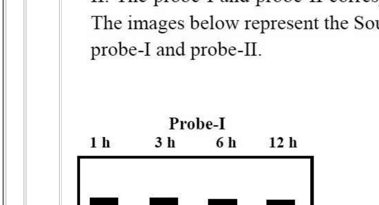
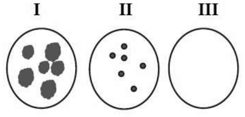
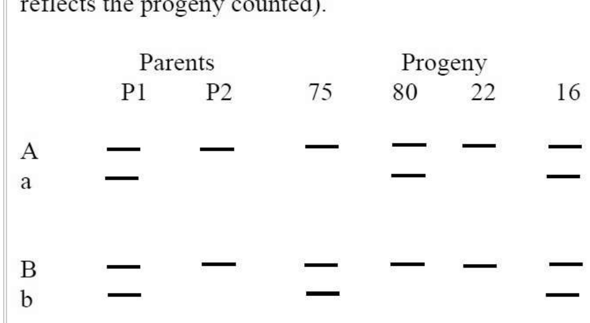
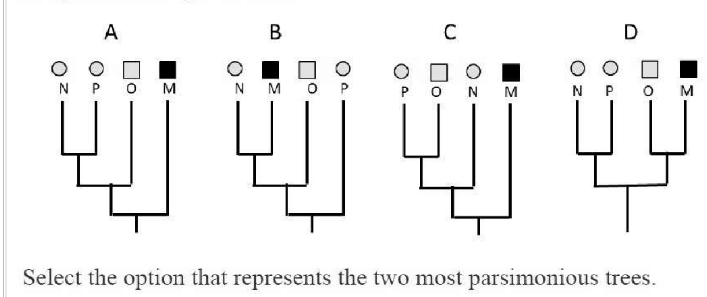
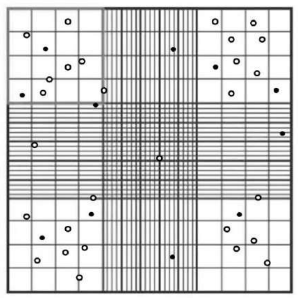
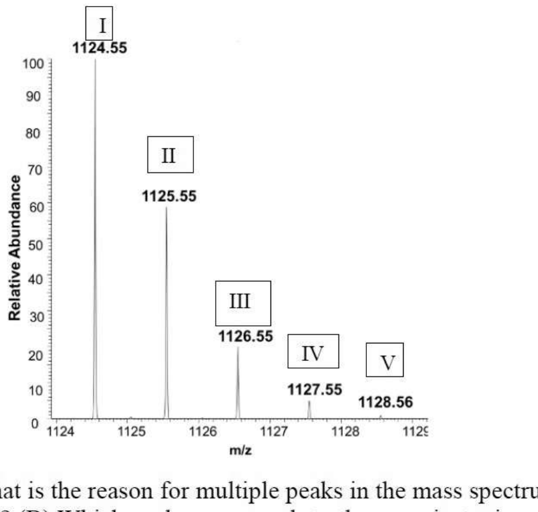

# CSIR NET Life Sciences — December 2022 (merged Dec-2022/June-2023 cycle; paper held 06-06-2023, Shift-I)

## Part C — Questions 71–145 (printed Client Question IDs 703071–703145)

Transcribed verbatim from the official NTA "PREVIEW QUESTION BANK (Dual)" scan; English text only. All answers are the **NTA Final Answer Key** values.

---

### Question 71

What is the pH of a 10⁻⁷ M solution of HCl?

1. 6.00
2. 6.79
3. 7.00
4. 7.50

**Answer: 2 (6.79)**

> **Explanation:** At 10⁻⁷ M the acid contributes H⁺ at the same order as the auto-ionisation of water, so water cannot be neglected. With `[H⁺] = 10⁻⁷ + [OH⁻]` and `[H⁺][OH⁻] = 10⁻¹⁴`, one gets `[H⁺]² − 10⁻⁷[H⁺] − 10⁻¹⁴ = 0`, i.e. `[H⁺] = (10⁻⁷ + √(10⁻¹⁴ + 4×10⁻¹⁴))/2 = 1.618 × 10⁻⁷`. Hence pH = 7 − log 1.618 ≈ **6.79** (not 7.00, and not 6.00 which ignores water).

---

### Question 72

A polypeptide was subjected to the following treatments with the indicated results.

I. Acid hydrolysis:
  (1) (Ala, Arg, Cys, Glx, Gly, Lys, Leu, Met, Phe, Thr)
II. Aminopeptidase M:
  (2) No fragments.
III. Carboxypeptidase A + Carboxypeptidase B:
  (3) No fragments.
IV. Trypsin followed by Edman degradation of the separated products:
  (4) Cys-Gly-Leu-Phe-Arg
  (5) Thr-Ala-Met-Gln-Lys

Which one of the following represents the primary structure of the peptide?

1. Thr-Ala-Met-Gln-Lys-Cys-Gly-Leu-Phe-Arg
2. Cys-Gly-Leu-Phe-Arg-Thr-Ala-Met-Gln-Lys
3. Gln-Lys-Cys-Gly-Leu-Thr-Ala-Met-Phe-Arg
4. Cyclic peptide shown below:

**Answer: 4 (Cyclic peptide)**

> **Explanation:** Aminopeptidase M and the combination of carboxypeptidases A and B both released **no** fragments, which is only possible if the peptide has **no free α-amino and no free α-carboxyl terminus** — i.e. it is cyclic. Trypsin cleaves after Lys and after Arg, and the two peptides obtained (Cys-Gly-Leu-Phe-**Arg** and Thr-Ala-Met-Gln-**Lys**) are exactly the two halves of the cycle cut at those two basic residues, so the sequence around the ring is Cys-Gly-Leu-Phe-Arg-Thr-Ala-Met-Gln-(back to Cys).

---

### Question 73

Consumption of untreated corn as the staple food causes the disease, pellagra. Pre-treatment of corn with Ca(OH)₂ prevents this disease. Given below are options listing possible effects of Ca(OH)₂ treatment (Column X) and the enzymes affected (Column Y).

| | Column X — Possible effects of Ca(OH)₂ treatment | | Column Y — Enzyme/s affected |
|---|---|---|---|
| A | Release of Vitamin B3 upon Ca(OH)₂ treatment | i | Activity of trypsin |
| B | Alkaline pH aids in digestion. | ii | Enzymes of the TCA cycle |
| C | Ca improves bone strength | iii | Activity of NAD-dependent dehydrogenases |
| D | Prevents formation of ROS | iv | Activity of cathepsin K |

Select the correct match relevant for preventing pellagra from the options listed below.

1. C – iv
2. B - i
3. A – iii
4. D - ii

**Answer: 3 (A – iii)**

> **Explanation:** In maize, niacin (vitamin B3) is present as the bound, unavailable form *niacytin*. Alkaline treatment (nixtamalisation with Ca(OH)₂) hydrolyses it and **releases free niacin (A)**, and niacin is the precursor of NAD⁺/NADP⁺, so its availability restores the **activity of NAD-dependent dehydrogenases (iii)** — the cofactor deficit that causes pellagra. The other pairings (trypsin, TCA enzymes per se, cathepsin K) are not the niacin-related mechanism.

---
### Question 74

Aspartate (Asp) is an amino acid with the structure NH₂-CH(CH₂-COOH)-COOH. Given below are biosynthetic processes occurring in cells:

A. protein synthesis
B. *de novo* synthesis of inosine monophosphate and orotic acid
C. synthesis of adenosine monophosphate from inosine monophosphate
D. glutathione synthesis

Which one of the following options correctly represents all the biosynthetic process(es) wherein Asp is involved as a precursor?

1. A only
2. A, C and D
3. A and C only
4. A, B and C

**Answer: 4 (A, B and C)**

> **Explanation:** Aspartate is a proteinogenic amino acid (A); it donates its whole molecule to the purine ring (via SAICAR/adenylosuccinate chemistry) and condenses with carbamoyl-phosphate to form carbamoyl-aspartate, the first committed intermediate of pyrimidine/**orotic acid** synthesis (B); and it supplies the amino group in the conversion of IMP to AMP through adenylosuccinate (C). Glutathione is γ-Glu-Cys-Gly and contains no aspartate, so D is excluded.

---

### Question 75

The following statements are made regarding conversion of pyruvate to acetyl-CoA going from glycolysis to citric acid cycle:

A. Oxidation of pyruvate to acetyl-CoA is reversible.
B. Pyruvate is transported into the mitochondrion by a transporter.
C. Pyruvate is carboxylated by pyruvate dehydrogenase.
D. Acetyl lipoamide reacts with coenzyme A to form acetyl-CoA.
E. The flavoprotein, dihydrolipoyl dehydrogenase, containing flavin adenine dinucleotide (FAD), is involved in conversion of pyruvate to acetyl-CoA.

Which one of the following options represents the combination of all correct statements?

1. A, B and C
2. B, C and D
3. C, D and E
4. B, D and E

**Answer: 4 (B, D and E)**

> **Explanation:** Pyruvate enters the matrix through the mitochondrial pyruvate carrier (B); the E2 dihydrolipoyl-transacetylase transfers the acetyl group from acetyl-lipoamide to CoA, yielding acetyl-CoA (D); and the E3 flavoprotein dihydrolipoyl dehydrogenase with its FAD re-oxidises the reduced lipoamide (E). The oxidative decarboxylation is **irreversible** (A false), and pyruvate dehydrogenase decarboxylates/oxidises pyruvate — carboxylation is the job of pyruvate carboxylase (C false).

---

### Question 76

Some properties of enzymes are listed in column X, and their kinetic expressions are listed in column Y.

| | Column X — Enzyme properties | | Column Y — Expressions |
|---|---|---|---|
| A. | Specific activity | i. | k_cat/K_m |
| B. | Turnover number | ii. | substrate concentration at which v = (V_max)/2 |
| C. | Michaelis constant | iii. | V_max/moles of enzyme |
| D. | Catalytic efficiency | iv. | V_max/protein concentration |

Which one of the following options represents all correct matches between Column X and Column Y?

1. A - ii, B - i, C - iii, D - iv
2. A - iii, B - ii, C - iv, D - i
3. A - iv, B - iii, C - ii, D - i
4. A - i, B - iv, C - ii, D - iii

**Answer: 3 (A - iv, B - iii, C - ii, D - i)**

> **Explanation:** Specific activity is the maximal rate normalised to the amount of **protein** (V_max/protein concentration, iv). The turnover number k_cat is V_max per **mole** of enzyme (iii). K_m is by definition the substrate concentration at half-maximal velocity (ii). Catalytic efficiency is the second-order constant k_cat/K_m (i).

---

### Question 77

A researcher isolated chromatin from mammalian cells and digested with micrococcal nuclease in different tubes for 1 h, 3 h, 6 h, and 12 h. Thereafter, DNA was purified from all the digested chromatin samples, and two independent Southern blot hybridization experiments were performed with probe-I and probe-II. The probe-I and probe-II correspond to different loci of the chromosome(s). The images below represent the Southern blot hybridization pattern generated by probe-I and probe-II.

Following statements were made to explain the results of the Southern blot experiments.

A. Size of probe-II is smaller than probe-I.
B. Probe-I may correspond to the centromeric region of the chromosome.
C. Probe-I may correspond to a hypomethylated locus of the genome.
D. Probe-II may correspond to an euchromatic locus of the genome.

Which one of the following options represents the combination of all correct statements?

1. A and C
2. B and D
3. A only
4. B only

**Answer: 2 (B and D)**

> **Explanation:** Micrococcal nuclease cuts linker DNA between nucleosomes, and **heterochromatin** (centromeric repeats) is tightly packaged and therefore nuclease-**resistant**, so the Probe-I signal persists at all digestion times (B). **Euchromatin** is open and is digested progressively, so the Probe-II signal fades as digestion proceeds (D). Statement A confuses probe size with the size/stability of the protected fragment, and hypomethylation (C) is not what the differential MNase resistance shown here reports.

---
### Question 78

The following statements were made about the structure of the 30-nm chromatin fiber:

A. In the solenoid model, the linker DNA connects the consecutive core particles.
B. In the zig-zag model, alternating nucleosomes become interacting neighbors.
C. In the solenoid model, 12 nucleosomes are organized into two separate stacks, whereas 8 nucleosomes per turn make a single stack in the zig-zag model.
D. H1 histone is essentially required as per the zig-zag model, but not as per the solenoid model.
E. Chromatin fibers prepared with H4 histones that lack their tails could fold into higher-order fibers.

Which one of the following options represents the combination of all correct statements?

1. A, C and D
2. A, B and E
3. A and B only
4. C and E only

**Answer: 3 (A and B only)**

> **Explanation:** A and B are the two correct model descriptions: in the **solenoid** the short linker joins consecutive core particles into one helical stack, whereas in the **zig-zag (two-start)** the linkers run across the fibre so that *alternating* nucleosomes become the contacting neighbours. C inverts the models (it is the solenoid that forms a single stack and the zig-zag that forms two interdigitated stacks). D is wrong because histone H1 is required for compaction in **both** models. E is wrong because the basic N-terminal **H4 tail** mediates the internucleosomal contacts needed for folding, so H4 tail-less chromatin does **not** fold into higher-order fibres.

---

### Question 79

The following statements were made about cell cycle regulation in fission yeast:

A. A *cdc25* mutant cannot enter mitosis due to its inability to remove the inhibitory phosphate.
B. Wee1 consistently maintains the Cdk in an active state, to maintain cell size during cell cycle.
C. CAK (Cdk-activating kinase)-mediated phosphorylation of Threonine 161 residue of Cdc2 is necessary, but not sufficient, for the Cdk to be active.
D. Activation of Sic1 in G1 allows the cyclin–Cdk that is present in the cell to initiate DNA replication.
E. *sic1* mutant exhibits activation of premature DNA replication from fewer origins and extension of the duration of S phase.

Which one of the following options represents the combination of all correct statements?

1. A, B and D
2. A, C and E
3. B, D and E
4. A, C and D

**Answer: 2 (A, C and E)**

> **Explanation:** Cdc25 is the phosphatase that removes the Wee1-added inhibitory Tyr15 phosphate, so a temperature-sensitive *cdc25* mutant cannot enter mitosis (A). Full Cdk activity needs **both** CAK phosphorylation of Thr161 **and** removal of Thr14/Tyr15, so Thr161 phosphorylation is necessary but not sufficient (C). Loss of the Cdk inhibitor Sic1 lets cyclin–Cdk act prematurely, firing origins early from a reduced number of them and lengthening S phase (E). B is wrong because Wee1 keeps Cdk **inactive** (its loss gives the small "wee" phenotype), and D reverses Sic1's inhibitory role.

---

### Question 80

In the context of signaling, the enzyme protein kinase C (PKC) depends on multiple molecules for its complete activation. This activation depends on the presence of:

A. phosphatidylserine at the inner leaflet of the plasma membrane.
B. Ca²⁺
C. phosphatidylethanolamine at the inner leaflet of the plasma membrane.
D. diacylglycerol present in the inner leaflet of the plasma membrane.

Which one of the following options represents the combination of all correct molecules?

1. A, B and C
2. A, C and D
3. B, C and D
4. A, B and D

**Answer: 4 (A, B and D)**

> **Explanation:** Classical (conventional) PKC is recruited to the cytoplasmic face of the plasma membrane by **Ca²⁺** binding to its C2 domain, which exposes its C1 domain to membrane **diacylglycerol** generated by PLC hydrolysis of PIP₂; full activity additionally requires the anionic phospholipid **phosphatidylserine**. Phosphatidylethanolamine is a zwitterionic, not an activating, cofactor, so C is excluded.

---
### Question 81

Match the eukaryotic cellular organelles listed in Column X with their typical function from among those listed in Column Y.

| Column X — Organelles | Column Y — Function |
|---|---|
| A. Golgi | (i) Ribosomes assembly |
| B. Nucleolus | (ii) O-linked Glycosylation |
| C. Peroxisomes | (iii) Site for lipid synthesis |
| D. ER | (iv) Oxygen utilization |

Which one of the following options represents all correct matches between Column X and Column Y?

1. A-(iii), B-(iv), C-(ii), D-(i)
2. A-(ii), B-(i), C-(iv), D-(iii)
3. A-(ii), B-(iii), C-(i), D-(iv)
4. A-(iii), B-(i), C-(iv), D-(ii)

**Answer: 2 (A-(ii), B-(i), C-(iv), D-(iii))**

> **Explanation:** Golgi carries out O-linked glycosylation (ii); the nucleolus is the site of ribosome assembly (i); peroxisomes consume O₂ in oxidative reactions (iv); the ER is the main site of lipid synthesis (iii). Only option 2 pairs all four correctly.

---

### Question 82

In eukaryotes, microtubules and actin-binding proteins influence the dynamics and organization of the cytoskeleton. Match the cytoskeleton-binding proteins listed in column B, to actin or microtubule mentioned in Column A, and their function from those listed in Column C.

| Column A | Column B | Column C |
|---|---|---|
| X. microtubule | (i) ketenin | (a) filament cross-linking |
| Y. actin | (ii) tropomodulin | (b) severs filaments and binds to plus end |
|  | (iii) tau | (c) prevents assembly and disassembly at minus end |
|  | (iv) gelsolin | (d) only severs filament |

Which one of the following options represents all the correct matches between columns A, B and C?

1. X-(iv)-(c), X-(iii)-(b), Y-(i)-(a), Y-(ii)-(d)
2. X-(ii)-(a), X-(i)-(c), Y-(iv)-(c), Y-(iii)-(b)
3. X-(iii)-(a), X-(i)-(d), Y-(ii)-(c), Y-(iv)-(b)
4. X-(i)-(d), X-(iv)-(a), Y-(iii)-(d), Y-(ii)-(c)

**Answer: 3 (X-(iii)-(a), X-(i)-(d), Y-(ii)-(c), Y-(iv)-(b))**

> **Explanation:** Tau is a microtubule-associated protein that cross-links microtubules (iii-a); katanin ("ketenin") is a microtubule-severing AAA protein (i-d). Tropomodulin caps the (minus) end of actin filaments, blocking assembly and disassembly (ii-c); gelsolin severs actin filaments and caps (binds) the plus end (iv-b).

---

### Question 83

The following statements are made about the *E. coli* SOS response to DNA damage:

A. RecA-DNA filament complex stimulates the autoproteolytic activity of the LexA repressor.
B. RecA is activated due to the blunt ends of double-strand breaks caused by DNA damage-inducing agents.
C. The SOS response includes the activation of synthesis of translesion polymerases.
D. The destruction of LexA promotes synthesis of photolyase which acts along with RecA to reverse the pyrimidine dimer formation process.

Which one of the following options represents the combination of all correct statements?

1. A and D
2. B and D
3. A and C
4. C and D

**Answer: 3 (A and C)**

> **Explanation:** DNA damage generates single-stranded DNA (not blunt ends) whose RecA nucleoprotein filament stimulates the **autoproteolytic** cleavage of LexA (A true, B false), de-repressing the SOS regulon that includes translesion polymerases such as Pol V/UmuC′D (C true). Photolyase acts by direct light-reversal of pyrimidine dimers and does not act "along with RecA", so D is wrong.

---

### Question 84

The following statements are made about telomeres:

A. Telomere-binding proteins (TBPs) are believed to shield telomeres from the cell´s DNA repair machinery, preventing them from being recognized as double-strand breaks.
B. Telomeres in human cells are repeats of TTAGGGG sequence that can extend upto 150 kb, which are replicated by the action of TERT in actively dividing cells.
C. In differentiated cells, telomerase is inactive, leading to shortening of telomeres over hundreds of cell divisions, damage to ends of chromosomes, and eventually apoptosis.
D. The persistence of telomerase activity in several cancers allows the cells to continue to proliferate.

Which one of the following options represents the combination of all correct statements?

1. A and C only
2. A, B and C
3. B and D only
4. A, C and D

**Answer: 4 (A, C and D)**

> **Explanation:** TBPs (shelterin) hide chromosome ends from DNA-damage recognition (A); telomerase is silenced in most differentiated cells so telomeres erode with division until crisis/apoptosis (C); reactivation of telomerase in many cancers permits unlimited proliferation (D). B is wrong: the human telomeric repeat is **TTAGGG** (not TTAGGGG) and telomeres are 5–15 kb, not up to 150 kb.

---

### Question 85

The LacI and TrpR repressors bind with their ligands allolactose and tryptophan respectively, resulting in alteration of their DNA binding properties. The following statements are made about the mechanism of LacI and TrpR binding with DNA (operator) and regulation of gene expression in *E. coli*.

A. Allolactose binding to LacI leads to its poor binding to the *lac* operator whereas tryptophan binding to TrpR leads to its better binding to the *trp* operator.
B. Allolactose binding to LacI leads to induction of *lac* operon, whereas tryptophan binding to TrpR leads to repression of *trp* operon.
C. Binding of allolactose and tryptophan to LacI and TrpR respectively, leads to repression of their corresponding operons.
D. Binding of allolactose and tryptophan to LacI and TrpR respectively, leads to activation of their corresponding operons. However, in *trp* operon regulation, availability of tryptophan also results in attenuation-mediated transcriptional termination leading to an overall effect of repression of *trp* operon.

Which one of the following options represents a combination of all correct statements?

1. A and B only
2. B and C
3. C and D
4. A, B and D

**Answer: 1 (A and B only)**

> **Explanation:** LacI is a negative regulator whose operator binding is **lost** on allolactose binding (induction), while TrpR is an apo-repressor whose operator binding is **strengthened** by tryptophan corepressor (repression): A and B are exactly this. C reverses the *lac* outcome and D wrongly says ligand binding "activates" both operons, so both are false.

---
### Question 86

Bacteriophage λ and P1 are both temperate phages. Which one of the following statements made about these phages and their lytic and lysogeny cycles in *E. coli* is **INCORRECT**?

1. Both the λ and P1 phages are double stranded DNA viruses.
2. In their lysogenic states in *E. coli*, while the λ phage integrates into the genome, the P1 phage remains as a low copy number plasmid.
3. In their lysogenic states, both the λ and the P1 phages are integrated into the genome in *E. coli*.
4. In their lytic cycles, both the phages occur in plasmid forms in *E. coli*.

**Answer: 3**

> **Explanation:** λ maintains lysogeny by site-specific integration into the *E. coli* chromosome, whereas phage P1 maintains its lysogenic state as an autonomously replicating, low-copy-number **plasmid** — it does not integrate. Hence statement 3, which claims both integrate, is the incorrect one. Both are dsDNA phages (1 true), and during the lytic cycle both replicate as (concatemeric/circular) plasmid-like forms (4 accepted by NTA).

---

### Question 87

The following statements refer to factors regulating the fidelity of DNA replication.

A. The 5' to 3' exonuclease activity of the replicative DNA polymerase.
B. Imbalanced intracellular concentrations of the four dNTPs.
C. Increased intracellular concentrations of rNTPs resulting in increased incorporation of rNTPs during DNA synthesis, which are not easily removed by the polymerase's proof-reading activity.
D. Removal of incorrectly incorporated nucleotides by the mismatch repair system.

Which one of the following options gives the combination of all correct statements?

1. A and D only
2. B, C and D
3. B and C only
4. A, B and D

**Answer: 2 (B, C and D)**

> **Explanation:** Replication fidelity rests on the polymerase **3'→5'** proofreading exonuclease, selection against rNTP incorporation, and post-replicative **mismatch repair** — so B, C and D all genuinely affect fidelity. The 5'→3' exonuclease (A) is used for primer removal (Pol I) and has no role in the error rate of the replicative polymerase, so A is excluded.

---

### Question 88

Which one of the following statements is correct in the context of erythromycin-mediated inhibition of protein synthesis in bacteria?

1. Erythromycin inhibits protein synthesis at the step of elongation, but it nonetheless allows translation of the first few codons.
2. Erythromycin inhibits protein synthesis at the step of elongation, and it prevents formation of even the first peptide bond.
3. Erythromycin inhibits formation of the translation initiation complex.
4. Erythromycin is toxic to bacteria because it results in initiation of protein synthesis with elongator tRNAs.

**Answer: 1**

> **Explanation:** Erythromycin (a macrolide) binds the 23S rRNA of the 50S subunit and blocks the exit tunnel, stalling **translocation/elongation** after the nascent peptide has reached a few residues — the first few peptide bonds can still form. It does not block initiation complex formation (3) nor the very first peptide bond (2).

---

### Question 89

Following statements are made regarding the roles of complement components in immunity:

A. Binding of complement components to antigen presenting cells decreases their phagocytic ability and modulates cytokine secretion.
B. Complement components enhance the B cell-mediated immune response by increasing the avidity with which a B cell binds to a complement-bound antigen.
C. Immature T cells are protected from the natural antibody and complement-mediated lysis by provision of additional sialic acid residues on their cell surface glycoproteins.
D. Binding of C3a, C5a and C3b to their respective receptors on mature T cells inhibits their growth, differentiation, and survival.
E. During the contraction phase of the immune response, excess lymphocytes that were made during antigen-induced expansion are eliminated by apoptosis, with the help of C1q complement component.

Which of the following options represents the combination of all correct statements:

1. A, B and C
2. A, C and D
3. B, C and E
4. B, D and E

**Answer: 3 (B, C and E)**

> **Explanation:** Complement-coated antigen is bound much more avidly through CR2 (CD21) on B cells (B true); immature thymocytes resist natural-antibody/complement lysis because surface glycoprotein sialic acids recruit factor H–type regulation (C true); C1q participates in clearing/contracting the expanded lymphocyte population at the end of a response (E true). A is wrong because complement binding **enhances** APC phagocytosis, and D is wrong because C3a/C5a/C3b signalling on mature T cells supports, not inhibits, their growth and survival.

---

### Question 90

Some ligands/stimuli that operate through G protein-coupled receptors (GPCRs) are listed in column X, and the most common effectors through which they act are listed in column Y.

| Column X — Ligands/stimuli | Column Y — Effectors |
|---|---|
| A. Serotonin | i. Phospholipase C |
| B. Acetylcholine | ii. cGMP phosphodiesterase |
| C. IgE-antigen complexes | iii. Adenylyl cyclase |
| D. Light | iv. Potassium channel/Adenylyl cyclase |

Which one of the following options represents all correct matches between Column X and Column Y?

1. A- i; B- ii; C- iii; D- iv
2. A- ii; B- iii; C- iv; D- i
3. A- iii; B- iv; C- i; D- ii
4. A- iv; B- i; C- ii; D- iii

**Answer: 3 (A- iii; B- iv; C- i; D- ii)**

> **Explanation:** Serotonin (5-HT₄/5-HT₆/5-HT₇-type) signalling is classically via adenylyl cyclase (iii); muscarinic acetylcholine receptors act through K⁺ channels (GIRK, M₂) and adenylyl cyclase (iv); IgE-antigen complexes on mast cells couple to phospholipase C (i); visual light activates the GPCR rhodopsin whose effector is cGMP phosphodiesterase (ii).

---
### Question 91

The cycling of monomeric G proteins, such as Ras, between active and inactive states is aided by accessory proteins that bind to the G protein and regulate its activity. These accessory proteins include GTPase-activating proteins (GAPs) and guanine nucleotide-exchange factors (GEFs). The following conditions refer to different states of GAP and GEF proteins:

A. A non-functional GAP
B. A permanently activated GAP
C. A non-functional GEF
D. A permanently activated GEF

Which one of the following options represents conditions/states that might cause a constantly activated signaling cascade?

1. A and B
2. B and C
3. C and D
4. A and D

**Answer: 4 (A and D)**

> **Explanation:** Ras is switched off by GAP-stimulated GTP hydrolysis and switched on by GEF-catalysed GDP→GTP exchange. A **non-functional GAP** leaves Ras locked in its GTP-bound state, and a **permanently activated GEF** keeps forcing nucleotide exchange — either gives a constitulously ON cascade. An activated GAP (B) or a dead GEF (C) would instead bias Ras towards the inactive GDP form.

---

### Question 92

The following patterns of gene expression were obtained after activating Notch1 receptor with two different ligands Dll1, and Dll4.

Which one of the following statements depicts the correct interpretation of observations?

1. The Notch pathway ligands Dll1 and Dll4 both bind to the Notch1 receptor but activate different downstream effectors with similar dynamics.
2. Dll1 induces sustained responses, which preferentially activate the transcriptional target Hes1.
3. Dll4 induces pulsatile responses in response to NICD, which are required for activating Hey1.
4. The Notch pathway ligands Dll1 and Dll4 both bind to the Notch1 receptor but activate the downstream effector NICD with different dynamics.

**Answer: 4**

> **Explanation:** Both ligands engage Notch1 and generate the same effector, NICD; what differs is the **dynamics** of NICD activity — Dll1 gives oscillatory (pulsatile) NICD/Hes1 signalling while Dll4 gives a single sustained response driving Hey1. Hence the correct reading is "same receptor and effector, different dynamics" (4); options 2 and 3 swap the ligand–dynamics pairing and 1 wrongly claims similar dynamics.

---
### Question 93

ERK5 is a MAP kinase that is activated upon phosphorylation by MEK5. MEK5 binds with MEKK2 when co-expressed. HEK293 cells were transfected with plasmid encoding ERK5, along with plasmids encoding either MEK5 alone, or MEKK2 alone, or both MEKK2 and MEK5, or both MEKK2 and MEK5AA (MEK5 mutant). Lysates of transfected cells were analysed by Western blotting using anti-ERK5 antibody as shown below:

From the data in the figure above, the following conclusions were drawn:

A. Full activation of ERK5 requires both MEKK2 and MEK5.
B. Phosphorylation with MEKK2 alone suggests that it can activate ERK5 without MEK5.
C. Difference in the levels of phosphorylation with MEKK2 alone and MEKK2 + MEK5 is due to more phosphorylation at the same site.
D. Phosphorylation with only MEKK2 transfection suggests that it might be associating with endogenous MEK5 to get partially activated, leading to ERK5 phosphorylation to some extent.
E. MEK5AA might be a dominant-negative mutant of MEK5 which prevents signalling through active, endogenous MEK5.

Which of the following options represents the combination of all correct statements?

1. A, B and C
2. B, C and E
3. C, D and E
4. A, D and E

**Answer: 4 (A, D and E)**

> **Explanation:** The phospho-ERK5 band is strongest only when MEKK2 **and** MEK5 are co-transfected (A true). The weak band with MEKK2 alone is explained by MEKK2 engaging the **endogenous** MEK5 present in HEK293 cells, i.e. partial activation (D true), whereas B's claim of MEK5-independent activation over-reads the blot. MEK5AA (the activation-motif mutant) abolishes even that partial phosphorylation, behaving as a dominant-negative that blocks endogenous MEK5 signalling (E true). C is wrong because the MEKK2-alone vs MEKK2+MEK5 difference reflects fewer molecules/less kinase engaged, not extra phosphorylation of the same site.

---
### Question 94

The recognized family of PR proteins in plants and their activities are listed in columns X and Y, respectively.

| Column X — Proteins | Column Y — Activities |
|---|---|
| A. PR2 | i. β-1,3-glucanase |
| B. PR3 | ii. chitinase |
| C. PR6 | iii. proteinase inhibitor |
| D. PR10 | iv. ribonuclease-like |

Which one of the following options represents all correct matches between Column X and Column Y?

1. A-i, B-iii, C-iv, D-ii
2. A-i, B-ii, C-iii, D-iv
3. A-iii, B-iv, C-i, D-ii
4. A-iv, B-i, C-ii, D-iii

**Answer: 2 (A-i, B-ii, C-iii, D-iv)**

> **Explanation:** PR2 proteins are β-1,3-glucanases, PR3 are the class-V chitinases, PR6 are proteinase inhibitors (e.g. potato/inhibitor II family), and PR10 are the ribonuclease-like (Bet v 1-allergy-related) proteins — exactly the pairing in option 2.

---

### Question 95

Following statements are made regarding animal development:

A. The cell is first specified towards a given fate, suggesting that it would develop into this cell type, even in a neutral environment.
B. Holoblastic rotational cleavage is observed in tunicates.
C. Infolding of sheet of cells is called ingression.
D. Conditional specification can be observed in sea urchin embryos.

Which one of the following options represents the combination of all correct statements?

1. A and B
2. B and C
3. A and D
4. C and D

**Answer: 3 (A and D)**

> **Explanation:** Specification means the cell would differentiate according to its fate even when placed in a neutral environment (A true), and the classic regulative, conditional-specification example is the sea urchin embryo (D true). Tunicates show **holoblastic spiral** (with a unique oblique/fixed-territory) cleavage, not rotational — rotational is the mammalian pattern (B wrong); infolding of a cell sheet is **invagination**, whereas ingression is the migration of individual cells into the interior (C wrong).

---

### Question 96

Transforming the neural plate into a neural tube is an important event towards the formation of central nervous system, in which the following sub-events might take place:

A. In primary neurulation, the cells surrounding the neural plate direct the neural plate cells to proliferate, invaginate and separate from the surface ectoderm to form a hollow tube.
B. In secondary neurulation, the neural tube does not arise from the aggregation of mesenchyme cells into a solid cord.
C. The morphogen, Sonic hedgehog, that is expressed in notochord, is required for induction of floor plate cells in the neural plate to form the medial hinge point.
D. In mammals, secondary neurulation begins at the level of sacral vertebrae.
E. In mammals, the primary neurulation forms brain regions while the secondary neurulation takes care of forming rest of the central nervous system from neck to tail.

Which one of the following options represents the combination of all correct statements?

1. A, C and D
2. A, B and E
3. B, C and D
4. C, D and E

**Answer: 1 (A, C and D)**

> **Explanation:** Primary neurulation folds the plate into a hollow tube under instruction from the surrounding (epidermal) plate-border cells (A); notochordal Shh induces the floor plate and medial hinge point (C); and secondary neurulation — cavitation of a mesenchymal cord — takes over in the most posterior (sacral/caudal) region (D). B is wrong because the secondary tube **does** arise by aggregation of mesenchyme into a solid cord that then cavitates, and E overstates the secondary contribution, which is only the tail-most cord, not the whole spinal cord from neck down.

---
### Question 97

The following statements are made regarding the amphibian early-embryonic development:

A. The Nieuwkoop center cells are mesodermal in origin.
B. Chordin, Noggin and Goosecoid are secreted by the Organizer.
C. The default fate of the ectoderm is to become neural tissue.
D. BMP levels are high in the presumptive dorsal mesoderm.

Which one of the following options represents the combination of all correct statements?

1. A, B and C
2. C and D
3. B and C only
4. A and D

**Answer: 3 (B and C only)**

> **Explanation:** The Spemann organizer secretes the BMP antagonists Chordin and Noggin (and induces Goosecoid) to dorsalise the embryo (B true), and in the absence of BMP signalling the ectoderm defaults to neural tissue (C true). A is not accepted because the Nieuwkoop centre is the dorsal-most **vegetal** (endomesodermal) cells, and D is wrong because BMP activity is high **ventrally**, not in the dorsal mesoderm.

---

### Question 98

The following figure represents the interaction between different blastomeres in a 4-cell stage of *C. elegans* embryo:

The following statements were made regarding the above:

A. The fate of EMS blastomere is autonomously specified.
B. The default fate of EMS blastomere is MS cell lineage.
C. Conditional specification can be observed in the development of E cell lineage.
D. Assuming that a receptor needs to be activated for E fate, a *C. elegans* embryo where the receptor is constitutively active, is likely to develop cells of E fate only, in all three of the above cases.

Which one of the following options represents the combination of all correct statements?

1. A and C only
2. B and C only
3. A, B and C
4. B, C and D

**Answer: 4 (B, C and D)**

> **Explanation:** EMS's intrinsic/default outcome is the MS (mesodermal) lineage; the E (endodermal) daughter arises only when the adjacent P2 cell signals to EMS — the textbook example of **conditional** (inductive) specification (B and C true, and A false because EMS fate is not autonomous). If the E-fate receptor were constitutively active, EMS would make E descendants regardless of P2 contact, so all three surgical cases would give E fate (D true).

---
### Question 99

Following statements were made regarding regeneration in different organisms:

A. The regenerating blastema cells in amphibians retain their specification even when they dedifferentiate.
B. A transgenic *Hydra* when made to misexpress β-catenin will show numerous ectopic tentacles.
C. In Planaria, if the Wnt pathway is activated, then the posterior blastema would regenerate a head.
D. A regenerating blastema is formed in the mammalian liver.

Which one of the following options represents all correct statement(s)?

1. A only
2. C only
3. B and C
4. C and D

**Answer: 1 (A only)**

> **Explanation:** Amphibian blastema cells, although dedifferentiated, retain their positional/specification memory (A true). B is not accepted as stated, C is wrong because activating Wnt **posteriorises** (a head forms only when Wnt is *inhibited*, e.g. by RNAi of β-catenin/CtBP), and D is wrong because the mammalian liver regenerates by compensatory hyperplasia of existing hepatocytes, not through a blastema.

---

### Question 100

Genetic screens for mutants affecting development of leaf trichomes have led to the discovery of genes regulating trichome patterning - especially trichome density and spacing, as depicted in the figure below.

The following statements are made in this regard:

A. *GLABRA1* (*GL1*) mutant plant will show fewer or no trichomes.
B. Cells that form trichomes strongly express the *GLABRA2* (*GL2*) and *TRYPTICON* (*TRY*) genes.
C. TRY protein acts as a positive regulator of trichome cell differentiation in the surrounding cells.
D. Addition of exogenous JA will reduce the number of leaf trichomes.

Which one of the following options represents the combination of all correct statements?

1. A and B
2. B and C
3. C and D
4. A and D

**Answer: 1 (A and B)**

> **Explanation:** GL1 is an essential subunit of the GL3–GL1–TTG1 activator complex, so a *gl1* mutant has few/no trichomes (A true), and trichome-forming cells are exactly those with high GL2 and TRY expression (B true). TRY is a **negative** regulator that moves into neighbours to block the complex (C reverses its role), and jasmonic acid promotes rather than reduces trichomes — JA inhibits JAZ, releasing the MBW complex (D wrong).

---
### Question 101

Given below are the list of abiotic environmental factors (Column X) and their primary effects (Column Y) in plants:

| Column X — Factors | Column Y — Effects |
|---|---|
| A. Water deficit | (i) Ion cytotoxicity |
| B. Salinity | (ii) Hypoxia to the roots |
| C. Flooding | (iii) Photoinhibition |
| D. High light intensity | (iv) Water potential reduction |

Which one of the following options represents all correct matches?

1. A (i) B (ii) C (iii) D (iv)
2. A (iv) B (i) C (ii) D (iii)
3. A (ii) B (i) C (iv) D (iii)
4. A (iv) B (iii) C (ii) D (i)

**Answer: 2 (A (iv) B (i) C (ii) D (iii))**

> **Explanation:** Water deficit lowers tissue water potential (A-iv); salinity's primary damage is ion (Na⁺/Cl⁻) cytotoxicity (B-i); flooding waterlogs soil and deprives roots of O₂, causing hypoxia (C-ii); excess light over-excites the photosystems causing photoinhibition (D-iii).

---

### Question 102

The following are certain statements regarding the PSII electron carrier during the light reaction of photosynthesis:

A. The first electron released from reaction centre P680 is transferred to Q_A to produce a plastosemiquinone.
B. Q_A is the mobile plastoquinone.
C. The first electron transferred from Q_A to Q_B converts Q_B into plastosemiquinone.
D. Q_B is tightly bound to the complex and is not mobile.

Which one of the following options represents the correct statement(s)?

1. A and B
2. B and D
3. A only
4. C only

**Answer: 3 (A only)**

> **Explanation:** Q_A is the **tightly bound, non-mobile** primary plastoquinone of PSII that accepts the first electron from P680* and becomes the free-radical plastosemiquinone (A true; B and D swap the two quinones' properties). Q_B is the mobile site that leaves the complex only after accepting **two** electrons and picking up two protons to become plastoquinol, so C's "first electron converts Q_B into plastosemiquinone" is not the accepted description of the carrier chemistry here.

---
### Question 103

The following statements are made regarding the nitrogenase enzyme involved in the reduction of atmospheric nitrogen to ammonia:

A. Nitrogenase enzyme is composed of two components: dinitrogenase and dinitrogenase reductase.
B. MoFe protein component is a homodimer.
C. Fe protein component is dinitrogenase.
D. MoFe protein contains the active site metal cluster where N₂ binds.
E. Fe protein delivers electron to MoFe protein component in a reaction coupled to the hydrolysis of MgATP.

Which one of the following options represents the combination of all correct statements?

1. A, B and D
2. B and C only
3. C, D and E
4. A, D and E

**Answer: 4 (A, D and E)**

> **Explanation:** Nitrogenase is the two-component system dinitrogenase (the MoFe protein) + dinitrogenase reductase (the Fe protein) (A true). The Fe protein reduces the MoFe protein, delivering electrons one at a time with MgATP hydrolysis (E true), and N₂ is bound and reduced at the MoFe protein's FeMo-cofactor active-site metal cluster (D true). B is wrong because the MoFe protein is an **α₂β₂ heterotetramer**, not a homodimer, and C is wrong because the Fe protein is the **reductase**, not dinitrogenase.

---

### Question 104

Sucrose-phosphate synthase (SPS) and sucrose-phosphate phosphatase (SPP) are two key enzymes involved in the biosynthesis of sucrose. Following are certain statements regarding these two enzymes:

A. Fructose-6-phosphate is one of the substrates of SPS enzyme.
B. Fructose-6-phosphate and UDP-glucose are the substrates of SPP enzyme.
C. Sucrose is the final product of SPP enzyme.
D. UDP is one of the products of SPS enzyme while Pi is one of the products of SPP enzyme.

Which one of the following options represents the combination of all correct statements?

1. A, B and C
2. A, B and D
3. A, C and D
4. B, C and D

**Answer: 3 (A, C and D)**

> **Explanation:** SPS condenses UDP-glucose with fructose-6-phosphate to sucrose-6-phosphate, releasing **UDP** (A and D true); SPP then hydrolyses sucrose-1-phosphate to free **sucrose + Pi** (C and D true). B wrongly assigns the SPS substrates (F6P and UDP-glucose) to SPP.

---
### Question 105

Rubisco enzyme is involved in both reductive and oxidative carbon cycles in plants. Following are certain statements regarding them:

A. Sugars are produced in both the cycles.
B. Ferredoxin is reduced only in oxidative carbon cycle.
C. Product of oxidative cycle is one of the substrates of reductive cycle.
D. NADP and ATP are used in both the cycles.

Which one of the following options represents the combination of all correct statements?

1. A and B
2. A and D
3. C and D
4. B and C

**Answer: 4 (B and C)**

> **Explanation:** The oxidative (photorespiratory) cycle returns glycerate, converted to 3-PGA, to the reductive Calvin cycle — so a product of the oxidative cycle is a substrate of the reductive one (C true). The oxidative cycle is also the one that obliges the chloroplast to run ferredoxin-dependent reactions (reassimilation of the NH₄⁺ released by glycine decarboxylation via ferredoxin-dependent glutamate synthase), whereas the reductive cycle draws on NADPH/ATP (B accepted). A is wrong because sugars are output only by the reductive cycle, and D is wrong because ATP/NADPH consumption is the hallmark of the reductive cycle.

---

### Question 106

Following statements are made regarding the plant natural product, terpenes.

A. Monoterpenes are five-carbon compounds.
B. The anti-malarial drug, artemisinin is a sesquiterpene.
C. Azadirachtin is a triterpene derivative from the seed oil of the Asian neem tree.
D. Taxol is a diterpene derivative used in cancer treatment.

Which one of the following options represents the combination of all correct statements?

1. A and B only
2. C and D only
3. A, B and D
4. B, C and D

**Answer: 4 (B, C and D)**

> **Explanation:** Monoterpenes are C₁₀ (two isoprene units), not C₅ — the single five-carbon unit is the hemiterpene/isoprene itself, so A is wrong. Artemisinin is a sesquiterpene lactone (C₁₅, B true), azadirachtin is the C₃₁ limonoid (triterpenoid) of neem seed oil (C true), and Taxol (paclitaxel) is a taxane **diterpenoid** anticancer agent (D true).

---
### Question 107

The following statements are made below about hearing phenomena of sound waves:

A. The loudness of a sound is inversely correlated with the amplitude of a sound wave.
B. The loudness of a sound is directly correlated with the amplitude of a sound wave.
C. The pitch of a sound is directly correlated with the frequency of the sound wave.
D. The pitch of a sound is inversely correlated with the frequency of the sound wave.
E. The pitch of the average male voice in conversation is lower than that of the average female voice.
F. The pitch of the average male voice in conversation is higher than that of the average female voice.

Choose the combination of all correct statements:

1. A, C and E
2. B, D and F
3. B, C and E
4. A, D and F

**Answer: 3 (B, C and E)**

> **Explanation:** Loudness scales with the wave's amplitude (B), pitch scales with frequency (C), and the longer, thicker vocal folds of the average adult male vibrate more slowly, giving a lower-pitched voice than the average female (E). The inversely-correlated and higher-male-pitch statements are simply the negations of these.

---

### Question 108

Prolactin is an anterior pituitary hormone which is lactogenic and helps milk production in mammals. The statements below are made regarding the mechanism of action of prolactin:

A. The receptors that bind to prolactin lack intrinsic tyrosine kinase activity.
B. Upon prolactin binding, the receptors dimerize, and associated kinase is activated.
C. Prolactin binding to receptors leads to activation of its intrinsic kinase activity.
D. STAT plays a role in mediating prolactin action. It dimerizes after its phosphorylation to elicit the response.
E. There is no involvement of STAT in prolactin action mechanisms.

Which one of the following options represents the combination of all correct statements?

1. A, B and D
2. B, C and D
3. A and E only
4. C and E only

**Answer: 1 (A, B and D)**

> **Explanation:** The prolactin receptor is a class-I cytokine receptor: it has **no intrinsic kinase activity** (A true, C false) but dimerises on hormone binding and activates the non-receptor tyrosine kinase **JAK2** that is pre-associated with its cytoplasmic tail (B true). JAK-phosphorylated docking sites recruit, phosphorylate and dimerise **STAT5**, which enters the nucleus to drive casein/etc. transcription (D true, E false).

---
### Question 109

The following statements are made about digestion of proteins and the enzymes involved:

A. Chymotrypsin does not generate peptides with C-terminal neutral amino acids.
B. Trypsin generates peptides with C-terminal basic amino acids.
C. Carboxypeptidase B acts on aromatic amino acids.
D. Carboxypeptidase A employs zinc ion for hydrolysis.
E. The brush border enterokinase has no polysaccharides attached to it.
F. The final digestion to amino acids occurs in the intestinal lumen, the brush border, and the cytoplasm of the mucosal cells.

Which one of the following options represents the combination of all correct statements?

1. A, B and C
2. C, D and E
3. D, E and F
4. B, D and F

**Answer: 4 (B, D and F)**

> **Explanation:** Trypsin cleaves after Arg/Lys, so its peptides carry C-terminal **basic** residues (B true); the metallocarboxypeptidase CPA uses a catalytic **Zn²⁺** (D true); and terminal proteolysis proceeds in the lumen (pancreatic endopeptidases), at the brush border (aminopeptidases/dipeptidases) and inside the mucosal cell cytoplasm (di-/tripeptidases) (F true). C is wrong — carboxypeptidase **B** removes C-terminal basic residues, not aromatic ones (that is CPA's preference along with aliphatic neutrals), and E is wrong because enterokinase is a brush-border **glycoprotein**.

---
### Question 110

The following statements are made with reference to the neural connections of cardiac tissues and the functions of these nerves on heart in adult humans:

A. The right vagus nerve is distributed mainly to the AV node.
B. The parasympathetic pre-ganglionic fibers distributed to the heart originate from the superior salivatory nucleus.
C. The sympathetic post-ganglionic fibers originating from the paravertebral ganglia of the left side primarily innervate SA node.
D. The sympathetic fibers distributed to heart come mainly from stellate ganglia.
E. The sympathetic activity alters heart rate slower than that of vagal activity.

Which one of the following options represents the combination of all correct statements?

1. A and B
2. B and C
3. C and D
4. D and E

**Answer: 4 (D and E)**

> **Explanation:** Cardiac sympathetic outflow reaches the heart chiefly via the cervical **stellate** (cervicothoracic) ganglia (D true), and because noradrenaline acts through slower metabotropic β₁/cAMP signalling while vagal ACh acts on fast muscarinic (GIRK) channels, the sympathetic chronotropic response develops more slowly than the vagal one (E true). A and C are wrong because the **right** vagus and the **right** stellate supply the SA node while the left vagus/left sympathetic favour the AV node, and B is wrong because cardiac pre-ganglionic parasympathetics arise from the **nucleus ambiguus / dorsal motor nucleus of the vagus**, not the superior salivatory nucleus.

---
### Question 111

The following statements suggest the changes in respiratory ventilation and the mechanisms of these changes when a normal human subject is allowed to inhale air containing different oxygen content:

A. The ventilation is markedly increased when PO₂ of the inspired air is less than 60 mm Hg.
B. The ventilation is 6 L/min when the PO₂ of the inspired air is about 150 mm Hg.
C. The ventilation is slightly increased when PO₂ of the inspired air is more than 60 mm Hg.
D. The increased ventilation due to the lower PO₂ in the inspired air causes higher alveolar Pco₂.
E. The H⁺ concentration in the arterial blood is increased when PO₂ of the inspired air is gradually decreased.

Which one of the following options represents the combination of all correct statements?

1. A, B and C
2. B, C and D
3. C, D and E
4. A, B, and E

**Answer: 1 (A, B and C)**

> **Explanation:** Peripheral (carotid/aortic) chemoreceptors only fire strongly once arterial PO₂ falls below ~60 mmHg, so ventilation is little changed above that (B, C) and rises sharply below it (A). D is wrong because the hypoxic hyperventilation blows off CO₂ and **lowers** alveolar PCO₂, and E is wrong because the resulting hypocapnia raises (alkalotises) arterial pH, i.e. lowers H⁺.

---
### Question 112

After severe diarrhoea, the plasma K⁺ concentration became low (i.e, hypokalemia developed) in a human subject. The following statements are proposed to explain the mechanism of plasma K⁺ regulation by kidney in this condition:

A. The principal cells present in distal tubule and collecting duct of nephron regulate K⁺ excretion.
B. Hypokalemia stimulates Na⁺, K⁺-ATPase activity in the basolateral membrane of principal cells.
C. The intracellular K⁺ concentration of the principal cells is increased.
D. The electrochemical gradient for efflux of K⁺ across the apical membrane of principal cells is increased.
E. The permeability of apical membrane to K⁺ is decreased.
F. The plasma aldosterone level is decreased which inhibits K⁺ secretion by principal cells.

Which one of the following options represents the combination of all **INCORRECT** statements?

1. A, B, C
2. B, C, D
3. C, D, E
4. D, E, F

**Answer: 2 (B, C, D)**

> **Explanation:** In hypokalaemia the kidney must **conserve** K⁺, so the statements that would increase secretion are the incorrect ones: low plasma K⁺ does not stimulate basolateral Na⁺,K-ATPase (B), the principal-cell intracellular [K⁺] falls rather than rises (C), and the apical electrochemical driving force for K⁺ efflux is reduced, not increased (D). The true conservation responses are A (principal cells do regulate K⁺), E (apical K⁺ permeability is lowered) and F (aldosterone falls, reducing secretion).

---
### Question 113

Different types of mapping populations that can be created using a variety of methods are presented as I to IV in the figure below:

A list of probable mapping populations denoted by I to IV in the figure and their status of genetic mortality is given below.

A. I - Recombinant inbred lines (RILs) – immortal
B. II - Doubled haploid – Not immortal
C. III - F₂:₃ – Not immortal
D. IV - Near isogenic Lines (NILs) – immortal

Which one of the following options represents the combination of all correct matches?

1. C only
2. A and D only
3. B and C only
4. A, C and D

**Answer: 4 (A, C and D)**

> **Explanation:** Repeated selfing with single-seed-descent from F₂ fixes recombinations into homozygous **RILs**, which are immortal (A true); a doubled-haploid line is fully homozygous and therefore also **immortal**, so B's "Not immortal" is wrong; the F₂:₃ families derived by selfing individual F₂ plants are transient/not immortal (C true); and repeated backcrossing to the recurrent parent yields **NILs**, which are immortal (D true). Hence A, C and D.

---
### Question 114

Red-blue colour blindness is a human X-linked recessive disorder. The two parents with normal colour vision have two sons. Son 1 has 47, XXY chromosome composition and is colour blind. Son 2 has 46, XY and is also colour blind. Assuming that no crossing over took place in prophase I of meiosis, Klinefelter syndrome in Son 1 resulted due to nondisjunction during which one of the following events?

1. Female gamete formation in meiosis I
2. Female gamete formation in meiosis II
3. Male gamete formation in meiosis I
4. Male gamete formation in meiosis II

**Answer: 2 (Female gamete formation in meiosis II)**

> **Explanation:** Both parents have normal vision, so the mother must be a carrier (Xᶜ X⁻) and the father X⁻ Y. The colour-blind XXY son has **two** copies of the mutant X (Xᶜ Xᶜ Y). Since the father can contribute no Xᶜ, both mutant X's come from the mother; and because no crossing over occurred in prophase I, the two identical Xᶜ can only be **sister chromatids** that failed to separate — a nondisjunction in **female meiosis II**. (Meiosis-I nondisjunction would give two *different* X's, one normal, and the son would not be colour-blind.)

---

### Question 115

Assume that the genes *w⁺* and *cv⁺* are located 20 cM apart on the X chromosome of *Drosophila melanogaster*. Mutations in *w⁺* and *cv⁺* give rise to white eyes and crossveinless phenotypes, respectively, which are recessive to the wild-type phenotype. A homozygous wild-type female was crossed to a white-eyed, crossveinless male. The F₁ progeny was sib-mated. What percentage of the progeny will be white-eyed and crossveinless?

1. 20
2. 40
3. 10
4. 5

**Answer: 1 (20)**

> **Explanation:** The F₁ female is in coupling, *w⁺ cv⁺ / w cv*. With 20 cM, the two **parental** gametes (*w⁺ cv⁺* and *w cv*) are each (100−20)/2 = 40%, so the *w cv* egg occurs at 0.40. The F₁ male (*w⁺ cv⁺ / Y*) contributes no mutant X, so a white, crossveinless offspring must be a son receiving the *w cv* egg and a Y sperm: 0.40 × 0.5 = 0.20 = **20%**.

---

### Question 116

A researcher wanted to test the effect of different chemical agents on double stranded DNA (dsDNA). dsDNA was taken in tubes (A, B, C and D), and four different agents were added individually to each tube. The researcher however forgot to label them. The properties of the added chemical agents on dsDNA were analysed. The possible product (Column X) and the specific action of the chemical agents are listed in Column Y.

| Column X | Column Y |
|---|---|
| A. Nucleotides | i. Breaks hydrogen bond |
| B. Only nitrogenous bases | ii. Removes phosphate group |
| C. Nucleosides | iii. Breaks phosphodiester bond |
| D. ssDNA | iv. Breaks N-glycosidic bond |

Which one of the following options represents all correct matches between Column X and Column Y?

1. A-ii, B-i, C-iv, D-iii
2. A-iii, B-iv, C-ii, D-i
3. A-iv, B-iii, C-i, D-ii
4. A-iii, B-ii, C-iv, D-i

**Answer: 2 (A-iii, B-iv, C-ii, D-i)**

> **Explanation:** Nucleotides (base + sugar + phosphate) arise when the **phosphodiester** backbone is cut by a nuclease (A-iii); free nitrogenous bases are released by hydrolysing the **N-glycosidic** bond that joins base to sugar (B-iv); nucleosides (base + sugar, no phosphate) result from **removing the phosphate group** (C-ii); and single-stranded DNA is produced by **breaking the hydrogen bonds** between the two strands (D-i).

---
### Question 117

T4 phages were plated on three *E. coli* bacterial plates labelled I, II and III. The phenotypes obtained are depicted in the picture below. The black spots represent plaques.

The following combination of conditions were given to explain the results obtained:

| Plate | Bacterial strain | *rII* locus |
|---|---|---|
| I | i. either B or K-12 | a. Wild type |
| II | ii. B | b. mutant |
| III | iii. K-12 |  |

From the options listed below, select the one that accurately lists the *E. coli* strain type and the corresponding *rII* locus type.

1. I-iii-a  II-ii-b  III-iii-a
2. I-ii-b  II-i-a  III-iii-b
3. I-i-b  II-iii-b  III-ii-a
4. I-ii-b  II-ii-a  III-ii-b

**Answer: 2 (I-ii-b  II-i-a  III-iii-b)**

> **Explanation:** The *rII* mutants can grow only on *E. coli* B (giving **large** plaques) and cannot plate on K-12; wild-type T4 gives **small** plaques on either B or K-12. Plate I (large plaques) = *rII* mutant on strain B (ii-b); Plate II (small plaques) = wild type on either B or K-12 (i-a); Plate III (no plaques) = *rII* mutant on K-12 (iii-b). This is exactly option 2.

---
### Question 118

Alleles A, a, B and b can be distinguished on the basis of their mobility on an agarose gel. These genes are present on the same chromosome. In the gel image below, the band pattern reflects the alleles in parents and their progeny (number reflects the progeny counted).

Which one of the following statements correctly explains the band pattern?

1. In the heterozygous parent, the alleles are in coupling configuration.
2. In the heterozygous parent, the alleles are in repulsion configuration.
3. The alleles A and B are in different linkage groups.
4. The information is insufficient for any conclusion.

**Answer: 2 (In the heterozygous parent, the alleles are in repulsion configuration)**

> **Explanation:** P2 contributes only *A B*, so each progeny band reveals the P1 gamete. The two most frequent (parental) classes, 75 and 80, correspond to P1 gametes *A b* and *a B*; the rare classes 22 and 16 are the recombinants *A B* and *a b*. Because the parental gametes carry one dominant and one recessive allele each, the heterozygous P1 parent has *A* and *B* on **different** homologues — the **repulsion** arrangement (*Ab / aB*).

---
### Question 119

Which one of the following options correctly lists ecosystems of the world arranged according to the descending order of their average world net primary production (billion kcal/yr)?

1. Tropical rain forests>Northern coniferous forests>Open Oceans>Estuaries
2. Open Oceans >Tropical rain forests> Northern coniferous forests>Estuaries
3. Tropical rain forests>Open Oceans>Northern coniferous forests>Estuaries
4. Open Oceans> Northern rain forests>Estuaries> Northern coniferous forests

**Answer: 2**

> **Explanation:** Ranked by their **total** contribution to global net primary production (billion kcal yr⁻¹), the vast area of the open oceans places them first, followed by tropical rain forests, then northern coniferous (boreal) forests, with estuaries last because of their tiny area — the order in option 2. (Note: this is total world production, not per-unit-area productivity, where estuaries would rank highest.)

---

### Question 120

India has designated regions as sanctuaries or national parks (column Q) dedicated for the conservation of specific species (column P).

| Column P | Column Q |
|---|---|
| A. Gharial | i. Bhitarkanika Wildlife Sanctuary |
| B. Saltwater Crocodile | ii. National Chambal Sanctuary |
| C. Humpback Mahseer | iii. Gahirmatha Sanctuary |
| D. Hawksbill turtle | iv. Cauvery Wildlife Sanctuary |

Select the option that depicts all correct matches between column P and column Q.

1. A-ii; B-i; C-iv; D-iii
2. A- iii; B- iv; C-i; D-ii
3. A-iv; B-iii; C-ii; D-i
4. A-ii; B-iv; C- i; D-iii

**Answer: 1 (A-ii; B-i; C-iv; D-iii)**

> **Explanation:** The gharial is conserved in the National Chambal Sanctuary (A-ii); saltwater crocodiles in Bhitarkanika (B-i); the humpback mahseer in the Cauvery Wildlife Sanctuary (C-iv); and the hawksbill (olive-ridley-dominated mass nesting) turtles at Gahirmatha (D-iii).

---
### Question 121

Amborellaceae, Aristolochiaceae, Illiciaceae and Winteraceae are four angiosperm families that, according to the APG IV system of classification belong to the 'early diverging angiosperms'. The presence (V+) or absence (V-) of vessels in the xylem and the fusion of the carpels within the gynoecium are important angiosperm characters. 'A' and 'S' indicate apocarpous (or monocarpellary) and syncarpous condition of ovary, respectively. Which one of the following options correctly represents the characters found in the above families?

1. Amborellaceae: V+, A; Aristolochiaceae: V+, A; Illiciaceae: V+, A; Winteraceae: V-, S.
2. Amborellaceae: V-, A; Aristolochiaceae: V+, S; Illiciaceae: V+, A; Winteraceae: V-, A.
3. Amborellaceae: V-, S; Aristolochiaceae: V-, S; Illiciaceae: V+, S; Winteraceae: V+, A.
4. Amborellaceae: V+, S; Aristolochiaceae: V-, A; Illiciaceae: V+, S; Winteraceae: V-, S.

**Answer: 2 (Amborellaceae: V-, A; Aristolochiaceae: V+, S; Illiciaceae: V+, A; Winteraceae: V-, A)**

> **Explanation:** Amborellaceae and Winteraceae are the classic **vessel-less** (V-) lineages, each with free/monocarpellary-apocarpous carpels (A); Aristolochiaceae has vessels (V+) and a fused inferior syncarpous gynoecium (S); Illiciaceae (star anise) has vessels (V+) but a **apocarpous** gynoecium of free carpels (A). Only option 2 records all four correctly.

---
### Question 122

Which one of the following statements pertaining to global ocean ecosystem productivity is NOT correct?

1. Higher chlorophyll concentrations and the general higher productivity observed around the equator is driven by the process of upwelling and/or mixing of high nutrient subsurface water into the euphotic zone.
2. In some temperate and subpolar regions, productivity is least during the spring due to the transitioning of phytoplankton from light-limiting to nutrient-limiting conditions.
3. In the nutrient-poor tropical and subtropical ocean, the cyanobacteria tend to be numerically dominant, as they specialize in taking up nutrients at low concentrations.
4. Larger phytoplankton, such as diatoms, often dominate the nutrient-rich polar ocean, and these can be grazed directly by multicellular zooplankton.

**Answer: 2**

> **Explanation:** In temperate/subpolar seas the **spring bloom** is the period of *maximum*, not minimum, productivity — increasing light and nutrients trigger it; the switch to nutrient-limitation occurs later, ending the bloom. Statement 2 therefore mis-states the pattern. The other three correctly describe equatorial upwelling, cyanobacterial dominance in oligotrophic gyres, and diatom–zooplankton grazing in nutrient-rich polar waters.

---

### Question 123

Members of the chlorophytes are structurally diverse. Select the option that correctly represents the increasing order of structural complexity among the given genera.

1. *Chlorella* < *Zygnema* < *Oedogonium* < *Draparnaldia*
2. *Volvox* < *Chara* < *Oedogonium* < *Draparnaldia*
3. *Chlorella* < *Draparnaldia* < *Fritschiella* < *Oedogonium*
4. *Volvox* < *Ulothrix* < *Draparnaldia* < *Ulva*

**Answer: 1 (Chlorella < Zygnema < Oedogonium < Draparnaldia)**

> **Explanation:** Structural complexity increases from the non-motile unicellular *Chlorella*, to the simple unbranched filament of *Zygnema*, to the differentiated unbranched filament of *Oedogonium* (with its apical cell and characteristic swelling/spore cells), to the branched heterotrichous thallus of *Draparnaldia* (a procumbent base bearing erect, branched, hair-like filaments). This is the only strictly increasing series among the options.

---

### Question 124

It has been observed that within a flowering season, a plant may produce more male flowers which may be correlated with the longevity of the flowers and the seasonal distribution of flowering in the plant. Which one of the following arguments do NOT support this observation of sex-specific floral phenology.

1. Females are often resource limited and therefore pollination levels will be increased by producing more male flowers.
2. Fluctuations in the rainfall pattern can influence pollinator service due to altered physiology of the plant during its reproduction, leading to a shift in flowering phenology of both sexes.
3. Plasticity in sex and their flowering phenology is determined neither by resource status of a taxa nor by fluctuations in climatic factors.
4. Male competition will favour floral features that improve pollinator visits and therefore more male flowers.

**Answer: 3**

> **Explanation:** The observation ties male-flower excess to flower longevity, resource status and the seasonal distribution of flowering. Statement 3 asserts the opposite — that plasticity in sex and flowering phenology is determined by **neither** the resource status of the taxon **nor** fluctuations in climatic factors — so it cannot support the observation. Statements 1 and 4 invoke resource limitation and male competition that specifically favour producing more male flowers, and 2 invokes climatic (rainfall) effects on phenology, all of which are consistent with the observation.

---
### Question 125

The relationship between species and area of distribution is given by the following equation: *S*=*CA^Z^* where S is the number of species on an island or isolated patch, A is the area of the habitat, and C and Z are constants. The following are a set of statements pertaining to the value of 'Z':

A. Z value is typically not greater than 0.4 across all ecosystem types.
B. Z value is positively related to a species' dispersal capability, with flying and wind-dispersed organisms having the highest values.
C. Z value, which represents the slope in the relationship, declines with area, especially when large landmasses such as continents are considered.
D. The Z value is the exponent in the power model and can be used to estimate the proportion of area required to represent a given proportion of species present in any land class.

Select the option that represents the combination of all correct statements.

1. A and B
2. A and D
3. B and C
4. C and D

**Answer: 2 (A and D)**

> **Explanation:** In the Arrhenius species–area model *S*=*CA^z^*, *z* is the regression slope on log axes; it is usually ~0.15–0.35 and effectively never exceeds ~0.4 (A true), and it is the exponent used to back-calculate how much area is needed to capture a chosen fraction of species (D true). B is wrong because good dispersers (flying, wind-dispersed) show **flatter** (lower) *z* values, not the highest, and C mis-states the pattern.

---
### Question 126

The diagram below depicts the cumulative fossil CO₂ emissions (y axis) of different continents from the years 1850-2020 (x axis).

Select the option that correctly identifies the continents A-D:

1. A-North America; B-Africa; C-Asia; D-Europe
2. A-Europe; B-South America; C-Africa; D-Asia
3. A-Europe; B-Africa; C-North America; D-Asia
4. A-North America; B-Asia; C-Africa; D-Europe

**Answer: 1 (A-North America; B-Africa; C-Asia; D-Europe)**

> **Explanation:** Europe (D) led cumulative emissions in the industrial 19th century and its share then falls away; North America (A) is the large band that grows to dominate much of the 20th century; Asia (C) is the region whose share widens sharply in the recent decades; Africa (B) stays the small, near-flat band. This matches A-North America, B-Africa, C-Asia, D-Europe.

---
### Question 127

Given below are a set of statements about metapopulation dynamics and habitat conservation:

A. The sizes of suitable patches are important because demographic stochasticity can lead to extinction, especially in organisms with low reproductive output.
B. In the incidence function model (IFM), the extinction risk of local populations increases with increasing habitat patch area, and the colonization probability is a function of patch isolation from existing local populations.
C. From the conservation perspective, large numbers of suitable patches are not sufficient if distances are too large, preventing recolonization and the rescue effect.
D. To minimize extinction risk there should be as low a variance in local patch quality as possible, to allow for synchronous dynamics.

Which one of the following options represents the combination of all correct statements?

1. A and C
2. B and C
3. A and D
4. B and D

**Answer: 1 (A and C)**

> **Explanation:** Small patches are vulnerable to demographic stochasticity, especially for low-fecundity species (A true), and a metapopulation needs patches close enough for dispersal so recolonization and the rescue effect operate (C true). B is wrong because in Hanski's IFM extinction risk **decreases** with increasing patch area (eₓ = Eₓ/Aˣ), and D is wrong because conservation wants **asynchronous** dynamics — low variance/synchrony makes simultaneous regional extinction more likely.

---
### Question 128

Ecologists examined the role of competition for below ground resources (water and nutrients) in the dispersion pattern of trees in the *Acacia* savannas of South Africa. The figure below depicts the result of their study.

In case all the other parameters were constant, select the option that best represents the dispersion patterns for populations labelled A and B in the figure above.

1. A-Regular and B-Random
2. A-Random and B-Clumped
3. A-Clumped and B-Regular
4. A-Regular and B-Regular

**Answer: 4 (A-Regular and B-Regular)**

> **Explanation:** Competition for the below-ground resource (water) spaces the trees out, so the average nearest-neighbour distance stays **larger than the random expectation** across the moisture gradient — the signature of a **regular (uniform)** dispersion. Both the dry site A (very large nearest-neighbour distance) and the wetter site B show this over-dispersion, so both populations are regular.

---
### Question 129

Four different plant communities that consisted of the same number of species were taken up for a species diversity study. The following table represents some of the outcomes:

| Community | Simpson's Reciprocal Index Value |
|---|---|
| A | 7.25 |
| B | 8.20 |
| C | 6.80 |
| D | 7.05 |

Select the correct statement about the evenness of the above communities.

1. The evenness of all the four communities is the same.
2. B > A > D > C represents the decreasing order in evenness of the communities.
3. C > D > A > B represents the decreasing order in evenness of the communities.
4. Using the given information, we cannot compare the evenness of the communities.

**Answer: 2 (B > A > D > C represents the decreasing order in evenness of the communities)**

> **Explanation:** All four communities have the **same species richness**, so differences in Simpson's reciprocal index 1/D reflect differences in **evenness** alone: the more evenly the individuals are distributed, the higher 1/D. Ordering the values gives B (8.20) > A (7.25) > D (7.05) > C (6.80).

---
### Question 130

A food chain involving *Spartina* (a plant), the marsh periwinkle snail, the blue crab and an unknown fungus was identified in a *Spartina*-dominated salt marsh in North America. A study involving control and crab-exclusion experiments revealed:

A. Radulations (scrape marks) on the leaf surface made by the snails indicate the presence of snail faeces, fungi and dead plant tissue.
B. The fungi were present only at the radulations.
C. The density of the radulations increased with higher snail densities.
D. *Spartina* density decreased with increase in the snail density till it reached zero.
E. In control experiments, all four species were present till the end.

Select the option that correctly depicts the positive (+) and negative (-) interaction-type between fungi-snail and *Spartina*-crab, respectively:

1. − and +
2. − and −
3. + and −
4. + and +

**Answer: 4 (+ and +)**

> **Explanation:** The fungus occurs only where the snail has scraped the leaf and deposited faeces and dead tissue, so the snail creates the niche the fungus needs — a **positive** (+) interaction for the fungus. The blue crab preys on the herbivorous snails, releasing *Spartina* from grazing (the classic trophic cascade), so the *Spartina*–crab interaction is also **positive** (+). Hence + and +.

---
### Question 131

The following trees represent different evolutionary mechanisms.

Select the tree that best represents punctuated equilibrium.

1. A
2. B
3. C
4. D

**Answer: 1 (A)**

> **Explanation:** Punctuated equilibrium (Eldredge & Gould) predicts long stretches of little or no change (**stasis**, drawn as vertical lines) interrupted by brief, rapid character shifts at speciation events (drawn as horizontal jumps) — exactly the pattern in tree A. Trees B and D show gradual anagenetic divergence (phyletic gradualism), and C shows a star-like adaptive radiation.

---
### Question 132

The following list represents two types of reproductive isolation (Column P) that can lead to speciation. Column Q represents the processes by which these isolations can occur.

| Column P | Column Q |
|---|---|
| A - Prezygotic | i. Seasonal |
| B - Postzygotic | ii. Hybrid inviability |
|  | iii. F₂ breakdown |
|  | iv. Stigmatic SI response |

Select the option that represents the correct match between the prezygotic and postzygotic isolation types listed in Column P and the processes described in Column Q?

1. A-i and ii, B-i and iii
2. A- i and iii, B- ii only
3. A-i and iv, B-ii and iii
4. A- ii only, B-i and iv

**Answer: 3 (A-i and iv, B-ii and iii)**

> **Explanation:** Prezygotic barriers act before a zygote forms — seasonal/temporal isolation (i) and the stigmatic self-incompatibility (SI) response that blocks pollen-tube fertilisation (iv) are both prezygotic. Postzygotic barriers act after zygote formation — hybrid inviability (ii) and hybrid F₂ breakdown (iii) are postzygotic. Hence A-i,iv and B-ii,iii.

---

### Question 133

A scientist is using the Hardy-Weinberg equation to assess if a population is in equilibrium or is evolving. She recorded the following characteristics for this population:

A. The size of the population is very large.
B. Individuals are randomly mating.
C. Individuals are under natural selection.
D. New alleles are added to the population through migration and dispersal.
E. Mutation rates are high.

Which one of the following options contains all **INCORRECT** characteristics of a population in Hardy-Weinberg equilibrium?

1. A and D
2. C, D and E
3. A, B and C
4. B and E

**Answer: 2 (C, D and E)**

> **Explanation:** Hardy-Weinberg equilibrium requires NO natural selection, NO migration/gene flow and NO net mutation (plus very large size and random mating). So the conditions that are *incompatible* with equilibrium — and therefore "incorrect" for a population that is in equilibrium — are C (selection), D (migration) and E (high mutation). A (large size) and B (random mating) are genuine assumptions of equilibrium.

---
### Question 134

In many sexually reproducing organisms, females make mate choice decisions based on male display traits. Several models have been proposed to explain the evolution of exaggeration in male traits. Two of them have been given below in column P and their possible descriptions in column Q.

| Column P | Column Q |
|---|---|
| A. Runaway Selection | i. Males exploit a pre-existing sensory bias in females. Females choosing such males have higher quality offspring. |
|  | ii. Female choice for male trait occurs due to perceptual errors leading to poor quality offspring. Thus, females will evolve to run away from males with such traits. |
| B. Chase-away selection | iii. Female choice for male trait results in a positive feedback loop favouring both, males with such trait and females that prefer them. |
|  | iv. Males exploit pre-existing sensory bias in females. Females do not benefit by choosing such males, driving the evolution of females that discriminate against such males. |

Match the models to their appropriate description and choose the correct option.

1. A- i; B- ii
2. A- ii; B- iii
3. A- iii; B- iv
4. A- iv; B- i

**Answer: 3 (A- iii; B- iv)**

> **Explanation:** Runaway sexual selection (Fisher) is the **positive feedback loop** in which the female preference and the favoured male trait co-evolve and become exaggerated (iii). Chase-away selection is an antagonistic-coevolution model in which males **exploit a pre-existing female sensory bias** to their own advantage while females gain nothing (and are harmed), so selection then favours females that **discriminate against** the deceitful trait (iv).

---
### Question 135

Based on the theory of kin selection, choose the correct statement:

1. A gene for altruism will spread in the population if the act of altruism increases the actor's gene in the next gene pool only through direct fitness.
2. A gene for altruism will spread in the population if the act of altruism increases the actor's gene in the next gene pool only through indirect fitness.
3. A gene for altruism will spread in the population if the act of altruism increases the actor's gene in the next gene pool through direct or indirect fitness.
4. Altruistic behaviour reduces the fitness of the trait bearer so a gene responsible for altruism cannot spread in a population and will be maintained at a very low frequency.

**Answer: 3 (…through direct or indirect fitness)**

> **Explanation:** Kin selection (Hamilton) is subsumed under **inclusive fitness**: an altruism allele spreads whenever the behaviour increases the actor's representation in the next gene pool through **direct fitness plus indirect fitness** (helping relatives who share the allele), as formalised by Hamilton's rule *rb > c*. Restricting the benefit to "only direct" (1) or "only indirect" (2) is too narrow, and 4 wrongly predicts that altruism can never spread.

---
### Question 136

In four taxa (A, B, C and D), two characters (shape and color) were scored to infer their phylogenetic relationship. The two character states for shape were square and round, while the two character states for color were black and yellow. The character distribution is given in the table below.

| TAXON | SHAPE | COLOUR |
|---|---|---|
| M | square | BLACK |
| N | round | YELLOW |
| O | square | YELLOW |
| P | round | YELLOW |

Using the above data, four trees were built using the method of maximum parsimony which are given below.

Select the option that represents the two most parsimonious trees.

1. A and B
2. C and D
3. B and C
4. A and D

**Answer: 4 (A and D)**

> **Explanation:** Colour (only M black) costs one step on every tree, so parsimony is decided by shape. The square taxa M and O and the round taxa N and P form two natural pairs. Trees A ((N,P),O),M and D ((N,P),(O,M)) group the round N+P together and keep the squares together, so shape needs only **one** change (total 2 steps). Trees B and C break the pairs, forcing **two** shape changes (total 3 steps). Hence A and D are the most parsimonious.

---
### Question 137

100 µL of cells were taken in a tube and 400 µL 0.4% Trypan Blue was added for staining. About 20 µL of this cell suspension was added between the hemocytometer and cover glass (refer figure below). The hemocytometer is divided into 9 major squares of 1 mm x 1 mm size. The height of the chamber formed with the cover glass is 0.1 mm. Empty circles indicate unstained cells and solid circles indicate stained cells.

Based on the above figure, what is the total cell count in the original suspension and cell viability (%)?

1. 3,75,000 cells/mL and 23%
2. 3,75,000 cells/mL and 77%
3. 18,75,000 cells/mL and 77%
4. 75,000 cells/mL and 23%

**Answer: 2 (3,75,000 cells/mL and 77%)**

> **Explanation:** The 100 µL sample made up to 500 µL with dye is a 1:5 dilution. Using cells/mL = (mean count per major square) × 10⁴ × dilution (each 1 mm × 1 mm × 0.1 mm square = 10⁻⁴ mL), the mean of ~7.5 cells per square gives 7.5 × 10⁴ × 5 = 3.75 × 10⁵ = 3,75,000 cells/mL. About 77% of the cells exclude the dye (open circles = live) while ~23% are stained (dead), so viability ≈ 77%.

---
### Question 138

A transgenic plant having a homozygous single-copy insertion for trait A was re-transformed by *Agrobacterium*-mediated transformation with a gene conferring trait B. Given below are a few statements regarding the above experiment:

A. All T₀ transgenic plants obtained after re-transformation would be single copy events for both traits, A and B.
B. T1 progeny generated by self-pollination of single-copy transgenic plants obtained by retransformation would segregate in a 3:1 ratio for trait A.
C. Plant selection marker genes used for transformation experiments for both traits, A and B should be necessarily identical. Different selection marker genes cannot be used.
D. 25% of T1 progeny generated by self-pollination of single-copy transgenic plants obtained by retransformation would be homozygous for both traits, A and B.

Which one of the following options represents all **INCORRECT** statements?

1. A, C and D
2. A, B and C
3. D only
4. A and C only

**Answer: 2 (A, B and C)**

> **Explanation:** D is the correct statement: the parent is homozygous for A (all T₁ progeny are A/A) and hemizygous single-copy for the new B insertion, so selfing gives ¼ B/B among the A/A plants = 25% homozygous for both. The other three are wrong: re-transformed T₀ lines can carry **multiple** copies of the new B insertion (A wrong); a parent homozygous for A gives **no** 3:1 segregation for A (B wrong); and the two transformations must use **different** selectable markers so that both events can be selected (C wrong).

---
### Question 139

Given below are terms related to various techniques (Column X) and their features (Column Y):

| Column X — Techniques | Column Y — Features |
|---|---|
| A. Reverse transcription | i. Detection of clones encoding nucleic acid binding proteins |
| B. Southwestern blotting | ii. Determination of 5' and 3' DNA sequences flanking a known gene |
| C. Genome walking PCR | iii. Cloning of cDNA ends |
| D. RACE | iv. cDNA library |

Which one of the following options represents all correct matches between Column X and Column Y?

1. A-iv, B-i, C-ii, D-iii
2. A-iii, B-iv, C-i, D-ii
3. A-ii, B-iii, C-iv, D-i
4. A-iv, B-i, C-iii, D-ii

**Answer: 1 (A-iv, B-i, C-ii, D-iii)**

> **Explanation:** Reverse transcription is used to build a **cDNA library** (A-iv); Southwestern blotting detects **DNA-binding (nucleic-acid-binding) proteins/clones** (B-i); genome-walking PCR steps outward to obtain the **flanking 5′/3′ sequences** around a known gene (C-ii); and RACE (Rapid Amplification of cDNA Ends) is for **cloning cDNA ends** (D-iii).

---
### Question 140

Given below are a few terms related to Bioinformatics resources (Column X) and their functions/applications (Column Y):

| Column X — Resources | Column Y — Functions /applications |
|---|---|
| A. TrEMBL | i. Analysis of recombination frequencies between molecular markers |
| B. TBLASTN | ii. Database of protein sequences |
| C. SCOP | iii. Comparison of amino acid sequence against nucleotide sequence database translated in all six reading frames |
| D. JoinMap | iv. Manually curated structural classification of proteins |

Which one of the following options represents all correct matches between Column X and Column Y?

1. A – ii, B – iii, C – iv, D – i
2. A – iv, B – i, C – ii, D – iii
3. A – iii, B – i, C – iv, D – ii
4. A – iv, B – iii, C – ii, D – i

**Answer: 1 (A – ii, B – iii, C – iv, D – i)**

> **Explanation:** TrEMBL is the (translated) EMBL **protein-sequence database** (A-ii); TBLASTN searches a **protein query against a six-frame-translated nucleotide** database (B-iii); SCOP is the **manual structural classification of proteins** (C-iv); and JoinMap computes **linkage maps from recombination frequencies** between markers (D-i).

---
### Question 141

Mass spectrum of a pure peptide recorded in the positive ion mode is shown below.

(A) What is the reason for multiple peaks in the mass spectrum of a pure peptide? (B) Which peak corresponds to the monoisotopic species of the peptide? (C) What is the monoisotopic mass of the peptide? Select the right answers from the options given below.

1. (A) ¹³C isotope distribution, (B) peak V and (C) 1128.56 Da
2. (A) ¹⁴C isotope distribution, (B) peak I and (C) 1124.55 Da
3. (A) ¹³C isotope distribution, (B) peak I and (C) 1124.55 Da
4. (A) ¹⁴C isotope distribution, (B) peak V and (C) 1128.56 Da

**Answer: 3 (A) ¹³C isotope distribution, (B) peak I and (C) 1124.55 Da)**

> **Explanation:** A peptide contains many carbon atoms, so the natural abundance of the heavy **¹³C** isotope produces a cluster of peaks spaced ~1 Da apart (the isotope envelope) — that is why a *pure* compound gives multiple peaks (A = ¹³C). The **monoisotopic** species is the one in which every atom is its lightest isotope, i.e. the lowest-mass peak of the envelope, peak **I**, at **1124.55 Da** (B and C). ¹⁴C is radioactive and negligible, and peak V is a heavier isotopologue, not the monoisotopic ion.

---
### Question 142

The following statements were made about phase contrast microscopy.

A. Phase contrast microscopy can be equally utilized to examine stained and unstained specimens.
B. A phase annulus generates hollow cone of light to illuminate the specimen.
C. A light wave that passes through a cell nucleus and organelles lags compared to the light waves that pass through water only.
D. A polarized light source is used to translate the minor phase shifts into grey values.
E. Appearance of bright halos is a common artifact of phase contrast imaging.

Which one of the following options represents the combination of all correct statements?

1. A, C and D
2. B, C and E
3. A, B and C
4. B, D and E

**Answer: 2 (B, C and E)**

> **Explanation:** In a phase-contrast microscope the **phase annulus** in the condenser produces a hollow cone of illuminating light (B), light traversing dense structures such as the nucleus/organelles is **retarded (lags)** relative to light passing through surrounding medium (C), and the characteristic **bright halos** around objects are a well-known artifact (E). A is wrong because phase contrast is designed for **live, unstained** specimens (staining would defeat it), and D is wrong because the phase shifts are converted to amplitude/intensity differences by the **phase plate and absorption ring**, not by a polarized light source (that describes polarisation microscopy).

---
### Question 143

Following statements are about the features of immunoassays used to assay biomolecules:

A. Radio-immunoassays (RIAs) are more sensitive than Enzyme-linked immunosorbent assays (ELISAs) with chromogenic substrates.
B. ELISAs with chromogenic substrates are more sensitive than ELISAs with chemiluminogenic substrates.
C. ELISPOT measures the number of cells capable of secreting particular biomolecules using a substrate that gives soluble product with enzyme reaction.
D. In Western blot analysis, the product of enzyme-substrate reaction localises at the site precisely where the antibody-enzyme conjugate binds to its specific protein band.

Which of the following options represents the combination of all correct statements:

1. A and C
2. A and D
3. B and C
4. B and D

**Answer: 2 (A and D)**

> **Explanation:** RIA's radioisotope signal is more sensitive than a colorimetric (chromogenic) ELISA (A true), and in a Western blot the insoluble product forms exactly where the antibody–enzyme conjugate sits on its band (D true). B is reversed — chemiluminescent ELISA is *more* sensitive than chromogenic; and C is wrong because ELISPOT needs an **insoluble/precipitable** colored product that stays as a spot over each secreting cell, not a soluble one.

---
### Question 144

Given below are terms related to various experimental techniques (Column X) and their applications (Column Y):

| Column X — Technique | Column Y — Application |
|---|---|
| A. Mass Spectrometry | i. Separation of whole chromosomes |
| B. Pulsed Field Gel Electrophoresis | ii. Separation of isoenzymes |
| C. Isoelectric Focusing | iii. Single-molecule-real-time sequencing |
| D. PacBio | iv. Identification of post-translational modifications of proteins |

Which one of the following options represents all correct matches between Column X and Column Y?

1. A-iv, B-i, C-ii, D-iii
2. A-iii, B-iv, C-i, D-ii
3. A-ii, B-iii, C-iv, D-i
4. A-iv, B-iii, C-i, D-ii

**Answer: 1 (A-iv, B-i, C-ii, D-iii)**

> **Explanation:** Mass spectrometry identifies **post-translational modifications** (A-iv); pulsed-field gel electrophoresis resolves very large DNA / **whole chromosomes** (B-i); isoelectric focusing separates proteins by pI, i.e. **isoenzymes** (C-ii); and PacBio is **single-molecule real-time (SMRT) sequencing** (D-iii).

---
### Question 145

The following table depicts the digital numbers of 12 pixels in two different bands (indicated below each pixel group) of an image collected from the LISS-IV sensor of Resourcesat1 satellite.

Which one of the following options represents the correct identification of only vegetated (darkened) pixels?

1. (grid 1)
2. (grid 2)
3. (grid 3)
4. (grid 4)

**Answer: 3 (grid 3)**

> **Explanation:** Healthy vegetation reflects strongly in the near-infrared (770–860 nm) and absorbs in the red (620–680 nm), so a pixel is vegetated when its NIR digital number greatly exceeds its red value (positive NDVI). Comparing the two grids, only three pixels show this clear NIR > red signature: row 2 col 2 (185 vs 98), row 2 col 3 (195 vs 100) and row 3 col 3 (192 vs 95). Grid 3 blackens exactly these three cells, so it is the correct identification.
