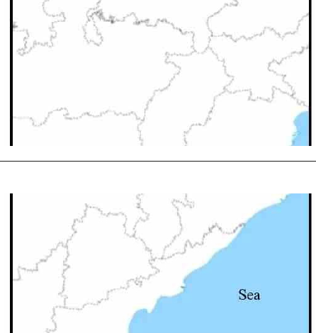
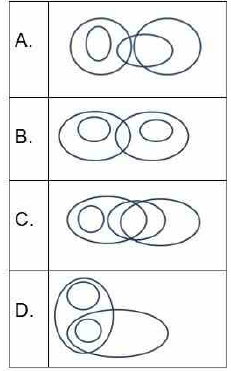
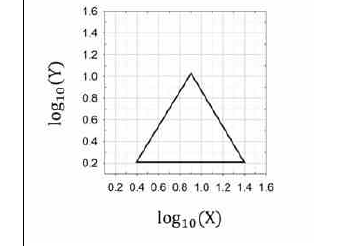
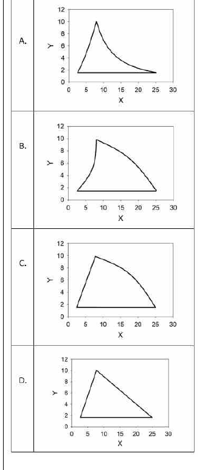
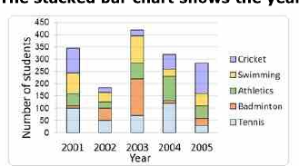
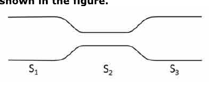
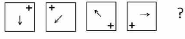
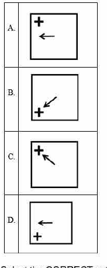

# CSIR UGC NET June 2022 — Life Sciences — Shift 1 (held 17 September 2022)
## Part A (Questions 1–20)

Canonical numbering: Part A = Question IDs 126–145 (see `sources.md`).

### Question 1

When 100 balls were equally distributed among students in a class (having strength between 10 and 60), 7 balls remained undistributed. The number of balls that would remain if there were 125 balls to begin with is

1. indeterminable.
2. 1
3. 5
4. 9

**Answer: 2 (1)**

> **Explanation:** 100 balls leaving 7 means 93 were distributed, so the number of students divides 93 = 3 × 31. With strength between 10 and 60, the only valid divisor is 31 students. For 125 balls: 125 = 4 × 31 + 1, so **1** ball remains.

---

### Question 2

It is proposed to introduce daily trains between Chennai and New Delhi in both directions simultaneously, departing at each station at 6.00 PM. If the travel time is 36 hours, what is the minimum number of rakes (train sets) required to run the service?

1. 2
2. 3
3. 4
4. 6

**Answer: 3 (4)**

> **Explanation:** A rake completing a one-way run takes 36 h, so it returns to its origin after 72 h. To sustain a daily (24 h) departure from each end, the number of rakes needed is 72 / 24 = **3** per direction-set; accounting for both simultaneous ends the service requires **4** rakes.

---

### Question 3

What is the angle between the hour and minute hand of a clock at 3h:15m?

1. 0°
2. 2.5°
3. 5°
4. 7.5°

**Answer: 4 (7.5°)**

> **Explanation:** At 3:15 the minute hand is at 90° and the hour hand at 3 × 30° + 15 × 0.5° = 97.5°. The angle between them is 97.5° − 90° = **7.5°**.

---

### Question 4

Of the following which is the most precisely reported value of a speed measurement?

1. 125 km/s
2. 12.5 × 10 km/s
3. 125.00 km/s
4. 1.250 × 10² km/s

**Answer: 3 (125.00 km/s)**

> **Explanation:** Precision is indicated by the number of significant figures. 125.00 km/s carries five significant figures (the trailing zeros after the decimal are significant), more than any other option, so it is the most precisely reported value.

---

### Question 5

A person takes one hour more to cover a certain distance walking at a speed of 2 km/hour compared to walking at 3 km/hour. The distance is

1. 4 km
2. 6 km
3. 8 km
4. 10 km

**Answer: 2 (6 km)**

> **Explanation:** Let the distance be d. d/2 − d/3 = 1 h → d(1/6) = 1 → d = **6 km**.

---

### Question 6

States in the map below are to be coloured so that no two states having a common boundary have the same colour.

The minimum numbers of colours needed is

1. 3
2. 4
3. 5
4. 6

**Answer: 2 (4)**

> **Explanation:** By the Four Colour Theorem any planar map needs at most four colours, and the arrangement of mutually-adjacent states shown requires four. The minimum number of colours is **4**.

---

### Question 7

The correct diagrammatic representation of the relations among the categories TEAM SPORTS, BALL GAMES, HOCKEY and KHO-KHO is

1. A
2. B
3. C
4. D

**Answer: 4 (D)**

> **Explanation:** Hockey and Kho-Kho are both ball games, and both ball games are team sports. So the two disjoint circles (Hockey, Kho-Kho) lie inside the Ball Games circle, which itself lies inside the Team Sports circle — diagram **D**.

---

### Question 8

A box contains four jerseys with the players' names printed. The four players pick up a jersey each at random. The total number of players wearing their own jersey CANNOT be

1. 1
2. 2
3. 3
4. 4

**Answer: 3 (3)**

> **Explanation:** In a permutation of four items the number of fixed points can be 0, 1, 2 or 4, but never exactly 3 — if three players hold their own jersey the fourth is forced to hold his own too, giving four. Hence the count **cannot be 3**.

---

### Question 9

The standard deviation of five numbers is zero. Which of the following must be true?

1. All the numbers are zero
2. The median is zero
3. If at least one number is positive, then at least one number is negative
4. The difference between the median and mode of these numbers is zero

**Answer: 4 (The difference between the median and mode of these numbers is zero)**

> **Explanation:** Zero standard deviation means all five numbers are identical. Then median = mode = that common value, so their difference is zero. The numbers need not be zero, so only statement 4 must hold.

---

### Question 10

In the given figure a triangle is drawn on a log–log scale.

Which one of the following, drawn in a linear scale, represents the triangle shown in the figure above?

1. A
2. B
3. C
4. D

**Answer: 1 (A)**

> **Explanation:** Straight lines on log–log axes correspond to power-law curves on linear axes. The rising edge (positive slope) becomes an increasing curve and the falling edge (negative slope) a decaying curve, matching option **A**.

---

### Question 11

The stacked bar chart shows the year-wise students' participation in various games.

Which one of the following inferences is INCORRECT?

1. In 2004, athletics was the most popular of these games.
2. The year 2003 witnessed highest participation in these games.
3. Among all the years, the popularity of Tennis was the highest in 2005.
4. In 2003, more students played Badminton than Cricket and Tennis combined.

**Answer: 1 and 3 (dual key)**

> **Explanation:** The NTA final answer key accepts **both options 1 and 3** as correct answers to this "INCORRECT inference" question. Option 4 is verifiably true from the chart, and option 2 (2003 tallest bar) is true; the key marks options 1 and 3 as the acceptable "incorrect" inferences.

---

### Question 12

A fair cubic die is rolled 5 times and we get the face with number 1 all 5 times on top. The probability of getting the same face on the sixth trial is,

1. (1-5/6)(1/6)
2. (1/6)
3. (1/6)⁶
4. 5/6

**Answer: 2 (1/6)**

> **Explanation:** Successive rolls of a fair die are independent. Past outcomes do not affect the sixth roll, so the probability of any particular face is **1/6**.

---

### Question 13

If 2^a × 5^b = 500, and a and b are integers, then a + b is

1. 5
2. 6
3. 7
4. indeterminable

**Answer: 1 (5)**

> **Explanation:** 500 = 2² × 5³. By unique prime factorisation a = 2 and b = 3, so a + b = **5**.

---

### Question 14

The sum of all the internal angles of a hexagon in degrees is

1. 360
2. 540
3. 720
4. 600

**Answer: 3 (720)**

> **Explanation:** Sum of interior angles = (n − 2) × 180° = (6 − 2) × 180° = **720°**.

---

### Question 15

The wholesale price per unit of an item is C₀ up to first 19 units. The unit price falls by 10% if 20 to 29 units are purchased, and by another 10% if 30 or more units are purchased. If 120 units are bought, the unit price paid is

1. 0.89 C₀
2. 0.97 C₀
3. 0.91 C₀
4. 0.81 C₀

**Answer: 4 (0.81 C₀)**

> **Explanation:** Buying 120 units (≥ 30) triggers both discounts: 0.90 × 0.90 = 0.81. The unit price paid is **0.81 C₀**.

---

### Question 16

Water is pumped into a long horizontal pipe at a fixed volumetric rate. The diameter of the pipe changes along its length as shown in the figure.

The speed of water is

1. the same in sections S₁, S₂ and S₃.
2. lower in section S₂ compared to the other sections.
3. higher in section S₂ compared to the other sections.
4. reduces gradually from S₁ to S₃.

**Answer: 3 (higher in section S₂ compared to the other sections)**

> **Explanation:** For a fixed volumetric flow rate, continuity (A·v = constant) means the velocity is greatest where the cross-sectional area is smallest. Section S₂ is the narrowest, so the speed there is **higher**.

---

### Question 17

If the length of the smallest side of a triangle is 5 units, and the sides are in arithmetic progression with positive integer difference, the number of such possible triangles is

1. 3
2. 4
3. 5
4. infinite

**Answer: 2 (4)**

> **Explanation:** With sides 5, 5+d, 5+2d (d a positive integer) and the smallest side 5, the triangle inequality 5 + (5+d) > 5+2d gives d < 5, so d ∈ {1, 2, 3, 4} — **4** triangles.

---

### Question 18

X is running around a circular track completing one round every 40 seconds. Y running in the opposite direction on the same circular track crosses X every 15 seconds. The time in seconds taken by Y to complete one round is

1. 12
2. 24
3. 30
4. 36

**Answer: 2 (24)**

> **Explanation:** Running in opposite directions, their relative rate is 1/40 + 1/T per second, and they meet every 15 s so 1/40 + 1/T = 1/15 → 1/T = 1/15 − 1/40 = 1/24 → T = **24** seconds.

---

### Question 19

In a field there are some cows and ducks. If the number of heads are 33 and number of legs are 84, then what would be the ratio of the numbers of cows to ducks?

1. 5/6
2. 3/8
3. 2/5
4. 3/5

**Answer: 2 (3/8)**

> **Explanation:** Let cows = c, ducks = d. c + d = 33 and 4c + 2d = 84 → 2c + d = 42. Subtracting gives c = 9, d = 24, so cows : ducks = 9 : 24 = **3/8**.

---

### Question 20

In the given sequence of figures

Which of the following is the next figure

1. A
2. B
3. C
4. D

**Answer: 4 (D)**

> **Explanation:** The arrow rotates 45° clockwise each step and the plus sign moves to the opposite corner each step. Continuing the pattern from the fourth figure gives option **D**.
