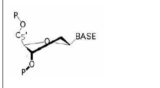
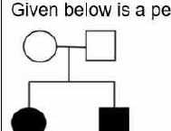
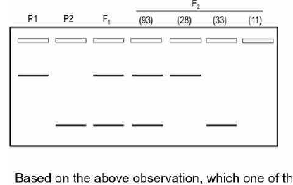
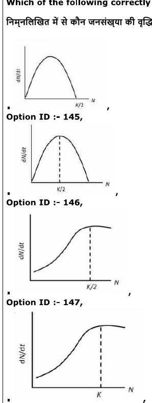

# CSIR UGC NET June 2022 — Life Sciences — Shift 1 (held 17 September 2022)
## Part B (Questions 21–70)

Canonical numbering: Part B = Question IDs 1–50 (see `sources.md`). Answers are from the official NTA final answer key.

### Question 21

In crystalline NaCl, how many chloride ions surround each sodium ion?

1. Four
2. Six
3. Eight
4. Ten

**Answer: 2 (Six)**

> **Explanation:** Rock salt (NaCl) is a face-centred cubic lattice in which each ion occupies an octahedral hole, giving **6:6 coordination** — every Na⁺ is surrounded by six Cl⁻ and vice versa.

---

### Question 22

At which one of the following electron transport chain complexes does Antimycin A typically inhibit the respiratory chain?

1. Complex I
2. Complex II
3. Complex III
4. Complex IV

**Answer: 3 (Complex III)**

> **Explanation:** Antimycin A binds the Qi site of cytochrome bc₁ complex (**Complex III**), blocking transfer of electrons from cytochrome b to cytochrome c₁ and hence ubiquinol re-oxidation. (Rotenone and amytal inhibit Complex I; cyanide/azide inhibit Complex IV.)

---

### Question 23

Identify the ribose conformation in the nucleotide shown below.

1. C2'-endo
2. C2'-exo
3. C3'-endo
4. C3'-exo

**Answer: 1 (C2'-endo)**

> **Explanation:** In the furanose ring the out-of-plane ("flap") carbon is named for the atom displaced on the same side as the base (β face). In the figure the **C2'** atom is displaced above the plane while C3' lies below, i.e. a C2'-endo pucker — the conformation typical of B-form DNA. RNA A-form helices favour C3'-endo.

---

### Question 24

Which one of the following correctly describes the effect of a mutation in phosphofructokinase (PFK), that leads only to the loss of allosteric regulation by ATP?

1. Decrease in the activity of PFK
2. Increase in the activity of PFK
3. Decrease in the amount of ADP generated by PFK
4. Increase in the amount of ATP generated by PFK

**Answer: 2 (Increase in the activity of PFK)**

> **Explanation:** ATP is the classical allosteric **inhibitor** of PFK-1 (it lowers the enzyme's affinity for fructose-6-phosphate when energy charge is high). Losing only this inhibitory regulation means the enzyme is no longer switched off by high ATP, so its activity **increases**.

---

### Question 25

A few organelles that are present in a eukaryotic cell are mentioned below:
A. Centrosomes
B. Peroxisomes
C. Nucleolus
D. Endosomes

Which one of the following options represents organelles that are not membrane-bound?

1. A and B
2. B and C
3. A and C
4. A and D

**Answer: 3 (A and C)**

> **Explanation:** The **centrosome** and the **nucleolus** are non-membranous organelles (built by self-assembly of proteins/centrioles and by liquid–liquid phase separation, without a lipid bilayer). Peroxisomes and endosomes are both bounded by a membrane.

---

### Question 26

Individual chromosomes are clearly seen during which phase of the cell cycle?

1. G₀
2. G₁
3. S
4. M

**Answer: 4 (M)**

> **Explanation:** Individual chromosomes become visible as discrete, condensed structures only during **M phase (mitosis)**, when chromatin is compacted by condensins. In G₀, G₁ and S the DNA is decondensed and not individually resolvable by light microscopy.

---

### Question 27

Which one of the following conditions represents autopolyploidy?

1. More than two sets of chromosomes, both of which are from the same parental species.
2. More than two sets of chromosomes, both of which are from the different parental species.
3. More than two sets of chromosomes only from a single parent.
4. Duplication of a chromosomal locus leading to spontaneous increase in the copy number of a gene.

**Answer: 1 (More than two sets of chromosomes, both of which are from the same parental species.)**

> **Explanation:** Auto-polyploidy (autopolyploidy) means having more than two complete chromosome sets, all derived from the **same** species — e.g. an autotetraploid produced within one species. Sets contributed by two different parental species describe allopolyploidy, and duplication of a single locus is gene amplification, not polyploidy.

---

### Question 28

Which one of the following statements about the recognition of tRNAs by their cognate aminoacyl-tRNA synthetases is correct?

1. Aminoacyl-tRNA synthetases recognize their cognate tRNAs by the exclusive recognition of their anticodons
2. Aminoacyl-tRNA synthetases recognize their cognate tRNAs by recognition of their anticodons in some tRNAs only.
3. Aminoacyl-tRNA synthetases cannot aminoacylate a tRNA that lacks the conserved modifications in the TψC loop.
4. Aminoacyl-tRNA synthetases cannot aminoacylate a tRNA that lacks the conserved modifications in the DHU loop.

**Answer: 2 (Aminoacyl-tRNA synthetases recognize their cognate tRNAs by recognition of their anticodons in some tRNAs only.)**

> **Explanation:** Identity determinants vary between synthetases. For some tRNAs the anticodon is the dominant recognition element, but for others (e.g. tRNA^Ala, whose G3:U70 acceptor-stem pair is the main determinant; tRNA^Gly, tRNA^Ile) identity lies mainly in the acceptor stem or elsewhere. Hence anticodon recognition is used by only some systems. The TψC and DHU loops are not essential for aminoacylation, so statements 3 and 4 are false, and "exclusive" anticodon recognition (1) is false.

---

### Question 29

Histone variants play important roles in chromatin function in mammalian cells. Which one of the following statements is correct in the context of the histone variants?

1. Histone variants have been reported for H3 and H4 but not for H2A and H2B
2. Histone variants have been reported for H3, H4, H2A but not for H2B
3. Histone variants have been reported for H3, H4, H2B but not for H2A
4. Histone variants have been reported for H3, H4, H2A and H2B

**Answer: 4 (Histone variants have been reported for H3, H4, H2A and H2B)**

> **Explanation:** Variants are known for all four core histones: H3 (CENP-A, H3.3, H3.1/H3.2), H2A (H2A.Z, macroH2A, H2A.X, H2A.Bbd), H2B (H2B.E, H2B.T) and H4 (H4 variant in spermatids). Hence the statement covering H3, H4, H2A and H2B is the correct one.

---

### Question 30

Which one of the following statements made about the bacterial replisome is INCORRECT?

1. The rate of forward movement of DnaB helicase along the template DNA increases, 10-fold when DnaB and DNA Pol III interact, thus ensuring that the helicase does not move ahead rapidly without the polymerase.
2. The transient interaction of the primase with the helicase allows activation of primase activity by, 1000-fold, promoting RNA primer synthesis.
3. The length of the Okazaki fragments is typically restricted to 1000-2000 nucleotides.
4. The E. coli oriC carries repeats of two sequence motifs: repeats of a 9-mer that collectively form the site at which the origin first becomes single-stranded, and repeats of a 13-mer to which the DnaA initiator protein binds.

**Answer: 4 (The E. coli oriC carries repeats of two sequence motifs: repeats of a 9-mer ... DnaA initiator protein binds)**

> **Explanation:** The two oriC motifs are described the wrong way round. The **13-mer (DUE, GATCTNTTNTTTT) repeats are AT-rich and melt first** to make the origin single-stranded, whereas the **9-mer (DnaA box, TTATCCACA) repeats are the binding sites for the DnaA initiator protein**. Statement 4 reverses these roles and is therefore the incorrect one; statements 1–3 correctly describe polymerase–helicase coupling, primase activation by DnaB, and Okazaki fragment length.

---

### Question 31

Which of the options correctly matches the proteins involved in transcription (Column A) with the DNA binding domains they carry (Column B)?

| | Column A | | Column B |
|---|---|---|---|
| A. | TFIIIA | i. | Helix-turn-helix |
| B. | MyoD | ii. | Zinc finger |
| C. | Jun | iii. | Helix-loop-helix |
| D. | Cro | iv. | Leucine zipper |

1. A-iv, B-iii, C-i, D-ii
2. A-ii, B-i, C-iv, D-iii
3. A-iii, B-i, C-ii, D-iv
4. A-ii, B-iii, C-iv, D-i

**Answer: 4 (A-ii, B-iii, C-iv, D-i)**

> **Explanation:** TFIIIA is the classic **zinc-finger** protein (ii); MyoD is a basic **helix-loop-helix** muscle determinant (iii); Jun (c-Jun) is a **leucine-zipper** bZIP protein (iv); and bacteriophage λ Cro is a **helix-turn-helix** repressor (i).

---

### Question 32

Which one of the following combinations of CD molecules and their associated functions is matched INCORRECTLY?

1. CD1: Antigen-presenting proteins that present antigenic peptides to T-cell receptors on natural killer T cells (NKT)
2. CD8: Thymic differentiation marker for T cells
3. CD11a: A membrane glycoprotein that provides cell-cell adhesion by interaction with ICAM 1 (intercellular adhesion molecule 1)
4. CD14: Activates innate immune responses by transferring LPS-LBP complex to TLR4.

**Answer: 1 (CD1: Antigen-presenting proteins that present antigenic peptides to T-cell receptors on natural killer T cells (NKT))**

> **Explanation:** CD1 molecules present **lipid and glycolipid** antigens (not peptide antigens) to NKT cells; peptide presentation to the T-cell receptor is the job of MHC class I/II. The other three are correct: CD8 is a thymic differentiation/T-lineage marker, CD11a (LFA-1) mediates adhesion through ICAM-1, and CD14 hands the LPS–LBP complex to TLR4.

---

### Question 33

Which one of the following is a small sulfated peptide that is secreted by a rice pathogenic bacterium, *Xanthomonas oryzae* to modulate motility, biofilm formation and virulence?

1. Coronatine
2. N-acylhomoserine lactones
3. Ax21
4. EPS

**Answer: 3 (Ax21)**

> **Explanation:** **Ax21** is the small, sulphated, secreted peptide of *Xanthomonas* (the rice pathogen *X. oryzae* pv. *oryzae* / *X. citri* system) that acts as a quorum-sensing-like signal modulating motility, biofilm formation and virulence. Coronatine is a Pseudomonas phytotoxin, N-acylhomoserine lactones are Gram-negative AHL signals (not peptides), and EPS is exopolysaccharide.

---

### Question 34

Which one of the following small molecule neurotransmitters is NOT synthesized from tyrosine?

1. Epinephrine
2. Dopamine
3. Serotonin
4. Norepinephrine

**Answer: 3 (Serotonin)**

> **Explanation:** Tyrosine is the precursor of the catecholamines dopamine, noradrenaline (norepinephrine) and adrenaline (epinephrine) via the DOPA → dopamine → noradrenaline → adrenaline pathway. **Serotonin** is instead synthesised from the aromatic amino acid **tryptophan** (tryptophan → 5-hydroxytryptophan → 5-hydroxytryptamine), so it is not a tyrosine-derived neurotransmitter.

---

### Question 35

While studying pathogenic bacteria, a protein with the following features was identified:

A. It was secreted during infection conditions, but not in *in-vitro* cultures
B. It was also observed to be present in the membranous fraction in traces, which was released upon bacterial lysis
C. It had a heat labile N-terminal enzymatic domain that binds MHC molecules, stimulating T cells non-specifically
D. It had a C-terminal non-enzymatic domain which was highly antigenic and heat-stable

How will you best classify the toxic nature of this protein?

1. An endotoxin
2. Superantigen
3. Pore-forming toxin
4. A-B toxin

**Answer: 2 (Superantigen)**

> **Explanation:** The defining feature — binding MHC molecules and stimulating T cells **non-specifically** (polyclonally, outside the normal peptide groove) — is the hallmark of a **superantigen**. Endotoxin is LPS (not a secreted protein), pore-forming toxins lyse cells by making membrane channels, and A-B toxins act intracellularly via an enzymatic A domain on a host target, none of which matches MHC-mediated non-specific T-cell activation.

---

### Question 36

Which one of the following statements is INCORRECT?

1. Transient rise in Ca²⁺ is necessary for egg activation in mammals.
2. Sperm induces egg activation and does not involve Ca²⁺.
3. In many organisms, eggs secrete diffusible molecules that attract and activate sperm.
4. Capacitated mammalian sperm can penetrate the cumulus and bind the zona pellucida.

**Answer: 2 (Sperm induces egg activation and does not involve Ca²⁺)**

> **Explanation:** Fertilisation triggers a series of transient intracellular **Ca²⁺ waves/oscillations** in the egg (initiated by the sperm factor PLCζ in mammals) that cause cortical granule exocytosis and egg activation. A statement that sperm-induced egg activation does not involve Ca²⁺ is therefore incorrect.

---

### Question 37

In which one of the following developmental events, the fate of maternal somatic cell is determined first, which then determines the fate of the developing embryo?

1. The specification of primary organizer in amphibian embryo.
2. The specification of dorso-ventral axis in Drosophila.
3. The formation of the vulval precursor cells during development of C. elegans.
4. Specification of the micromeres in case of sea urchin.

**Answer: 2 (The specification of dorso-ventral axis in Drosophila.)**

> **Explanation:** The dorsoventral axis of the Drosophila embryo is set up by signals from the **maternal follicle cells** (a maternal somatic tissue). Ventral follicle cells (via the Pipe/Nudel/Corkscrew pathway) generate a ventralised Egghead-Spätzle cascade that establishes the embryo's DV axis. Thus a maternal somatic cell fate is determined first and then instructs the embryo — the defining feature asked for.

---

### Question 38

Which one of the following floral mutants shows the pattern 'sepals-petals-petals' repeated several times?

1. agamous (ag)
2. apetala1 (ap1),
3. apetala3 (ap3),
4. pistillata (pi)

**Answer: 1 (agamous (ag))**

> **Explanation:** In the ABC model, class A function alone gives sepals, A+B gives petals and C alone gives carpels. Loss of the C-function gene **AGAMOUS** allows A-function to expand into the inner whorls, producing the whorl pattern sepal–petal–petal–sepal, and weak/serial *ag* phenotypes repeat a sepal-petal-petal arrangement. *ap1* and *ap3* mutants lack A or B function (giving carpel/leaf-like or sepal-stamen-stamen-sepal patterns) and *pi* (B-class in Arabidopsis, together with AP3) gives sepal–carpel–carpel–sepal.

---

### Question 39

The table below lists cleavage pattern and names of species.

| | Cleavage pattern | | Species |
|---|---|---|---|
| A. | Isolecithal bilateral | i. | Amphibians |
| B. | Mesolecithal radial | ii. | Birds |
| C. | Centrolecithal superficial | iii. | Tunicates |
| D. | Telolecithal discoidal | iv. | Insects |

Match the cleavage patterns with the species.

1. A – i; B –ii; C – iii; D – iv
2. A – ii; B – iv; C – i; D – iii
3. A – iv; B – i; C – iii; D – ii
4. A – iii; B – i; C – iv; D – ii

**Answer: 4 (A – iii; B – i; C – iv; D – ii)**

> **Explanation:** Isolecithal (equal) **bilateral** cleavage is characteristic of **tunicates** (A-iii); **mesolecithal radial** cleavage is that of **amphibians** (B-i); **centrolecithal superficial** cleavage occurs in **insects** (C-iv); and **telolecithal discoidal** (meroblastic) cleavage is seen in the heavily yolked eggs of **birds** (D-ii).

---

### Question 40

Which of the following statements regarding chlorophyll is NOT correct?

1. Chlorophyll-a has a -CH₃ group in its porphyrin-like ring structure.
2. Chlorophyll-b has -CHO group in its porphyrin-like ring structure.
3. Only chlorophyll-a, but not chlorophyll-b, has a Mg⁺⁺ coordinated at the centre of the porphyrin-like ring structure.
4. The long hydrocarbon tails of chlorophyll anchors them in the photosynthetic membrane.

**Answer: 3 (Only chlorophyll-a, but not chlorophyll-b, has a Mg⁺⁺ coordinated at the centre of the porphyrin-like ring structure.)**

> **Explanation:** **Both** chlorophyll-a and chlorophyll-b have a central Mg²⁺ ion in their chlorin ring; the two differ only at the C-7 substituent (–CH₃ in chlorophyll-a, –CHO in chlorophyll-b). So statement 3 is the incorrect one. Statements 1, 2 and 4 are true.

---

### Question 41

Which of the following nitrogen containing compounds is formed during deamination of organic nitrogen in plants?

1. NO
2. NO₂⁻
3. NO₃⁻
4. NH₄⁺

**Answer: 4 (NH₄⁺)**

> **Explanation:** Deamination (and assimilation reversal) of amino acids removes the amino group as **ammonium (NH₄⁺)**. Nitrate and nitrite are oxidation states of the nitrogen cycle, not direct products of deamination.

---

### Question 42

The product of *nahG* gene of *Pseudomonas putida* catalyzes the metabolism of salicylic acid to which one of the following compounds?

1. Benzoic acid
2. Methyl salicylate
3. Catechol
4. Benzoyl-CoA

**Answer: 3 (Catechol)**

> **Explanation:** *nahG* encodes salicylate 1-monooxygenase, which hydroxylates salicylic acid to **catechol**, the entry metabolite of the naphthalene-degradation pathway. Catechol is then cleaved by catechol 2,3-dioxygenase (*nahH*) in the meta-cleavage pathway.

---

### Question 43

*Lr34*, a broad-spectrum disease resistance gene in wheat, encodes for a putative:

1. Serine hydroxymethyl transferase
2. ABC transporter
3. Host-specific toxin
4. TIR-NB-LRR protein

**Answer: 2 (ABC transporter)**

> **Explanation:** *Lr34* is a durable, broad-spectrum resistance gene whose causal allele encodes a putative **ABC (ATP-binding-cassette) transporter** (with a second, STP/serine-hydroxymethyltransferase-like gene at the same locus). Its mode of action is non-race-specific, consistent with an ABC-transporter function rather than a classical TIR-NB-LRR R protein.

---

### Question 44

The activities of baroreceptors present in the carotid sinus are carried by the afferent fibers of neurons located in

1. nodose ganglion
2. geniculate ganglion
3. petrosal ganglion
4. spiral ganglion

**Answer: 3 (petrosal ganglion)**

> **Explanation:** The carotid sinus is innervated by the sinus (Hering's) nerve, a branch of the **glossopharyngeal (CN IX)**. Its primary afferent cell bodies lie in the inferior (petrosal) ganglion of CN IX. The nodose ganglion is the vagal inferior ganglion (aortic-arch baroreceptors), the geniculate is the facial nerve sensory ganglion, and the spiral ganglion is cochlear.

---

### Question 45

Which one is NOT a true response of pulmonary J-receptor stimulation by hyperventilation of lung?

1. Bronchodilation
2. Decreased heart rate
3. Apnoea followed by rapid breathing
4. Low blood pressure

**Answer: 1 (Bronchodilation)**

> **Explanation:** Pulmonary J (juxtacapillary) receptor stimulation produces the slow-breathing/apnoea reflex with **bronchoconstriction**, coronary vasodilation, bradycardia and hypotension. Broncho**dilation** is therefore not a response — the opposite occurs.

---

### Question 46

Which one does NOT occur as a physiological adjustment during heat acclimatization?

1. Lowered threshold for start of sweating
2. Effective distribution of cardiac output
3. Improved skin blood flow
4. Increased salt concentration of sweat

**Answer: 4 (Increased salt concentration of sweat)**

> **Explanation:** Heat acclimatization produces earlier and more profuse sweating (lowered threshold), better skin blood flow and more effective distribution of cardiac output, plus **reduced** salt (NaCl) loss in sweat due to increased aldosterone action. An increased salt concentration of sweat is the opposite of the acclimatized state.

---

### Question 47

Absorbed monosaccharides in intestinal epithelial cells exit via which one of the following transporters?

1. GLUT2
2. GLUT3
3. GLUT4
4. GLUT5

**Answer: 1 (GLUT2)**

> **Explanation:** Apical uptake uses SGLT1 (Na⁺-coupled) for glucose/galactose and GLUT5 for fructose. All three monosaccharides then leave the enterocyte across the **basolateral membrane via GLUT2**, which is insulin-independent. GLUT3 is the neuronal high-affinity transporter and GLUT4 the insulin-sensitive transporter of muscle and adipose.

---

### Question 48

Given below is a pedigree indicating a pattern of inheritance:

Which one of the following options correctly describes the pattern of inheritance shown in the above pedigree?

1. X-linked recessive
2. Autosomal recessive
3. X-linked dominant
4. Autosomal dominant

**Answer: 2 (Autosomal recessive)**

> **Explanation:** Two unaffected parents produce affected offspring, so the trait is **recessive**. An affected daughter must be homozygous; for an X-linked recessive trait her father would necessarily be affected, but he is unaffected. The trait also appears in both sexes. Hence the pedigree is **autosomal recessive**.

---

### Question 49

In a conjugation experiment between bacterial Hfr strain 'X' and F⁻ cell, *lac* gene enters the recipient in 4 minutes, but the F⁻ cells remain auxotrophic for Leu, Trp, Ura, Glu, Phe and Gly. The mating is then allowed to proceed for 20 minutes and *lac*⁺ exconjugants are selected. Of the *lac*⁺ cells,

35% are *leu*⁺
98% are *trp*⁺
10% are *ura*⁺
65% are *glu*⁺
0% are *phe*⁺
81% are *gly*⁺

Select the correct order of the genes as they enter, from the choices given below:

1. *trp*⁺, *gly*⁺, *glu*⁺, *leu*⁺, *ura*⁺, *phe*⁺ *lac*⁺
2. *lac*⁺, *phe*⁺, *ura*⁺, *leu*⁺, *glu*⁺, *gly*⁺, *trp*⁺
3. *phe*⁺, *ura*⁺, *leu*⁺, *glu*⁺, *gly*⁺, *trp*⁺, *lac*⁺
4. *lac*⁺, *trp*⁺, *gly*⁺, *glu*⁺, *leu*⁺, *ura*⁺, *phe*⁺

**Answer: 4 (*lac*⁺, *trp*⁺, *gly*⁺, *glu*⁺, *leu*⁺, *ura*⁺, *phe*⁺)**

> **Explanation:** In interrupted mating the co-transfer frequency of an unselected marker with the selected *lac* marker falls the later that marker enters. Ranking the percentages from highest to lowest gives the order of entry after *lac*: trp (98%) → gly (81%) → glu (65%) → leu (35%) → ura (10%) → phe (0%). Hence *lac*⁺, *trp*⁺, *gly*⁺, *glu*⁺, *leu*⁺, *ura*⁺, *phe*⁺.

---

### Question 50

The following picture represents a gel profile of a pair of DNA markers observed in parents P1 and P2, their F₁ progeny and F₂ progeny. Four different profiles were observed in case of F₂. The number of F₂ progeny showing a given profile is indicated in brackets

Based on the above observation, which one of the following statements is correct?

1. Co-dominant DNA markers were used for this study.
2. The polymorphic DNA bands represents two independent genes.
3. If the P1 parent was crossed to the F₁ individual, the progeny will show all the four profiles as observed in the case of F₂ progeny.
4. If an F₂ progeny which does not show either of the DNA markers (last lane of the above gel) is crossed to a P1 individual, the obtained progeny will have two types of individual, one which shows a band and the other where no band is observed.

**Answer: 2 (The polymorphic DNA bands represents two independent genes.)**

> **Explanation:** The four F₂ profile counts 93 : 28 : 33 : 11 fit a **9 : 3 : 3 : 1** ratio (total 165 ≈ 92.8 : 30.9 : 30.9 : 10.3). This is the signature of two independently assorting dominant markers — each band is a presence/absence allele at a different locus — so the two polymorphic bands represent two independent genes, not a single co-dominant locus.

---

### Question 51

The additive nature of a genetic map as suggested by Alfred Sturtevant and T. H. Morgan is possible if there is:

1. no interference in crossovers.
2. complete interference in crossovers.
3. partial interference in crossovers.
4. variable interference in crossovers dependent on the genetic distances.

**Answer: 2 (complete interference in crossovers.)**

> **Explanation:** For map distances to be additive, the recombination frequency between two outside markers must equal the sum of the frequencies in the two intervals: RF(A–C) = RF(A–B) + RF(B–C). That holds only when a crossover in one interval never coincides with a crossover in the adjacent interval, i.e. when **double crossovers are absent — complete interference (coefficient of coincidence = 0)**. If crossovers were independent (no interference), double crossovers between the outside markers would go undetected and the observed RF would fall short of the sum, destroying additivity.

---

### Question 52

Which one of the following forest type occupies the largest area in India?

1. Tropical rain forest
2. Tropical dry deciduous forest
3. Temperate deciduous forest
4. Temperate evergreen forest

**Answer: 2 (Tropical dry deciduous forest)**

> **Explanation:** Under the Champion & Seth classification used by the Forest Survey of India, **tropical dry deciduous forest** covers the largest fraction of India's forest area, far exceeding the small tracts of tropical rain (evergreen) forest and the temperate types confined to the Himalaya and shola hills.

---

### Question 53

Which one of the following biome is known to occur in India?

1. Tundra
2. Boreal forest
3. Taiga
4. Alpine grasslands

**Answer: 1 and 4 (Tundra; Alpine grasslands) — NTA key accepts both options**

> **Explanation:** India's high Himalayan trans-Himalayan tracts (Ladakh, Spiti, Sikkim) carry both **tundra** (cold desert) vegetation and **alpine grasslands** above the tree line, so the official key credits both options 1 and 4. Boreal forest/taiga is essentially absent from India, although a narrow band of montane coniferous ("temperate coniferous") forest occurs in the eastern Himalaya; the NTA did not credit it.

---

### Question 54

The following are selected plant apomorphies:
A. Development of xylem
B. Development of cuticle
C. Development of independent sporophyte
D. Development of eustele

Which option represents the correct evolutionary sequence of the above?

1. A-D-B-C
2. C-A-B-D
3. B-C-A-D
4. C-B-D-A

**Answer: 3 (B-C-A-D)**

> **Explanation:** Land-plant evolution proceeded from the charophyte algae: a **cuticle** (B) arose first as the key adaptation against desiccation on land; then the **sporophyte became independent** of the gametophyte (C, a feature of tracheophytes); vascular **xylem** (A) followed with the evolution of tracheophytes; and the **eustele** (D) is the stele type of the more derived seed plants. Hence B → C → A → D.

---

### Question 55

The biological species concept defines species as a group of populations that are reproductively isolated from others. However, this definition is not applicable to groups where sexual reproduction has not been observed yet or is extremely rare. Choose the correct option of organisms where biological species concept may therefore not apply:

1. Monocots and basal angiosperms
2. Ascomycetes and oligochaetes
3. Mosses and liverworts
4. Cyanobacteria and Euglenophyta

**Answer: 4 (Cyanobacteria and Euglenophyta)**

> **Explanation:** The biological species concept needs observed interbreeding and reproductive isolation, so it fails for organisms that reproduce **only asexually** (or where sex is unknown/rare). **Cyanobacteria** are strictly asexual prokaryotes and **Euglenophyta** are essentially asexual flagellates, so the BSC cannot be applied to them. The other groups all have documented sexual reproduction.

---

### Question 56

Which of the following is typically true of invasive species?

1. They are r-selected
2. They are K-selected
3. They are habitat specialists
4. They are always introduced by humans

**Answer: 1 (They are r-selected)**

> **Explanation:** Invasive species characteristically show **r-selected** traits — high intrinsic rate of increase, early maturity, many small propagules and good dispersal — which let them colonise and expand rapidly in a new, enemy-free environment. They are typically generalists rather than habitat specialists, and although human activity often aids introduction, "always" is too absolute.

---

### Question 57

Which of the following correctly represents the relationship between the rate of population growth and population size?

1.
2.
3.
4.

**Answer: 2**

> **Explanation:** Logistic growth gives dN/dt = rN(1 − N/K), a downward-opening parabola in N that is zero at N = 0 and at N = K and maximal at N = K/2. Only graph 2 has that shape with the peak exactly at K/2.

---

### Question 58

The Biodiversity Management Committees (BMCs) envisaged under the Biological Diversity Act (2002) and Rules (2004) are constituted at which one of the following administrative levels?

1. Village
2. Tehsil / Taluka
3. District
4. State

**Answer: 1, 2 and 3 (Village; Tehsil / Taluka; District) — NTA key accepts options 1, 2 and 3**

> **Explanation:** The Biological Diversity Act provides for **Biodiversity Management Committees at the local-body level** — i.e. village/panchayat, tehsil/taluka and district (Urban Local Bodies and the corresponding tiers) — which prepare and maintain People's Biodiversity Registers. The State-level body is the State Biodiversity Board, not a BMC, so option 4 is excluded. The NTA key credits options 1, 2 and 3.

---

### Question 59

There is a species that is critically endangered, found in the Russian Far East. It is solitary, but it has been reported that some males stay with females after mating, and may even help with rearing the young. Identify this species.

1. Amur leopard
2. Snow leopard
3. Arctic fox
4. Black-footed ferret

**Answer: 1 (Amur leopard)**

> **Explanation:** The **Amur (Far Eastern) leopard** is a critically endangered felid of the Russian Far East. It is normally solitary, but unusual post-mating male–female association with help in rearing cubs has been documented in this population. Snow leopards occupy Central Asian mountains, the Arctic fox is not a cat, and the black-footed ferret is a North American species.

---

### Question 60

The measurement of distance based on counting steps or number of vertical bars by insects for navigation is called:

1. path integration.
2. allocentric coding.
3. odomentry.
4. alignment image-matching.

**Answer: 3 (odometry)**

> **Explanation:** **Odometry** (path-length measurement) is the internal estimate of distance travelled — e.g. desert ants counting steps, or bees estimating distance from the number of optic-flow "vertical bars" passed. Path integration is the broader vector-summing of direction and distance; odometry supplies the distance input to it.

---

### Question 61

The correct hierarchy of geological times is:

1. eon > era > period > epoch
2. period > era > epoch
3. epoch > period > era > eon
4. era > eon > period

**Answer: 1 (eon > era > period > epoch)**

> **Explanation:** The geochronologic hierarchy from largest to smallest unit is **eon → era → period → epoch → age** (e.g. Phanerozoic eon → Mesozoic era → Cretaceous period → Late Cretaceous epoch). Option 1 lists them in the correct descending order.

---

### Question 62

Consider a predator species foraging for prey in a habitat, where there are two prey species A and B. Assume the foraging predator can choose from a high-value prey A and low-value prey B. A and B occur at different frequencies in the environment, so it may take different average times to find the next A or B individual.

Choose the correct option based on the optimal foraging theory.

1. If it takes too long to search for A, predators may switch to eating B only.
2. If it takes too long to search for A, predators may eat both A and B, whichever is encountered.
3. Predators will only feed on B, regardless of search time.
4. Predators will never feed on B, irrespective of its relative frequency.

**Answer: 2 (If it takes too long to search for A, predators may eat both A and B, whichever is encountered.)**

> **Explanation:** In the optimal diet (prey-addition) model the predator is a specialist on the high-value prey A only while A is abundant. As A becomes scarce and its search/handling time rises, the profitability of adding the low-value prey B becomes positive, so the predator becomes a generalist and takes **both A and B as encountered**. It would not switch to B alone (1), nor ignore B absolutely (3, 4).

---

### Question 63

Any movie that features dinosaurs should also have which of the following combinations of geological age-appropriate organisms? Choose the correct combination.

1. Humans, angiosperms and birds
2. Early diverging angiosperms, reptiles, amphibians
3. Apes, gymnosperms, birds
4. Early diverging gymnosperms, amphibians, reptiles

**Answer: 2 (Early diverging angiosperms, reptiles, amphibians)**

> **Explanation:** Non-avian dinosaurs ranged over the Mesozoic (Triassic–Cretaceous). Amphibians and reptiles were already established, and **early diverging (basal) angiosperms appear in the Cretaceous**, so this combination is age-consistent. Humans and apes are Cenozoic, which eliminates options 1 and 3.

---

### Question 64

If you want to selectively kill the newly dividing mammalian cells in a cell culture assay, which of the following methods will you use?

1. Exposure to UV radiation at 250 nm.
2. Treatment with 5-ethynyl-2'-deoxyuridine (EdU), followed by doxorubicin hydrochloride treatment.
3. Treatment with 5-bromo-2'-deoxyuridine (BrdU), followed by UV-A exposure
4. Tritiated thymidine treatment followed by vinblastine treatment

**Answer: 3 (Treatment with 5-bromo-2'-deoxyuridine (BrdU), followed by UV-A exposure)**

> **Explanation:** BrdU, a thymidine analogue, is incorporated only into the DNA of cells that enter S phase, i.e. the newly dividing cells. BrdU-substituted DNA is highly photosensitive: exposure to **long-wave UV-A** light produces strand breaks and selective death of the labelled (dividing) cells while unlabelled, non-dividing cells survive. This is the classic BrdU/UV-A suicide selection. Plain 250 nm UV kills all cells indiscriminately, and vinblastine is a spindle poison rather than a label-dependent killer.

---

### Question 65

Which one of the following traits would hypothetically NOT be considered for preferential selection during domestication of the corresponding crops listed below?

1. Increased fruit size of tomato
2. Reduced spininess in okra
3. Shattering seeds of corn
4. Increased oil content of mustard

**Answer: 3 (Shattering seeds of corn)**

> **Explanation:** Domestication favours **reduced** seed shattering (non-shattering rachis) so that seeds are retained on the plant and harvested rather than dispersed. Selecting *for* shattering seeds would work against cultivation, so it is the trait not chosen. Larger tomato fruit, less-spiny okra and higher-oil mustard are all genuine domestication targets.

---

### Question 66

Species richness can be measured with the:

1. abundance of species in an area.
2. number and the abundance of species in an area.
3. number of species in an area.
4. density of species in an area.

**Answer: 3 (number of species in an area.)**

> **Explanation:** Species richness is defined simply as the **number of species present in an area**, without regard to their abundances. Incorporating abundance gives diversity (Shannon, Simpson) or evenness, and density refers to individuals per unit area, not species count.

---

### Question 67

What is the 50th percentile of the numbers 9, 5, 11, 3 and 2?

1. Five
2. Six
3. Nine
4. Fifteen

**Answer: 1 (Five)**

> **Explanation:** The 50th percentile is the median. Ordering the data 2, 3, **5**, 9, 11, the middle value is **5**.

---

### Question 68

In remote sensing, which one of the following formulae is used for the calculation of normalized difference vegetation index (NDVI)?

1. RED / (NIR + RED)
2. RED / (NIR − RED)
3. (NIR + RED) / (NIR − RED)
4. (NIR − RED) / (NIR + RED)

**Answer: 4 ((NIR − RED) / (NIR + RED))**

> **Explanation:** NDVI is defined as **(NIR − RED)/(NIR + RED)**, where NIR is near-infrared reflectance (high in healthy vegetation) and RED is red-band reflectance (low due to chlorophyll absorption). The normalisation keeps the index between −1 and +1.

---

### Question 69

The radioactive isotope of an element has a half-life of 100 hours. How many hours will it take for 15/16 of the source amount to decay?

1. 50
2. 400
3. 250
4. 1000

**Answer: 2 (400)**

> **Explanation:** If 15/16 has decayed, 1/16 of the original remains. Since (1/2)ⁿ = 1/16, n = 4 half-lives. 4 × 100 h = **400 hours**.

---

### Question 70

Which one of the following correctly describes the spectroscopic experiment that would help distinguish between a α helix, a 3₁₀ helix and a π helix?

1. Near UV absorption spectrum between 250-300nm
2. Fluorescence emission spectra between 350-400nm
3. 1H NMR spectroscopy involving Hydrogen/Deuterium exchange
4. Near UV Circular Dichroism spectrum between 250-300nm

**Answer: 3 (1H NMR spectroscopy involving Hydrogen/Deuterium exchange)**

> **Explanation:** The three helix types differ in their intra-helical hydrogen-bonding patterns (α: i→i+4; 3₁₀: i→i+3; π: i→i+5), which fixes which backbone amide protons are protected. Amide H/D exchange monitored by **¹H NMR** identifies the specific hydrogen-bonded amides and therefore distinguishes α, 3₁₀ and π helices. CD and absorption in the near-UV report on tertiary/aromatic structure, not this level of helix geometry.

---
