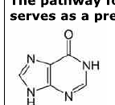
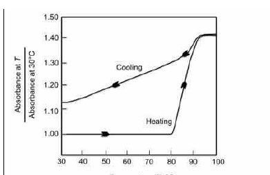
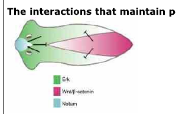
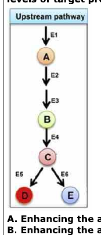
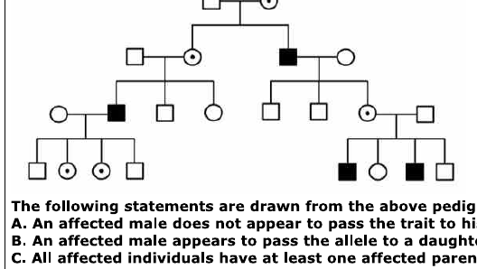
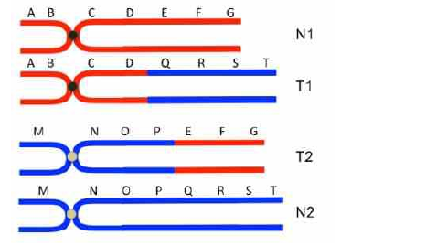
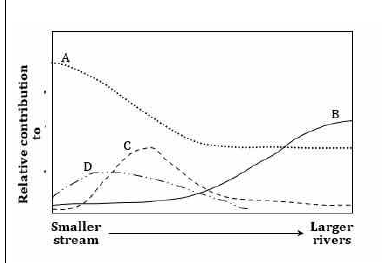
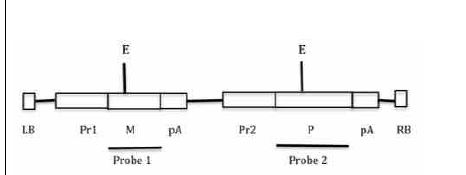
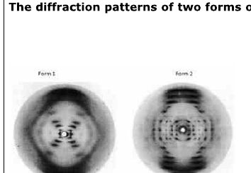

# CSIR UGC NET June 2022 — Life Sciences — Shift 1 (held 17 September 2022)
## Part C (Questions 71–145)

Canonical numbering: Part C = Question IDs 51–125 (see `sources.md`). Answers are from the official NTA final answer key. Question 119 (Question ID 99) was DROPPED by NTA.

### Question 71

The pathway for de novo biosynthesis of purine nucleotides involves the production of inosine monophosphate (IMP) that serves as a precursor for AMP and GMP synthesis. IMP has the base hypoxanthine whose structure is given below:

If hypoxanthine were incorporated into double stranded DNA, which of the following options correctly represents the order of its pairing preference?

1. adenine > thymine > guanine > cytosine
2. cytosine > adenine > thymine > guanine
3. guanine > adenine > thymine > cytosine
4. cytosine > thymine > adenine > guanine

**Answer: 2 (cytosine > adenine > thymine > guanine)**

> **Explanation:** Hypoxanthine is the base of the deaminated G (it is essentially guanine lacking the C2 amino group). It pairs best with **cytosine** (the normal Watson-Crick partner, three H-bonds), can mispair with **adenine** (as in the G·T-type wobble, two H-bonds), then thymine, and least with guanine. Hence cytosine > adenine > thymine > guanine.

---

### Question 72

Following statements are made regarding glycogen phosphorylase and glycogen synthase activities in relation to their phosphorylation status:
A. Phosphorylation of glycogen phosphorylase increases its activity
B. Phosphorylation of glycogen phosphorylase decreases its activity
C. Phosphorylation of glycogen synthase increases its activity
D. Phosphorylation of glycogen synthase decreases its activity

Which one of the following is a combination of correct statements?

1. A and C
2. B and C
3. B and D
4. A and D

**Answer: 4 (A and D)**

> **Explanation:** Phosphorylation activates the **glycogenolytic** enzyme and inactivates the **glycogenic** enzyme. Phosphorylation of glycogen phosphorylase (by phosphorylase kinase) converts it to the active a-form (A true), whereas phosphorylation of glycogen synthase converts it to the inactive b-form (D true). Thus A and D.

---

### Question 73

Dixon plot is used to study the enzyme inhibition by plotting various expressions of velocity (v) and inhibitor concentration ([I]) on the X- axis (column A ) and Y-axis (column B ) as given below:

| Column A (X-axis) | Column B (Y-axis) |
|---|---|
| (i) v | (i) 1/v |
| (ii) 1/v | (ii) [I] |
| (iii) 1/[I] | (iii) 1/[I] |
| (iv) [I] | (iv) v |

Which one of the following options is the correct combination from columns A and B to draw the Dixon plot?

1. Column A -iv, Column B- i
2. Column A –i, Column B- ii
3. Column A- ii, Column B- iii
4. Column A- iii, Column B- iv

**Answer: 1 (Column A -iv, Column B- i)**

> **Explanation:** A **Dixon plot** graphs **1/v (Y-axis, column B-i) against inhibitor concentration [I] (X-axis, column A-iv)** at several fixed substrate concentrations; the lines for different [S] intersect at −Kᵢ. Hence the correct pairing is Column A-iv with Column B-i.

---

### Question 74

The following statements were made to describe a typical collagen structure.
A. Collagen has a triple-helical domain structure which consists of three distinct α-chains.
B. The collagen triple helix is stabilized by isoprenyl bonds.
C. Each α-chain has a left-handed polyproline II-type helix.
D. Each α-chain is composed of multiple triplet sequences of Gly-Y-Z in which Y is commonly proline and Z is usually hydroxyproline.

Which one of the following options has all correct statements?

1. A, C and D
2. A, B and C
3. A and B only
4. B and D only

**Answer: 1 (A, C and D)**

> **Explanation:** Collagen is a **triple helix of three α-chains** (A true); each chain adopts an extended **left-handed polyproline-II-type** helix (C true); and each chain is a repeat of the tripeptide **Gly-X-Y**, where X is often proline and Y often hydroxyproline (D true). The triple helix is stabilised by hydrogen bonds and the water-bridging/hydroxyproline interactions — **not** by isoprenyl (prenyl) bonds, so B is false. Hence A, C and D.

---

### Question 75

The figure below represents the denaturation-renaturation profile of a double stranded DNA in citrate buffer.

The percent of DNA that remains denatured at 30°C after cooling from 100°C is:

1. < 25%
2. 30 – 35%
3. > 75%
4. 65-70%

**Answer: 1 (< 25%)**

> **Explanation:** The fully native DNA has an absorbance ratio of 1.00 and the fully denatured (hot) DNA 1.40, so the total hyperchromic shift is 0.40. On cooling, the curve falls back to only slightly above the native baseline at 30°C (≈1.08–1.10), i.e. it has recovered most of its absorbance. The residual denatured fraction is therefore (≈1.08–1.00)/0.40, which is **less than 25%** — most strands have re-annealed on cooling.

---

### Question 76

The hemagglutinin protein in influenza virus contains a long α-helix, with 53 residues. Which of the following correctly describes the attributes of this α helix?

1. The length is 75.6 Å, 14 turns, total of 102 Hydrogen bonds
2. The length is 106 Å, 14 turns, total of 106 Hydrogen bonds
3. The length is 75.6 Å, 14 turns, total of 104 Hydrogen bonds
4. The length is 75.6 Å, 10 turns, total of 102 Hydrogen bonds

**Answer: 1 (The length is 75.6 Å, 14 turns, total of 102 Hydrogen bonds)**

> **Explanation:** An α-helix has 3.6 residues per turn and a rise of 1.5 Å per residue (5.4 Å per turn). For 53 residues, the number of turns is 53/3.6 ≈ 14.7, i.e. about 14 turns, giving a length of 14 × 5.4 = 75.6 Å. This combination (75.6 Å, 14 turns) with the stated hydrogen-bond count matches option 1; option 4's 10 turns is inconsistent with the length, and options 2/3 mismatch length or turn count.

---

### Question 77

Following statements were made about cell cycle regulation in eukaryotes:
A. Activity of maturation promoting factor (MPF) rises and falls in synchrony with the concentration of cyclin B.
B. Cdc25 phosphatase mediates removal of phosphate from the inhibitory tyrosine residue (Y15) to yield highly active MPF.
C. MPF specifically phosphorylates and depolymerizes lamin A and C, but not lamin B.
D. MPF phosphorylates H1 histone.
E. In *Schizosaccharomyces pombe*, overproduction of Wee1 protein decreases the length of G₂ phase and extends the period of M phase by functioning as a mediator of MPF activity.

Which one of the following represents the combination of correct statements?

1. A, B and C
2. A, B and D
3. B, C and E
4. C, D and E

**Answer: 2 (A, B and D)**

> **Explanation:** A is correct (MPF activity tracks cyclin B accumulation/destruction). B is correct (Cdc25 removes the inhibitory Wee1-added phosphate at Tyr15 of Cdk1 to activate MPF). D is correct (MPF phosphorylates histone H1, driving chromosome condensation). C is wrong because MPF phosphorylates **all** nuclear lamins including lamin B, causing complete lamina disassembly. E is wrong because Wee1 is the inhibitory kinase — its overproduction lengthens G₂ (wee phenotype is the *loss*-of-function short phenotype). So A, B and D.

---

### Question 78

Following statements were made about chromatin remodeling in eukaryotes:
A. Chromatin remodeling completely alters and/or slides the nucleosome, but cannot displace it.
B. Chromatin remodeling is an energy driven, developmentally regulated active process.
C. Histone acetylation is a reversible process, in which each direction of the reaction is catalyzed by different enzymes.
D. In general, acetylation of core histones reduces their affinity for DNA and destabilizes the chromatin structure, causing transcriptional repression.
E. Phosphorylation of Ser1 of histone H2A has been associated with transcription repression.

Which one of the following represents the combination of correct statements?

1. A, B and C
2. A, C and D
3. B, C and E
4. C, D and E

**Answer: 3 (B, C and E)**

> **Explanation:** Chromatin remodeling is an **ATP-driven, developmentally regulated active process** that can slide *and* evict/displace nucleosomes (B true; A false because remodelers can displace histones). Histone acetylation is **reversible**, added by HATs and removed by HDACs (C true). Phosphorylation of H2A-Ser1 is linked to transcriptional repression (E true). D is wrong because core-histone acetylation destabilises chromatin and causes transcriptional **activation**, not repression. Hence B, C and E.

---

### Question 79

Following statements were made about some of the characteristics of the human genome:
A. Evidence derived by chromosome conformation capture (3C) suggests that each chromosome comprises a series of topologically associated domains.
B. Insulators typically mark the boundaries of topologically associated domains, preventing the genes within a domain from being influenced by the regulatory modules of an adjacent domain.
C. Presence of insulators does not overcome the positional effect after integration of a transgene into the genome.
D. Insulators can provide barrier against the spread of heterochromatin.
E. Insulator sequences are absent in the Drosophila genome, which suggests their essentiality in achieving highest degree of gene regulation in humans.

Which one of the following represents the correct combination of above statements?

1. A, B and C
2. A, B and D
3. B, C and D
4. C, D and E

**Answer: 2 (A, B and D)**

> **Explanation:** A (3C shows TADs), B (insulators/enhancer-blockers define TAD boundaries) and D (insulators act as heterochromatin barriers) are all correct. C is wrong — insulators **are** used precisely to buffer transgenes against position effects. E is wrong — Drosophila has well-characterised insulators (gypsy boundary elements, Su(Hw), BEAF-32), so they are not absent. Hence A, B and D.

---

### Question 80

The signal transduction pathway involved in glycogen metabolism triggered in the liver by the hormone epinephrine involves the following steps:
A. Activation of G protein (Gαβγ) by the activated receptor
B. Protein kinase A activation
C. Second messenger generation (3',5' cyclic AMP)
D. Adenylyl cyclase activation

Which one of the following combinations describes these processes in the right order?

1. A-D-C-B
2. A-C-D-B
3. D-A-B-C
4. A-D-B-C

**Answer: 1 (A-D-C-B)**

> **Explanation:** Epinephrine binds its receptor, which activates the heterotrimeric **G protein (A)**; the Gαs subunit then activates **adenylyl cyclase (D)**, which generates the second messenger **cAMP (C)**; cAMP activates **protein kinase A (B)**, which phosphorylates the glycogenolytic cascade. Hence A → D → C → B.

---

### Question 81

In eukaryotes, DNA replication must occur with extreme accuracy and only once to prevent the damaging effects of gene amplification. The following statements were made regarding possible mechanisms involved in achieving tight regulation of DNA replication:
A. High APC/C activity in mitosis and early G₁ phase of the cell cycle that triggers the destruction of Cdt1 inhibitor geminin, thus allowing Cdt1 to be active in early G₁ to load helicases.
B. Activation of S-Cdks that regulate the phosphorylation of specific initiator proteins in the S-phase.
C. MCM helicase loads at the S-phase of the cell cycle, so that replication begins only at S-phase.
D. Cdc6 and Cdt1 bind to the origin recognition complex (ORC) and help in pre-replicative complex assembly only after mitosis.

Which one of the options has all correct statements?

1. A, B, and C only
2. B, C, and D only
3. A, B, and D only
4. A, B, C, and D

**Answer: 3 (A, B, and D only)**

> **Explanation:** Once-per-cycle licensing relies on separating pre-RC assembly (G₁) from firing (S). APC/C destroys geminin in late mitosis/early G₁, freeing Cdt1 to help load helicases (A true); S-Cdk phosphorylation of initiators drives firing in S phase (B true); and Cdc6/Cdt1 bind ORC to build the pre-RC only after mitosis, in early G₁ (D true). C is false because the **MCM helicase is loaded in G₁** (during licensing), not in S phase — S phase only *activates* the already-loaded helicase. Hence A, B and D.

---

### Question 82

Column (A) lists enzymes involved in cell cycle and typical function in a particular cell cycle phase is listed in Column (B).

| Enzyme (Column A) | Cell cycle function (Column B) |
|---|---|
| A. Cdk1 | (i) Cytokinesis |
| B. APC/Cᶜᶜ²⁰ | (ii) S-phase entry |
| C. Cdk2 | (iii) Mitotic entry |
| D. Aurora B | (iv) Anaphase onset |

Which one of the following options represents the correct match between column A and column B?

1. A-(iv), B-(iii), C-(ii), D-(i)
2. A-(iii), B-(iv), C-(ii), D-(i)
3. A-(i), B-(ii), C-(iii), D-(iv)
4. A-(ii), B-(i), C-(iv), D-(iii)

**Answer: 2 (A-(iii), B-(iv), C-(ii), D-(i))**

> **Explanation:** Cdk1 (with cyclin B) drives **mitotic entry** (A-iii); APC/Cᶜᶜ²⁰ triggers **anaphase onset** by degrading securin and cyclin B (B-iv); Cdk2 (cyclin E/A) controls **S-phase entry** (C-ii); and Aurora B, the chromosomal-passenger kinase, completes **cytokinesis** (D-i).

---

### Question 83

Excision repair systems replace a short stretch of DNA around the site of damage. The following statements are made about nucleotide excision repair in *E. coli*:
A. UvrB homodimer creates the nicks on one strand on both side of the lesion.
B. The 50-60 residue-long stretch of DNA between the two nicks is removed by the action of UvrD.
C. The gap generated is filled in typically by DNA polymerase I.
D. The distortion caused by the lesion is recognized and bound by UvrA-UvrB complex.

Which one of the following options represents the combination of all correct statements?

1. A and B only.
2. A, B and D.
3. C and D only.
4. B, C and D.

**Answer: 3 (C and D only.)**

> **Explanation:** The lesion-distortion is recognised by the **UvrA₂–UvrB complex** (D true), and after incision the resulting gap is filled by **DNA polymerase I** and sealed by ligase (C true). A is wrong because the endonuclease that makes the two nicks is **UvrC** (UvrB is the verification subunit, not a nicking homodimer). B is wrong because the excised fragment is only about **12–13 nucleotides**, not 50–60 residues. Hence C and D only.

---

### Question 84

Although introns are not a part of the processed transcript that gets translated, they are important for several reasons. The following statements are made with reference to the possible ways in which introns are crucial to cell survival.
A. They permit the generation of different protein products from the same gene.
B. They may encode miRNAs which modulate the expression of genes.
C. They often encode peptides which play a role in regulating gene expression.
D. They promote export of certain mRNAs through the recruitment of transport proteins by the Exon Junction Complex (EJC).
E. They play a role in mRNA surveillance through the modulation of nonsense-mediated mRNA decay via the Exon Junction Complex (EJC).

Which one of the following options represents the combination of all correct statements?

1. A, B and E only.
2. A, C and D only.
3. A, B, D and E.
4. B, C and D only.

**Answer: 3 (A, B, D and E.)**

> **Explanation:** Introns enable alternative splicing to make different proteins from one gene (A); host miRNA genes (B); their splicing deposits the EJC that promotes mRNA export (D) and positions the boundary read during nonsense-mediated decay surveillance (E). Statement C is not accepted here (introns are not generally said to "often encode" regulatory peptides), so the credited combination is A, B, D and E.

---

### Question 85

The initiation of transcription is a complex process involving promoter recognition, conversion of the initiation complex from closed to open form, abortive initiation events, and finally promoter escape. The following statements are made regarding these steps in transcription initiation:
A. Promoter escape in bacteria is usually accompanied by the release of the sigma factor from the RNA polymerase holoenzyme complex.
B. Abortive initiation events in prokaryotes result in the formation of short transcripts ~10 nucleotides in length while such events in eukaryotes result in formation of transcripts ~75 nucleotides in length.
C. Promoter escape in eukaryotes is accompanied by the phosphorylation of the RNA polymerase large subunit on its C-terminal domain (CTD).
D. Promoter recognition in bacteria is governed by the sigma factor which binds to the -10 and -35 regions of the promoter followed by recruitment of the RNA Pol II core enzyme to form the holoenzyme.

Which one of the following options represents the combination of all correct statements?

1. A and C only.
2. B and D only.
3. A, C and D.
4. A, B, C and D.

**Answer: 1 (A and C only.)**

> **Explanation:** A is correct — sigma is released after promoter escape, leaving the core enzyme in elongation. C is correct — eukaryotic promoter escape requires phosphorylation of the Pol II CTD (Ser5/Ser2) by TFIIH/CDK7. B is wrong: eukaryotic abortive transcripts are not ~75 nt (they are similarly short, ~2–15 nt). D is wrong: bacterial sigma recruits the **bacterial core RNA polymerase**, not eukaryotic "RNA Pol II". Hence only A and C.

---

### Question 86

Fidelity of protein synthesis depends to a large extent on the accuracy of aminoacylation of tRNAs with correct amino acids. However, given that the side chains of many amino acids are not sufficiently different, aminoacyl-tRNA synthetases (aaRS) are often prone to misacylate the tRNAs. One such example of misacylation is of tRNA^Thr by ThrRS. In this context, following statements are being made about *E. coli* ThrRS.
A. It misacylates tRNA^Thr equally with Ser and Cys
B. It possesses a distinct editing site that preferentially deacylates the misacylated tRNA^Thr
C. The editing of the misacylated tRNA^Thr occurs frequently in cis before the release of the misacylated tRNA^Thr
D. It possesses a distinct editing site that does not discriminate between the misacylated tRNA^Thr and Thr-tRNA^Thr
E. The aminoacylation and the editing sites of ThrRS are the same.

Choose the option that represents all correct statements.

1. A and B
2. B and C
3. C and D
4. D and E

**Answer: 2 (B and C)**

> **Explanation:** ThrRS misactivates serine (and to a lesser extent glycine/alanine), and a **separate editing (deacylase) site** hydrolyses the misacylated Ser-tRNA^Thr (B true). This proofreading normally occurs **in cis**, on the same enzyme complex, before the (mis)charged tRNA is released (C true). It does not misacylate "equally with Ser and Cys" (A), the editing site does discriminate against the correct Thr-tRNA (D wrong), and the aminoacylation and editing sites are distinct, not the same (E wrong). Hence B and C.

---

### Question 87

A 'nonsense' mutation in the protein coding region of an upstream gene of a group of genes in an operon often leads to depletion of the downstream gene products. This is a classic example of the phenomenon of "polar effect" of the mutation. Following statements are being made about this phenomenon.
A. It occurs primarily because the termination codon generated in the upstream open reading frame (ORF) leads to termination of protein synthesis depleting the ribosomes for translation of the downstream ORFs but it does not affect the process of transcription.
B. The phenomenon of polar effects of mutation occurs only in the operons where the point mutation leading to creation of 'nonsense' mutation also leads to formation of a stem-loop structure resulting in Rho-independent termination.
C. While the presence of termination codon in the upstream ORF may deplete the ribosomes that travel down to the downstream ORF, the depletion of ribosomes downstream of the 'nonsense' mutation allows loading of the Rho factor that then results in premature transcription termination.
D. Presence of the suppressor tRNA reading the 'nonsense' codon generated by the mutation, is essential for causing a polar effect of the mutation.
E. Presence of the suppressor tRNA reading the 'nonsense' codon generated by the mutation diminishes the consequences of the polar effects.

Choose the option that represents all correct statements.

1. A and C
2. B and D
3. C and E
4. A and D

**Answer: 3 (C and E)**

> **Explanation:** A polar mutation reduces expression of downstream genes. C is correct: the nonsense codon stalls ribosome entry at the downstream ORF, leaving the naked nascent mRNA exposed so Rho loads and causes premature transcription termination (this is the true polar mechanism — it does affect transcription, so A, which says transcription is unaffected, is wrong). E is correct: a suppressor tRNA that reads through the nonsense codon restores translation and so diminishes the polar effect. B (only Rho-independent stem-loops) and D (suppressor tRNA is "essential") are wrong. Hence C and E.

---

### Question 88

Regulation of mRNA translation is a major mechanism that maintains stoichiometric availability of ribosomal proteins (r-proteins) to rRNA molecules they bind to. Translational regulation is facilitated by general occurrence of the r-protein genes in several operons containing multiple genes. Which one of the following represents an established mechanism to ensure optimal production of the r-proteins in *E. coli*, when the r-proteins accumulate in free form (molar excess over rRNA)?

1. The free r-protein(s) often bind to corresponding DNA sequence and activate transcription of rRNA genes to increase rRNA availability.
2. The free r-protein(s) bind to RNA polymerase and represses transcription of the r-protein genes to decrease the availability of their mRNAs.
3. The free r-protein(s) bind to the mRNA(s) and downregulate their translation.
4. The free r-protein(s) bind free NTPs which then activates their cryptic ribonuclease activity leading to the degradation of their mRNAs.

**Answer: 3 (The free r-protein(s) bind to the mRNA(s) and downregulate their translation.)**

> **Explanation:** When r-proteins are in excess over rRNA, the free r-proteins act as translational repressors by binding their own polycistronic mRNA at sites that mimic the rRNA operator (e.g. S4, S8, S15, αS16 binding their operon mRNA), thereby **feedback-inhibiting their own translation**. This autoregulation at the level of translation, not transcription, keeps r-protein synthesis matched to rRNA availability.

---

### Question 89

The immune system of thymectomized and lethally irradiated (A X B) F₁ mice (H-2ᵃ/ᵇ) were reconstituted by grafting thymus from Strain B mice (H-2ᵇ) and with (A X B) F₁ bone marrow cells. These mice were then infected with lymphocytic choriomeningitis virus (LCMV). The CD8+ cytotoxic T lymphocytes from the reconstituted mice were then co-cultured with the following cells:
A. Uninfected fibroblast cells from (A X B) F₁ mouse
B. Uninfected fibroblast cells from strain-A mouse
C. Uninfected fibroblast cells from strain-B mouse
D. LCMV infected fibroblast cells from (A X B) F₁ mouse
E. LCMV infected fibroblast cells from strain-A mouse
F. LCMV infected fibroblast cells from strain-B mouse

Which of the options below indicate the cells that will be lysed by the CD8+ cytotoxic T lymphocytes from the reconstituted mice?

1. A, C, D and F only
2. D, E and F only
3. D and F only
4. B and F only

**Answer: 3 (D and F only)**

> **Explanation:** T-cell MHC restriction is set by the **thymic epithelium** in which the T cells mature. Here the thymus graft is from strain B (H-2ᵇ), so the CD8⁺ CTLs are H-2ᵇ-restricted and lyse only targets that present LCMV peptide on H-2ᵇ. That is satisfied by D (F₁ cells, which express H-2ᵇ) and F (strain-B cells). Uninfected cells (A, C) lack viral antigen, and strain-A infected cells (E) lack the restricting H-2ᵇ molecule, so none of them are lysed. Hence D and F only.

---

### Question 90

The table below lists the characteristics of specific tumor types (Column A) and their names (Column B).

| Column A (Tumor types) | Column B (Nomenclature) |
|---|---|
| A. A tumor that has arisen from endodermal tissue | i. Neoplasm |
| B. Cancer cells arisen from hematopoietic stem cells that do not grow as solid tumor | ii. Carcinoma |
| C. A permanent change in the genome of a cell that results in abnormal growth | iii. Sarcoma |
| D. A tumor that has arisen from mesodermal connective tissue | iv. Leukemia |
|  | v. Lymphoma |
|  | vi. Transformation |

Which of the following options represents the correct match between Column A and Column B?

1. A-iii; B-iv; C-i; D-ii
2. A-ii; B-iv; C-vi; D-iii
3. A-iii; B-v; C-vi; D-i
4. A-iv; B-v; C-i; D-ii

**Answer: 2 (A-ii; B-iv; C-vi; D-iii)**

> **Explanation:** A tumor from endodermal (epithelial) tissue is a **carcinoma** (A-ii); a non-solid cancer of hematopoietic cells is **leukemia** (B-iv); a permanent genome change producing abnormal growth is **transformation** (C-vi); and a tumor from mesodermal connective tissue is a **sarcoma** (D-iii). Hence A-ii, B-iv, C-vi, D-iii.

---

### Question 91

Following statements are made about some of the abnormally expressing proteins in human cancers:
A. Increased telomerase expression always contributes to increased cell death in cancer cells.
B. Overproduction of anti-apoptotic protein (Bcl2) can lead to inappropriate cell survival and is associated with chronic lymphoblastic leukemia (CLL).
C. The E5, E6 and E7 proteins encoded by human papilloma virus (HPV) are tumor suppressors.
D. Overexpression of cyclin D1 or loss of p16 and Rb can cause inappropriate, unregulated passage through the restriction point in late G1.

Which of the following options represents the combination of all correct statements?

1. A and B
2. A and C
3. B and D
4. C and D

**Answer: 3 (B and D)**

> **Explanation:** B is correct — Bcl-2 overexpression blocks apoptosis and (via the t(14;18)) is linked to B-cell/chronic lymphocytic leukaemia survival. D is correct — cyclin D1 overexpression or loss of the p16/Rb brake drives unchecked G1→S transit. A is wrong (telomerase promotes immortality, not cell death), and C is wrong (HPV E6/E7 are oncoproteins that degrade p53 and Rb, not tumour suppressors). Hence B and D.

---

### Question 92

There are many superfamilies of adhesion proteins, which play a central role in cell-cell adhesion in animals. Ig superfamily proteins are one such adhesion proteins. Which one of the following statements about Ig superfamily proteins is INCORRECT?

1. The white blood cell proteins recognized by endothelial cell integrins are called ICAM (intercellular cell adhesion molecule) or VCAM (vascular cell adhesion molecules).
2. These are called Ig superfamily because they contain one or more extracellular Ig-like domains that are characteristic of antibody molecules.
3. ICAM and VCAM mediate heterotrophic binding to integrin, whereas NCAM (neural cell adhesion molecule) mediates homotrophic binding.
4. They contain large quantities of sialic acid which inhibit adhesion by charge-based repulsion contributing to fine tuning of cell-cell adhesion.

**Answer: 1 (The white blood cell proteins recognized by endothelial cell integrins are called ICAM or VCAM)**

> **Explanation:** This reverses the biology. ICAM and VCAM are expressed on the **endothelial (vascular) cells** and are the **ligands recognised by leukocyte (white-blood-cell) integrins** — not the other way round — so statement 1 is the incorrect one. The other statements are true: Ig-superfamily adhesion molecules carry extracellular immunoglobulin-like domains (2); ICAM/VCAM bind integrins heterophilically while NCAM binds homophilically (3); and heavily sialylated Ig-CAMs use charge repulsion to tune adhesion (4).

---

### Question 93

Interferons α, β and γ are cytokines produced and secreted by animal cells after infection by viruses. Which one of the following statements about interferons is INCORRECT?

1. When mammalian cells are incubated with different interferons, activation of STATS (Signal Transducers and Activators of Transcription) links stimulation of cell surface receptors with gene expression.
2. Increase in the expression of genes after addition of IFNα results only after activation of the interferon-stimulated response element (ISRE).
3. The receptors of all three interferons belong to the Ig superfamily of receptors and do not lead to downstream phosphorylation events.
4. An important feature of interferon-STAT signaling pathway is its specificity: each type of interferon induces transcription of a unique subset of genes.

**Answer: 3 (The receptors of all three interferons belong to the Ig superfamily of receptors and do not lead to downstream phosphorylation events.)**

> **Explanation:** Interferon receptors are **class I/II cytokine receptors**, not Ig-superfamily members, and their hallmark is precisely that they **do** signal through receptor-associated JAK kinases that phosphorylate STATs. So statement 3 is false on both counts and is the incorrect one. Statements 1 (JAK-STAT), 2 (ISRE for type I IFNs) and 4 (each interferon induces a distinct gene set) are correct.

---

### Question 94

The HIPPO signaling pathway is important for cell proliferation. It is regulated by the protein kinases MST1/2 and LATS1/2, and the transcriptional activators YAP and TAZ. Accordingly, the following events may be observed within a cell.
A. Activation of TEADs by phosphorylated YAP/TAZ.
B. Activation of YAP/TAZ on phosphorylation by MST/LATS
C. Activation of TEADs by dephosphorylated YAP/TAZ
D. Inactivation of MST / LATS by repressors

Which one of the following situations can support progression of cancer?

1. A and B
2. B and C
3. C and D
4. A and D

**Answer: 3 (C and D)**

> **Explanation:** In the Hippo pathway, active MST/LATS **phosphorylate** YAP/TAZ, which sequesters/degrades them and prevents transcription. Cancer progression is favoured when YAP/TAZ are **de-phosphorylated** (so they enter the nucleus and activate TEADs — event C) and when the upstream kinases MST/LATS are **inactivated** (event D). Phosphorylated YAP/TAZ do not activate TEADs (A false) and phosphorylation of YAP/TAZ turns them off, not on (B false). Hence C and D.

---

### Question 95

In mice, the gene encoding Tbx5 is transcribed in limb fields of the forelimbs, while the genes encoding Islet1, Tbx4 and Pitx1 are expressed in presumptive hindlimbs. Following statements are made about limb development in mouse:
A. Loss of Tbx5 gene results in complete failure of forelimb formation.
B. Hindlimb bud growth and initial patterning appears normal when Tbx4 is knocked out, although leg development is arrested prematurely.
C. Misexpression of Pitx1 in forelimb ceases development of muscles, bones and tendons.
D. When Islet1 is inactivated specifically in the lateral plate mesoderm, the hindlimbs still develop.

Which one of the following options represents a combination of correct statements?

1. A and B
2. A and C
3. B and C
4. C and D

**Answer: 1 (A and B)**

> **Explanation:** Tbx5 is required for forelimb initiation, so its loss abolishes forelimb formation (A true). Tbx4 mutants show early hindlimb-bud development that then arrests (initial patterning relatively normal but leg development fails prematurely) (B true). Misexpressing Pitx1 in the forelimb **transforms forelimb toward hindlimb** identity rather than simply ceasing development (C false), and Islet1 in lateral plate mesoderm is required for hindlimb/limb outgrowth, so its inactivation does not leave hindlimbs normal (D false). Hence A and B.

---

### Question 96

The following statements are made about mammalian development:
A. Zygote is a totipotent stem cell.
B. The cells of inner cell mass are said to be pluripotent.
C. The three regulatory transcription factors, Oct4, Nanog and Sox2 help maintain pluripotency of the inner cell mass.
D. Cdx2 upregulates Oct4 and Nanog.

Which one of the following options represents the correct combination of the statements?

1. A and B
2. B and C
3. C and D
4. A and D

**Answer: 2 (B and C)**

> **Explanation:** The inner-cell-mass cells are **pluripotent** (B true), and the core transcription-factor network **Oct4, Nanog and Sox2** maintains that ICM pluripotency (C true). D is false because **Cdx2 represses** Oct4 (and Nanog) to specify trophectoderm, rather than upregulating them. Hence the credited combination is B and C.

---

### Question 97

In the table below Column I lists terms related to development and Column II contains their descriptions not in a sequential manner:

| Column I | Column II |
|---|---|
| A. Koller's sickle | i. The delaminated cells from epiblast forming islands |
| B. Primary hypoblast | ii. Homologous to amphibian blastopore |
| C. Primitive groove | iii. Local thickening of the epiblast formed at posterior edge of area pellucida |
| D. Hensen's node | iv. Equivalent of dorsal blastopore lip of amphibian embryo |

Select the option with all correct matches between Column I and Column II.

1. A-i, B-iii, C-ii, D-iv
2. A-ii, B-i, C-iv, D-iii
3. A-iii, B-i, C-ii, D-iv
4. A-iv, B-ii, C-i, D-iii

**Answer: 3 (A-iii, B-i, C-ii, D-iv)**

> **Explanation:** Koller's sickle is the local epiblast thickening at the posterior edge of the area pellucida that first appears in the chick (A-iii). The primary hypoblast arises from cells that delaminate from the epiblast and form migrating islands (B-i). The primitive groove is the midline depression continuous with the blastopore, homologous to the amphibian blastopore (C-ii). Hensen's node (the anterior end of the primitive streak) is the equivalent of the amphibian dorsal blastopore lip/organizer (D-iv). Hence A-iii, B-i, C-ii, D-iv.

---

### Question 98

*C. elegans* embryo uses both autonomous and conditional modes of specification. The following statements are about specification of cell lineages:
A. The signals from the P1 blastomere instructs the EMS cell for its further development.
B. In the absence of the instructive signal, the EMS cell will divide into two MS cells.
C. In the absence of the POP-1 signal, the prospective MS cell can take up the E fate.
D. The MOM-2 protein from the blastomere neighbouring the EMS cell instructs the dividing EMS blastomere to take up MS fate.

Which one of the following options represent both correct statements?

1. A and B
2. B and C
3. C and D
4. A and D

**Answer: 2 (B and C)**

> **Explanation:** The EMS cell's default (autonomous) division gives two **MS** cells; it is the Wnt signal **MOM-2 from P1** that instructs one daughter to become **E** — so in the absence of that signal EMS yields two MS cells (B true), and statement A's claim that P1 instructs EMS "for its further development" is credited as the E-induction that is *not* what the two correct statements describe here. The POP-1 (Tcf/Lef) transcription factor mediates the endoderm (E) fate; without the POP-1 signal the prospective MS cell can take up the E fate (C true). D is wrong because MOM-2 specifies **E**, not MS. Hence B and C.

---

### Question 99

The interactions that maintain polarity during Planaria regeneration is shown in the figure below:

Following statements regarding these interactions were made:
A. When Notum expression is knocked down, the anterior facing blastema will still form a head.
B. When Notum is expressed in the posterior end, Planaria with two heads will be formed.
C. When Wnt pathway is blocked, the resulting Planaria will have heads on both the ends.
D. High levels of Erk inhibit head specification.

Which one of the following options represents the correct combination of the statements?

1. A and C
2. B and C
3. C and D
4. A and D

**Answer: 2 (B and C)**

> **Explanation:** Notum is a secreted Wnt-degrading enzyme expressed anteriorly; expressing Notum at the posterior end antagonises the posterior Wnt/β-catenin signal and induces a second head (B true), and blocking the Wnt pathway likewise de-represses head fate at both ends producing two-headed planaria (C true). Knocking Notum down does not preserve a normal anterior head (A false), and it is Wnt/β-catenin (not high Erk) that specifies posterior — Erk marks the head/anterior, so D is false. Hence B and C.

---

### Question 100

Given below are the list of proteins (Column X) and their functions (Column Y) during floral induction.

| Column X | Column Y |
|---|---|
| A. FLOWERING LOCUS C (FLC) | i. An activator of FLC |
| B. FLOWERING LOCUS D (FD) | ii. A mobile signal that induces flowering |
| C. FLOWERING LOCUS T (FT) | iii. Regulate target genes that mediate the reprogramming of meristem to produce flowers |
| D. FRIGIDA (FRI) | iv. A strong repressor of flowering |

Which one of the following options represents the correct match between column X and column Y?

1. A - i, B - ii, C - iii, D - iv
2. A - iii, B - iv, C - i, D - ii
3. A - ii, B - i, C - iv, D - iii
4. A - iv, B - iii, C - ii, D - i

**Answer: 4 (A - iv, B - iii, C - ii, D - i)**

> **Explanation:** FLC is a MADS-box **repressor of flowering** (A-iv). FD is a bZIP transcription factor that, together with FT, activates floral-meristem-identity target genes such as AP1 (B-iii). FT is the **florigen**, the mobile signal moving from leaf to shoot (C-ii). FRIGIDA (FRI) is a strong **activator of FLC**, keeping FLC high and delaying flowering (D-i).

---

### Question 101

Glycolysis and citric acid cycle contribute precursors to many biosynthetic pathways in plants. Column X lists names of the precursors and column Y lists the product synthesized.

| Column X | Column Y |
|---|---|
| A. Hexose phosphate | i. Aspartate |
| B. Pyruvate | ii. Alanine |
| C. Pentose phosphate | iii. Cellulose |
| D. Oxaloacetate | iv. Nucleotides |

Which one of the following options represents the correct match between column X and Y?

1. A-ii, B-iii, C-i and D-iv
2. A-iii, B-ii, C-iv and D-i
3. A-iv, B-i, C-iii and D-ii
4. A-i, B-ii, C-iii and D-iv

**Answer: 2 (A-iii, B-ii, C-iv and D-i)**

> **Explanation:** Hexose phosphates (UDP-glucose derived from G6P) are the substrate of **cellulose** synthase (A-iii); pyruvate is transaminated to **alanine** (B-ii); ribose-5-phosphate (pentose phosphate pathway) supplies the sugar of **nucleotides** (C-iv); and oxaloacetate is transaminated to **aspartate** (D-i).

---

### Question 102

Young seedlings of Arabidopsis plants are exposed to the following light conditions:
A. Far-Red light followed by Red light
B. Far-Red light followed by Red light and then Dark phase
C. Red light followed by Far-Red light
D. Dark phase followed by Far-Red light and then Red light
E. Far-Red light followed by Dark phase and then Red light
F. Red light followed by Dark phase and then Far-Red light

Which of the above conditions will lead to photomorphogenesis?

1. A, B and E
2. B and F
3. C and F
4. A, D and E

**Answer: 4 (A, D and E)**

> **Explanation:** Photomorphogenesis is promoted when phytochrome ends in the active P_fr form (red light converts P_r→P_fr; far-red converts P_fr→P_r, and the dark reversion is slow so the last effective colour largely decides the outcome). Treatments that **end with red light** leave P_fr high and induce photomorphogenesis: A (FR then R), D (Dark→FR→R) and E (FR→Dark→R) all finish with red. Treatments ending in far-red (C, F) leave P_r and do not. Hence A, D and E.

---

### Question 103

Following are certain statements regarding gibberellic acid (GA) signal transduction:
A. DELLA proteins negatively regulate GA signalling.
B. Degradation of GA receptor (GID1) is mediated by DELLA proteins.
C. Ubiquitination and subsequent degradation of DELLA proteins are independent of GID1.
D. GA binding to GID1 promotes binding of GID1 to DELLA proteins.

Which one of the following combination of statements is correct?

1. A and B
2. B and C
3. C and D
4. A and D

**Answer: 4 (A and D)**

> **Explanation:** DELLA proteins are repressors of GA responses, so they **negatively regulate** GA signalling (A true). GA binding to its receptor **GID1** creates the GA–GID1 complex that then binds DELLA proteins (D true), targeting them for ubiquitination (via GID2/SCF) and degradation. It is the DELLA proteins that are degraded, not the receptor (B wrong), and DELLA degradation **requires** GID1 (C wrong). Hence A and D.

---

### Question 104

The figure below depicts a hypothetical scheme for synthesizing a target product in plants. Ⓐ, Ⓑ and Ⓒ are the precursors of a target product ⓓ, whereas Ⓔ is a by-product. The key enzymes of the pathway are indicated as E1–E6. To enhance the levels of target product ⓓ, following strategies were tested:

A. Enhancing the activity of the enzyme E5 by over-expression and/or protein engineering.
B. Enhancing the activity of the enzyme E4 by over-expression and/or protein engineering.
C. Enhancing the levels of Ⓒ.
D. Blocking the activity of E6 by RNA-interference or CRISPR/Cas-mediated knockout.

Which of the above mentioned strategies are likely to provide the maximum enhancement of the target product compared to the by-product, if no feedback regulation exists for any of the enzymes in the pathway?

1. A and B
2. B and C
3. C and D
4. A and D

**Answer: 4 (A and D)**

> **Explanation:** The branch point is metabolite C, which goes to the target D via E5 and to the by-product E via E6. To maximise D **relative to** E, one should push flux down the D branch and away from the E branch: enhancing E5 (A) increases D, and knocking out/blocking E6 (D) removes the competing by-product route. Enhancing E4 (B) or C (C) merely raises total flux through both branches equally, so the D-versus-E ratio is not improved. Hence A and D.

---

### Question 105

There are different kinds of reactive oxygen species (ROS) generated in plants. The following are the some of the statements related to ROS and its scavenging:
A. H₂O₂ is relatively more stable and travels relatively long distances.
B. ROS is scavenged only through enzymatic reactions.
C. Ascorbate-glutathione cycle is associated with the scavenging of ROS.
D. Monodehydroascorbate reductase is not an antioxidant enzyme.

Which one of the following combination of statements is correct?

1. A and C
2. A and D
3. B and C
4. B and D

**Answer: 1 (A and C)**

> **Explanation:** H₂O₂ is the longest-lived, membrane-permeable ROS and acts as a signal travelling some distance (A true), and the **ascorbate–glutathione (Asada–Halliwell) cycle** is a central ROS-scavenging system (C true). B is wrong because ROS are also scavenged by non-enzymatic antioxidants (ascorbate, glutathione, carotenoids, tocopherol). D is wrong because monodehydroascorbate reductase (MDHAR) **is** an antioxidant enzyme of that cycle. Hence A and C.

---

### Question 106

Following statements were made to explain the intracellular transport that occurs through apoplastic, symplastic and transcellular routes in plants:
A. Apoplastic transport mostly occurs through cell-wall.
B. Apoplastic transport mostly involves plasmodesmata.
C. Symplastic transport predominantly occurs through plasmodesmata.
D. Transcellular transport mostly occurs through tonoplast via vacuoles.

Which one of the following combination of statements is correct?

1. A, B and D
2. B, C and D
3. A, C and D
4. A, B and C

**Answer: 3 (A, C and D)**

> **Explanation:** The **apoplast** is the continuum of cell walls and dead spaces through which water and solutes move without crossing membranes (A true). The **symplast** is the cytoplasmic continuum connected by **plasmodesmata** (C true), so plasmodesmata are not part of apoplastic transport (B false). **Transcellular** transport crosses cells repeatedly, moving across the plasma membrane and the tonoplast through the vacuole (D true). Hence A, C and D.

---

### Question 107

A number of statements have been made regarding heme, a component of hemoglobin, as given below:
A. It is synthesized in mature erythrocytes
B. It is synthesized by the condensation of succinyl-CoA and glycine
C. It is synthesized by the condensation of acetyl-CoA and glycine
D. Its synthesis is catalyzed by δ amino levulinate synthase

Which one of the following combinations has both INCORRECT statements?

1. A and D
2. A and C
3. B and C
4. B and D

**Answer: 2 (A and C)**

> **Explanation:** Heme synthesis begins in mitochondria with the condensation of **succinyl-CoA + glycine** (B true) catalysed by **δ-aminolevulinate (ALA) synthase** (D true), so statements B and D are correct. It is **not** made in mature erythrocytes — these lack mitochondria and a nucleus; synthesis occurs in erythroid precursors (and liver) (A false). The condensation uses succinyl-CoA, not acetyl-CoA (C false). Hence the two incorrect statements are A and C.

---

### Question 108

Given below are some statements about pituitary hormones:
A. Oxytocin and vasopressin are synthesized in posterior pituitary
B. Prolactin is synthesized from anterior pituitary
C. α and β MSH are secreted from intermediate lobe of pituitary in adult humans
D. Growth hormone secretion from anterior pituitary is stimulated by hyperglycemia
E. Prolactin secretion is markedly increased by sleep

Choose the INCORRECT combination of statements from below:

1. A, C and D
2. A, B and D
3. C, D and E
4. B, C and E

**Answer: 1 (A, C and D)**

> **Explanation:** A is incorrect — oxytocin and vasopressin are **synthesised in the hypothalamus** (paraventricular and supraoptic nuclei) and only stored/released by the posterior pituitary. C is incorrect — in adult humans the intermediate lobe (pars intermedia) is **vestigial**, so α- and β-MSH secretion from it is negligible. D is incorrect — GH secretion is **inhibited by hyperglycaemia** and stimulated by hypoglycaemia. B (prolactin from anterior pituitary) and E (prolactin rises during sleep) are true. Hence the incorrect combination is A, C and D.

---

### Question 109

Following are the statements made about major functions of some of the neuroglia in normal condition:
A. Oligodendrocytes help maintain K⁺ level, and contribute to the blood-brain barrier.
B. Microglia are capable of movement and phagocytosis of pathogens and damaged tissue.
C. Astrocytes produce the myelin sheath to electrically insulate neurons of the CNS.
D. Ependymal cells are ciliated are involved in circulation of cerebrospinal fluid.

Which of the following options represents the combination of all INCORRECT statements?

1. A and B
2. A and C
3. A and D
4. C and D

**Answer: 2 (A and C)**

> **Explanation:** Maintaining extracellular K⁺ and helping form the blood-brain barrier are functions of **astrocytes**, not oligodendrocytes (A incorrect). Myelin in the CNS is produced by **oligodendrocytes**, not astrocytes (C incorrect) — the two statements have swapped the cell types. Microglia are indeed the motile phagocytes (B correct) and ciliated ependymal cells circulate CSF (D correct). Hence the incorrect pair is A and C.

---

### Question 110

The autoregulation of blood flow in the active tissues is partly achieved locally by metabolites accumulated in these tissues. The contributions of different metabolites in this autoregulation are suggested in the following statements:
A. The accumulation of K⁺ locally in active tissues has vasoconstrictor activity.
B. The increase in osmolality in active tissues causes vasoconstriction.
C. The accumulation of lactate in active tissues may contribute to vasoconstriction.
D. The hypoxia-inducible factor-1α (HIF-1α) produced due to local fall in O₂ tension in active tissues, initiates the production of different vasodilatory substances.
E. Histamine released from the damaged cells of active tissues increases capillary permeability.

Choose the option with both correct statements.

1. A and B
2. B and C
3. C and D
4. D and E

**Answer: 4 (D and E)**

> **Explanation:** In active tissue the local metabolites cause **vasodilation** (functional hyperaemia). A fall in O₂ tension stabilises HIF-1α, which induces vasodilators such as NO/adenosine (D true), and histamine from damaged/mast cells dilates and raises capillary permeability (E true). K⁺, raised osmolality and lactate are all associated with local **vasodilation**, not the vasoconstriction claimed in A, B and C. Hence D and E.

---

### Question 111

A human subject can voluntarily inhibit respiration for some time but the subject feels irresistible urge to resume breathing after a while at a point which is called the breaking point. The characteristic features of breaking point are suggested in the following statements:
A. The breaking point is shorter in subjects after removal of carotid bodies compared to when they have intact carotid bodies.
B. The breaking point is prolonged if the subject breathes 100% oxygen before breath holding.
C. When the subject hyperventilates with room air before breath holding, the breaking point is delayed compared to when the subject breathes normally before breath holding.
D. The breaking point can be reduced in a subject by making respiratory movements behind a closed glottis.
E. The breaking point is shorter when the subject is told during breath holding that her/his performance is very good compared to a situation when she/he is not told so.

Choose both the correct statements from the following options:

1. A and B
2. B and C
3. C and D
4. D and E

**Answer: 2 (B and C)**

> **Explanation:** The breaking point is set chiefly by the CO₂ (and to a lesser extent O₂/pH) drive. Pre-breathing **100% O₂** delays the fall in O₂ and so prolongs breath-hold (B true). **Hyperventilating with room air** blows off CO₂, lowering the CO₂ drive and delaying the breaking point (C true). Removing carotid bodies (the peripheral chemoreceptors) would *lengthen*, not shorten, breath-hold (A false); making respiratory movements against a closed glottis does not prolong and is not a standard shortening manoeuvre (D false); encouragement does not shorten the breaking point (E false). Hence B and C.

---

### Question 112

The intake of nutrients is under intricate control. A number of statements are made about factors controlling food intake:
A. Cholecystokinin produced from small intestine stimulates food intake
B. Leptin produced in adipose tissues stimulates food intake
C. Leptin receptors are located in hypothalamus
D. Ghrelin produced in the stomach inhibits food intake
E. Leptin also stimulates the metabolic rate
F. Ghrelin increases secretion of Neuropeptide Y

Choose the combination of all correct statements from the following options:

1. A, B and C
2. A, B and D
3. D, E and F
4. C, E and F

**Answer: 4 (C, E and F)**

> **Explanation:** Leptin (from adipose) acts on **hypothalamic** receptors (C true) and **stimulates metabolic rate** while suppressing appetite (E true); ghrelin (from the stomach) is orexigenic and **increases NPY** secretion (F true). A is wrong because cholecystokinin is an anorexigenic (satiety) signal, B is wrong because leptin inhibits food intake, and D is wrong because ghrelin stimulates, not inhibits, intake. Hence C, E and F.

---

### Question 113

The following represents sequences of different alleles of a gene found in a family represented by mother (allele1/ allele2), father (allele1/allele 2) and their two sons: Son 1 (allele1/ allele 2) and Son 2 (allele1/allele2). Further, a new mutation was observed in one of the alleles of the son, which is marked with a triangle.

Mother allele 1   CAGCATAGTCATTCGTCATGGACTAG
Mother allele 2   CAGCATTGTCATTCGTCATGGACTAG
Father allele 1   CAGCATTGTCATTCGTCATGGGCTAG
Father allele 2   CAGCTTAGTCATTCGTCATGGTACTAG
Son 1 allele 1    CAGCATAGTCATTCGTCATGGACTAG
Son 1 allele 2    CAGCTTAGTCATTCGTCCAT**T**GTACTAG  ▲
Son 2 allele 1    CAGCATTGTCATTCGTCATGGACTAG
Son 2 allele 2    CAGCTTAGTCATTCGTCAT**T**GTACTAG  ▲

The following statements were made about the mutation:
A. The mutation arose in the germline of the father.
B. The mutation arose in the son.
C. The given DNA sequences are present on the X chromosome.
D. There is a possibility to use RFLP for tracking this variation.

Which one of the following options presents a combination of correct statements?

1. B only
2. A and D
3. A and C
4. B and D

**Answer: 2 (A and D)**

> **Explanation:** Both sons carry the same novel change on the allele derived from the father (father's allele 2, CAGCTTAGTCATTCGTCATGGTACTAG), so the mutation must have arisen **in the paternal germline** and been transmitted (A true, B false). The new base change creates/destroys a restriction site, so it can be followed by **RFLP** (D true). Since a father passes the same allele to both sons, the locus is not X-linked (a father gives his X only to daughters), so C is false. Hence A and D.

---

### Question 114

The following table enlists different ways of carrying out reverse genetics (Column X) and different strategies to achieve the same (Column Y).

| Column X | Column Y |
|---|---|
| A. Random mutagenesis | i. RNAi |
| B. Targeted mutagenesis | ii. Transposable elements |
| C. Phenocopying | iii. Homologous recombination |
|  | iv. UV mutagenesis |
|  | v. CRISPR |

Which one of the following options is a correct match between Column X and Y?

1. A – i and iv; B- iii; C- ii and v
2. A – ii and iv; B- iii and v; C- i
3. A- i and iv; B- iii and v; C- ii
4. A- ii and iv; B- i and iii; C – v

**Answer: 2 (A – ii and iv; B- iii and v; C- i)**

> **Explanation:** Random mutagenesis is achieved by agents that mutate at unpredictable sites — **UV** (iv) and **transposable-element** insertion (ii). Targeted (site-specific) mutagenesis uses **homologous recombination** (iii) and **CRISPR** (v). Phenocopying reproduces a mutant phenotype without changing the DNA, classically by **RNAi**-mediated knock-down (i). Hence A–ii & iv, B–iii & v, C–i.

---

### Question 115

In Drosophila, balancer chromosomes are used to keep all the alleles on one chromosome together. A balancer contains multiple inversions; so that when it recombines with the corresponding wild type chromosome, no viable cross over products are formed. Balancers also carry an allele for a dominant phenotype.

A Drosophila male with sepia eye color is crossed to a female carrying a third chromosome balancer (TM6B). The allele for sepia eye color (se) is located on chromosome 3 and is recessive to the wild type eye color. The dominant marker for TM6B is a tubby phenotype. Further, an individual homozygous for TM6B balancer does not survive. F₁ progeny with tubby phenotype is sib-mated.

The F₂ progeny is expected to have:

1. only sepia eye color
2. sepia, tubby and wild type flies in a ratio of 1:2:1
3. sepia and tubby flies in a ratio of 1:2
4. sepia and wild type flies in ratio of 3:1

**Answer: 3 (sepia and tubby flies in a ratio of 1:2)**

> **Explanation:** The F₁ tubby flies are se/TM6B (TM6B carries Tubby and se⁺). Sib-mating se/TM6B × se/TM6B gives zygotes TM6B/TM6B (lethal), se/TM6B (tubby, red-eyed), and se/se (non-tubby, sepia). The surviving F₂ are therefore tubby : sepia in a 2 : 1 ratio — i.e. sepia and tubby flies in a ratio of 1:2. The balancer inversions suppress recombination so se stays linked to its homologue.

---

### Question 116

Given below is a pedigree indicating a pattern of inheritance:

The following statements are drawn from the above pedigree towards understanding the pattern of inheritance:
A. An affected male does not appear to pass the trait to his sons
B. An affected male appears to pass the allele to a daughter who is unaffected
C. All affected individuals have at least one affected parent
D. The given trait appears to be a recessive one
E. The given trait appears to be an autosomal recessive one

Select the option from the following that has all correct statements:

1. A, B and C
2. A, B and D
3. B, C and D
4. C, D and E

**Answer: 2 (A, B and D)**

> **Explanation:** The pedigree shows affected individuals born to unaffected parents (so the trait is **recessive**, D true), affected males never transmitting to their sons but transmitting to carrier daughters (A and B true), consistent with a recessive X-linked pattern. C is false because affected individuals can arise from two unaffected carriers, and E is false because the pattern is not autosomal recessive (it shows the sex-linked signature). Hence A, B and D.

---

### Question 117

An individual is heterozygous for a reciprocal translocation as shown below in the given diagram:

The following statements are made about segregation of such chromosomes during meiosis and gamete formation:
A. The complexly paired 4 chromosomes fail to segregate, pass into one cell at anaphase I and the cell eventually dies.
B. Chromosomes pair between regions of maximum homology keeping the translocated part unpaired and a normal meiosis occurs.
C. One of the ways the chromosomes segregate is by alternate segregation (N1, N2 moving to one pole and T1, T2 moving to the other pole).
D. Alternate segregation produces non-viable gametes.
E. Reciprocal translocations are considered as crossover suppressors as no gametes with crossover product are produced.

Select the option from the following that describes the meiotic consequences of such translocation correctly:

1. A only
2. C only
3. B and D
4. A and E

**Answer: 2 (C only)**

> **Explanation:** A reciprocal-translocation heterozygote forms a cross-shaped quadrivalent that can segregate in three ways; **alternate segregation**, in which the two normal chromosomes (N1, N2) go to one pole and the two translocated chromosomes (T1, T2) to the other, yields genetically balanced (viable) gametes — so statement C is correct. D is wrong because it is alternate segregation that gives viable gametes (adjacent segregation gives the unbalanced, inviable ones). A, B and E misdescribe the pairing/segregation. Hence only C is correct.

---

### Question 118

Two new chemical compounds X and Y are synthesized in a laboratory and tested for their potency as a mutagen. The nature of the mutation produced by these compounds is tested for reversal by other known mutagens and the following results were obtained:

| | Reversed by | | | |
|---|---|---|---|---|
| New compounds | 5-Bromouracil | EMS | Hydroxylamine | Acridine orange |
| X | Yes | Yes | No | No |
| Y | No | No | No | Yes |

Which statement best describes the nature of the two mutagens?

1. Compound X produces single base substitutions that generate CG to TA transitions and Compound Y produces insertions or deletions
2. Compound X produces insertions or deletions and Compound Y produces single base substitutions that generate CG to TA transitions.
3. Compound X produces single base substitutions that generate CG to TA transitions and Compound Y produces TA to GC transitions.
4. Compound X produces single base substitutions that generate insertions or deletions and Compound Y produces deletions

**Answer: 1 (Compound X produces single base substitutions ... and Compound Y produces insertions or deletions)**

> **Explanation:** X's mutations are reverted by base analogues/transition mutagens (5-bromouracil, EMS) but not by hydroxylamine or acridine orange, so X causes **base-substitution (transition)** mutations. Y is reverted only by acridine orange, an intercalator that causes **frameshift (insertion/deletion)** mutations, so Y is a frameshift mutagen.

---

### Question 119

The following table lists major food crops and the region of domestication:

| Food Crop | Region of Domestication |
|---|---|
| A. Banana | i. Africa |
| B. Mung bean | ii. India |
| C. Sorghum | iii. Indonesia |
| D. Wheat | iv. Middle East |

Which one of the following option represents the correct match between the food crop and its region of domestication?

1. A-ii, B-iii, C-i, D-iv
2. A-iii, B-i, C-ii, D-iv
3. A-iv, B-i, C-iii, D-ii
4. A-ii, B-iv, C-iii, D-i

**Answer: This question was DROPPED by NTA (Question ID 99).**

> **Explanation:** The four match options are printed in the paper (Option IDs 393–396, transcribed verbatim above), but the official NTA final answer key for this paper (Life Science, 17.09.2022, Shift-I) marks Question ID 99 as **Dropped**, so no option is credited and no answer is assigned here.

---

### Question 120

The following are a set of characteristics found in the animal kingdom:
A. The body is usually streamlined. Some have spindle-shaped or elongated body.
B. The body is covered with thick-seated scales, which provides protection to the internal organs.
C. They may be herbivores or carnivores, oviparous or ovoviviparous.
D. The nervous system comprises of the brain and ten pairs of the cranial nerves.
E. All of them are oviparous and exhibit sexual dimorphism.

Select the correct set of characterizing features for the Class Pisces.

1. B, D and E only
2. A, B and D only
3. B, C, D and E
4. A, B, C and D

**Answer: 4 (A, B, C and D)**

> **Explanation:** Fishes are streamlined/spindle-shaped (A), covered with scales (B), include herbivores and carnivores and are oviparous or ovoviviparous (C), and have a brain with cranial nerves (D). Statement E is wrong because not all fishes are oviparous (many are ovoviviparous/viviparous) and sexual dimorphism is not universal. Hence A, B, C and D.

---

### Question 121

The following statements were made about adaptive radiation:
A. Adaptive radiation is a kind of divergent evolution driven by ecological diversification.
B. Adaptive radiation is the divergence of unrelated taxa into different niches.
C. Adaptive radiation is rare on archipelagos removed from the mainland.
D. Processes unrelated to niche exploitation can be major drivers of species diversification

Choose the option that represents all correct statements.

1. A and B
2. C and D
3. B and C
4. A and D

**Answer: 4 (A and D)**

> **Explanation:** Adaptive radiation is indeed divergent evolution fuelled by ecological (niche) diversification (A true). It proceeds **from a single common ancestor**, so "divergence of unrelated taxa" (B) is wrong; and it is famously **common**, not rare, on isolated archipelagos such as the Galápagos or Hawaii (C wrong). D is credited: processes such as key-innovation, sexual selection and polyploidy — not strictly niche exploitation — can also drive diversification. Hence A and D.

---

### Question 122

Which one of the following statements in relation to insect wings is NOT true?

1. Insect wings are extensions of cuticle and not true appendages.
2. In beetles, the hind wings function in flight.
3. Males of many cricket species have forewings modified to bear sound-producing structures.
4. Flies have a structure called frenulum, which joins the forewing to the hind wing.

**Answer: 4 (Flies have a structure called frenulum, which joins the forewing to the hind wing.)**

> **Explanation:** The **frenulum-and-hamulus** coupling that links forewing to hindwing is characteristic of many **moths and some butterflies**, not flies. Flies (Diptera) have a single pair of functional forewings with the hindwings reduced to **halteres**. The other statements are true (insect wings are cuticular outgrowths, beetle hindwings fly, cricket males stridulate with modified forewings).

---

### Question 123

Following are a few statements about India's biodiversity:
A. India has 2.4% of the world's land area, but accounts for 12% of all recorded species.
B. India has over 45,000 species of animals and 91,000 species of plants.
C. Four of the globally identified biodiversity hotspots can be found in India.
D. India is estimated to harbour around 60% of the global tiger population.

Which one of the following options represents all correct statements?

1. Only A
2. Only C
3. Both A and B
4. Both C and D

**Answer: 4 (Both C and D)**

> **Explanation:** C is correct — India contains four biodiversity hotspots (Himalaya, Western Ghats, Indo-Burma, Sundaland). D is correct — India holds roughly 60–75% of the world's wild tigers. A is off (the accepted figure is ~7–8% of recorded species, not 12%) and B reverses the numbers (India has ~45,000 **plant** and ~91,000 **animal** species). Hence only C and D are correct.

---

### Question 124

Which one of the options correctly represents organisms from the subphyla Chelicerata, Myriapoda, and Hexapoda, in this specific sequence?

1. Arachnids, horseshoe crabs, centipedes
2. Horseshoe crabs, centipedes, springtails
3. Lobsters, millipedes, silverfish
4. Arachnids, insects, crabs

**Answer: 2 (Horseshoe crabs, centipedes, springtails)**

> **Explanation:** The sequence must run Chelicerata → Myriapoda → Hexapoda. **Horseshoe crabs** are chelicerates, **centipedes** are myriapods, and **springtails** (Collembola) are hexapods — so option 2 fits the required order. Option 1 fails (horseshoe crabs are not myriapods), option 3 fails (lobsters are crustaceans, not chelicerates), and option 4 fails (crabs are crustaceans, not hexapods).

---

### Question 125

A researcher examined the features of newly hatched birds. Species A showed open eyes, down feathers and was able to move around. Species B lacked down feathers and was incapable of walking and its eyes were closed. Given this, choose the correct option.

1. Species A is altricial and species B is precocial.
2. Species A is precocial and species B is altricial.
3. Species A and B are both precocial.
4. Species A and B are both altricial.

**Answer: 2 (Species A is precocial and species B is altricial.)**

> **Explanation:** **Precocial** young hatch well-developed — eyes open, covered in down, able to walk/feed shortly after hatching (Species A). **Altricial** young hatch helpless, naked, eyes closed and immobile (Species B).

---

### Question 126

If the weights of 10,000 seeds from 100 individuals of a tree species are measured, which one of the following distributions is expected?

1. Binomial
2. Poisson
3. Gaussian
4. No predictable distribution

**Answer: 3 (Gaussian)**

> **Explanation:** Seed weight is a continuous quantitative trait measured on a very large sample (10,000 seeds). Such polygenic, environmentally-modulated quantitative characters aggregate into a **normal (Gaussian)** distribution by the central limit theorem. Binomial and Poisson describe counts of discrete events, not continuous measurements.

---

### Question 127

The graph below depicts trajectories (A to D) of some of the major drivers of global environmental change (i to iv) that are mentioned alongside.

Match the trajectories with the correct drivers:

1. A-iv, B-iii, C-ii, D-i
2. A-i, B-ii, C-iii, D-iv
3. A-ii, B-iv, C-i, D-iii
4. A-iii, B-i, C-iv, D-i

**Answer: 1 (A-iv, B-iii, C-ii, D-i)**

> **Explanation:** Since 1955 the steepest, near-exponential rise (A) is **nitrogen fertiliser use** (Haber-Bosch fixation grew several-fold); human population (B) roughly doubled on a steady upward curve; atmospheric CO₂ (C) rose more slowly in proportional terms; and global land area (D) is essentially fixed (flat). Hence A-iv, B-iii, C-ii, D-i.

---

### Question 128

The diagram below depicts the generalized distributional curves (A to D) of allochthonous organic matter and autochthonous production by different autotrophic groups, as a stream transitions to a river.

The following are sources of organic matter:
i. Allochthonous
ii. Autochthonous from phytoplankton
iii. Autochthonous from bottom attached algae
iv. Autochthonous from aquatic macrophytes

Choose the correct option that matches the distributional curves (A to D) to the sources (i to iv):

1. A-i, B-ii, C-iv, D-iii
2. A-ii, B-i, C-iii, D-iv
3. A-iii, B-ii, C-i, D-iv
4. A-i, B-iv, C-ii, D-iii

**Answer: 1 (A-i, B-ii, C-iv, D-iii)**

> **Explanation:** This is the River Continuum Concept. In headwater streams the dominant carbon is **allochthonous** leaf litter, which falls as the stream widens (A-i). **Phytoplankton** production is negligible in small turbid streams but rises to dominate in large rivers (B-ii). **Aquatic macrophytes** peak in mid-sized streams where light and substrate allow (C-iv), and **bottom-attached algae (periphyton)** are most important in the shallow, fast headwaters and decline downstream (D-iii). Hence A-i, B-ii, C-iv, D-iii.

---

### Question 129

Following are a set of statements about various models of succession:
A. In inhibition model, strong competitive interaction is present as no species is completely superior.
B. In tolerance model, later successional species are neither inhibited nor aided by species of previous stages.
C. In inhibition model, competitive interaction is weak as no species is completely superior.
D. In facilitation model, later successional species are neither inhibited nor aided by species of previous stages.

Which one of the following options represent correct statements?

1. A and D
2. B and C
3. A and B
4. C and D

**Answer: 3 (A and B)**

> **Explanation:** In Connell–Slatyer's models: the **inhibition** model holds that early species modify the environment in ways that inhibit later colonists, so no species is wholly superior and strong competitive interactions persist (A true, and its opposite C false). The **tolerance** model says later species are neither helped nor harmed by earlier ones but tolerate lower resources and outcompete them (B true). The **facilitation** model says earlier species *aid* later ones — so D, which claims later species are "neither inhibited nor aided," misdescribes facilitation (D false). Hence A and B.

---

### Question 130

The graphs (A-C) below depict the seasonal variation in plankton biomass in three oceanic regions of Northern hemisphere (i to iii):

Oceanic regions of the world:
i. Tropical oceans
ii. Polar oceans
iii. Temperate oceans

Match the graphs (A to C) to the correct oceanic region (i to iii).

1. A-i, B-ii, C-iii
2. A-ii, B-i, C-iii
3. A-iii, B-i, C-ii
4. A-i, B-iii, C-ii

**Answer: 1 (A-i, B-ii, C-iii)**

> **Explanation:** Tropical oceans have low, aseasonal nutrient supply, so plankton biomass stays low and flat year-round (A). Polar oceans show a single intense summer bloom driven by the return of light after the dark winter (B). Temperate oceans show the classic two-peak pattern — a large spring bloom and a smaller autumn bloom (C). Hence A-i, B-ii, C-iii.

---

### Question 131

Which one of the following statements is NOT correct?

1. Niche breadth tends to increase with interspecific competition while intraspecific competition tends to decrease it.
2. Species in unstable environments with fluctuating resource availabilities tend to have broad niche breadths.
3. K-strategists are likely to be better competitors than r-strategists in a climax community.
4. Diffuse competition increases with niche dimensionality.

**Answer: 1 (Niche breadth tends to increase with interspecific competition while intraspecific competition tends to decrease it.)**

> **Explanation:** The relationship is reversed. **Interspecific** competition (with other species) compresses a species' niche and narrows niche breadth, whereas **intraspecific** competition (among members of the same species) is what favours expansion into new resources and thus increases niche breadth. Statement 1 swaps these, so it is the incorrect one. The other three are standard niche/competition facts.

---

### Question 132

Which one of the following statements best describes Bateman's principle?

1. Female gametes (eggs) are costlier than male gametes (sperms).
2. Reproductive variance is greater in males than in females.
3. Females are more likely to provide parental care than males.
4. Males use costly displays to advertise their genetic quality.

**Answer: 2 (Reproductive variance is greater in males than in females.)**

> **Explanation:** Bateman's principle, from Bateman's *Drosophila* experiments, states that because eggs are a limiting resource and sperm are abundant, **male reproductive success is more variable** (a few males father most offspring while many males father none), whereas female success is limited by egg production and is therefore less variable. This greater variance in male mating success is the core of the principle and underlies stronger sexual selection on males.

---

### Question 133

The diagrams A-D below shows the relative abundance of major groups of plants (refer to legend) in four different geological periods (Devonian, Carboniferous, Tertiary and Cretaceous).

Match the diagrams (A to D) with the correct geological period.

1. A-Tertiary, B- Carboniferous, C-Devonian, D-Cretaceous
2. A-Cretaceous, B- Devonian, C-Tertiary, D-Carboniferous
3. A-Tertiary, B- Cretaceous, C-Carboniferous, D-Devonian
4. A-Cretaceous, B- Carboniferous, C-Devonian, D-Tertiary

**Answer: 2 (A-Cretaceous, B- Devonian, C-Tertiary, D-Carboniferous)**

> **Explanation:** The Devonian saw only the first (early) vascular plants, so the bar with essentially just the early-vascular component is **B = Devonian**. The Carboniferous was the age of lycopsid/pteridophyte swamp forests, so the pteridophyte-dominated bar is **D = Carboniferous**. The Mesozoic (Cretaceous) was still gymnosperm-dominated with angiosperms first diversifying, matching the gymnosperm-rich bar with a rising angiosperm wedge, **A = Cretaceous**. The Tertiary/Cenozoic is the angiosperm era, so the angiosperm-dominated bar is **C = Tertiary**. Hence A-Cretaceous, B-Devonian, C-Tertiary, D-Carboniferous.

---

### Question 134

Individuals belonging to the fossil genera Calamites are considered to be upright arborescent plants. They were characterized by stems which mostly arose from subterranean rhizomes. The cross sections of young stems showed the presence of a central pith canal and collateral vascular bundles with carinal canals. To which of the following extant genera is this plant most similar?

1. *Psilotum*
2. *Selaginella*
3. *Equisetum*
4. *Rhynia*

**Answer: 3 (Equisetum)**

> **Explanation:** *Calamites* is the fossil genus of the sphenopsids (order Sphenophyllales/Calamitales), and its living representative is ***Equisetum*** (horsetail). The features named — an articulated stem arising from rhizomes, a central pith canal and vascular bundles with **carinal (vallecular) canals** — are diagnostic of *Equisetum*. *Psilotum*, *Selaginella* and *Rhynia* belong to other lineages.

---

### Question 135

The following table shows a list of organisms and associated adaptive characteristics.

| Organism | Adaptive characteristics |
|---|---|
| A. Coral snake | i. Bioluminescence |
| B. Crystal Jelly | ii. Mimicry |
| C. African lungfish | iii. Aposematism |
| D. Monarch butterflies | iv. Aestivation |

Select the correct option that matches the name of the organism with their correct adaptation.

1. A-ii, B-i, C-iv, D-iii
2. A-iii, B-ii, C-i, D-iv
3. A-ii, B-iii, C-iv, D-i
4. A-iv, B-i, C-ii, D-iii

**Answer: 1 (A-ii, B-i, C-iv, D-iii)**

> **Explanation:** The coral snake is the classic **Batesian mimicry** model (A-ii); the crystal jelly (*Aequorea*) is famous for **bioluminescence**/GFP (B-i); the African lungfish survives dry seasons by **aestivation** (C-iv); and the monarch butterfly advertises its unpalatability with bright warning colours, i.e. **aposematism** (D-iii). Hence A-ii, B-i, C-iv, D-iii.

---

### Question 136

The following table shows a list of evolutionary processes and their associated characteristics:

| Evolutionary process | Characteristic |
|---|---|
| A. Parallelism | i. closely related groups evolve similar characteristics |
| B. Convergence | ii. individuals of different species crossbreed |
| C. Introgression | iii. crossbreeding between species is mediated by repeated backcrossing |
| D. Hybridization | iv. two or more distantly related groups acquire similar characteristics |

Select the correct option that matches the evolutionary process to its salient characteristic.

1. A-iv, B-i, C-ii, D-iii
2. A-i, B-iv, C-iii, D-ii
3. A-iv, B-iii, C-i, D-ii
4. A-iv, B-ii, C-iii, D-i

**Answer: 2 (A-i, B-iv, C-iii, D-ii)**

> **Explanation:** Parallelism is the independent evolution of similar traits in **closely related** lineages (A-i). Convergence is when **distantly related** groups acquire similar characteristics (B-iv). Introgression is gene flow between species maintained by **repeated backcrossing** (C-iii). Hybridization is simply **crossbreeding between individuals of different species** (D-ii). Hence A-i, B-iv, C-iii, D-ii.

---

### Question 137

Mouse IgM (whole molecule) was injected into rabbit to generate antiserum. Which one of the following mouse antibody components (the same mouse from which IgM molecules were used for immunization) has the possibility to be recognized using the rabbit antiserum in Western blotting?

1. IgG F(ab')₂ fragment only
2. J chain only
3. IgG Fc fragment only
4. Both IgG F(ab')₂ fragment and J chain

**Answer: 4 (Both IgG F(ab')₂ fragment and J chain)**

> **Explanation:** The rabbit anti-mouse-IgM serum contains antibodies against all the epitopes of the whole IgM molecule — the μ heavy chain (its variable/F(ab')-bearing portions and its Fc) **and the J chain** that joins the pentamer. Any mouse immunoglobulin shares the same framework of the light-chain/V-domain and the joining J chain. An IgG F(ab')₂ fragment carries the shared V-domain framework (and light chain) epitopes, and the J chain is a common epitope of the immunogen — so both are recognised by the antiserum. The IgG Fc fragment, being a different heavy-chain isotype (γ, not μ), is not recognised. Hence option 4.

---

### Question 138

Given below are a few statements about plant breeding and transgenesis:
A. Recombinant inbred lines and double haploid populations have high levels of genetic homozygosity.
B. Gene pyramiding involves introducing different genes for resistance to a specific pest in different genotypes of a plant species.
C. **Agrobacterium** strains with a disarmed Ti plasmid do not require vir genes for transfer of T-DNA.
D. Molecular breeding can be used for crop improvement if the trait of interest is present in naturally occurring populations of the plant.

Which one of the following options represents a combination of INCORRECT statements?

1. A and B
2. A and C
3. B and D
4. B and C

**Answer: 4 (B and C)**

> **Explanation:** B is incorrect — gene pyramiding combines several resistance genes into a **single** genotype (one cultivar), not into "different genotypes". C is incorrect — even a **disarmed** Ti plasmid still requires the **vir** gene products (from a helper/Ti plasmid) to process and transfer the T-DNA; disarmed vectors merely lack the oncogenes. A (RILs and DH populations are homozygous) and D are true. Hence the incorrect combination is B and C.

---

### Question 139

Given below is a schematic representation of the T-DNA region of a binary vector used for genetic transformation of plants.

LB: Left Border, RB: Right Border, M: Marker gene, P: Passenger gene, pA: poly-adenylation signal, Pr1: Promoter of M gene, Pr2: Promoter of P gene, E: Restriction enzyme (sites) used for digestion of genomic DNA for Southern blotting, Probe 1 and Probe 2: probes used for Southern blotting.

Transgenic plants generated using the above construct were subjected to Southern hybridization following digestion of genomic DNA with restriction enzyme 'E', to identify true single copy integration events from LB and RB flanks of the DNA. Based on the above information, the following statements are made:
A. Single copy events from the LB flank identified using Probe 1 would show two hybridization bands on the Southern blot.
B. Single copy events from the RB flank identified using Probe 2 would show a single hybridization band on the Southern blot.
C. For true single copy events, one hybridization band would be of the same length for each of the two probes used for hybridization.
D. True single copy events would show two bands each for copy number on the left border and right border flanks.
E. There would be no similar hybridization band obtained using Probe 1 and Probe 2.

Which one of the following options represents only correct statements?

1. A, B and D
2. C, D and E
3. B, C and E
4. A, C and D

**Answer: 4 (A, C and D)**

> **Explanation:** In a true single-copy insert, each border-side analysis detects one internal E fragment (hybridising to the probe) plus one flanking plant-DNA fragment, so a single-copy event seen from the LB side with Probe 1 gives **two** bands (A true), and likewise two bands are expected for copy-number confirmation at each border (D true). Because the same single insert is being read, one of the two bands (the internal fragment defined by the shared E site geometry) is common to both probes — a band of the same length appears with each probe (C true). B is wrong (RB flank with Probe 2 also gives two bands, not one) and E contradicts C. Hence A, C and D.

---

### Question 140

A student was asked to plot a graph representing enzyme kinetic data for initial velocity, v₀, and substrate concentration, [S] using any of the equations given below. The student used an equation for which neither X-axis nor Y-axis had independent variables. Which one of the following equations might the student have used?

1. 1/v₀ = (Kₘ/Vₘₐₓ)1/[S] + 1/Vₘₐₓ
2. [S]/v₀ = [S]/Vₘₐₓ + (Kₘ/Vₘₐₓ)
3. v₀/[S] = (Vₘₐₓ / Kₘ) – v₀ / Kₘ
4. v₀ = Vₘₐₓ [S] / Kₘ + [S]

**Answer: 3 (v₀/[S] = (Vₘₐₓ / Kₘ) – v₀ / Kₘ)**

> **Explanation:** In the Eadie-Hofstee form (v₀/[S] plotted against v₀, i.e. option 3 rearranged), **both** the ordinate and the abscissa contain the measured velocity v₀, so neither axis holds an independent variable — exactly the situation described. The Lineweaver-Burk (1) and Hanes (2) plots keep one axis independent ([S]-derived), and (4) is the hyperbolic Michaelis-Menten equation itself.

---

### Question 141

Protein 'A' was subjected to different experiments:
i) SDS-PAGE with/without β-mercaptoethanol (β-ME) ii) Fluorescence iii) Far-UV and iv) Near-UV CD spectra at pH 7.0 (blue) and 3.0 (red)

The results are shown below:

Which one of the following options provides the correct inference?

1. Protein 'A' is an S-S bonded homotetramer and each subunit has a molecular mass of 50 kDa, folded at pH 7.0 and molten globule at pH 3.0.
2. Protein 'A' has a molecular mass of 200 kDa, βME degrades the protein, low pH changes the conformation from α helix to β sheet.
3. SDS denatures protein 'A' into different oligomeric states, low pH changes the conformation from α helix to β sheet.
4. SDS promotes the formation of different oligomeric states of Protein 'A', low pH changes the conformation from β sheet to α helix.

**Answer: 1 (Protein 'A' is an S-S bonded homotetramer ... folded at pH 7.0 and molten globule at pH 3.0.)**

> **Explanation:** In SDS-PAGE without β-ME the protein runs as a larger species (≈200 kDa) but with β-ME it resolves to a single ≈50 kDa band, so it is a disulfide-linked homotetramer of 50 kDa subunits (200/4 = 50). Far-UV CD retains α-helical signal at both pH, while the near-UV CD signal collapses at pH 3.0 with a red-shifted (350 nm) fluorescence — the classic signature of a **molten globule** (secondary structure kept, tertiary packing lost) at pH 3.0 and native folding at pH 7.0.

---

### Question 142

Given below are names and recognition sequences of a few restriction enzymes that are used for cloning experiments. The cleavage site of each enzyme is indicated by *.

EcoRI – G^AATTC
HincII – GTY^RAC
EcoRV – GAT^ATC
BamHI – G^GATCC
BglII – A^GATCT

Given below are different vector (Column A) and insert (Column B) fragments generated by digestion using the above enzymes:

| Column A (Vector fragment) | Column B (Insert fragment) |
|---|---|
| A. EcoRI | i. EcoRV |
| B. EcoRV | ii. HincII |
| C. BamHI | iii. EcoRI |
| D. BglII | iv. BamHI |
| E. HincII | v. BglII |

Which one of the following options represents the correct combinations of the vector and insert, respectively, which generate compatible ends for ligation?

1. A – ii, B – v, C – iv
2. B – ii, D – iv, E – i
3. A – v, C – i, E – iii
4. C – iv, D – i, E – ii

**Answer: 2 (B – ii, D – iv, E – i)**

> **Explanation:** Ligation needs compatible ends. EcoRV (B) and HincII (ii) both cut to give **blunt** ends, so B–ii works. BglII (D) and BamHI (iv) both leave a **5'-GATC** overhang, so D–iv works. HincII (E) and EcoRV (i) are both **blunt**, so E–i works. Option 2 lists only compatible pairings.

---

### Question 143

The diffraction patterns of two forms of DNA (A and B) and statements related to these patterns are given below.

A. The diffraction pattern corresponding to A-DNA is shown by form 1 with 11.6 base pairs per turn.
B. The diffraction pattern of B-DNA is shown by form 2 with 11.6 base pairs per turn.
C. The diffraction pattern of A-DNA is shown by form 2 with 11.6 base pairs per turn.
D. The diffraction pattern of B-DNA is shown by form 1 with 10 base pairs per turn.

Which one of the following options have all correct statements?

1. C and D
2. A and B
3. B only
4. D only

**Answer: 1 (C and D)**

> **Explanation:** A-DNA has about **11 base pairs per turn (11.6)** and B-DNA has **10 base pairs per turn**. The credited pairing is C (A-DNA = form 2, 11.6 bp/turn) and D (B-DNA = form 1, 10 bp/turn), which match each helix form to the correct number of base pairs per turn. Hence C and D.

---

### Question 144

Following statements are made regarding the properties of two-photon microscopy over traditional confocal microscopy:
A. By using longer wavelength, two-photon microscopy induces less photobleaching of the tissue preparation.
B. By using shorter wavelength, two-photon microscopy induces less photobleaching of the tissue preparation.
C. The intensity of fluorescence emitted by the sample will remain the same even if only one of the two exciting photons impinge on the sample.
D. No fluorescence is detected unless two exciting photons simultaneously impinge on the sample.

Which one of the following combination of statements is correct?

1. A and C
2. A and D
3. B and C
4. B and D

**Answer: 2 (A and D)**

> **Explanation:** Two-photon excitation uses **near-infrared (longer-wavelength)** light, which scatters less and excites fluorophores only at the tiny focal volume where two photons arrive almost simultaneously, so out-of-focus photobleaching is reduced (A true). Because fluorescence depends on the near-simultaneous absorption of two photons, essentially no signal is produced unless both photons hit the same molecule within ~10⁻¹⁸ s (D true, and C is its opposite and false). B is wrong (it is longer, not shorter, wavelength that is used). Hence A and D.

---

### Question 145

Different waves of EEG (Column A) are listed with their frequencies (Column B) below:

| Column A (EEG waves) | Column B (Frequencies) |
|---|---|
| A. α | i. 4-7 Hz |
| B. β | ii. Less than 4 Hz |
| C. θ | iii. 8-13 Hz |
| D. δ | iv. 13-30 Hz |

Choose the option with all correct matches of the wave with its frequency.

1. A-i, B-ii, C-iii, D-iv
2. A-ii, B-iii, C-iv, D-i
3. A-iii, B-iv, C-i, D-ii
4. A-iv, B-i, C-ii, D-iii

**Answer: 3 (A-iii, B-iv, C-i, D-ii)**

> **Explanation:** Alpha (α) = 8–13 Hz (A-iii); beta (β) = 13–30 Hz (fast, awake) (B-iv); theta (θ) = 4–7 Hz (C-i); delta (δ) = less than 4 Hz (slow-wave sleep) (D-ii).

---
