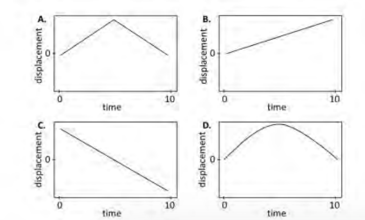
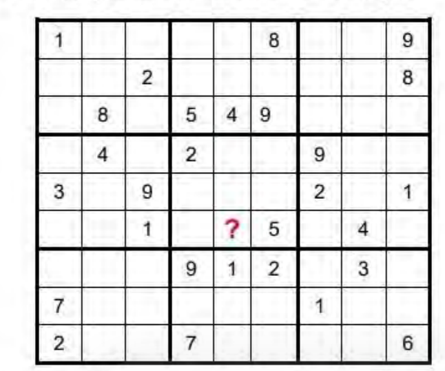
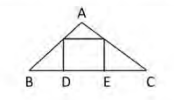
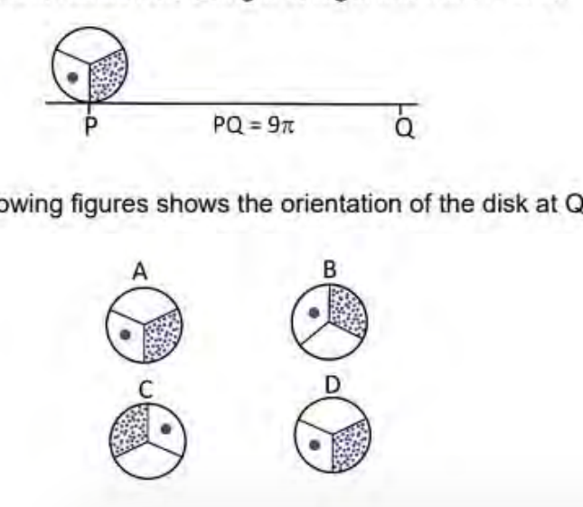
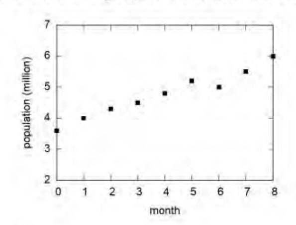

# CSIR UGC NET Life Sciences — December 2023 (Shift 1, 26-12-2023, 09:00–12:00) — Part A

Questions 1–20 (Part A, 2 marks each). Answers confirmed against the NTA **final** answer key (subject 703, shift 09:00–12:00). Question numbering follows the printed "Question No." within Part A; the printed Question ID of each question is given in italics under its heading.

---

### Question 1

*Question ID 703002*

The number 68132 – 31932 is divisible by

1. both 362 and 1000
2. 362 but not 1000
3. 1000 but not 362
4. neither 362 nor 1000

**Answer: 1 (both 362 and 1000)**

> **Explanation:** Repeatedly applying a² – b² = (a–b)(a+b): 68132 – 31932 contains the factor 6812 – 3192 = (681 – 319)(681 + 319) = 362 × 1000. Hence the number is divisible by both 362 and 1000.

---

### Question 2

*Question ID 703001*

Which one of the following graphs represents the displacement vs time relation for the motion of a ball thrown upward and returning toward the ground, remaining in air for 10 seconds? (Ignore air resistance.)

1. A
2. B
3. C
4. D

**Answer: 4 (D)**

> **Explanation:** With no air resistance, displacement s = ut – ½gt², a parabola that rises smoothly to a maximum at the top of the flight and falls back to zero at t = 10 s. Graph D is the only smooth (curved) parabola returning to the ground; A has a sharp corner (impossible under constant acceleration), B and C are straight lines (constant velocity).

---

### Question 3

*Question ID 703016*

Vehicle number plates have two letters out of the 26 letters of the English alphabet followed by four decimal digits. How many different number plates are possible if repetition of letters and digits is allowed?

1. 26 × 25 × 10 × 9 × 8 × 7
2. 26 × 26 × 10 × 10 × 10 × 10
3. (26 × 25 × 24 × 23 × 10 × 9) / (4 × 3 × 2 × 2)
4. 26 × 25 × 24 × 23 × 10 × 9

**Answer: 2 (26 × 26 × 10 × 10 × 10 × 10)**

> **Explanation:** Repetition is allowed, so each of the two letter positions has 26 choices and each of the four digit positions has 10 choices: 26 × 26 × 10 × 10 × 10 × 10.

---

### Question 4

*Question ID 703005*

In a grid puzzle, each row and column in the 9×9 grid, as well as each 3×3 sub-grid shown with heavy borders, must contain all the digits 1—9.

In the given partially filled grid, the digit in the square marked "?" is

1. 3
2. 9
3. 8
4. 7

**Answer: 2 (9)**

> **Explanation:** The "?" is at row 6, column 5, inside the centre 3×3 box (which already contains 2 and 5). Place the digit 9 in that box: row 4 already has a 9 (column 7) and row 5 already has a 9 (column 3), so 9 must sit in row 6 of the box; column 4 already has a 9 (row 7), and column 6 already has a 9 (row 3), leaving only the "?" cell. Hence the digit is 9.

---

### Question 5

*Question ID 703003*

In an examination 3 medals were awarded for each of 5 subjects. If three candidates won exactly four medals each, and no candidate won just one medal, the total number of medal winners

1. was exactly 4
2. was exactly 5
3. could be either 5 or 6
4. was exactly 6

**Answer: 1 (was exactly 4)**

> **Explanation:** Total medals = 3 × 5 = 15. Three candidates took 4 each = 12, leaving 3 medals. No candidate won exactly one medal, so the remaining 3 medals cannot be split as 1+2 or 1+1+1; they must all go to one more candidate. Hence winners = 3 + 1 = exactly 4.

---

### Question 6

*Question ID 703007*

What is the difference, 11 hours after synchronisation, in the time shown by a standard watch and a watch whose hour and minute hands coincide every 64 minutes?

1. 11 min
2. 16 min
3. 22 min
4. 44 min

**Answer: 2 (16 min)**

> **Explanation:** In a correct watch the hands coincide every 65 5/11 min; the faulty watch coincides every 64 min, i.e. it is fast by 65 5/11 − 64 = 16/11 min per coincidence cycle. Applying the standard textbook treatment (one cycle per hour of the watch's reckoning), the gain over 11 hours is 11 × 16/11 = 16 min. (A strict real-time reading gives ≈ 15 min; the NTA key marks option 2, 16 min.)

---

### Question 7

*Question ID 703013*

The sum of squares of four integers

1. can never be divisible by 13
2. can never be divisible by 15
3. can be divisible by 17
4. can never be divisible by 19

**Answer: 3 (can be divisible by 17)**

> **Explanation:** Each "never" claim is killed by a single counterexample: 13 = 2²+2²+2²+1², so a sum of four squares **can** be divisible by 13; 15 = 3²+2²+1²+1², likewise for 15; 19 = 4²+1²+1²+1², likewise for 19. The remaining positive statement is option 3, and it is true: 34 = 5²+2²+2²+1² is divisible by 17.

---

### Question 8

*Question ID 703010*

If *ab* = 5, *bc* = 7 and *ca* = 11, which of the following identities is valid?

1. 7 *a* = 11 *b* = 5 *c*
2. √35 *a* = √55 *b* = √77 *c*
3. √7/5 *a* = √5/11 *b* = √11/7 *c*
4. √5/11 *a* = √11/7 *b* = √7/5 *c*

**Answer: 1 (7 a = 11 b = 5 c)**

> **Explanation:** ab/bc = 5/7 gives a/c = 5/7 ⇒ 7a = 5c. ab/ca = 5/11 gives b/c = 5/11 ⇒ 11b = 5c. Hence 7a = 11b = 5c.

---

### Question 9

*Question ID 703006*

In the given triangle ABC, a square is drawn as shown. Given, ∠BAC = 90°, *BC* = *a*, *BD* = *x* and *EC* = *y*; which of the following is the area of the square?

1. (*a* – *x*)*y*
2. (*a* – *y*)*x*
3. (*a* – *x*)(*a* – *y*)
4. *xy*

**Answer: 4 (xy)**

> **Explanation:** Let the square have side s = DE. Triangles ABD-region and ECF are each similar to the square-side triangles: Δ(small left triangle) ~ Δ(small right triangle) by angle chasing with ∠BAC = 90°. Then BD/s = s/EC, so s² = BD × EC = xy. The area of the square is xy.

---

### Question 10

*Question ID 703019*

A circular disk of unit radius rolls along a straight line from P to Q.

Which of the following figures shows the orientation of the disk at Q?

1. A
2. B
3. C
4. D

**Answer: 3 (C)**

> **Explanation:** Circumference = 2πr = 2π. PQ = 9π = 4 full rotations (8π) plus a half rotation (π). After 4 complete turns the disk is back to its starting orientation; the extra half-turn flips it 180°, which is orientation C.

---

### Question 11

*Question ID 703009*

A test consists of 20 questions. A correct answer fetches 4 marks and a wrong answer is penalised by deducting 1 mark. Unattempted questions fetch nothing. If a candidate with a few wrong answers secures 44 marks, how many questions were attempted?

1. 15
2. 16
3. 17
4. 18

**Answer: 2 (16)**

> **Explanation:** Let c correct, w wrong (w ≥ 1, "a few wrong answers"). 4c – w = 44 with c + w ≤ 20. Trying w = 4 gives c = 12, total attempted 16 (and 4 unanswered); other w values in 4c – w = 44 (w = 0 → c = 11 but w must be nonzero; w = 4 is the only solution keeping c + w ≤ 20 with integer c, e.g. w = 8 → c = 13, attempted 21 > 20). So 16 attempted.

---

### Question 12

*Question ID 703020*

On day 1, a boy puts one coin in his piggy bank. On successive days he adds coins so as to double the number of coins. In another piggy bank, a girl puts 2 coins on day 1 but adds coins on every alternate day so as to double the number of coins. On which day will they put the same number of coins in their piggy banks?

1. Day 2
2. Day 3
3. Day 5
4. on no day

**Answer: 2 (Day 3)**

> **Explanation:** Boy's daily deposits: day 1 = 1, day 2 = 1 (doubling the total means adding 1 more), continuing 2, 4, 8… — counting what each *puts in* each day: boy 1,1,2,4,8; girl puts 2 on day 1, nothing on day 2, then doubles on alternate days: 2,0,2,0,4. On day 3 both put in 2 coins.

---

### Question 13

*Question ID 703018*

Symbols ⊖, ⊗, ⊘ represent mathematical operations (out of +, –, ÷, ×) which respect the relations

8 ⊘ 5 ⊖ 9 = 53

9 ⊖ 3 ⊗ 2 = 25

What is the value of 2 ⊗ 13 ⊘ 7 ?

1. –4
2. 8
3. –89
4. 19

**Answer: 1 (–4)**

> **Explanation:** From 9 ⊖ 3 ⊗ 2 = 25: 9×3 – 2 = 25 ⇒ ⊖ = ×, ⊗ = –. Check 8 ⊘ 5 ⊖ 9 = 53: 8 ⊘ 5×9 = 53 ⇒ ⊘ = +. Therefore 2 ⊗ 13 ⊘ 7 = 2 – 13 + 7 = –4.

---

### Question 14

*Question ID 703011*

The shape of a country on a map is approximated by a kite with diagonals of length 300 km each. The minimum possible length of its boundary will be closest to

1. 1696 km
2. 1131 km
3. 848 km
4. 600 km

**Answer: 3 (848 km)**

> **Explanation:** For a kite whose diagonals are equal (300 km each) and perpendicular, the boundary is minimised when the diagonals bisect each other — a square. Each side = √(150² + 150²) = 150√2 ≈ 212.1 km, perimeter = 4 × 212.1 ≈ 848.5 km.

---

### Question 15

*Question ID 703015*

In the following finite sequence of integers, how many 9s are divisible by the integers immediately preceding them?

8,3,4,9,3,5,9,5,9,9,9,4,5,9,5,6,3,3,5,7,2,3,9,9,8,9,3,9,1,9,4

1. 3
2. 4
3. 5
4. 6

**Answer: 4 (6)**

> **Explanation:** A 9 is counted when the digit before it divides 9 (divisors among digits: 1, 3, 9). Scanning: 9 after 4 ✗; 9 after 5 ✗; 9 after 5 ✗; 9 after 9 ✓; 9 after 9 ✓; 9 after 4 ✗; 9 after 5 ✗; 9 after 3 ✓; 9 after 3 ✓; 9 after 8 ✗; 9 after 3 ✓; 9 after 1 ✓ — six qualifying 9s.

---

### Question 16

*Question ID 703012*

A rectangular paper of sides in the ratio 3:4 is folded in half across the longer side. The process is repeated several times. After how many foldings will the ratio of the sides be 3:4? (Ignore the finite thickness of the paper.)

1. Never
2. Every second fold
3. Every third fold
4. Every fifth fold

**Answer: 2 (Every second fold)**

> **Explanation:** 3:4 folded across the longer side → 3:2 = 1.5:1 → ratio 1.5 (i.e. 3:2). Fold again across the longer side → 0.75:1 = 3:4 again. The original ratio recurs after every second fold.

---

### Question 17

*Question ID 703008*

Six years ago, the ages of three persons were in ratio 3:5:8. If the sum of their ages 8 years from now would be 122, what are their present ages (in years)?

1. 15, 25, 40
2. 21, 31, 46
3. 15, 25, 30
4. 21, 26, 37

**Answer: 2 (21, 31, 46)**

> **Explanation:** Ages six years ago: 3x, 5x, 8x. Present: 3x+6, 5x+6, 8x+6. Eight years hence their sum = 16x + 18 + 24 = 16x + 42 = 122 ⇒ x = 5. Present ages: 21, 31, 46.

---

### Question 18

*Question ID 703014*

Four students Adil, Billy, Ramesh and Diana joined a college in 1991, 1992, 1993 and 1994 but not necessarily in that order. Each student joined one of the four departments, viz. Physics, Chemistry, Mathematics and Biology. No two students joined the same department. One of those who joined the college before 1993 joined Chemistry. No one joined the college after Ramesh. Diana joined Physics. Adil joined one year after Diana but didn't join Chemistry. Who joined the college in the year 1993?

1. Adil
2. Billy
3. Ramesh
4. Diana

**Answer: 1 (Adil)**

> **Explanation:** "No one joined after Ramesh" ⇒ Ramesh = 1994. If Diana joined in 1991, Adil joined 1992; then Chemistry (which belongs to a pre-1993 joiner) could be neither Diana (Physics) nor Adil (not Chemistry) nor Ramesh — contradiction with Billy? Billy would then have 1993, so no pre-1993 seat left for Chemistry. Hence Diana = 1992 (Physics), Adil = 1993, Billy = 1991 with Chemistry — Adil joined in 1993.

---

### Question 19

*Question ID 703004*

Suppose each of my brothers has the same number of children as I have sisters, each of the sister having the same number of children as I have brothers. If my siblings have a total of 12 children, none of them an only child, the number of my siblings is

1. 3
2. 5
3. 6
4. 7

**Answer: 2 (5)**

> **Explanation:** Let me have b brothers and s sisters. Brothers' children: b × s; sisters' children: s × b; total = 2bs = 12 ⇒ bs = 6. "None of them an only child" means b, s ≥ 2, so {b, s} = {2, 3} and the number of my siblings = b + s = 5.

---

### Question 20

*Question ID 703017*

The population of a species (*y*) changes with the month (*x*) as shown in the graph. Which of the following equations best describes the population curve?

1. *y* = 3*x* + 3.2
2. *y* = 0.96 (*x* – 4)
3. *y* = 0.3*x*² + *x* + 3.6
4. *y* = 0.3 *x* + 3.6

**Answer: 4 (y = 0.3 x + 3.6)**

> **Explanation:** The points lie along a straight line with intercept ≈ 3.6 at x = 0 and slope ≈ (5.5 – 3.6)/7 ≈ 0.3, giving y = 0.3x + 3.6. Option 1's slope (3) is far too steep and option 3 curves upward, which the data do not show.

---

## Answer key

Source: **official NTA final answer key** — *CSIR-UGC NET December 2023, Final Answer Keys on
which result generated*, subject **(703) Life Sciences**, exam date **26-12-2023**,
shift **09:00-12:00** (https://nta.ac.in/Download/Notice/Notice_20240213113136.pdf).
See `sources.md` for provenance and verification. `Global` is the numbering used in this
archive; `Printed` is the number printed on the paper within Part A.

| Global | Printed | Question ID | Correct key |
|---:|---:|---|---|
| 1 | 1 | 703002 | 1 |
| 2 | 2 | 703001 | 4 |
| 3 | 3 | 703016 | 2 |
| 4 | 4 | 703005 | 2 |
| 5 | 5 | 703003 | 1 |
| 6 | 6 | 703007 | 2 |
| 7 | 7 | 703013 | 3 |
| 8 | 8 | 703010 | 1 |
| 9 | 9 | 703006 | 4 |
| 10 | 10 | 703019 | 3 |
| 11 | 11 | 703009 | 2 |
| 12 | 12 | 703020 | 2 |
| 13 | 13 | 703018 | 1 |
| 14 | 14 | 703011 | 3 |
| 15 | 15 | 703015 | 4 |
| 16 | 16 | 703012 | 2 |
| 17 | 17 | 703008 | 2 |
| 18 | 18 | 703014 | 1 |
| 19 | 19 | 703004 | 2 |
| 20 | 20 | 703017 | 4 |

Questions in this Part marked by the key as accepting **more than one option**, or as **DROPPED**,
are recorded exactly as the key states them; none has been narrowed to a single answer.
