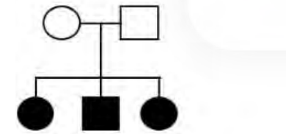
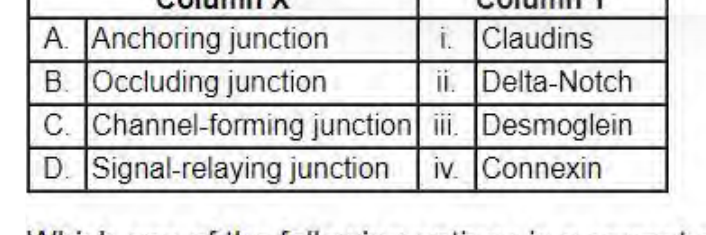

# CSIR UGC NET Life Sciences — December 2023 (Shift 1, 26-12-2023, 09:00–12:00) — Part B

Questions 21–70 (Part B, 2 marks each). Answers confirmed against the NTA **final** answer key (subject 703, shift 09:00–12:00). Global numbering continues from Part A; the printed Question ID of each question is given in italics.

---

### Question 21

*Question ID 703064*

During animal cell culture, which one of the following cell types would **NOT** require trypsin for passaging?

1. Epithelial cells
2. Hematopoietic cells
3. Fibroblasts
4. Myoblasts

**Answer: 2 (Hematopoietic cells)**

> **Explanation:** Hematopoietic cells (blood-cell lineage, e.g. lymphocytes, monocytes) grow in suspension and are not attached to the culture surface, so they do not need enzymatic detachment with trypsin. Adherent types (epithelial, fibroblasts, myoblasts) require trypsinisation for passaging.

---

### Question 22

*Question ID 703024*

Which one of the following pairs of metabolic intermediates does **NOT** provide a backbone carbon skeleton for the synthesis of amino acids?

1. Succinate and citrate
2. 3-phosphoglycerate and phosphoenolpyruvate
3. Ribose 5-phosphate and erythrose 4-phosphate
4. α-ketoglutarate and oxaloacetate

**Answer: 1 (Succinate and citrate)**

> **Explanation:** The amino-acid carbon skeletons come from glycolytic/gluconeogenic and TCA intermediates: 3-phosphoglycerate (Ser, Gly, Cys), phosphoenolpyruvate (aromatics), ribose-5-P (His), erythrose-4-P (aromatics), α-ketoglutarate (Glu family) and oxaloacetate (Asp family). Succinate and citrate are not precursors of amino-acid backbones.

---

### Question 23

*Question ID 703056*

Which one of the following four plant families has the largest number of species?

1. Brassicaceae
2. Cucurbitaceae
3. Cactaceae
4. Rosaceae

**Answer: 4 (Rosaceae)**

> **Explanation:** The NTA key marks Rosaceae, a very large family of flowering plants (~2,200–3,000 species: apples, pears, cherries, strawberries, roses), as the most species-rich among the four options given.

---

### Question 24

*Question ID 703029*

During replication, over-winding of DNA is caused by ______ and removed by ______.

1. primase, topoisomerase
2. primase, single stranded binding protein
3. helicase, gyrase
4. helicase, DNA polymerase

**Answer: 3 (helicase, gyrase)**

> **Explanation:** Helicase unwinds the duplex at the fork, generating positive supercoiling (over-winding) ahead of the fork; DNA gyrase (a type II topoisomerase) relieves this torsional strain.

---

### Question 25

*Question ID 703067*

Which one of the following combinations of excitation light and objectives gives the best lateral resolution in a fluorescence microscope?

1. 480nm, 63X, 1.4NA
2. 650nm, 63X, 1.4NA
3. 550nm, 100X, 1NA
4. 480nm, 100X, 1.1NA

**Answer: 1 (480nm, 63X, 1.4NA)**

> **Explanation:** Lateral resolution d = 0.61λ/NA; smaller d is better. Best achieved with the shortest wavelength and highest NA. Option 1 pairs 480 nm with NA 1.4 (d ∝ 480/1.4 ≈ 343), the lowest value among the choices.

---

### Question 26

*Question ID 703052*

In a mutagenesis experiment, the following pedigree was obtained. All progeny had the same phenotype.

The mutation is most likely to have occurred

1. during maturation of the egg cell.
2. in the maternal somatic cell.
3. in the mother in the precursor to all germ cells.
4. in the embryo during development.

**Answer: 3 (in the mother in the precursor to all germ cells)**

> **Explanation:** Both parents are phenotypically normal yet all progeny are affected, which fits a mutation arising in the mother's germ-cell precursor (present in all/gametes) so every offspring inherits it — a germline (not somatic, not single-egg) event.

---

### Question 27

*Question ID 703061*

Which one of the following geological events in the Cretaceous had a massive impact on the climate and biodiversity of India?

1. Origin of Tibetan plateau
2. Deccan Trap volcanic activity
3. Formation of Lonar Lake
4. Origin of Himalayan mountains

**Answer: 2 (Deccan Trap volcanic activity)**

> **Explanation:** The Deccan Traps flood-basalt eruptions peaked at the end-Cretaceous (~66 Ma), coinciding with the K–Pg extinction and strongly affecting India's climate and biota. The Himalaya/Tibetan plateau orogeny is largely Cenozoic.

---

### Question 28

*Question ID 703050*

Which one of the following options contains only those types of mapping populations that are characterized by 'true-breeding' individuals?

1. RILs and F2 populations
2. F2 populations and BC1F2
3. Doubled haploid populations and BC1F2
4. Doubled haploid populations and RILs

**Answer: 4 (Doubled haploid populations and RILs)**

> **Explanation:** Doubled-haploid lines and recombinant inbred lines (RILs) are fully homozygous and hence true-breeding. Segregating F2 and BC1F2 populations are heterozygous at many loci and do not breed true.

---

### Question 29

*Question ID 703062*

Monogamy in sexually reproducing animals is seemingly paradoxical given that males must maximise their number of matings for higher fitness. Yet, many birds are known to be monogamous. Which one of the following statements represents a scenario where monogamy in birds is **LEAST** likely to evolve?

1. Poor quality of habitat wherein resources are hard to find
2. Males guard females after mating with them
3. Mates are scattered and hard to find
4. Offspring do not require elaborate parental care

**Answer: 4 (Offspring do not require elaborate parental care)**

> **Explanation:** Bird monogamy is favoured when biparental care is needed, when mates are widely scattered (defence of multiple mates costly), or in poor habitats requiring two parents. If offspring need no elaborate care, the male gains little from staying, so monogamy is least likely to evolve.

---

### Question 30

*Question ID 703036*

Kaposi's sarcoma is caused by

1. Epstein-Barr virus
2. HIV and HHV-8
3. HTLV type1
4. HPV

**Answer: 2 (HIV and HHV-8)**

> **Explanation:** Kaposi's sarcoma is caused by human herpesvirus 8 (HHV-8, KSHV); it is characteristically associated with immunosuppression in HIV/AIDS.

---

### Question 31

*Question ID 703060*

In which of the following ecosystems would the largest percentage of Net Primary Productivity (NPP) be taken up by the grazing food chain?

1. Tropical rainforest
2. Temperate deciduous forest
3. Algal seabed
4. Open ocean

**Answer: 4 (Open ocean)**

> **Explanation:** In the open ocean most NPP is phytoplankton that is directly consumed by zooplankton, so a very large fraction of production enters the grazing food chain; in forests most fixed carbon goes to the detritus food chain (woody biomass, litter).

---

### Question 32

*Question ID 703043*

The defect in a major semi-dwarfing gene of rice, *sd-1*, leads to cultivar with short, thick culms and improved lodging resistance. The gene is related to which one of the following phytohormones?

1. Gibberellins
2. Abscisic acid
3. Jasmonic Acid
4. Salicylic acid

**Answer: 1 (Gibberellins)**

> **Explanation:** *sd-1* encodes a GA 20-oxidase; loss of function reduces bioactive gibberellin, giving the semi-dwarf "Green Revolution" rice phenotype.

---

### Question 33

*Question ID 703044*

In the model plant *Arabidopsis thaliana*, methionine is a precursor amino acid in the biosynthesis of

1. Alkaloids
2. Glucosinolates
3. Phenolics
4. Terpenoids

**Answer: 2 (Glucosinolates)**

> **Explanation:** The sulphur-containing amino acid methionine is the chain initiator for glucosinolate (mustard-oil glycoside) biosynthesis in *Arabidopsis*.

---

### Question 34

*Question ID 703023*

One strand of a palindromic dsDNA is composed of 5'-CCGCGGCGG-3'. Which one of the following forms of nucleic acid structures will be adopted in water if sense and antisense strands are mixed in equal proportion followed by annealing?

1. A-form of double-stranded nucleic acid
2. B-form of double-stranded nucleic acid
3. Z-form of double-stranded nucleic acid
4. Both will remain as single strands

**Answer: 2 (B-form of double-stranded nucleic acid)**

> **Explanation:** Under physiological aqueous conditions a complementary DNA duplex adopts the right-handed B-form. (Z-form needs alternating purine–pyrimidine like (CG)n under high salt; here the sequence and normal water conditions favour B-DNA.)

---

### Question 35

*Question ID 703068*

Which one of the following techniques allows the study of all three types of interactions namely, protein:protein, protein:DNA, and protein:RNA?

1. Differential display
2. Phage display
3. ChIP assay
4. Southwestern blotting

**Answer: 2 (Phage display)**

> **Explanation:** Phage display can be selected against protein, DNA and RNA baits, so it interrogates protein:protein, protein:DNA and protein:RNA interactions. Southwestern is protein:DNA only; ChIP is protein:DNA in vivo; differential display profiles gene expression.

---

### Question 36

*Question ID 703049*

Which one of the following is true for Genome-wide association study (GWAS)?

1. There is a need to make controlled crosses or work with human families with known parent-offspring relationship.
2. All alleles in the population are assayed at the same time.
3. Single nucleotide polymorphisms (SNPs) cannot be used for such studies.
4. Knowledge about candidate genes is essential.

**Answer: 2 (All alleles in the population are assayed at the same time)**

> **Explanation:** GWAS is a hypothesis-free, population-based scan of markers (SNPs) genome-wide, assaying variation across the whole genome at once; it needs neither controlled crosses nor prior candidate-gene knowledge, and SNPs are precisely the markers used.

---

### Question 37

*Question ID 703040*

Which one of the following floral homeotic genes is transcribed in all four whorls during flower development?

1. AP1
2. AP2
3. AP3/PI
4. AG

**Answer: 2 (AP2)**

> **Explanation:** Among the class A/B/C genes listed, APETALA2 has the broadest expression (whorls 1–3, and per the key the option accepted for all-whorl expression). AP1 is whorls 1–2, AP3/PI whorls 2–3, AG whorls 3–4. (The solution source flags this question; the NTA key marks option 2.)

---

### Question 38

*Question ID 703070*

Which one of the following statistical methods compares the means of the populations?

1. *t*-test
2. Chi-square test
3. Analysis of Variance
4. Principal Component Analysis

**Answer: 1 and 3 (t-test; Analysis of Variance)**

> **Explanation:** The NTA final key accepts **both** option 1 and option 3. Both the *t*-test (two means) and ANOVA (multiple means) compare population means; chi-square tests associations/goodness-of-fit and PCA is a dimension-reduction method.

---

### Question 39

*Question ID 703039*

Which one of the following statements is correct for dosage compensation in human?

1. X-chromosome inactivation in female occurs in a zygote immediately after fertilization.
2. X-chromosome inactivation is non-random, in some individuals maternal X is inactivated while in others paternal X-chromosome is inactivated.
3. Y-chromosome of males is seen as Barr body.
4. The body of female is a mosaic of cells, some having paternal X- and others having maternal X-inactivated.

**Answer: 4 (The body of female is a mosaic of cells, some having paternal X- and others having maternal X-inactivated.)**

> **Explanation:** In humans X-inactivation is random early in embryogenesis (not in the zygote, not the imprinted pattern of marsupials/mouse extraembryory tissue), so adult females are cellular mosaics for maternal- or paternal-X inactivation. The Barr body is an inactivated X, not the Y.

---

### Question 40

*Question ID 703059*

Which one of the following anthropogenic activities contributes the most nitrogen to the global nitrogen cycle?

1. Industrial production of fertilizers
2. NOx production due to combustion of fossil fuels
3. Nitrogen fixation by soyabean farming
4. Nitrogen fixation by cultivation of legumes (excluding soyabean)

**Answer: 1 (Industrial production of fertilizers)**

> **Explanation:** The Haber-Bosch industrial fixation of N for fertilizers is by far the largest human-driven nitrogen input to the global cycle, exceeding fossil-fuel NOx and cultivated-legume (soyabean and other) biological fixation.

---

### Question 41

*Question ID 703038*

Which one of the following statements regarding the developmental potential of cells in embryo is **INCORRECT**?

1. The cells of the 4-cell stage mouse embryo are totipotent.
2. The cells of inner cell mass of the mouse blastocyst differentiate into trophectoderm, mesoderm and endoderm.
3. Spermatogonial stem cells in testis are unipotent.
4. Haematopoietic stem cells which can differentiate into blood cells are multipotent.

**Answer: 2 (The cells of inner cell mass of the mouse blastocyst differentiate into trophectoderm, mesoderm and endoderm.)**

> **Explanation:** The inner cell mass is pluripotent and gives the three germ layers (ectoderm, mesoderm, endoderm) — not trophectoderm, which is a separate lineage derived from the outer blastocyst cells. Statements 1, 3, 4 are correct.

---

### Question 42

*Question ID 703034*

Phosphatidylinositol (PI) is unusual among membrane lipids because it can undergo reversible phosphorylation at multiple sites on the inositol head to generate a variety of phosphorylated PI lipids called phosphoinositides. In a cell signaling event, the enzyme that directly converts PI(4,5)P₂ to PI(3,4,5)P₃ is:

1. PI3-Kinase
2. PLCβ
3. PTEN
4. Protein Kinase B

**Answer: 1 (PI3-Kinase)**

> **Explanation:** Phosphoinositide 3-kinase (PI3K) phosphorylates the 3-position of PIP2 to give PIP3. PLCβ cleaves PIP2; PTEN dephosphorylates PIP3 back; PKB/Akt is recruited by PIP3, not the kinase that makes it.

---

### Question 43

*Question ID 703058*

Which one of the following options lists landmasses that were all a part of the ancient Gondwana supercontinent?

1. Australia, New Zealand, and North America
2. Africa, Europe, India, New Zealand, and South America
3. Africa, Europe, India, Madagascar, and North America
4. Africa, Australia, Antarctica, India, Madagascar, and South America

**Answer: 4 (Africa, Australia, Antarctica, India, Madagascar, and South America)**

> **Explanation:** Gondwana comprised the southern continents — Africa, South America, Antarctica, Australia, the Indian subcontinent and Madagascar. North America and most of Europe belonged to Laurasia.

---

### Question 44

*Question ID 703026*

Which one of the following statements about distribution of chromosomes within the interphase nucleus of a mammalian cell is correct?

1. Chromosomes are randomly distributed within the nuclear volume.
2. The gene-poor chromosomes tend to locate towards the nuclear envelope.
3. The larger chromosomes tend to locate at the nuclear periphery.
4. Centromeric region of all the chromosomes tend to concentrate at the center of the nucleus.

**Answer: 2 (The gene-poor chromosomes tend to locate towards the nuclear envelope.)**

> **Explanation:** Gene-poor (AT-rich) chromosome territories associate with the nuclear lamina at the periphery, while gene-rich chromosomes occupy the nuclear interior. Chromosome positioning is non-random.

---

### Question 45

*Question ID 703041*

Which one of the following statements is **INCORRECT** regarding plant phytochrome (PHY), cyanobacterial phytochrome1 (Cph1) and bacterial phytochrome like protein (BphP)?

1. PHY has two PRD domains in the C-terminal moiety.
2. Cph1 and BphP has histidine kinase domains at the N-terminal moiety.
3. GAF domain is present in N-terminal moiety of PHY, Cph1 and BphP.
4. The cysteine residue that forms the linkage is located in the GAF domain in canonical phytochromes such as PHY and Cph1.

**Answer: 2 (Cph1 and BphP has histidine kinase domains at the N-terminal moiety.)**

> **Explanation:** In bacterial phytochromes (BphP, Cph1) the histidine-kinase (His Kinase Related) domain lies in the **C-terminal** output region, not the N-terminal photosensory core (which is PAS–GAF–PHY). So statement 2 is the incorrect one.

---

### Question 46

*Question ID 703069*

What type of electromagnetic radiation is used in biomolecular NMR spectroscopy?

1. Radio waves
2. Beta emissions
3. X-ray waves
4. Microwaves

**Answer: 1 (Radio waves)**

> **Explanation:** NMR probes nuclear spin transitions in a magnetic field, which fall in the radio-frequency region of the electromagnetic spectrum.

---

### Question 47

*Question ID 703055*

Select the species that was thought to be extinct because of climate change and habitat loss, but was recently rediscovered in the year 2022.

1. Nicobar Wart Frog
2. Harlequin Frog
3. Nilgiri Cricket Frog
4. Lemur Leaf Frog

**Answer: 2 (Harlequin Frog)**

> **Explanation:** The harlequin frog (a *Atelopus* species) reported extinct due to habitat loss and chytrid/climate effects was declared rediscovered in 2022.

---

### Question 48

*Question ID 703033*

Choose the **INCORRECT** statement:

1. Tetanospasmin is associated with Tetanus
2. Tetanospasmin is a neurotoxin
3. Tetanospasmin facilitates the release of gamma-aminobutyric acid at synapses
4. Immunization with toxoids is used for the prevention of tetanus.

**Answer: 3 (Tetanospasmin facilitates the release of gamma-aminobutyric acid at synapses)**

> **Explanation:** Tetanospasmin (from *Clostridium tetani*) is a neurotoxin that **blocks** release of inhibitory transmitters (GABA and glycine) by cleaving synaptobrevin, causing spastic paralysis. It does not facilitate GABA release, so statement 3 is incorrect. Toxoid immunization does prevent tetanus.

---

### Question 49

*Question ID 703047*

Aldosterone is synthesized exclusively in zona glomerulosa due to the presence of _________ enzyme in addition to a dehydrogenase.

1. 11 β-hydroxylase
2. 17 α-hydroxylase
3. 18-hydroxylase
4. 21-hydroxylase

**Answer: 3 (18-hydroxylase)**

> **Explanation:** Zona glomerulosa uniquely expresses aldosterone synthase (CYP11B2), which has 11β-, 18-hydroxylase and 18-oxidase (dehydrogenase) activities. The 18-hydroxylase step is required for aldosterone; fasciculata (17α-hydroxylase) cannot make it.

---

### Question 50

*Question ID 703035*

Column X represents the type of junctions and column Y represents the proteins associated with the junctions.

Which one of the following options is a correct match between terms of Columns X and Y?

1. A-iii, B-i, C-iv, D-ii
2. A-iv, B-i, C-iv, D-iii
3. A-iii, B-ii, C-iv, D-i
4. A-ii, B-iii, C-i, D-iv

**Answer: 1 (A-iii, B-i, C-iv, D-ii)**

> **Explanation:** Anchoring junctions (desmosomes) use desmoglein (iii); occluding/tight junctions use claudins (i); channel-forming gap junctions use connexin (iv); signal-relaying junctions use Delta-Notch (ii). Hence A-iii, B-i, C-iv, D-ii.

---

### Question 51

*Question ID 703063*

Sometimes similar traits or characteristics evolve in two distinct lineages independently, such as venoms in scorpions and snakes. This process can be described as:

1. Convergent evolution
2. Microevolution
3. Macroevolution
4. Divergent evolution

**Answer: 1 (Convergent evolution)**

> **Explanation:** Independent evolution of similar functionally-analogous traits in unrelated lineages is convergent evolution.

---

### Question 52

*Question ID 703045*

How much hemoglobin is present approximately in each normal human red blood cell?

1. 19 pg
2. 29 pg
3. 39 pg
4. 49 pg

**Answer: 2 (29 pg)**

> **Explanation:** Mean corpuscular hemoglobin (MCH) in a normal human RBC is about 27–31 pg, i.e. ~29 pg.

---

### Question 53

*Question ID 703025*

Fifteen spontaneous Ara⁻ mutants of *E.coli* that were not able to utilize arabinose as a sole carbon source in minimal synthetic medium at 42°C were isolated. However, interestingly all these mutants were able to use arabinose as the sole carbon source at 30°C. Based on the above information, which one of the following options represents the most likely type of the mutations?

1. Deletions
2. Inversions
3. Frameshift mutations
4. Mis-sense mutations

**Answer: 4 (Mis-sense mutations)**

> **Explanation:** The temperature-dependent (conditional) phenotype — functional protein at 30 °C but not at 42 °C — is characteristic of a missense (temperature-sensitive) mutation producing a protein that folds/works at the permissive but not the restrictive temperature. Deletions/frameshifts would be null at both temperatures. (The NTA key marks option 4; the solution source notes these are conditional/temperature-sensitive missense alleles.)

---

### Question 54

*Question ID 703053*

Which one of the following statements is **NOT** correct about collenchyma?

1. Collenchyma cell walls are thick and they require more glucose for their production.
2. Collenchyma cells are rigid.
3. Collenchyma is usually produced in shoot tips and young petioles.
4. Collenchyma is generally not present in subterranean shoots and roots.

**Answer: 2 (Collenchyma cells are rigid.)**

> **Explanation:** Collenchyma has unevenly thickened primary walls of pectin/hemicellulose and is flexible/pliable (providing support to growing organs), not rigid. Rigidity is a feature of sclerenchyma/lignified cells. So statement 2 is incorrect.

---

### Question 55

*Question ID 703066*

Which one of the following is **NOT** required in the blood glucose biosensor?

1. Glucose oxidase as biologically active component
2. Electrode as electrochemical transducer
3. Piezoelectric crystal as sensor
4. FAD as coenzyme of glucose oxidase

**Answer: 3 (Piezoelectric crystal as sensor)**

> **Explanation:** The classic Clark-type glucose biosensor uses glucose oxidase (with FAD) and an electrochemical transducer electrode; a piezoelectric crystal belongs to acoustic (bulk-acoustic-wave) sensors, not the amperometric glucose biosensor.

---

### Question 56

*Question ID 703021*

Which one of the following enzymes does **NOT** catalyze the oxidation of substrate by reducing the electron acceptor, NAD⁺?

1. Lactate dehydrogenase
2. Pyruvate dehydrogenase
3. Succinate dehydrogenase
4. Isocitrate dehydrogenase

**Answer: 3 (Succinate dehydrogenase)**

> **Explanation:** Succinate dehydrogenase (Complex II) passes electrons to enzyme-bound FAD (→ ubiquinone), not to NAD⁺. Lactate DH, pyruvate DH and isocitrate DH all reduce NAD⁺.

---

### Question 57

*Question ID 703057*

Which one of the following correctly shows the total estimated biomass of the lifeforms on Earth given here, in increasing order?

1. Bacteria < Viruses < Fungi
2. Bacteria < Fungi < Viruses
3. Viruses < Fungi < Bacteria
4. Fungi < Viruses < Bacteria

**Answer: 3 (Viruses < Fungi < Bacteria)**

> **Explanation:** Global biomass estimates (e.g. Bar-On et al.) rank bacteria (~60–70 Gt C) > fungi (~12 Gt C) > viruses (~0.1 Gt C), so in increasing order: Viruses < Fungi < Bacteria.

---

### Question 58

*Question ID 703027*

Which cell cycle phase is typically the shortest in mammalian cells?

1. G0 phase
2. G1 phase
3. G2 phase
4. Mitosis

**Answer: 4 (Mitosis)**

> **Explanation:** In a typical mammalian cell cycle, M (mitosis + cytokinesis) lasts ~1 hour, far shorter than G1, S and G2, making it the shortest phase.

---

### Question 59

*Question ID 703032*

RNA polymerase is an enzyme that transcribes DNA sequences into RNA. Which one of the following is **NOT** a property of the RNA polymerase?

1. RNA polymerases initiate RNA synthesis without primers that provide a free 3'OH group
2. RNA polymerases have high fidelity due to the action of proof-reading endonuclease activity
3. In eukaryotes, RNA that encodes ribosomal proteins is transcribed by RNA polymerase II
4. RNA polymerases initiate RNA synthesis from defined regions of DNA

**Answer: 2 (RNA polymerases have high fidelity due to the action of proof-reading endonuclease activity)**

> **Explanation:** Unlike DNA polymerases, RNA polymerases lack an intrinsic proof-reading exonuclease/endonuclease activity, so transcription has a higher error rate. Statements 1, 3, 4 are true properties.

---

### Question 60

*Question ID 703042*

Which one of the following is referred to as tuberonic acid?

1. Methyl jasmonate
2. *cis*-jasmone
3. Jasmonoyl-1-β-glucose
4. 12-Hydroxy-(+)-7-isojasmonate

**Answer: 4 (12-Hydroxy-(+)-7-isojasmonate)**

> **Explanation:** Tuberonic acid is 12-hydroxyjasmonic acid (the 12-hydroxylated jasmonate), i.e. 12-hydroxy-(+)-7-isojasmonate.

---

### Question 61

*Question ID 703028*

Porins, which are normally present on the outer mitochondrial membrane, reach their destination by

1. direct synthesis of porins on mitochondria membrane by the mitochondrial protein synthesis machinery.
2. synthesis on the ER and transport via vesicles to the mitochondria.
3. synthesis in the cytosol, import by TOM complex and insertion from the inter-mitochondrial membrane space.
4. synthesis in the cytosol, import by TIM complex and insertion in the membrane.

**Answer: 3 (synthesis in the cytosol, import by TOM complex and insertion from the inter-mitochondrial membrane space.)**

> **Explanation:** β-barrel outer-membrane proteins such as porins are made on cytosolic ribosomes, recognised and translocated across the outer membrane by the TOM complex, then handed to the SAM/TOB complex in the intermembrane space for insertion into the outer membrane.

---

### Question 62

*Question ID 703051*

In a family, the father has an X-linked mutation causing a late-onset lethal disorder and the mother is **not** a carrier. Based on the above information, which one of the following statements about the children the couple may have is correct?

1. There is a 50% chance that the son will show the disorder.
2. No children will show the disorder.
3. The probability that the parents have a daughter carrying a mutant allele is 25%.
4. All daughters will carry the mutant allele.

**Answer: 4 (All daughters will carry the mutant allele.)**

> **Explanation:** An affected father passes his mutant X to every daughter (so all daughters are carriers) and his Y to every son (so sons are unaffected, as the mother is not a carrier). Hence all daughters carry the mutant allele.

---

### Question 63

*Question ID 703037*

Sperm _____, which helps in penetration of the egg during fertilization in mammals, contains _____.

1. lysin, hyaluronidase
2. fertilizin, hyaluronidase
3. lysin, hyaluronic acid
4. fertilizin, hyaluronic acid

**Answer: 1 (lysin, hyaluronidase)**

> **Explanation:** The sperm acrosomal enzyme lysin (binds/penetrates the egg) and the acrosomal hyaluronidase that disperses cumulus cells (hyaluronic-acid matrix) — the sperm lysin helps penetration and the acrosome contains hyaluronidase. (Key marks option 1.)

---

### Question 64

*Question ID 703022*

The pH of endocytic vesicles is 5.2, and the pH of gastric juice is 2.0. The endocytic vesicle has a [H⁺] that is

1. 15.85 times lower than that of gastric juice.
2. 0.1585 times lower than that of gastric juice.
3. 158.5 times lower than that of gastric juice.
4. 1585 times lower than that of gastric juice.

**Answer: 4 (1585 times lower than that of gastric juice.)**

> **Explanation:** ΔpH = 5.2 − 2.0 = 3.2, so [H⁺] ratio = 10^3.2 ≈ 1585. The endocytic vesicle has ~1585-fold lower [H⁺] than gastric juice.

---

### Question 65

*Question ID 703030*

P-bodies are discrete cytoplasmic collections of RNAs and proteins that are involved in:

1. Deadenylation, decapping and mRNA degradation
2. Deadenylation and mRNA degradation only
3. Deadenylation and decapping only
4. Decapping and mRNA degradation only

**Answer: 1 (Deadenylation, decapping and mRNA degradation)**

> **Explanation:** Processing bodies (P-bodies) are sites of mRNA turnover containing the machinery for deadenylation, decapping and 5'→3' decay, plus stored translationally repressed mRNAs.

---

### Question 66

*Question ID 703048*

Which one of the following hormones has no supply store in the cells where it is synthesized?

1. Catecholamines
2. Insulin
3. T3 and T4
4. Steroids

**Answer: 4 (Steroids)**

> **Explanation:** Steroid hormones are synthesised on demand from cholesterol and are not stored in vesicles, unlike catecholamines, insulin and thyroid hormones, which are stored.

---

### Question 67

*Question ID 703065*

In the production of alcohol by fermentation, in the absence of oxygen, yeasts convert glucose to pyruvate and pyruvate to ethanol. Fermentation promotes glycolysis by

1. Converting acetaldehyde to alcohol to prevent feed-back inhibition
2. Generating NADH for mitochondrial ATP generation
3. Preventing toxicity of acetaldehyde
4. Generating NAD+ for glycolysis

**Answer: 4 (Generating NAD+ for glycolysis)**

> **Explanation:** The ethanol-formation steps (pyruvate→acetaldehyde→ethanol) reoxidise NADH to NAD⁺, regenerating the NAD⁺ that glycolysis (glyceraldehyde-3-P dehydrogenase) requires, so glycolysis can continue anaerobically.

---

### Question 68

*Question ID 703046*

Which one of the following is involved in the pinching-off of the neck of invaginating coated pit to form endocytotic vesicle at the pre-synaptic terminal?

1. Synaptojanin
2. AP2
3. Clathrin
4. Dynamin

**Answer: 4 (Dynamin)**

> **Explanation:** Dynamin assembles as a collar at the neck of the invaginating clathrin-coated pit and, by GTP hydrolysis, constricts and severs (pinches off) the nascent endocytic vesicle.

---

### Question 69

*Question ID 703031*

Which one of the following functions is **NOT** facilitated by a tmRNA?

1. Addition of a stop codon at the 3' end of a defective and/or truncated mRNA.
2. Addition of a proteolysis-inducing tag at carboxyl terminus of unfinished polypeptide.
3. Release of defective and/or truncated mRNA from the ribosome.
4. Recycling of the stalled ribosomes.

**Answer: 1 (Addition of a stop codon at the 3' end of a defective and/or truncated mRNA.)**

> **Explanation:** In *trans*-translation, tmRNA rescues ribosomes stalled on non-stop mRNAs: it acts as both tRNA and mRNA, adding a proteolysis-tag (ssrA/AANDENYALAA) to the unfinished protein and providing a stop codon in the **tmRNA reading frame** to release the polypeptide, and freeing/recycling the ribosome. It does not add a stop codon to the 3' end of the defective mRNA itself.

---

### Question 70

*Question ID 703054*

Which one of the following terms describes the biological classification system based on common ancestry?

1. Linnean taxonomy
2. Binomial nomenclature
3. Phylogenetic classification
4. Rank based classification

**Answer: 3 (Phylogenetic classification)**

> **Explanation:** Phylogenetic (cladistic) systematics groups organisms by evolutionary descent from common ancestors. Linnean/rank-based taxonomy and binomial nomenclature are not necessarily ancestry-based.

---

## Answer key

Source: **official NTA final answer key** — *CSIR-UGC NET December 2023, Final Answer Keys on
which result generated*, subject **(703) Life Sciences**, exam date **26-12-2023**,
shift **09:00-12:00** (https://nta.ac.in/Download/Notice/Notice_20240213113136.pdf).
See `sources.md` for provenance and verification. `Global` is the numbering used in this
archive; `Printed` is the number printed on the paper within Part B.

| Global | Printed | Question ID | Correct key |
|---:|---:|---|---|
| 21 | 1 | 703064 | 2 |
| 22 | 2 | 703024 | 1 |
| 23 | 3 | 703056 | 4 |
| 24 | 4 | 703029 | 3 |
| 25 | 5 | 703067 | 1 |
| 26 | 6 | 703052 | 3 |
| 27 | 7 | 703061 | 2 |
| 28 | 8 | 703050 | 4 |
| 29 | 9 | 703062 | 4 |
| 30 | 10 | 703036 | 2 |
| 31 | 11 | 703060 | 4 |
| 32 | 12 | 703043 | 1 |
| 33 | 13 | 703044 | 2 |
| 34 | 14 | 703023 | 2 |
| 35 | 15 | 703068 | 2 |
| 36 | 16 | 703049 | 2 |
| 37 | 17 | 703040 | 2 |
| 38 | 18 | 703070 | **1 and 3** (both accepted) |
| 39 | 19 | 703039 | 4 |
| 40 | 20 | 703059 | 1 |
| 41 | 21 | 703038 | 2 |
| 42 | 22 | 703034 | 1 |
| 43 | 23 | 703058 | 4 |
| 44 | 24 | 703026 | 2 |
| 45 | 25 | 703041 | 2 |
| 46 | 26 | 703069 | 1 |
| 47 | 27 | 703055 | 2 |
| 48 | 28 | 703033 | 3 |
| 49 | 29 | 703047 | 3 |
| 50 | 30 | 703035 | 1 |
| 51 | 31 | 703063 | 1 |
| 52 | 32 | 703045 | 2 |
| 53 | 33 | 703025 | 4 |
| 54 | 34 | 703053 | 2 |
| 55 | 35 | 703066 | 3 |
| 56 | 36 | 703021 | 3 |
| 57 | 37 | 703057 | 3 |
| 58 | 38 | 703027 | 4 |
| 59 | 39 | 703032 | 2 |
| 60 | 40 | 703042 | 4 |
| 61 | 41 | 703028 | 3 |
| 62 | 42 | 703051 | 4 |
| 63 | 43 | 703037 | 1 |
| 64 | 44 | 703022 | 4 |
| 65 | 45 | 703030 | 1 |
| 66 | 46 | 703048 | 4 |
| 67 | 47 | 703065 | 4 |
| 68 | 48 | 703046 | 4 |
| 69 | 49 | 703031 | 1 |
| 70 | 50 | 703054 | 3 |

Questions in this Part marked by the key as accepting **more than one option**, or as **DROPPED**,
are recorded exactly as the key states them; none has been narrowed to a single answer.
