# CSIR UGC NET Life Sciences — December 2023 (Shift 1, 26-12-2023, 09:00–12:00) — Part C

Questions 71–145 (Part C, 4 marks each; printed Part C numbers 1–75). Answers are taken from the **official NTA final answer key** (subject 703, shift 09:00–12:00). The printed Question ID of each question is given in italics under its heading. Question and option text is transcribed verbatim from the scanned response sheet, including its printing.

---
### Question 71

*Question ID 703131*

The graph given below is based on the optimal foraging theory. If the Y axis represents “Cumulative Resource Intake” following the law of diminishing returns, what do T and T’ stand for?

1. T: Patch residence time, T’: Travel time to reach patch
2. T: Search time to find prey, T’: Handling time for a prey
3. T: Travel time to reach patch, T’: Patch residence time
4. T: Handling time for a prey, T’: Search time to find prey

**Answer: 3 (T: Travel time to reach patch, T’: Patch residence time)**

> **Explanation:** By the marginal value theorem the tangent is drawn from the point representing the travel time (T, plotted to the left of the origin) to the diminishing-returns intake curve; the point of tangency gives the time spent in the patch. Hence T is the travel time to reach the patch and T' the patch residence time.

---
### Question 72

*Question ID 703088*

The table below represents some protein modifications in Column X and their functions in Column Y.

Which one of the following options represents all correct matches between Column X and Column Y?

1. a-ii; b-i; c-iv; d-iii
2. a-i; b-iv; c-ii; d-iii
3. a-ii; b-i; c-ii; d-iii
4. a-iv; b-iv; c-ii; d-i

**Answer: 3 (a-ii; b-i; c-ii; d-iii)**

> **Explanation:** Palmitoylation attaches a fatty acid to a cysteine and anchors proteins to membranes (ii). polySUMOylation targets proteins for degradation (i). GPI anchors attach the protein to the membrane (ii). Mannose-6-phosphate is the classic lysosomal-targeting tag (iii). Hence a-ii, b-i, c-ii, d-iii.

---
### Question 73

*Question ID 703080*

The statements below attempt to describe a few characteristics of Alu repeats found in the human genome

A. Alu elements are a class of short interspersed elements (SINEs).

B. SINEs are autonomous transposons.

C. Alu repeat originated from cDNA copies of 7SL RNA.

D. Alu repeats have a relatively high AT content.

E. They are preferentially located in the gene-poor G chromosome bands.

Which one of the following options shows combination of all correct statements?

1. A, B and E
2. B, C and D
3. A and C only
4. C and E only

**Answer: 3 (A and C only)**

> **Explanation:** A is true: Alu elements are SINEs. B is false: SINEs are non-autonomous, they lack the transposase they need. C is true: Alu derives from reverse-transcribed 7SL RNA. D is false: Alu is GC-rich (it is named for the GC-rich restriction site it contains). E is false: Alu elements are enriched in gene-rich G-bands. So only A and C.

---
### Question 74

*Question ID 703142*

Following are marker enzymes that would be used to identify correct sub-cellular fractions.

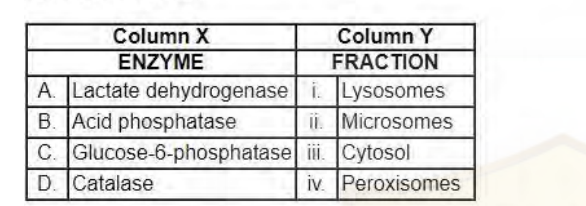

Which one of the following options correctly pairs the enzymes with the subcellular fractions?

1. A-i, B-ii, C-iii, D-iv
2. A-iv, B-iii, C-i, D-ii
3. A-iii, B-i, C-ii, D-iv
4. A-ii, B-iv, C-iii, D-i

**Answer: 3 (A-iii, B-i, C-ii, D-iv)**

> **Explanation:** Lactate dehydrogenase is a cytosolic marker (iii); acid phosphatase marks lysosomes (i); glucose-6-phosphatase marks the ER/microsomal fraction (ii); catalase marks peroxisomes (iv). Hence A-iii, B-i, C-ii, D-iv.

---
### Question 75

*Question ID 703135*

The table below lists phylogenetic reconstruction methods and the description of these methods, which includes both algorithmic and optimality-based methods or criteria.

Select the option that best matches the tree reconstruction method (Column X) with its correct description in Column Y.

1. A-ii, B-i, C- iv, D-iii
2. A-iv, B-iii, C-i, D-ii
3. A-i, B-ii, C-iv, D-iii
4. A-i, B-iii, C-ii, D-iv

**Answer: 1 (A-ii, B-i, C- iv, D-iii)**

> **Explanation:** Maximum parsimony minimises the number of changes over ancestral states (ii). Minimum evolution uses total tree length (sum of branch lengths), often estimated by least squares (i). Bayesian inference works on posterior probabilities integrated over branch lengths and substitution parameters (iv). Neighbour joining is a distance/cluster method that arrives at a single tree (iii). Hence A-ii, B-i, C-iv, D-iii.

---
### Question 76

*Question ID 703090*

The cAMP-PKA-CREB pathway regulates many important biological processes, from hormone synthesis to inducing long-term memory in the brain. The following statements describe the effects of mutations in the components of the pathway on gene transcription by CREB.

A. Loss of function mutation in a cAMP binding site of the PKA regulatory subunit leads to the inactivation of gene expression.

B. Activating mutation in the GTP-binding domain of the a subunit of Gs leads to the activation of gene expression.

C. Inactivating mutation that prevents the regulatory subunit of PKA to bind the catalytic subunit leads to the activation of gene expression.

D. Inactivating mutation in the PKA phosphorylation site of CREB leads to the activation of gene expression.

Which one of the following statements is INCORRECT?

1. Only A
2. A and D
3. Only D
4. B and D

**Answer: 3 (Only D)**

> **Explanation:** A is correct: if the regulatory subunit cannot bind cAMP it never releases the catalytic subunit, so the pathway stays off. B is correct: a Gsα that cannot hydrolyse GTP keeps adenylate cyclase on. C is correct: if the regulatory subunit cannot bind the catalytic subunit, the catalytic subunit is constitutively active. D is INCORRECT: CREB must be phosphorylated by PKA to drive transcription, so destroying the PKA site of CREB abolishes, not activates, gene expression.

---
### Question 77

*Question ID 703134*

Which one of the following Newick trees represents the correct relationship between apes.

1. ((((Orangutan, Gibbons), Gorillas), Chimpanzees), Humans)
2. ((((Humans, Chimpanzees), Gorillas), Orangutan), Gibbons)
3. ((((Humans, Gorillas), Chimpanzees), Gibbons), Orangutan)
4. ((((Humans, Chimpanzees), Gibbons), Orangutan), Gorillas)

**Answer: 2 (((((Humans, Chimpanzees), Gorillas), Orangutan), Gibbons))**

> **Explanation:** Apes nest as (((humans, chimpanzees) gorillas) orangutan) with gibbon (Hylobates) as the outgroup. Only option 2 places humans with chimpanzees, then gorilla, then orangutan, then gibbons.

---
### Question 78

*Question ID 703112*

Given below are statements about the Kallmann syndrome.

A. It is a condition of hypogonadotropic hypogonadism.

B. There is a loss of sense of smell in such individuals.

C. This syndrome is most common in women.

D. It happens due to mutation of the KALIG1 gene on X-chromosome that codes for an adhesion molecule necessary for the normal development of the gustatory nerve.

Which one of the following options has the combination of all correct statements?

1. A and D
2. B and C
3. C and D
4. A and B

**Answer: 4 (A and B)**

> **Explanation:** Kallmann syndrome is hypogonadotropic hypogonadism with anosmia, so A and B are correct. It is more common in males (C false), and KALIG1/KAL1 encodes an adhesion molecule needed for the development of the OLFACTORY (not gustatory) nerve (D false).

---
### Question 79

*Question ID 703099*

Mechanism of primary sex determination is best known in Drosophila and mammals. Given below are statements in regard of sex determination in these two model systems.

A. In Drosophila, if sry gene product is present, it may block beta-catenin signaling and along with SF1, activate the sox9 gene.

B. In mammals, an alternate splicing of Sxl transcript that removes a stop codon and allows formation of a functional protein, is responsible for initiating the female sex determination.

C. A trans-splicing event in Tra transcript results in formation of functional Tra protein in Drosophila.

D. XO individuals in Drosophila are males while, XXY individuals are females.

Which of the above statements are correct?

1. A, B and C
2. D only
3. C and D
4. B only

**Answer: 2 (D only)**

> **Explanation:** A is wrong: sry (SRY) is the mammalian testis-determining gene, not a Drosophila gene, and β-catenin/SF1/sox9 belong to the mammalian pathway. B is wrong: Sxl alternative splicing is the Drosophila, not the mammalian, switch. C is wrong: tra is regulated by cis-splicing (somatic sex-specific splicing), not trans-splicing. D is correct: in Drosophila sex is set by the X:A ratio, so XO is male and XXY is female.

---
### Question 80

*Question ID 703122*

Given below are species concepts (Column X) and their descriptions (Column Y):

![Two-column table. Column X: A. Typological species concept, B. Biological species concept, C. Evolutionary species concept, D. Phylogenetic species concept. Column Y: i. Single lineage of ancestor-descendant populations which maintains its identity from other such lineages. ii. A species is a set of organisms that resemble one another and is distinct from other sets. iii. Species are groups of interbreeding natural populations that are reproductively isolated from other such groups. iv. A group recognised by its monophyly](images/C/fig80.png)

Which one of the following options represents all the correct matches?

1. A-ii, B-iii, C-i, D-iv
2. A-i, B-ii, C-iii, D-iv
3. A-iii, B-ii, C-i, D-iv
4. A-iv, B-iii, C-i, D-ii

**Answer: 1 (A-ii, B-iii, C-i, D-iv)**

> **Explanation:** Typological = organisms that resemble one another and form a distinct set (ii); biological = interbreeding natural populations reproductively isolated from others (iii); evolutionary = a single ancestral-descendant lineage maintaining its identity (i); phylogenetic = the smallest group recognised by its monophyly (iv). Hence A-ii, B-iii, C-i, D-iv.

---
### Question 81

*Question ID 703121*

Selected human diseases and their vectors are listed below:

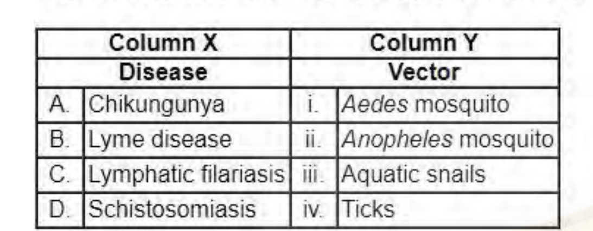

Which one of the following options represents the correct match between column X and column Y?

1. A-ii, B-iii, C-iv, D-i
2. A-iii, B-iv, C-i, D-ii
3. A-i, B-ii, C-iii, D-iv
4. A-i, B-iv, C-ii, D-iii

**Answer: 4 (A-i, B-iv, C-ii, D-iii)**

> **Explanation:** Chikungunya is carried by Aedes (i); Lyme disease by ticks (iv); lymphatic filariasis by Anopheles (ii); schistosomiasis by aquatic snails (the intermediate host, iii). Hence A-i, B-iv, C-ii, D-iii.

---
### Question 82

*Question ID 703114*

Epistasis is observed between different genes in flower color of sweet pea. A red variety on selfing yields red:white in ratio 9:7. The precursors and intermediates give white color. The following biochemical pathways were proposed for the above observations:

Which one of the options represents the correct pathway(s) that explains the observations?

1. A only
2. Both A and B
3. Both B and C
4. A, B and C

**Answer: 2 (Both A and B)**

> **Explanation:** A 9:7 ratio is duplicate recessive epistasis: two genes acting in series, with the product of either one alone insufficient. Pathway A (precursor → intermediate X → red product, genes B then A) and pathway B (extracellular → intracellular precursor → red, genes A then B) both put the two gene products in series, so a double recessive is white and any single mutant still gives 9:7. Pathway C uses "Gene A or Gene B", i.e. redundant steps, which would give a 15:1 ratio, so it cannot explain the data.

---
### Question 83

*Question ID 703124*

The following table lists habitat type (Column X) and geographic regions (Column Y) where they can be found:

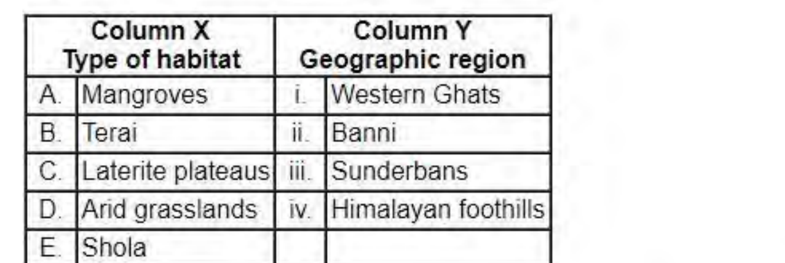

Which of the following options represents the correct match between column X and Y?

1. A-iii, B-iv, C-ii, D-ii, E-i
2. A-iv, B-iii, C-ii, D-i, E-ii
3. A-iii, B-iv, C-i, D-ii, E-i
4. A-i, B-ii, C-iv, D-iii, E-iv

**Answer: 3 (A-iii, B-iv, C-i, D-ii, E-i)**

> **Explanation:** Mangroves = Sundarbans (iii); Terai = Himalayan foothills (iv); laterite plateaus = Western Ghats (i); arid grasslands = Banni (ii); Shola = Western Ghats (i). Hence A-iii, B-iv, C-i, D-ii, E-i.

---
### Question 84

*Question ID 703136*

In Bayesian statistics, A and A’ correspond to different hypotheses, H1 and H2, and D corresponds to the observed data (X).

An equation for hypothesis H1 can be given as P(H1|D) = P(H1) x P(X|H1) / P(X)

Given below are statements related to the above equation:

A. The equation represents the conditional probability of hypothesis H1, given the data.

B. The equation represents the probability of the data, given the hypothesis.

C. P(X|H1) is called a prior probability, which is assigned to the hypothesis before the data is observed or analysed.

D. P(X|H1) represents the likelihood under the hypothesis H1.

Select the option that represents all correct statements with respect to the equation above.

1. A and C
2. A and D
3. B and C
4. B and D

**Answer: 2 (A and D)**

> **Explanation:** P(H1|D) is the posterior, i.e. the conditional probability of hypothesis H1 given the data (A true, B false). In Bayes' formula P(H1) is the prior and P(X|H1) is the likelihood of the data under H1, so C is false (it mislabels the likelihood as a prior) and D is true.

---
### Question 85

*Question ID 703138*

A transgenic line was developed in mustard. The T0 transgenic line was selfed and the insertion of transgene was analyzed in the parental (P) and progeny lines (1 to 5). The T-DNA region (between left (LB) and right (RB) borders) used for transformation is outlined in Figure A. The pattern following Southern hybridization using probes A and B is represented in Figure B. Genomic DNA was digested with EcoRI (E). The thickness of band indicates the intensity of hybridization.

The following statements were made based on the above observation:

A. The developed transgenic line has a single copy of T-DNA.

B. The absence of band in progeny 4 is due to incomplete transfer of the T-DNA during transformation.

C. Progeny 2 is homozygous at the site of insertion.

D. All selfed progeny of line 5 is expected to show hybridization with both probes A and B.

Which one of the following options has all of the correct statements?

1. D only
2. A and D only
3. B and C only
4. A, C and D

**Answer: 4 (A, C and D)**

> **Explanation:** Reading Figure B: the parent (P) shows a single band with each probe → one T-DNA insertion, so A is correct. Progeny 4 has the probe-A band but not the probe-B band, which is explained by the two probes lying on either side of the EcoRI site (a recombinant/fragment-length relationship), NOT by incomplete transfer of the T-DNA — the plant still carries the insertion, so B is wrong. Progeny 2 shows no band with either probe, i.e. it inherited no T-DNA at all and is therefore homozygous (null) at the insertion site, so C is correct. Line 5 carries both probes at double (thick) intensity → homozygous for the insertion → all its selfed progeny inherit it and hybridize with both probes, so D is correct. Hence A, C and D.

---
### Question 86

*Question ID 703082*

Researcher plans to study protein trafficking into the endoplasmic reticulum (ER). For this purpose, they plan different experimental conditions shown below:

A. The cytosol is mixed with mRNA that codes for a secreted protein, followed by western blotting with antibodies against secreted protein.

B. The cytosol is mixed with mRNA that codes for a secreted protein and rough microsomes, followed by western blotting with antibodies against secreted protein.

C. The cytosol is mixed with mRNA that codes for a secreted protein and rough microsomes followed by protease treatment. Subsequently, western blotting with antibodies against secreted protein is done.

Consider that mRNA that codes for a secreted protein is added in abundant amount, which experimental control/s would be the best to confirm the polypeptide entry into the ER?

1. A and B only
2. B only
3. C only
4. A, B and C

**Answer: 4 (A, B and C)**

> **Explanation:** A is a valid control: without microsomes the protein cannot be translocated and remains protease-sensitive/unprocessed. B is a valid control: with rough microsomes the protein is translocated and becomes protease-protected. C is the experimental condition whose protection is only interpretable against A and B. All three together are required, so A, B and C.

---
### Question 87

*Question ID 703123*

In birds and mammals, 3rd, 4th and 6th aortic arches persist in adult animals with some structural modifications. Which of the following modified organization is correct?

1. In birds, 4th aortic arch forms systemic aorta on the left.
2. In mammals, 6th aortic arch forms pulmonary aorta.
3. In birds, 3rd aortic arch forms systemic aorta.
4. In mammals, 3rd aortic arch forms systemic aorta.

**Answer: 2 (In mammals, 6th aortic arch forms pulmonary aorta.)**

> **Explanation:** In mammals the 6th aortic arch persists as the pulmonary arch (ductus arteriosus), so option 2 is correct. In birds the systemic aorta is derived from the 4th arch but on the RIGHT, not the left (1 false); the 3rd arches form the carotids, not the systemic aorta (3 and 4 false).

---
### Question 88

*Question ID 703078*

Iron (Fe) is taken up by cells via receptor-mediated endocytosis utilizing transferrin and transferrin receptor. In a cell line with a mutation in the transferrin receptor that is unable to interact with transferrin at pH (4-6), which one of the following steps will be first affected in this pathway?

1. Binding of transferrin to iron in plasma.
2. Association of iron bound transferrin with transferrin receptor on the plasma membrane.
3. Release of iron in the endosomes.
4. Recycling of transferrin to the plasma membrane.

**Answer: 4 (Recycling of transferrin to the plasma membrane.)**

> **Explanation:** Iron release occurs in the acidic endosome and requires transferrin to bind its receptor at pH 4–6. If the receptor cannot bind transferrin at that pH, iron is not retained in the endosome and, critically, apo-transferrin is not carried back to the surface — the recycling step fails. Binding of transferrin to iron in plasma (1) and the initial association at the neutral cell surface (2) are unaffected, and release of iron (3) precedes recycling, so the first step affected is recycling of transferrin to the plasma membrane.

---
### Question 89

*Question ID 703100*

The following statements describe the developmental processes during different modes of reproduction in angiosperms:

A. In double fertilization, one sperm fuses with the egg and other with the central cell to form the zygote and endosperm, respectively.

B. In sporophytic apomixis, a diploid cell gives rise to the next generation thereby maintaining the maternal genotype.

C. In gametophytic apomixis, a reduced egg cell forms apomictic embryo through parthenogenesis.

D. In pseudogamy, the functional endosperm is formed without fertilization.

Which one of the following represents the combinations of CORRECT statements?

1. A and B
2. B and C
3. B and D
4. C and D

**Answer: 1 (A and B)**

> **Explanation:** A is correct (double fertilization gives diploid zygote and triploid endosperm). B is correct (sporophytic apomixis arises from a diploid sporophytic cell, so the maternal genotype is maintained). C is wrong: gametophytic apomixis involves an unreduced (not reduced) egg/embryo sac. D is wrong: pseudogamy requires fertilization of the central cell to form endosperm while the embryo develops without fertilization. Hence A and B.

---
### Question 90

*Question ID 703141*

Figure A represents the sites for NcoI (N) in a binary vector pCSIR2023. The vector is 16500 bp in size. Figure B represents the fragments observed when the vector is either digested with NcoI (N) or double digested with HindIII and NcoI (H+N). The intensity of fluorescence of the 453 bp fragment is double that of the 516 bp fragment.

Which one of the following statements regarding the numbers and location(s) of HindIII site is correct?

1. There are two sites of HindIII, one of which is located in the ~ 11Kb fragment generated by NcoI digestion.
2. There are three sites of HindIII, one of which is located in the ~ 1.6Kb fragment generated by NcoI digestion.
3. There are three sites of HindIII, one of which is definitely at 2015 position.
4. There are four sites of HindIII, one of which is at 2015 position.

**Answer: 2 (There are three sites of HindIII, one of which is located in the ~ 1.6Kb fragment generated by NcoI digestion.)**

> **Explanation:** NcoI alone gives 10789, 2546, 1567, 1082 and 516 (sum 16500). Double digestion replaces 10789 by 10336, 2546 by 2093+453, and 1567 by 1185+382, and the 453 band is twice as intense as 516 because two 453 fragments co-migrate — so a third cut also occurs inside the 10789 fragment near the 0/16500 junction. Thus there are three HindIII sites, one of them within the ~1.6 Kb NcoI fragment.

---
### Question 91

*Question ID 703125*

Which one of the following statements about change in temperature with elevation is correct?

1. Adiabatic cooling of air due to increasing elevation leads to a drop of temperature by ~10°C for every 1,000 m in elevation, irrespective of water vapor or cloud formation.
2. Adiabatic cooling of air due to increasing elevation leads to a drop of temperature by ~10°C for every 1,000 m in elevation, as long as no water vapor or cloud formation occurs.
3. A vertical ascent of 1km from the Earth surface produces a temperature change roughly equivalent to that brought about by an increase in latitude of 1,000 km.
4. A vertical ascent of 600 m from the Earth surface produces a temperature change roughly equivalent to that brought about by an increase in latitude of 100 km.

**Answer: 2 (Adiabatic cooling of air due to increasing elevation leads to a drop of temperature by ~10°C for every 1,000 m in elevation, as long as no water vapor or cloud formation occurs.)**

> **Explanation:** The dry adiabatic lapse rate of ~10 °C per 1000 m applies only to unsaturated air, i.e. as long as no condensation/cloud forms (option 2); option 1 wrongly says the rate holds irrespective of water vapour. The altitudinal equivalence usually quoted is ~1000 m of ascent ≈ ~20–22° of latitude (a few thousand km), not the values in 3 and 4.

---
### Question 92

*Question ID 703081*

In C. elegans, PAR proteins segregate at the cell cortex in the zygote to establish cell polarity. This is dependent on the regulation of the cortical actin cytoskeleton by RhoA. An investigator sought to directly inhibit actin polymerization to analyze the impact of this inhibition on PAR protein localization. Which one of the following chemicals would be the most suitable?

1. Taxol
2. Colchicine
3. Latrunculin
4. LY294002

**Answer: 3 (Latrunculin)**

> **Explanation:** Latrunculin binds actin monomers and prevents their polymerisation, so it directly inhibits actin assembly. Taxol and colchicine act on microtubules, and LY294002 inhibits PI-3 kinase.

---
### Question 93

*Question ID 703076*

What is the V0/Vmax ratio for an enzymatic reaction when [S]= 3 Km and 9 Km, respectively?

1. 0.65 and 0.83
2. 0.55 and 1.0
3. 0.93 and 1.2
4. 0.75 and 0.9

**Answer: 4 (0.75 and 0.9)**

> **Explanation:** v/Vmax = [S]/(Km + [S]). At [S] = 3Km this is 3/4 = 0.75; at [S] = 9Km it is 9/10 = 0.9.

---
### Question 94

*Question ID 703140*

The figure below dpicts the reflectance curves of different features found in an urban ecosystem.

Which one of the options below correctly identifies the reflectance curves?

1. A - Concrete road; B - Dry grass lawn; C - Asphalt road; E - waterbody
2. A - Waterbody; B - Live grass lawn; C - Dry grass; E - Asphalt road
3. A - Asphalt road; B - Dry grass lawn; C - Waterbody; D - Live grass lawn
4. B - Asphalt road; C - Concrete Road; D - Live grass lawn; E - Concrete road

**Answer: 1 (A - Concrete road; B - Dry grass lawn; C - Asphalt road; E - waterbody)**

> **Explanation:** Curve A, high and fairly flat reflectance across the visible with a slight rise, is concrete. Curve B, low in the blue and rising very steeply into the near-infrared to the highest values, is dry grass. Curve C, moderate steadily rising reflectance, is asphalt. Curve E, very low and falling to near zero in the NIR, is water. This matches option 1.

---
### Question 95

*Question ID 703087*

A portion of an mRNA encoding a protein is shown below, with the start codon underlined.

5’…CCUCAACAGACACCA AUG UUGCACCUGACUCCU…3’

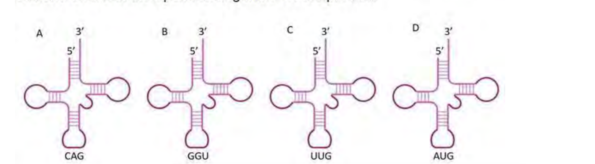

Which one of the following tRNAs is most likely used for translating the second codon in the open reading frame of the protein?

1. A
2. B
3. C
4. D

**Answer: 1 (A)**

> **Explanation:** Reading from the underlined AUG, the second codon is UUG. The tRNA that decodes it must carry the complementary anticodon, and the anticodon drawn in structure A pairs with UUG. Hence A.

---
### Question 96

*Question ID 703073*

The amino acid sequence of tetrapeptides (P, Q, R) is shown below.

P) Asp-Gly-Asp-Ser    Q) Gly-Ser-Arg-Gly    R) Gly-Lys-Arg-Ala

i. Calculate the net charge on the above tetrapeptides at pH 7.0

ii. If the mixture of the above tetrapeptides is separated on a cation-exchange column at pH 7.0, which tetrapeptide will elute last?

Choose the correct answer given below.

1. i) P, -2 ; Q, +1 ; R, +2 and  ii) R
2. i) P, -3; Q, +2 ; R, +3 and  ii) Q
3. i) P, -1 ; Q, +1 ; R, +1 and  ii) P
4. i) P, -1 ; Q, +0 ; R, +1 and  ii) R

**Answer: 1 (i) P, -2 ; Q, +1 ; R, +2 and  ii) R)**

> **Explanation:** At pH 7.0 the termini contribute +1 and –1 which cancel, so only the ionisable side chains count. P (Asp-Gly-Asp-Ser) has two Asp → –2. Q (Gly-Ser-Arg-Gly) has one Arg → +1. R (Gly-Lys-Arg-Ala) has Lys + Arg → +2. On a cation-exchange (negatively charged) column the most positively charged peptide binds most tightly and elutes last, i.e. R.

---
### Question 97

*Question ID 703137*

Unknown antigens can be detected or measured by a sandwich ELISA whereas Elispot assays measure the number of cells capable of secreting particular molecules such as cytokines which is considered as antigens. Which of the following is true for both assays?

1. Reaction products in both the assays are soluble.
2. Reaction products in both the assays are insoluble.
3. Reaction products in sandwich ELISA are insoluble whereas those in Elispot assays are soluble.
4. Reaction products in sandwich ELISA are soluble whereas those in Elispot assays are insoluble.

**Answer: 4 (Reaction products in sandwich ELISA are soluble whereas those in Elispot assays are insoluble.)**

> **Explanation:** Both assays are detected with an enzyme-linked secondary antibody acting on a chromogenic substrate. In sandwich ELISA the coloured product is solubilised and read in the plate reader, whereas in the Elispot assay the product is precipitated as an insoluble spot over each secreting cell. Hence sandwich ELISA product soluble, Elispot product insoluble.

---
### Question 98

*Question ID 703096*

By expressing the EGF-like ligand LIN-3, the C. elegans anchor cell (AC) directly triggers vulval development. LIN-3 acts at a distance and has a graded action. The levels of  LIN-3 can be controlled by using various genetic techniques.

Which one of the following options is a correct match between column I and column II?

1. a-ii, b-iii, c-iv, d-i
2. a-ii, b-iv, c-i, d-iii
3. a-iv, b-i, c-ii, d-iii
4. a-iii, b-iv, c-i, d-ii

**Answer: 1 (a-ii, b-iii, c-iv, d-i)**

> **Explanation:** Wild type on empty-vector RNAi (A) gives the normal 3,2,1,1,1,2 pattern — row II. A lin-3 nonsense mutant (B) eliminates the signal, so all cells adopt 3 — row IV. Wild type on lin-3 RNAi (C) reduces but does not remove LIN-3, giving the all-3/weak pattern of row III. A multi-copy lin-3 array (D) overproduces the ligand, so cells far from the AC are induced — row I. Hence a-ii, b-iii, c-iv, d-i.

---
### Question 99

*Question ID 703111*

The following proposed statements describe some aspects of thermoregulation.

A. The basal metabolic rate is rapidly adjusted in the thermoneutral zone to maintain temperature homeostasis.

B. The homeotherms who have the ability to hibernate, do not maintain normal physiological temperature range during hibernation.

C. The thermoregulation is not regulated by hypothalamus.

D. Warm-blooded animals require more food compared to cold-blooded animals of the same size and weight.

Which one of the following options represents combinations of all correct statements?

1. A, B and C
2. A, B and D
3. B and D only
4. A and B only

**Answer: 3 (B and D only)**

> **Explanation:** A is wrong: in the thermoneutral zone metabolic rate is at its minimum and stable, not rapidly adjusted. B is correct: hibernators let body temperature fall towards ambient. C is wrong: the hypothalamus is the thermoregulatory centre. D is correct: endotherms need far more food than ectotherms of equal size. Hence B and D only.

---
### Question 100

*Question ID 703071*

The central rod domain of keratin protein is 300 amino acids in length. What is the approximate length (in Å) of the rod domain if the peptide consists of

i) distorted α-helix

ii) true α-helix

iii) anti-parallel β-sheet

1. (i) 425 Å; (ii) 450 Å; (iii) 1041 Å
2. (i) 450 Å; (ii) 450 Å; (iii) 840 Å
3. (i) 425 Å; (ii) 425 Å; (iii) 1004 Å
4. (i) 340 Å; (ii) 425 Å; (iii) 104 Å

**Answer: 1 ((i) 425 Å; (ii) 450 Å; (iii) 1041 Å)**

> **Explanation:** A true α-helix rises 1.5 Å per residue, so 300 residues give 450 Å. The distorted (coiled-coil) α-helix of the keratin rod has ~1.42 Å per residue, giving ~425 Å. An anti-parallel β-sheet contributes ~3.5 Å per residue, giving ~1041 Å for an extended 300-residue chain.

---
### Question 101

*Question ID 703110*

Certain statements are put forth on the regulation of renal blood flow and are given below.

A. Norepinephrine dilates the renal vessels.

B. Dopamine causes renal vasodilation and natriuresis.

C. Angiotensin II exerts a constrictor effect.

D. Prostaglandins decrease blood flow in the renal cortex and increase it in the medulla.

E. Acetylcholine produces renal vasodilation.

Choose the option with the combination of all correct statements.

1. A, B and D
2. B, C and D
3. B, C and E
4. A, C and E

**Answer: 3 (B, C and E)**

> **Explanation:** A is wrong: norepinephrine constricts renal vessels, it does not dilate them. B is correct: dopamine acts on D1 receptors to dilate renal vessels and promotes natriuresis. C is correct: angiotensin II is a potent renal vasoconstrictor. D is wrong: prostaglandins (PGE2, PGI2) dilate the renal vasculature and help maintain cortical flow rather than diverting flow away from the cortex. E is correct: acetylcholine produces renal vasodilation. Hence B, C and E.

---
### Question 102

*Question ID 703074*

In a mammalian cell undergoing active glycolysis, what would be the effect of a sudden increase in the concentration of metabolites, AMP, citrate, ATP, and glucose-6-phosphate?

A. Increased ATP inhibits glycolysis.

B. Increased AMP stimulates glycolysis.

C. Increased citrate and glucose-6-phosphate stimulate glycolysis.

D. Increased AMP and citrate inhibits glycolysis.

Which one of the following represents the combination of all correct statements?

1. C and D
2. B and D
3. A and B
4. A and C

**Answer: 3 (A and B)**

> **Explanation:** High ATP allosterically inhibits phosphofructokinase-1, so A is correct. High AMP stimulates PFK-1 and relieves ATP inhibition, so B is correct. Citrate signals abundant mitochondrial substrate and inhibits PFK-1, and glucose-6-phosphate inhibits hexokinase, so C is wrong (they inhibit, not stimulate). D is wrong because AMP stimulates while citrate inhibits. Hence A and B.

---
### Question 103

*Question ID 703128*

The graph below depicts the net change in forest cover in four regions (A – D) between 1990 and 2020, according to the FAO report - ‘The State of World’s Forests 2020’.

Which one of the following options correctly identifies these regions?

1. A - Asia, B - North and Central America, C - South America, D - Europe
2. A - North and Central America, B - Africa, C - Asia, D - South America
3. A - Asia, B - Europe, C - South America, D - Africa
4. A - Europe, B - South America, C - Asia, D - Africa

**Answer: 3 (A - Asia, B - Europe, C - South America, D - Africa)**

> **Explanation:** Region A shows small positive gains with a large 2000–2010 peak — Asia. Region B is modestly positive throughout — Europe. Region C has by far the largest losses — South America. Region D shows large, increasing losses — Africa.

---
### Question 104

*Question ID 703079*

In yeast, temperature-sensitive mutants of cell cycle regulators, cdc2 (the key cyclin- dependent kinase), cdc13 (required for telomeric DNA replication), and cdc13 rad9 (that carries an additional mutation in the DNA damage sensor) were isolated. When grown in non-permissive temperature for a few hours, different phenotypes were observed in these mutants. Choose the option that correctly describes the most likely phenotype for all of these mutants.

1. The cdc2 mutants will arrest in G1/S, cdc13 in M and cdc13 rad9 in S-phase.
2. The cdc2 mutants will arrest after a few divisions in G1, cdc13 in M and cdc13 rad9 in S-phase.
3. The cdc2 mutants will arrest in G1/S, G2 and M, cdc13 in G2 and cdc13 rad9 will continue to divide for a few generations.
4. The cdc2 mutants will arrest in G1/S, G2 and M, cdc13 in G1 and M and cdc13 rad9 in all phases of the cell cycle.

**Answer: 3 (The cdc2 mutants will arrest in G1/S, G2 and M, cdc13 in G2 and cdc13 rad9 will continue to divide for a few generations.)**

> **Explanation:** cdc2 (CDK1) is required for both the G1/S and G2/M transitions, so cdc2 mutants arrest in G1/S, G2 and M. cdc13 is needed for telomere maintenance, so its loss produces a DNA-damage checkpoint arrest in G2. cdc13 combined with rad9 (a damage-sensor component) removes the checkpoint, so the cells continue to divide for a few generations before dying. Hence option 3.

---
### Question 105

*Question ID 703106*

Given below are the list of plant hormones (Column X) and their biosynthesis precursors (Column Y).

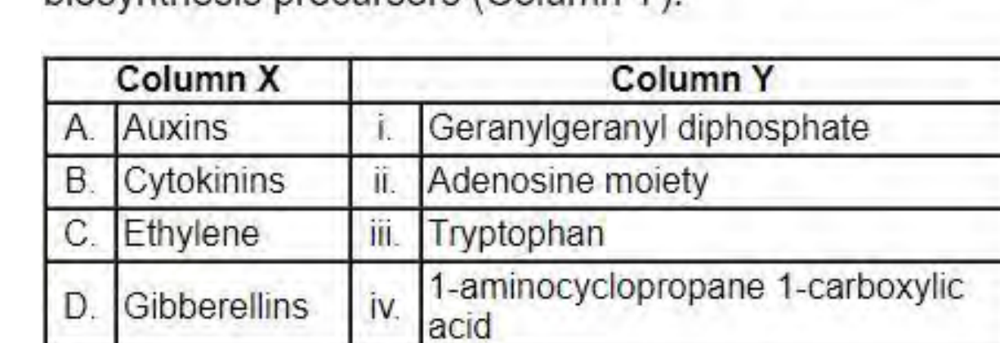

Which one of the following options represents the correct match between column X and Y?

1. A – i; B – ii; C – iii; D - iv
2. A – iii; B – i; C – iv; D - ii
3. A – iii; B – ii; C – iv; D - i
4. A – iv; B – iii; C – ii; D - i

**Answer: 3 (A – iii; B – ii; C – iv; D - i)**

> **Explanation:** Auxins are made from tryptophan (iii); cytokinins from the adenosine moiety (ii); ethylene from 1-aminocyclopropane-1-carboxylic acid (iv); gibberellins from geranylgeranyl diphosphate (i). Hence A-iii, B-ii, C-iv, D-i.

---
### Question 106

*Question ID 703109*

The sensory nerve fibers (Column X) and the sensory receptors connected to different sensory nerves (Column Y) are given below.

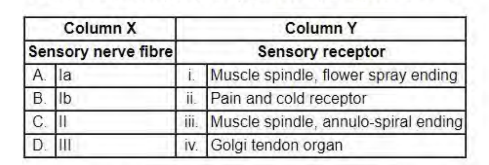

Which of the following options represents the correct match between column X and column Y?

1. A- i, B- ii, C- iii, D- iv
2. A- ii, B- iii, C- iv D-i
3. A- iii, B- iv, C- i, D- ii
4. A- iv, B- i, C- ii, D- iii

**Answer: 3 (A- iii, B- iv, C- i, D- ii)**

> **Explanation:** Ia (annulo-spiral) endings wrap muscle spindles (iii); Ib belongs to Golgi tendon organs (iv); II fibres carry the flower-spray endings of muscle spindles (i); III (Aδ) fibres carry pain and cold receptors (ii). Hence A-iii, B-iv, C-i, D-ii.

---
### Question 107

*Question ID 703107*

The structure and process of formation of different antigens in blood ABO system are given in the following statements:

A. Galactose is added to the terminal of H-antigen by a transferase expressed in individuals with type A blood.

B. The B antigen is formed by a transferase expressed in individuals with type B blood which adds a terminal N-acetylgalactosamine to H-antigen.

C. The H-antigen is formed by fucose transferase that adds a terminal fucose to its precursor.

D. The H-antigen is the precursor of both the A- and B- antigens and it is the blood group antigen in persons of type O blood.

Which one of the following options represents the correct combination of statements?

1. A and B
2. B and C
3. C and D
4. A and D

**Answer: 3 (C and D)**

> **Explanation:** A is wrong: the A transferase adds N-acetylgalactosamine, not galactose. B is wrong: the B transferase adds galactose, not N-acetylgalactosamine. C is correct: fucosyltransferase makes the H antigen. D is correct: H antigen is the precursor of A and B and is the type-O antigen. Hence C and D.

---
### Question 108

*Question ID 703091*

Extracellular matrix comprises of various proteins and polysaccharides that assemble into an organized meshwork. This associates with the cells that produce them. Given below are a few statements regarding different components of the matrix.

A. Collagen is the major protein of the extracellular matrix and is a long, and triple-stranded helical structure.

B. Hyaluronan which is produced in large quantities during wound healing is a type of glycosaminoglycan (GAG) that contains sulfated sugar and is covalently linked to the core protein.

C. Syndecans are plasma membrane proteoglycans that interact with the actin cytoskeleton and signaling molecules of the cell cortex.

D. Decorin is a small proteoglycan secreted by fibroblasts and contains 1-10 GAG chains.

Which one of the following options represents INCORRECT statement/s?

1. C and D only
2. B, C and D
3. A and B
4. B only

**Answer: 4 (B only)**

> **Explanation:** A is correct. B is INCORRECT: hyaluronan is non-sulfated and is NOT covalently linked to a core protein. C is correct. D is correct: decorin is a small leucine-rich proteoglycan with 1–2 GAG chains secreted by fibroblasts. Only B is incorrect.

---
### Question 109

*Question ID 703119*

Consider a highly diverse community of closely related species of lizards which has evolved in a short period of time and that occupies different ecological niches in peninsular India. What type of speciation process can explain the above pattern?

1. Non-ecological speciation
2. Adaptive radiation
3. Allopatric speciation
4. Parapatric speciation

**Answer: 2 (Adaptive radiation)**

> **Explanation:** Many closely related species that evolved rapidly and filled different ecological niches in one region is the definition of adaptive radiation.

---
### Question 110

*Question ID 703089*

Bacteria employ various mechanisms to invade or enter host cells, which are either phagocytic or non-phagocytic in nature. Given below are some of the mechanisms which are generally used for carrying out this process.

A. Some bacteria express a protein called invasin that is recognized by host-cell β1 integrins.

B. Actin polymerization along with assembly of clathrin coat results in the internalization of bacteria by zipper mechanism.

C. Some bacteria, including Salmonella enterica, use trigger mechanism to inject a set of effector molecules in the cytosol through type III secretion system.

D. Some bacteria attach to host cell surface receptors inducing local elevation of Ca2+ in cell cytosol, leading to the fusion of lysosomes with bacteria containing plasma membrane vesicles.

Which one of the following represents the combination of correct mechanisms for invading non-phagocytic cells?

1. A, B and C
2. B, C and D
3. A, B and D
4. A, C and D

**Answer: 1 (A, B and C)**

> **Explanation:** Non-phagocytic invasion uses (A) invasin binding β1 integrins, (B) the zipper mechanism, and (C) the Salmonella type III secretion trigger mechanism. Statement D describes actin-based pedestal formation/lysosome fusion associated with other strategies and is not part of the classic non-phagocytic-cell entry combination here. Hence A, B and C.

---
### Question 111

*Question ID 703127*

Phosphorus is an important essential element for living organisms. Given below are a few fluxes of the global phosphorus cycle.

A. Internal cycling in terrestrial ecosystems

B. Internal cycling in marine ecosystems

C. Terrestrial runoff into oceans

D. Natural chemical weathering in terrestrial ecosystems

Select the correct option that arranges the fluxes in an increasing order of magnitude.

1. A < D < B < C
2. A < B < C < D
3. D < C < A < B
4. D < A < C < B

**Answer: 3 (D < C < A < B)**

> **Explanation:** Global phosphorus fluxes increase in the order natural chemical weathering on land (D, smallest) < terrestrial runoff to the ocean (C) < internal cycling in terrestrial ecosystems (A) < internal cycling in marine ecosystems (B, largest). Hence D < C < A < B.

---
### Question 112

*Question ID 703095*

Several extracellular mechanisms lead to intracellular changes to regulate stem cell behavior during development. Based on this, which one of the following statements is NOT true?

1. Structural and adhesion factors in the extracellular matrix support cellular architecture of the stem cell niche.
2. Different patterns of chromatin accessibility influence gene expression related to stem cell behavior.
3. Partitioning of cytoplasmic determinants distributes factors determining cell fate evenly into daughter cells during asymmetric division.
4. Secreted proteins from surrounding cells by autocrine, paracrine or juxtacrine mechanisms often maintain stem cells in an uncommitted state.

**Answer: 3 (Partitioning of cytoplasmic determinants distributes factors determining cell fate evenly into daughter cells during asymmetric division.)**

> **Explanation:** Partitioning of cytoplasmic determinants produces UNEQUAL distribution of fate determinants between daughter cells during asymmetric division; the statement says they are distributed evenly, which is false. The other three statements are true descriptions of niche regulation.

---
### Question 113

*Question ID 703126*

In a study comparing different plant communities (A D) across a landscape, the following data were obtained:

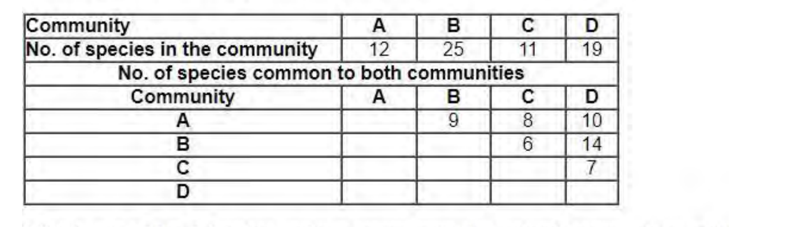

Which one of the following options represents the pair of communities with highest similarity value when Sorensen’s coefficient is used?

1. A and C
2. A and D
3. B and C
4. B and D

**Answer: 1 (A and C)**

> **Explanation:** Sorensen's coefficient S = 2c/(a+b). A–C: 2×8/(12+11) = 16/23 = 0.70. A–D: 20/31 = 0.65. B–C: 12/36 = 0.33. B–D: 28/44 = 0.64. The highest value is for A and C.

---
### Question 114

*Question ID 703130*

Match the names of scientists (column X) with the ecosystem concepts (column Y) they are known for:

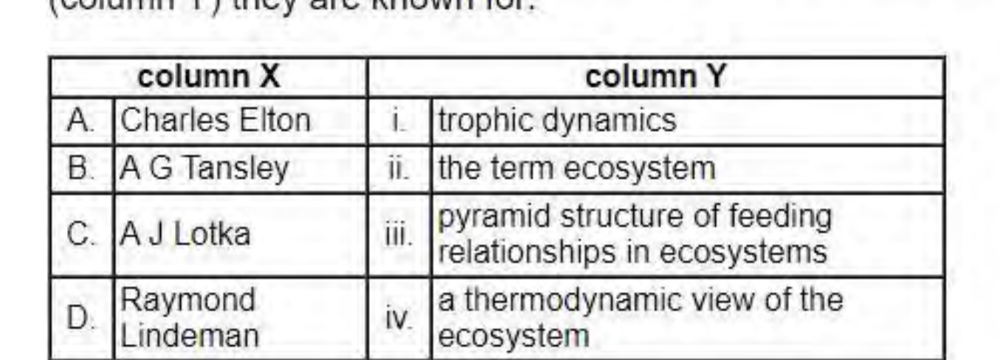

1. A- I, B- II, C- III, D- iv
2. A- IV, B- II, C- III, D- i
3. A- IV, B- I, C- ii, D- iii
4. A- III, B- II, C- IV, D- i

**Answer: 4 (A- III, B- II, C- IV, D- i)**

> **Explanation:** Charles Elton described the pyramid of feeding relationships in animal communities (iii); A. G. Tansley coined the term ecosystem (ii); A. J. Lotka developed the thermodynamic/dynamic view of energy flow through ecosystems (iv); Raymond Lindeman's 1942 paper introduced trophic dynamics (i). Hence A-iii, B-ii, C-iv, D-i.

---
### Question 115

*Question ID 703105*

A researcher had inoculated the bottom leaves of a wild-type tobacco plant with tobacco ringspot virus (TRSV) and made the following statements regarding the disease after 23 days post-inoculation.

A. Strong ringspot symptoms develop on the lower leaves.

B. The ringspot symptoms are higher on the upper leaves.

C. The top leaves have no viral symptoms

D. The top leaves are immune to secondary infection by the same virus.

Choose the option with all correct statements:

1. A, C and D
2. B and D only
3. A and B only
4. C and D only

**Answer: 1 (A, C and D)**

> **Explanation:** After TRSV inoculation of lower leaves, strong ringspots develop there (A). The top leaves show no symptoms (C) because the plant has acquired systemic resistance, and they are immune to secondary challenge with the same virus (D). The ringspot symptoms are not higher on the upper leaves, so B is wrong.

---
### Question 116

*Question ID 703132*

Defending a territory is energetically expensive and animals should invest in this only if it is profitable. A sunbird species is dependent on a plant species that contains nectar-rich flowers, making it an important resource for the sunbird. Males may defend territories containing these plants against other males, while allowing females to access the flowers. In this way they keep competitors out and get access to the females.

The columns below (P to S) represent characteristics of the resources and their variants (i and ii).

From the given options, choose the combination of plant characteristics that makes defending a territory most profitable for males.

1. P - i, Q - i, R - ii, S - i
2. P - i, Q - ii, R - ii, S - i
3. P - ii, Q - i, R - i, S - ii
4. P - ii, Q - ii, R - i, S - ii

**Answer: 2 (P - i, Q - ii, R - ii, S - i)**

> **Explanation:** Territory defence pays when the resource is abundant but spatially clumped so that one male can monopolise a patch worth defending (P-i, Q-ii), and when nectar is depleted slowly (R-ii) and renewed quickly (S-i), so the defended patch keeps its value.

---
### Question 117

*Question ID 703129*

Based on theoretical concepts of mating systems in plants, pollen : ovule ratios are likely to be most skewed in which one of the following cases?

1. Entomophilous dioecious species
2. Entomophilous bisexual species
3. Anemophilous bisexual species
4. Anemophilous dioecious species

**Answer: 4 (Anemophilous dioecious species)**

> **Explanation:** Pollen:ovule ratios are highest (most skewed) when pollen transfer is inefficient and pollen competition is intense — wind (anemophily) plus separate sexes (dioecy), where a male plant must broadcast enormous amounts of pollen to find the scattered females.

---
### Question 118

*Question ID 703133*

Given below are statements related to different types of natural selection models.

A. Directional selection changes the average value of a trait.

B. Stabilizing selection increases variation in a trait.

C. Disruptive selection reduces variation in a trait.

D. Balancing selection maintains variation in a trait.

Select the correct option that represents the combinations of statements that are NOT true about natural selection.

1. A and B
2. B and C
3. C and D
4. A and C

**Answer: 2 (B and C)**

> **Explanation:** Directional selection changes the mean (A true) and balancing selection maintains variation (D true). Stabilizing selection REDUCES variation, not increases it (B false), and disruptive selection INCREASES variation, not reduces it (C false). The statements that are NOT true are B and C.

---
### Question 119

*Question ID 703101*

Given below are certain statements regarding the light absorption by chlorophyll pigment molecule in a green leaf.

A. The absorption of a photon by a pigment molecule converts it from its lower state to an excited state.

B. Internal conversions or relaxations of pigments convert higher excited states to the lowest excited state, with a concomitant loss of energy as heat.

C. The light reemitted from the lowest excited state of chlorophyll molecule is fluorescence.

D. Red light absorption by chlorophyll molecule results into higher excitation state relative to the blue light absorption.

Which one of the following combinations is correct?

1. A, B and C
2. A, B and D
3. B, C and D
4. A, C and D

**Answer: 1 (A, B and C)**

> **Explanation:** A photon raises the pigment to an excited state (A). Internal conversion relaxes higher excited states to the lowest, losing energy as heat (B). Emission from the lowest excited state is fluorescence (C). Red light, being lower in energy than blue, gives a LOWER (not higher) excited state, so D is wrong. Hence A, B and C.

---
### Question 120

*Question ID 703083*

Following statements were made about mRNA splicing:

A. Involvement of a cis-acting branchpoint site (or branchpoint sequence) present near 3’ end of each exon is essential for splicing.

B. In the first step of splicing reaction, 2’-OH of the conserved U at the branch-site acts as a nucleophile to attack the phosphoryl group of the conserved G in the 5’ splice site.

C. The newly liberated intron adapts shape of a lariat due to joining of the 5’ end of the intron to the branchpoint.

D. During the splicing process, there is no net gain in the number of chemical bonds.

E. Prp22 (a DEAD-box helicase) is required for stripping the spliced mRNA from the spliceosome.

Which one of the following options shows combination of all correct statements?

1. B, C, D
2. C, D, E
3. A and E only
4. B and D only

**Answer: 2 (C, D, E)**

> **Explanation:** A is wrong: the cis-acting branchpoint lies near the 3’ end of the INTRON, not of each exon. B is wrong: the nucleophile is the 2’-OH of the conserved branch-site ADENOSINE (not U) of the intron, which attacks the 5’ splice site. C is correct: the excised intron is a lariat because its 5’ end is joined 2’-5’ to the branchpoint. D is correct: splicing proceeds by transesterification, so there is no net change in the number of phosphodiester bonds. E is correct: the DEAD-box helicase Prp22 strips the spliced mRNA from the spliceosome. Hence C, D and E.

---
### Question 121

*Question ID 703097*

Given below are statements about development in different model organisms.

A. Xenopus egg has yolk and hence undergoes meroblastic cleavage.

B. Embryonically transcribed beta-catenin in the blastomeres of sea urchin embryos regulates the autonomous specification of micromeres.

C. The sodium pump activity in the trophoblast helps in the formation of blastocoel of a mammalian blastocyst.

D. Prevention of tubal pregnancy is one of the major functions of zona pellucida in humans.

Which combination of the statements is true?

1. A and B
2. A and C
3. B and D
4. C and D

**Answer: 4 (C and D)**

> **Explanation:** A is wrong: the Xenopus egg is moderately telolecithal and undergoes holoblastic (complete), not meroblastic, cleavage. B is wrong: β-catenin in sea urchin specifies the micromeres, but it is MATERNAL, not embryonically transcribed, and this is the classic case of inductive (not wholly autonomous) specification. C is correct: Na+/K+-ATPase activity of the trophoblast pumps fluid to form the blastocoel. D is correct: the zona pellucida confines the embryo to the oviduct and prevents tubal implantation. Hence C and D.

---
### Question 122

*Question ID 703108*

The characteristic features and causes of different heart sounds during a cardiac cycle of humans are given in the following statements.

A. The second heart sound is loud and sharp when the diastolic pressure is decreased in the aorta or pulmonary artery.

B. Sudden closure of atrioventricular (AV) valves at the start of ventricular systole caused vibration that produces first heart sound.

C. The second heart sound is caused by the vibration associated with the closure of aortic and pulmonary valves after the end of ventricular systole.

D. The first heart sound is soft when heart rate is low as the ventricles are well filled with blood and the leaflets of AV valves float together before systole.

Which one of the following options represents the combination of all correct statements?

1. A, B and C
2. B and C only
3. B, C and D
4. A and D only

**Answer: 3 (B, C and D)**

> **Explanation:** A is wrong: the second heart sound is loud and sharp when aortic/pulmonary diastolic pressure is HIGH, not decreased. B is correct: the first sound comes from sudden AV-valve closure at the start of systole. C is correct: the second sound comes from aortic and pulmonary valve closure at the end of systole. D is correct: with a low heart rate the ventricles fill well and the AV leaflets float together, giving a soft first sound. Hence B, C and D.

---
### Question 123

*Question ID 703118*

A new strain of bacteria was created by introducing an artificial operon, to allow bacterial cells to grow in the presence of iron. The Fe++ operon consisted of genes that made the cells capable of tolerating increased iron. For efficient functioning of this operon, the following desirable features were considered.

Which one of the following can be used to develop this operon?

1. A repressor protein, which is active when bound to Fe++
2. An activator protein, which is active when not bound to Fe++
3. A repressor protein, which is inactive when bound to Fe++
4. A repressor protein, which is active constitutively

**Answer: 3 (A repressor protein, which is inactive when bound to Fe++)**

> **Explanation:** The operon must be OFF when iron is absent (to avoid wasteful expression) and ON when iron is present. That is the behaviour of a repressor which is active (and therefore blocks transcription) when NOT bound to Fe++ and becomes inactive when Fe++ binds — an inducible negative system. Hence option 3.

---
### Question 124

*Question ID 703092*

Synchronous cultures of MCF7 breast cancer cells were grown and treated with the following:

(i) buffer (plate was named MCF7), (ii) an inhibitor of Cyclin D (plate was named MCF7.1), and (iii) siRNA designed against Cyclin B1 (plate was named MCF7.2).

Following this, the cells were stained and sorted using flow cytometry. The relative amount of DNA in each of the three phases of the cell cycle (G1, S, G2/M in arbitrary units) were plotted against the number of cells, as shown below.

Which one of the following options correctly represents all the cell cycle states of MCF7, MCF7.1 and MCF7.2?

1. MCF7-C; MCF7.1-D ; MCF7.2-A
2. MCF7-C ; MCF7.1-A ; MCF7.2-D
3. MCF7-B ; MCF7.1-D ; MCF7.2-A
4. MCF7-B ; MCF7.1-A ; MCF7.2-D

**Answer: DROPPED**

> **Explanation:** The official NTA final answer key marks this question **Drop** (question dropped; marks awarded to candidates who attempted it). No correct option is published for it, so none is asserted here.

---
### Question 125

*Question ID 703072*

Which one of the following nucleic acids with same concentrations in water, will form a stable stem-loop structure upon annealing by heating and flash cooling on ice?

1. 5’ - GGCUUAUUUUUCUUCGG -3’
2. 5’ - CCGAACUUUUAUUCGG -3’
3. 5’ - AUGCCAUUUUCGGCUU -3’
4. 5’ - AGAGCGUUUUAUUCGG -3’

**Answer: 2 (5’ - CCGAACUUUUAUUCGG -3’)**

> **Explanation:** A stable stem-loop needs a self-complementary stem separated by a short loop. 5'-CCGAACUUUUAUUCGG-3' has CCGA at one end pairing with UCGG at the other (reverse complement) around a UUUUA loop, giving a hairpin. The other sequences cannot pair with themselves.

---
### Question 126

*Question ID 703098*

The following statements pertain to limb development in chick. Each statement describes an experiment and the expected outcome.

A. Targeted loss of retinoic acid synthesis in the forelimb causes a reduction of Tbx4 expression and the failure to form forelimbs.

B. When Fgf10 secreting beads are placed at a somite level that induced limb bud expressing Tbx5 in the anterior and Tbx4 in the posterior part, a chimeric limb can be formed.

C. Constitutive activation of FGF receptors results in the loss of forelimb field, demonstrating that expression of Fgf8 functions to inhibit forelimb development.

Which one of the following option(s) is/are correct?

1. A only
2. B only
3. A and B
4. B and C

**Answer: (2) B only; (4) B and C**

> **Explanation:** The official NTA final answer key accepts **both** option 2 and option 4. Retinoic acid is required for forelimb field initiation via Tbx5, so loss of its synthesis reduces forelimb Tbx5 (the statement names Tbx4, which is a hindlimb marker) — A is wrong. Fgf10-secreting beads induce an ectopic limb bud, and where that bud expresses Tbx5 anteriorly and Tbx4 posteriorly a chimeric limb results — B is correct. Constitutive FGF receptor activation expands rather than removes the forelimb field, and Fgf8 maintains (not inhibits) the forelimb field, so C is at best partially supported — which is why the key also accepts the option that includes it.

---
### Question 127

*Question ID 703093*

Apoptosis refers to programmed cell death that is triggered by specialized intracellular proteases called caspases. The intrinsic pathway of apoptosis

A. depends on the activation of Fas domain by the Fas ligand, which activates the DISC.

B. is regulated by the Bcl2 family of proteins.

C. consists of a key regulatory protein Apaf1 which is a water-soluble component of the electron transport chain.

D. recruits procaspase 9 into the apoptosome, and once activated, caspase 9 cleaves and activates downstream executioner caspases.

Which of the following combinations represents all correct statements?

1. A, B and D
2. B, C and D
3. C and D only
4. B and D only

**Answer: 4 (B and D only)**

> **Explanation:** The intrinsic pathway is regulated by Bcl2 family proteins (B) and works by recruiting procaspase-9 into the apoptosome, after which caspase-9 activates executioner caspases (D). Fas/DISC belongs to the extrinsic pathway (A), and Apaf1 is a cytosolic protein, not a component of the electron transport chain (C). Hence B and D only.

---
### Question 128

*Question ID 703113*

The following represents a Southern hybridization of restricted genomic DNA, probed with a DNA fragment corresponding to gene ‘Z’. ‘Z’ is a single copy gene. The hybridization patterns of parents and their progeny have been presented.

Which one of the following options is a correct interpretation of the observation?

1. Gene ‘Z’ is present on an autosome.
2. Gene ‘Z’ is an example of X- linked gene.
3. In this organism the female is the heterogametic sex.
4. Polymorphism of this gene has been studied by RAPD.

**Answer: 3 (In this organism the female is the heterogametic sex.)**

> **Explanation:** The female parent shows a single band (middle), the male parent two bands (upper + lower). Crucially the two progeny classes inherit differently: the son shows the maternal middle band plus a paternal lower band (two parental contributions), whereas the daughter shows only a paternal upper band and **no** maternal band. A daughter that receives no allele from her mother is the signature of the mother being the heterogametic sex (ZW): she passes her W (which carries no copy of gene Z) to daughters and her Z to sons, while the ZZ father contributes one Z allele to each. Hence the female is the heterogametic sex.

---
### Question 129

*Question ID 703086*

Following statements were made about rolling circle mechanism of replication.

A. It occurs unidirectionally, with only one replicating fork.

B. The E. coli ΦX174 phage uses this mechanism to replicate double-stranded circular genome.

C. E. coli utilizes this mechanism to replicate its double-stranded DNA genome.

D. In λ, the progeny DNA may range several genomes long before it is packaged.

E. The lagging strand is not formed in rolling circle mechanism of replication.

Which one of the following options shows the combination of all correct statements?

1. A and C
2. A and D
3. B and C
4. D and E

**Answer: 2 (A and D)**

> **Explanation:** Rolling-circle replication is unidirectional with a single fork (A true), and in λ the concatemeric progeny DNA is several genomes long before being packaged from a cos site (D true). ΦX174 has a single-stranded genome (B false), E. coli uses theta replication for its chromosome (C false), and a lagging strand IS made as the displaced strand is copied (E false). Hence A and D.

---
### Question 130

*Question ID 703115*

This is a hypothetical example. In a plant, a single gene governs flower color. The wild type color is red, while the mutant is white. It was demonstrated that insertion of a transposable element caused the white phenotype. In a PCR test, a set of primers outside the site of insertion is used to amplify the genomic DNA and the PCR products are resolved by Agarose gel electrophoresis. A geneticist made a cross between two plants. 30 progeny from the cross was analyzed by PCR. Each lane in the gel below represents analysis of one progeny.

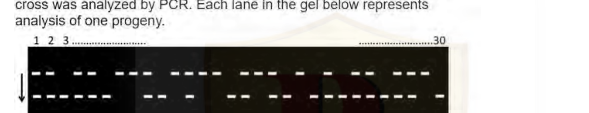

Based on the above, which one of the following statements is correct?

1. The DNA marker is dominant.
2. Plant 3 has white flowers.
3. In the above cross, one of the parents was heterozygous while the other was homozygous.
4. If the progeny from a cross between plant 1 and plant 30 is analyzed in a similar way two different kinds of banding pattern will be observed.

**Answer: 4 (If the progeny from a cross between plant 1 and plant 30 is analyzed in a similar way two different kinds of banding pattern will be observed.)**

> **Explanation:** The two band positions are the allele without the insertion and the allele carrying the transposable-element insertion. Reading across the 30 lanes, plants showing both bands are heterozygous and plants showing a single band are homozygous; plant 1 has both bands and plant 30 only one. A cross between a heterozygote and a homozygote gives two genotypic classes, so its progeny would show exactly two different banding patterns on the same gel. The remaining options are not supported: the marker is not dominant, plant 3 is not necessarily white, and the distribution of patterns shows both parents were heterozygous.

---
### Question 131

*Question ID 703103*

Stomata detached from the epidermis of common dayflower (Commelina communis) were treated with saturating photon fluxes of red light. After a duration of 2 hours, the same stomata, under the background of red light were also illuminated with blue light. Which one of the following statements regarding opening of stomatal apertures is true?

1. The red light illumination will saturate stomatal opening and blue light illumination will have no effect on it.
2. The red light illumination will not result in opening of stomata and they will open only upon perceiving blue light.
3. The blue light illumination will increase the level of stomata opening above the saturation level of stomatal opening by red light illumination.
4. The blue light illumination will result in closing of the stomata opened due to red light illumination.

**Answer: 3 (The blue light illumination will increase the level of stomata opening above the saturation level of stomatal opening by red light illumination.)**

> **Explanation:** Blue light acting through phototropins adds to the red-light-driven opening, pushing stomatal aperture above the level saturated by red light alone; blue light does not close red-opened stomata, and red light alone does open them.

---
### Question 132

*Question ID 703084*

Given below is the structure of a gene whose transcription is terminated in a Rho-independent manner. When the terminator is operational, the short transcript of 150 bases is formed and when it is not operational, a longer transcript of 200 bases is formed. A researcher generated several mutations in the terminator region and examined the transcripts obtained.

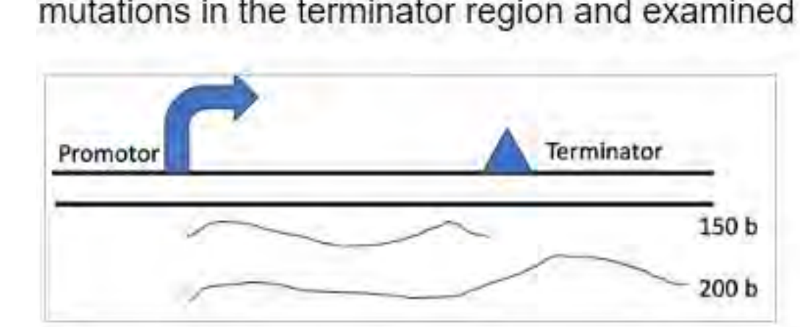

The manipulations done are:

A. Three nucleotides of the string of 8Ts were replaced by GCC.

B. The 8T sequence was transferred to the template strand.

C. The sequences that generate the paired stem were altered to disrupt pairing.

D. The sequences that generate the paired stem were altered to disrupt pairing, followed by introduction of compensatory mutations to restore pairing.

Choose the option that correctly predicts the potential transcript size in each of these cases.

1. Short transcript in A and D; long in B and C
2. Long transcript in A, B and D; short in C
3. Short transcript in B and D; long in A and C
4. Long transcript in A, B and C; short in D

**Answer: 4 (Long transcript in A, B and C; short in D)**

> **Explanation:** The Rho-independent terminator needs (i) the GC-rich stem-loop and (ii) the run of 8 Us on the non-template strand. Replacing three U's of the 8T string by GCC (A) weakens the U tract → long transcript. Moving the 8T to the template strand (B) removes the U tract from the RNA → long transcript. Disrupting the stem (C) → long transcript. Disrupting the stem and then restoring it with compensatory changes (D) reconstitutes a functional stem-loop → short transcript. Hence long in A, B and C; short in D.

---
### Question 133

*Question ID 703145*

An oligopeptide is subjected to amino acid analysis and found to have the following composition.

Tyr, Phe, Asp, Val, Arg, Met

The following statements represents/outline/list the results obtained after analysis:

A. The above oligopeptide is subjected to N-terminal Edman degradation, revealing Tyrosine residue.

B. Trypsin treatment did not affect the peptide.

C. Cyanogen bromide treatment yielded a dipeptide, tetrapeptide, and free Arginine.

D. Chymotrypsin treatment yielded dipeptide and tetrapeptide. The composition of tetrapeptide was Valine, Arginine, and Methionine.

Based on above observations, what is the CORRECT sequence of heptapeptide?

1. Tyr-Asp-Phe-Met-Val-Met-Arg
2. Tyr-Phe-Asp-Met-Met-Val-Arg
3. Tyr-Met-Asp-Val-Met-Arg-Phe
4. Tyr-Asp-Met-Met-Phe-Val-Arg

**Answer: 1 (Tyr-Asp-Phe-Met-Val-Met-Arg)**

> **Explanation:** Composition Tyr, Phe, Asp, Val, Arg, Met with 7 residues (a heptapeptide, so one residue occurs twice). Edman gives Tyr at the N-terminus. Trypsin does not cleave, which is only possible if Arg is the C-terminal residue (trypsin cannot cleave a terminal Arg). CNBr gives a dipeptide, a tetrapeptide and free Arg, so there are two Met, one of them internal, with Met immediately before the terminal Arg. Chymotrypsin gives a dipeptide and a tetrapeptide whose composition is Val, Arg, Met plus one aromatic; chymotrypsin cuts after Phe/Tyr, and since Tyr is first, Phe must be at position 2 to give a Tyr-Phe dipeptide. Assembling these constraints gives Tyr-Asp-Phe-Met-Val-Met-Arg.

---
### Question 134

*Question ID 703120*

Which one of the following phylogenetic trees correctly depicts the relationship between the given orders of pteridophytes, according to the Pteridophyte Phylogeny Group 1?

1. 1
2. 2
3. 3
4. 4

**Answer: 4 (4)**

> **Explanation:** PPG I places the lycopolypod (Lycopodiales + isoetalean) clade and the eusporangiate monilophyte clade (Equisetales + Psilotales + Ophioglossales) as the two main lineages, with Equisetales sister to (Psilotales, Ophioglossales) and Lycopolypods as (Lycopodium, (Isoetes, Selaginella)). Only tree 4 has this arrangement.

---
### Question 135

*Question ID 703104*

Apoplast phloem loading is determined by the cellular location and transport function of the membrane-bound proteins. Following are certain statements regarding these proteins.

A. SWEETs are the sugar transporter proteins and are capable of transporting only sucrose and not glucose.

B. Double mutants of Arabidopsis SWEET11 and SWEET12 results in carbohydrate accumulation in the source leaves and slower export of the photoassimilates.

C. H+-symport mechanism loads sucrose or polyols into Sieve Element (SE)/Companion Cell (CC) complexes.

D. Several clades of sucrose/H+ symporters (SUTs or SUCs) are localized to plasma membranes of minor vein SE/CCs and participate in apoplastic loading.

Which one of the following combinations is correct?

1. A, B and C
2. A, B and D
3. B, C and D
4. A, C and D

**Answer: 3 (B, C and D)**

> **Explanation:** A is wrong: SWEETs transport hexoses as well as sucrose. B is correct: sweet11 sweet12 double mutants accumulate carbohydrate in source leaves and export slowly. C is correct: the H+-symport (SUT) mechanism loads sucrose/polyols into SE/CC complexes. D is correct: SUT/SUC clades sit in the plasma membrane of minor-vein SE/CCs and mediate apoplastic loading. Hence B, C and D.

---
### Question 136

*Question ID 703077*

P. aeruginosa makes a blue-green pigment called pyocyanin. To understand the pyocyanin biosynthetic pathway, mutants which cannot make pyocyanin were isolated. Six such mutants are crossed with each other and the data is given below:

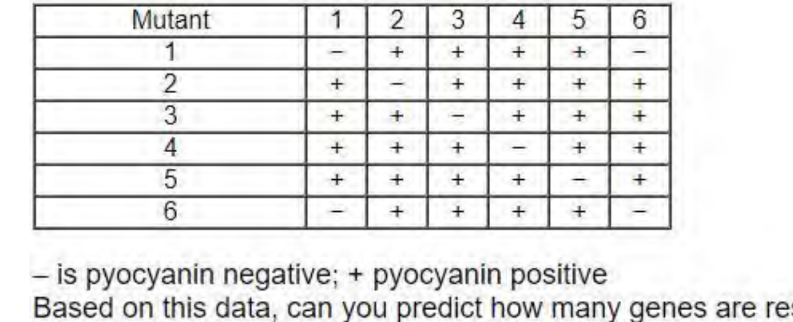

– is pyocyanin negative; + pyocyanin positive

Based on this data, can you predict how many genes are responsible for the pyocyanin production?

1. One
2. Two
3. Five
4. Six

**Answer: 3 (Five)**

> **Explanation:** Complementation groups are defined by the negative (non-complementing) entries. Mutants 1 and 6 fail to complement each other and nothing else, so they are the same gene; mutants 2, 3, 4 and 5 each fail only with themselves. That gives five complementation groups, i.e. five genes.

---
### Question 137

*Question ID 703094*

In an experiment using nude mice, the population is divided into two groups, A and B. Group A mice are injected with T cells from normal mice and Group B mice are left untreated. Both the groups are then immunized with LPS. Which one of the following statements regarding antibody production in groups A and B is most likely to be true?

1. Both groups of mice will have very similar levels of antibody against LPS as it is a thymus- independent antigen.
2. No immune response will be generated in both groups of mice as they lack thymus.
3. Only Group A mice will have antibodies as T-independent antigens are dependent on T-cell activation.
4. Only Group B mice will have antibodies, because in group A mice, the presence of T cells will interfere with the production of antibodies against T-independent antigen.

**Answer: 1 (Both groups of mice will have very similar levels of antibody against LPS as it is a thymus- independent antigen.)**

> **Explanation:** LPS is a thymus-independent (TI) antigen; it is engaged directly by B cells without T-cell help. Nude mice therefore still respond to LPS, so treated and untreated groups give very similar anti-LPS antibody levels.

---
### Question 138

*Question ID 703117*

A mutant strain of E.coli having defects in one of the DNA repair pathways was identified. To identify the pathways where mutation occurred, a researcher looks at the following parameters and identified the defect to be in base excision repair pathway.

A. Topoisomerase II enzyme activity.

B. AP endonuclease activity

C. Expression of mutL and mutS

D. DNA glycosylase activity

E. DNA ligase activity

Based on the changes in which of the above parameters, this conclusion can be drawn?

1. A, C, E
2. B, D, E
3. B, C, D
4. A, D, E

**Answer: 2 (B, D, E)**

> **Explanation:** Base excision repair uses a DNA glycosylase (D) to remove the damaged base, AP endonuclease (B) to cut the abasic site, and DNA ligase (E) to seal the nick. Topoisomerase II (A) is not a BER component, and mutL/mutS (C) belong to mismatch repair. Hence B, D and E.

---
### Question 139

*Question ID 703144*

In DNA foot-printing,

A. The DNA is labelled by random priming so that the entire DNA is labelled and one does not miss out any region that binds with the given protein.

B. The DNA is end-labelled so that the bands get organized from higher to lower size after electrophoresis and autoradiography.

C. A sequencing polyacrylamide gel is used to resolve all the fragments distinctly.

D. A higher concentration of agarose gel is used to resolve the finer bands.

Which one of the following options has the combination of all correct statements?

1. A only
2. B and D
3. B and C
4. D only

**Answer: 3 (B and C)**

> **Explanation:** Footprinting requires the DNA to be end-labelled (B) so that every fragment carries one radioactive end and terminates at the same point, and the products must be resolved on a sequencing polyacrylamide gel (C) that separates fragments differing by one nucleotide. Random labelling (A) and agarose gels (D) cannot do this.

---
### Question 140

*Question ID 703085*

Following statements were made about initiation of translation in eukaryotes.

A. The eIF2 facilitates correct recognition and binding of ribosomal subunits.

B. The eIF2B activates eIF2 by replacing its GDP with GTP.

C. The eIF3 binds to the 60S ribosomal subunit and inhibits its reassociation with the 40S subunit.

D. eIF5 promotes association between the 60S ribosomal subunit and the 48S complex.

E. The eIF6 binds to the 60S ribosomal subunit and blocks reassociation with the 40S subunit.

Which one of the following options shows combination of all correct statements?

1. A, B, D
2. B, D, E
3. B, C, E
4. A, C, D

**Answer: 2 (B, D, E)**

> **Explanation:** A is wrong: eIF2 delivers Met-tRNAi to the 40S subunit as a GTP-dependent ternary complex; recognition and binding of the ribosomal subunits is not its function. B is correct: eIF2B is the guanine-nucleotide exchange factor that reactivates eIF2 by swapping GDP for GTP. C is wrong: eIF3 binds the 40S (not the 60S) subunit and prevents premature 60S joining. D is correct: eIF5 promotes association of the 60S subunit with the 48S complex. E is correct: eIF6 binds the 60S subunit and blocks its reassociation with the 40S subunit. Hence B, D and E.

---
### Question 141

*Question ID 703139*

The Cre-LoxP system was used to knock-out the p53 gene from the mice lungs. An immunoblot analysis was carried out as shown below.

The following assumptions were made.

A. The LoxP system did not work since the recombinase was not functional.

B. The Lox P sites were introduced under a promoter specific for lungs.

C. The tissue-specified promoter selected was of the prostate gland.

D. The mice died because of being knocked out of p53.

E. The knocked-out mice developed mutagen-induced tumours in their prostate gland more rapidly than in their lungs.

Which one of the following is correct combination of above assumption?

1. A and D
2. B and C
3. C and E
4. A and E

**Answer: 3 (C and E)**

> **Explanation:** The blot shows p53 present in Control and Lungs but absent from Prostate, with equal β-tubulin loading. So Cre activity was confined to the prostate, meaning the tissue-specific promoter driving Cre was the prostate promoter (C), and the animals, lacking p53 in that tissue, developed mutagen-induced tumours faster in the prostate than in the lungs (E).

---
### Question 142

*Question ID 703116*

Shown below is the inversion product of the X chromosome of wild type Drosophila. The w+ gene coding for the red eye colour is near the telomere and another gene roughest (rst+) is  close to w+ but towards the centromere. The eyes of roughest mutants have rough appearance The inversion brings w+ near the vicinity of highly compact centromeric heterochromatin and places rst+ little farther away from the centromeric heterochromatin.

![Diagram of two X chromosomes. Wild-type X chromosome: a bar labelled Euchromatin over its left part and Heterochromatin over a wavy right part, with gene marks w+ and rst+ near the left telomere end and Centromere marked by a black dot in the wavy heterochromatin. Two crossing lines labelled Inversion lead to the Inverted X chromosome, in which the wavy heterochromatin with the centromere dot lies in the middle-left and the gene marks rst+ and w+ now sit immediately to its right, w+ being closest to the heterochromatin](images/C/fig142.png)

Which of the following phenotypes will NEVER be observed in the Drosophila strain with inversion?

1. Red and smooth eyes
2. White and smooth eyes
3. White and rough eyes
4. Red and rough eyes

**Answer: 4 (Red and rough eyes)**

> **Explanation:** Position-effect variegation silences a gene placed near heterochromatin. In the inversion w+ lies next to centromeric heterochromatin, so it is variably silenced and the eyes become white/mottled; rst+ lies away from the heterochromatin and stays expressed, so the eye surface remains smooth. A red (w+ fully expressed) AND rough (rst+ silenced) eye can therefore never arise.

---
### Question 143

*Question ID 703075*

You have purified an enzyme that has a molecular weight of 60 kDa. You run this protein on an SDS-PAGE gel and get the following results.

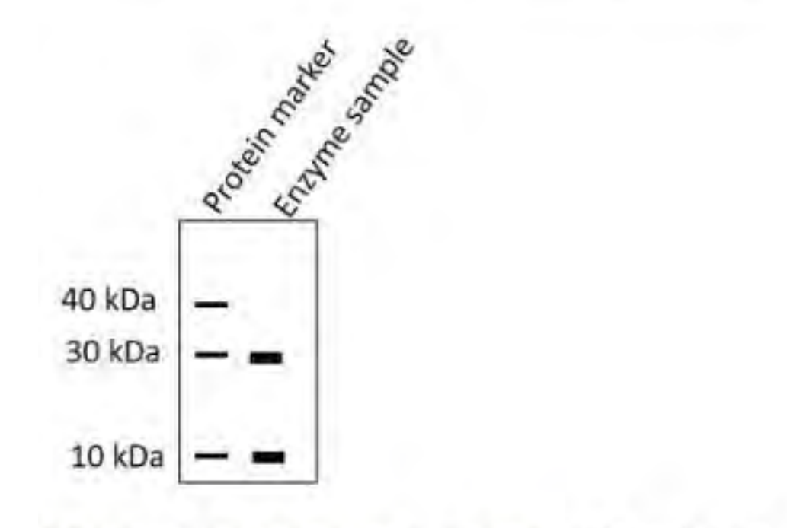

Which of the following statements is valid for the quaternary structure of this enzyme?

1. Two subunits of 30 kDa
2. One subunit of 30 kDa and three subunits of 10 kDa
3. Six subunits of 10
4. Three subunits of 30 kDa and one subunit of 10 kDa

**Answer: 2 (One subunit of 30 kDa and three subunits of 10 kDa)**

> **Explanation:** Under denaturing SDS-PAGE the 60 kDa enzyme resolves into two bands, 30 kDa and 10 kDa, so it is built from both subunit types. Only 30 + 10 + 10 + 10 = 60 kDa, i.e. one 30 kDa subunit and three 10 kDa subunits.

---
### Question 144

*Question ID 703143*

The following statements are suggested regarding the principle and uses of positron emission tomography (PET):

A. The PET scanner is a positron ray detector.

B. The PET scanner cannot determine the location of collision between positron and electron in the brain.

C. The typical PET activation studies can measure the absolute metabolic activity of brain.

D. In PET, a radioactive isotope is introduced into blood as ‘tracer’ that rapidly decays by emitting a positron from their atomic nuclei.

Which one of the following options represents the combination of correct statement(s)?

1. A, B, and C
2. B only
3. C and D
4. D only

**Answer: 4 (D only)**

> **Explanation:** A is wrong: a PET scanner detects the two 511 keV gamma photons produced when the emitted positron annihilates with an electron; it is not a positron detector. B is wrong: pairs of detectors define a line of response, so the location of the collision can be determined. C is wrong: PET activation studies measure relative, not absolute, metabolic activity. D is correct: an isotope-emitting positron is introduced as a tracer and decays by positron emission from its nucleus.

---
### Question 145

*Question ID 703102*

Photorespiration or C2 cycle takes place in three distinct organelles in the plant cells. Following are certain statements related to the C2 cycle.

A. Reduced ferredoxin and ATP are required for photorespiration and assimilation of resulting NH3.

B. Photosynthetic electron transport provides energy rich ATP and NADPH for photorespiration.

C. Glutamate is translocated from chloroplast to peroxisome, while α-ketoglutarate is translocated from peroxisome to chloroplast.

D. The action of enzyme serine hydroxymethyl transferase takes place in peroxisome.

Which one of the following combinations has all correct statements?

1. A and B
2. A and C
3. B and C
4. B and D

**Answer: 2 (A and C)**

> **Explanation:** Photorespiration consumes reducing power and ATP: reduced ferredoxin and ATP are needed to assimilate the NH3 released by glycine decarboxylation (A), and the electron transport chain supplies the ATP and NADPH used in the process (B is worded so as to be excluded by the key). Glutamate is exported from the chloroplast to the peroxisome while α-ketoglutarate moves the other way (C), and serine hydroxymethyltransferase works in the mitochondrion, not the peroxisome (D false). Hence A and C.

---

---

## Answer key

Source: **official NTA final answer key** — *CSIR-UGC NET December 2023, Final Answer Keys on
which result generated*, subject **(703) Life Sciences**, exam date **26-12-2023**,
shift **09:00-12:00** (https://nta.ac.in/Download/Notice/Notice_20240213113136.pdf).
See `sources.md` for provenance and verification. `Global` is the numbering used in this
archive; `Printed` is the number printed on the paper within Part C.

| Global | Printed | Question ID | Correct key |
|---:|---:|---|---|
| 71 | 1 | 703131 | 3 |
| 72 | 2 | 703088 | 3 |
| 73 | 3 | 703080 | 3 |
| 74 | 4 | 703142 | 3 |
| 75 | 5 | 703135 | 1 |
| 76 | 6 | 703090 | 3 |
| 77 | 7 | 703134 | 2 |
| 78 | 8 | 703112 | 4 |
| 79 | 9 | 703099 | 2 |
| 80 | 10 | 703122 | 1 |
| 81 | 11 | 703121 | 4 |
| 82 | 12 | 703114 | 2 |
| 83 | 13 | 703124 | 3 |
| 84 | 14 | 703136 | 2 |
| 85 | 15 | 703138 | 4 |
| 86 | 16 | 703082 | 4 |
| 87 | 17 | 703123 | 2 |
| 88 | 18 | 703078 | 4 |
| 89 | 19 | 703100 | 1 |
| 90 | 20 | 703141 | 2 |
| 91 | 21 | 703125 | 2 |
| 92 | 22 | 703081 | 3 |
| 93 | 23 | 703076 | 4 |
| 94 | 24 | 703140 | 1 |
| 95 | 25 | 703087 | 1 |
| 96 | 26 | 703073 | 1 |
| 97 | 27 | 703137 | 4 |
| 98 | 28 | 703096 | 1 |
| 99 | 29 | 703111 | 3 |
| 100 | 30 | 703071 | 1 |
| 101 | 31 | 703110 | 3 |
| 102 | 32 | 703074 | 3 |
| 103 | 33 | 703128 | 3 |
| 104 | 34 | 703079 | 3 |
| 105 | 35 | 703106 | 3 |
| 106 | 36 | 703109 | 3 |
| 107 | 37 | 703107 | 3 |
| 108 | 38 | 703091 | 4 |
| 109 | 39 | 703119 | 2 |
| 110 | 40 | 703089 | 1 |
| 111 | 41 | 703127 | 3 |
| 112 | 42 | 703095 | 3 |
| 113 | 43 | 703126 | 1 |
| 114 | 44 | 703130 | 4 |
| 115 | 45 | 703105 | 1 |
| 116 | 46 | 703132 | 2 |
| 117 | 47 | 703129 | 4 |
| 118 | 48 | 703133 | 2 |
| 119 | 49 | 703101 | 1 |
| 120 | 50 | 703083 | 2 |
| 121 | 51 | 703097 | 4 |
| 122 | 52 | 703108 | 3 |
| 123 | 53 | 703118 | 3 |
| 124 | 54 | 703092 | **DROPPED** |
| 125 | 55 | 703072 | 2 |
| 126 | 56 | 703098 | **2 and 4** (both accepted) |
| 127 | 57 | 703093 | 4 |
| 128 | 58 | 703113 | 3 |
| 129 | 59 | 703086 | 2 |
| 130 | 60 | 703115 | 4 |
| 131 | 61 | 703103 | 3 |
| 132 | 62 | 703084 | 4 |
| 133 | 63 | 703145 | 1 |
| 134 | 64 | 703120 | 4 |
| 135 | 65 | 703104 | 3 |
| 136 | 66 | 703077 | 3 |
| 137 | 67 | 703094 | 1 |
| 138 | 68 | 703117 | 2 |
| 139 | 69 | 703144 | 3 |
| 140 | 70 | 703085 | 2 |
| 141 | 71 | 703139 | 3 |
| 142 | 72 | 703116 | 4 |
| 143 | 73 | 703075 | 2 |
| 144 | 74 | 703143 | 4 |
| 145 | 75 | 703102 | 2 |

Questions in this Part marked by the key as accepting **more than one option**, or as **DROPPED**,
are recorded exactly as the key states them; none has been narrowed to a single answer.
