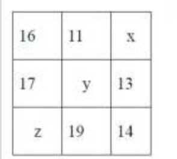
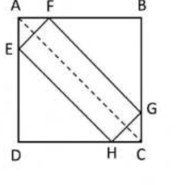
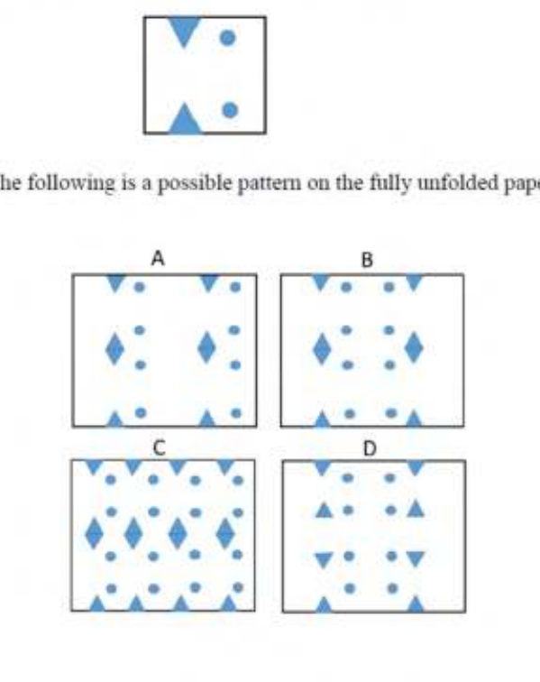
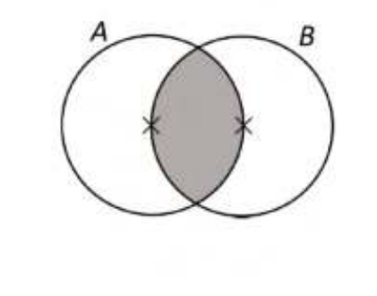
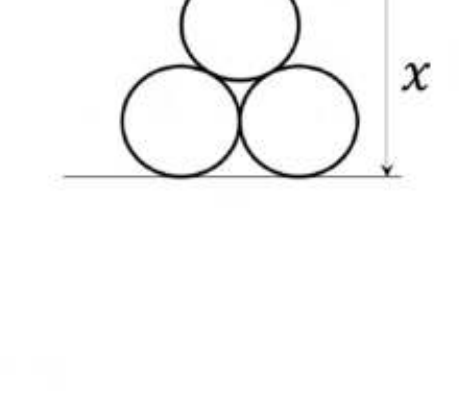
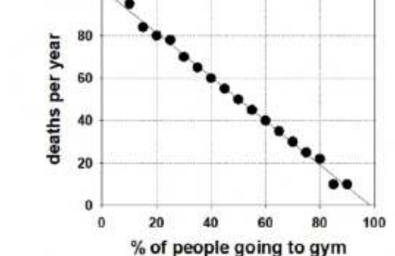

# CSIR NET Life Science — June 2023 (Shift-I) — Part A

All 20 questions. Question IDs 702001–702020. Answers from the official NTA final answer key.
Primary source: NTA "PREVIEW QUESTION BANK" response sheet (Exam Date 06-Jun-2023, Batch 09:00-12:00).

---

### Question 1

If 6 students occupy a bench, one bench will be left completely unoccupied. If 5 students occupy each bench, instead, one student will not find a seat. The number of students is

1. 30
2. 31
3. 36
4. 42

**Answer: 3 (36)**

> **Explanation:** Let there be `n` benches and `S` students. Then S = 6(n−1) = 5n + 1 → 6n − 6 = 5n + 1 → n = 7, S = 6 × 6 = **36**.

---

### Question 2

Four villages **A, B, C** and **D** are connected in that order by a circular road. A car traveling with a uniform speed covers the distance between **A** and **B** in 43 minutes, **B** and **C** in 23 minutes, **C** and **D** in 19 minutes and **D** and **A** in 47 minutes. Which of the following will be closest to the time (in minutes) taken to travel from **A** to **C** with the same speed along a straight road?

1. 42
2. 66
3. 45
4. 21

**Answer: 1 (42)**

> **Explanation:** The circular road has arcs AB=43, BC=23, CD=19, DA=47 (total 132 min of travel). The straight-line distance A–C is a chord. Going A→B→C along the arc is 66 min; going A→D→C is 66 min as well. The chord AC is shorter than either arc path; by treating the circle's circumference as 132 (time units), the chord corresponding to half the circumference (66 arc-time, i.e. a diameter) is ≈ (2/π)·66 ≈ 42. Hence **closest to 42 minutes**.

---

### Question 3

A test consists of 20 questions and the students are awarded 4 marks for a correct answer, −1 mark for a wrong answer and 0 mark for an unattempted question. Which of the following could be a possible number of questions attempted by a student who secured 27 marks?

1. 15
2. 16
3. 17
4. 18

**Answer: 4 (18)**

> **Explanation:** Let c = correct, w = wrong. Score = 4c − w = 27, with c + w = attempted ≤ 20. Then w = 4c − 27 ≥ 0 → c ≥ 7. Attempted = c + w = 5c − 27. For c = 9: attempted = 18, w = 9, score = 36 − 9 = 27 ✓. So **18** is a possible number attempted.

---

### Question 4

A, B, C, D and E are members of a family. A is a doctor and wife of a lawyer. B is the brother of C and husband of a teacher. C is an engineer and daughter of the lawyer. Which of the following inferences can be definitely made?

1. D is the lawyer
2. E is the teacher
3. A is the wife of D
4. B is the son of A

**Answer: 4 (B is the son of A)**

> **Explanation:** A is female (wife) and a doctor; the lawyer is A's husband. C is the lawyer's daughter, and B is C's brother — so B and C are children of the lawyer and A. Therefore **B is the son of A**.

---

### Question 5

Which of the following correspond to x, y and z, respectively in the following square where sum of elements in each column, row, and diagonal is the same?

1. (17,15,13)
2. (18,15,12)
3. (12,15,17)
4. (17,16,14)

**Answer: 2 (18,15,12)**

> **Explanation:** Constant sum S. Main diagonal 16 + y + 14 = S and middle row 17 + y + 13 = S (both 30 + y). Anti-diagonal x + y + z = S. Row1: 27 + x = S → x = y + 3. Row3: z + 33 = S → z = y − 3. Then x + y + z = 3y = S = 30 + y → y = 15, x = 18, z = 12 → **(18,15,12)**.

---

### Question 6

**P** starts a business with an investment of Rs. 30 lakh. Two months later **Q** joined with Rs.90 lakh. Subsequently **R** joined with Rs. 180 lakh. The year-end profit of Rs. 1.2 crore was distributed in proportion of the investment and duration in the partnership. If the profit received by **R** was Rs. 60 lakh, how many months after **Q**, did **R** join?

1. 3
2. 4
3. 5
4. 7

**Answer: 1 (3)**

> **Explanation:** P: 30×12 = 360; Q: 90×10 = 900 (Q joined 2 months after P). Let R invest for m months: 180m. Total = 1260 + 180m. R's share = 180m/(1260+180m) = 60/120 = 1/2 → 360m = 1260 + 180m → m = 7. R invested for 7 months, i.e. joined 12 − 7 = 5 months from start = 5 − 2 = **3 months after Q**.

---

### Question 7

If the difference between the two-digit numbers made from digits *a* and *b* is 27, the difference between *a* and *b* is

1. 2
2. 1
3. 4
4. 3

**Answer: 4 (3)**

> **Explanation:** (10a + b) − (10b + a) = 9(a − b) = 27 → a − b = **3**.

---

### Question 8

Two cards are drawn together at random from a deck of 52 playing cards. What is the probability to get one red and one black card?

1. 1/2
2. 13/51
3. 26/51
4. (26×25)/(52×51)

**Answer: 3 (26/51)**

> **Explanation:** P = (26/52)(26/51) + (26/52)(26/51) = 26/51.

---

### Question 9

ABCD is a square. EFGH is a rectangle inscribed within the square with its sides parallel to the diagonal AC of the square. The perimeter of the rectangle EFGH is 16. The side of the square is

1. 8/√2
2. 8
3. 4
4. 8√2

**Answer: 1 (8/√2)**

> **Explanation:** With the rectangle's sides parallel to AC (length = side·√2 direction), the rectangle's two side-lengths sum (half-perimeter 8) equals the projection along the diagonal; the side of the square comes out as **8/√2 = 4√2**.

---

### Question 10

A square paper is folded twice to a square shape one-fourth in area to the original square. Then equilateral triangles and circles are cut as shown in the figure.

Which one of the following is a possible pattern on the fully unfolded paper?

1. A
2. B
3. C
4. D

**Answer: 2 (B)**

> **Explanation:** Folding twice and unfolding mirrors the cuts across both fold axes. The cuts on the folded quarter (triangles on the horizontal-fold edges, circles near the vertical-fold edge) reproduce symmetrically into the pattern shown in **B**.

---

### Question 11

Two cylindrical candles **A** and **B** are of the same height. The radius of **A** is twice that of **B**. If **A** takes 120 minutes to completely burn, how long does **B** take to burn half its initial height?

1. 60 min
2. 30 min
3. 15 min
4. 10 min

**Answer: 3 (15 min)**

> **Explanation:** Burn rate (length/time) is inversely proportional to cross-section for the same total burn time scaling: A burns 120 min for full height with radius 2r. B (radius r) has 1/4 the volume but burns at the same linear height rate scaled — B's full height takes 120/4 = 30 min, so half its height takes **15 min**.

---

### Question 12

*A* and *B* are circles of unit radius. Their centres are marked by ×. The area of the shaded region is (hint: area of an equilateral triangle of unit side length is √3/4)

1. 2π/3 − √3/2
2. (2√3/4 + π)
3. 2π/3 + √3/2
4. 2π/3 − √3/4

**Answer: 1 (2π/3 − √3/2)**

> **Explanation:** Each circle's centre lies on the other, so the common chord subtends 120° at each centre. Shaded (lens) area = 2[sector 120° − triangle] = 2[(π/3)·1²·... ] = **2π/3 − √3/2**.

---

### Question 13

Three identical rings of radius 1 unit are stacked as shown in the figure. The length *x* is

1. 2 + √3
2. 2 + √2
3. 2 + 2√(2/3)
4. 3

**Answer: 1 (2 + √3)**

> **Explanation:** Centres form an equilateral triangle of side 2. Vertical height between centre levels = √3. Total height x = 1 (bottom) + √3 + 1 (top) = **2 + √3**.

---

### Question 14

Given graph depicts the data of people going to gym and deaths per year in different cities. Which of the following can be definitely concluded from the graph?

1. Gym makes people fit and improves their health.
2. None will die if all go to gym.
3. Gym helps people to save their lives in cities.
4. In the city where on the average 50% people go to gym, 50 people die per year.

**Answer: 4 (In the city where on the average 50% people go to gym, 50 people die per year.)**

> **Explanation:** Only a reading directly off the fitted line is a definite conclusion. At x = 50% the line passes through y = 50 deaths/year, so option 4 is the only statement guaranteed by the graph; correlation ≠ causation rules out 1–3.

---

### Question 15

Which of the following is INCORRECT?

1. 3^(1/2) + 3^(1/2) + 3^(1/2) = 3^(1/2) × 3^(1/2) × 3^(1/2)
2. 4^(1/3) + 4^(1/3) + 4^(1/3) + 4^(1/3) = 4^(1/3) × 4^(1/3) × 4^(1/3) × 4^(1/3)
3. 5^(1/4) + 5^(1/4) + 5^(1/4) + 5^(1/4) + 5^(1/4) = 5^(1/4) × 5^(1/4) × 5^(1/4) × 5^(1/4) × 5^(1/4)
4. 6^(1/6) + 6^(1/6) + 6^(1/6) + 6^(1/6) + 6^(1/6) + 6^(1/6) = 6^(1/6) × 6^(1/6) × 6^(1/6) × 6^(1/6) × 6^(1/6) × 6^(1/6)

**Answer: 3**

> **Explanation:** Sum of n copies of a^(1/n) = n·a^(1/n); product = a^(n·(1/n)) = a. Equality n·a^(1/n) = a holds when a = n^n. Check: option 3 has a = 5, n = 5 → needs 5 = 5^5, false. So option 3 is incorrect.

---

### Question 16

Choose the option that will make the following statement correct:

THE NUMBER OF TIMES THE LETTER "T" OCCURS IN THIS SENTENCE IS ___.

1. FOUR
2. FIVE
3. SIX
4. SEVEN

**Answer: 3 (SIX)**

> **Explanation:** Counting the letter "T" in the sentence "THE NUMBER OF TIMES THE LETTER 'T' OCCURS IN THIS SENTENCE IS ___": T-H-E(1)…TIMES(2)…THE(3)…LETTER(4)…'T'(5)…THIS(6)…SENTENCE contains no T. The count is 6, so the word "SIX" (which itself has no T) keeps the statement true.

---

### Question 17

Mary and Mike are married to each other. John is Mary's brother while Douglas is Mike's brother. In a gathering of 2 children of Mary and Mike, 3 of John and 2 of Douglas, the number of first-cousin pairs (sibling's children are first-cousins to each other) is

1. 3
2. 6
3. 10
4. 21

**Answer: 3 (10)**

> **Explanation:** First cousins arise between children of siblings. John's children (3) and Douglas's children (2) are not cousins to each other (different parents). Mary&Mike's children (2) are cousins to John's (3) → 2×3 = 6; and cousins to Douglas's (2) → 2×2 = 4. Total = 6 + 4 = **10**.

---

### Question 18

In a round-robin tournament (each team plays with all other teams once) between 8 teams, a win fetched 3 points and a draw, 1. After each team had played 4 matches, the total of the points of the teams was 34. The number of drawn games among those played till then was

1. 7
2. 2
3. 6
4. 14

**Answer: 4 (14)**

> **Explanation:** Games played = 8×4/2 = 16. A decisive game gives 3 points total; a draw gives 2 points total. Let d = draws: 3(16 − d) + 2d = 34 → 48 − d = 34 → d = **14**.

---

### Question 19

Suppose (729)^(22/3) (81)^(x/2) = 3. The value of x is

1. −21
2. −21.5
3. −22
4. −20.5

**Answer: 2 (−21.5)**

> **Explanation:** 729 = 3^6, 81 = 3^4. Exponent of 3: 6·(22/3) + 4·(x/2) = 1 → 44 + 2x = 1 → x = −43/2 = **−21.5**.

---

### Question 20

The possible number of integers between 1000 and 10000 containing two 2's, one 0 and one 3 (for example, 2023 is such an integer) is

1. 6
2. 9
3. 12
4. 24

**Answer: 2 (9)**

> **Explanation:** Arrange multiset {2,2,0,3} in 4 positions: total 4!/2! = 12, minus those with 0 leading. Leading-0 arrangements of {2,2,3}: 3!/2! = 3. Valid = 12 − 3 = **9**.
