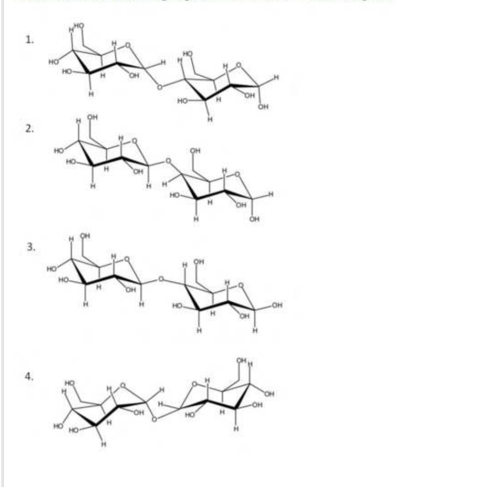
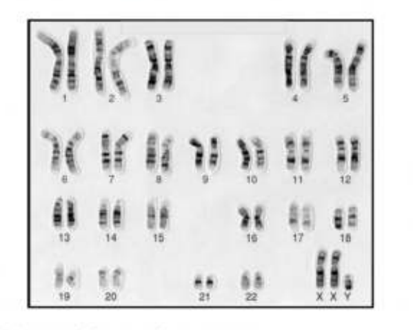

# CSIR UGC NET Life Sciences — June 2023 (Shift-I) — Part B (Q21–Q70)

Transcribed verbatim from the official NTA response sheet. Answers confirmed against the official NTA final answer key. Figures are crops of the scanned page.

---

### Question 21

Which one of the following sugars will not reduce Tollen's reagent?

1. Structure 1
2. Structure 2
3. Structure 3
4. Structure 4

**Answer: 4 (Structure 4)**

> **Explanation:** Tollen's reagent is reduced by reducing sugars, i.e. those that retain a free anomeric carbon (a hemiacetal –OH) capable of opening to the free aldehyde/ketone form. Structures 1, 2 and 3 each possess a free anomeric carbon on the second residue and are therefore reducing. Structure 4 has both anomeric carbons tied up in the glycosidic bond (a non-reducing, head-to-head linkage of the type found in trehalose), so it cannot open to a free carbonyl and will **not** reduce Tollen's reagent.

---

### Question 22

The solubility of NaCl is greater in water than ethanol. What physical property of the solvent governs this difference?

1. Surface tension
2. Viscosity
3. Dielectric constant
4. Boiling point

**Answer: 3 (Dielectric constant)**

> **Explanation:** NaCl is an ionic solid; its dissolution depends on the solvent's ability to screen the electrostatic attraction between Na⁺ and Cl⁻. This ability is measured by the dielectric constant. Water (ε ≈ 80) has a far higher dielectric constant than ethanol (ε ≈ 24), so it stabilises the separated ions much better and dissolves NaCl more readily.

---

### Question 23

In mature erythrocytes, the end-product of glycolysis that contains the carbons of glucose is:

1. ethanol
2. pyruvate
3. acetaldehyde
4. lactate

**Answer: 4 (lactate)**

> **Explanation:** Mature erythrocytes lack mitochondria, so pyruvate cannot enter the TCA cycle. To regenerate NAD⁺ for continued glycolysis, pyruvate is reduced by lactate dehydrogenase to **lactate**, which is the final glycolytic product in these cells and carries the carbons originally derived from glucose.

---

### Question 24

The standard free energy (kJ mol⁻¹) of hydrolysis of glucose-1-phosphate is:

1. -40.3
2. -35.8
3. -7.7
4. -20.9

**Answer: 4 (-20.9)**

> **Explanation:** The phosphate ester of glucose-1-phosphate is a low-energy ester; its hydrolysis has ΔG°′ ≈ **−20.9 kJ mol⁻¹** (compare glucose-6-phosphate ≈ −13.8). The large negatives (−40.3, −35.8) correspond to high-energy compounds such as phosphoenolpyruvate and ATP-type donors, not a sugar monophosphate ester.

---

### Question 25

Which one of the following statements about LINEs present in the human genome is TRUE?

1. LINEs preferentially localize to AT-rich DNA.
2. LINEs cannot transpose independently.
3. By parasitizing on the SINE element transposition machinery, LINEs can attain very high copy number.
4. The Alu family is the most prominent LINE family in terms of copy number.

**Answer: 1 (LINEs preferentially localize to AT-rich DNA.)**

> **Explanation:** LINE-1 elements integrate preferentially into AT-rich genomic regions (an endonuclease nick at a degenerate 5′-TTTT/AA-3′ consensus), so statement 1 is true. LINEs **are** autonomous (they encode their own reverse transcriptase/endonuclease), so 2 is false. It is SINEs (non-autonomous) that parasitize the LINE machinery, not the reverse, so 3 is false. Alu is a **SINE**, not a LINE, so 4 is false.

---

### Question 26

Which one of the following changes is energetically favorable and occurs spontaneously in an aqueous solution?

1. Formation of a bilayer from phospholipid molecules
2. Dispersion of one oil droplet into many small ones
3. Tearing of the lipid bilayer
4. Conversion of a membrane vesicle to a flat bilayer

**Answer: 1 (Formation of a bilayer from phospholipid molecules)**

> **Explanation:** Amphipathic phospholipids spontaneously assemble into a bilayer in water because this sequesters the hydrophobic tails away from water (the hydrophobic effect, favourable entropy of released water). Dispersing an oil droplet into many small ones increases unfavourable oil–water contact area, tearing a bilayer exposes hydrophobic cores, and a vesicle edge (flat bilayer) leaves exposed edges — all energetically unfavourable.

---

### Question 27

A temperature sensitive *S. pombe* mutant exhibits cell cycle arrest both, at the G1 to S, as well as at the G2 to M transition phases. This is possibly a mutant of:

1. Clb1
2. Cyclin B
3. Cdc2 only
4. Cdc2 and Clb3

**Answer: 3 (Cdc2 only)**

> **Explanation:** Cdc2 (CDK1) is the single, essential cyclin-dependent kinase in *S. pombe* that drives both the G1→S and G2→M transitions. A temperature-sensitive *cdc2* allele therefore arrests at both transitions. Clb1 is a *S. cerevisiae* B-type cyclin, and cyclin B levels oscillate rather than being required at both checkpoints in the same way; only loss of the common kinase Cdc2 blocks both transitions.

---

### Question 28

In the context of protein import in the nucleus, which molecule is responsible for releasing the cargo from the importing receptor?

1. Ras
2. RhoA
3. Ran
4. Rock

**Answer: 3 (Ran)**

> **Explanation:** Importin-β carries the cargo–importin complex into the nucleus, where binding of **Ran-GTP** to importin-β triggers a conformational change that releases the cargo. Ran's GTP-bound nuclear gradient is the directionality switch for nucleocytoplasmic transport. Ras, RhoA (GTPases of signalling/cytoskeleton) and Rock (a kinase) are unrelated to this step.

---

### Question 29

Which one of the following mRNAs is most likely to be exported out of the nucleus?

1. Spliced RNA associated with the poly A binding and cap binding complex.
2. Mis-spliced RNA with multiple stop codons, for degradation in cytosol.
3. Spliced RNA with the associated spliceosomal complex.
4. Uncapped and unspliced RNA.

**Answer: 1 (Spliced RNA associated with the poly A binding and cap binding complex.)**

> **Explanation:** Only a fully processed mRNA — 5′-capped, spliced and polyadenylated, with the cap-binding (CBC) and poly(A)-binding proteins and the export adaptor TREX deposited — is licensed for TAP/NXF1-mediated nuclear export. Retained spliceosomal components, retained introns/unspliced RNA, or premature-stop-codon-containing (NMD-target) transcripts are flagged and held/degraded rather than exported.

---

### Question 30

Which one of the following translation factors is used at the step of translation initiation and defined as anti-association factor for 30S and 50S subunit interactions?

1. IF1
2. IF2
3. IF3
4. RRF

**Answer: 3 (IF3)**

> **Explanation:** **IF3** is the bacterial anti-association factor: it binds the 30S subunit and prevents premature 30S–50S subunit joining, and helps position fMet-tRNA. IF1 blocks the A site, IF2 is the GTPase that delivers fMet-tRNA and promotes subunit joining, and RRF (ribosome recycling factor) splits ribosomes after translation, not during initiation.

---

### Question 31

Which one of the following codons is used to code for selenocysteine in *Escherichia coli*?

1. UGA
2. UAA
3. UAG
4. UCC

**Answer: 1 (UGA)**

> **Explanation:** Selenocysteine (the 21st amino acid) is co-translationally inserted at an in-frame **UGA** codon when it is followed by a SECIS element, recoding this normally stop codon. UAA and UAG are the other stop codons (UAG also codes pyrrolysine), and UCC codes serine.

---

### Question 32

Which of the following statements about site-specific recombinases is **NOT** true?

1. The Cre recombinase is believed to mediate the circularization of the P1 phage genome during infection of the bacterial host.
2. The λ integrase cannot mediate integration of the λ genome into the host genome without the help of accessory proteins.
3. The Hin invertase-mediated recombination event is stimulated by protein-DNA interactions at a 60 bp enhancer sequence.
4. In Xer recombinase-mediated monomerization of chromosomal dimers, the interaction of FtsK with XerCD activates XerC and initiates the recombination process.

**Answer: 4 (In Xer recombinase-mediated monomerization of chromosomal dimers, the interaction of FtsK with XerCD activates XerC and initiates the recombination process.)**

> **Explanation:** Statement 4 is the incorrect one. During XerC/XerD-mediated resolution of chromosome dimers at *dif*, FtsK stimulates the reaction but the strand-cleavage order and activation are such that FtsK promotes the reaction through XerD/XerC regulation differently from the way the statement describes; the assertion that FtsK–XerCD interaction "activates XerC and initiates recombination" misrepresents the mechanism. Statements 1–3 correctly describe Cre (P1 circularization), λ integrase requiring IHF/Xis accessory factors, and the Hin enhancer (~60 bp) requirement.

---

### Question 33

The mode of action of cholera toxin in causing diarrhoea is by:

1. inactivating Gᵢ protein.
2. continuous activation of adenylyl cyclase.
3. locking Gₛ protein in an inactive state.
4. rapidly hydrolyzing GTP to GDP.

**Answer: 2 (continuous activation of adenylyl cyclase.)**

> **Explanation:** Cholera toxin ADP-ribosylates the Gₛα subunit and locks it in its **active** GTP-bound form, so adenylyl cyclase is constitutively stimulated. cAMP rises continuously, opening CFTR chloride channels and driving the massive secretory diarrhoea. It does not inactivate Gᵢ or Gₛ, nor accelerate GTP hydrolysis (it prevents it).

---

### Question 34

Which one of the following is the communicating junction linking adjacent cells in plants, which permits small molecules to pass from cell to cell while blocking the passage of most large molecules?

1. Adherens junction
2. Gap junction
3. Plasmodesmata
4. Hemidesmosome

**Answer: 3 (Plasmodesmata)**

> **Explanation:** **Plasmodesmata** are the membrane-lined cytoplasmic channels that connect adjacent plant cells and allow size-selective passage of small molecules while restricting most large ones. Gap junctions are the (animal) functional analogue; adherens junctions and hemidesmosomes are anchoring, not communicating, junctions.

---

### Question 35

The extracellular domain of a cell surface receptor (A) was switched with the extracellular domain of another receptor (B) to create a chimeric receptor (B-A). Assuming that there is no effect on the functionality of the domains in the chimeric receptor, what is the most likely outcome in the presence of the ligand for receptor B?

1. The ligand will activate the pathway normally triggered by receptor A.
2. The ligand will activate the pathway normally triggered by receptor B.
3. The chimeric receptor will fail to transduce any signal in response to the ligand.
4. The chimeric receptor will cause constitutive activation of the signalling pathway.

**Answer: 1 (The ligand will activate the pathway normally triggered by receptor A.)**

> **Explanation:** The chimeric receptor (B-A) has the **extracellular** domain of B (so it binds the ligand for B) but the **intracellular** signalling domain of A (so it triggers A's downstream pathway). Binding of B's ligand therefore activates the pathway normally triggered by receptor A — the classic domain-swap experiment showing that ligand specificity and signal output are modular.

---

### Question 36

Appressorium is expected to be formed during which one of the following diseases?

1. Bacterial leaf blight in rice
2. Bacterial wilt in tomato
3. Powdery mildew in pea
4. Leaf curl disease in tobacco

**Answer: 3 (Powdery mildew in pea)**

> **Explanation:** An appressorium is the swollen, pressurised infection structure formed by **fungi** to breach the host cuticle. Powdery mildew of pea (caused by the fungus *Erysiphe pisi*) involves appressorium formation. Bacterial leaf blight, bacterial wilt and (virus-caused) leaf curl are not fungal infections and do not form appressoria.

---

### Question 37

Clonogenic neoblasts are involved in planarian (flatworm) regeneration. This is an example of:

1. epimorphosis
2. morphallaxis
3. stem cell-mediated regeneration
4. compensatory regeneration

**Answer: 3 (stem cell-mediated regeneration)**

> **Explanation:** Planarian regeneration is powered by **neoblasts**, pluripotent somatic stem cells that proliferate and differentiate to replace lost parts — the textbook example of stem-cell-mediated regeneration. Epimorphosis/morphallaxis describe blastema-based vs. remodelling-based regeneration in other systems, and compensatory regeneration refers to hypertrophy of remaining tissue.

---

### Question 38

Which one of the following describes an amphosome?

1. It is an intermediate/hybrid organelle produced through the fusion of endosomes with autophagosomes within cells.
2. It is a double-membrane sequestering vesicle that is the hallmark of the intracellular catabolic process called macroautophagy.
3. It is a compartment formed when autophagosome fuses with a lysosome.
4. It is a vacuole that arises when membranes of the ER sequester parts of the cytoplasm.

**Answer: 1 (It is an intermediate/hybrid organelle produced through the fusion of endosomes with autophagosomes within cells.)**

> **Explanation:** The **amphisome** is the hybrid organelle formed when an autophagosome fuses with an endosome (early/late endosome, multivesicular body), an intermediate before the autolysosome. Option 2 describes the isolation membrane/phagophore, option 3 the autolysosome, and option 4 the origin of the phagophore.

---

### Question 39

Homeotic selector genes are responsible for the specification of *Drosophila* body parts. Which one of the following identities would you expect if the *ultrabithorax* gene is deleted?

1. The third thoracic segment is transformed to another second thoracic segment and a fly with four wings.
2. The third thoracic segment develops halteres.
3. The second thoracic segment loses wings.
4. The first and second thoracic segments fuse and wings are formed on the third thoracic segment.

**Answer: 1 (The third thoracic segment is transformed to another second thoracic segment and a fly with four wings.)**

> **Explanation:** *Ultrabithorax* (*Ubx*) normally specifies the third thoracic segment (T3), repressing wing fate there so that T3 bears the halteres. Loss of *Ubx* transforms T3 into a second T2-like segment, duplicating the wing-bearing identity and producing a **four-winged fly** (the classic *bithorax* phenotype).

---

### Question 40

Which one of the following root initials gives rise to the root vascular system, including the pericycle?

1. Columella initials
2. Epidermal-lateral root cap initials
3. Cortical-endodermal initials
4. Stele initials

**Answer: 4 (Stele initials)**

> **Explanation:** In the root apical meristem the **stele initials** (procambium) give rise to the vascular cylinder — xylem, phloem and the pericycle. Columella initials form the central root cap, the dermatogen/calyptra initials form epidermis and lateral root cap, and the cortex–endodermis initials form cortex and endodermis.

---

### Question 41

Which one of the following plant-derived molecules is widely used as an analgesic?

1. Abscisic acid
2. Salicylic acid
3. Jasmonic acid
4. Gibberellic acid

**Answer: 2 (Salicylic acid)**

> **Explanation:** **Salicylic acid**, derived from the willow-bark precursor salicin, is the active basis of aspirin (acetylsalicylic acid) and is widely used as an analgesic/antipyretic. Abscisic acid, jasmonic acid and gibberellic acid are plant hormones regulating stress, defence and growth, not pain relief.

---

### Question 42

Which one of the following statements is **INCORRECT**?

1. Avr proteins predominantly have SecA secretion signals.
2. Avr proteins are secreted through the type III secretion system (T3SS).
3. Hypersensitive response and pathogenicity (HRP) cluster proteins are involved in the secretion of Avr proteins.
4. Some of the components of the T3SS pathway are conserved between animal- and plant-pathogenic bacteria.

**Answer: 1 (Avr proteins predominantly have SecA secretion signals.)**

> **Explanation:** Avr (avirulence) effector proteins are delivered into the plant cell by the **type III secretion system (T3SS)**, not by the general SecA co-translational pathway; they generally lack classical SecA signal peptides. So statement 1 is the incorrect one. Statements 2–4 are true: Avr proteins use the T3SS, the Hrp gene cluster encodes the translocation apparatus, and T3SS components are evolutionarily conserved across animal and plant pathogens.

---

### Question 43

During glycolysis in plants, alanine and related amino acids are directly produced from which one of the following precursors?

1. 3-Phosphoglycerate
2. Phosphoenolpyruvate
3. Pyruvate
4. Acetyl-CoA

**Answer: 3 (Pyruvate)**

> **Explanation:** **Alanine** is formed by a single transamination step from the glycolytic end-product **pyruvate** (alanine aminotransferase). 3-Phosphoglycerate is the precursor of serine/glycine/cysteine, phosphoenolpyruvate feeds the aromatic amino acids, and acetyl-CoA is not a direct glycolytic amino-acid precursor.

---

### Question 44

Which one of the following statements regarding PEPCase is **INCORRECT**?

1. During the day, C4 PEPCase is inactive whereas CAM PEPCase is active.
2. PEPCase is inactivated by dephosphorylation.
3. PEPCase kinase phosphorylates PEPCase.
4. The synthesis of PEPCase kinase is modulated by circadian rhythm in CAM leaves.

**Answer: 1 (During the day, C4 PEPCase is inactive whereas CAM PEPCase is active.)**

> **Explanation:** Statement 1 is incorrect. In **C4** plants PEPCase is active **during the day** (it fixes CO₂ into oxaloacetate in mesophyll cells as part of the C4 pump). In **CAM** plants PEPCase is activated **at night** (when stomata open and malate is stored); during the day CAM PEPCase is largely inactive. So the statement reverses the daytime activity. Options 2–4 correctly describe PEPCase regulation by phosphorylation (PEPC kinase inactivates it by phosphorylation in C4/CAM, dephosphorylation restores activity in the dark-to-light transition) and circadian control of PEPC-kinase.

---

### Question 45

The hemolysis of red blood cells takes place when they are suspended in which one of the following solutions?

1. 2.0% NaCl
2. 1.5% NaCl
3. 1.0% NaCl
4. 0.5% NaCl

**Answer: 4 (0.5% NaCl)**

> **Explanation:** Normal physiological saline is ≈0.9% NaCl. In a **hypotonic** solution below this, water enters the cell by osmosis, the red blood cell swells and bursts (hemolysis). 0.5% NaCl is hypotonic and causes hemolysis, whereas 1.0%, 1.5% and 2.0% NaCl are isotonic-to-hypertonic and do not lyse the cells.

---

### Question 46

The non-ciliated cuboidal epithelial cells in bronchioles that secrete important defense markers are called

1. Goblet cells
2. Basal cells
3. Langerhans cells
4. Club cells

**Answer: 4 (Club cells)**

> **Explanation:** **Club cells** (formerly Clara cells) are the non-ciliated, dome-shaped cuboidal secretory cells of the bronchiolar epithelium. They secrete club cell secretory protein (CC10/CCSP) and other defence/surfactant components, detoxify xenobiotics, and act as progenitor cells. Goblet cells secrete mucus, basal cells are progenitors in larger airways, and Langerhans cells are dendritic antigen-presenting cells.

---

### Question 47

Which one of the following factors inhibits renin secretion?

1. Increased level of plasma catecholamines.
2. Increased blood pressure in the afferent arterioles leading to glomerulus.
3. Increased activity of sympathetic nerves connected to kidney.
4. Prostaglandins.

**Answer: 2 (Increased blood pressure in the afferent arterioles leading to glomerulus.)**

> **Explanation:** Renin release from juxtaglomerular cells is stimulated by low perfusion pressure, sympathetic (β1) activity, catecholamines and prostaglandins, and inhibited by **high arterial pressure** stretching the afferent arteriole (myogenic/baroreceptor inhibition) and by high NaCl at the macula densa. Thus increased afferent-arteriolar pressure inhibits renin; the other three stimulate it.

---

### Question 48

Which one of the following is correct regarding zeitgebers?

1. Have no effect on biological rhythms
2. Sense biological rhythms
3. Synchronize biological rhythms
4. Abolish biological rhythms

**Answer: 3 (Synchronize biological rhythms)**

> **Explanation:** A **zeitgeber** ("time-giver", e.g. the light–dark cycle) is an external cue that **entrains/synchronizes** an organism's endogenous circadian rhythm to the 24-hour environmental cycle. It neither senses nor abolishes the rhythm; it resets and maintains its phase.

---

### Question 49

Segregation of alleles can occur either at anaphase I or anaphase II of meiosis. Which one of the following is an ideal model system for identifying the stage at which allelic segregation occurred?

1. *Arabidopsis thaliana*
2. *Drosophila melanogaster*
3. *Neurospora crassa*
4. *Saccharomyces cerevisiae*

**Answer: 3 (*Neurospora crassa*)**

> **Explanation:** *Neurospora crassa* produces **ordered octad tetrads**, in which the linear arrangement of spores directly records whether a gene segregated at the first (MI) or second (MII) meiotic division — the basis of the classic "first-division vs second-division segregation" pattern analysis. The other organisms do not give ordered tetrads that report segregation timing as directly.

---

### Question 50

Based on the image given below, select the option that describes it correctly:

1. Q-banded normal human karyotype.
2. G-banded human karyotype depicting aneuploidy.
3. C-banded karyotype depicting Klinefelter syndrome.
4. G-banded normal human karyotype.

**Answer: 2 (G-banded human karyotype depicting aneuploidy.)**

> **Explanation:** The chromosomes show the characteristic light/dark **G-banding** pattern (Giemsastain after trypsin). The sex-chromosome complement is **XXY** (Klinefelter), i.e. an abnormal number of sex chromosomes — an **aneuploidy**. Hence it is a G-banded karyotype depicting aneuploidy, not a normal karyotype (rules out 1 and 4), and it is G-banded, not C-banded (rules out 3).

---

### Question 51

Consider alleles 'A' and 'a' in a population. The frequency of heterozygotes will be highest when:

1. Frequency of 'A' is more than frequency of 'a'
2. Frequency of 'A' is less than frequency of 'a'
3. Frequency of 'A' is equal to frequency of 'a'
4. Frequency of 'A' and 'a' affects the frequency of homozygotes, not heterozygotes

**Answer: 3 (Frequency of 'A' is equal to frequency of 'a')**

> **Explanation:** Under Hardy–Weinberg equilibrium the heterozygote frequency is 2pq, where p + q = 1. The product 2pq is maximised when p = q = 0.5, giving 2pq = 0.5. Thus heterozygosity is highest when the two allele frequencies are **equal**.

---

### Question 52

Recessive lethal alleles are never completely eliminated from the population because:

1. lethal alleles are always conditional in nature.
2. lethal alleles have selective advantage.
3. lethal alleles protect organisms from other deleterious mutations.
4. they are maintained in the population as heterozygotes.

**Answer: 4 (they are maintained in the population as heterozygotes.)**

> **Explanation:** A recessive lethal allele is exposed to selection only in homozygotes; **heterozygotes are phenotypically normal and viable**, so the allele "hides" in them and is passed on each generation. Selection cannot efficiently purge it, so it persists at a low equilibrium frequency maintained by heterozygotes (and by recurrent mutation).

---

### Question 53

Which one of the following mammalian species is distributed in evergreen forests?

1. Nilgai
2. Black buck
3. Cheetah
4. Lion-tailed macaque

**Answer: 4 (Lion-tailed macaque)**

> **Explanation:** The **lion-tailed macaque** (*Macaca silenus*) is an endangered primate endemic to the **evergreen (wet evergreen) rain forests** of the Western Ghats, India. Nilgai (blue bull) and blackbuck inhabit open grasslands/thorn scrub, and the cheetah is a savannah/dry grassland cat — none is a species of closed evergreen forest.

---

### Question 54

The grizzled giant squirrel, *Ratufa macroura*, naturally occurs in

1. north-east India and Burma
2. western Himalayas
3. southern India and Sri Lanka
4. Andaman and Nicobar islands

**Answer: 3 (southern India and Sri Lanka)**

> **Explanation:** The grizzled giant squirrel *Ratufa macroura* is native to the dry and wet evergreen forests of **southern India (Western Ghats/Shivalik fringe in the south) and Sri Lanka**. The other giant-squirrel populations (e.g. *R. indica*, *R. bivittata*) occur elsewhere; *R. macroura*'s range is peninsular southern India and Sri Lanka.

---

### Question 55

Which one of the following characteristics is **NOT** correct for bryophytes?

1. All bryophytes are homosporous.
2. Gametophyte is the dominant phase of the life cycle.
3. The antherozoids are always biflagellate.
4. Water is conducted by hydroids in all bryophytes.

**Answer: 4 (Water is conducted by hydroids in all bryophytes.)**

> **Explanation:** Bryophytes are **non-vascular** plants; true water-conducting hydroids (and leptoids) are present only in some specialised mosses, not in "all bryophytes," so statement 4 is the incorrect one. Statement 1 is broadly treated as correct for bryophytes (they are homosporous), the gametophyte is indeed the dominant free-living phase (2), and motile **biflagellate antherozoids** are characteristic (3).

---

### Question 56

Which one of the following species of birds is known to migrate across the Himalayas?

1. Sarus Crane
2. Red-vented Bulbul
3. Jacobin Cuckoo
4. Bar-headed Goose

**Answer: 4 (Bar-headed Goose)**

> **Explanation:** The **bar-headed goose** (*Anser indicus*) is famous for its high-altitude migration across the Himalaya, flying over passes at extreme altitude (physiologically adapted for low-oxygen flight). Sarus crane, red-vented bulbul and Jacobin cuckoo do not perform trans-Himalayan high-altitude migrations.

---

### Question 57

Which one of the following terms is used for species that exploit the same resources in a similar manner?

1. Guild
2. Taxonomic order
3. Community
4. Assemblage

**Answer: 1 (Guild)**

> **Explanation:** A **guild** is a group of species in a community that exploit the same class of resources in a similar way (e.g. seed-eaters, nectar-feeders), irrespective of their taxonomy. A community/assemblage is the set of all interacting species in an area, and a taxonomic order is a classification rank — none is defined by shared resource-use strategy.

---

### Question 58

Invasive species, in general grow very well in a new area that they invade, and often outcompete native species. An explanation for the better growth and propagation of invasive species in comparison to their native counterparts is provided by which one of the following hypotheses?

1. Ecological niche hypothesis
2. Intermediate disturbance hypothesis
3. Enemy release hypothesis
4. Biotic resistance hypothesis

**Answer: 3 (Enemy release hypothesis)**

> **Explanation:** The **enemy release hypothesis** states that invasive species leave behind their specialist predators, parasites and pathogens in the native range, so in the new range reduced enemy pressure frees resources for growth and reproduction, giving them an advantage over their native counterparts. The biotic resistance hypothesis is the opposite (diverse communities resist invasion); intermediate disturbance explains diversity, and "ecological niche hypothesis" is not the mechanism for this pattern.

---

### Question 59

A positive association between absolute average individual fitness and population size over some finite interval is known as

1. Allee effect
2. Founder effect
3. Rensch's rule
4. Bergmann's rule

**Answer: 1 (Allee effect)**

> **Explanation:** The **Allee effect** is the positive correlation between per-capita fitness (growth rate) and population size/density at low densities — individuals do better when the population is larger (mate-finding, cooperative defence, etc.). The founder effect is a genetic drift phenomenon; Rensch's and Bergmann's rules concern allometry and body-size/latitude relationships.

---

### Question 60

Given below are characteristic traits found in sun- or shade-acclimated leaves
A. High dry mass per unit area
B. Higher number of chloroplasts per area
C. Lower Chl-a/Chl-b ratio
D. Lower dark respiration per area
E. Higher light harvesting complexes per area

Select the option that has all correct characteristics for shade-acclimated leaves?

1. A, B and C
2. C, D and E
3. A, C and D
4. B, C and D

**Answer: 2 (C, D and E)**

> **Explanation:** Shade leaves acclimate to low light by increasing light-harvesting capacity: they have a **lower Chl-a/Chl-b ratio** (more antenna/LHCII, C), **lower dark respiration per area** (reduced respiratory cost, D), and **more light-harvesting complexes per area** (E). High dry mass per unit area (A) and more chloroplasts per area (B) are sun-leaf traits, so the set C, D and E is correct.

---

### Question 61

Which one of the following statements is correct for a primary successional species?

1. These species do not follow specific survivorship curves.
2. These species show Type II survivorship curve.
3. These species show Type III survivorship curve.
4. These species show Type I survivorship curve.

**Answer: 3 (These species show Type III survivorship curve.)**

> **Explanation:** Early (primary/colonising) successional species are typical **r-strategists**: they produce very many propagules with little parental investment, and most individuals die young — the strongly convex **Type III** survivorship curve. Type I (low early mortality, high parental investment) characterises K-strategists, and Type II is a constant intermediate.

---

### Question 62

Directional Selection for a particular trait will lead to the frequency of the trait:

1. being normally distributed in the population.
2. always showing a left-skewed distribution in the population.
3. always showing a right-skewed distribution in the population.
4. showing either a right- or a left-skewed distribution in the population.

**Answer: 4 (showing either a right- or a left-skewed distribution in the population.)**

> **Explanation:** Directional selection favours one phenotypic extreme, shifting the mean of the trait distribution in that direction and skewing it. Depending on which extreme is favoured, the distribution becomes skewed to the **right or to the left**, so the outcome is "either" — not fixed to one direction (rules out 2 and 3), and not the symmetric normal distribution maintained by stabilising selection (rules out 1).

---

### Question 63

Given that Asian Koel is a brood parasite, which one of the following statements is TRUE for this species?

1. The brood of the bird is usually infested with parasitic wasps.
2. The young ones learn the calls of their foster parents.
3. The bird feeds parasitic wasps to its brood.
4. The call of the species is innate and not learned.

**Answer: 4 (The call of the species is innate and not learned.)**

> **Explanation:** The Asian Koel is a brood parasite whose chick is raised by host (e.g. crow) foster parents, yet the adult koel's characteristic call is **innate, genetically programmed, and not learned** from foster parents — which is why it retains species-typical vocalisations despite being reared heterospecifically. This makes statement 4 true and statement 2 false; statements 1 and 3 are irrelevant/incorrect.

---

### Question 64

The following terms represent different methods in phylogenetic tree constructions.
A. Unweighted Pair Group Method Using Arithmetic Average (UPGMA)
B. Minimum Evolution (ME) method
C. Maximum Parsimony (MP) method
D. Maximum Likelihood (ML) method

Select the option that represents all distance-based methods?

1. A and B
2. B and C
3. C and D
4. A and D

**Answer: 1 (A and B)**

> **Explanation:** **Distance-based (phenetic) methods** operate on a pairwise distance matrix: UPGMA (a clustering distance method) and Minimum Evolution (which selects the tree with the shortest total branch length from distances) are both distance-based. Maximum Parsimony and Maximum Likelihood are **character-based (discrete)** methods, not distance methods. Hence A and B.

---

### Question 65

Which one of the following types of promoters would **NOT** be used within the T-DNA for expression of a negative selection marker gene for generation of transgenic plants by *Agrobacterium*-mediated transformation?

1. strong constitutive promoter
2. tissue-specific promoter
3. substrate-inducible promoter
4. stress-inducible promoter

**Answer: 1 (strong constitutive promoter)**

> **Explanation:** A **negative selection marker** (a counter-selectable gene such as *bar*/*nptII* used in negative-selection systems, or a toxin/counter-selection gene) must **not** be expressed constitutively in the whole plant, or it would kill/counter-select all tissues. It is driven by tissue-specific, substrate-inducible or stress-inducible promoters so its (harmful) activity is restricted/controlled. A **strong constitutive promoter** (e.g. 35S/CaMV) would defeat the purpose and is the type NOT used — hence option 1.

---

### Question 66

Which one of the following statements regarding molecular markers for genotyping is **INCORRECT**?

1. Polymorphism in intronic regions of a gene cannot be used for trait mapping.
2. Codominant molecular markers can be used to detect heterozygosity.
3. Sequence Tagged Microsatellite Sites (STMS) and Simple Sequence Repeat Polymorphisms (SSRPs) are based on polymorphisms in repetitive DNA sequences.
4. Restriction Fragment Length Polymorphisms (RFLPs) and Simple Sequence Repeats (SSRs) are multi-allelic markers.

**Answer: 1 (Polymorphism in intronic regions of a gene cannot be used for trait mapping.)**

> **Explanation:** Statement 1 is incorrect. Intronic polymorphisms (e.g. within-gene SSRs/SNPs in introns) **are** routinely used as markers for trait mapping and marker-assisted selection, since they can be tightly linked to or within the gene affecting the trait. The other statements are true: codominant markers distinguish heterozygotes (2); STMS/SSRPs exploit repeat-number variation (3); and RFLPs and SSRs are multi-allelic (4).

---

### Question 67

A patient was injected with Purified Protein Derivative (PPD) to diagnose TB disease or a previous exposure to *Mycobacterium tuberculosis*. The injected area, when inspected after 48-72 hours was found to develop induration (thick, hardened bulge). Which of the following cells will be predominant at this site?

1. Neutrophils and mast cells
2. Helper T cells and macrophages
3. Eosinophils and mast cells
4. Natural killer and dendritic cells

**Answer: 2 (Helper T cells and macrophages)**

> **Explanation:** The tuberculin (Mantoux) reaction is a **delayed-type (type IV) hypersensitivity** response peaking at 48–72 h, mediated by memory **Th1 helper T cells** that release cytokines recruiting and activating **macrophages**; the resulting cellular infiltrate produces the induration. Neutrophils/mast cells (immediate, type I), eosinophils (parasitic/allergic) and NK cells are not the predominant cells in this classic DTH lesion.

---

### Question 68

The flowers of which one of the following plant species is used by indigenous communities of Central India to make an intoxicant for consumption?

1. Mahua (*Madhuca* spp.)
2. Monkey-puzzle tree (*Araucaria* spp.)
3. Rhododendron (*Rhododendron* spp.)
4. Elephant grass (*Pennisetum* spp.)

**Answer: 1 (Mahua (*Madhuca* spp.))**

> **Explanation:** The **Mahua** (*Madhuca longifolia*/*Madhuca* spp.) flowers are fermented by tribal/indigenous communities of central India into an alcoholic intoxicant (mahua liquor). Monkey-puzzle, rhododendron and elephant grass are not the source of this traditional central-Indian fermented drink.

---

### Question 69

Which one of the following methods is best suited to estimate the population size of fish?

1. Camera Trap
2. Line Transect
3. Point count
4. Mark-Recapture

**Answer: 4 (Mark-Recapture)**

> **Explanation:** **Mark-recapture** (capture–mark–release–recapture, e.g. Lincoln–Petersen index) is the standard method for estimating the size of a mobile, aquatic population such as fish. Camera traps, line transects and point counts are survey methods designed for terrestrial or visible wildlife, not for counting fish in water.

---

### Question 70

Which one of the following factors will **NOT** have any impact on the resolving power of a bright field microscope?

1. Color of light
2. Intensity of light
3. Angle of admittance of light in the objective lens
4. Medium between the objective lens and specimen

**Answer: 2 (Intensity of light)**

> **Explanation:** Resolution in a bright-field microscope is set by the Abbe limit, d = λ / (2·NA) = λ / (2·n·sinθ). It therefore depends on **wavelength/colour of light (λ)** (option 1), the **angle of light collected by the objective (θ)** (option 3), and the **refractive index of the medium (n)** (option 4). **Intensity (brightness) of the light** affects image brightness/contrast but not the minimum resolvable distance, so it has no impact on resolving power.
