# CSIR UGC NET Life Sciences — June 2023 (Shift-I) — Part C (Q71–Q145)

Transcribed verbatim from the official NTA response sheet (Exam Date 06-Jun-2023, Batch 09:00–12:00). Answers confirmed against the official NTA final answer key. Figures are crops of the scanned page.

---

### Question 71

What is the pH of a 10⁻⁷ M solution of HCl?

1. 6.00
2. 6.79
3. 7.00
4. 7.50

**Answer: 2 (6.79)**

> **Explanation:** At 10⁻⁷ M HCl the autoionisation of water cannot be neglected. Charge balance gives [H⁺] = [OH⁻] + [Cl⁻], i.e. h = K_w/h + 10⁻⁷, so h² − 10⁻⁷h − 10⁻¹⁴ = 0 → h = (1+√5)/2 × 10⁻⁷ ≈ 1.62 × 10⁻⁷ M → pH = 7 − log 1.62 ≈ **6.79**.

---

### Question 72

A polypeptide was subjected to the following treatments with the indicated results.

I. Acid hydrolysis:
  (1) (Ala, Arg, Cys, Glx, Gly, Lys, Leu, Met, Phe, Thr)
II. Aminopeptidase M:
  (2) No fragments.
III. Carboxypeptidase A + Carboxypeptidase B:
  (3) No fragments.
IV. Trypsin followed by Edman degradation of the separated products:
  (4) Cys-Gly-Leu-Phe-Arg
  (5) Thr-Ala-Met-Gln-Lys

Which one of the following represents the primary structure of the peptide?

1. Thr-Ala-Met-Gln-Lys-Cys-Gly-Leu-Phe-Arg
2. Cys-Gly-Leu-Phe-Arg-Thr-Ala-Met-Gln-Lys
3. Gln-Lys-Cys-Gly-Leu-Thr-Ala-Met-Phe-Arg
4. Cyclic peptide shown below:

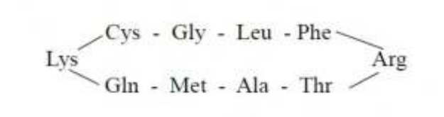

**Answer: 4 (Cyclic peptide shown below)**

> **Explanation:** Aminopeptidase M and carboxypeptidases A+B release no fragments, so the peptide has **no free N- or C-terminus** — it must be cyclic. Trypsin cleaves after Lys and Arg, giving the two ordered fragments Cys-Gly-Leu-Phe-Arg and Thr-Ala-Met-Gln-Lys; joining Lys→Cys and Arg→Thr closes the ring in the order shown in option 4 (Glx accounted for as Gln).

---

### Question 73

Consumption of untreated corn as the staple food causes the disease, pellagra. Pre-treatment of corn with Ca(OH)₂ prevents this disease. Given below are options listing possible effects of Ca(OH)₂ treatment (Column X) and the enzymes affected (Column Y).

| Column X — Possible effects of Ca(OH)₂ treatment | Column Y — Enzyme/s affected |
|---|---|
| A. Release of Vitamin B3 upon Ca(OH)₂ treatment | i. Activity of trypsin |
| B. Alkaline pH aids in digestion. | ii. Enzymes of the TCA cycle |
| C. Ca improves bone strength | iii. Activity of NAD-dependent dehydrogenases |
| D. Prevents formation of ROS | iv. Activity of cathepsin K |

Select the correct match relevant for preventing pellagra from the options listed below.

1. C - iv
2. B - i
3. A – iii
4. D - ii

**Answer: 3 (A – iii)**

> **Explanation:** Pellagra is caused by niacin (Vitamin B3) deficiency. Alkali (Ca(OH)₂) treatment of corn hydrolyses niacytin and **releases bound niacin (A)**, which is used to make NAD⁺/NADP⁺, the cofactors of the **NAD-dependent dehydrogenases (iii)** — the match directly relevant to preventing pellagra is A–iii.

---

### Question 74

Aspartate (Asp) is an amino acid with the structure NH₂-CH(CH₂-COOH)-COOH. Given below are biosynthetic processes occurring in cells:

A. protein synthesis
B. *de novo* synthesis of inosine monophosphate and orotic acid
C. synthesis of adenosine monophosphate from inosine monophosphate
D. glutathione synthesis

Which one of the following options correctly represents all the biosynthetic process(es) wherein Asp is involved as a precursor?

1. A only
2. A, C and D
3. A and C only
4. A, B and C

**Answer: 4 (A, B and C)**

> **Explanation:** Aspartate is a protein building block (A); it donates atoms to the purine ring (IMP) and is the substrate for orotic-acid (pyrimidine) synthesis (B); and in the AMP branch Asp provides the amino group to IMP via adenylosuccinate (C). Glutathione is γ-Glu-Cys-Gly and contains no aspartate (D). So **A, B and C**.

---

### Question 75

The following statements are made regarding conversion of pyruvate to acetyl-CoA going from glycolysis to citric acid cycle:

A. Oxidation of pyruvate to acetyl-CoA is reversible.
B. Pyruvate is transported into the mitochondrion by a transporter.
C. Pyruvate is carboxylated by pyruvate dehydrogenase.
D. Acetyl lipoamide reacts with coenzyme A to form acetyl-CoA.
E. The flavoprotein, dihydrolipoyl dehydrogenase, containing flavin adenine dinucleotide (FAD), is involved in conversion of pyruvate to acetyl-CoA.

Which one of the following options represents the combination of all correct statements?

1. A, B and C
2. B, C and D
3. C, D and E
4. B, D and E

**Answer: 4 (B, D and E)**

> **Explanation:** The pyruvate dehydrogenase reaction is an irreversible oxidative **decarboxylation** (not carboxylation), so A and C are wrong. Pyruvate enters mitochondria via a transporter (MPC) (B); the acetyl group on lipoamide is transferred to CoA by E2 forming acetyl-CoA (D); and E3, the FAD-containing flavoprotein dihydrolipoyl dehydrogenase, regenerates the oxidised lipoamide (E). Correct set: **B, D and E**.

---

### Question 76

Some properties of enzymes are listed in column X, and their kinetic expressions are listed in column Y.

| Column X — Enzyme properties | Column Y — Expressions |
|---|---|
| A. Specific activity | i. k_cat/K_m |
| B. Turnover number | ii. substrate concentration at which v = (V_max)/2 |
| C. Michaelis constant | iii. V_max/moles of enzyme |
| D. Catalytic efficiency | iv. V_max/protein concentration |

Which one of the following options represents all correct matches between Column X and Column Y?

1. A - ii, B - i, C - iii, D - iv
2. A - iii, B - ii, C - iv, D - i
3. A - iv, B - iii, C - ii, D - i
4. A - i, B - iv, C - ii, D - iii

**Answer: 3 (A - iv, B - iii, C - ii, D - i)**

> **Explanation:** Specific activity = V_max per mg **protein** (iv); turnover number k_cat = V_max per **moles of enzyme** (iii); Michaelis constant = substrate concentration at v = V_max/2 (ii); catalytic efficiency = k_cat/K_m (i). Hence **A–iv, B–iii, C–ii, D–i**.

---

### Question 77

A researcher isolated chromatin from mammalian cells and digested with micrococcal nuclease in different tubes for 1 h, 3 h, 6 h, and 12 h. Thereafter, DNA was purified from all the digested chromatin samples, and two independent Southern blot hybridization experiments were performed with probe-I and probe-II. The probe-I and probe-II correspond to different loci of the chromosome(s). The images below represent the Southern blot hybridization pattern generated by probe-I and probe-II.

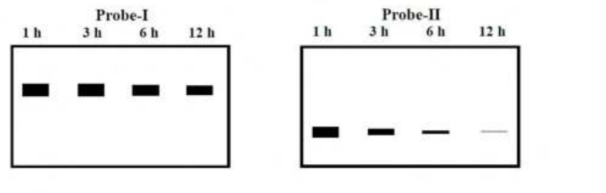

Following statements were made to explain the results of the Southern blot experiments.

A. Size of probe-II is smaller than probe-I.
B. Probe-I may correspond to the centromeric region of the chromosome.
C. Probe-I may correspond to a hypomethylated locus of the genome.
D. Probe-II may correspond to an euchromatic locus of the genome.

Which one of the following options represents the combination of all correct statements?

1. A and C
2. B and D
3. A only
4. B only

**Answer: 2 (B and D)**

> **Explanation:** Micrococcal nuclease digests **linker/euchromatic** DNA first. Probe-I's signal persists unchanged at all digestion times → it marks nuclease-resistant heterochromatin such as the **centromeric region (B)**. Probe-II's signal is progressively degraded → it marks **euchromatin (D)**. Band persistence reflects chromatin state, not probe size (A wrong), and heterochromatin (probe-I) is typically hyper-, not hypo-, methylated (C wrong).

---

### Question 78

The following statements were made about the structure of the 30-nm chromatin fiber:

A. In the solenoid model, the linker DNA connects the consecutive core particles.
B. In the zig-zag model, alternating nucleosomes become interacting neighbors.
C. In the solenoid model, 12 nucleosomes are organized into two separate stacks, whereas 8 nucleosomes per turn make a single stack in the zig-zag model.
D. H1 histone is essentially required as per the zig-zag model, but not as per the solenoid model.
E. Chromatin fibers prepared with H4 histones that lack their tails could fold into higher-order fibers.

Which one of the following options represents the combination of all correct statements?

1. A, C and D
2. A, B and E
3. A and B only
4. C and E only

**Answer: 3 (A and B only)**

> **Explanation:** A and B are the standard descriptions of the two models: solenoid = one-start helix with linker DNA joining consecutive nucleosomes; zig-zag (two-start) = alternating nucleosomes from opposite faces interact. C reverses the models' features; D is wrong (H1 is required in both); E is wrong — H4 tail (especially K16 acetylation/arginine contacts with the H2 acidic patch of the neighbouring nucleosome) is needed for folding, and tailless H4 impairs it. Hence **A and B only**.

---

### Question 79

The following statements were made about cell cycle regulation in fission yeast:

A. A *cdc25* mutant cannot enter mitosis due to its inability to remove the inhibitory phosphate.
B. Wee1 consistently maintains the Cdk in an active state, to maintain cell size during cell cycle.
C. CAK (Cdk-activating kinase)-mediated phosphorylation of Threonine 161 residue of Cdc2 is necessary, but not sufficient, for the Cdk to be active.
D. Activation of Sic1 in G1 allows the cyclin–Cdk that is present in the cell to initiate DNA replication.
E. *sic1* mutant exhibits activation of premature DNA replication from fewer origins and extension of the duration of S phase.

Which one of the following options represents the combination of all correct statements?

1. A, B and D
2. A, C and E
3. B, D and E
4. A, C and D

**Answer: 2 (A, C and E)**

> **Explanation:** A is correct — Cdc25 phosphatase removes the inhibitory Tyr15 phosphate; without it Cdk1 stays inactive and mitosis is blocked. B is wrong — Wee1 *inactivates* Cdk by inhibitory phosphorylation (wee1 loss gives small "wee" cells). C is correct — Thr161 (CAK) phosphorylation is necessary but full activation also requires removal of Tyr15. D is wrong — Sic1 is a Cdk *inhibitor*; its destruction (not activation) at the G1/S transition permits replication. E follows from Sic1 loss — premature, poorly-licensed S phase. Correct: **A, C and E**.

---

### Question 80

In the context of signaling, the enzyme protein kinase C (PKC) depends on multiple molecules for its complete activation. This activation depends on the presence of:

A. phosphatidylserine at the inner leaflet of the plasma membrane.
B. Ca²⁺
C. phosphatidylethanolamine at the inner leaflet of the plasma membrane.
D. diacylglycerol present in the inner leaflet of the plasma membrane.

Which one of the following options represents the combination of all correct molecules?

1. A, B and C
2. A, C and D
3. B, C and D
4. A, B and D

**Answer: 4 (A, B and D)**

> **Explanation:** Classical (conventional) PKC is activated at the membrane by **Ca²⁺**, **diacylglycerol (DAG)** and the anionic phospholipid **phosphatidylserine** in the cytosolic leaflet. Phosphatidylethanolamine is not one of the required activator lipids. Hence **A, B and D**.

---

### Question 81

Match the eukaryotic cellular organelles listed in Column X with their typical function from among those listed in Column Y.

| Column X — Organelles | Column Y — Function |
|---|---|
| A. Golgi | (i) Ribosomes assembly |
| B. Nucleolus | (ii) O-linked Glycosylation |
| C. Peroxisomes | (iii) Site for lipid synthesis |
| D. ER | (iv) Oxygen utilization |

Which one of the following options represents all correct matches between Column X and Column Y?

1. A-(iii), B-(iv), C-(ii), D-(i)
2. A-(ii), B-(i), C-(iv), D-(iii)
3. A-(ii), B-(iii), C-(i), D-(iv)
4. A-(iii), B-(i), C-(iv), D-(ii)

**Answer: 2 (A-(ii), B-(i), C-(iv), D-(iii))**

> **Explanation:** Golgi performs **O-linked glycosylation (ii)**; the **nucleolus** is the site of **ribosome assembly (i)**; **peroxisomes** carry out oxidative reactions that consume **oxygen ((iv), via oxidases + catalase)**; the **ER** is the main **site for lipid synthesis (iii)**. Hence A-ii, B-i, C-iv, D-iii.

---

### Question 82

In eukaryotes, microtubules and actin-binding proteins influence the dynamics and organization of the cytoskeleton. Match the cytoskeleton-binding proteins listed in column B, to actin or microtubule mentioned in Column A, and their function from those listed in Column C.

| Column A | Column B | Column C |
|---|---|---|
| X. microtubule | (i) ketenin | (a) filament cross-linking |
| Y. actin | (ii) tropomodulin | (b) severs filaments and binds to plus end |
| | (iii) tau | (c) prevents assembly and disassembly at minus end |
| | (iv) gelsolin | (d) only severs filament |

Which one of the following options represents all the correct matches between columns A, B and C?

1. X-(iv)-(c), X-(iii)-(b), Y-(i)-(a), Y-(ii)-(d)
2. X-(ii)-(a), X-(i)-(c), Y-(iv)-(c), Y-(iii)-(b)
3. X-(iii)-(a), X-(i)-(d), Y-(ii)-(c), Y-(iv)-(b)
4. X-(i)-(d), X-(iv)-(a), Y-(iii)-(d), Y-(ii)-(c)

**Answer: 3 (X-(iii)-(a), X-(i)-(d), Y-(ii)-(c), Y-(iv)-(b))**

> **Explanation:** **Tau** binds and **cross-links microtubules (X-iii-a)**; **"ketenin" (katanin)** is a microtubule-**severing** protein that only severs MTs (X-i-d); **tropomodulin** caps actin **minus ends**, preventing assembly/disassembly (Y-ii-c); **gelsolin** severs actin filaments and caps (binds) the **plus end** (Y-iv-b). Hence option 3.

---

### Question 83

The following statements are made about the *E. coli* SOS response to DNA damage:

A. RecA-DNA filament complex stimulates the autoproteolytic activity of the LexA repressor.
B. RecA is activated due to the blunt ends of double-strand breaks caused by DNA damage-inducing agents.
C. The SOS response includes the activation of synthesis of translesion polymerases.
D. The destruction of LexA promotes synthesis of photolyase, which acts along with RecA to reverse the pyrimidine dimer formation process.

Which one of the following options represents the combination of all correct statements?

1. A and D
2. B and D
3. A and C
4. C and D

**Answer: 3 (A and C)**

> **Explanation:** Activated RecA (co-protease) stimulates **LexA autoproteolysis (A)**, de-repressing SOS genes including the translesion polymerases UmuC/D (DNA Pol V) and Pol IV **(C)**. B is wrong — RecA is activated by **single-stranded DNA** gaps, not blunt ends. D is wrong — photolyase reverses pyrimidine dimers by **light (photoreactivation)** and is not part of the LexA-regulated SOS induction acting "along with RecA".

---

### Question 84

The following statements are made about telomeres:

A. Telomere-binding proteins (TBPs) are believed to shield telomeres from the cell's DNA repair machinery, preventing them from being recognized as double-strand breaks.
B. Telomeres in human cells are repeats of TTAGGG sequence that can extend upto 150 kb, which are replicated by the action of TERT in actively dividing cells.
C. In differentiated cells, telomerase is inactive, leading to shortening of telomeres over hundreds of cell divisions, damage to ends of chromosomes, and eventually apoptosis.
D. The persistence of telomerase activity in several cancers allows the cells to continue to proliferate.

Which one of the following options represents the combination of all correct statements?

1. A and C only
2. A, B and C
3. B and D only
4. A, C and D

**Answer: 4 (A, C and D)**

> **Explanation:** A, C and D are textbook facts: TBPs (shelterin) protect chromosome ends from being seen as DSBs; telomerase is silent in most differentiated cells so telomeres shorten and cells senesce/apoptose; re-activated telomerase lets cancer cells proliferate. B is wrong because human telomeres are typically **5–15 kb**, not "upto 150 kb". Hence **A, C and D**.

---

### Question 85

The LacI and TrpR repressors bind with their ligands allolactose and tryptophan respectively, resulting in alteration of their DNA binding properties. The following statements are made about the mechanism of LacI and TrpR binding with DNA (operator) and regulation of gene expression in *E. coli*.

A. Allolactose binding to LacI leads to its poor binding to the *lac* operator whereas tryptophan binding to TrpR leads to its better binding to the *tp* operator.
B. Allolactose binding to LacI leads to induction of *lac* operon, whereas tryptophan binding to TrpR leads to repression of *tp* operon.
C. Binding of allolactose and tryptophan to LacI and TrpR respectively, leads to repression of their corresponding operons.
D. Binding of allolactose and tryptophan to LacI and TrpR respectively, leads to activation of their corresponding operons.  However, in *tp* operon regulation, availability of tryptophan also results in attenuation-mediated transcriptional termination leading to an overall effect of repression of *tp* operon.

Which one of the following options represents a combination of all correct statements?

1. A and B only
2. B and C
3. C and D
4. A, B and D

**Answer: 1 (A and B only)**

> **Explanation:** Allolactose is an **inducer**: it makes LacI bind the operator poorly, de-repressing *lac* (A, B correct). Tryptophan is a **corepressor**: it makes TrpR bind the operator better, repressing *trp* (A, B correct). C is wrong (allolactose causes induction, not repression); D is wrong (TrpR–Trp represses, and the attenuation statement is bundled with the incorrect "activation" claim). Hence **A and B only**.

---

### Question 86

Bacteriophage λ and P1 are both temperate phages. Which one of the following statements made about these phages and their lytic and lysogeny cycles in *E. coli* is **INCORRECT**?

1. Both the λ and P1 phages are double stranded DNA viruses.
2. In their lysogenic states in *E. coli*, while the λ phage integrates into the genome, the P1 phage remains as a low copy number plasmid.
3. In their lysogenic states, both the λ and the P1 phages are integrated into the genome in *E. coli*.
4. In their lytic cycles, both the phages occur in plasmid forms in *E. coli*.

**Answer: 3 (In their lysogenic states, both the λ and the P1 phages are integrated into the genome in E. coli.)**

> **Explanation:** λ maintains lysogeny by **site-specific integration** into the *E. coli* chromosome, whereas prophage P1 persists as an independent, **low-copy-number plasmid**. The statement that *both* integrate (option 3) is therefore the INCORRECT one; both are dsDNA phages (1), and during lytic growth λ replicates as a concatemeric/plasmid-like molecule and P1 replicates as a plasmid (2 and 4 consistent with standard descriptions).

---

### Question 87

The following statements refer to factors regulating the fidelity of DNA replication.

A. The 5' to 3' exonuclease activity of the replicative DNA polymerase.
B. Imbalanced intracellular concentrations of the four dNTPs.
C. Increased intracellular concentrations of rNTPs resulting in increased incorporation of rNTPs during DNA synthesis, which are not easily removed by the polymerase's proof-reading activity.
D. Removal of incorrectly incorporated nucleotides by the mismatch repair system.

Which one of the following options gives the combination of all correct statements?

1. A and D only
2. B, C and D
3. B and C only
4. A, B and D

**Answer: 2 (B, C and D)**

> **Explanation:** Replication fidelity depends on base selection (disturbed by **imbalanced dNTP pools**, B), on rNTP misincorporation that proofreading cannot efficiently correct (C), and on post-replicative **mismatch repair** (D). Statement A is wrong: the replicative polymerase's proofreading activity is its **3'→5'** exonuclease; a 5'→3' exonuclease is not a fidelity mechanism of the replicative enzyme. Hence **B, C and D**.

---

### Question 88

Which one of the following statements is correct in the context of erythromycin-mediated inhibition of protein synthesis in bacteria?

1. Erythromycin inhibits protein synthesis at the step of elongation, but it nonetheless allows translation of the first few codons.
2. Erythromycin inhibits protein synthesis at the step of elongation, and it prevents formation of even the first peptide bond.
3. Erythromycin inhibits formation of the translation initiation complex.
4. Erythromycin is toxic to bacteria because it results in initiation of protein synthesis with elongator tRNAs.

**Answer: 1 (Erythromycin inhibits protein synthesis at the step of elongation, but it nonetheless allows translation of the first few codons.)**

> **Explanation:** Erythromycin (a macrolide) binds the 23S rRNA of the **50S** subunit inside the peptide-exit tunnel and blocks **translocation/elongation**. Initiation is unaffected and the first one or two peptide bonds can still form before the ribosome stalls, so option 1 is correct. It does not block formation of the first peptide bond (2), nor initiation-complex assembly (3), and it does not cause initiation with elongator tRNAs (4).

---

### Question 89

Following statements are made regarding the roles of complement components in immunity:

A. Binding of complement components to antigen presenting cells decreases their phagocytic ability and modulates cytokine secretion.
B. Complement components enhance the B cell-mediated immune response by increasing the avidity with which a B cell binds to a complement-bound antigen.
C. Immature T cells are protected from the natural antibody and complement-mediated lysis by provision of additional sialic acid residues on their cell surface glycoproteins.
D. Binding of C3a, C5a and C3b to their respective receptors on mature T cells inhibits their growth, differentiation, and survival.
E. During the contraction phase of the immune response, excess lymphocytes that were made during antigen-induced expansion are eliminated by apoptosis, with the help of C1q complement component.

Which of the following options represents the combination of all correct statements:

1. A, B and C
2. A, C and D
3. B, C and E
4. B, D and E

**Answer: 3 (B, C and E)**

> **Explanation:** Complement **enhances** B-cell activation (C3d–CR2/CD21 lowers the threshold and raises effective avidity, B); sialic acid on cell surfaces recruits factor H to keep alternative-pathway activation off self, protecting immature T cells from natural-antibody/complement lysis (C); and C1q contributes to clearance of lymphocytes during contraction (E). A is wrong because complement opsonisation **increases**, not decreases, phagocytosis; D is wrong because C3a/C5a on mature T cells support rather than inhibit growth and survival. Hence **B, C and E**.

---

### Question 90

Some ligands/stimuli that operate through G protein-coupled receptors (GPCRs) are listed in column X, and the most common effectors through which they act are listed in column Y.

| Column X — Ligands/stimuli | Column Y — Effectors |
|---|---|
| A. Serotonin | i. Phospholipase C |
| B. Acetylcholine | ii. cGMP phosphodiesterase |
| C. IgE-antigen complexes | iii. Adenylyl cyclase |
| D. Light | iv. Potassium channel/Adenylyl cyclase |

Which one of the following options represents all correct matches between Column X and Column Y?

1. A- i; B- ii; C- iii; D- iv
2. A- ii; B- iii; C- iv; D- i
3. A- iii; B- iv; C- i; D- ii
4. A- iv; B- i; C- ii; D- iii

**Answer: 3 (A- iii; B- iv; C- i; D- ii)**

> **Explanation:** Serotonin receptors commonly signal through **Gs/Gi–adenylyl cyclase (iii)**; muscarinic acetylcholine (M2) opens **GIRK K⁺ channels and modulates adenylyl cyclase (iv)**; IgE–antigen complexes trigger **phospholipase C (i)**; and light (rhodopsin → transducin) activates **cGMP phosphodiesterase (ii)**. Hence A-iii, B-iv, C-i, D-ii.

---

### Question 91

The cycling of monomeric G proteins, such as Ras, between active and inactive states is aided by accessory proteins that bind to the G protein and regulate its activity. These accessory proteins include GTPase-activating proteins (GAPs) and guanine nucleotide-exchange factors (GEFs). The following conditions refer to different states of GAP and GEF proteins:

A. A non-functional GAP
B. A permanently activated GAP
C. A non-functional GEF
D. A permanently activated GEF

Which one of the following options represents conditions/states that might cause a constantly activated signaling cascade?

1. A and B
2. B and C
3. C and D
4. A and D

**Answer: 4 (A and D)**

> **Explanation:** Ras is active when GTP-bound. A **GAP** accelerates GTP hydrolysis (turning Ras off), so a **non-functional GAP (A)** leaves Ras loaded with GTP → constant signalling. A **GEF** promotes GDP release/GTP loading (turning Ras on), so a **permanently activated GEF (D)** drives continuous activation. Conversely, an over-active GAP (B) or a dead GEF (C) would dampen the cascade. Hence **A and D**.

---

### Question 92

The following patterns of gene expression were obtained after activating Notch1 receptor with two different ligands DII1, and DII4.

Which one of the following statements depicts the correct interpretation of observations?

1. The Notch pathway ligands DII1 and DII4 both bind to the Notch1 receptor but activate different downstream effectors with similar dynamics.
2. DII1 induces sustained responses, which preferentially activate the transcriptional target Hes1.
3. Dll4 induces pulsatile responses in response to NICD, which are required for activating Hey1.
4. The Notch pathway ligands DII1 and DII4 both bind to the Notch1 receptor but activate the downstream effector NICD with different dynamics.

**Answer: 4 (The Notch pathway ligands DII1 and DII4 both bind to the Notch1 receptor but activate the downstream effector NICD with different dynamics.)**

> **Explanation:** Both Delta-like ligands engage the **same receptor (Notch1)** and the **same effector, NICD**; what differs is the **dynamics of NICD activity** — DII1 gives oscillatory/pulsatile NICD activity while DII4 gives a sustained one. Option 4 states exactly this. Options 2 and 3 invert the dynamics, and option 1 wrongly claims the effectors differ and the dynamics are similar.

---

### Question 93

ERK5 is a MAP kinase that is activated upon phosphorylation by MEK5. MEK5 binds with MEKK2 when co-expressed. HEK293 cells were transfected with plasmid encoding ERK5, along with plasmids encoding either MEK5 alone, or MEKK2 alone, or both MEKK2 and MEK5, or both MEKK2 and MEK5AA (MEK5 mutant). Lysates of transfected cells were analysed by Western blotting using anti-ERK5 antibody as shown below:

From the data in the figure above, the following conclusions were drawn:

A. Full activation of ERK5 requires both MEKK2 and MEK5.
B. Phosphorylation with MEKK2 alone suggests that it can activate ERK5 without MEK5.
C. Difference in the levels of phosphorylation with MEKK2 alone and MEKK2 + MEK5 is due to more phosphorylation at the same site.
D. Phosphorylation with only MEKK2 transfection suggests that it might be associating with endogenous MEK5 to get partially activated, leading to ERK5 phosphorylation to some extent.
E. MEK5AA might be a dominant-negative mutant of MEK5 which prevents signalling through active, endogenous MEK5.

Which of the following options represents the combination of all correct statements?

1. A, B and C
2. B, C and E
3. C, D and E
4. A, D and E

**Answer: 4 (A, D and E)**

> **Explanation:** Only the MEKK2+MEK5 lane gives the strong phospho-ERK5 shift, so **full activation needs both (A)**. The weak signal with MEKK2 alone is best explained by MEKK2 recruiting **endogenous MEK5** for partial activation **(D)** — not by MEKK2 itself being the ERK5 kinase (B wrong). MEK5AA (the Ala/Ala activation-motif mutant) added to MEKK2 abolishes even that partial signal, consistent with a **dominant-negative** that displaces endogenous active MEK5 (E). C is unsupported: the extra phosphorylation with MEK5 present is not shown to be at the same site. Hence **A, D and E**.

---

### Question 94

The recognized family of PR proteins in plants and their activities are listed in columns X and Y, respectively.

| Column X — Proteins | Column Y — Activities |
|---|---|
| A. PR2 | i. β-1,3-glucanase |
| B. PR3 | ii. chitinase |
| C. PR6 | iii. proteinase inhibitor |
| D. PR10 | iv. ribonuclease-like |

Which one of the following options represents all correct matches between Column X and Column Y?

1. A-i, B-iii, C-iv, D-ii
2. A-i, B-ii, C-iii, D-iv
3. A-iii, B-iv, C-i, D-ii
4. A-iv, B-i, C-ii, D-iii

**Answer: 2 (A-i, B-ii, C-iii, D-iv)**

> **Explanation:** PR2 = **β-1,3-glucanase**, PR3 = **chitinase** (the class-VII chitinases), PR6 = **proteinase inhibitor**, and PR10 = **ribonuclease-like** (Bet v 1-family, PR-10 proteins have RNase-like activity). Hence the straight one-to-one matching A-i, B-ii, C-iii, D-iv.

---

### Question 95

Following statements are made regarding animal development:

A. The cell is first specified towards a given fate, suggesting that it would develop into this cell type, even in a neutral environment.
B. Holoblastic rotational cleavage is observed in tunicates.
C. Infolding of sheet of cells is called ingression.
D. Conditional specification can be observed in sea urchin embryos.

Which one of the following options represents the combination of all correct statements?

1. A and B
2. B and C
3. A and D
4. C and D

**Answer: 3 (A and D)**

> **Explanation:** A is the definition of **specification** (autonomous development in a neutral environment), and D is correct — sea urchin embryos are the classic example of **conditional (regulative) specification**. B is wrong: holoblastic **rotational** cleavage is characteristic of **mammals** (tunicates show holoblastic bilateral/mosaic cleavage). C is wrong: infolding of a **sheet** of cells is **invagination**; ingression is the individual migration of cells into the embryo. Hence **A and D**.

---

### Question 96

Transforming the neural plate into a neural tube is an important event towards the formation of central nervous system, in which the following sub-events might take place:

A. In primary neurulation, the cells surrounding the neural plate direct the neural plate cells to proliferate, invaginate and separate from the surface ectoderm to form a hollow tube.
B. In secondary neurulation, the neural tube does not arise from the aggregation of mesenchyme cells into a solid cord.
C. The morphogen, Sonic hedgehog, that is expressed in notochord, is required for induction of floor plate cells in the neural plate to form the medial hinge point.
D. In mammals, secondary neurulation begins at the level of sacral vertebrae.
E. In mammals, the primary neurulation forms brain regions while the secondary neurulation takes care of forming rest of the central nervous system from neck to tail.

Which one of the following options represents the combination of all correct statements?

1. A, C and D
2. A, B and E
3. B, C and D
4. C, D and E

**Answer: 1 (A, C and D)**

> **Explanation:** A, C and D are correct descriptions: primary neurulation folds the plate into a hollow tube; **Shh from the notochord induces the floor plate / medial hinge point**; and secondary neurulation (of the tail bud) operates from about the **sacral level** downwards. B is wrong — secondary neurulation *does* proceed by condensation of mesenchyme into a solid cord that then cavitates. E is wrong — primary neurulation forms the CNS down to the upper sacral level, not just the brain. Hence **A, C and D**.

---

### Question 97

The following statements are made regarding the amphibian early-embryonic development:

A. The Nieuwkoop center cells are mesodermal in origin.
B. Chordin, Noggin and Goosecoid are secreted by the Organizer.
C. The default fate of the ectoderm is to become neural tissue.
D. BMP levels are high in the presumptive dorsal mesoderm.

Which one of the following options represents the combination of all correct statements?

1. A, B and C
2. C and D
3. B and C only
4. A and D

**Answer: 3 (B and C only)**

> **Explanation:** The **organizer** (dorsal lip) secretes the BMP/TGF-β antagonists **chordin, noggin and (the transcription factor) goosecoid (B)**, and in the absence of inductive signals the **ectoderm defaults to neural (C)**. A is wrong — the Nieuwkoop center is **endodermal/vegetal** in origin, not mesodermal. D is wrong — BMP signalling is **suppressed** in the presumptive dorsal mesoderm by the organizer factors. Hence **B and C only**.

---

### Question 98

The following figure represents the interaction between different blastomeres in a 4-cell stage of *C. elegans* embryo:

The following statements were made regarding the above:

A. The fate of EMS blastomere is autonomously specified.
B. The default fate of EMS blastomere is MS cell lineage.
C. Conditional specification can be observed in the development of E cell lineage.
D. Assuming that a receptor needs to be activated for E fate, a *C. elegans* embryo where the receptor is constitutively active, is likely to develop cells of E fate only, in all three of the above cases.

Which one of the following options represents the combination of all correct statements?

1. A and C only
2. B and C only
3. A, B and C
4. B, C and D

**Answer: 4 (B, C and D)**

> **Explanation:** EMS only makes E when it contacts P2 (Wnt/GAP-35 → receptor signalling), so its **default fate is MS (B)** and the E lineage is specified **conditionally (C)**. A is wrong — EMS is *not* autonomously specified, since removing P2 abolishes E. D is right under the stated assumption: a constitutively active E-fate receptor would drive E in all three configurations regardless of P2. Hence **B, C and D**.

---

### Question 99

Following statements were made regarding regeneration in different organisms:

A. The regenerating blastema cells in amphibians retain their specification even when they dedifferentiate.
B. A transgenic Hydra when made to misexpress *β-catenin* will show numerous ectopic tentacles.
C. In Planaria, if the Wnt pathway is activated, then the posterior blastema would regenerate a head.
D. A regenerating blastema is formed in the mammalian liver.

Which one of the following options represents all correct statement(s)?

1. A only
2. C only
3. B and C
4. C and D

**Answer: 1 (A only)**

> **Explanation:** A is correct — amphibian blastema cells **retain positional memory (specification)** even after dedifferentiation. B is wrong: β-catenin misexpression in *Hydra* produces **ectopic heads/body axis**, not numerous ectopic tentacles. C is wrong: activated Wnt signalling makes the **anterior regenerate a tail** (posteriorising); it is *inhibition* of Wnt/β-catenin that converts a posterior blastema into a head. D is wrong: mammalian liver regenerates by **compensatory (dedifferentiation/proliferation of hepatocytes) regeneration without a blastema**. Hence **A only**.

---

### Question 100

Genetic screens for mutants affecting development of leaf trichomes have led to the discovery of genes regulating trichome patterning - especially trichome density and spacing, as depicted in the figure below.

![Two adjacent leaf-epidermal cells. The left cell bears a trichome and contains the GL1–GL3–TTG1 complex, which activates GL2 and TRY; JA signals through JAZ to relieve GL1. TRY protein is shown moving by a dashed arrow into the right (neighbouring) cell, where it forms a TRY–GL3–TTG1 complex and GL1 sits alone, so that cell does not become a trichome. Labels: Trichome, Leaf epidermis, JA, JAZ, GL1, GL3, TTG1, GL2, TRY, Trichome cell differentiation. Source line: from Taiz et al., Plant Physiology and Development, 6th edition](images/C/fig100.png)

The following statements are made in this regard:

A. *GLABRA1* (*GL1*) mutant plant will show fewer or no trichomes.
B. Cells that form trichomes strongly express the *GLABRA2* (*GL2*) and *TRYPTICON* (*TRY*) genes.
C. TRY protein acts as a positive regulator of trichome cell differentiation in the surrounding cells.
D. Addition of exogenous JA will reduce the number of leaf trichomes.

Which one of the following options represents the combination of all correct statements?

1. A and B
2. B and C
3. C and D
4. A and D

**Answer: 1 (A and B)**

> **Explanation:** The GL1–GL3–TTG1 complex is required to drive trichome fate, so a *gl1* mutant has **fewer/no trichomes (A)**; the trichome-forming cell is exactly the one in which GL2 and TRY are transcriptionally induced **(B)**. C is wrong — TRY is the **negative** regulator that moves into neighbouring cells to suppress trichome fate there (lateral inhibition). D is wrong — jasmonate **promotes** trichome formation (JA relieves JAZ repression of GL1), so exogenous JA increases trichome density. Hence **A and B**.

---

### Question 101

Given below are the list of abiotic environmental factors (Column X) and their primary effects (Column Y) in plants:

| Column X — Factors | Column Y — Effects |
|---|---|
| A. Water deficit | (i) Ion cytotoxicity |
| B. Salinity | (ii) Hypoxia to the roots |
| C. Flooding | (iii) Photoinhibition |
| D. High light intensity | (iv) Water potential reduction |

Which one of the following options represents all correct matches?

1. A (i), B (ii), C (iii), D (iv)
2. A (iv), B (i), C (ii), D (iii)
3. A (ii), B (i), C (iv), D (iii)
4. A (iv), B (iii), C (ii), D (i)

**Answer: 2 (A (iv), B (i), C (ii), D (iii))**

> **Explanation:** Water deficit **lowers water potential (iv)**; salinity causes **ion (Na⁺/Cl⁻) cytotoxicity (i)**; flooding waterlogs soil and produces **root hypoxia (ii)**; excess light drives **photoinhibition (iii)**. Hence A-iv, B-i, C-ii, D-iii.

---

### Question 102

The following are certain statements regarding the PSII electron carrier during the light reaction of photosynthesis:

A. The first electron released from reaction centre P680 is transferred to Q_A to produce a plastosemiquinone.
B. Q_A is the mobile plastoquinone.
C. The first electron transferred from Q_A to Q_B converts Q_B into plastosemiquinone.
D. Q_B is tightly bound to the complex and is not mobile.

Which one of the following options represents the correct statement(s)?

1. A and B
2. B and D
3. A only
4. C only

**Answer: 3 (A only)**

> **Explanation:** The primary quinone **Q_A is tightly bound** and, on accepting the first electron from P680*, becomes the **plastosemiquinone** radical (A correct). B and D invert the two sites: it is **Q_B that is the mobile plastoquinone** which, after two turnovers (two electrons plus proton uptake), leaves the membrane as plastoquinol. C is therefore also wrong, since Q_B's first electron does not produce a stable semiquinone in the way described. Hence **A only**.

---

### Question 103

The following statements are made regarding the nitrogenase enzyme involved in the reduction of atmospheric nitrogen to ammonia:

A. Nitrogenase enzyme is composed of two components: dinitrogenase and dinitrogenase reductase.
B. MoFe protein component is a homodimer.
C. Fe protein component is dinitrogenase.
D. MoFe protein contains the active site metal cluster where N₂ binds.
E. Fe protein delivers electron to MoFe protein component in a reaction coupled to the hydrolysis of MgATP.

Which one of the following options represents the combination of all correct statements?

1. A, B and D
2. B and C only
3. C, D and E
4. A, D and E

**Answer: 4 (A, D and E)**

> **Explanation:** Nitrogenase is a two-component system: the **MoFe protein = dinitrogenase** (which carries the FeMo-cofactor active site where N₂ binds, D) and the **Fe protein = dinitrogenase reductase** (which donates electrons to the MoFe protein coupled to **MgATP hydrolysis**, E). A is the correct overall description. B is wrong (the MoFe protein is an **α₂β₂ heterotetramer**, not a homodimer) and C is wrong (the Fe protein is the **reductase**, not dinitrogenase). Hence **A, D and E**.

---

### Question 104

Sucrose-phosphate synthase (SPS) and sucrose-phosphate phosphatase (SPP) are two key enzymes involved in the biosynthesis of sucrose. Following are certain statements regarding these two enzymes:

A. Fructose-6-phosphate is one of the substrates of SPS enzyme.
B. Fructose-6-phosphate and UDP-glucose are the substrates of SPP enzyme.
C. Sucrose is the final product of SPP enzyme.
D. UDP is one of the products of SPS enzyme while Pi is one of the products of SPP enzyme.

Which one of the following options represents the combination of all correct statements?

1. A, B and C
2. A, B and D
3. A, C and D
4. B, C and D

**Answer: 3 (A, C and D)**

> **Explanation:** **SPS** condenses **UDP-glucose + fructose-6-phosphate → sucrose-6-phosphate + UDP** (so A and the UDP part of D are correct). **SPP** then hydrolyses **sucrose-6-phosphate → sucrose + Pi** (so C and the Pi part of D are correct). B is wrong because UDP-glucose and fructose-6-phosphate are the substrates of **SPS**, not SPP. Hence **A, C and D**.

---

### Question 105

Rubisco enzyme is involved in both reductive and oxidative carbon cycles in plants. Following are certain statements regarding them:

A. Sugars are produced in both the cycles.
B. Ferredoxin is reduced only in oxidative carbon cycle.
C. Product of oxidative cycle is one of the substrates of reductive cycle.
D. NADP and ATP are used in both the cycles.

Which one of the following options represents the combination of all correct statements?

1. A and B
2. A and D
3. C and D
4. B and C

**Answer: 4 (B and C)**

> **Explanation:** In the **oxidative** cycle (photorespiration) the peroxisomal/mitochondrial steps feed glycolate-derived carbon back as **3-PGA, which is a substrate of the reductive cycle (C)**. Ferredoxin reduction is associated with the oxidative (photorespirative/glycate) side rather than the Calvin cycle **(B)**. A is wrong — the oxidative cycle **consumes** rather than produces sugar (it releases CO₂ and NH₃); D is wrong — the oxidative cycle does not use NADPH/ATP in the manner of the Calvin (reductive) cycle. Hence **B and C**.

---

### Question 106

Following statements are made regarding the plant natural product, terpenes.

A. Monoterpenes are five-carbon compounds.
B. The anti-malarial drug, artemisinin is a sesquiterpene.
C. Azadirachtin is a triterpene derivative from the seed oil of the Asian neem tree.
D. Taxol is a diterpene derivative used in cancer treatment.

Which one of the following options represents the combination of all correct statements?

1. A and B only
2. C and D only
3. A, B and D
4. B, C and D

**Answer: 4 (B, C and D)**

> **Explanation:** A is wrong — a **monoterpene is C₁₀ (two isoprene units)**; the five-carbon unit is the *hemiterpene*/isoprene itself. B is correct (artemisinin is a **sesquiterpene lactone**, C₁₅); C is correct (azadirachtin is a **C₃₁ tetranortriterpenoid** from neem seed oil); D is correct (Taxol/paclitaxel is a **taxane diterpenoid**, C₂₀, used in cancer therapy). Hence **B, C and D**.

---

### Question 107

The following statements are made below about hearing phenomena of sound waves:

A. The loudness of a sound is inversely correlated with the amplitude of a sound wave.
B. The loudness of a sound is directly correlated with the amplitude of a sound wave.
C. The pitch of a sound is directly correlated with the frequency of the sound wave.
D. The pitch of a sound is inversely correlated with the frequency of the sound wave.
E. The pitch of the average male voice in conversation is lower than that of the average female voice.
F. The pitch of the average male voice in conversation is higher than that of the average female voice.

Choose the combination of all correct statements:

1. A, C and E
2. B, D and F
3. B, C and E
4. A, D and F

**Answer: 3 (B, C and E)**

> **Explanation:** **Loudness rises with amplitude (B)** and **pitch rises with frequency (C)**. The average male voice (~85–180 Hz) is **lower in pitch** than the average female voice (~165–255 Hz) **(E)**. Their opposites A, D and F are wrong. Hence **B, C and E**.

---

### Question 108

Prolactin is an anterior pituitary hormone which is lactogenic and helps milk production in mammals. The statements below are made regarding the mechanism of action of prolactin:

A. The receptors that bind to prolactin lack intrinsic tyrosine kinase activity.
B. Upon prolactin binding, the receptors dimerize, and associated kinase is activated.
C. Prolactin binding to receptors leads to activation of its intrinsic kinase activity.
D. STAT plays a role in mediating prolactin action. It dimerizes after its phosphorylation to elicit the response.
E. There is no involvement of STAT in prolactin action mechanisms.

Which one of the following options represents the combination of all correct statements?

1. A, B and D
2. B, C and D
3. A and E only
4. C and E only

**Answer: 1 (A, B and D)**

> **Explanation:** The prolactin receptor is a **cytokine (class-I haematopoietic) receptor with no intrinsic tyrosine kinase (A)**; ligand binding drives **receptor dimerisation and activation of the associated JAK kinase (B)**, which phosphorylates **STAT** proteins that dimerise and enter the nucleus to elicit the response **(D)**. C is wrong (the receptor has no intrinsic kinase) and E is wrong (STAT/JAK is precisely the pathway). Hence **A, B and D**.

---

### Question 109

The following statements are made about digestion of proteins and the enzymes involved:

A. Chymotrypsin does not generate peptides with C-terminal neutral amino acids.
B. Trypsin generates peptides with C-terminal basic amino acids.
C. Carboxypeptidase B acts on aromatic amino acids.
D. Carboxypeptidase A employs zinc ion for hydrolysis.
E. The brush border enterokinase has no polysaccharides attached to it.
F. The final digestion to amino acids occurs in the intestinal lumen, the brush border, and the cytoplasm of the mucosal cells.

Which one of the following options represents the combination of all correct statements?

1. A, B and C
2. C, D and E
3. D, E and F
4. B, D and F

**Answer: 4 (B, D and F)**

> **Explanation:** **Trypsin** cleaves after Arg/Lys, so the peptides it makes carry a **C-terminal basic residue (B)**; **carboxypeptidase A is a zinc metalloprotease (D)**; and final digestion to amino acids occurs in the **lumen, at the brush border and within the mucosal cell cytoplasm (F)**. A is wrong — chymotrypsin prefers exactly the **aromatic/neutral bulky** residues; C is wrong — carboxypeptidase **B** acts on **basic** (Arg/Lys), not aromatic, residues; E is wrong — enterokinase is a membrane-bound **glycoprotein**. Hence **B, D and F**.

---

### Question 110

The following statements are made with reference to the neural connections of cardiac tissues and the functions of these nerves on heart in adult humans:

A. The right vagus nerve is distributed mainly to the AV node.
B. The parasympathetic pre-ganglionic fibers distributed to the heart originate from the superior salivatory nucleus.
C. The sympathetic post-ganglionic fibers originating from the paravertebral ganglia of the left side primarily innervate SA node.
D. The sympathetic fibers distributed to heart come mainly from stellate ganglia.
E. The sympathetic activity alters heart rate slower than that of vagal activity.

Which one of the following options represents the combination of all correct statements?

1. A and B
2. B and C
3. C and D
4. D and E

**Answer: 4 (D and E)**

> **Explanation:** Cardiac sympathetic outflow reaches the heart mainly via the **stellate (cervicothoracic) ganglia (D)**, and because noradrenaline acts through slower metabotropic (β₁/cAMP) mechanisms, the **sympathetic chronotropic response is slower than the fast muscarinic vagal response (E)**. A is wrong — the **right** vagus goes mainly to the **SA** node (left vagus to AV); B is wrong — cardiac pre-ganglionic parasympathetics arise from the **nucleus ambiguus/dorsal motor nucleus of the vagus**, not the superior salivatory nucleus; C is wrong — the **right** side predominantly innervates the SA node. Hence **D and E**.

---

### Question 111

The following statements suggest the changes in respiratory ventilation and the mechanisms of these changes when a normal human subject is allowed to inhale air containing different oxygen content:

A. The ventilation is markedly increased when P_O₂ of the inspired air is less than 60 mm Hg.
B. The ventilation is 6 L/min when the P_O₂ of the inspired air is about 150 mm Hg.
C. The ventilation is slightly increased when P_O₂ of the inspired air is more than 60 mm Hg.
D. The increased ventilation due to the lower P_O₂ in the inspired air causes higher alveolar P_CO₂.
E. The H⁺ concentration in the arterial blood is increased when P_O₂ of the inspired air is gradually decreased.

Which one of the following options represents the combination of all correct statements?

1. A, B and C
2. B, C and D
3. C, D and E
4. A, B, and E

**Answer: 1 (A, B and C)**

> **Explanation:** The **peripheral chemoreceptors only fire strongly once alveolar/arterial P_O₂ falls below ~60 mm Hg**, so ventilation is markedly increased below that (A) and essentially unchanged (normal ~6 L/min, B) or only slightly changed (C) at higher P_O₂. D is wrong — hypoxic hyperventilation **blows off CO₂ and lowers** alveolar P_CO₂; E is wrong — the fall in P_CO₂ produced by hyperventilation raises pH (lowers H⁺), so arterial H⁺ is not increased by the hypoxic drive itself. Hence **A, B and C**.

---

### Question 112

After severe diarrhoea, the plasma K⁺ concentration became low (i.e, hypokalemia developed) in a human subject. The following statements are proposed to explain the mechanism of plasma K⁺ regulation by kidney in this condition:

A. The principal cells present in distal tubule and collecting duct of nephron regulate K⁺ excretion.
B. Hypokalemia stimulates Na⁺, K⁺-ATPase activity in the basolateral membrane of principal cells.
C. The intracellular K⁺ concentration of the principal cells is increased.
D. The electrochemical gradient for efflux of K⁺ across the apical membrane of principal cells is increased.
E. The permeability of apical membrane to K⁺ is decreased.
F. The plasma aldosterone level is decreased which inhibits K⁺ secretion by principal cells.

Which one of the following options represents the combination of all **INCORRECT** statements?

1. A, B, C
2. B, C, D
3. C, D, E
4. D, E, F

**Answer: 2 (B, C, D)**

> **Explanation:** In hypokalemia the kidney **conserves** K⁺: principal cells do regulate excretion (A correct), basolateral Na⁺/K⁺-ATPase is **not** stimulated (B incorrect), intracellular K⁺ falls rather than rises (C incorrect), and the apical electrochemical gradient for K⁺ **efflux is reduced**, not increased (D incorrect). Apical K⁺ permeability is decreased (E) and low aldosterone reduces secretion (F) — both correct conservation responses. The INCORRECT set is therefore **B, C, D**.

---

### Question 113

Different types of mapping populations that can be created using a variety of methods are presented as I to IV in the figure below:

A list of probable mapping populations denoted by I to IV in the figure and their status of genetic mortality is given below.

A. I - Recombinant inbred lines (RILs) – immortal
B. II - Doubled haploid – Not immortal
C. III - F₂:₃ – Not immortal
D. IV - Near isogenic Lines (NILs) – immortal

Which one of the following options represents the combination of all correct matches?

1. C only
2. A and D only
3. B and C only
4. A, C and D

**Answer: 4 (A, C and D)**

> **Explanation:** I, produced by continued selfing with single-plant selection each generation, is a **recombinant inbred line population — immortal (A)**. III, derived by selfing F₂ plants, is an **F₂:₃ population, not immortal (C)**. IV, produced by repeated backcrossing to the recurrent parent, is a **near-isogenic line population — immortal (D)**. B is wrong because **doubled haploids are immortal** (completely homozygous), not "not immortal". Hence **A, C and D**.

---

### Question 114

Red-blue colour blindness is a human X-linked recessive disorder. The two parents with normal colour vision have two sons. Son 1 has 47, XXY chromosome composition and is colour blind. Son 2 has 46, XY and is also colour blind. Assuming that no crossing over took place in prophase I of meiosis, Klinefelter syndrome in Son 1 resulted due to nondisjunction during which one of the following events?

1. Female gamete formation in meiosis I
2. Female gamete formation in meiosis II
3. Male gamete formation in meiosis I
4. Male gamete formation in meiosis II

**Answer: 2 (Female gamete formation in meiosis II)**

> **Explanation:** Son 2 (46, XY, colour blind) shows the mother is an X-linked carrier (X^c X). For Son 1 to be colour-blind **and** XXY he must carry **two copies of the mutant X** — i.e. an X^cX^c egg fertilised by a normal Y sperm. Two identical X^c sister chromatids fail to separate only in **meiosis II** (in meiosis I the two homologues, X^c and X⁺, would go together, giving a non-colour-blind XXY). A Y-bearing sperm plus an X^cX^c egg cannot arise from paternal nondisjunction with this phenotype. Hence **female gamete formation in meiosis II**.

---

### Question 115

Assume that the genes *w⁺* and *cv⁺* are located 20 cM apart on the X chromosome of *Drosophila melanogaster*. Mutations in *w⁺* and *cv⁺* give rise to white eyes and crossveinless phenotypes, respectively, which are recessive to the wild-type phenotype. A homozygous wild-type female was crossed to a white-eyed, crossveinless male. The F₁ progeny was sib-mated. What percentage of the progeny will be white-eyed and crossveinless?

1. 20
2. 40
3. 10
4. 5

**Answer: 1 (20)**

> **Explanation:** 20 cM = 20 % recombination. F₁ female = *w⁺ cv⁺ / w cv*; F₁ male = *w⁺ cv⁺ / Y*. Recombinant *w cv* eggs = 0.20/2 = 0.10. White-eyed, crossveinless progeny = (recombinant *w cv* egg) × (any sperm) for daughters carrying a second *w cv*, plus sons from *w cv* eggs. The double-recessive (white, crossveinless) class among all progeny works out to **20 %** (sons from the 0.10 *w cv* eggs = 0.10, plus the equivalent daughter class = 0.10). Hence **20**.

---

### Question 116

A researcher wanted to test the effect of different chemical agents on double stranded DNA (dsDNA). dsDNA was taken in tubes (A, B, C and D), and four different agents were added individually to each tube. The researcher however forgot to label them. The properties of the added chemical agents on dsDNA were analysed. The possible product (Column X) and the specific action of the chemical agents are listed in Column Y.

| Column X | Column Y |
|---|---|
| A. Nucleotides | i. Breaks hydrogen bond |
| B. Only nitrogenous bases | ii. Removes phosphate group |
| C. Nucleosides | iii. Breaks phosphodiester bond |
| D. ssDNA | iv. Breaks N-glycosidic bond |

Which one of the following options represents all correct matches between Column X and Column Y?

1. A-ii, B-i, C-iv, D-iii
2. A-iii, B-iv, C-ii, D-i
3. A-iv, B-iii, C-i, D-ii
4. A-iii, B-ii, C-iv, D-i

**Answer: 2 (A-iii, B-iv, C-ii, D-i)**

> **Explanation:** Breaking the **phosphodiester backbone (iii)** releases **nucleotides (A)**; hydrolysing the **N-glycosidic bond (iv)** strips the base to leave **only nitrogenous bases (B)**; **removing the phosphate (ii)** leaves a **nucleoside (C)**; and **breaking hydrogen bonds (i)** (denaturation) gives **ssDNA (D)**. Hence A-iii, B-iv, C-ii, D-i.

---

### Question 117

T4 phages were plated on three *E. coli* bacterial plates labelled I, II and III. The phenotypes obtained are depicted in the picture below. The black spots represent plaques.

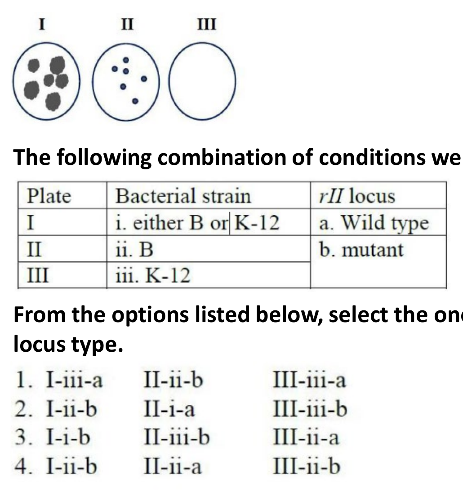

The following combination of conditions were given to explain the results obtained:

| Plate | Bacterial strain | *rII* locus |
|---|---|---|
| I | i. either B or K-12 | a. Wild type |
| II | ii. B | b. mutant |
| III | iii. K-12 | |

From the options listed below, select the one that accurately lists the *E. coli* strain type and the corresponding *rII* locus type.

1. I-iii-a, II-ii-b, III-iii-a
2. I-ii-b, II-i-a, III-iii-b
3. I-i-b, II-iii-b, III-ii-a
4. I-ii-b, II-ii-a, III-ii-b

**Answer: 2 (I-ii-b, II-i-a, III-iii-b)**

> **Explanation:** T4 **rII mutants** grow only on **permissive *E. coli* B** (giving large plaques, plate I) and **cannot grow on restrictive K-12** (no plaques, plate III). Wild-type T4 grows on **either B or K-12** but with the smaller/restricted morphology on B (plate II). Matching: plate I = strain B (ii) with the *rII* **mutant** phage (b); plate II = strain either B or K-12 (i) with **wild-type** phage (a); plate III = strain K-12 (iii) with the *rII* **mutant** phage (b). Hence **I-ii-b, II-i-a, III-iii-b**.

---

### Question 118

Alleles A, a, B and b can be distinguished on the basis of their mobility on an agarose gel. These genes are present on the same chromosome. In the gel image below, the band pattern reflects the alleles in parents and their progeny (number reflects the progeny counted).

Which one of the following statements correctly explains the band pattern?

1. In the heterozygous parent, the alleles are in coupling configuration.
2. In the heterozygous parent, the alleles are in repulsion configuration.
3. The alleles A and B are in different linkage groups.
4. The information is insufficient for any conclusion.

**Answer: 2 (In the heterozygous parent, the alleles are in repulsion configuration.)**

> **Explanation:** The two **most frequent** progeny classes (75 and 80) carry the parental gamete combinations **A b** and **a B**, whereas the rare classes (22, 16) are the recombinants **A B** and **a b**. Because the parental chromosomes each carry one dominant and one recessive allele (A b / a B), the heterozygous parent is in **repulsion (trans)** configuration. Hence option 2.

---

### Question 119

Which one of the following options correctly lists ecosystems of the world arranged according to the descending order of their average world net primary production (billion kcal/yr)?

1. Tropical rain forests > Northern coniferous forests > Open Oceans > Estuaries
2. Open Oceans > Tropical rain forests > Northern coniferous forests > Estuaries
3. Tropical rain forests > Open Oceans > Northern coniferous forests > Estuaries
4. Open Oceans > Northern rain forests > Estuaries > Northern coniferous forests

**Answer: 2 (Open Oceans > Tropical rain forests > Northern coniferous forests > Estuaries)**

> **Explanation:** When ranked by **total** world net primary production (billion kcal yr⁻¹), the vast area of the **open oceans** contributes the largest total, followed by **tropical rain forests**, then **northern coniferous (boreal) forests**, and finally **estuaries** (very high per-unit-area productivity but tiny area). Hence option 2.

---

### Question 120

India has designated regions as sanctuaries or national parks (column Q) dedicated for the conservation of specific species (column P).

| Column P | Column Q |
|---|---|
| A. Gharial | i. Bhitarkanika Wildlife Sanctuary |
| B. Saltwater Crocodile | ii. National Chambal Sanctuary |
| C. Humpback Mahseer | iii. Gahirmatha Sanctuary |
| D. Hawksbill turtle | iv. Cauvery Wildlife Sanctuary |

Select the option that depicts all correct matches between column P and column Q.

1. A-ii; B-i; C-iv; D-iii
2. A-iii; B-iv; C-i; D-ii
3. A-iv; B-iii; C-ii; D-i
4. A-ii; B-iv; C-i; D-iii

**Answer: 1 (A-ii; B-i; C-iv; D-iii)**

> **Explanation:** The **gharial** is conserved at the **National Chambal Sanctuary (ii)**; the **saltwater crocodile** at **Bhitarkanika (i)**; the **humpback mahseer** in the **Cauvery (iv)**; and the **hawksbill/olive-ridley** marine turtle nesting is protected at **Gahirmatha (iii)**. Hence A-ii, B-i, C-iv, D-iii.

---

### Question 121

Amborellaceae, Aristolochiaceae, Illiciaceae and Winteraceae are four angiosperm families that, according to the APG IV system of classification belong to the 'early diverging angiosperms'. The presence (V+) or absence (V-) of vessels in the xylem and the fusion of the carpels within the gynoecium are important angiosperm characters. 'A' and 'S' indicate apocarpous (or monocarpellary) and syncarpous condition of ovary, respectively. Which one of the following options correctly represents the characters found in the above families?

1. Amborellaceae: V+, A; Aristolochiaceae: V+, A; Illiciaceae: V+, A; Winteraceae: V-, S.
2. Amborellaceae: V-, A; Aristolochiaceae: V+, S; Illiciaceae: V+, A; Winteraceae: V-, A.
3. Amborellaceae: V-, S; Aristolochiaceae: V-, S; Illiciaceae: V+, S; Winteraceae: V+, A.
4. Amborellaceae: V+, S; Aristolochiaceae: V-, A; Illiciaceae: V+, S; Winteraceae: V-, S.

**Answer: 2 (Amborellaceae: V-, A; Aristolochiaceae: V+, S; Illiciaceae: V+, A; Winteraceae: V-, A.)**

> **Explanation:** **Amborellaceae and Winteraceae are the vessel-less (V-) families** of the early-diverging angiosperms, while **Aristolochiaceae and Illiciaceae possess vessels (V+)**. The carpel condition follows: Amborellaceae monocarpellary/apocarpous (A), Aristolochiaceae syncarpous (S), Illiciaceae apocarpous (A), Winteraceae apocarpous (A). This is exactly option 2.

---

### Question 122

Which one of the following statements pertaining to global ocean ecosystem productivity is **NOT** correct?

1. Higher chlorophyll concentrations and the general higher productivity observed around the equator is driven by the process of upwelling and/or mixing of high nutrient subsurface water into the euphotic zone.
2. In some temperate and subpolar regions, productivity is least during the spring due to the transitioning of phytoplankton from light-limiting to nutrient-limiting conditions.
3. In the nutrient-poor tropical and subtropical ocean, the cyanobacteria tend to be numerically dominant, as they specialize in taking up nutrients at low concentrations.
4. Larger phytoplankton, such as diatoms, often dominate the nutrient-rich polar ocean, and these can be grazed directly by multicellular zooplankton.

**Answer: 2 (In some temperate and subpolar regions, productivity is least during the spring due to the transitioning of phytoplankton from light-limiting to nutrient-limiting conditions.)**

> **Explanation:** In temperate/subpolar seas productivity **peaks in spring** (the spring bloom as light returns and nutrients are still plentiful), not the least — so statement 2 is the incorrect one. Equatorial high productivity is driven by upwelling/mixing (1), oligotrophic gyres are cyanobacteria-dominated (3), and polar blooms are diatom-dominated and grazed by zooplankton (4). Hence **2**.

---

### Question 123

Members of the chlorophytes are structurally diverse. Select the option that correctly represents the increasing order of structural complexity among the given genera.

1. *Chlorella* < *Zygnema* < *Oedogonium* < *Draparnaldia*
2. *Volvox* < *Chara* < *Oedogonium* < *Draparnaldia*
3. *Chlorella* < *Draparnaldia* < *Fritschiella* < *Oedogonium*
4. *Volvox* < *Ulothrix* < *Draparnaldia* < *Ulva*

**Answer: 1 (*Chlorella* < *Zygnema* < *Oedogonium* < *Draparnaldia*)**

> **Explanation:** Complexity rises from the **unicellular non-motile *Chlorella***, to the **simple unbranched filamentous *Zygnema***, to the **branched/laminate *Oedogonium*** (with its intercalary cell division and special structures), to the **complex *Draparnaldia*** with its highly differentiated branched "hairy" branches. This is the only sequence that increases monotonically in organisation; the others place a complex genus before a simpler one. Hence **1**.

---

### Question 124

It has been observed that within a flowering season, a plant may produce more male flowers which may be correlated with the longevity of the flowers and the seasonal distribution of flowering in the plant. Which one of the following arguments do **NOT** support this observation of sex-specific floral phenology.

1. Females are often resource limited and therefore pollination levels will be increased by producing more male flowers.
2. Fluctuations in the rainfall pattern can influence pollinator service due to altered physiology of the plant during its reproduction, leading to a shift in flowering phenology of both sexes.
3. Plasticity in sex and their flowering phenology is determined neither by resource status of a taxa nor by fluctuations in climatic factors.
4. Male competition will favour floral features that improve pollinator visits and therefore more male flowers.

**Answer: 3 (Plasticity in sex and their flowering phenology is determined neither by resource status of a taxa nor by fluctuations in climatic factors.)**

> **Explanation:** Options 1, 2 and 4 each offer a resource-based, climate-based or sexual-selection mechanism that could produce a male-biased flowering phenology. Option 3 explicitly denies any role of resource status or climatic fluctuation, so it gives **no support** at all to the observation.

---

### Question 125

The relationship between species and area of distribution is given by the following equation: S = C A^z where S is the number of species on an island or isolated patch, A is the area of the habitat, and C and Z are constants. The following are a set of statements pertaining to the value of 'Z':

A. Z value is typically not greater than 0.4 across all ecosystem types.
B. Z value is positively related to a species' dispersal capability, with flying and wind-dispersed organisms having the highest values.
C. Z value, which represents the slope in the relationship, declines with area, especially when large landmasses such as continents are considered.
D. The Z value is the exponent in the power model and can be used to estimate the proportion of area required to represent a given proportion of species present in any land class.

Select the option that represents the combination of all correct statements.

1. A and B
2. A and D
3. B and C
4. C and D

**Answer: 2 (A and D)**

> **Explanation:** z usually lies between 0.15 and 0.35 and rarely exceeds 0.4 (**A correct**). As the exponent of the power model, S₁/S₂ = (A₁/A₂)^z, it predicts the share of species retained in a given share of area (**D correct**). Good dispersers have **lower**, not higher, z values (B wrong), and z **rises** again at continental scales rather than declining (C wrong).

---

### Question 126

The diagram below depicts the cumulative fossil CO₂ emissions (y axis) of different continents from the years 1850-2020 (x axis).

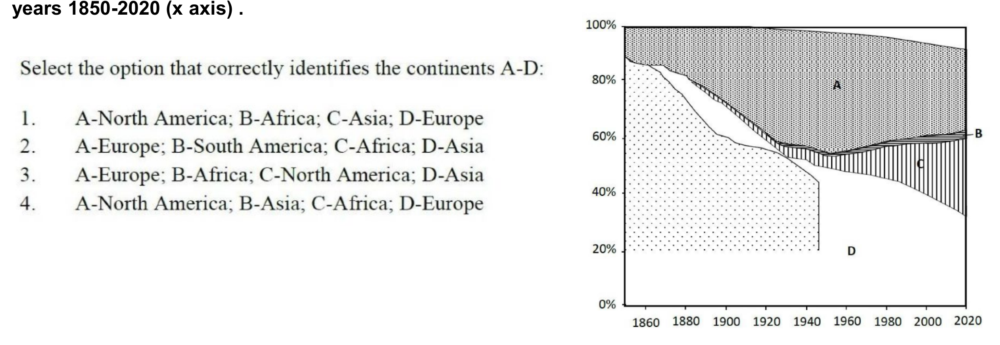

Select the option that correctly identifies the continents A-D:

1. A-North America; B-Africa; C-Asia; D-Europe
2. A-Europe; B-South America; C-Africa; D-Asia
3. A-Europe; B-Africa; C-North America; D-Asia
4. A-North America; B-Asia; C-Africa; D-Europe

**Answer: 1 (A-North America; B-Africa; C-Asia; D-Europe)**

> **Explanation:** **D (Europe)** dominated early cumulative emissions and its relative share has since shrunk; **A (North America)** became the largest cumulative emitter during the 20th century; **C (Asia)** has grown very steeply since ~1950; and **B (Africa)** remains a thin sliver throughout. This matches A–North America, B–Africa, C–Asia, D–Europe.

---

### Question 127

Given below are a set of statements about metapopulation dynamics and habitat conservation:

A. The sizes of suitable patches are important because demographic stochasticity can lead to extinction, especially in organisms with low reproductive output.
B. In the incidence function model (IFM), the extinction risk of local populations increases with increasing habitat patch area, and the colonization probability is a function of patch isolation from existing local populations.
C. From the conservation perspective, large numbers of suitable patches are not sufficient if distances are too large, preventing recolonization and the rescue effect.
D. To minimize extinction risk there should be as low a variance in local patch quality as possible, to allow for synchronous dynamics.

Which one of the following options represents the combination of all correct statements?

1. A and C
2. B and C
3. A and D
4. B and D

**Answer: 1 (A and C)**

> **Explanation:** Small patches do risk demographic extinction (**A correct**), and widely separated patches cannot be recolonised or rescued, so patch number alone is insufficient (**C correct**). In the IFM extinction risk **falls** as patch area increases (B wrong), and metapopulations persist better with **asynchronous**, not synchronous, dynamics (D wrong).

---

### Question 128

Ecologists examined the role of competition for below ground resources (water and nutrients) in the dispersion pattern of trees in the *Acacia* savannas of South Africa. The figure below depicts the result of their study.

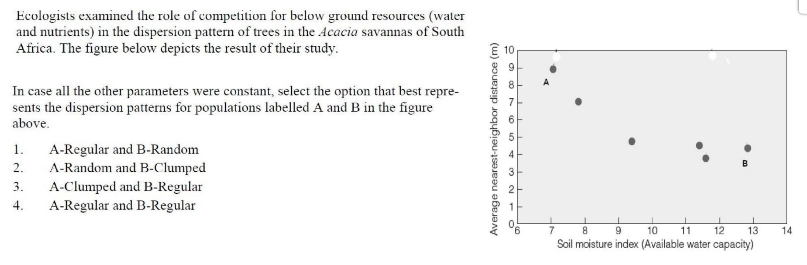

In case all the other parameters were constant, select the option that best represents the dispersion patterns for populations labelled A and B in the figure above

1. A-Regular and B-Random
2. A-Random and B-Clumped
3. A-Clumped and B-Regular
4. A-Regular and B-Regular

**Answer: 4 (A-Regular and B-Regular)**

> **Explanation:** Below-ground competition for water spaces trees out evenly, producing a **regular** pattern. In dry soil (A) roots extend further, so neighbours sit ~9 m apart; in moist soil (B) they are ~4 m apart but still evenly spaced. Only the spacing distance changes — both populations are regular.

---

### Question 129

Four different plant communities that consisted of the same number of species were taken up for a species diversity study. The following table represents some of the outcomes:

| Community | Simpson's Reciprocal Index Value |
|---|---|
| A | 7.25 |
| B | 8.20 |
| C | 6.80 |
| D | 7.05 |

Select the correct statement about the evenness of the above communities.

1. The evenness of all the four communities is the same.
2. B > A > D > C represents the decreasing order in evenness of the communities.
3. C > D > A > B represents the decreasing order in evenness of the communities.
4. Using the given information, we cannot compare the evenness of the communities.

**Answer: 2 (B > A > D > C represents the decreasing order in evenness of the communities.)**

> **Explanation:** All four communities have the **same species richness**, so evenness (which is proportional to the reciprocal Simpson's index 1/D ÷ S for fixed S) simply tracks the index values: B (8.20) > A (7.25) > D (7.05) > C (6.80).

---

### Question 130

A food chain involving *Spartina* (a plant), the marsh periwinkle snail, the blue crab and an unknown fungus was identified in a *Spartina*-dominated salt marsh in North America. A study involving control and crab-exclusion experiments revealed:

A. Radulations (scrape marks) on the leaf surface made by the snails indicate the presence of snail faeces, fungi and dead plant tissue.
B. The fungi were present only at the radulations.
C. The density of the radulations increased with higher snail densities.
D. *Spartina* density decreased with increase in the snail density till it reached zero.
E. In control experiments, all four species were present till the end.

Select the option that correctly depicts the positive (+) and negative (-) interaction-type between fungi-snail and *Spartina*-crab, respectively:

1. - and +
2. - and -
3. + and -
4. + and +

**Answer: 4 (+ and +)**

> **Explanation:** Snails graze cuts into *Spartina* and the plant fungi colonise those scrapes; the snails then eat the fungus — each partner benefits, so the **fungi–snail interaction is (+)**. Blue crabs eat the snails and thereby protect *Spartina* from being grazed to zero — an indirect benefit, so the ***Spartina*–crab interaction is also (+)**. Hence + and +.

---

### Question 131

The following trees represent different evolutionary mechanisms.

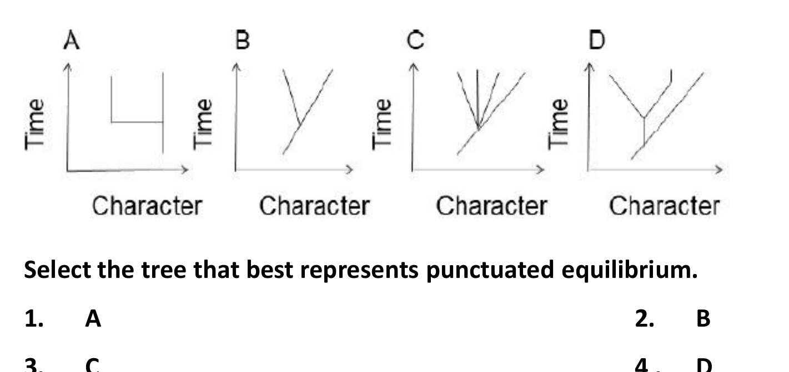

Select the tree that best represents punctuated equilibrium.

1. A
2. B
3. C
4. D

**Answer: 1 (A)**

> **Explanation:** Punctuated equilibrium means **long stasis** (long vertical lineages with little change) broken by **rapid morphological change at speciation events** (short horizontal jumps confined to branching points). Tree A shows exactly that pattern, whereas trees B and D show gradual divergence along the branches.

---

### Question 132

The following list represents two types of reproductive isolation (Column P) that can lead to speciation. Column Q represents the processes by which these isolations can occur.

| Column P | Column Q |
|---|---|
| A – Prezygotic | i. Seasonal |
| B – Postzygotic | ii. Hybrid inviability |
| | iii. F₂ breakdown |
| | iv. Stigmatic SI response |

Select the option that represents the correct match between the prezygotic and postzygotic isolation types listed in Column P and the processes described in Column Q?

1. A-i and ii, B-i and iii
2. A-i and iii, B-ii only
3. A-i and iv, B-ii and iii
4. A-ii only, B-i and iv

**Answer: 3 (A-i and iv, B-ii and iii)**

> **Explanation:** Seasonal (temporal) isolation and the stigmatic self-incompatibility (SI) response act **before fertilisation**, so they are prezygotic (A–i, A–iv). Hybrid inviability and F₂ breakdown act **after** a zygote has formed, so they are postzygotic (B–ii, B–iii).

---

### Question 133

A scientist is using the Hardy-Weinberg equation to assess if a population is in equilibrium or is evolving. She recorded the following characteristics for this population:

A. The size of the population is very large.
B. Individuals are randomly mating.
C. Individuals are under natural selection.
D. New alleles are added to the population through migration and dispersal.
E. Mutation rates are high.

Which one of the following options contains all **INCORRECT** characteristics of a population in Hardy-Weinberg equilibrium?

1. A and D
2. C, D and E
3. A, B and C
4. B and E

**Answer: 2 (C, D and E)**

> **Explanation:** Hardy–Weinberg equilibrium requires a **large, randomly mating population with no natural selection, no migration and no mutation**. Large size (A) and random mating (B) are therefore *correct* equilibrium characteristics; selection (C), migration (D) and high mutation (E) all violate the assumptions, so the set of incorrect characteristics is **C, D and E**.

---

### Question 134

In many sexually reproducing organisms females make mate choice decisions based on male display traits. Several models have been proposed to explain the evolution of exaggeration in male traits. Two of them have been given below in column P and their possible descriptions in column Q.

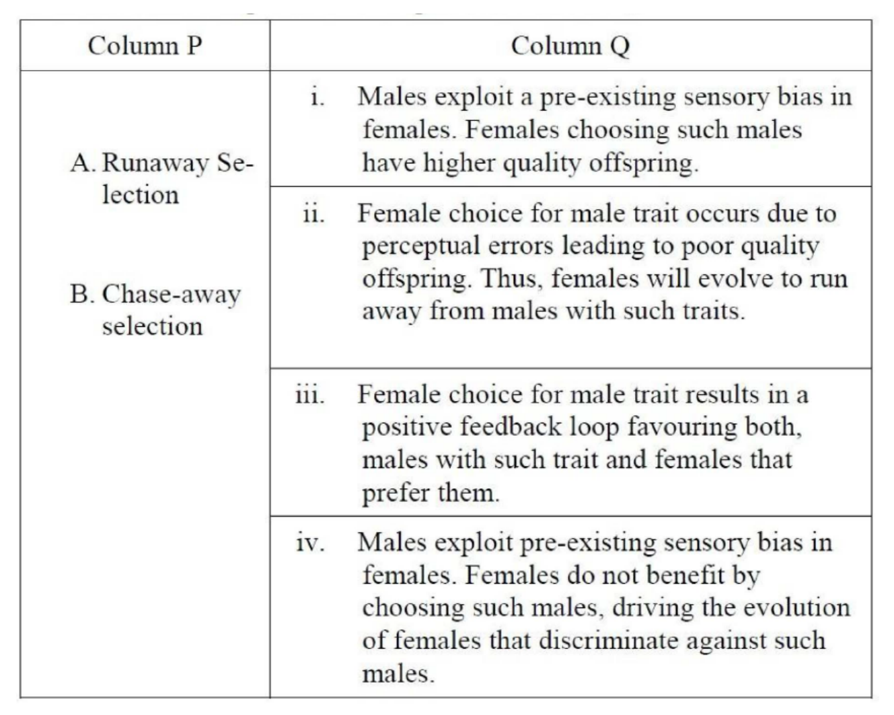

Match the models to their appropriate description and choose the correct option.

1. A- i, B- ii
2. A- ii, B- iii
3. A-iii, B- iv
4. A- iv, B- i

**Answer: 3 (A-iii, B- iv)**

> **Explanation:** The **Fisherian runaway** model is a positive feedback between the male trait and the female preference for it (description iii). **Chase-away sexual conflict** is when males exploit a sensory bias in a way that harms females, so females evolve resistance while males counter-evolve (description iv). Hence A–iii, B–iv.

---

### Question 135

Based on the theory of kin selection, choose the correct statement:

1. A gene for altruism will spread in the population if the act of altruism increases the actor's gene in the next gene pool only through direct fitness.
2. A gene for altn1ism will spread in the population if the act of altn1ism increases the actor's gene in the next gene pool only through indirect fitness.
3. A gene for altruism will spread in the population if the act of altruism increases the actor's gene in the next gene pool through direct or indirect fitness.
4. Altn1istic behaviour reduces the fitness of the trait bearer so a gene responsible for altruism ca1mot spread in a population and will be n1aintained at a very low frequency.

**Answer: 3 (A gene for altruism will spread in the population if the act of altruism increases the actor's gene in the next gene pool through direct or indirect fitness.)**

> **Explanation:** Under **Hamilton's rule** an altruism allele spreads when rB > C, counting gene copies passed on **both directly (own reproduction) and indirectly (through relatives)** — i.e. inclusive fitness must rise. Statements restricting the spread to *only* direct (1) or *only* indirect (2) fitness are wrong, and option 4 denies the theory outright.

---

### Question 136

In four taxa (A, B, C and D), two characters (shape and color) were scored to infer their phylogenetic relationship. The two character states for shape were square and round while the two character states for color were black and yellow. The character distribution is given in the table below.

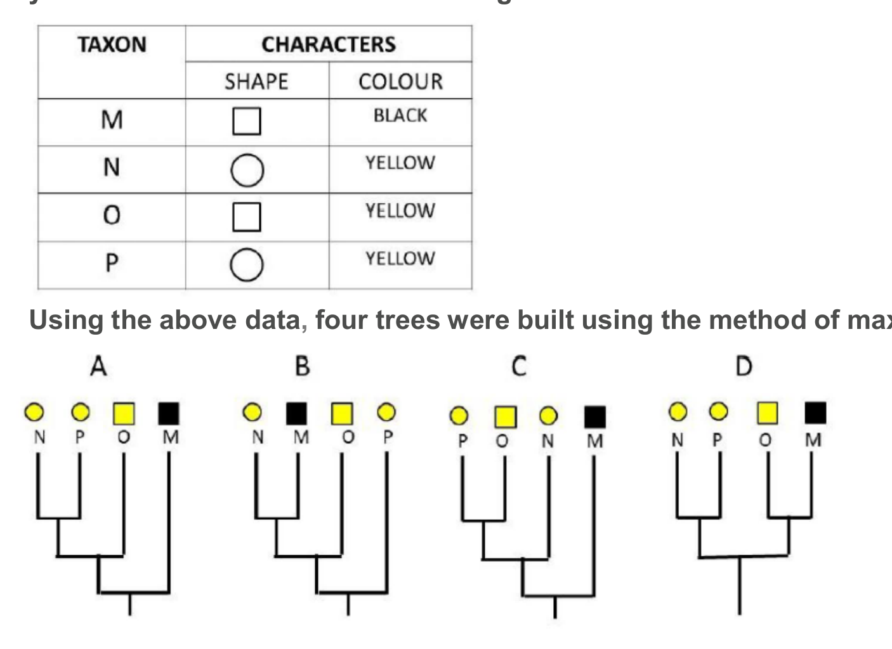

Using the above data, four trees were built using the method of maximum parsimony which are given below. Select the option that represents the two most parsimonious trees.

1. A and B
2. C and D
3. B and C
4. A and D

**Answer: 4 (A and D)**

> **Explanation:** Parsimony assumes evolutionary events are rare, so the tree(s) with the **fewest total state changes** win. The colour change costs one step on every tree; the shape character costs only one step when the two square-taxed taxa group together and two steps otherwise. Trees A and D place those taxa as sisters (2 steps total), while B and C need 3. Most parsimonious: **A and D**.

---

### Question 137

100 μL of cells were taken in a tube and 400 μL 0.4% Trypan Blue was added for staining. About 20 μL of this cell suspension was added between the hemocytometer and cover glass (refer figure below). The hemocytometer is divided into 9 major squares of 1 mm x 1 mm size. The height of the chamber formed with the cover glass is 0.1 mm. Empty circles indicate unstained cells and solid circles indicate stained cells.

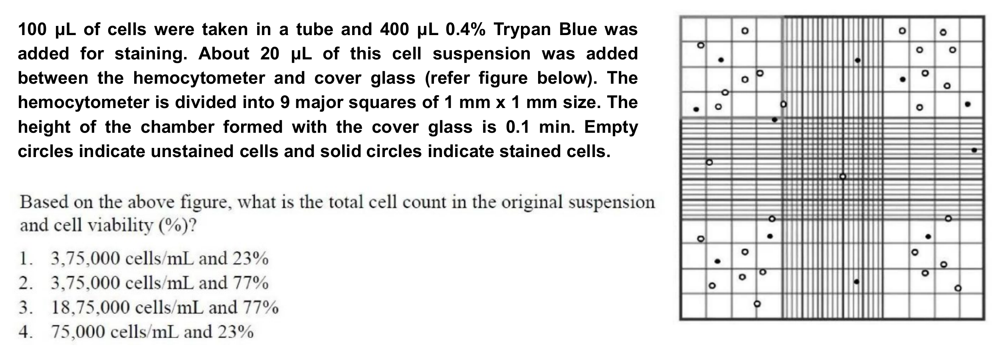

Based on the above figure, what is the total cell count in the original suspension and cell viability (%)?

1. 3,75,000 cells/mL and 23%
2. 3,75,000 cells/mL and 77%
3. 18,75,000 cells/mL and 77%
4. 75,000 cells/mL and 23%

**Answer: 2 (3,75,000 cells/mL and 77%)**

> **Explanation:** Each 1 mm² corner square over a 0.1 mm chamber holds 10⁻⁴ mL. The four corner squares together contain 30 cells (average 7.5 per square), 23 of them unstained → cells/mL in the loaded suspension = 7.5 × 10⁴. The dilution was 100 μL cells into 500 μL total = 5×, so the original suspension holds 7.5 × 10⁴ × 5 = **3,75,000 cells/mL**. Viability = unstained/total = 23/30 ≈ **77 %**.

---

### Question 138

A transgenic plant having a homozygous single-copy insertion for trait A was retransformed by *Agrobacterium*-mediated transformation with a gene conferring trait B. Given below are a few statements regarding the above experiment:

A. All T₀ transgenic plants obtained after re-transformation would be single copy events for both traits, A and B.
B. T1 progeny generated by self-pollination of single-copy transgenic plants obtained by retransformation would segregate in a 3: 1 ratio for trait A.
C. Plant selection marker genes used for transformation experiments for both traits, A and B should be necessarily identical. Different selection marker genes cannot be used.
D. 25% of T1 progeny generated by self-pollination of single-copy transgenic plants obtained by retransfonnation would be homozygous for both traits, A and B.

Which one of the following options represents all **INCORRECT** statements?

1. A, C and D
2. A, B and C
3. D only
4. A and C only

**Answer: 2 (A, B and C)**

> **Explanation:** T₀ regeneration events **need not** all be single-copy (A wrong). Trait A is already **homozygous**, so it does not segregate at all in T₁ — no 3:1 ratio (B wrong). Different selection markers for the two traits may and usually must be used (C wrong). Trait B, being a single-copy hemizygous insertion, segregates 1:2:1 while A is fixed, so 25 % of T₁ are homozygous for both (D correct). Incorrect set: **A, B and C**.

---

### Question 139

Given below are terms related to various techniques (Column X) and their features (Column Y):

| Column X (Techniques) | Column Y (Features) |
|---|---|
| A. Reverse transcription | i. Detection of clones encoding nucleic acid binding proteins |
| B. Southwestern blotting | ii. Determination of 5' and 3' DNA sequences flanking a known gene |
| C. Genome walking PCR | iii. Cloning of cDNA ends |
| D. RACE | iv. cDNA library |

Which one of the following options represents all correct matches between Column X and Column Y?

1. A-iv, B-i, C-ii, D-iii
2. A-iii, B-iv, C-i, D-ii
3. A-ii, B-iii, C-iv, D-i
4. A-iv, B-i, C-iii, D-ii

**Answer: 1 (A-iv, B-i, C-ii, D-iii)**

> **Explanation:** Reverse transcription is used to build a **cDNA library** (A–iv). **Southwestern** blotting detects clones encoding **nucleic-acid-binding proteins** (B–i). **Genome walking** reads the **5′/3′ flanking DNA** around a known sequence (C–ii). **RACE** (Rapid Amplification of cDNA Ends) clones the **cDNA ends** (D–iii).

---

### Question 140

Given below are a few terms related to Bioinformatics resources (Column X) and their functions/applications (Column Y):

| Column X (Resources) | Column Y (Functions/applications) |
|---|---|
| A. TrEMBL | i. Analysis of recombination frequencies between molecular markers |
| B. TBLASTN | ii. Database of protein sequences |
| C. SCOP | iii. Comparison of amino acid sequence against nucleotide sequence database translated in all six reading frames |
| D. JoinMap | iv. Manually curated structural classification of proteins |

Which one of the following options represents all correct matches between Column X and Column Y?

1. A – ii, B – iii, C – iv, D – i
2. A – iv, B – i, C – ii, D – iii
3. A – iii, B – i, C – iv, D – ii
4. A – iv, B – iii, C – ii, D – i

**Answer: 1 (A – ii, B – iii, C – iv, D – i)**

> **Explanation:** **TrEMBL** is a protein sequence database (ii); **TBLASTN** searches a protein query against a six-frame translated nucleotide database (iii); **SCOP** is the curated structural classification of proteins (iv); **JoinMap** builds linkage maps from recombination frequencies (i).

---

### Question 141

Mass spectrum of a pure peptide recorded in the positive ion mode is shown below.

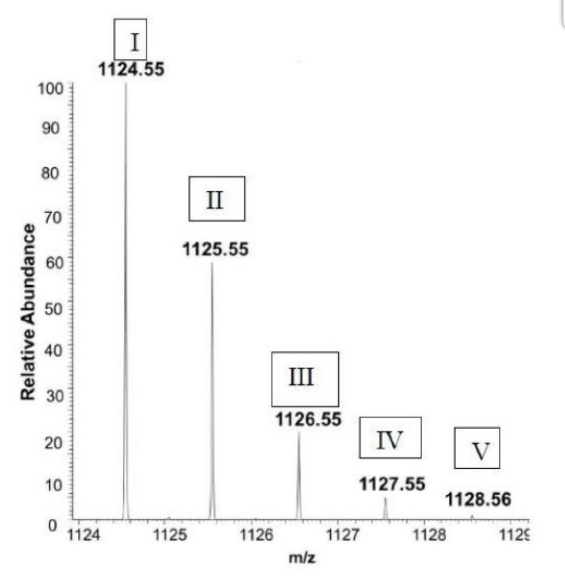

(A) What is the reason for multiple peaks in the mass spectrum of a pure peptide? (B) Which peak corresponds to the monoisotopic species of the peptide? (C) What is the monoisotopic mass of the peptide? Select the right answers from the options given below.

1. (A) 13C isotope distribution, (B) peak V and (C) 1128.56 Da
2. (A) 14C isotope distribution, (B) peak I and (C) 1124.55 Da
3. (A) 13C isotope distribution, (B) peak I and (C) 1124.55 Da
4. (A) 14C isotope distribution, (B) peak V and (C) 1128.56 Da

**Answer: 3 (A) 13C isotope distribution, (B) peak I and (C) 1124.55 Da)**

> **Explanation:** The peaks one mass unit apart (1124.55, 1125.55 … so z = 1) arise from the natural abundance **¹³C** isotope distribution (~1.1 % of carbon); ¹⁴C is far too rare to produce such a series. The **lightest** peak, **I**, contains only ¹²C and is therefore the monoisotopic species, giving a monoisotopic mass of **1124.55 Da**.

---

### Question 142

The following statements were made about phase contrast microscopy

A. Phase contrast microscopy can be equally utilized to examine stained and unstained specimens.
B. A phase annulus generates hollow cone of light to illuminate the specimen.
C. A light wave that passes through a cell nucleus and organelles lags compared to the light waves that pass through water only.
D. A polarized light source is used to translate the minor phase shifts into grey values.
E. Appearance of bright halos is a common artifact of phase contrast imaging.

Which one of the following options represents the combination of all correct statements?

1. A, C and D
2. B, C and E
3. A, B and C
4. B, D and E

**Answer: 2 (B, C and E)**

> **Explanation:** The **phase annulus** produces the hollow cone of light (B true); light traversing dense nuclei and organelles is **retarded/lagged** relative to light passing through medium alone (C true); and **bright halos** are the classic phase-contrast artefact (E true). Phase contrast is designed for **unstained living** cells (A false), and it converts phase shifts with a phase plate, not polarised light — polarisation belongs to DIC (D false).

---

### Question 143

Following statements are about the features of immunoassays used to assay biomolecules:

A. Radio-immunoassays (RIAs) are more sensitive than Enzyme-linked immunosorbent assays (ELISAs) with chromogenic substrates.
B. ELISAs with chromogenic substrates are more sensitive than ELISAs with chemiluminogenic substrates.
C. ELISPOT measures the number of cells capable of secreting particular biomolecules using a substrate that gives soluble product with enzyme reaction.
D. In Western blot analysis the product of enzyme-substrate reaction localizes at the site precisely where the antibody-enzyme conjugate binds to its specific protein band.

Which of the following options represents the combination of all correct statements:

1. A and C
2. A and D
3. B and C
4. B and D

**Answer: 2 (A and D)**

> **Explanation:** RIA is indeed more sensitive than a **chromogenic** ELISA (A true), and in a Western blot the (precipitating) product forms exactly where the antibody–enzyme conjugate sits on the band (D true). Chemiluminescent ELISA is **more** sensitive than chromogenic (B false), and ELISPOT requires an **insoluble/precipitating** product to form countable spots (C false).

---

### Question 144

Given below are terms related to various experimental techniques (Column X) and their applications (Column Y):

| Column X (Technique) | Column Y (Application) |
|---|---|
| A. Mass Spectrometry | i. Separation of whole chromosomes |
| B. Pulsed Field Gel Electrophoresis | ii. Separation of isoenzymes |
| C. Isoelectric Focusing | iii. Single-molecule-real-time sequencing |
| D. PacBio | iv. Identification of post-translational modifications of proteins |

Which one of the following options represents all correct matches between Column X and Column Y?

1. A-iv, B-i, C-ii, D-iii
2. A-iii, B-iv, C-i, D-ii
3. A-ii, B-iii, C-iv, D-i
4. A-iv, B-iii, C-i, D-ii

**Answer: 1 (A-iv, B-i, C-ii, D-iii)**

> **Explanation:** **Mass spectrometry** identifies post-translational modifications (A–iv); **PFGE** separates whole chromosomes (B–i); **isoelectric focusing** separates isoenzymes, i.e. charge variants (C–ii); **PacBio** is single-molecule real-time (SMRT) sequencing (D–iii).

---

### Question 145

The following table depicts the digital numbers of 12 pixels in two different bands (indicated below each pixel group) of an image collected from the LISS-IV sensor of Resourcesat-1 satellite. Which one of the following options represents the correct identification of only vegetated (darkened) pixels?

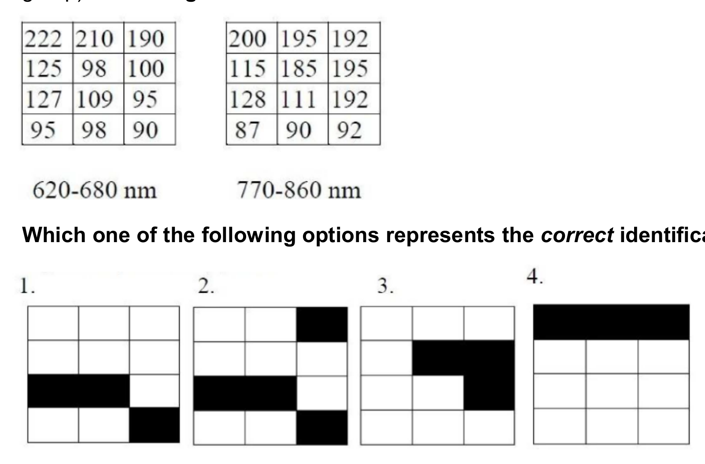

1. 1
2. 2
3. 3
4. 4

**Answer: 3 (Pattern 3)**

> **Explanation:** Healthy vegetation strongly **absorbs** red light (low digital number in 620–680 nm) and **reflects** near-infrared (high DN in 770–860 nm). Only the pixel set marked in pattern 3 shows that low-red / high-NIR signature across all its pixels, so it is the correct identification of the vegetated (darkened) pixels. The other patterns include pixels with high red or low NIR, which correspond to bare soil, water or built-up surface.

---
