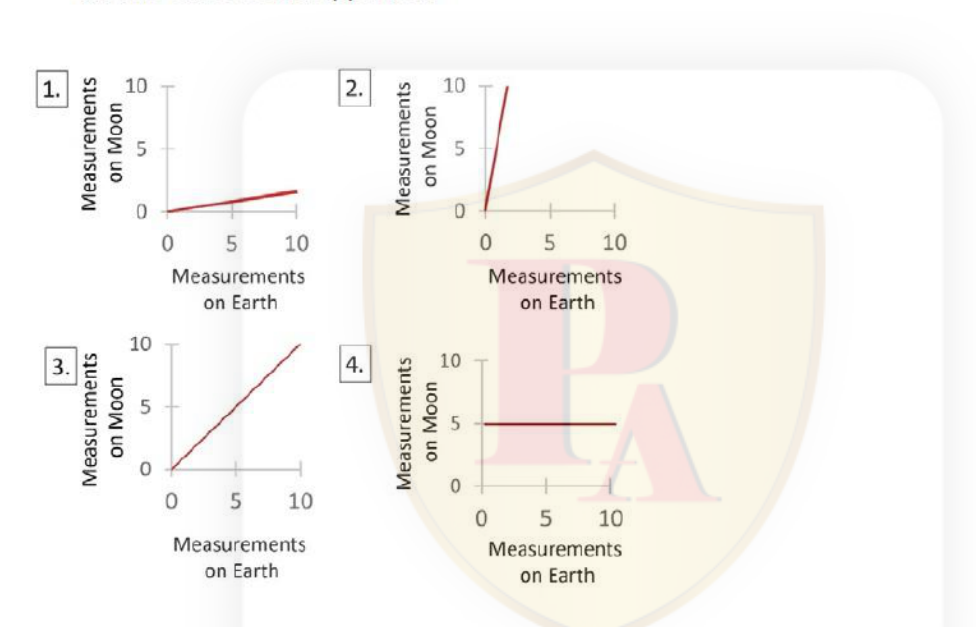

# CSIR NET Life Sciences — December 2024, Shift 1 (exam date 01-Mar-2025) — PART A

Source of question text: NTA response-sheet rendering of the paper (Pathfinder Academy PDF, printed `Question No. n / Question ID 7031nn`), cross-checked against a second independent export (see `sources.md`).
Answers are taken from the **NTA Final Answer Key** (`csirnet.nta.ac.in/images/csirdecember-2024final-answer-key.pdf`, Subject: Life Science, Exam Date 01-03-2025, Shift 1).
Global numbering: Part A = Question 1–20 (printed Part A numbers 1–20).

### Question 1

*(Part A, Question No. 1 / Question ID 703104, Marks 2.00)*

Masses of several objects were measured on the Earth as well as on the Moon using the same two-pan balance. The graph of the measurements obtained on the two sites would appear as

1. Graph 1
2. Graph 2
3. Graph 3
4. Graph 4

**Answer: 3 (Graph 3)**

> **Explanation:** Mass does not depend on location. A two-pan balance compares the object against standard masses, and both pans are affected identically by the local value of *g*, so the balance reading is the same on the Earth and on the Moon. Hence Moon measurement = Earth measurement for every object, which is the straight line of slope 1 through the origin — graph 3. Graphs 1 and 2 give the wrong slope, and graph 4 makes the Moon reading independent of the Earth reading.

---

### Question 2

*(Part A, Question No. 2 / Question ID 703106, Marks 2.00)*

In the fictional country of Petrevirsia, which of the following provinces is the odd one out?

1. TANGODIN
2. PATACAHON
3. BACCANEH
4. HORVITHA

**Answer: 4 (HORVITHA)**

> **Explanation:** NTA's final key marks **HORVITHA** as the odd one out. The three retained names can each be segmented into consecutive chemical-element symbols read from the printed letters in order — PATACAHON = Pa·Ta·Ca·H·O·N and BACCANEH = B·Ac·Ca·Ne·H — a property the key evidently extends to TANGODIN but not to HORVITHA, whose letters (H, O, R, V, I, T, H, A) cannot be partitioned into valid symbols in sequence (R and V never begin or continue a legal run here once Ho is taken). See `sources.md`: an independent letter-pattern reading (vowel count 4 vs 3, or 9 letters vs 8) instead singles out PATACAHON; the key value is recorded.

---

### Question 3

*(Part A, Question No. 3 / Question ID 703111, Marks 2.00)*

A boy in a family says "I have twice as many sisters as I have brothers" but one of his sisters claims that she has the same number of brothers and sisters. The numbers of girls and boys in that family are, respectively

1. 4 and 2
2. 3 and 2
3. 3 and 4
4. 4 and 3

**Answer: 4 (4 and 3)**

> **Explanation:** With $g$ girls and $b$ boys: a boy has $g$ sisters and $b-1$ brothers, so $g=2(b-1)$; a girl has $g-1$ sisters and $b$ brothers, so $g-1=b$. Substituting $b=g-1$ gives $g=2(g-2)$, so $g=4$ and $b=3$. Check: the boy counts 4 sisters and 2 brothers (4 = 2×2 ✓); the girl counts 3 sisters and 3 brothers ✓. Girls and boys, respectively: 4 and 3.

---

### Question 4

*(Part A, Question No. 4 / Question ID 703119, Marks 2.00)*

The geometric mean of squares of two positive integers is 10. The smallest possible sum of these two integers is

1. 7
2. 8
3. 11
4. 10

**Answer: 1 (7)**

> **Explanation:** The geometric mean of $a^2$ and $b^2$ is $\sqrt{a^2b^2}=ab$ (both positive), so $ab=10$. The positive integer factorisations are $1\times10$ (sum 11) and $2\times5$ (sum 7). The smallest possible sum is 7.

---

### Question 5

*(Part A, Question No. 5 / Question ID 703102, Marks 2.00)*

The given figure shows a line fit using least squares method between profit in chocolate business and mean temperature (T) data for a city. The correlation coefficient obtained from this data is *r*. Which one of the following statements is INCORRECT?

1. The sum of the squared differences between the observed and estimated values of profit is minimum.
2. About 69% of the variation in profit is explained by the variation in temperature.
3. At 30°C, estimated profit is 34 million ₹.
4. Data point (32, 80) is anomalous and therefore must be discarded.

**Answer: 4 (Data point (32, 80) is anomalous and therefore must be discarded.)**

> **Explanation:** Statements 1, 2 and 3 are all correct: the least-squares criterion is exactly the minimisation of the sum of squared observed-minus-estimated differences; $r^2 = 0.83^2 \approx 0.69$, i.e. ~69% of the variation in profit is explained by temperature; and the fitted line gives $4(30)-86 = 34$ million ₹ at 30°C. Statement 4 is the incorrect one — a single point that departs from the regression line is not thereby invalid, and least-squares fitting does not require discarding anomalous observations; removing it would bias the fit rather than correct it.

---

### Question 6

*(Part A, Question No. 6 / Question ID 703108, Marks 2.00)*

A cube is coloured on each face by one of yellow, orange, red, blue, green and pink colours. Orange is opposite to yellow. Pink is between orange and yellow. Red is alongside of Pink. Green is between red and blue. Orange is at top. What is opposite to blue?

1. Red
2. Green
3. Pink
4. Yellow

**Answer: 1 (Red)**

> **Explanation:** Orange (top) and yellow (bottom) take the two opposite faces, so pink, red, green and blue occupy the four side faces, forming a ring. "Green is between red and blue" fixes the ring order as red–green–blue, and the fourth face pink must sit between blue and red, giving the cyclic ring pink–red–green–blue. Opposite pairs in a four-ring are the faces two steps apart: pink/green and **red/blue**. Therefore the face opposite blue is red. (Consistently, orange is at top and pink lies between orange and yellow as required.)

---

### Question 7

*(Part A, Question No. 7 / Question ID 703107, Marks 2.00)*

How many 4-digit numbers can be generated from the digits 1, 2, 3, 4, 5 and 6 such that 123 always appear as a string? No digit appears more than once.

1. 8
2. 4
3. 6
4. 12

**Answer: 3 (6)**

> **Explanation:** Treat "123" as one indivisible block. A 4-digit number containing it must be the block plus exactly one further digit, which may only be 4, 5 or 6 (reusing 1, 2 or 3 is forbidden), and which may be placed either before or after the block. That gives $3 \times 2 = 6$ numbers: 4123, 1234, 5123, 1235, 6123, 1236.

---

### Question 8

*(Part A, Question No. 8 / Question ID 703120, Marks 2.00)*

An item in a shop is priced at ₹ 375 excluding tax. The shopkeeper offers a discount of 15%, however there is a tax of 12% before discount on the item. The selling price of the item is:

1. ₹ 318.75
2. ₹ 420
3. ₹ 357
4. ₹ 382.5

**Answer: 3 (₹ 357)**

> **Explanation:** The tax is applied *before* the discount, so the taxed price is $375 \times 1.12 = 420$, and the 15% discount is then taken from that: $420 \times 0.85 = ₹\,357$. (₹420 is the pre-discount taxed price; ₹382.5 is what you get if the discount is wrongly applied before the tax.)

---

### Question 9

*(Part A, Question No. 9 / Question ID 703113, Marks 2.00)*

Five girls are standing in a line. Out of them, Henna is to the left of Agatha, between Agatha and Dipti there are 3 places, and Shabnam has both Lata and Dipti as neighbours. Then,

1. Lata is to the right of Agatha
2. Henna is at the extreme Left
3. there are exactly two places between Henna & Dipti
4. there is exactly one place between Shabnam & Agatha

**Answer: 3 (there are exactly two places between Henna & Dipti)**

> **Explanation:** In a line of five, "3 places between Agatha and Dipti" means they occupy positions 1 and 5. Since Henna stands to the left of Agatha, Agatha cannot be at position 1; so Dipti = 1 and Agatha = 5. Shabnam must have Dipti (position 1) as a neighbour, so Shabnam = 2, and her other neighbour Lata is then at 3. Henna takes the remaining position 4. Arrangement: Dipti, Shabnam, Lata, Henna, Agatha. Between Henna (4) and Dipti (1) lie exactly two places (2 and 3) — statement 3. Statements 1, 2 and 4 are all false in this arrangement.

---

### Question 10

*(Part A, Question No. 10 / Question ID 703115, Marks 2.00)*

A 6-digit security code is made using digits from 0 to 9. The first and the last digits are known. If the remaining four digits are known to be primes, at the most how many trials are required to determine the code?

1. 100
2. 2560
3. 256
4. 10000

**Answer: 3 (256)**

> **Explanation:** Only the four middle digits are unknown, and each is restricted to the prime digits {2, 3, 5, 7}. Repetition is allowed, so the number of candidate codes is $4^4 = 256$; in the worst case all 256 must be tried.

---

### Question 11

*(Part A, Question No. 11 / Question ID 703117, Marks 2.00)*

A fair coin is tossed two times independently and X denotes the number of heads. Then a fair 6-faced die is thrown at random (independently of the tosses) and Y denotes the number on the top of the die. What is the probability that the value of X+Y is 4?

1. 1/2
2. 1/3
3. 1/4
4. 1/6

**Answer: 4 (1/6)**

> **Explanation:** $P(X=0)=P(X=2)=\tfrac14$, $P(X=1)=\tfrac12$; each die face has probability $\tfrac16$. $X+Y=4$ arises from $(X,Y)=(0,4),(1,3),(2,2)$, so the probability is $\tfrac14\cdot\tfrac16+\tfrac12\cdot\tfrac16+\tfrac14\cdot\tfrac16=\tfrac{1+2+1}{24}=\tfrac16$.

---

### Question 12

*(Part A, Question No. 12 / Question ID 703110, Marks 2.00)*

If the words FAST, SLOW and TONE are written as 3475, 2913 and 1648 but not necessarily in the same order, then using the same code how the word NEAT would be written?

1. 7513
2. 7953
3. 7593
4. 1537

**Answer: 3 (7593)**

> **Explanation:** The words must be matched to the codes so that shared letters get shared digits in the same positions. FAST and SLOW share **S** (FAST position 3, SLOW position 1); FAST and TONE share **T** (position 4 vs position 1); SLOW and TONE share **O** (position 3 vs position 2). The only assignment satisfying all three is FAST = 2913, SLOW = 1648, TONE = 3475, giving F=2, A=9, S=1, T=3, S=1, L=6, O=4, W=8, T=3, O=4, N=7, E=5. Hence N-E-A-T = **7593**. (Every other pairing contradicts itself, e.g. taking FAST = 3475 forces T=5 from FAST but T=3 from TONE.)

---

### Question 13

*(Part A, Question No. 13 / Question ID 703105, Marks 2.00)*

Let A: export, B: rainfall, C: harvest, D: godown storage
Which one of the following sequences is correct?

1. C, A, B, D
2. B, C, D, A
3. C, B, A, D
4. D, C, B, A

**Answer: 2 (B, C, D, A)**

> **Explanation:** The causal chain for an agricultural commodity is rainfall → harvest → storage in a godown → export, i.e. B, C, D, A. No other ordering puts the harvest before its storage or the storage before export.

---

### Question 14

*(Part A, Question No. 14 / Question ID 703112, Marks 2.00)*

Fifteen distinct points are randomly placed on the circumference of a circle. At most how many triangles can be formed using these points?

1. 105
2. 455
3. 2730
4. 30

**Answer: 2 (455)**

> **Explanation:** No three points on a circle are collinear, so every choice of three points determines a triangle: $\binom{15}{3}=\frac{15\times14\times13}{6}=455$. (2730 is $15\times14\times13$, i.e. the ordered count, and 105 is $\binom{15}{2}$, the number of chords.)

---

### Question 15

*(Part A, Question No. 15 / Question ID 703101, Marks 2.00)*

$\sqrt{0.99 \times 0.99 \times 0.99}$ is closest to

1. 0.99×0.33
2. 0.33×0.33×0.33
3. 0.99×0.99×0.99
4. 0.33

**Answer: 3 (0.99×0.99×0.99)**

> **Explanation:** $\sqrt{0.99^3}=0.99^{1.5}\approx0.985$. The candidates are 0.327, 0.036, 0.970 and 0.33, so $0.99^3\approx0.970$ is by far the nearest. Taking the square root of a number just below 1 keeps it just below 1 — it does not pull the value down towards 0.33.

---

### Question 16

*(Part A, Question No. 16 / Question ID 703116, Marks 2.00)*

The sum of the digits of a four-digit number 'abcd' is subtracted from the number. Then the result of this will be always divisible by

1. 9
2. 11
3. 13
4. 14

**Answer: 1 (9)**

> **Explanation:** The number is $1000a+100b+10c+d$; subtracting the digit sum $a+b+c+d$ leaves $999a+99b+9c=9(111a+11b+c)$, which is a multiple of 9 for every choice of digits. It need not be a multiple of 11, 13 or 14 (e.g. 1000 → $1000-1=999=9\times111$).

---

### Question 17

*(Part A, Question No. 17 / Question ID 703114, Marks 2.00)*

If you add liquid soap in the centre of a bowl of water, which has black pepper flakes floating in it, the pepper flakes will

1. start dissolving
2. move away from the centre
3. settle down
4. not move

**Answer: 2 (move away from the centre)**

> **Explanation:** Soap is a surfactant: where it lands it sharply lowers the surface tension of the water. The surrounding clean water, still under higher surface tension, pulls the surface film outward, and the pepper flakes riding on that film are carried away from the point where the soap was added.

---

### Question 18

*(Part A, Question No. 18 / Question ID 703118, Marks 2.00)*

A cylinder has two concentric identical metal plates placed on each other that have identical circular holes as shown in the figure (shaded area). The plate A rotates in clockwise direction at 15° per second. The plate B rotates in anti-clockwise direction at 5° per second. If the starting positions of the plates as seen from the top of the cylinder are as shown below, the first instance when both the shaded regions completely coincide happens at:

1. 11.25 seconds
2. 3.25 seconds
3. 6.75 seconds
4. 8.35 seconds

**Answer: 1 (11.25 seconds)**

> **Explanation:** Measure angles from the positive horizontal radius. Plate A's hole starts at 90° and moves clockwise, so its angle is $90-15t$; plate B's hole starts on the lower-left diagonal at 225° and moves anti-clockwise, so its angle is $225+5t$. Coincidence requires $90-15t \equiv 225+5t \pmod{360}$, i.e. $20t \equiv -135 \equiv 225 \pmod{360}$, giving $t = 11.25 + 18k$ s. The first positive solution is **11.25 s**. (6.75 s is the answer if the relative rotation is taken in the wrong sense.)

---

### Question 19

*(Part A, Question No. 19 / Question ID 703109, Marks 2.00)*

A rectangular sheet of 31.4 cm x 10 cm size is rolled across its length to make a cylinder without overlap. What will be the approximate volume of the cylinder?

1. 785 cm³
2. 1570 cm³
3. 3140 cm³
4. 6280 cm³

**Answer: 1 (785 cm³)**

> **Explanation:** Rolling across the length makes 31.4 cm the circumference of the cylinder and 10 cm its height. Then $2\pi r = 31.4 \Rightarrow r = 31.4/(2\times3.14) = 5$ cm, and $V = \pi r^2 h = 3.14 \times 25 \times 10 = 785$ cm³.

---

### Question 20

*(Part A, Question No. 20 / Question ID 703103, Marks 2.00)*

Choose the option to fill in the blank that will make the following statement logically correct:

COUNTING WITH PRECISION THE NUMBER OF OCCURENCES OF THE LETTER "I" IN THIS SENTENCE YIELDS _______.

1. SEVEN
2. EIGHT
3. NINE
4. TEN

**Answer: 3 (NINE)**

> **Explanation:** The self-referential count must equal the number of I's actually present once the chosen word is written into the blank. Reading the sentence as printed, the I's occur in COUNT**I**NG, W**I**TH, PREC**I**S**I**ON (two), the quoted letter "I", **I**N, TH**I**S, and in the instruction line that precedes it (F**I**LL, **I**N) — a total of nine, which is what option 3 states. See `sources.md`: counting only the quoted sentence gives seven, which would make SEVEN self-consistent; the NTA final key for Question ID 703103 is option 3 and is recorded.
