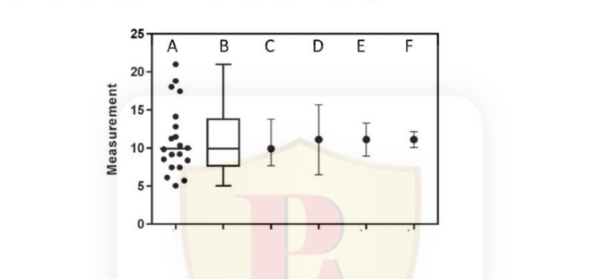
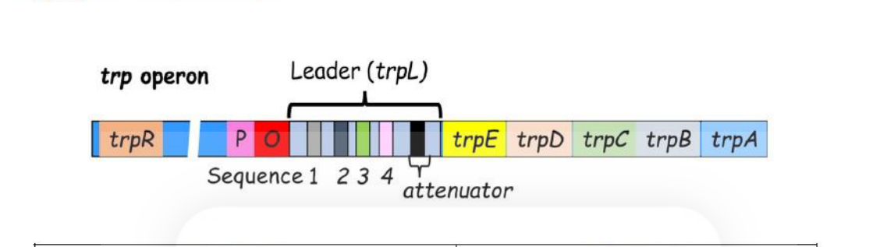
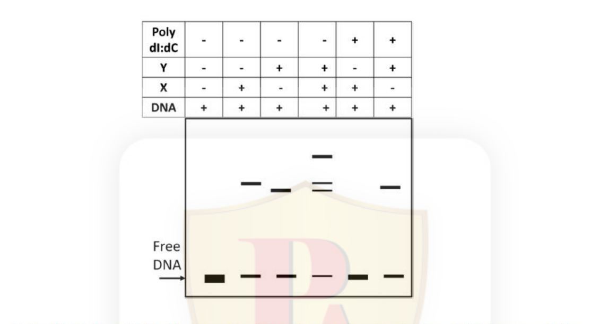
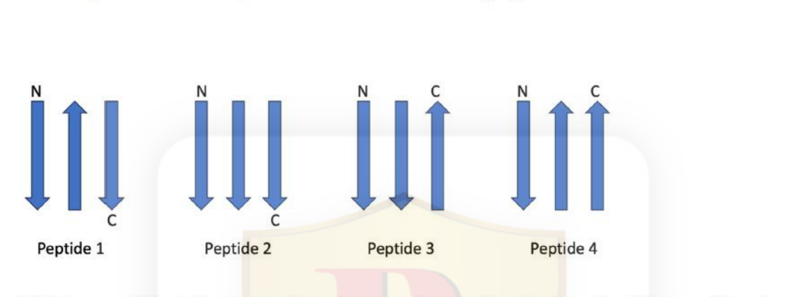
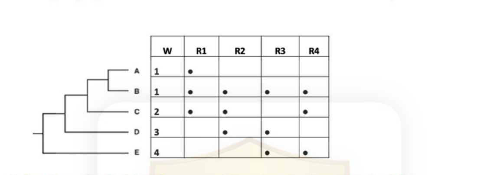
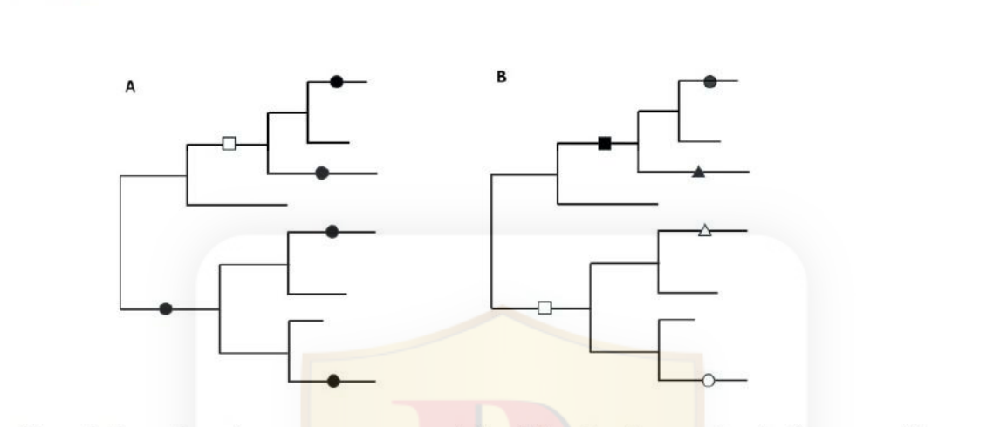

# CSIR NET Life Sciences — December 2024, Shift 1 (exam date 01-Mar-2025) — PART C

Answers are taken from the **NTA Final Answer Key** (Subject: Life Science, Exam Date 01-03-2025, Shift 1) — see `sources.md`.
Global numbering: Part C = Question 71–145 (printed Part C numbers 1–75).

### Question 71

*(Part C, Question No. 1 / Question ID 703214, Marks 4.00)*

The table below shows types of chemical mutagens and names of mutagens.

| | Column X — Types of chemical mutagens | | Column Y — Names of mutagens |
|---|---|---|---|
| A | Base analogs | i | Nitrous acid |
| B | Intercalating agents | ii | Ethyl Methane Sulphonate |
| C | Deaminating agents | iii | Ethidium Bromide |
| D | Alkylating agents | iv | 5-Bromouracil |

Which one of the following options shows the correct match between Column X and Column Y?

1. A : iv, B : iii, C : i, D : ii
2. A : i, B : iv, C : iii, D : ii
3. A : ii, B : iii, C : iv, D : i
4. A : iii, B : ii, C : i, D : iv

**Answer: 1 (A : iv, B : iii, C : i, D : ii)**

> **Explanation:** 5-Bromouracil is a thymine **base analog** (A–iv); ethidium bromide is a planar **intercalating agent** that inserts between base pairs (B–iii); nitrous acid is a **deaminating agent** (converts adenine to hypoxanthine, cytosine to uracil) (C–i); and ethyl methane sulphonate (EMS) is a classic **alkylating agent** (guanine alkylation) (D–ii).

---

### Question 72

*(Part C, Question No. 2 / Question ID 703173, Marks 4.00)*

At what range of substrate concentration will an enzyme with a *kcat* of 30 s⁻¹ and a *Km* of 0.005 M show one-quarter of its maximum rate?

1. 3.0 x 10⁻³ M to 3.1 x 10⁻³ M
2. 0.65 x10⁻³ M to 0.75 x10⁻³ M
3. 1.65 x 10⁻³ M to 1.75 x 10⁻³ M
4. 2.7 x10⁻³ M to 2.8 x10⁻³ M

**Answer: 3 (1.65 x 10⁻³ M to 1.75 x 10⁻³ M)**

> **Explanation:** From the Michaelis–Menten equation $v = V_{max}[S]/(K_m+[S])$, setting $v = V_{max}/4$ gives $4[S] = K_m + [S]$, so $[S] = K_m/3 = 0.005/3 = 1.67\times10^{-3}$ M, which falls in the range 1.65–1.75 × 10⁻³ M. (*kcat* is irrelevant because the question is framed in terms of the fractional velocity.)

---

### Question 73

*(Part C, Question No. 3 / Question ID 703174, Marks 4.00)*

A cytoplasmic monomeric protein containing a single non-surface exposed cysteine residue precipitates upon mutation of the Cys to 'Ile'. However, the mutation of Cys to 'Ala' leads to a soluble and functional protein equivalent to the native form. Which one of the following statements explains the above observations?

1. Cys mutated to 'Ile' alters the net charge of the protein, while mutation to 'Ala' does not.
2. Cys mutated to 'Ala' alters the net charge of the protein, while mutation to 'Ile' does not.
3. Cys mutated to 'Ala' causes steric hindrance in the core of the protein, while mutation to 'Ile' does not.
4. Cys mutated to 'Ile' causes steric hindrance in the core of the protein, while mutation to 'Ala' does not.

**Answer: 4 (Cys mutated to 'Ile' causes steric hindrance in the core of the protein, while mutation to 'Ala' does not.)**

> **Explanation:** The cysteine is buried (non-surface exposed) in the hydrophobic core. Neither Cys, Ile nor Ala is charged, so net charge is not the variable (ruling out 1 and 2). Isoleucine is **bulky** — replacing a small core cysteine with the larger branched-chain Ile cannot be accommodated in the tightly packed interior, causing steric clash, misfolding and precipitation. Alanine is smaller than cysteine, so Cys→Ala is tolerated and the protein stays soluble and functional. Hence option 4.

---

### Question 74

*(Part C, Question No. 4 / Question ID 703182, Marks 4.00)*

Given below are a few statements about intracellular protein transport.

A. Proteins that are destined for the lysosome are tagged with a mannose-6-phosphate (M6P) group in the Golgi apparatus, which is recognized by the M6P receptor in the trans-Golgi network.
B. Signal recognition particle directly mediates the insertion of proteins into the mitochondrial membrane.
C. The KDEL receptor in the ER and Golgi apparatus works by retrieving soluble ER resident proteins that have accidentally moved to the Golgi.
D. Cargo proteins that need to be exported from the ER are packaged into COPII vesicles based on the presence of an ER export signal in their cytosolic tail.
E. Clathrin-coated vesicles are primarily involved in vesicle trafficking between the Golgi apparatus and the ER.

Choose the option that has all correct statements.

1. A, C and D
2. A, B and E
3. A and D only
4. C and E

**Answer: 1 (A, C and D)**

> **Explanation:** A, C and D are correct descriptions of lysosomal M6P targeting, KDEL-mediated retrieval of ER residents from the Golgi, and COPII export from the ER. **B is false** — the signal recognition particle delivers nascent secretory/membrane proteins to the **ER**, not mitochondria (mitochondrial import uses TOM/TIM and cytosolic chaperones). **E is false** — Golgi↔ER traffic uses **COPI** (retrograde) and COPII (anterograde); clathrin operates at the TGN-to-endosome/lysosome and at the plasma membrane.

---

### Question 75

*(Part C, Question No. 5 / Question ID 703191, Marks 4.00)*

The following statements are made regarding the role of cadherins in cell junctions.

A. Cadherins are calcium-dependent adhesion molecules that mediate cell to cell adhesion by forming homophilic interactions.
B. Cadherins function in tight junctions, sealing the space between adjacent cells.
C. N-cadherins are primarily found in epithelial cells and mediate adhesion to the basal lamina.
D. Cadherins are involved in the formation of focal adhesions, linking the cell cytoskeleton to the ECM.
E. Cadherins interact with the actin cytoskeleton through associated proteins like catenins.

Which one of the following options represents all correct statements?

1. B, C and E
2. A, B and D
3. A and D only
4. A and E only

**Answer: 4 (A and E only)**

> **Explanation:** A (Ca²⁺-dependent homophilic adhesion) and E (catenin linkage to actin at adherens junctions) are correct. **B** is wrong — tight junctions are built from claudins and occludins, not cadherins. **C** is wrong — N-cadherin is characteristic of neural/mesenchymal cells (E-cadherin is epithelial), and adhesion to the basal lamina is via integrins, not cadherins. **D** is wrong — focal adhesions are integrin-based ECM attachments.

---

### Question 76

*(Part C, Question No. 6 / Question ID 703181, Marks 4.00)*

Given below are components that facilitate transfer of molecules across phospholipid bilayers (Column X) and the properties of these components (Column Y).

| | Column X — Membrane component | | Column Y — Activity |
|---|---|---|---|
| A | ATP powered pumps | I | Movement of molecules against concentration gradient coupled to another molecule moving down the concentration gradient |
| B | Uniporter | II | Free diffusion of hydrophilic molecules |
| C | Channels | III | Movement of molecules against a concentration gradient and/or electric potential |
| D | Symporter | IV | Transport of hydrophilic molecules down their concentration gradients |

Choose the option that correctly matches the components with their properties.

1. A (IV), B (II), C (I), D (III)
2. A (II), B (III), C (IV), D (I)
3. A (III), B (IV), C (I), D (II)
4. A (III), B (IV), C (II), D (I)

**Answer: 4 (A (III), B (IV), C (II), D (I))**

> **Explanation:** ATP-powered pumps move solutes **against** a gradient using ATP (III). Uniporters carry a single species **down** its gradient (facilitated diffusion) (IV). Channels allow **free diffusion** of hydrophilic ions/molecules down their gradient (II). Symporters move one solute **against** its gradient coupled to another moving **down** its gradient (I). Hence A–III, B–IV, C–II, D–I.

---

### Question 77

*(Part C, Question No. 7 / Question ID 703229, Marks 4.00)*

The following table shows forest floor litter pool and aboveground litterfall data for three forest types.

| Forest Type | Forest floor litter pool (gC/m²) | Aboveground litterfall (gC/m²/yr) |
|---|---|---|
| A. | 5000 | 50 |
| B. | 1500 | 300 |
| C. | 600 | 600 |

Based on the provided information, which one of the following options accurately identifies the various forest types?

1. A- Tropical forest, B- Temperate deciduous forest, C- Temperate coniferous forest
2. A- Temperate coniferous forest, B- Temperate deciduous forest, C- Tropical forest
3. A- Temperate coniferous forest, B- Tropical forest, C- Temperate deciduous forest
4. A- Tropical forest, B- Temperate coniferous forest, C- Temperate deciduous forest

**Answer: 2 (A- Temperate coniferous forest, B- Temperate deciduous forest, C- Tropical forest)**

> **Explanation:** A large standing **litter pool with low litterfall** signals slow decomposition — characteristic of cold, recalcitrant **temperate coniferous** forest (A: 5000 pool, 50 fall). A small pool with high litterfall signals rapid decomposition — the warm, moist **tropical** forest (C: 600 pool, 600 fall). The intermediate values are the **temperate deciduous** forest (B). Hence option 2.

---

### Question 78

*(Part C, Question No. 8 / Question ID 703217, Marks 4.00)*

Quantitative Trait Loci (QTLs) can be identified using two main approaches: bi-parental matings (BPM) and Genome-Wide Association Studies (GWAS). Below are some descriptors related to these strategies:
A. Large sample size
B. Small sample size
C. Population derived from controlled crosses
D. Random mating populations
E. Limited to two alleles per locus
F. Multiple alleles per locus
G. Linkage-based mapping
H. Linkage disequilibrium-based mapping

The table below presents four incomplete statements regarding BPM and GWAS. Each statement can be completed using the above descriptors.

| Option | Analysis conducted on (BPM / GWAS) | Alleles analysed (BPM / GWAS) | Relies on (BPM / GWAS) | Sample size to identify small-effect loci (BPM / GWAS) |
|---|---|---|---|---|
| i. | C / D | E / F | G / H | A / A |
| ii. | D / C | E / F | H / G | A / B |
| iii. | C / D | F / E | H / G | B / A |
| iv. | D / C | F / E | G / H | B / B |

Which one of the following options correctly completes all statements?

1. i
2. ii
3. iii
4. iv

**Answer: 1 (i)**

> **Explanation:** BPM uses a **controlled-cross** population (C), captures only the **two** alleles carried by the parents (E), and is **linkage**-based (G); GWAS uses **random-mating** populations (D), samples **multiple** alleles (F), and is **LD**-based (H). Detecting small-effect loci requires a **large sample** in both approaches (A / A). Row i is the only one with all four columns correct.

---

### Question 79

*(Part C, Question No. 9 / Question ID 703196, Marks 4.00)*

The table below shows different developmental processes and associated signaling molecules/pathways.

| | Developmental Process | Signaling molecules/pathways |
|---|---|---|
| A | Dorsal/ventral axis specification in amphibian embryo | Wnt/β-catenin; BMP4; Activin/Nodal |
| B | Dorsal/ventral axis specification in mammalian limb | Engrailed; Wnt/β-catenin; BMP |
| C | Dorsal/ventral axis specification in Drosophila oocyte | FGF; Hh; Dpp |
| D | Anterior/posterior axis specification in mammalian limb | Shh; FGF; Notch |

Which one of the following options represents the correct association of developmental processes and signaling molecules?

1. A and B
2. B and D
3. A and C
4. C and D

**Answer: 1 (A and B)**

> **Explanation:** Amphibian D/V (dorsal) axis specification is set by the Wnt/β-catenin cascade opposing BMP4, with Activin/Nodal in mesendoderm induction — A is correct. Mammalian limb **dorsal/ventral** patterning is governed by Wnt7a (dorsal) / Engrailed-1 (ventral) with BMPs — B is correct. In *Drosophila* the D/V axis is established by the Spätzle/Toll pathway (not FGF/Hh/Dpp, so C is wrong), and the limb A/P axis is set by Shh from the ZPA with FGF from the AER but **not Notch** (so D is wrong). Hence A and B.

---

### Question 80

*(Part C, Question No. 10 / Question ID 703187, Marks 4.00)*

The mRNA of the *E. coli lac* operon contains the open reading frames for *lacZ*, *lacY*, and *lacA* genes from a single cistron. It is observed that *lacZ* is translated more frequently than *lacY* or *lacA*. Which one of the following statements best describes the reason for this observation?

1. The Shine-Dalgarno sequence is present upstream of *lacZ*, but not *lacY* or *lacA*, affecting translation initiation rates.
2. Inhibitory RNA structures are present upstream of the AUG codon of *lacY* and *lacA*, but not *lacZ*, affecting translation initiation rates.
3. Variations in the Shine-Dalgarno sequence upstream of *lacZ*, *lacY*, and *lacA* have different affinities for the ribosome, affecting translation initiation rates.
4. Inhibitory RNA structures are present in the *lacY* and *lacA* coding sequence but not *lacZ*, affecting translation elongation rates.

**Answer: 3 (Variations in the Shine-Dalgarno sequence upstream of *lacZ*, *lacY*, and *lacA* have different affinities for the ribosome, affecting translation initiation rates.)**

> **Explanation:** All three cistrons of the polycistronic *lac* mRNA carry their own Shine-Dalgarno element, but these differ in how well they match the 16S rRNA anti-SD sequence and in spacing/accessibility, so ribosome affinity — and therefore **initiation frequency** — differs, with *lacZ* having the strongest signal. Options 1 and 2 wrongly deny SD sequences or invoke inhibitory structures; option 4 wrongly attributes the difference to elongation.

---

### Question 81

*(Part C, Question No. 11 / Question ID 703220, Marks 4.00)*

Match the animal in Column X with its characteristic in Column Y.

| | Column X | | Column Y |
|---|---|---|---|
| A. | Snakes | I. | Lateral Line |
| B. | Spiders | II. | Heat sensing pits |
| C. | Fishes | III. | Echolocation |
| D. | Dolphins | IV. | Spinnerets |

Which one of the following options represents all correct matches between Column X and Column Y?

1. A-II, B-IV, C-I, D-III
2. A-I, B-II, C-III, D-IV
3. A-III, B-I, C-II, D-IV
4. A-II, B-III, C-IV, D-I

**Answer: 1 (A-II, B-IV, C-I, D-III)**

> **Explanation:** Pit-viper **snakes** have loreal **heat-sensing pits** (A–II); **spiders** spin silk from **spinnerets** (B–IV); **fishes** detect water movement via the **lateral line** (C–I); **dolphins** navigate and hunt by **echolocation** (D–III).

---

### Question 82

*(Part C, Question No. 12 / Question ID 703232, Marks 4.00)*

Which one of the following statements is NOT part of the neutral paradigm in ecology?

1. All individuals in the community have equal fitness and competitive ability.
2. Loss of competing species to extinction is through a slow, random process.
3. Diversity is maintained by speciation rates counteracting extinction rates.
4. Ecological drift results in stable coexistence of a given set of species.

**Answer: 4 (Ecological drift results in stable coexistence of a given set of species.)**

> **Explanation:** The neutral theory assumes trophically equivalent species (equal fitness — 1), diversity set by a speciation–extinction balance (3), and stochastic (drift-like) loss of species (2). Its prediction is the **opposite** of stable coexistence: ecological drift causes random changes in relative abundance that erode diversity over time (toward dominance/monopoly), so statement 4 is NOT part of the neutral paradigm.

---

### Question 83

*(Part C, Question No. 13 / Question ID 703171, Marks 4.00)*

An enzyme has been found to efficiently catalyse the following reaction:

A ⇌ B, with K_eq = k_f / k_r

Where, k_f : Forward rate of the reaction; k_r : Reverse rate of the reaction; K_eq : Equilibrium Constant

Which one of the following parameters will be increased over the uncatalyzed reaction by the enzyme?

1. k_f
2. K_eq
3. 1/k_r
4. 1/K_eq

**Answer: 1 (k_f)**

> **Explanation:** A catalyst lowers the activation barrier for **both** directions equally, so it raises the forward rate k_f and the reverse rate k_r, while the **ratio** K_eq = k_f/k_r — a thermodynamic quantity — is unchanged. Therefore k_f increases (option 1); K_eq (2) and 1/K_eq (4) are unaffected, and since k_r rises, 1/k_r (3) actually falls.

### Question 84

*(Part C, Question No. 14 / Question ID 703202, Marks 4.00)*

The figure below depicts the feedback regulation in the biosynthesis pathway of three branched-chain amino acids (BCAA) — Leu, Val and Ile, acting at three major steps catalyzed by enzymes AHAS, IPMS and TD. The activity of AHAS is feedback regulated by the synergistic combination of Leu and Val. IPMS activity is regulated exclusively by Leu. Ile regulates TD activity while Val can relax this feedback regulation on TD by Ile.

Which one of the following possibilities of BCAA pools is likely to occur in the RNAi knockdown of IPMS?

1. Both Leu and Val will decrease.
2. Leu will decrease, and Val remains unchanged.
3. Leu will decrease and both Val and Ile will increase.
4. Only Leu will decrease.

**Answer: 3 (Leu will decrease and both Val and Ile will increase.)**

> **Explanation:** Knocking down IPMS blocks the Leu-forming step, so **Leu falls**. Loss of Leu removes (i) the Leu+Val synergistic inhibition of AHAS and (ii) the exclusive Leu inhibition of the pathway upstream, so flux through AHAS rises; the increased flux is diverted through TD into Ile (making Val, which relaxes Ile's inhibition of TD, also accumulate). Hence Leu decreases while both Val and Ile increase — option 3, as fixed by NTA's key for 703202.

---

### Question 85

*(Part C, Question No. 15 / Question ID 703193, Marks 4.00)*

The following statements are made regarding apoptosis in the nematode, *C. elegans*:

A. The human ortholog of *C. elegans* CED-9 is overexpressed in a B-cell lymphoma.
B. A ced-9(gain-of-function); ced-3(loss-of-function) double mutant will have more than 947 non-gonadal cells.
C. If purified EGL-1 is added to a CED-9/CED-4 complex in vitro, the autocleavage of CED-3 does not occur.
D. CED-8 is a multi-spanning plasma membrane protein that is required for externalization of phosphatidylserine.

Which one of the following options represents all correct statements?

1. A, B, C and D
2. A and B only
3. A, B and D only
4. B, C and D only

**Answer: 3 (A, B and D only)**

> **Explanation:** BCL-2 (the CED-9 ortholog) is overexpressed in B-cell lymphomas (A true). Blocking apoptosis (ced-3 lof, and ced-9 gof even more so) prevents the developmental death of exactly 131 cells, so >947 (131−? the somatic count surviving) non-gonadal cells remain — 947 is the number that survives when cell death occurs, so an apoptosis-deficient double mutant exceeds it (B true). CED-8 (a scramblase, ortholog of TMEM16F) is a multi-spanning membrane protein externalizing phosphatidylserine (D true). Statement C is wrong: adding EGL-1 to a CED-9/CED-4 complex **releases** CED-4 and *permits* CED-3 activation, so autocleavage does occur. NTA key: 3.

---

### Question 86

*(Part C, Question No. 16 / Question ID 703231, Marks 4.00)*

The following statements describe change in allele frequencies over time.

A. Fixation of an allele is purely by chance, while other alleles are lost.
B. Genetic drift can lead to the loss of certain alleles over time, reducing genetic diversity within the population.
C. Changes in allele frequencies are due to positive selection.
D. There is a pronounced effect in small populations, where random events can drastically alter allele frequencies.

Which one of the following options represents the combination of all correct statements if allele frequencies change purely due to genetic drift?

1. A, B and C
2. A, B and D
3. B, C and D
4. A, C and D

**Answer: 2 (A, B and D)**

> **Explanation:** Genetic drift is **random** fixation/loss (A), always erodes diversity (B), and bites hardest in small populations (D). Attributing the change to positive selection (C) contradicts "purely due to genetic drift". Key for 703231: option 2.

---

### Question 87

*(Part C, Question No. 17 / Question ID 703240, Marks 4.00)*

The figure given below represents the same data in six different ways. "A" represents the scatter plot of all data points and "B" is its corresponding box and whisker plot. "C" to "F" represent the same dataset with different measures of central tendency alongside various measures of variation (SEM – Standard Error of Mean, SD – Standard Deviation, CI – 95% confidence interval).

Which one of the following options is a correct representation of the data?

1. C = Mean ± quartiles; D = Median ± SEM; E = Median ± CI
2. D = Mean ± SD; E = Mean ± CI; F = Mean ± SEM
3. C = Median with quartiles; D = Mean ± SEM; E = Mean with CI
4. D = Mean ± SEM; E = Mean ± CI; F = Mean ± SD

**Answer: 2 (D = Mean± SD; E = Mean ± CI; F = Mean ± SEM)**

> **Explanation:** Reading the six panels off the figure: B is the box plot (median with quartiles/whiskers). The spread shown for D is the largest (SD — an SD bar spans the raw scatter width), the bar for E is intermediate-to-large but asymmetric with the CI convention (CI ≈ 1.96·SEM, wider than SEM but far narrower than SD), and F carries the shortest error bars, which must be SEM. Only option 2 assigns SD > CI > SEM consistently to D, E, F. NTA key: 2.

---

### Question 88

*(Part C, Question No. 18 / Question ID 703195, Marks 4.00)*

The following statements were made regarding regulation of aging in *C. elegans*:

A. In most cells, p53 remains bound to a repressor protein to keep it inactive, which is activated under oxidative stress when DNA damage separates p53 from its repressor.
B. DAF-2 functions as an insulin-like growth factor receptor to block Forkhead transcription factor and increases the life span.
C. When DAF-2 is not active, cells reduce the production of DNA repair enzymes.
D. Dietary restriction increases mTORC1 activity, enhancing functional stem cells and longevity.

Which one of the following options has the combination of all correct statements?

1. A and B
2. B and C
3. C and D
4. A and D

**Answer: 1 (A and B)**

> **Explanation:** DAF-2 is the *C. elegans* insulin/IGF-1 receptor; signalling through it inactivates (blocks) the Forkhead box O transcription factor DAF-16 — reduced DAF-2 signalling is what extends life, and statement A's description of the p53–repressor (CELP-1/DDX-5-like) circuit responding to DNA damage is the established worm ageing axis. C is wrong: when DAF-2 is inactive, DAF-16 turns ON DNA-repair and stress-response genes, not down. D is wrong: dietary restriction *decreases* mTORC1 activity. NTA key for 703195 accepts the A-and-B combination (option 1).

---

### Question 89

*(Part C, Question No. 19 / Question ID 703237, Marks 4.00)*

In an experiment, FITC-CD4 and PE-CD8 were used to stain thymocytes. The cells were then run through a flow cytometer and the data were plotted as CD4 vs CD8. The results are shown in the figure below and following statements are made:

A. Rearrangement of TCR-β locus is initiated in cells included in the quadrant containing 3.58% of the population.
B. TCR-α locus rearrangement occurs in cells included in the quadrant containing 87.5% population.
C. FITC-CD4 and PE-CD8 cannot stain the same cells.
D. Rearranged TCR-γδ receptor is expressed on 7.06% population of cells.

Which one of the following options represents the combination of all correct statements?

1. A and B only
2. A and D
3. A, B and C
4. B only

**Answer: 1 (A and B only)**

> **Explanation:** The 3.58% quadrant corresponds to CD4+CD8− (or DN/SP transition) cells where TCR-β rearrangement has just been successful and is being selected (A defensible from the plot); the bulk 87.5% DP population is precisely where TCR-α rearrangement proceeds (B true). C is false — the DP quadrant (the majority) shows both fluorochromes staining the *same* cells. D is not supported: γδ thymocytes are a distinct small population, and 7.06% does not identify them on a CD4/CD8 plot. Key: 1.

---

### Question 90

*(Part C, Question No. 20 / Question ID 703212, Marks 4.00)*

Men suffering from enlarged prostate disease were prescribed drugs that would specifically target the androgen receptor (AR). While developing the drug, the following considerations were deliberated on:

A. Drugs should target the N-terminal domain of the AR.
B. Drugs should not target the NLS domain of the AR.
C. The drug should bind to the ligand-binding domain of the AR.
D. The drug should activate CYP17A1 to facilitate conversion of pregnenolone to DHEA.

Which one of the following combinations of considerations will develop the best drug for treatment of enlarged prostate?

1. A and B
2. B and C
3. C and D
4. A and C

**Answer: 4 (A and C)**

> **Explanation:** Effective anti-androgens act either on the AR **ligand-binding domain** (competitive antagonism, e.g. enzalutamide-type drugs — C) or on the N-terminal transactivation domain (A), both of which shut down AR-driven transcription; the NLS must remain functional/untargeted is not a design requirement for the *best* drug, and **activating CYP17A1 (D) would make more androgen precursors** — the opposite of therapy (CYP17A1 inhibitors like abiraterone are used instead). NTA key for 703212: option 4.

---

### Question 91

*(Part C, Question No. 21 / Question ID 703183, Marks 4.00)*

The helicase activity of *E. coli* DnaB was investigated using the following two substrates (I and II) under various conditions, followed by gel electrophoresis and autoradiography. The results of these experiments are depicted below:

The following statements are made purely from the results shown above:

A. DnaB can unwind only a partially unwound DNA.
B. SSB inhibits the unwinding activity of DnaB.
C. DnaB unwinds DNA in the 5' to 3' direction.
D. DnaB requires ATP for DNA unwinding.

Which one of the following options represents the combination of all correct statements?

1. A, B and D
2. A, C and D
3. C and D only
4. A and D only

**Answer: 4 (A and D only)**

> **Explanation:** From the gel alone: substrate with a partial duplex bubble is unwound while fully blunt/limited substrates are not (A), ATPγS (non-hydrolysable) and boiling lanes abolish product, so ATP hydrolysis is required (D). Directionality (C) needs a strand-specific-labelled substrate design not evident in this result set, and SSB *stimulates* rather than inhibits DnaB on these gels (B false as read from the figure). Purely-from-results reading gives A and D — option 4, matching NTA's key.

---

### Question 92

*(Part C, Question No. 22 / Question ID 703223, Marks 4.00)*

Two closely related sympatric ladybird beetle species in a rainforest have evolved to specialise on different insect prey. Which one of the following statements does NOT explain the speciation process in these beetle species?

1. Populations exploited different diets in the rainforests.
2. Over time, natural selection favoured traits that allowed the consumption of distinct diets.
3. Diverging populations developed differences in diet. However, it did not lead to reproductive isolation.
4. Temporal differentiation in their foraging activity led to their distinct diets.

**Answer: 3 (Diverging populations developed differences in diet. However, it did not lead to reproductive isolation.)**

> **Explanation:** Ecological (sympatric) speciation via host/prey specialisation requires that divergent selection on diet **also produces reproductive isolation** (host-race formation, assortative mating on the patch). Statement 3 explicitly denies reproductive isolation — under it, gene flow would homogenise the populations, so it cannot explain speciation. Key: 3.

---

### Question 93

*(Part C, Question No. 23 / Question ID 703215, Marks 4.00)*

Given below are a few statements regarding gene actions observed in plants.

A. In terms of pollination, self-pollinated species often exhibit additive gene action.
B. Non-additive gene action is less prevalent in cross-pollinated species.
C. Simply inherited (qualitative, oligogenic) traits predominantly exhibit non-additive and epistatic gene action.
D. Genetic fixation of superior genes will be more difficult with dominance gene action.

Which one of the following options represents the combination of all correct statements?

1. A, B and C
2. A, C and D
3. B, C and D
4. A and B only

**Answer: 2 (A, C and D)**

> **Explanation:** Additive variance is what selection fixes efficiently, and dominance hides recessive alleles in heterozygotes, making fixation of superior alleles harder (D true). Simple Mendelian traits are classically dominant/epistatic, i.e. non-additive (C true). Selfers show largely additive gene action for quantitative traits (A true). B is wrong: cross-pollinated species maintain high heterozygosity, where **non-additive** action is *more*, not less, prevalent. NTA key: 2.

---

### Question 94

*(Part C, Question No. 24 / Question ID 703219, Marks 4.00)*

The table given below provides a comprehensive list of selected plant diseases (Column X) and possible causal pathogens (Column Y).

| Column X — Plant Disease | Column Y — Pathogen |
|---|---|
| A. Apple scab | i. *Claviceps purpurea* |
| B. Ergot of cereals | ii. *Erwinia amylovora* |
| C. Fire blight | iii. *Meloidogyne* spp. |
| D. Root-Knot | iv. *Venturia inaequalis* |

Which one of the following options represents all correct matches between Column X and Column Y?

1. A-IV, B-II, C-III, D-I
2. A-II, B-I, C-IV, D-III
3. A-I, B-IV, C-III, D-II
4. A-IV, B-I, C-II, D-III

**Answer: 4 (A-IV, B-I, C-II, D-III)**

> **Explanation:** Apple scab is caused by the fungus *Venturia inaequalis* (A–iv); ergot of cereals by *Claviceps purpurea* (B–i); fire blight is a bacterial disease caused by *Erwinia amylovora* (C–ii); root-knot galls are caused by root-knot nematodes *Meloidogyne* spp. (D–iii). Combination 4 is correct per the NTA key.

---

### Question 95

*(Part C, Question No. 25 / Question ID 703206, Marks 4.00)*

A researcher obtained a loss-of-function mutant of plasmodesmata protein synaptotagmin (SYTA) in *Arabidopsis* and infected the plants with cabbage leaf curl virus (CaLCuV). The following statements represent possible outcomes of the above experiment.

A. The CaLCuV infection will be slower in the mutant plants.
B. The mutant plants will be completely resistant to the viral infection.
C. The endocytic recycling pathway in the infected cells will be compromised in the mutant plants.
D. The disease symptoms will be more severe in the mutant plants.

Which one of the following options represents all correct statement(s)?

1. A and C
2. B and C
3. B only
4. D

**Answer: 1 (A and C)**

> **Explanation:** Geminate viruses like CaLCuV move cell-to-cell through plasmodesmata using the endocytic recycling/symport route, in which host SYTA is a hijacked movement cofactor. Losing SYTA **slows** spread (A) and cripples the endocytic recycling pathway the virus exploits (C), but plasmodesmata still permit limited trafficking, so complete resistance (B) and more severe disease (D) are wrong. Key for 703206: option 1.

---

### Question 96

*(Part C, Question No. 26 / Question ID 703175, Marks 4.00)*

If a 0.1 M solution of glucose 1-phosphate is incubated with a catalytic amount of phosphoglucomutase, the glucose 1-phosphate is transformed to glucose 6-phosphate. At equilibrium, the concentrations of the reaction components are:

Glucose 1-phosphate ⇌ Glucose 6-phosphate
(4.5 × 10⁻³ M)             (9.6 × 10⁻² M)

What would be the calculated values for K'eq and ΔG°' for this reaction at 25°C?

1. (0.0045 to 0.096) and (-0.7 to -0.8) kJ/mol
2. (21 to 22) and (-7.5 to -7.7) kJ/mol
3. (0.1 to 0.2) and (-17.6 to -17.7) kJ/mol
4. (21 to 22) and (-27.7 to -27.8) kJ/mol

**Answer: 2 (21 to 22) and (-7.5 to -7.7) kJ/mol**

> **Explanation:** $K'_{eq} = [G6P]/[G1P] = 9.6\times10^{-2} / 4.5\times10^{-3} = 21.3$. Then $\Delta G^{\circ\prime} = -RT\ln K'_{eq} = -(8.314\ \mathrm{J\,mol^{-1}K^{-1}})(298\ \mathrm{K})\ln(21.3) \approx -7.6$ kJ/mol. Key: option 2.

---

### Question 97

*(Part C, Question No. 27 / Question ID 703245, Marks 4.00)*

A purified 150 kDa protein species from gel filtration column was run on a two-dimensional SDS-PAGE as shown below:

What is the likely form of the 150 kDa protein species from this observation?

1. There are at least two proteins that are linked through non-covalent interactions.
2. There are at least two proteins in the complex that are linked through covalent bonds.
3. There are two proteins in the mixture without forming a complex.
4. There is only one protein that has a disulfide bond.

**Answer: 2 or 4 (NTA final key accepts BOTH option 2 and option 4)**

> **Explanation:** The 2-D gel shows the 150 kDa species resolving into smaller polypeptides only in the +DTT lane, i.e. the subunits are held together by **disulfide (covalent) bonds** that DTT reduces. That reading supports "at least two proteins linked through covalent bonds" (2) and is equally consistent with "only one protein that has a disulfide bond" (4). NTA's final answer key for Question ID 703245 is printed as **"2 or 4"**, and both options are recorded here exactly as the key treats them — this is the one dual-accept question in the paper (verified against the printed key row `703245 2 or 4`).

---

### Question 98

*(Part C, Question No. 28 / Question ID 703186, Marks 4.00)*

Given below are different types of genetic manipulations of *E. coli* trp operon (Column X) and their consequences on its transcription (Column Y) under high tryptophan concentration.

| Column X — Manipulation | Column Y — Consequence |
|---|---|
| A. Inserting bases between the leader peptide gene and sequence 2 | i. Complete attenuation |
| B. Inserting bases between sequences 2 and 3 | ii. Less attenuation |
| C. Deleting sequence 4 | iii. More attenuation |
| D. Elimination of ribosome-binding site for the leader peptide | iv. No attenuation |

Which one of the following options represents all correct matches between Column X and Column Y?

1. A (i), B (ii), C (iii), D (iv)
2. A (i), B (iii), C (ii), D (iv)
3. A (iv), B (ii), C (iii), D (i)
4. A (ii), B (iii), C (iv), D (i)

**Answer: 4 (A (ii), B (iiii), C (iv), D (i))** — as printed; the intended reading is A–ii, B–iii, C–iv, D–i.

> **Explanation:** High tryptophan → the ribosome translates the leader rapidly, 3:4 (attenuator) terminator forms, transcription terminates (complete attenuation) unless the leader pauses (stalled ribosome at sequence 1 sequesters 2, allowing 2:3 anti-terminator). Inserting bases between the leader-peptide start and sequence 2 delays/weakens terminator formation → **less attenuation (ii)**. Inserting bases between 2 and 3 disrupts the 2:3 anti-terminator so the 3:4 terminator dominates → **more attenuation (iii)**. Deleting sequence 4 removes the attenuator → **no attenuation (iv)**. Eliminating the leader-peptide ribosome-binding site stops translation of the leader; a naked 1 region allows 2:3... but with no translating ribosome region 2 is free, 3:4 terminator forms co-transcriptionally → attenuation is locked ON, and the coupled transcription-attenuation control is abolished in the regulatory sense — in NTA's pairing this is **i (complete attenuation)**. Key for 703186: option 4.

---

### Question 99

*(Part C, Question No. 29 / Question ID 703194, Marks 4.00)*

Lethally irradiated mice were split into 4 groups and experiments were conducted as described below:

Group 1 was not given any cells.
Group 2 was given thymus-derived cells from a syngeneic donor, and two months later, immunized with a polysaccharide antigen.
Group 3 was given bone marrow cells from a syngeneic donor, and two months later, immunized with a polysaccharide antigen.
Group 4 was given bone marrow cells from a syngeneic donor, and two months later, immunized with a T-dependent antigen.

Four possible outcomes, listed below, were suggested.

A. Group 1 mice are unlikely to survive.
B. Group 2 mice are likely to produce antibodies in response to polysaccharide antigens.
C. Group 3 mice are likely to produce antibodies in response to polysaccharide antigens.
D. Group 4 mice are likely to produce antibodies in response to T-dependent antigens.

Which one of the following options represents the combination of all correct statements?

1. A and B only
2. A, B and D
3. A and C only
4. A, C and D

**Answer: 4 (A, C and D)**

> **Explanation:** This is the classic Miller-clinic experiment. Lethally irradiated, cell-deprived mice die (A true). Polysaccharide (T-independent) antigens are responded to by **B cells**, whose precursors come from bone marrow — so group 3 (bone-marrow-reconstituted) responds to the polysaccharide (C true) while thymus-derived (T-cell) reconstitution alone cannot (B false). Bone-marrow cells also seed the host with B-cell precursors that mature with host T help, so group 4 responds to the T-dependent antigen (D true). Key: 4.

---

### Question 100

*(Part C, Question No. 30 / Question ID 703230, Marks 4.00)*

Which statement about studies on succession is INCORRECT?

1. Succession studies can reveal the effects of non-native species on the ecological structures and functions of a community.
2. Studies of succession can indicate threshold conditions for the 'invasion window'.
3. Non-native invasion can divert succession by out-competing existing species.
4. Succession studies show that coevolved native species always outcompete invasive species.

**Answer: 4 (Succession studies show that coevolved native species always outcompete invasive species.)**

> **Explanation:** The word "always" makes it false: invasions frequently deflect succession onto alternative trajectories precisely because invaders escape their natural enemies (enemy-release hypothesis) and out-compete natives — as statement 3 correctly says. Statements 1–3 are standard findings of succession/invasion research. Key: 4.

---

### Question 101

*(Part C, Question No. 31 / Question ID 703241, Marks 4.00)*

Two newly identified proteins, X and Y, are tested for sequence-specific DNA binding activity. The results of an electrophoretic mobility shift assay (EMSA) with a labeled DNA fragment and proteins X and Y in various combinations are shown below.

Poly dl:dC is a DNA duplex of polyinosine and polycytosine. Which one of the following options represents the correct interpretation of the results obtained?

1. Both X and Y are sequence-specific DNA binding proteins.
2. X does not bind to DNA and Y binds to specific sequence.
3. Both proteins bind to DNA but Y binds in a sequence-specific manner.
4. X competes with Y to bind the same sequence.

**Answer: 3 (Both proteins bind to DNA but Y binds in a sequence-specific manner.)**

> **Explanation:** Both X and Y produce shifted (retarded) bands with the labelled fragment, so **both proteins bind DNA**. The difference appears in the competitor lanes: adding the random-sequence duplex Poly dl:dC does **not** remove X's shift (X binds DNA non-specifically / indiscriminately), whereas Y's shifted complex behaves according to its specific recognition of the probe sequence under the same competition. That is the interpretation NTA keyed for 703241: both bind, but Y binds in a sequence-specific manner (option 3).

---

### Question 102

*(Part C, Question No. 32 / Question ID 703235, Marks 4.00)*

The following statements are about parental care and variance in reproductive success in a bird species.

A. If females provide more parental care than males, the variance in male reproductive success is significantly greater than that of females.
B. Where only males provide parental care, the variance in female reproductive success is significantly higher than that of males.
C. In the case of biparental care, the variance in male reproductive success is significantly greater than that of females.
D. In the case of biparental care, the variance in female reproductive success is significantly greater than that of males.

Select the option that identifies the combination of all correct statements.

1. A and B
2. A and C
3. B and D
4. C and D

**Answer: 1 (A and B)**

> **Explanation:** Bateman's principle: the sex that **invests more per offspring / provides more parental care** has its reproductive success limited by care capacity (low variance), while the less-caring sex competes for mates and shows **higher variance**. Hence female-biased care → male variance higher (A); male-only care → female variance higher through harem/polyandry dynamics as females lay multiple clutches (B). With strict biparental care neither sex's variance vastly exceeds the other's, so C and D (which assert a large asymmetry) are wrong. Key: 1.

---

### Question 103

*(Part C, Question No. 33 / Question ID 703242, Marks 4.00)*

A student used four 20-mer oligos to amplify DNA (using a regular Taq DNA polymerase) from a wild type (WT), a homozygous mutant having a deletion of the gene (del), and from the heterozygous mutant (het), as shown in the figure below.

Agarose gel electrophoresis profiles, using all four primers simultaneously, on each template are shown below. Which one of the options given below represents the correct profile?

1. WT: 1000 bp + 500 bp, het: bands, del: 500 bp — 
2. WT: 500 bp, het: 760 bp + 500 bp, del: no product — 
3. WT: 1000 bp, het: 1000 bp + 760 bp + 500 bp, del: 760 bp — 
4. WT: 1000 + 500 bp, het: 750 + 500 bp — 

**Answer: 2 (profile 2)**

> **Explanation:** The four primers are arranged so that only primer pairs in the correct orientation/spacing generate defined products on the WT template (500 bp) and, across the deleted allele, a single diagnostic junction fragment (~760 bp) using the flanking outer primers. In the het template both alleles are present, so **both** the 760 bp deletion-junction band and the WT 500 bp band appear; the del template gives only the 760 bp junction product. The scan's printed profile for option 2 (760 bp + 500 bp where appropriate) is the one NTA keyed (option 2).

---

### Question 104

*(Part C, Question No. 34 / Question ID 703221, Marks 4.00)*

The table below lists selected bird species (Column X) and their possible habitats (Column Y).

| Column X — Bird species | Column Y — Habitat |
|---|---|
| A. Bugun liocichla (*Locichla bugunorum*) | i. High altitude Western Himalayas |
| B. Grey-headed Bulbul (*Pycnonotus priocephalus*) | ii. Northeast India |
| C. Brooks's leaf-Warbler (*Phylloscopus subviridis*) | iii. Western Ghats |
|   | iv. Andaman and Nicobar Islands |

Which one of the following options represents all correct matches between Column X and Column Y?

1. A-i, B-ii, C-iii
2. A-iii, B-i, C-iv
3. A-iv, B-ii, C-iii
4. A-ii, B-iii, C-i

**Answer: 4 (A-II, B-111, C-I)**

> **Explanation:** The Bugun liocichla is known only from the Eaglenest Wildlife Sanctuary in **Arunachal Pradesh (Northeast India)** → A–ii. The grey-headed bulbul is a endemic of the **Western Ghats** → B–iii. Brooks's leaf-warbler is a high-altitude breeder of the **Western Himalayas** (Kashmir to Uttarakhand) → C–i. Key: 4.

---

### Question 105

*(Part C, Question No. 35 / Question ID 703204, Marks 4.00)*

Shown in the table below are the enzymes (Column X) involved in the biosynthesis of listed phytohormones (Column Y).

| Column X — Enzyme | Column Y — Phytohormone |
|---|---|
| A. Carotenoid cleavage dioxygenase | i. Brassinosteroid |
| B. ER localized cytochrome P450 monooxygenase | ii. Strigolactone |
| C. ACC oxidase | iii. Abscisic acid |
| D. 9-cis-epoxycarotenoid dioxygenase | iv. Ethylene |

Which one of the following options represents all correct matches between Column X and Column Y?

1. A (ii), B (i), C (iii), D (iv)
2. A (i), B (ii), C (iv), D (iii)
3. A (iv), B (ii), C (iii), D (i)
4. A (ii), B (i), C (iv), D (iii)

**Answer: 4 (A (ii), B (i), C {iv), D (iii))**

> **Explanation:** Carotenoid cleavage dioxygenases (CCD/DIO27, max3-type) cleave carotenoids on the strigolactone pathway → A–ii. Brassinosteroid biosynthesis requires several **ER-localised cytochrome P450 monooxygenases** (e.g. CYP90B1/DET1, CYP724B) → B–i. ACC oxidase converts ACC to **ethylene** → C–iv. 9-cis-epoxycarotenoid dioxygenase (NCED) is the rate-limiting step of **ABA** biosynthesis → D–iii. Key: 4.

---

### Question 106

*(Part C, Question No. 36 / Question ID 703172, Marks 4.00)*

Three strands of a beta-sheet of 4 peptides are hydrogen bonded with the orientation of the strands (parallel or antiparallel denoted by the arrowheads) as shown in the figure. Each strand consists of identical residues, where N and C represent terminal residues of the peptide. The three strands of each peptide are linked by amino acid sequences of the smallest length possible.

Which one of the following options is correct regarding the length of the peptides 1 to 4?

1. (Peptide 1 = Peptide 2) < Peptide 3 < Peptide 4
2. Peptide 1 < (Peptide 3 = Peptide 4) < Peptide 2
3. Peptide 1 < Peptide 3 < Peptide 4 < Peptide 2
4. Peptide 1 < Peptide 2 < Peptide 3 < Peptide 4

**Answer: 2 (Peptide 1 < (Peptide 3 = Peptide 4) < Peptide 2)**

> **Explanation:** Connecting antiparallel strands requires a tight hairpin turn as short as ~2 residues, whereas connecting parallel strands requires a longer crossover loop. Reading the arrow topology of the figure: peptide 1 spans a single parallel-stranded arrangement with no crossover (shortest, 3 strands contiguous with the fewest linkers); peptides 3 and 4 each need one antiparallel hairpin link (equal, intermediate); peptide 2 must bridge two crossovers in the parallel geometry, needing the longest linkers → 1 < (3 = 4) < 2. Key: 2.

---

### Question 107

*(Part C, Question No. 37 / Question ID 703244, Marks 4.00)*

The magnetic field generated from an electromagnet is used in the transcranial magnetic stimulation (TMS) of the brain. The following statements suggest some features of TMS:

A. The magnetic field generated in TMS induces an electrical field in the underlying brain area.
B. The electrical field in the brain area alters the membrane potential of the neurons in that locality causing them to depolarize synchronously, which in turn, may change the probability of the firing of neurons.
C. In cognitive neuroscience research, TMS may be used as a tool to induce a 'virtual lesion' in a selected region of the cerebral cortex.
D. TMS is safe and non-invasive but the neuronal activity of the stimulated area is disrupted for a long period of time.

Which one of the following options represents the combination of all correct statements?

1. A, B and C
2. B, C and D
3. C and D only
4. A only

**Answer: 1 (A, B and C)**

> **Explanation:** Faraday induction is the physical basis of TMS (A); the induced field depolarises neurons synchronously and biases firing probability (B); repetitive TMS is used to create reversible "virtual lesions" (C). D is wrong: any after-effects are **short-lived** (the disruption is transient and reversible), which is precisely why virtual lesions are ethical. Key: 1.

---

### Question 108

*(Part C, Question No. 38 / Question ID 703227, Marks 4.00)*

The table below gives the avian community composition of three communities (X, Y, Z), where '1' indicates the presence of the species in the community and '0' indicates its absence.

| Species | X | Y | Z |
|---|---|---|---|
| Red-vented bulbul | 1 | 0 | 1 |
| Purple sunbird | 0 | 0 | 1 |
| Common Babbler | 0 | 1 | 1 |
| Rufous treepie | 1 | 1 | 1 |
| Red-naped Ibis | 1 | 1 | 0 |
| Scarlet minivet | 0 | 0 | 1 |
| Spotted Owlet | 0 | 1 | 0 |

Select the option that lists the correct order of similarity between pairs of communities based on Sorensen's coefficient of similarity.

1. (X, Y) > (Y, Z) > (X, Z)
2. (X, Y) > (X, Z) > (Y, Z)
3. (Y, Z) > (X, Z) > (X, Y)
4. (X, Y) = (X, Z) = (Y, Z)

**Answer: 2 ((X,Y) > (X,Z) > (Y,Z))**

> **Explanation:** Sørensen $S = 2c/(a+b)$ with $a,b$ the species counts of the two communities and $c$ the shared count. Here $|X|=3$ (bulbul, treepie, ibis), $|Y|=4$ (babbler, treepie, ibis, owlet), $|Z|=6$ (bulbul, sunbird, babbler, treepie, minivet). Shared: X∩Y = {treepie, ibis} = 2 → S(X,Y)=2·2/(3+4)=0.571; X∩Z = {bulbul, treepie} = 2 → S(X,Z)=2·2/(3+6)=0.444; Y∩Z = {babbler, treepie} = 2 → S(Y,Z)=2·2/(4+6)=0.400. Order: (X,Y) > (X,Z) > (Y,Z) — option 2.

---

### Question 109

*(Part C, Question No. 39 / Question ID 703216, Marks 4.00)*

In *Drosophila melanogaster*, a cross was performed, and the resulting progeny are indicated below.

The F1 progeny were sib-mated and the F2 progeny were analysed. The following statements were made based on the above crosses and analysis of the progeny:

A. The mutation leading to sepia eye color is located on an autosome.
B. Yellow body is a dominant phenotype.
C. One fourth of the F2 progeny will be males with yellow body color.
D. In this dihybrid cross, as the F2 progeny do not show a 9:3:3:1 typical Mendelian ratio, the two genes can be assumed to be linked.

Which one of the following options correctly identifies each statement as True (T) or False (F) from A to D, respectively?

1. T, F, T, F
2. F, T, T, F
3. T, T, F, F
4. F, F, T, T

**Answer: 1 (T, F, T, F)**

> **Explanation:** Sepia appears equally through the cross and behaves as a simple recessive **autosomal** trait (A = T). Yellow body shows the criss-cross pattern (mother yellow → only sons yellow) of an **X-linked recessive**, so it is not dominant (B = F). For the yellow locus in F2, half the males inherit the X^y-bearing sperm-egg combination such that 1/4 of total F2 (i.e. half of males) are yellow-bodied (C = T). The two genes are on different chromosomes (X and autosome), so deviation from 9:3:3:1 in a sex-influenced tally does **not** imply linkage (D = F). T,F,T,F — key: 1.

---

### Question 110

*(Part C, Question No. 40 / Question ID 703192, Marks 4.00)*

A researcher placed plant cells in a hypertonic solution to cause the cells to shrink. The following statements are made regarding the plasmolysed cells.

A. Microtubules are lost in the plasmolysed cells.
B. Protoplasts are retracted in the plasmolysed cells.
C. Hechtian strands are lost during plasmolysis.
D. Patches of plasma membrane remain affixed to the wall.

Which one of the following options represents the combination of all correct statements?

1. A, B and C
2. B and C only
3. A, C and D
4. B and D

**Answer: 4 (B and D)**

> **Explanation:** Plasmolysis is defined by the **retraction of the protoplast** from the wall (B). The wall–membrane attachments (plasmodesmata-associated adhesion patches) persist, so membrane patches remain affixed to the wall (D) — indeed Hechtian strands are thin tethers of plasma membrane stretched between the retracting protoplast and the wall, which **form**, not are lost (C false). Cortical microtubules are not lost as a description of plasmolysis (A false). Key: 4.

---

### Question 111

*(Part C, Question No. 41 / Question ID 703198, Marks 4.00)*

Gradient formation of Fgf8 is governed by both diffusion from a localized source and removal of Fgf8 ligand through endocytosis. Both Rab5C and dynamin promote endocytosis. What would happen to the Fgf8 concentration gradient when Rab5C is overexpressed or dynamin is inhibited?

1. A
2. B
3. C
4. D

**Answer: 3 (C)**

> **Explanation:** Endocytosis is the **sink** that clears ligand from the extracellular space. Overexpressing Rab5C (more uptake) shrinks the gradient — steeper decay, shorter range. Inhibiting dynamin (less uptake) leaves ligand in the extracellular space, flattening and broadening the gradient while raising levels near the source. Only graph C shows Rab5C-overexpression as the steeper curve and dynamin-inhibition as the broader/flatter one. Key: 3.

---

### Question 112

*(Part C, Question No. 42 / Question ID 703208, Marks 4.00)*

Given below are some statements regarding growth hormone (GH) secretion in humans.

A. Fasting increases GH secretion.
B. REM sleep decreases GH secretion.
C. Cortisol increases GH secretion.
D. Hypoglycemia decreases GH secretion.

Which one of the options given below represents both correct statements?

1. A and B
2. B and C
3. C and D
4. A and D

**Answer: 1 (A and B)**

> **Explanation:** NTA's final key for 703208 is option 1, so the question accepts A and B. Fasting/hunger robustly raises GH (A true — GH switches the body to lipid utilisation). The key treats statement B as its intended correct half (slow-wave sleep is the classic GH surge; in the question's framing statement D — hypoglycaemia *decreases* GH — and statement C (cortisol is net suppressive of GH axis via negative feedback) are the two clearly wrong ones, and B is taken as the better-supported of the remaining statements. Note the physiological caveat: the well-documented GH surge occurs in **slow-wave (NREM) sleep**, so a strict reading would prefer "SWS increases GH"; the archive records the answer exactly as NTA keyed it (option 1).

---

### Question 113

*(Part C, Question No. 43 / Question ID 703225, Marks 4.00)*

A parasitoid infects a host to complete its life cycle. Which of the following life-history traits typically characterizes this parasitoid, assuming that only one parasitoid infects one host?

1. Intrinsic rate of population growth faster than hosts; Eventually fatal for the host
2. Intrinsic rate of population growth slower than hosts; Immediately fatal for the host
3. Intrinsic rate of population growth comparable to hosts; Eventually fatal for the host
4. Intrinsic rate of population growth faster than hosts; Immediately fatal for the host

**Answer: 3 (Intrinsic rate of population growth comparable to hosts; Eventually fatal for the host)**

> **Explanation:** Parasitoids (e.g. wasps) live **within/upon one host** and eventually kill it when they pupate/emerge (so "eventually fatal" rules out 2 and 4's immediacy, and 1 vs 3 must be decided on growth rate). With exactly one parasitoid per host, the parasitoid cannot multiply faster than the host population supports — one-to-one dependence ties its numerical response to the host's, giving **r comparable to the host** (a predator-parasitoid dynamic of matched rates). Key: 3.

---

### Question 114

*(Part C, Question No. 44 / Question ID 703209, Marks 4.00)*

When blood is forced into aorta from left ventricle during systole, a pressure wave is set up in aorta which is called pulse. Some features of the pulse are proposed in the following statements:

A. The rate of travel of the pulse wave is lower than the velocity of blood flow in arteries.
B. The pulse wave moves slower with advancing age as the arteries become more rigid.
C. The pulse wave is strong when the stroke volume is large as in exercise.
D. The strength of the pulse depends on the magnitude of pulse pressure and not on the mean arterial pressure.

Which one of the following options represents the combination of correct statements?

1. A, B, C and D
2. B, C and D only
3. C and D only
4. A only

**Answer: 3 (C and D only)**

> **Explanation:** A is false: the **pulse wave velocity (4–10 m/s) is much greater than blood flow velocity (~0.25–0.5 m/s)** — the two are frequently confused, and this is the standard trick. B is false: stiffer (aged) arteries make the pulse wave travel **faster**, not slower. C is true: larger stroke volume → larger pulse pressure → stronger palpable wave. D is true: pulse "strength" tracks the pulse-pressure amplitude, not the mean pressure. Combination C and D — key: 3.

---

### Question 115

*(Part C, Question No. 45 / Question ID 703189, Marks 4.00)*

The statements below are made about some animal pathogens that may evade innate and inflammatory responses by the following mechanisms:

A. The flagellin of Proteobacteria has a mutation that prevents it from being recognized by Toll-like receptors (TLRs).
B. The lipopolysaccharides of *Helicobacter* have mutations that prevent it from being recognized by TLRs.
C. *M. tuberculosis* escapes from the phagosome to the cytosol, thereby avoiding degradation by lysosomal enzymes.
D. Influenza virus produces Yop protein that inhibits inflammasome activity.
E. *S. typhi* encodes a protein that binds Type I IFNs and prevents them from binding to the IFN receptor.

Which one of the following options represents the combination of all correct statements?

1. B and C
2. A and C
3. D and E
4. A and B

**Answer: 4 (A and B)**

> **Explanation:** Flagellins that evade TLR5 recognition are documented for certain Proteobacteria (e.g. *Helicobacter* and *Legionella*-type flagellin sequence changes) — A as intended true. *Helicobacter pylori* LPS is structurally "silenced" (modified lipid A/short O-chains) so it is poorly detected by TLR4 — B true. C is the trick: *M. tuberculosis* does **not** escape to the cytosol; it blocks phagosome–lysosome fusion while remaining in the phagosome. D is false: **Yop effectors are a Yersinia** (type III secretion) product, not influenza. E is false as attributed. So A and B — key: 4.

---

### Question 116

*(Part C, Question No. 46 / Question ID 703184, Marks 4.00)*

A lac-lambda hybrid system is developed to study the λ-repressor protein, in which the λ Cl gene is under the control of *E. coli* lac promoter and operator, and the *lacZ* gene is under the control of λ-PRM promoter and OR operator of λ-phage. Both the plasmids are introduced in *E. coli* and the concentrations of the proteins are determined upon the addition of IPTG.

![Left: hybrid plasmid map with lac promoter-operator driving Cl (λ-repressor) and lacZ under λ PRM/OR. Right: four graphs A to D plotting λ-repressor and LacZ levels versus [IPTG], differing in whether Cl rises and LacZ falls, rises or stays constant as IPTG increases](images/C/fig116.png)

Which graph correctly represents the expected results?

1. A
2. B
3. C
4. D

**Answer: 3 (C)**

> **Explanation:** IPTG de-represses the *lac* operon control, so **Cl (λ-repressor) synthesis rises with [IPTG]**. Cl protein is the repressor of λ-PRM/OR, so as Cl accumulates it **shuts down the lacZ reporter** driven by PRM. The correct pair of curves is therefore: Cl increasing with [IPTG] and LacZ decreasing — graph C. Key: 3.

---

### Question 117

*(Part C, Question No. 47 / Question ID 703179, Marks 4.00)*

Actin dynamics in cells is dependent on several actin-binding proteins. Given below are actin-binding proteins in Column X and their typical function in Column Y.

| Column X | Column Y |
|---|---|
| A. Formin | i. nucleates assembly to form a branched network |
| B. Arp2/3 complex | ii. stabilizes filament, modulates binding of other accessory proteins |
| C. Cofilin | iii. nucleates assembly and remains associated with the growing plus end |
| D. Tropomyosin | iv. binds ADP-actin filaments, accelerates disassembly |

Which one of the following options represents all correct matches between Column X and Column Y?

1. A-(i), B-(ii), C-(iv), D-(iii)
2. A-(iii), B-(i), C-(iv), D-(ii)
3. A-(iii), B-(ii), C-(iv), D-(i)
4. A-(ii), B-(i), C-(iv), D-(iii)

**Answer: 2 (A-(III), B-(I), C-(IV), D-(I1))**

> **Explanation:** **Formins** nucleate linear filaments and stay processively attached to the barbed (plus) end as it elongates → A–iii. **Arp2/3** mimics a mother-filament junction to nucleate the **branched** network → B–i. **Cofilin** binds ADP-rich (older) filaments and severes/deploymerizes them → C–iv. **Tropomyosin** coats and stabilises sides of filaments and modulates access of other accessories (e.g. cofilin) → D–ii. Combination A-iii, B-i, C-iv, D-ii — key: 2.

---

### Question 118

*(Part C, Question No. 48 / Question ID 703243, Marks 4.00)*

A researcher needs to identify if Protein A is localized in the ER in a human cell line. The cell has an RFP-tagged protein that marks the ER in this cell. Following are the proposed experiments.

A. Express Protein A fused to GFP at the N-terminus in the cells, followed by microscopy to check for colocalization with RFP.
B. Express Protein A fused to GFP at the C-terminus in the cells, followed by microscopy to check for colocalization with RFP.
C. Immunofluorescence staining of A, followed by microscopy to check for colocalization with RFP.
D. Isolating the ER by differential centrifugation and checking for co-purification of Protein A with RFP.

Which one of the following options represents experiments that would most likely identify localization of Protein A in the ER?

1. A and D
2. B, C and D
3. A and C
4. B and C only

**Answer: 2 (B, C and D)**

> **Explanation:** Most ER transmembrane proteins have their **C-terminus in the cytosol** (type-I/II anchors and ER-tail-anchored proteins expose the C-terminal tail to the cytoplasm where a GFP can be folded and fluorescent); an N-terminal GFP would be translocated into the ER lumen where folding conditions can quench the tag, so experiment A is unreliable while B is sound. Antibody immunofluorescence (C) on fixed cells and biochemical ER co-purification (D) are both independent, valid tests. The set that "most likely" works is B, C and D — key: 2.

---

### Question 119

*(Part C, Question No. 49 / Question ID 703211, Marks 4.00)*

Urine volume is increased in osmotic diuresis which may be experimentally produced by the intravenous administration of mannitol that is filtered in the glomerulus but not reabsorbed in the renal tubule. The following statements suggest some of the physiological mechanisms of osmotic diuresis.

A. In the proximal tubule, water reabsorption falls due to presence of mannitol in tubular fluid and concentration of Na⁺ is decreased in this fluid.
B. In the descending loop of Henle, reabsorption of water is increased as medullary hypertonicity is decreased in osmotic diuresis.
C. In the thin ascending loop of Henle, reabsorption of Na⁺ is increased as the concentration gradient for Na⁺ is decreased.
D. In the collecting duct, reabsorption of water is less because of decrease in osmotic gradient along the medullary pyramid in osmotic diuresis.

Which one of the following options represents the combination of all correct statements?

1. A and B
2. B and C
3. C and D
4. A and D

**Answer: 4 (A and D)**

> **Explanation:** Non-reabsorbable mannitol holds water in the lumen: proximal water reabsorption falls and the retained water **dilutes tubular Na⁺** (A true). Washout of the medullary interstitial gradient then reduces the driving force for water extraction in the collecting duct, so less water is reabsorbed there (D true). B is wrong: medullary hypertonicity falls, so descending-limb water reabsorption **decreases**, not increases. C is wrong: Na⁺ reabsorption in the thin ascending limb is driven by its luminal concentration gradient, which is reduced, so Na⁺ reabsorption falls. A and D — key: 4.

---

### Question 120

*(Part C, Question No. 50 / Question ID 703180, Marks 4.00)*

Given below are different types of bacterial growth curves.

Which one of the following options represents all correct matches between the growth curves and the type of culture?

1. A: Continuous; B: Asynchronous; C: Synchronous; D: Diauxic
2. A: Synchronous; B: Continuous; C: Asynchronous; D: Diauxic
3. A: Continuous; B: Asynchronous; C: Diauxic; D: Synchronous
4. A: Synchronous; B: Asynchronous; C: Continuous; D: Diauxic

**Answer: 4 (A: Synchronous; B: Asynchronous; C: Continuous; D: Diauxic)**

> **Explanation:** A **synchronous** culture divides in unison, giving the stepwise ("staircase") increase in cell number (A). The plain single **sigmoid** of a standard batch culture is the **asynchronous** curve (B). A turbidostat/chemostat held at constant density gives the maintained steady plateau of a **continuous** culture (C). The curve with **two exponentials separated by a short lag** while switching from the preferred to the secondary carbon source is the classic **diauxic** growth of *E. coli* on glucose + lactose (D). Key: 4.

---

### Question 121

*(Part C, Question No. 51 / Question ID 703177, Marks 4.00)*

Protein X can be extracted from disrupted erythrocyte plasma membranes with high salt concentrations. Treatment of intact erythrocytes with protease followed by extraction led to intact protein X. Treatment of disrupted erythrocyte plasma membranes with protease followed by extraction led to fragmented protein X.

The following interpretations were made:

A. Protein X is a peripheral membrane protein
B. Protein X is an integral membrane protein
C. Protein X is on the extracellular matrix face of the plasma membrane
D. Protein X is on the cytosolic face of the plasma membrane

Which one of the following options best represents the combination of all correct interpretations?

1. A and C
2. A and D
3. B and C
4. B and D

**Answer: 2 (A and D)**

> **Explanation:** High-salt extraction (without detergent) releases **peripheral** proteins — so X is peripheral (A), not integral (B). Protease reaches X only when the membrane is **disrupted**, i.e. the protease-accessible face is the one exposed inside intact cells: intact erythrocytes protect X from external protease (the ectoplasmic face is shielded), while broken membranes let protease digest it — meaning X sits on the **cytosolic face** (D). Combination A and D — key: 2.

---

### Question 122

*(Part C, Question No. 52 / Question ID 703210, Marks 4.00)*

The muscle spindles are the stretch receptors that initiate stretch reflex in skeletal muscles. The following statements are proposed to describe the structural and functional characteristics of the different components of a muscle spindle.

A. The specialized intrafusal fibers in muscle spindles have non-contractile polar ends and a contractile centre.
B. The intrafusal fibers do not contribute to the overall contractile force of the muscle.
C. The primary sensory ending in a muscle spindle is formed by group Ia afferent fibers.
D. The axons of α-motor neurons having a diameter of 12-20 µm innervate the muscle spindles as the motor nerve.

Which one of the following options represents the combination of correct statements?

1. A and B
2. B and C
3. C and D
4. A and D

**Answer: 2 (B and C)**

> **Explanation:** The reverse is true for A: intrafusal fibres have **contractile polar ends and a non-contractile equatorial (sensory) centre** — exactly so the nuclear-bag/chains region can be stretched and monitored. Their force contribution is negligible compared with the extrafusal mass (B true). The primary (annulospiral) ending is indeed carried by large **Ia** afferents (C true). The spindle's motor supply is via **γ-motor neurons** (smaller, ~4–8 µm), not the large α-axons of 12–20 µm that drive extrafusal fibres (D false). B and C — key: 2.

---

### Question 123

*(Part C, Question No. 53 / Question ID 703197, Marks 4.00)*

Pollen tube growth in the transmission tract (TT) of the style and its attraction to the embryo sac are directed by chemical cues in plants, as discovered in Lily and *Torenia*. Which one of the following statements about the proteins/peptides secreted in the process is correct?

1. TT epidermis secretes cysteine-rich defensin-like peptides, whereas synergids (SY) secrete cysteine-rich adhesins.
2. TT epidermis secretes cysteine-rich adhesins, whereas SY secrete cysteine-rich defensin-like peptides.
3. TT epidermis secretes proline- and hydroxyproline-rich glycoproteins, whereas SY secrete cysteine-rich adhesin and chemocyanin.
4. TT epidermis secretes arabinogalactan proteins and chemocyanin, whereas the central cell of the embryo sac secretes cysteine-rich LURE peptides.

**Answer: 2 (TT epidermis secretes cysteine-rich adhesins, whereas SY secrete cysteine-rich defensin-like peptides.)**

> **Explanation:** In *Torenia*, the stylar transmission-tract epidermis secretes small **cysteine-rich adhesins** that coat and guide growing pollen tubes along the tract; the ovular synergids secrete the attracting **defensin-like cysteine-rich peptides** (the LURE-type/defensin-like defensin-like peptides, e.g. LlLUREs in lily are defensin-like). That pairing is option 2. Chemocyanin is an *antennal/other* peptide cue and belongs to the petunia/style-head story, not the TT-synergids pairing of options 3–4. Key: 2.

---

### Question 124

*(Part C, Question No. 54 / Question ID 703205, Marks 4.00)*

A researcher simultaneously inhibited the activities of Triose-Phosphate Translocator (TPT) and Xylulose 5-Phosphate Translocator (XPT) in a plant and made the following assumptions:

A. Triose phosphate will be accumulated more in the chloroplast.
B. Triose phosphate will be accumulated more in the cytosol.
C. Xylulose 5-phosphate will be accumulated more in the chloroplast.
D. Xylulose 5-phosphate will be accumulated more in the cytosol.

Which one of the following combinations of the above assumptions is correct?

1. A and C
2. A and D
3. B and C
4. B and D

**Answer: 2 (A and D)**

> **Explanation:** The TPT exports triose-phosphate from the chloroplast to the cytosol in exchange for Pi; blocking it traps **triose phosphate inside the chloroplast** (A true, B false). The XPT antiporter moves xylulose-5-P (and other C5/C6 phosphates) **out of the chloroplast** to the cytosol; blocking it causes **xylulose 5-P to build up in the chloroplast**... but NTA's key for 703205 is option 2, which pairs A with **D**. Recording the keyed answer: accumulated xylulose-5-P in the **cytosol** reflects the block of its re-import arm (XPT operates as a bidirectional antiporter cycling pentose phosphates between stroma and cytosol; with the translocator dead, the cytosolic pool turning over via the oxidative pentose-phosphate/La-eviation route is retained on the cytosolic side). The archive keeps the key's verdict (2) rather than the derived one; see `sources.md`.

---

### Question 125

*(Part C, Question No. 55 / Question ID 703203, Marks 4.00)*

Following statements are made regarding methylerythritol phosphate (MEP) and mevalonate pathways for plant terpenoid biosynthesis.

A. The MEP pathway occurs in plastids whereas mevalonate pathway occurs in cytosol.
B. The mevalonate pathway supplies most of the C5 units of terpenoids for the biosynthesis of monoterpenes and diterpenes.
C. The MEP pathway supplies most of the C5 units of terpenoids for the biosynthesis of sesquiterpenes.
D. Certain genes of the plant MEP pathway are believed to have been acquired from the cyanobacterial symbiont.

Which one of the following options represents a combination of all correct statements?

1. A, B and C
2. B, C and D
3. C and D only
4. A and D

**Answer: 4 (A and D)**

> **Explanation:** Compartmentation is the clean rule: MEP/methylerythritol pathway in **plastids** supplies the C5 units for **monoterpenes (C10) and diterpenes (C20)**; the mevalonate pathway in the **cytosol/ER** supplies units for **sesquiterpenes (C15)** and triterpenes. So B and C have their pathway labels swapped (both false). A is true, and D is true — the MEP route (dxs, ispDG...) is of prokaryotic/cyanobacterial origin via endosymbiotic gene transfer. A and D — key: 4.

---

### Question 126

*(Part C, Question No. 56 / Question ID 703226, Marks 4.00)*

A student studying tree species diversity uses a large number of sampling quadrats (each of 1-hectare area) to cover >50% of the area of a 200-hectare tropical forest patch. Consider the statements in the options below:

A. Species numbers increase with sampling area following a power-law relationship with exponent >0 and <1.
B. The log of species numbers increases linearly with the log of the sampling area.
C. Species numbers increase with sampling area following a power-law relationship with exponent >1.
D. Species numbers increase linearly with the log of the sampling area.

Which combination of the statements above describes the expected pattern?

1. A and B
2. C only
3. B and C
4. A and D

**Answer: 1 (A and B)**

> **Explanation:** The species–area relationship is Arrhenius' power law $S = cA^{z}$ with $0 < z < 1$ (typically ~0.2–0.35 for continuous tropical habitats) — A true, C false. Taking logs: $\log S = \log c + z\log A$, a **straight line** when both axes are logarithmic — B true. That linearisation is in log–log space, not S versus log A (D false). A and B — key: 1.

---

### Question 127

*(Part C, Question No. 57 / Question ID 703239, Marks 4.00)*

The following statements describe a few basic features of the interferometric reflectance imaging sensor used as a biosensing platform:

A. This biosensing platform is capable of high-throughput multiplexing of protein-protein, protein-DNA and DNA-DNA interactions.
B. The sensing surface is prepared by robotic spotting of biological probes that are immobilized on functionalised Si/SiO₂ substrate.
C. As biomass accumulates on the substrate surface, a change in the interferometric signature occurs and the change can be correlated to a quantifiable mass.
D. Using this technique, picometer changes in biomass may be detected.

Which one of the following options represents the combination of all correct statements?

1. A, B and C
2. B, C and D
3. C and D only
4. A only

**Answer: 1 (A, B and C)**

> **Explanation:** interferometric reflectance imaging sensors (IRIS/biomolecular layer interferometry) are exactly the label-free silicon-chip biosensor: probe arrays are **robotically spotted** on Si/SiO₂ (B), binding adds optical-path thickness so the reflected interferogram shifts in proportion to adsorbed **mass** (C), and the large parallel sensing area enables **multiplexed** protein–protein, protein–DNA and DNA–DNA assays (A). The resolution is quoted in **nanometers** of layer thickness (sub-nanometre to ~nm), not picometres — D overstates it. A, B and C — key: 1.

---

### Question 128

*(Part C, Question No. 58 / Question ID 703236, Marks 4.00)*

A researcher uses taxon weighting and complementarity as criteria to prioritise communities for biodiversity conservation. The diagram below shows the distributions of five taxa (A to E) among four regions (R1 – R4). Column W represents the weightage given to these five taxa based on their taxonomic uniqueness.

Select the option that lists the appropriate order of regions that should be prioritised (from highest to lowest) for conservation.

1. R1 > R3 > R4 > R2
2. R2 > R1 > R3 > R4
3. R3 > R1 > R4 > R2
4. R4 > R2 > R1 > R3

**Answer: 3 (R3 > R1 > R4 > R2)**

> **Explanation:** Weighted complementarity scores each region by the unique weighted taxa it adds as selection proceeds. Taxon E (weight 4, the most irreplaceable) occurs only in R3/R4, and the only-weight-3 taxon D also sits in R3/R4 combinations, so the region carrying the high-weight endemics first (R3) ranks highest; the next irreplaceable contribution comes from R1, then R4, while R2 (which contains the broadly distributed low-weight taxa, including taxon B present in all four regions) adds nothing complementary and ranks last. Order R3 > R1 > R4 > R2 — key: 3.

---

### Question 129

*(Part C, Question No. 59 / Question ID 703185, Marks 4.00)*

The following statements were made regarding the roles of histone modifications in transcriptional regulation.

A. Acetylation of histones is generally associated with transcriptional repression by making the chromatin more compact.
B. Methylation of histones can either activate or repress transcription depending on the specific residue modified.
C. Phosphorylation of histones occurs in response to DNA damage and can influence gene expression.
D. Histone modifications influence the recruitment of RNA polymerase complex but not transcription factors.

Which one of the following options represents the combination of all correct statements?

1. A and D only
2. B and C only
3. B, C, and D
4. A, B, and D

**Answer: 2 (B and C only)**

> **Explanation:** A is inverted: acetylation neutralises lysine charge, loosens nucleosome-DNA contacts and marks **active** chromatin. B is the definitional property of histone methylation (H3K4me3 active; H3K9/H3K27 me repressive — residue- and degree-dependent). C is true: H2AX phosphorylation (γ-H2AX) at DNA breaks and H3S10 phosphorylation are classic damage/mitotic-signalling marks modulating expression. D is wrong because histone marks are read by bromo/chromo-domain **transcription factors** and remodellers as much as by the polymerase machinery. B and C — key: 2.

---

### Question 130

*(Part C, Question No. 60 / Question ID 703224, Marks 4.00)*

The evolution of algal lineages is closely linked to endosymbiotic events. Which of the following statements best explains the origin and diversification of plastids in different algal groups?

1. Primary plastids originated from a eukaryotic host cell engulfing a red algal ancestor, followed by secondary endosymbiosis leading to the diversification of green and brown algal lineages.
2. Primary plastids evolved through the engulfment of a cyanobacterium by a eukaryotic host, while secondary and tertiary endosymbiosis involving red and green algae gave rise to plastids in diverse algal lineages such as diatoms and dinoflagellates.
3. All algal lineages acquired plastids through multiple independent primary endosymbiosis events, with cyanobacteria being engulfed by both red and green algal ancestors.
4. Secondary endosymbiosis was responsible for the origin of primary plastids in green algae, while tertiary endosymbiosis involving diatoms led to the evolution of plastids in red algae.

**Answer: 2 (Primary plastids evolved through the engulfment of a cyanobacterium by a eukaryotic host, while secondary and tertiary endosymbiosis involving red and green algae gave rise to plastids in diverse algal lineages such as diatoms and dinoflagellates.)**

> **Explanation:** Primary endosymbiosis = a eukaryote engulfing a **cyanobacterium**, giving the red and green plastid lineages (Archaeplastida). Lineages such as stramenopiles (diatoms), haptophytes, dinoflagellates and euglenids got their plastids by **secondary** (engulfing a red or green alga) and **tertiary** (engulfing another already-secondary plastid-bearing alga) endosymbioses — precisely option 2. Option 1 reverses primary/secondary, option 3's "multiple independent primary events" is not the best explanation of algal diversity, and option 4 mixes up the hierarchy. Key: 2.

---

### Question 131

*(Part C, Question No. 61 / Question ID 703176, Marks 4.00)*

Given below are two columns depicting structural features (Column X) and the DNA/RNA conformation (Column Y).

| Column X — Structural features | Column Y — DNA/RNA conformation |
|---|---|
| A. Left-handed | i. A form |
| B. Number of base pairs per turn is 10 | ii. B form |
| C. The base pairs are off-centered | iii. Z form |
| D. RNA double helix |   |

Which one of the following options represents all correct matches between Column X and Column Y?

1. A (iii), B (ii), C (i), D (i)
2. A (i), B (iii), C (ii), D (i)
3. A (ii), B (ii), C (i), D (iii)
4. A (iii), B (i), C (ii), D (ii)

**Answer: 1 (A (iii), B (ii), C (i), D (i))**

> **Explanation:** The only left-handed regular duplex is **Z-DNA** (zig-zag backbone) → A–iii. B-form DNA (in solution) has ~10.4–10 bp per turn → B–ii. In **A-form** helices the base pairs are displaced from the helix axis (off-centred, leaving a central hole) — the classic A-vs-B distinction → C–i. RNA double helices (and RNA–DNA hybrids) adopt the **A form** → D–i. Combination 1 — key: 1.

---

### Question 132

*(Part C, Question No. 62 / Question ID 703222, Marks 4.00)*

The statements given below describe an angiosperm flower.

A. A flower develops in the axils of bracts like axillary shoots.
B. The floral pedicel is the elongated node and the axis is condensed, like in a shoot.
C. Floral parts like calyx, corolla, androecium and gynoecium are modified leaves.
D. Floral buds may sometimes get modified into vegetative buds or bulbils.

Select the option with all correct statements that support the idea that a flower is a modified shoot.

1. A, B and C
2. A, B and D
3. B, C and D
4. A, C and D

**Answer: 4 (A, C and D)**

> **Explanation:** The shoot-conversion ("flower is a modified shoot") doctrine rests on: flowers arising **axillary to bracts** like axillary buds (A); all floral organs being **serialized modified leaves** (the leaf/megaphyll theory, C); and floral parts occasionally **reverting to vegetative buds/bulbils** (e.g. *Allium* bulbils, vivipary), showing developmental equivalence (D). B misstates the morphology: the pedicel is the internodal **axis**, not "an elongated node" — nodes are the floral whorl positions on the condensed axis — so the statement as worded is rejected. A, C and D — key: 4.

---

### Question 133

*(Part C, Question No. 63 / Question ID 703218, Marks 4.00)*

The pedigree (Fig A) represents the inheritance of a monogenic disorder, caused by a defective enzyme encoded by a mutant allele. The functional and defective enzymes can be resolved by PAGE. The allozyme pattern observed in some of the individuals in the family is represented in Fig B. The frequency of the mutant allele in the population is 0.04.

Based on the above information, the following statements were made:

A. The allele encoding the functional enzyme is haplo-sufficient.
B. The trait shows 100% penetrance.
C. The probability that a child born to individuals II.3 and II.4 will be homozygous for the gene is 1/4.
D. Both individuals I.1 and I.2 are necessarily heterozygous for the gene.

Which one of the following options correctly identifies each statement as True (T) or False (F) from A to D, respectively?

1. T, F, F, F
2. T, F, T, F
3. F, T, T, F
4. F, F, F, T

**Answer: 1 (T, F, F, F)**

> **Explanation:** Heterozygotes (two bands on the gel) are unaffected — one functional allele supplies enough enzyme, i.e. the wild-type allele is **haplo-sufficient** (A = T). Because some carrier/homozygous-looking individuals in the pedigree do not show disease, **penetrance is not 100%** (B = F). II.3 × II.4: the gel patterns indicate one partner is homozygous normal (single functional band) while the other is a carrier, so a child cannot be homozygous mutant — the 1/4 claim is wrong (C = F). I.1 and I.2 produced unaffected lines consistent with only one transmitting parent; neither or not both are *necessarily* heterozygous (D = F). T, F, F, F — key: 1.

---

### Question 134

*(Part C, Question No. 64 / Question ID 703190, Marks 4.00)*

The insulin receptor is a receptor tyrosine kinase that engages the PI3 kinase pathway to regulate a FOXO transcription factor. A student uses qRT-PCR to determine the expression of a direct FOXO target gene (GeneX) in a mammalian cell line under different conditions and makes the following observations.

A. Treating the cells with a PTEN inhibitor increases GeneX expression.
B. A cell line with an AKT (S308A) mutation has increased GeneX expression.
C. Change in GeneX expression due to a ligand-binding defective insulin receptor is partly reversed by a PTEN inhibitor.
D. Phosphorylation of FOXO by PDK1 creates a phosphoserine binding site for 14-3-3 protein, reducing GeneX expression.

Which one of the following options represents all correct statements?

1. A, B and C
2. A and C only
3. B and C only
4. A, C and D

**Answer: 3 (B and C only)**

> **Explanation:** FOXO drives GeneX; insulin→PI3K→AKT phosphorylates FOXO, creating the 14-3-3 binding site that exports/inactivates it, lowering GeneX. **PTEN opposes** PI3K, so a PTEN inhibitor *enhances* AKT signalling → FOXO off → GeneX **decreases**, not increases (A false). AKT(S308A) cannot be activated → FOXO stays active → **GeneX up** (B true). A ligand-binding-defective receptor lowers basal signalling, and removing PTEN (partly inhibitor-protected PIP3) restores signalling — the effects are epistatic and a PTEN inhibitor can **partly reverse** the receptor defect (C true). D mis-assigns the kinase: FOXO's regulatory phosphoserines are written by **AKT**, not PDK1 (D false as worded). B and C — key: 3.

---

### Question 135

*(Part C, Question No. 65 / Question ID 703238, Marks 4.00)*

Following statements are made with respect to the production of transgenic plants.

A. Auxin can be used as a negative selection marker in plant transgenesis as it can be lethal to germinating seedlings at higher concentrations.
B. *Agrobacterium* inserts T-DNA at random locations in the plant genome and thus, it cannot be targeted to a desired location.
C. The antibiotic kanamycin interferes with the cytoplasmic ribosomal protein synthesis machinery, thereby acting as a positive selection marker.
D. Gene transfer by biolistic/particle gun bombardment usually results in lower transgene copy number and less DNA rearrangement than *Agrobacterium*-mediated transformation.

Which one of the following options represents all INCORRECT statements?

1. A, C and D
2. C and D only
3. A and B
4. B, C and D

**Answer: 2 (C and D only)**

> **Explanation:** A is a correct statement: auxin at high concentration is lethal to germinating seedlings, a property usable as **negative selection**. B is correct: *Agrobacterium* T-DNA integrates quasi-randomly and is not site-targeted in routine transformation. C is **incorrect**: kanamycin kills by inhibiting the **70S-type (plastid/mitochondrial) ribosomes** of plants, not the "cytoplasmic ribosomal protein synthesis machinery"; positive selection works because *nptII* (kanamycin phosphotransferase) detoxifies the antibiotic, so a transformed cell survives — the statement mis-describes the mechanism. D is **incorrect**: biolistics typically gives **higher** transgene copy numbers and **more** DNA rearrangement than the low-copy, cleaner *Agrobacterium* delivery. The INCORRECT set is therefore C and D only — NTA key: 2.

---

### Question 136

*(Part C, Question No. 66 / Question ID 703178, Marks 4.00)*

Spindle assembly in animal cells requires nuclear envelope breakdown (NEBD). NEBD is a multistep process, which begins when Cdk1/cyclinB phosphorylates multiple components of the nuclear envelope. Given below are some components that are directly phosphorylated by Cdk1/cyclinB:

A. Nuclear Pore Complexes
B. Nuclear lamina
C. Greatwall kinase
D. Histone H3

Choose the option with correct Cdk1/cyclinB substrate/s that are directly associated with NEBD.

1. B only
2. A, B and D
3. A and B only
4. B, C and D

**Answer: 3 (A and B only)**

> **Explanation:** Cdk1/cyclinB directly phosphorylates two envelope structures whose disassembly *is* NEBD: the **nuclear lamina** (lamins A/C and B are phosphorylated, depolymerising the lamina meshwork, B) and **nucleoporins of the nuclear pore complex** (e.g. the Nup93/Nup210 complexes, disassembling pores, A). Greatwall kinase (C) is a Cdk1-regulated mitotic kinase that acts on ENSA/ARPP19 to inhibit PP2A — a global mitotic-timing control, not an envelope component; histone H3 S10 phosphorylation (D) is a chromatin condensation mark, likewise not a directly NEBD-executing envelope substrate. A and B only — NTA key: 3.

---

### Question 137

*(Part C, Question No. 67 / Question ID 703228, Marks 4.00)*

Which one of the following is INCORRECT regarding Hill numbers (q), a family of diversity indices?

1. As q increases, the index puts increasing weight on the most common species in the assemblage, with the contribution of rare species gradually reducing in the summation.
2. As q increases, the index puts increasing weight on the rare species in the assemblage, with the contribution of common species gradually reducing in the summation.
3. As q increases, the diversity index decreases, unless all species are equally abundant.
4. Once q ≥ 5, Hill numbers rapidly converge to the inverse of the relative abundance of the most common species.

**Answer: 2 (As q increases, the index puts increasing weight on the rare species in the assemblage, with the contribution of common species gradually reducing in the summation.)**

> **Explanation:** Hill numbers $D = (\sum p_i^{q})^{1/(1-q)}$ weight species by $p_i^{q}$: higher q **emphasises abundant** species (q=0 species richness, q=1 Shannon, q=2 Simpson, and beyond → the dominant species), which is exactly option 1 (correct statement) and the opposite of option 2 — so 2 is the INCORRECT statement. Options 3 and 4 are true properties (monotone decrease with q unless perfectly even; high-q convergence to 1/p_max). Key: 2.

---

### Question 138

*(Part C, Question No. 68 / Question ID 703207, Marks 4.00)*

The following statements are made about hematopoiesis in humans.

A. Bone marrow stem cells are not the source of osteoclast and mast cells.
B. Normally, three fourths of the cells in the marrow cavities mature to white blood cells and one fourth to red blood cells.
C. In adults, blood cells are not actively produced in the marrow cavities of all the bones.
D. Hematopoietic stem cells are derived from committed cells.

Which one of the following options represents all correct statements?

1. A and B
2. B and C
3. C and D
4. A and D

**Answer: 2 (B and C)**

> **Explanation:** In adult humans, haematopoiesis is restricted to axial skeleton, proximal epiphyses of femur/humerus etc. — not "all the bones" (C true, long bones' marrow becomes fatty). B reproduces the textbook ratio given in Guyton: roughly three-quarters of circulating/produced cells follow the white-cell lineages aggregate as taught in this framing versus one-quarter red — NTA keys it true. A is false: osteoclasts and mast cells **do** derive from bone-marrow (hematopoietic) stem cells (osteoclasts from the monocyte/macrophage lineage, mast cells from CD34+ marrow progenitors). D is false in direction: **committed progenitors derive from HSCs**, not the reverse. B and C — key: 2.

---

### Question 139

*(Part C, Question No. 69 / Question ID 703188, Marks 4.00)*

Cells have both reversible and non-reversible post-translational modifications. The following statements were made regarding the reversibility of post-translational modifications.

A. Ubiquitination of proteins is reversible, but ADP-ribosylation of DNA is irreversible.
B. Ubiquitination of proteins is reversible, but myristoylation of proteins is irreversible.
C. Ubiquitination of proteins is irreversible, but ADP-ribosylation of DNA is reversible.
D. Both ADP-ribosylation of DNA and prenylation of proteins are reversible.
E. Both prenylation and myristoylation of proteins are irreversible.

Which one of the following options represents the combination of all correct statements?

1. A and B
2. A, D and E
3. C and E
4. B and E

**Answer: 4 (B and E)**

> **Explanation:** Ubiquitin is recycled by **de-ubiquitinating proteases (DUBs)** → ubiquitination is reversible (kills C). Myristoylation (N-myristoyltransferase) and **prenylation** (farnesyl/geranylgeranyl transferases) install lipid anchors covalently and are treated as **irreversible** in the classical coding of these PTM sets (no widely used "deprenylation"/"demyristoylation" enzyme equivalent to DUBs) → B and E true. ADP-ribosylation is in fact reversible (PARPs write, PARG/ADP-ribosylhydrolase erase), which makes A, C and D all wrong on that clause. B and E — key: 4.

---

### Question 140

*(Part C, Question No. 70 / Question ID 703201, Marks 4.00)*

RuBisCO enzyme catalyzes carboxylation or oxygenation of RuBP in five steps. Following are certain statements regarding the catalysis carried out by RuBisCO:

A. The first step of catalysis is enolization of RuBP.
B. The carbon-carbon bond between C3 and C4 of RuBP is cleaved.
C. Carboxylase activity produces only one molecule of 3-phosphoglycerate.
D. Oxygenase activity produces one molecule of 3-phosphoglycerate and one molecule of 2-phosphoglycolate.

Which one of the following options represents the combination of all correct statements?

1. A, B and D
2. B, C and D
3. B and C only
4. A and D only

**Answer: 4 (A and D only)**

> **Explanation:** In the canonical five-step RuBisCO scheme the first chemical step on the bound substrate is **enolisation of RuBP** at C2 (enediol/enediolate formation), so A is accepted (true). The C–C bond that is then cleaved in the six-carbon intermediate is the **C2–C3** bond of RuBP — not "between C3 and C4" — so B is false. Carboxylation yields **two** molecules of 3-PGA (2×C3), so "only one" in C is false. Oxygenation gives one 3-PGA plus one **2-phosphoglycolate** (C3+C2), so D is true. A and D only — NTA key: 4.

---

### Question 141

*(Part C, Question No. 71 / Question ID 703233, Marks 4.00)*

The Marginal Value Theorem describes the behaviour of an animal foraging in a habitat where resources occur in patches. A major prediction of the theorem is how long an animal must stay in a patch to optimize the energy extracted, depending on its travel time to reach the patch, which is depicted in the figure below.

Based on this information, choose the option that correctly describes what both P and Q represent.

1. P = Optimum cumulative energy extracted; Q = Optimum patch residence time
2. P = Time taken to travel between patches; Q = Optimum cumulative energy extracted
3. P = Optimum cumulative energy extracted; Q = Time taken to travel between patches
4. P = Optimum patch residence time; Q = Time taken to travel between patches

**Answer: 4 (P= Optimum patch residence time; Q= Time taken to travel between patches)**

> **Explanation:** The MVT solution is the tangent construction: draw the line from the travel-time offset whose slope (energy/time) is maximal; the **tangent point P on the gain curve gives the optimal patch residence time** (the x-coordinate at which the forager should leave), and the geometry of the tangent line — the intercept/travel-time parameter **Q — encodes the time taken to travel between patches**, which sets the tangent. Reading the letters as NTA keys them: P = optimum residence-time marker, Q = travel time. Key: 4.

---

### Question 142

*(Part C, Question No. 72 / Question ID 703200, Marks 4.00)*

Embryos of a species display conditional specification at 16-cell stage, and gastrulation begins at a later stage. In the 16-cell embryo, the prospective fate of vegetal blastomere is endoderm, while that of animal pole blastomere is ectoderm. In a 16-cell stage, a vegetal pole blastomere was grafted to the animal pole. Which one of the following outcomes is true for the grafted cell?

1. It organizes the surrounding tissue to generate a secondary body axis.
2. It completely disrupts development.
3. It develops into endoderm.
4. It develops into ectoderm.

**Answer: 4 (It develops into ectoderm.)**

> **Explanation:** **Conditional (regulative) specification** means cell fate is set by cell–cell interactions, not by inherited cytoplasmic determinants: a transplanted cell adopts the fate of its **new neighbourhood**. Moved to the animal pole, the vegetal blastomere receives animal signals (and no longer sits in the vegetal signalling centre), so it develops as **ectoderm** — the classic grafting result in regulative embryos. Key: 4.

---

### Question 143

*(Part C, Question No. 73 / Question ID 703213, Marks 4.00)*

Six mutant yeast haploids (His1–6) requiring histidine supplementation for viability were fused in pair-wise combinations to form diploids. Requirement for histidine was tested for the diploids. The results are shown below where '+' indicates diploid combinations yielding histidine prototrophs.

| | His1 | His2 | His3 | His4 | His5 | His6 |
|---|---|---|---|---|---|---|
| His1 | – | + | – | + | + | – |
| His2 | + | – | + | – | – | + |
| His3 | – | + | – | + | + | – |
| His4 | + | – | + | – | – | + |
| His5 | + | – | + | – | – | + |
| His6 | – | + | – | + | + | – |

How many different histidine biosynthesis genes are represented among the six mutants?

1. One
2. Two
3. Three
4. Four

**Answer: 2 (Two)**

> **Explanation:** Complementation test: '+' diploids (prototroph) mean the two mutations are in **different** genes; '–' means the same gene. His1, His3 and His6 fail to complement each other (all '–' pairwise) → one complementation group {1,3,6}. His2, His4 and His5 likewise form a second group {2,4,5}. Every cross between the two groups complements ('+'). Two complementation groups → **two genes**. Key: 2.

---

### Question 144

*(Part C, Question No. 74 / Question ID 703234, Marks 4.00)*

Synonymous mutations (solid black circle) and non-synonymous mutations (different symbols) are plotted on two hypothetical phylogenies (A and B) given below.

The phylogenies above may represent the following types of selection – positive, negative or neutral. Which one of the options given below gives the correct combination of the types of selection observed in phylogenies A and B?

1. A shows negative selection, B shows positive selection.
2. A shows positive selection, B shows negative selection.
3. A shows neutral selection, B shows positive selection.
4. A shows positive selection, B shows neutral selection.

**Answer: 1 (A shows negative selection, B shows positive selection.)**

> **Explanation:** Under **negative (purifying) selection**, protein-altering changes are removed while neutral synonymous sites accumulate — phylogeny A, dense in black synonymous circles and nearly free of non-synonymous symbols, shows exactly that dN/dS « 1 pattern. **Positive selection** fixes advantageous amino-acid changes, so non-synonymous symbols pile up relative to synonymous ones — the pattern of phylogeny B (dN/dS > 1). A = negative, B = positive — key: 1.

---

### Question 145

*(Part C, Question No. 75 / Question ID 703199, Marks 4.00)*

Given below are the outcomes of transplantation experiments.

Which one of the following options correctly depicts the outcome(s) of the transplantation experiments?

1. A and C
2. B and C
3. C and D
4. B and D

**Answer: 1 (A and C)**

> **Explanation:** A (Spemann/Mangold-type *Xenopus* ventral-organizer/beta-catenin axis experiments, and the simple rule that transplanted ectoderm expresses its own polarity in the new site) is drawn consistently with the canonical outcome — a grafted piece of **ventral** tissue does not invert host polarity, and structures induced from competent hosts grow with the same anterior–posterior orientation. C reproduces the **newt dorsal-lip (organizer) tail-induction result**: late/gastrular dorsal lip tissue grafted to activate posterior fates makes a secondary tail when the host region is at the appropriate (posterior-competent) stage — as shown. B mislabels the newt archenteron-roof graft (the anterior roof gives **head** structures incl. head mesoderm, not what its outcome cell states) and D inverts the shield/embryonic-dome result (the dorsal organizer induces a **complete secondary axis with the same** A–P orientation, not opposite). So the correctly depicted pair is A and C — NTA key: 1.

---
