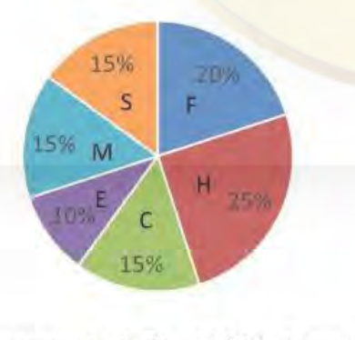
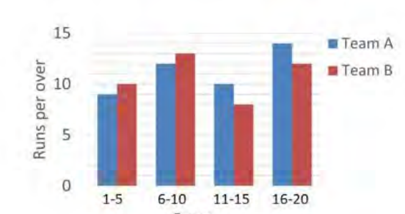
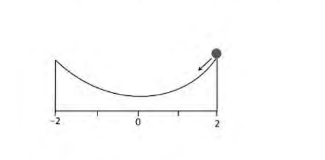
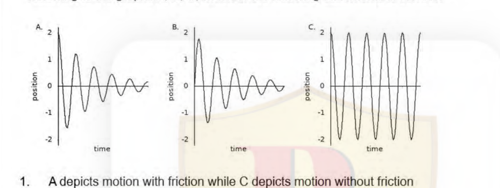

# CSIR NET Life Sciences — June 2024 — Part A

*(Questions 1–20 · General Aptitude · 2 marks each)*

---

### Question 1

In humans, if both parents are of blood group AB, then, there is a 1/4 probability that their offspring will be of blood group A, and 1/2 probability that the offspring will be of blood group AB. If the couple have three children, what is the probability that **NONE** of the children will be of blood group A or AB?

1. 1/4
2. 3/4
3. 1/64
4. 63/64

**Answer: 3 (1/64)**

> **Explanation:** For one child, P(A) = 1/4 and P(AB) = 1/2, so P(neither A nor AB) = 1 − 1/4 − 1/2 = 1/4. (AB × AB matings give A/AB/B in the ratio 1:2:1, so the only type outside {A, AB} is group B, which has probability 1/4.) Births are independent, so for three children the probability is (1/4)³ = **1/64**.

---

### Question 2

The growth model for a population is

*Nt* = *N*0 e*rt*

where *Nt* is the population at time *t*, *N*0 is the initial population and *r* is the per capita growth rate. How long does it take for the population numbers to double?

1. (ln 2) / *r*
2. 2 / *r*
3. 1 / (*r* ln 2)
4. 1 / *r*

**Answer: 1 ((ln 2) / r)**

> **Explanation:** Set *Nt* = 2*N*0: 2 = e*rt*, so ln 2 = *rt* and *t* = **(ln 2)/*r***.

---

### Question 3

The chart shows forest cover as percentages of total areas of 6 countries over the period 1990-2022 and their land areas (in million km²).

The maximum change in forest area in absolute terms among these countries took place in

1. Tanzania
2. Russian Federation
3. India
4. China

**Answer: 4 (China)**

> **Explanation:** Absolute change = (change in percentage) × (land area)/100. Tanzania: −13% × 0.9 = −0.117 million km². Russian Federation: ≈ +0.5% × 16.4 ≈ 0.08. India: +3% × 3.0 = 0.09. China: +7% × 9.4 ≈ **0.66 million km²** — by far the largest, because China combines a steep rise in percentage cover with a very large land area.

---

### Question 4

Among five girls standing side by side, Leela has exactly one girl to her left, Alice is just right of Prerna, and there are at least two girls between Radha and Zarina. The girl in the middle is

1. Prerna
2. Alice
3. Leela
4. Zarina

**Answer: 1 (Prerna)**

> **Explanation:** Number the positions 1–5. Leela has exactly one girl to her left → Leela = 2. Alice is immediately right of Prerna, so the block (Prerna, Alice) can only sit at (3,4) or (4,5) — (1,2) is blocked by Leela. If it sat at (4,5), Radha and Zarina would take 1 and 3, with only one girl between them, violating the "at least two girls between" condition. Hence (Prerna, Alice) = (3, 4), and Radha/Zarina take 1 and 5 (three girls apart ✓). The middle position 3 is **Prerna**.

---

### Question 5

A group of 54 boys and girls was made to stand in a queue as follows: a boy at the start was followed by a girl, then a boy followed by 2 girls, then a boy followed by 3 girls, and so on. The number of boys in the group was

1. 8
2. 9
3. 10
4. 27

**Answer: 2 (9)**

> **Explanation:** The *k*-th block is 1 boy followed by *k* girls, so *n* complete blocks contain *n* boys and 1+2+…+*n* = *n*(*n*+1)/2 girls. Total = *n* + *n*(*n*+1)/2 = 54 → *n*² + 3*n* − 108 = 0 → (*n* − 9)(*n* + 12) = 0 → *n* = **9** (giving 9 boys + 45 girls = 54 ✓).

---

### Question 6

A 1 m long rod having diameter of 12 mm weighs 880 g. What, approximately, is the density (in g/cm³) of the material of the rod?

1. 6.2
2. 6.6
3. 7.8
4. 8.8

**Answer: 3 (7.8)**

> **Explanation:** Radius = 6 mm = 0.6 cm, length = 1 m = 100 cm. Volume = πr²L = π × 0.36 × 100 = 36π ≈ 113.1 cm³. Density = 880 / 113.1 ≈ 7.78 ≈ **7.8 g/cm³**.

---

### Question 7

Suppose liars always lie and truthful persons never. In a group of 4 people A, B, C and D, A says, "We're all liars", B says, "Only one of us is a liar", C says, "No, exactly two of us are liars" and D says, "I'm truthful". Which among the following is definitely FALSE?

1. A is a liar
2. B is a liar
3. C is a liar
4. D is a liar

**Answer: 4 (D is a liar)**

> **Explanation:** A's claim "we're all liars" cannot be true (a truthful person asserting it would make himself a liar), so **A is a liar**. If B were truthful there would be exactly one liar — but then C's "exactly two" is false, making C a second liar, a contradiction; so **B is a liar** too. Two consistent worlds remain: C truthful (liars = A, B; D truthful) or C lying (liars = A, B, C; D truthful). In both, D is truthful, so "D is a liar" is **definitely FALSE**, while "C is a liar" is only possibly false.

---

### Question 8

Consider the first few consecutive natural numbers. The ratio of the sum of their squares to their sum can NEVER be

1. 67
2. 75
3. 91
4. 100

**Answer: 4 (100)**

> **Explanation:** For the first *n* natural numbers, Σk² / Σk = [n(n+1)(2n+1)/6] / [n(n+1)/2] = **(2n+1)/3**. Setting (2n+1)/3 = R gives n = (3R−1)/2, which is an integer only when 3R−1 is even, i.e. only when R is **odd**. 67 → n = 100, 75 → n = 112, 91 → n = 136 are all valid; but R = 100 is even, giving n = 149.5, so the ratio can never be **100**.

---

### Question 9

If *X* > *Y* > 0 , then *X*% of *Y* is

1. equal to *Y*% of *X*
2. more than *Y*% of *X*
3. less than *Y*% of *X*
4. (*X* + *Y*)% of (*X* + *Y*)

**Answer: 1 (equal to Y% of X)**

> **Explanation:** *X*% of *Y* = (*X*/100)·*Y* = *XY*/100, and *Y*% of *X* = (*Y*/100)·*X* = *XY*/100. The two are identical for all *X*, *Y* — the condition *X* > *Y* > 0 is a distractor. Option 4 would require (*X*+*Y*)²/100 = *XY*/100, impossible for positive *X*, *Y*.

---

### Question 10

If 16*x*² − 25*y*² +7 = 0, *x* and *y* being positive numbers, then which of the following may hold?

1. 4*x* + 5*y* + 1 = 0
2. 4*x* + 5*y* + 7 = 0
3. 4*x* − 5*y* + 1 = 0
4. 4*x* − 5*y* − 7 = 0

**Answer: 3 (4x − 5y + 1 = 0)**

> **Explanation:** 16x² − 25y² = −7 factors as (4x + 5y)(4x − 5y) = −7. With x, y > 0 the factor (4x + 5y) is positive, so (4x − 5y) must be negative and 4x + 5y = 7/(5y − 4x) > 0. Options 1 and 2 force 4x + 5y = −1 or −7 (negative) — impossible; option 4 forces 4x − 5y = +7 (positive) — impossible. Option 3 gives 4x − 5y = −1 and hence 4x + 5y = 7, so 8x = 6 → x = 0.75 and 10y = 8 → y = 0.8, both positive ✓.

---

### Question 11

A spherical object of radius 6 cm was melted and cast into a cylindrical bar of radius 3 cm. What would be the length (in cm) of the bar?

1. 24
2. 32
3. 36
4. 42

**Answer: 2 (32)**

> **Explanation:** Equate volumes: (4/3)π(6)³ = π(3)²·L → 288π = 9π·L → L = **32 cm**.

---

### Question 12

Every element in the central column of the matrix has a simple arithmetic relationship with the pairs on the left and right in the corresponding row.

| 17 | 12 | **1** | 19 | 23 |
|----|----|-------|----|----|
| 23 | 21 | ***X*** | 18 | 20 |
| 24 | 17 | **3** | 32 | 36 |
| 35 | 28 | **2** | 19 | 24 |

What would be the value of *X* ?

1. 2
2. 1
3. 0
4. −1

**Answer: 3 (0)**

> **Explanation:** The central entry equals (difference of the left pair) − (difference of the right pair): row 1 gives (17−12) − (23−19) = 5 − 4 = 1 ✓; row 3 gives (24−17) − (36−32) = 7 − 4 = 3 ✓; row 4 gives (35−28) − (24−19) = 7 − 5 = 2 ✓. For row 2: (23−21) − (20−18) = 2 − 2 = **0**, so *X* = 0.

---

### Question 13

The total monthly income of a family is split into expenses on food (F), house rent (H), college fees (C), entertainment (E), miscellaneous items (M), and savings (S), as shown in the pie chart.

The family transfers an amount of Rs 1000/- from the head food to the head entertainment, thereby making the expenses on the two heads equal. What is the net expenditure of the family?

1. Rs 20,000
2. Rs 50,000
3. Rs 37,500
4. Rs 17,000

**Answer: 4 (Rs 17,000)**

> **Explanation:** Food = 20%, entertainment = 10%. Moving Rs 1000 from food to entertainment equalises them, so F − 1000 = E + 1000 → F − E = 2000 → 10% of income = 2000 → total income = Rs 20,000. Savings = 15% = Rs 3,000, so net expenditure = 20,000 − 3,000 = **Rs 17,000**.

---

### Question 14

A certain item of raw food contains 35% starch, 25% protein, the rest fibre. The item is cooked by boiling in water, which doubles its weight. Half of the fibre in the food becomes soluble when cooked. If the cooked item weighs 200g, the amount of soluble fibre in it is

1. 15 g
2. 30 g
3. 20 g
4. 40 g

**Answer: 3 (20 g)**

> **Explanation:** Boiling doubles the weight, so the raw item weighed 200/2 = 100 g. Fibre is the remainder of the composition: 100% − 35% − 25% = 40%, i.e. 40 g of fibre in the raw food. Half of it becomes soluble: 40/2 = **20 g**.

---

### Question 15

A straight irrigation canal in a plain area has a floor at a depth of 5 m from the surface. The canal is 20 m wide at the surface. The floor of the canal is flat and the embankments have a slope of 45°. When it is completely filled, what will be the volume of water (in m³) in the canal over a length of 100m?

1. 6000
2. 7500
3. 8000
4. 9500

**Answer: 2 (7500)**

> **Explanation:** The cross-section is a trapezoid of depth 5 m with top width 20 m. A 45° embankment slope means each side cuts in horizontally by 5 × tan45° = 5 m, so the flat floor is 20 − 2(5) = 10 m wide. Cross-sectional area = ½(20 + 10)(5) = 75 m². Volume = 75 × 100 = **7500 m³**.

---

### Question 16

The graph shows average run rate (runs scored per over) by teams A and B in a twenty overs cricket match.

Select the INCORRECT statement.

1. Team B scored more runs than team A in the first 10 overs.
2. Team A scored more runs than team B in all.
3. Team B scored more runs in overs 1—10 than in overs 11—20.
4. Team A has a lower overall run rate than team B.

**Answer: 4 (Team A has a lower overall run rate than team B)**

> **Explanation:** Reading run rates per 5-over block and multiplying by 5: Team A = 9+12+10+14 = 45 → 45×5 = 225 runs; Team B = 10+13+8+12 = 43 → 43×5 = 215 runs. So A scored MORE overall (statement 2 correct) and A's overall run rate (45/20) is HIGHER, not lower, than B's — making **statement 4 incorrect**. Check the others: first 10 overs A = (9+12)×5 = 105, B = (10+13)×5 = 115 → B more (1 correct); B overs 1–10 = 115 vs 11–20 = (8+12)×5 = 100 → more in 1–10 (3 correct).

---

### Question 17

For any four consecutive decimal digits, the largest value of the product of the sum of any two and the sum of the other two is

1. an even number and a perfect square
2. an even number, but not a perfect square
3. an odd number and a perfect square
4. an odd number, but not a perfect square

**Answer: 3 (an odd number and a perfect square)**

> **Explanation:** Take the digits *d, d+1, d+2, d+3*. The three ways of splitting them into two pairs give products (2d+3)(2d+3) = (2d+3)², (2d+1)(2d+5) = (2d+3)² − 4, and (2d+2)(2d+4) = 4(d+1)(d+2). Since the four digits have a fixed total, the product of two pair-sums is greatest when the sums are equal, i.e. (2d+3)². This is the square of an odd number, so the largest value is **an odd number and a perfect square**.

---

### Question 18

A ball starts rolling from the edge of the slope at time *t* = 0 as shown in the diagram.

Referring to the graphs A, B, C, which of the following statements is correct?

1. A depicts motion with friction while C depicts motion without friction
2. C depicts motion with friction while A depicts motion without friction
3. B depicts motion with friction while A depicts motion without friction
4. B depicts motion with friction while C depicts motion without friction

**Answer: 1 (A depicts motion with friction while C depicts motion without friction)**

> **Explanation:** The ball is released at *t* = 0 from the edge, so position must start at +2 — this excludes B, which starts at 0. With friction, mechanical energy is lost and the turning points decay toward 0: that is graph A (amplitude falling from ±2). Without friction the oscillation is undamped with constant amplitude ±2: that is graph C. Hence **A = with friction, C = without friction**.

---

### Question 19

A record player stylus moves along a spiral groove cut on an annular portion of a disc. A record with inner radius 4 cm and outer radius 10 cm of the annulus, turning 100 times plays for 22 minutes. During this time the stylus travels at an average linear speed that is approximately equal to

1. 100 m/h
2. 120 m/h
3. 220 m/h
4. 440 m/h

**Answer: 2 (120 m/h)**

> **Explanation:** 100 turns across the annulus means a groove pitch of (10 − 4)/100 = 0.06 cm. The groove length equals the annular area divided by the pitch: π(10² − 4²)/0.06 = 84π/0.06 ≈ 4398 cm ≈ 44 m. In 22 minutes (= 22/60 h) that is 44 × 60/22 ≈ **120 m/h**.

---

### Question 20

Choose the option that will make the following statement FALSE:

A CHILD COUNTED THE NUMBER OF APPEARANCES OF THE LETTER T IN THIS SENTENCE, AND REPORTED IT CORRECTLY AS \_\_\_\_\_\_

1. TEN
2. ELEVEN
3. TWELVE
4. THIRTEEN

**Answer: 1 (TEN)**

> **Explanation:** The sentence already contains **11** occurrences of the letter T — COUNTED(1), THE(1), THE(1), LETTER(2), T(1), THIS(1), SENTENCE(1), REPORTED(1), IT(1), CORRECTLY(1) — and the inserted word adds its own T's. ELEVEN adds 0 (total 11 ✓), TWELVE adds 1 (total 12 ✓), THIRTEEN adds 2 (total 13 ✓), so all three make the statement true. TEN adds 1 T giving a total of 12, but reports 10 — so only **TEN** makes the statement FALSE.
