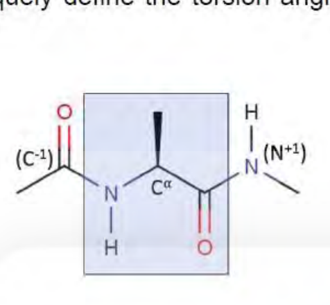
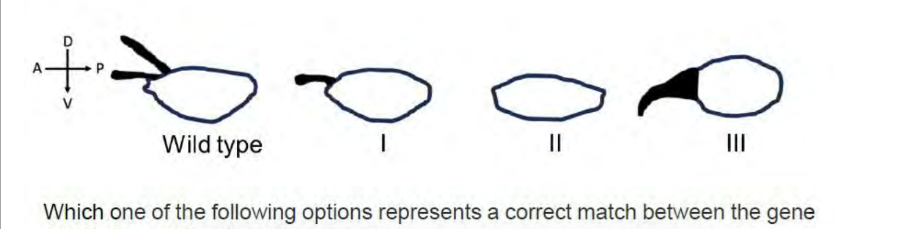
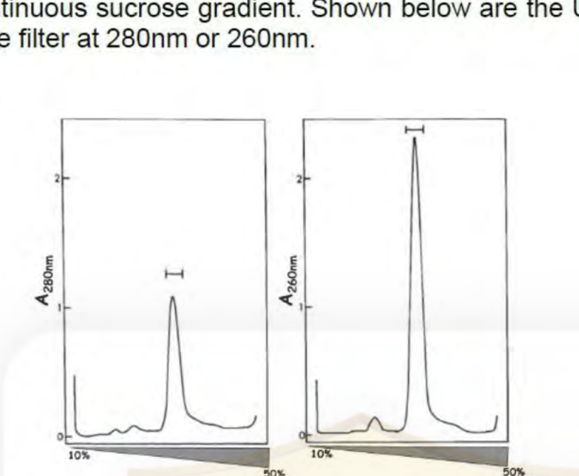

# CSIR NET Life Sciences — June 2024 — Part B

*(Questions 21–70 · 2 marks each)*

---

### Question 21

Given below are Ramachandran plots for four different proteins.

Choose the correct pair of proteins, both of which are predominantly alpha helical in nature.

1. A and B
2. A and C
3. B and D
4. C and D

**Answer: 4 (C and D)**

> **Explanation:** α-Helical residues occupy the lower-left quadrant near φ ≈ −60°, ψ ≈ −45° to −60°, while β-strand residues lie in the upper-left near φ ≈ −120°, ψ ≈ +120°. In plots **C and D** the overwhelmingly densest population sits in the α-helical region (lower-left), so both are predominantly helical. Plot A has substantial scatter including positive-φ (left-handed/glycine-like) regions and a strong β cluster, and B is dominated by the β region — so neither of those pairs is "both helical".

---

### Question 22

Which one of the following pairs correctly matches the enzyme with its allosteric activator?

1. Phosphofructokinase : Citrate
2. Pyruvate dehydrogenase : NADH
3. Pyruvate carboxylase : ADP
4. Pyruvate kinase : Fructose 1,6-bisphosphate

**Answer: 4**

> **Explanation:** PFK-1 is allosterically activated by AMP and fructose-2,6-bisphosphate and inhibited by citrate (so 1 is wrong); pyruvate dehydrogenase is inhibited (not activated) by NADH (2 wrong); pyruvate carboxylase is activated by acetyl-CoA, not ADP (3 wrong); pyruvate kinase is activated by fructose-1,6-bisphosphate (feed-forward from an upstream glycolytic intermediate), the correct pair.

---

### Question 23

In the representation of the di-peptide shown below, the superscript ‘-1’ denotes the atom of the previous amino acid while ‘+1’ denotes the atom of the next amino acid.
The atomic coordinates of how many AND which of the following atoms are required to uniquely define the torsion angles, φ and ψ of the Ramachandran plot?

1. 4 atoms; C⁻¹, N, C^α, C for φ; N, C^α, C, N⁺¹ for ψ
2. 2 atoms; N and C^α for φ; C^α and C for ψ
3. 4 atoms; H, N, C^α, C for φ; N, C^α, C, O for ψ
4. 3 atoms; C⁻¹, N, C^α for φ; C^α, C, N⁺¹ for ψ

**Answer: 1 (4 atoms; C-1, N, Ca, C for phi; N, Ca, C, N+1 for psi)**

> **Explanation:** A torsion (dihedral) angle is defined by **four** consecutively bonded atoms — the angle between the plane of atoms 1-2-3 and the plane of atoms 2-3-4. φ is measured about the N–C^α bond, so the defining atoms are C^(−1)–N–C^α–C; ψ is measured about the C^α–C bond, so the atoms are N–C^α–C–N^(+1). Two or three atoms (options 2 and 4) cannot define a dihedral, and option 3 substitutes the amide H and the carbonyl O for the flanking backbone atoms.

---

### Question 24

Which one of the following statements regarding the structure of water molecule is correct?

1. The oxygen atom in water is in sp³ hybridization, with an H-O-H angle of 109.5°.
2. The oxygen atom in water is in sp² hybridization, with an H-O-H angle of 120°.
3. The oxygen atom in water is in sp³ hybridization, with an H-O-H angle of 104.5°.
4. The oxygen atom in water is in sp² hybridization, with an H-O-H angle of 90°.

**Answer: 3 (The oxygen atom in water is in sp3 hybridization, with an H-O-H angle of 104.5°)**

> **Explanation:** Oxygen's six valence electrons occupy four sp³ hybrids — two form O–H σ bonds and two hold lone pairs — so the electron-pair geometry is tetrahedral. The two lone pairs repel more strongly than bonding pairs, compressing the H–O–H angle from the ideal 109.5° to the observed **104.5°**.

---

### Question 25

In animal cells, typically which organelle is only provided by the sperm to the oocyte following fertilization?

1. Nucleolus
2. Peroxisomes
3. Mitochondria
4. Centrioles

**Answer: 4**

> **Explanation:** During fertilization, the sperm contributes its centrioles to the oocyte (egg).

---

### Question 26

In eukaryotes, nucleosome remodelers

1. methylate histone H3.
2. acetylate histone H3 and H4.
3. create DNasel hypersensitive sites.
4. degrade histone subunits.

**Answer: 3 (create DNasel hypersensitive sites)**

> **Explanation:** ATP-dependent chromatin remodelling complexes (SWI/SNF, ISWI, CHD, INO80) slide, eject or restructure nucleosomes. By moving a nucleosome away from a promoter they expose naked DNA, which is exactly what a **DNase I hypersensitive site** is. Writing methyl or acetyl groups on H3/H4 is the job of histone methyltransferases and acetyltransferases (1, 2), and remodellers reposition nucleosomes rather than proteolytically destroying histones (4).

---

### Question 27

Which one of the following activities is associated with Mitochondria-associated ER membranes (MAM)?

1. Protein glycosylation
2. ATP synthesis
3. Phospholipid metabolism
4. Iron-sulphur cluster assembly

**Answer: 3**

> **Explanation:** There are sites in the ER where the outer membrane of the mitochondria is in close contact with the ER membrane, called mitochondria-associated ER membranes (MAMs). These contact sites can vary in size and are dynamic structures. MAMs are supposed to be involved in many functions. One important function is the exchange of lipids between the ER and mitochondria. This exchange is important for mitochondrial membrane biogenesis.

---

### Question 28

In eukaryotic cells, DNA replication is restricted to the S phase of the cell cycle because

1. DNA polymerase is present only in the S phase of the cell cycle.
2. Origin recognition complex (ORC) recognizes origin only in the S phase.
3. MCM helicases get activated in the S phase of the cell cycle.
4. MCM helicases get activated in the G1 phase of the cell cycle.

**Answer: 3 (MCM helicases get activated in the S phase of the cell cycle)**

> **Explanation:** Licensing and firing are separated in time. ORC binds origins throughout the cycle (2 ✗) and, with Cdc6/Cdt1 in **G1**, loads MCM2-7 double hexamers as inactive licensing factors (4 ✗). Those dormant MCM helicases are converted to active CMG helicases only at the G1→S transition by DDK and S-CDK, so unwinding — and therefore replication — can occur only in **S phase**. Replicative polymerases are not confined to S phase by their presence alone (1 ✗).

---

### Question 29

What is the correct order in which the following proteins are recruited during DNA double strand break repair in prokaryotes?

1. RecA, RecBCD, Ssb, DNA Pol III, DNA Ligase
2. Ssb, RecA, RecBCD, DNA Pol III, DNA Ligase
3. RecBCD, RecA, Ssb, DNA Pol III, DNA Ligase
4. RecBCD, Ssb, RecA, DNA Pol III, DNA Ligase

**Answer: 4 (RecBCD, Ssb, RecA, DNA Pol III, DNA Ligase)**

> **Explanation:** RecBCD binds the double-strand break first and processes it with its nuclease/helicase activity, generating a 3′ single-stranded tail. That exposed ssDNA is immediately coated by **Ssb** to protect it; RecBCD (with Chi) then displaces Ssb and loads **RecA** to form the recombinogenic filament for strand invasion. Gap filling after branch migration uses **DNA Pol III** and the nicks are closed by **DNA ligase**.

---

### Question 30

Which one of the following statements for the *lac* operon in *E. coli* is INCORRECT?

1. The *lac* operon is controlled by both the Lac repressor and the activator protein, CAP.
2. The *lac* operon is highly expressed only when both lactose and glucose are absent.
3. The *lac* operon is highly expressed only when lactose is present and glucose is absent.
4. In the presence of lactose, the repressor cannot bind to the operator.

**Answer: 2 (The lac operon is highly expressed only when both lactose and glucose are absent)**

> **Explanation:** High transcription needs *both* conditions: relief of repression (lactose/allolactose present so the repressor leaves the operator) **and** activation by CAP–cAMP (glucose absent). If lactose were also absent, the repressor would still block the operator and the operon would be off — so statement 2 is false. Statements 1, 3 and 4 correctly describe dual control by LacI and CAP.

---

### Question 31

Which one of the following does NOT occur during ribosome-associated quality control of damaged mRNA?

1. mRNA degradation
2. Nascent protein degradation
3. Disengagement of ribosome from mRNA
4. Ribosome-mRNA monosome degradation

**Answer: 4 (Ribosome-mRNA monosome degradation)**

> **Explanation:** In the ribosome-associated quality control (RQC) pathway a stalled ribosome is recognised (Hel2/ZNF598 ubiquitylation of 18S rRNA proteins), the stalled complex is **split** so that the ribosome subunits disengage from the mRNA (Pelota–Hbs1–ABCE1) (3 ✓); the incomplete **nascent chain** is extracted by NEMF and ubiquitylated by Listerin for proteasomal destruction (2 ✓); and the aberrant message is eliminated by No-Go decay (1 ✓). The ribosomal subunits and the mRNA are recycled or degraded separately — a "ribosome–mRNA monosome" is never degraded as a single unit, so 4 does not occur.

---

### Question 32

Which one of the following statements regarding mammalian innate immunity is INCORRECT?

1. Pattern recognition receptors (PRRs) are a component of innate immunity.
2. Serum complement proteins are part of innate immunity.
3. Innate immunity has only a narrow range of specificity.
4. The outcome of innate immunity is the rapid recognition and phagocytosis or destruction of the pathogen.

**Answer: 3 (Innate immunity has only a narrow range of specificity)**

> **Explanation:** Innate receptors are germline-encoded and recognise **broad classes** of conserved microbial structures (PAMPs/DAMPs) shared across many pathogens, so its range of recognition is wide, not narrow — it is *adaptive* immunity that is highly specific (narrow) per clone. PRRs (1), constitutive serum complement (2) and immediate phagocytosis/lysis (4) are all correct features of innate defence.

---

### Question 33

Which one of the following statements correctly explains the function of a GTPase activating protein (GAP) in the regulation of heterotrimeric G proteins in plants?

1. It activates Gβ protein.
2. It inactivates Gα protein.
3. It directly inhibits ligand binding to GPCR.
4. It leads to the dissociation of Gα from Gβ/Gγ subunits.

**Answer: 2 (It inactivates Gα protein)**

> **Explanation:** Gα is a self-limiting GTPase whose intrinsic hydrolysis of GTP is slow. A **GAP** binds the GTP-loaded Gα and completes the catalytic site, accelerating hydrolysis of GTP to GDP by orders of magnitude; the resulting Gα-GDP reassociates with Gβγ and signalling stops — i.e. GAP **inactivates Gα**. GEF (not GAP) causes GDP release and Gα dissociation from Gβγ (4 ✗); GAP does not act on Gβ (1 ✗) or on the receptor's ligand-binding step (3 ✗).

---

### Question 34

Which one of the following statements regarding plasmodesmata in a plant cell is INCORRECT?

1. They are specialized cell-to-cell junctions.
2. They are open channels that connect the cytosol of adjacent cells.
3. The plasma membranes of the adjacent cells extend continuously through each plasmodesma.
4. Plasmodesmata are extensions of chloroplast that interconnects the cytosol of the adjacent cells.

**Answer: 4 (Plasmodesmata are extensions of chloroplast that interconnects the cytosol of the adjacent cells)**

> **Explanation:** A plasmodesma is a cytoplasmic bridge lined by **continuous plasma membrane** — the plasmalemma of one cell passes through the wall pore and becomes that of the next cell — and it is often traversed by ER (desmotubule). It has nothing to do with chloroplasts, so statement 4 is false. Statements 1–3 correctly describe plasmodesmata as specialised, open, membrane-lined cell-to-cell junctions.

---

### Question 35

Which one of the following statements about the cortical reaction in sea urchins is correct?

1. The entry of Ca²⁺ ions into the egg initiates development.
2. The exocytosed cortical granules during egg maturation contain the components of the zona pellucida.
3. The depolarization of the plasma membrane after sperm entry helps to block polyspermy.
4. The release of the cortical granules after sperm entry converts the vitelline membrane into the fertilization membrane which blocks polyspermy.

**Answer: 4 (The release of the cortical granules after sperm entry converts the vitelline membrane into the fertilization membrane which blocks polyspermy)**

> **Explanation:** Sperm–egg fusion triggers an inositol-1,4,5-trisphosphate-mediated Ca²⁺ wave that drives exocytosis of the cortical granules just beneath the egg plasma membrane. Their contents digest the attachments between the vitelline membrane and the oolemma, raise the membrane into the **fertilization envelope**, and harden it — the slow block to polyspermy. Option 1 states a true upstream fact but is not a statement *about* the cortical reaction; sea urchins have a vitelline layer, not a zona pellucida (2); and fast-block depolarisation is not the cortical reaction (3).

---

### Question 36

In *Caenorhabditis elegans*, blastomere identity occurs both through conditional and autonomous modes of cell specification. Which one of the following options is a correct statement in this regard?

1. If the AB and P1 blastomeres are experimentally separated, the AB cell will generate all cells it would normally make.
2. When AB divides to form daughter cells, ABp becomes different from ABa through its interaction with the P2 cell.
3. The specification of AB cell is determined by the presence of cytoplasmic determinants.
4. The P2 cell produces a morphogen for the determination of the ABp cell.

**Answer: 2 (When AB divides to form daughter cells, ABp becomes different from ABa through its interaction with the P2 cell)**

> **Explanation:** ABp's identity is acquired **conditionally** by juxtacrine signalling: after the AB division, the P2 cell surface presents the LIN-12/Notch ligase (APX-1/Delta) which activates GLP-1 (Notch) in the adjacent ABp but not in ABa — this single interaction is what makes ABp different from ABa, and it is abolished if ABp is separated from P2. Isolated AB cannot make all its normal descendants (1 ✗); AB is not specified by cytoplasmic determinants — the P lineage is (3 ✗); and the signal is a membrane-bound ligand for lateral/inductive Notch signalling, not a diffusible morphogen (4 ✗).

---

### Question 37

The following are sketches of wild-type and mutant (I - III) embryos of *Drosophila melanogaster*.

Which one of the following options represents a correct match between the gene and its loss of function phenotype?

1. *dorsal* : I
2. *torpedo* : III
3. *gurken* : II
4. *cactus* : III

**Answer: 3 (gurken : II)**

> **Explanation:** The paired anterior-dorsal appendages mark dorsal follicle-cell fate, which requires the Gurken (TGF-α-like) signal from the oocyte to activate the Torpedo (EGFR) receptor in the overlying follicle cells. Loss of *gurken* removes the dorsal signal entirely, so the follicle cells all take ventral fate and **no appendages form** — exactly embryo II. (Loss of *torpedo* gives the same null phenotype, so pairing it with III, an expanded/extra dorsal structure, is wrong; *dorsal* and *cactus* act in the DV NF-κB pathway, not appendage number.)

---

### Question 38

If chimeric mouse embryos were generated using GFP-expressing embryonic stem cells and RFP-expressing induced pluripotent stem cells, which one of the following tissues from any resulting embryos will not express any fluorescent protein?

1. Brain
2. Heart
3. Intestine
4. Placenta

**Answer: 4 (Placenta)**

> **Explanation:** Both ES cells and induced pluripotent stem cells are **pluripotent**, not totipotent: injected into a blastocyst they colonise the embryo proper (all three germ layers → brain, heart, intestine, all fluorescent), but they contribute little or nothing to the extra-embryonic **trophectoderm** lineage. The placenta of the chimera therefore derives from the host morula/blastocyst cells, which carry no fluorescent transgene.

---

### Question 39

Which one of the following is a correct combination of four carbon intermediates formed during C4 photosynthesis in plants?

1. Malate and Aspartate
2. Aspartate and Alanine
3. Phosphoenolpyruvate and Oxaloacetate
4. Alanine and Pyruvate

**Answer: 1 (Malate and Aspartate)**

> **Explanation:** The C4 acids themselves are the four-carbon dicarboxylic acids **oxaloacetate (OAA), malate and aspartate**. Alanine and pyruvate are three-carbon compounds, so options 2 and 4 fail. Phosphoenolpyruvate is also a three-carbon CO₂ acceptor, so option 3 pairs a C3 with a C4 and is not a combination of two C4 intermediates. Only option 1 lists two genuine four-carbon intermediates.

---

### Question 40

Which one of the following represents the predominant source organ during phloem translocation in healthy plants?

1. Roots
2. Developing fruits
3. Immature leaves
4. Mature leaves

**Answer: 4**

> **Explanation:** Phloem sap flows from source (photosynthate-exporting) to sink (utilising/storage) tissue. In a healthy, photosynthesising plant, mature fully expanded leaves are the principal source; roots, fruits and immature leaves typically act as sinks. Answer: 4 (Mature leaves).

---

### Question 41

Which one of the following correctly describes 'Dark Reversion' of phytochromes?

1. Conversion of PR to PFR
2. Conversion of PFR to PR
3. Export of PFR from cytosol to nucleus
4. Export of PR from cytosol to nucleus

**Answer: 2 (Conversion of PFR to PR)**

> **Explanation:** Phytochrome exists in two interconvertible forms: the red-absorbing inactive PR and the far-red-absorbing active PFR. Light drives PR→PFR (red) and PFR→PR (far-red). **Dark reversion** is the slow, light-*independent* thermal relaxation of the active PFR back to PR in darkness, which regenerates the PR pool; it is not a nuclear transport event (nuclear import of PFR, not export, is what signalling requires).

---

### Question 42

Which of the following is LEAST suited for long-distance phloem transport of photo-assimilated carbon in plants?

1. Reducing sugars
2. Mannitol
3. Galactosyl-sucrose oligosaccharides
4. Non-reducing sugars

**Answer: 1 (Reducing sugars)**

> **Explanation:** A transported solute must be chemically inert in transit. Reducing sugars (glucose, fructose, galactose) have a free carbonyl/hemiacetal group, so they are metabolically reactive — they can be phosphorylated and oxidised anywhere they leak out, they participate in non-enzymatic glycation (Maillard) reactions, and they exert a higher effective osmotic penalty per unit carbon. Phloem sap therefore carries **non-reducing** solutes: sucrose (the universal transport sugar), the galactosyl-sucrose oligosaccharides raffinose/stachyose/verbascose, and sugar alcohols such as mannitol, all of which are metabolically stable. Reducing sugars are the least suited.

---

### Question 43

How many amino acids are present in calcitonin, a calcium lowering hormone synthesized from C-cells of the human thyroid gland?

1. 42
2. 32
3. 22
4. 12

**Answer: 2 (32)**

> **Explanation:** Human calcitonin is a straight-chain peptide of **32 amino acids** (MCSNZDBRPTAPAVLGEADVSFLSSCKTDTF) with a disulphide bridge between Cys1 and Cys7 and a proline amide at the C-terminus. Salmon calcitonin, used therapeutically, is also 32 residues.

---

### Question 44

Retinal rod cell cGMP-phosphodiesterase is an enzyme with subunit structure as:

1. αβγ
2. αβγ2
3. αβ2γ
4. α2βγ

**Answer: 2 (αβγ2)**

> **Explanation:** Rod cGMP phosphodiesterase (PDE6) is the inhibited heterotetramer **αβγ₂** — the two catalytic α and β subunits held inactive by two inhibitory γ subunits. Activated α-subunits of transducin (Gαₜ) bind the γ subunits and release the catalytic αβ dimer, which then hydrolyses cGMP.

---

### Question 45

How many times are sound waves amplified in the middle ear of a human?

1. 16 - 18
2. 6 - 8
3. 9 - 12
4. 2 - 4

**Answer: 1**

> **Explanation:** In the middle ear of a human, sound waves are amplified approximately 20 to 25 times. This amplification is achieved through the mechanical advantage provided by the ossicles (the small bones in the middle ear: the malleus, incus, and stapes).

---

### Question 46

Which one of the following neurotransmitters is synthesized in synaptic vesicles instead of being transported to the vesicle after its synthesis in the cytoplasm?

1. Norepinephrine
2. Epinephrine
3. Acetylcholine
4. Serotonin

**Answer: 1 (Norepinephrine)**

> **Explanation:** Dopamine is taken up into the synaptic (dense-core) vesicle by the vesicular monoamine transporter, and the enzyme dopamine β-hydroxylase — which is bound to the vesicle lumen — converts it to **norepinephrine inside the vesicle**. Acetylcholine (choline acetyltransferase) and serotonin (aromatic L-amino-acid decarboxylase) are made in the cytoplasm and then imported. Epinephrine is formed in the cytoplasm from vesicle-derived norepinephrine by PNMT.

---

### Question 47

Which one of the following statements regarding principles of linkage mapping in plants is correct?

1. Genetic markers would always show higher recombination frequencies when they are closer to each other than if they are far apart.
2. The genetic distance between two markers is a true representation of the physical distance between them.
3. An ideal mapping population for a self-pollinating species is generated using polymorphic parents that are inbred lines.
4. An F₂ mapping population would segregate in a 1:2:1 ratio for a dominant marker.

**Answer: 3 (An ideal mapping population for a self-pollinating species is generated using polymorphic parents that are inbred lines)**

> **Explanation:** Recombination frequency *rises* with separation, so statement 1 is inverted. Genetic (cM) distance reflects crossover frequency, which is distorted by recombination hot/cold spots and centromeric suppression, so it is not a faithful measure of physical bp distance (2 ✗). For a self-pollinating crop, both parents must be homozygous **inbred lines** that are polymorphic at many loci, otherwise no segregation is produced (3 ✓). A *dominant* marker cannot distinguish heterozygote from dominant homozygote, so an F₂ scores 3:1, not 1:2:1 — the 1:2:1 ratio belongs to *co-dominant* markers (4 ✗).

---

### Question 48

Who experimentally demonstrated "Mutations occur randomly"?

1. Alfred Hershey and Martha Chase
2. Matthew Meselson and Franklin Stahl
3. Salvador Luria and Max Delbrück
4. François Jacob and Jacques Monod

**Answer: 3 (Salvador Luria and Max Delbrück)**

> **Explanation:** Luria and Delbrück's 1943 **fluctuation test** compared bacteria grown from a single small inoculum (many generations before plating) with bacteria grown by continuously transferring equal aliquots. The number of phage-resistant colonies varied far more than Poisson expectation in the former — exactly what random mutation *before* selection predicts, and not what environmentally induced (Lamarckian) resistance would give. Hershey–Chase proved DNA is the genetic material; Meselson–Stahl proved semi-conservative replication; Jacob–Monod worked out the operon.

---

### Question 49

A DNA molecule is completely transcribed into messenger RNA by an RNA polymerase. The base composition of the DNA template strand is G = 24.1%; C = 18.5%; A = 24.6%; T = 32.8%. The base composition of the newly synthesized RNA molecule is:

1. G = 24.1%, C = 18.5%, A = 24.6%, U = 32.8%
2. G = 24.6%, C = 24.1%, A = 18.5%, U = 32.8%
3. G = 18.5%, C = 24.1%, A = 32.8%, U = 24.6%
4. G = 32.8%, C = 24.6%, A = 18.5%, U = 24.1%

**Answer: 3 (G = 18.5%, C = 24.1%, A = 32.8%, U = 24.6%)**

> **Explanation:** Key-confirmed answer: the NTA final key (ID 703549) and Pathfinder both give option **3**. The given strand is the template that the RNA is copied from, so base composition follows Watson–Crick complementarity (RNA G = template C = 18.5%, RNA C = template G = 24.1%, RNA A = template T = 32.8%, RNA U = template A = 24.6%). Note: a mirror-the-strand reading (U simply replacing T) would give option 1, which is biologically incorrect for a *template* strand; the earlier draft of this block had wrongly carried option 1 and that error is corrected here.

---

### Question 50

Brassica Juncea has bisexual flowers. A mutation in the mitochondria leads to cytoplasmic male sterility (CMS). CMS can be restored by a restorer of fertility gene (Rf) which is a nuclear gene. Fertility restoration is a dominant phenotype. A CMS line is crossed to a homozygous Rf line. The obtained F1 progeny is self-pollinated. What percentage of F2 progeny will be male sterile?

1. 0
2. 25
3. 75
4. 100

**Answer: 2**

> **Explanation:** CMS cytoplasm is transmitted maternally, so all F1 (CMS × homozygous Rf) inherit CMS cytoplasm plus a single Rf/rf genotype; Rf is dominant so all F1 are fertile. Selfing F1 gives F2 in 3 Rf_ : 1 rf/rf; only the homozygous recessive (rf/rf) progeny remain male sterile, i.e. 25%.

---

### Question 51

For maintaining hydraulic conductance, tree stems appear to trade-off vessel diameter with

1. strength of the stem.
2. stem length.
3. heartwood volume.
4. vessel length.

**Answer: 1 (strength of the stem)**

> **Explanation:** Conductance of an individual vessel scales with the fourth power of its radius (Hagen–Poiseuille), so a stem can maintain water transport with relatively few, **wide** vessels. But wide vessels mean fewer, larger perforations in the secondary xylem and lower wood density, which reduces the mechanical (compressive and buckling) **strength of the stem**. Trees therefore trade hydraulic efficiency against structural support — a classic safety–efficiency trade-off. Stem length, heartwood volume and vessel length are not the property sacrificed by widening vessels.

---

### Question 52

A plant is NOT watered for seven days (day 1 – day 7). Leaf and root water potential are measured every two hours starting from day 1 till day 7. Which one of the following is LEAST LIKELY to happen?

1. Pre-dawn leaf water potential declines over the 7 days.
2. Leaf water potential shows a diurnal cycle of highs and lows.
3. Root water potential falls below leaf water potential at night.
4. Root water potential fluctuates between day and night.

**Answer: 3 (Root water potential falls below leaf water potential at night)**

> **Explanation:** As drying soil progressively lowers water potential, pre-dawn leaf Ψ declines over the 7 days (1) and both leaf and root Ψ show daily (diurnal) highs and lows as transpiration waxes and wanes (2, 4). But at night the stomata close and the transpiration pull that keeps the leaf more negative than the root disappears; leaf Ψ recovers and the two equilibrate (root pressure may even reverse the gradient). A root Ψ that falls *below* leaf Ψ at night is therefore the **least likely** observation.

---

### Question 53

Which one of the following options includes all plants that are major non-native invaders of aquatic ecosystems in India?

1. Parthenium hysterophorus, Pontederia crassipes, Lantana camara
2. Salvinia molesta, Prosopis Juliflora, Mikania micrantha
3. Nelumbo nucifera, Pogostemon erectus, Hygrophila serpyllum
4. Pontederia crassipes, Salvinia molesta, Alternanthera philoxeroides

**Answer: 4**

> **Explanation:** This question is information based.

---

### Question 54

Select the geological time where some of the major events, like an increase in marine diversity, dominance of gymnosperms, diversification of synapsids (including the emergence of first dinosaurs), and first mammal-like forms, occurred.

1. Cretaceous
2. Jurassic
3. Triassic
4. Carboniferous

**Answer: 3**

> **Explanation:** During the Triassic, marine diversity rebounded after the end-Permian extinction, gymnosperms became the dominant land plants, synapsids diversified, first dinosaurs appeared, and the first mammal-like forms emerged. Cretaceous/Jurassic post-date these events and Carboniferous pre-dates the dinosaur/mammal-like radiation.

---

### Question 55

A community of woody plants is being shaped by environmental filtering. What will be the likely local species pool of this community, if the regional species pool comprises 60 species?

1. 100
2. 80
3. 120
4. 30

**Answer: 4 (30)**

> **Explanation:** Environmental filtering is a subtraction: abiotic conditions (climate, soil, water stress) and dispersal limits allow only a subset of the regional species pool to persist at a site. The local pool must therefore be **smaller than 60**, and 30 is the only option that satisfies this. Options 80, 100 and 120 all exceed the regional pool, which is impossible.

---

### Question 56

Andaman and Nicobar archipelago are part of which biodiversity hotspots?

1. Andaman - Indo-Burma; Nicobar - Sundaland
2. Andaman - Sundaland; Nicobar - Indo-Burma
3. Andaman - Indo-Burma; Nicobar - Indo-Burma
4. Andaman - Sundaland; Nicobar - Sundaland

**Answer: 1 (Andaman - Indo-Burma; Nicobar - Sundaland)**

> **Explanation:** The Andaman chain lies on the Burmese margin and its flora/affinities place it in the **Indo-Burma** hotspot, whereas the Nicobar islands (notably Great Nicobar, close to Sumatra) carry Sundaic elements and are assigned to the **Sundaland** hotspot. The archipelago therefore straddles the Wallace-like biogeographic boundary between these two hotspots.

---

### Question 57

Select the correct combination of terms from plant breeding systems that represents selfing or promote selfing.

1. Autogamy and allogamy
2. Cleistogamy and geitonogamy
3. Geitonogamy and allogamy
4. Autogamy and herkogamy

**Answer: 2 (Cleistogamy and geitonogamy)**

> **Explanation:** **Cleistogamous** flowers never open, so pollen from the same flower fertilises its own ovules — obligate selfing; **geitonogamy** is transfer of pollen between flowers of the *same* plant, which is genetically self-fertilisation. Allogamy is cross-pollination and herkogamy (spatial separation of anther and stigma) is specifically an *outcrossing* promoting mechanism, so every option containing either of those (1, 3, 4) fails even though autogamy itself is selfing.

---

### Question 58

Which of these traits is NOT characteristic of *r*-selected tree species?

1. Mortality and reproduction are strongly dependent on population density.
2. Tend to occupy habitats that are unpredictable and/or ephemeral.
3. Thrive in habitats where resource competition is low.
4. Have superior capabilities to colonize new habitats.

**Answer: 1 (Mortality and reproduction are strongly dependent on population density)**

> **Explanation:** *r*-selected species are defined by density-*independent* regulation: their mortality and reproduction are driven by physical disturbance and chance, not by crowding. Density-dependent control of survival and fecundity is the hallmark of *K*-selected species. Unpredictable/ephemeral habitats (2), low competition (3) and strong dispersal/colonisation ability (4) are all classic *r*-selected traits.

---

### Question 59

In 2007, scientists reported the fossil of a deer-like animal in Kashmir, India which is considered the most recent terrestrial ancestor of whales. The name of this fossil is

1. Jainosaurus
2. lndohyus
3. Rajasaurus
4. lndosuchus

**Answer: 2**

> **Explanation:** This question is information based.

---

### Question 60

Which one of the following concepts can explain host-parasite co-evolution?

1. Kin selection
2. Red Queen hypothesis
3. Runaway selection
4. Handicap principle

**Answer: 2 (Red Queen hypothesis)**

> **Explanation:** The **Red Queen hypothesis** (Van Valen, after *Through the Looking-Glass*) states that interacting species must keep adapting just to maintain their relative fitness — a host evolves resistance, the parasite counter-evolves infectivity, and so on, so both "run" to stay in the same place. This reciprocal, frequency-dependent arms race is exactly host–parasite co-evolution (and explains the maintenance of sex). Kin selection concerns altruism toward relatives, runaway selection and the handicap principle concern sexual selection.

---

### Question 61

Which one of the following is an example of dishonest signaling?

1. Batesian model
2. Batesian mimic
3. Mullerian model
4. Mullerian mimic

**Answer: 2 (Batesian mimic)**

> **Explanation:** In Batesian mimicry a harmless, palatable species (the **mimic**) advertises the warning colour pattern of an unpalatable model. Its aposematic signal is a bluff — it claims a defence it does not possess — which is the textbook case of dishonest signalling. The Batesian *model* signals honestly (it really is defended), and in Müllerian mimicry all participants are genuinely unpalatable, so their shared signal is honest.

---

### Question 62

Select the statement that describes guild coevolution, also known as diffuse coevolution.

1. One species uses the other as a resource.
2. Two species coevolve reciprocally, but only to each other.
3. Several species are involved in coevolutionary interactions.
4. A species escapes association from a predator and diversifies. Later, a different predator adapts to the host and diversifies.

**Answer: 3 (Several species are involved in coevolutionary interactions)**

> **Explanation:** Diffuse (guild) coevolution is selection imposed on a species by a *set* of interacting partners/antagonists — e.g. a plant and its whole community of pollinators, herbivores and seed predators, or a guild of mimicry participants — rather than by a single partner. Option 2 describes strict pairwise coevolution, option 1 a one-sided consumer–resource interaction, and option 4 escape-and-radiate/sequential coevolution.

---

### Question 63

A researcher overexpresses the full-length genomic sequence of rice *GAPDH* gene under a CaMV35S promoter in transgenic rice. Which one of the following options can be used to confirm transgenic lines using PCR?

1. Using exon-specific primers of the *GAPDH* gene.
2. Using intron-specific primers of the *GAPDH* gene.
3. Amplification of the promoter region of the *GAPDH* gene.
4. Using CaMV35S promoter-specific forward and *GAPDH*-specific reverse primer.

**Answer: 4 (Using CaMV35S promoter-specific forward and GAPDH-specific reverse primer)**

> **Explanation:** The host rice genome already contains a native *GAPDH* gene, so any primer pair that amplifies only rice sequence — exons (1), introns (2) or the native *GAPDH* promoter (3) — gives a product in both transformed and untransformed plants and cannot identify a transgenic line. Confirmation requires amplifying the **junction** that exists only in the construct: a forward primer in the foreign CaMV35S promoter plus a reverse primer inside *GAPDH* yields a band only when the transgene has integrated.

---

### Question 64

A pulse oximeter measures the ratio between oxyhemoglobin and hemoglobin in the pulsating condition on the finger. Which combination of wavelengths can obtain a differential absorption to measure blood oxygen saturation?

1. Ultraviolet and Infrared
2. Visible and Infrared
3. Far-ultraviolet and visible
4. Ultraviolet and far-ultraviolet

**Answer: 2 (Visible and Infrared)**

> **Explanation:** Pulse oximetry exploits the different absorption spectra of HbO₂ and Hb at two wavelengths: **red visible light (~660 nm)**, where deoxyhaemoglobin absorbs more, and **near-infrared (~940 nm)**, where oxyhaemoglobin absorbs more. Taking the ratio of the pulsatile (arterial) absorbance changes at these two bands cancels path length and venous/tissue contributions and yields SpO₂. UV is strongly absorbed by tissue and water and is not used.

---

### Question 65

It was found that most people who were vaccinated with the ancestral strain of Covid-19 (Wuhan strain) were protected against the Delta variant but not against the Omicron variant. PBMCs (peripheral blood mononuclear cells) and serum were obtained from five successfully vaccinated individuals with good neutralizing antibody titres and cytotoxic (CTL) activity against the Wuhan strain-infected targets. Pooled serum was transferred into unrelated recipient "A" and pooled purified T cells were transferred into unrelated recipient "B". Which one of the following is likely to be observed?

1. "A" will be protected against both the ancestral strain and the Delta variant.
2. "B" will be protected against ancestral strain but not against the Delta variant.
3. "A" will be protected against infection with the Omicron variant.
4. "A" will make antibodies against interferon gamma present in the donor serum.

**Answer: 1 ("A" will be protected against both the ancestral strain and the Delta variant)**

> **Explanation:** Recipient A receives *pre-formed* neutralising antibodies, so protection is immediate and does not require histocompatibility; since the vaccinated donors' antibodies neutralised the ancestral strain and Delta, A is protected against both (1 ✓, and not against Omicron, which the donors themselves escaped — so 3 ✗). Recipient B receives donor T cells, but cytotoxic T cells recognise viral peptide only in the context of the *donor's* MHC; in an unrelated recipient the MHC is mismatched, so the transferred CTLs cannot survey B's infected cells and B is not protected (2 ✗). Passively given cytokine such as interferon-γ is a host protein at trace concentration and does not immunise the recipient (4 ✗).

---

### Question 66

Cell lysate in 1% TX100 was purified over an affinity column to isolate a complex with certain enzymatic activity. The purified enzyme complex was separated on a 10-50% continuous sucrose gradient. Shown below are the UV spectra using an absorbance filter at 280nm or 260nm.

Which one of the following combinations of molecules would generate the spectra shown above?

1. Protein-Protein
2. Protein-RNA
3. Protein-Lipid
4. Protein-Cholesterol

**Answer: 2 (Protein-RNA)**

> **Explanation:** A280 reports protein (aromatic residues) and A260 reports nucleic acid (bases). Both traces peak in the **same gradient fraction**, so the two components co-sediment as one complex rather than being separate species — that excludes protein–protein (which would give no A260 signal) and excludes lipid/cholesterol (which absorb at neither wavelength and would not give a discrete A260 peak). The A260 peak being *larger* than the A280 peak indicates an RNA-rich particle, i.e. a **protein–RNA complex** (a ribonucleoprotein; the small earlier peaks are free RNA/protein not incorporated into the complex).

---

### Question 67

Which one of the following options has the correct set of components for assaying reverse transcriptase activity?

1. RNA primer, dNTPs, buffer, primase, DNA template
2. DNA primer, NTPs, buffer, DNA template
3. DNA primer, dNTPs, buffer, RNA template
4. RNA primer, NTPs, buffer, RNA template

**Answer: 3 (DNA primer, dNTPs, buffer, RNA template)**

> **Explanation:** Reverse transcriptase is an RNA-dependent DNA polymerase: it needs an **RNA template**, a **DNA primer** annealed to it (RT cannot prime itself with RNA and, unlike primase, makes DNA), **dNTPs** as the substrate for the DNA strand it synthesises, and buffer with Mg²⁺. Options with NTPs would make RNA, and a DNA template would test DNA-dependent DNA polymerase, not RT.

---

### Question 68

In which one of the following stages pontogeniculo-occipital (PGO) spikes are found in human EEG recordings?

1. Immediately before and during REM sleep
2. Non-REM sleep stage 2
3. Awake condition
4. Non-REM sleep stage 4

**Answer: 1 (Immediately before and during REM sleep)**

> **Explanation:** PGO waves/spikes are phasic potentials generated in the brainstem pontine tegmentum and relayed through the lateral geniculate nucleus to the occipital cortex. They are the hallmark electrophysiological event of **phasic REM sleep**, appearing just before and during REM bursts (and driving the rapid eye movements and dreaming), and are absent from NREM stages 2 and 4 and from waking.

---

### Question 69

A student counts the number of seeds produced by ten different haploid *Arabidopsis* plants and obtains the following data:

0, 5, 15, 25, 100,150, 200, 600,1500, 3000.

Which one of the following is the best measure of central tendency for summarizing the above data?

1. Mean
2. Median
3. Mode
4. Standard deviation

**Answer: 2 (Median)**

> **Explanation:** The distribution is extremely right-skewed (0 to 3000), so the mean = 5595/10 = 559.5 is pulled far above most observations and misrepresents a "typical" plant, while the mode is undefined/useless for continuous counts and the standard deviation measures spread, not central tendency. The **median** = (100 + 150)/2 = 125 is robust to the extreme values and is the best summary.

---

### Question 70

In rate-zonal centrifugation, a mixture is spun just long enough to separate molecules that differ in mass but may be similar in shape and density. Which one of the following options represents the component that is typically used to create a gradient in this technique?

1. Phospholipids
2. Sucrose
3. KCI
4. Starch

**Answer: 2**

> **Explanation:** Rate-zonal centrifugation separates particles by mass through a density gradient that does not itself stop migration; the standard medium for preparative and analytical rate-zonal gradients is soluble sucrose, which forms a smooth, low-viscosity gradient without disrupting macromolecular complexes.
