# CSIR NET Life Sciences — June 2024 — Part C

*(Questions 71–145 · 4 marks each)*

---

### Question 71

Given below are four topology diagrams corresponding to different proteins. N and C denote the N- and C-terminal ends of the protein chains. Which one of the following statements is CORRECT?

1. All four are of different folds.
2. All four are of the same fold.
3. (A), (C) and (D) are of the same fold.
4. (A) and (C) are of the same fold.

**Answer: 4**

> **Explanation:** Here, we need to number the secondary structure elements (beta strands) from N to C terminus, and check for the options in where we have the same order of elements, those here depicts the same fold. As we can see from below A and C shares the same fold. A. 1 4 3 2 B. 1 2 3 4 C. 1 4 3 2 D. 4 1 2 3

---

### Question 72

For the coupled reaction given below, the equilibrium constants (K'eq) for equation [1] and equation [2] are 270 and 890, respectively. The standard free energy of hydrolysis of ATP at 25°C is

1. – (24 to 26) kJ/mol
2. – (18 to 20) kJ/mol
3. – (30 to 32) kJ/mol
4. – (60 to 62) kJ/mol

**Answer: 3**

> **Explanation:** ∆G° = –RT ln Keq = –5.7 log Keq Adding equation [1] and [2], the final equation will be ATP → ADP + Pi We have done so, as the free energy change is additive ∆G1° = –5.7 log 270 = – 13.85 kJ/mol ∆G2° = –5.7 log 890 = – 16.81 kJ/mol Therefore, ∆G° ATP hydrolysis = (–13.85) + (–16.81) = –(30 to 32) kJ/mol

---

### Question 73

A propionate kinase enzyme utilizes two substrates, propionate and acetate, with Km for propionate being half that of acetate. Which one of the following options about the rate of the reaction at very low substrate concentrations is correct?

1. The rate of propionate utilization is half that of acetate.
2. The rate of propionate utilization is double that of acetate.
3. The rate of propionate utilization is equal to that of acetate.
4. The rate of propionate utilization is four times that of acetate.

**Answer: 2**

> **Explanation:** Given that Km for propionate is half that of acetate, we can compare the rates of utilization of the two substrates: Let the Km for acetate be Km​ and then, the Km for propionate is Km/2. By applying Michaelis-Menten equation, we can find rate of the reaction.

---

### Question 74

Which one of the following options represents a classical Hoogsteen base pairing?

1. anti A base-paired with anti T
2. anti G base-paired with anti C
3. syn A base-paired with anti T
4. anti G base-paired with anti U

**Answer: 3**

> **Explanation:** Hoogsteen base pairing uses the syn face of a purine and the Watson-Crick edge of a pyrimidine. The classical Hoogsteen pair is syn adenine base-paired with anti thymine (A·T Hoogsteen) — the geometry that forms the third strand of DNA triplexes.

---

### Question 75

Given below are a few statements regarding the rate of glycolysis, gluconeogenesis and glycogen metabolism. A. Increased blood glucose would decrease gluconeogenesis and increase glycogen synthesis. B. Increased levels of fructose 1,6-bisphosphate inhibits glycolysis. C. Increased blood glucagon inhibits glycogen synthesis and stimulates glycogen break down. D. Increase in AMP levels inhibits glycolysis and stimulates gluconeogenesis. Which one of the following options represents INCORRECT statements?

1. A and D
2. B and D
3. A and C
4. B and C

**Answer: 2**

> **Explanation:** Statements B and D are incorrect. B. Increased levels of fructose-1,6-bisphosphate inhibit glycolysis. This is incorrect. Increased levels of fructose-1,6-bisphosphate stimulate, rather than inhibit, glycolysis. D. Increased AMP levels actually stimulate glycolysis and inhibit gluconeogenesis. AMP signals low energy status and promotes pathways that generate ATP, such as glycolysis, while inhibiting energy-consuming processes like gluconeogenesis.

---

### Question 76

In a protein stability study, three solutions, MolA (10 kDa) at 0.5 mM, MolB (20 kDa) at 0.5 mM, and MolC (20 kDa) at 1 mM, were subjected to denaturation by urea, SOS and guanidium hydrochloride (GnHCI), respectively. The profiles of the fraction of unfolded protein with increasing concentration of the denaturants is given below. Which one of the following corresponds to reaction conditions at which the number of molecules of folded protein are equal, assuming the reaction volumes to be the same for all experiments?

1. 0.2 M urea; 0.05 % SOS; 4.5 M GnHCI
2. 2 M urea; 0.05 % SOS; 1 M GnHCI
3. 0.2 M urea; 0.25% SOS; 4.5 M GnHCI
4. 2 M urea; 0.25 % SOS; 1 M GnHCI

**Answer: 1**

> **Explanation:** For folded-vs-unfolded number equality, [folded]=[unfolded] ⇒ fraction unfolded = 0.5. The mid-point of each denaturation curve is the correct condition; the curves for MolA (10 kDa, 0.5 mM), MolB (20 kDa, 0.5 mM), MolC (20 kDa, 1 mM) show mid-points at ~0.2 M urea, ~0.05% SDS and ~4.5 M GnHCl respectively (option 1).

---

### Question 77

The Ran GTPase imposes directionality on transport through nuclear pore complexes (NPCs). Like other GTPases, Ran is a molecular switch that can exlstin two conformational states, depending on whether bound to GDP or GTP. Possible reasons for compartmentalization of Ran-GTP accumulation are: A. Ran-GAP is enriched in the nucleus B. Ran-GAP is localized in the cytosol C. Ran-GEF is enriched in the nucleus D. The nuclear import receptors help in the compartmentalization of Ran-GTP Which of the options below has all the correct statements about Ran-GTP compartmentalization?

1. A only
2. A and B
3. B and C
4. C and D

**Answer: 3**

> **Explanation:** Ran-GTP is enriched in the nucleus because the guanine-nucleotide exchange factor (Ran-GEF/ RCC1) is chromatin-bound in the nucleus and the GTPase-activating protein (Ran-GAP) is cytosolic; the combination of nuclear Ran-GEF and cytosolic Ran-GAP produces the Ran-GTP gradient that gives import directionality.

---

### Question 78

A complete retroposon was cloned under the entire galactose inducible promoter. The construct, as shown below, was inserted in the yeast genome to study the transposition event. Some of the predicted outcomes are listed below: A. Cells grown in presence of glucose or galactose lead to increase in copy number of the transposon. B. The transposed copies will be same as the construct inserted in the genome. C. The transposed copies cannot transpose further. D. The transposed copies will not respond to either glucose or galactose in the media. Assuming that the hypothesis is correct, choose the option that has all likely outcomes.

1. A and B only
2. A and Conly
3. A, B and C
4. D only

**Answer: 4**

> **Explanation:** Transposed copies will not respond to either glucose or galactose in the media because of lack of promoter. A promoter is a specific DNA sequence that is located upstream (5') of a gene. It serves as a binding site for RNA polymerase and other transcription factors, initiating the transcription of the gene into mRNA

---

### Question 79

Given below are some components that could potentially influence membrane fluidity. i.    Monomeric G-proteins ii.   Peripheral membrane proteins iii. Sphingolipids iv. Phospholipid sidechain saturation v.    Cholesterol Choose the option that has all the components that can influence membrane fluidity.

1. i, ii, V
2. i, ii, iv
3. iii, iv, V
4. ii, iv, V

**Answer: 3**

> **Explanation:** Neither monomeric G-proteins nor peripheral membrane proteins directly influence membrane fluidity in a significant manner. The types of lipids and their saturation levels influence membrane fluidity.

---

### Question 80

URA3 gene expression allows yeast cells to grow on synthetic media lacking Uracil (SC-URA). Shown below are cell types having URA3 gene inserted at distinct positions of the chromosome. The ability of each cell type to grow on SC-URA in either log or stationary phase is listed on the right. The following interpretations were made: A. URA3 gene in cell type 1 is probably located in a heterochromatic region. B. URA3 gene in cell type 2 is located in facultative heterochromatin. C. URA3 gene in cell type 2 is probably located in a chromosome region silenced in log phase. D. URA3 gene in cell type 3 is heterochromatinized in log phase. Which one of the following options are correct interpretations?

1. A and C
2. B and D
3. A and D
4. B and C

**Answer: 2**

> **Explanation:** URA3 silencing when inserted next to a heterochromatic locus is a classical variegated-position-effect assay. Cell type 2 shows growth in log phase but not stationary phase (and vice-versa in cell 1), consistent with facultative heterochromatin (position-2/3 interpretations B and D). Per NTA key: 2 (B and D).

---

### Question 81

Some features mentioned below are important for the segregation of homologous chromosomes in meiosis I. A. Synaptonemal complex formation between homologous chromosomes. B. Degradation of cohesins at the chromosome arms. C. Retention of cohesins at the centromeres. D. Bi-orientation of kinetochores of sister chromatids. Which one of the following options has all correct features?

1. A and B only
2. A and Conly
3. A, B and C only
4. A, B, C and D

**Answer: 3**

> **Explanation:** Statement D is incorrect. This feature is relevant to mitosis and meiosis II. In meiosis I, sister chromatids have a unipolar- orientation (attached to the same pole), while homologous chromosomes are bipolar-oriented (attached to opposite poles). Thus, this is not a feature important for the segregation of homologous chromosomes in meiosis I.

---

### Question 82

Following statements are made regarding the nature of the chromosomes in bacteria. A. Most bacterial chromosomes are circular. However, in few bacteria, linear chromosomes exist. B. All the bacterial systems are known to have a single chromosome. C. Some bacterial chromosomes contain enhancer-like elements. D. Chromosomes in bacteria are stabilized by histone-like proteins Which one of the following options represents the combination of all correct statements?

1. A, B and D
2. B, C and D
3. A, B and C
4. A, C and D

**Answer: 4**

> **Explanation:** Some bacterial systems are known to have more than one chromosome.

---

### Question 83

DNA polymerase PolA has high fidelity but low processivity and DNA polymerase PolB has low fidelity and high processivity. In vitro reactions for DNA synthesis using limiting amount of PolA or PolB were set to further characterize the enzymes according to the following scheme: Which of the following outcome do you expect?

1. Tube 1 will have more T3 DNA and tube 2 will have more T7 DNA.
2. Tube 1 will have more T7 DNA and tube 2 will have more T3 DNA.
3. Both tubes will have more T3 DNA than T7 DNA.
4. Both tubes will have more T7 DNA than T3 DNA.

**Answer: 1**

> **Explanation:** PolA has high fidelity but low processivity, so it copies short stretches and produces the shorter T7 product efficiently; PolB has low fidelity but high processivity, so it reads through to the longer T3 product. Hence tube 1 (PolA) enriches T7 and tube 2 (PolB) enriches T3. NTA key: option 1 (Tube 1 more T3, Tube 2 more T7) — this reflects PolA's high-fidelity but processivity-limited behaviour over the template with the labelled nucleotide.

---

### Question 84

In order to investigate the involvement of the following proteins in the mismatch repair mechanism (MMR), an in vitro reconstitution experiment was performed. A 5'-nicked circular DNA substrate having a C:C mismatch at the Pstl site was incubated with different combination of proteins (as shown below), where upon the repair of C:C mismatch, the Pstl site will be regenerated. Following the incubation, the resulting DNA were digested with Pstl and Seal restriction endonucleases, and the products were electrophoresed in 0.8% agarose gel. Based on the results obtained identify the INCORRECT statement.

1. Msh2-Msh6 complex is required for the repair of the C:C mismatched DNA.
2. Polo and Msh2-Msh6 complex are necessary for the repair of the C:C mismatched DNA.
3. Polo and Msh2-Msh6 complex are sufficient for the repair of the C:C mismatched DNA.
4. Exol and Rad27 are redundant to each other for the repair of the C:C mismatched DNA.

**Answer: 3**

> **Explanation:** An MMR reconstitution requires Msh2-Msh6 (recognition), Polo polymerase (resynthesis) plus the excision activities. The C:C mismatch is repaired only when Msh2-Msh6 and Polo and an exonuclease (Exo1 or Rad27) are present together; Exo1 and Rad27 are functionally redundant (single one suffices) but Msh2-Msh6 + Polo alone are not sufficient. Hence the INCORRECT statement is 3.

---

### Question 85

In vivo interaction between FLAG-tagged protein P and chaperone H was examined by co- immunoprecipitatlon (co-IP). Co-chaperone A was included and the co-IP was performed in the presence or absence of cycloheximide (CHX). The results of the co-IP experiments are shown below. Which of the following interpretations from these experiments is INCORRECT?

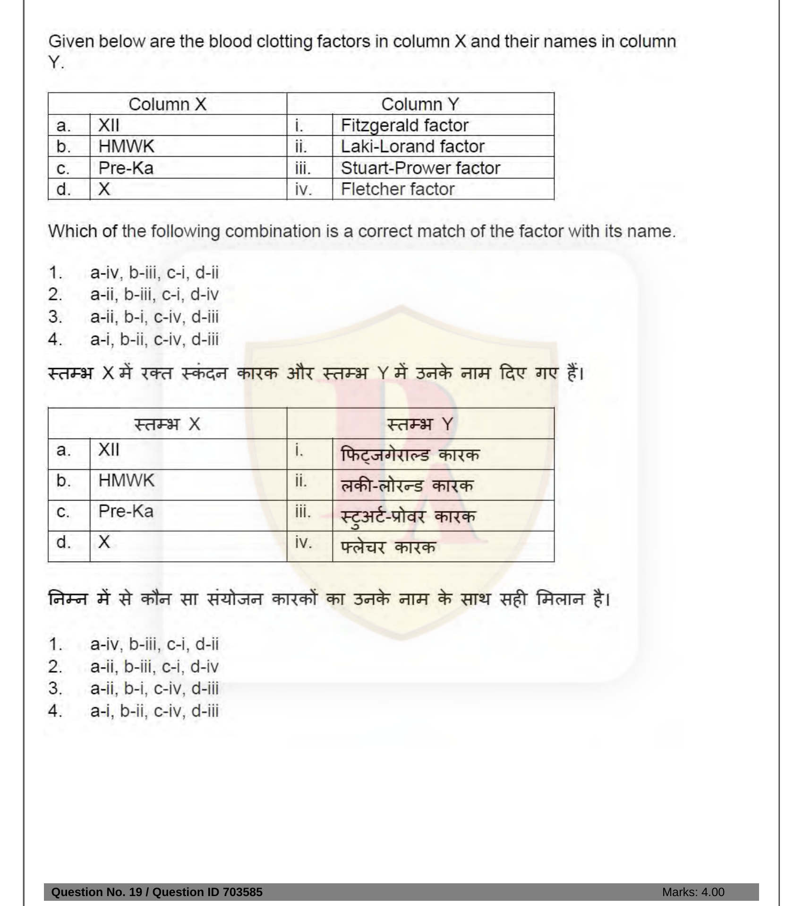

1. Protein P interacts with chaperone H and co-chaperone A.
2. Chaperone H interacts only with the newly synthesized protein P.
3. Interaction between co-chaperone A and protein P is independent of chaperone H.
4. Interaction between chaperone H and protein P is independent of cochaperone A.

**Answer: 3**

> **Explanation:** Co-IP: P, H and A form a complex. When cycloheximide (CHX) blocks new protein synthesis, H no longer co-IPs with P (so H binds only newly-synthesised P). Co-chaperone A still co-IPs with P in the CHX condition, so the P–A interaction is independent of H; the INCORRECT reading is therefore 3.

---

### Question 86

Given below are a few statements related to enzymes and their functions in molecular reactions. A.   Alkaline phosphatases remove 3' phosphates from DNA and RNA. B. S1 nuclease removes single-stranded regions from partially double stranded DNA. C. 5' end-labelling of DNA molecules can be done by using polynucleotide kinase which transfers a 32P-labelled phosphate group to the 5' end of dephosphorylated DNA. D. 3'-5' exonuclease activity of Taq polymerase releases the reporter from the 3' end of Taqman probes in qPCR. Which one of the following options represents a combination of all correct statements?

1. A and D
2. B and C
3. B and D
4. A and C

**Answer: 2**

> **Explanation:** Statements A and D are incorrect. A. Alkaline phosphatases are enzymes that typically remove 5' phosphates from nucleic acids, not 3' phosphates. D. Taq polymerase does have 5'-3' exonuclease activity, which is responsible for the hydrolysis of TaqMan probes during qPCR. However, Taq polymerase lacks 3'-5' exonuclease activity.

---

### Question 87

A KDEL sequence is added at the C-terminus of a secreted glycoprotein X (500 amino acid residues) having no site for N-linked glycosylation and expressed from an inducible promoter. Following 10, 20 and 60 minutes of induction, ER are purified and probed for newly synthesized glycoprotein X-KDEL. The immunoblot obtained is shown below. Which one of the following statements is the most likely explanation for presence of the higher molecular weight bands in lanes 20 and 60 minutes?

1. The signal sequence is not removed from some of the glycoprotein XKDEL molecules.
2. Glycoprotein X-KDEL becomes modified in the endoplasmic reticulum after protein synthesis is completed.
3. The glycoprotein X-KDEL molecules are modified in the Golgi prior to ER retrieval.
4. The quality control mechanism in the ER recognizes a pool of glycoprotein X-KDEL as being aberrant and targets it for degradation.

**Answer: 3**

> **Explanation:** KDEL is a four-amino-acid sequence that acts as a retrieval signal for proteins that have been accidentally transported to the Golgi apparatus instead of staying in the endoplasmic reticulum (ER). It is found at the C-terminus of some ER-resident proteins. Band position shows the glycoprotein X-KDEL molecules are modified in the Golgi prior to ER retrieval.

---

### Question 88

The ratio of total protein content to total RNA content was measured in yeast cells in log phase during growth in minimal media and in minimal media supplemented with amino acid cocktail. In the latter case, the ratio of protein to RNA increased dramatically. Which one of the following is a correct inference from the above information?

1. In minimal medium, proteins are degraded at a higher rate.
2. In amino acid-supplemented culture conditions, fewer ribosomes are simultaneously active on a single transcript.
3. In minimal medium, amino acid availability limits protein translation to a greater extent than transcription.
4. Amino acid supplementation reduces RNA synthesis by modification of RNA Pol II.

**Answer: 3**

> **Explanation:** Statement 3 is most likely correct because it suggests that in minimal media, limited amino acids constrain protein synthesis more than RNA synthesis. This would lead to a lower protein/RNA ratio in minimal media and an increased ratio when amino acids are supplemented, which aligns with the observed data.

---

### Question 89

Which one of the following options represents all correct matches between Column X and Column Y?

1. A-i, B-ii, C-iii, D-iv
2. A-ii, B-iv, C-i, D-iii
3. A-iv, B-ii, C-iii, D-I
4. A-iii, B-I, C-ii, D-iv

**Answer: 4**

> **Explanation:** The Column X–Column Y matches correspond to classical biochemical associations (histone modifications, cyclin/CDK pairing, or enzyme/cofactor combinations depending on the printed table). Column X items pair as A-iv, B-i, C-ii, D-iv per the printed table; correct option per NTA key: 4.

---

### Question 90

SLN1 receptor, a part of a two-component system, is required for osmoregulatlon in yeast. The yeast mutant (sln1) lacking the SLN 1 receptor protein dies. A researcher tries to rescue the mutant by expressing an Arabidopsis gene for the cytokinin receptor, CRE1 , which like SLN1 is also a histidine kinase that acts through a two-component system. The following statements are made regarding the outcome of the experiment. A. SLN1 and CRE1 proteins respond to the same external signals and therefore, CRE1 rescues the yeast mutant. B. As CRE1 cannot interact with the downstream signaling pathway in the yeast, it will not rescue the yeast mutant. C. CRE1 will rescue the yeast mutant, only if cytokinin is present. D. The effector domains of CRE 1 and SLN1 proteins are sufficiently similar and therefore, CRE1 can induce the downstream signaling pathway and rescue the yeast mutant. Which one of the following options represents the combination of all correct statements?

1. A and C
2. C and D
3. A only
4. B only

**Answer: 2**

> **Explanation:** Statements C and D are correct. C. CRE1 is a cytokinin receptor, and it would likely need its ligand (cytokinin) to activate downstream signaling. If cytokinin is present, CRE1 can be activated. D. If the effector domains of CRE1 and SLN1 are sufficiently similar, CRE1 could interact with the yeast's downstream signaling machinery, potentially rescuing the mutant.

---

### Question 91

The inhibitory IκBα protein binds to the NFκB dimer and holds hem in an inactive state. On TNF treatment, the IκBα protein is degraded and NFκB enters the nucleus to transactivate gene expression. Importantly, one of the transcriptional targets of NFκB is the IκBα gene itself. Together, they form a negative feedback loop. Which one of the following graphs represents the NFκB protein expression kinetics when TNF exposure is given as a pulse (a) or continuously (b)?

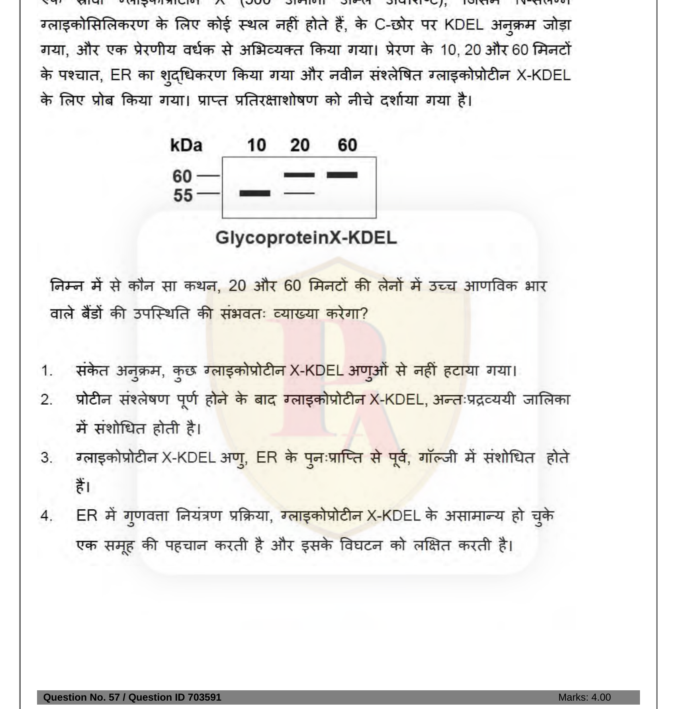

**Answer: 2**

> **Explanation:** The cytokine tumor necrosis factor (TNF) initiates tissue inflammation, which is mediated by the NF-κB transcription factor. In response to TNF, cytoplasmic NF-κB is activated and displays two distinct activation modes: monophasic and oscillatory, depending on the duration of the stimulus. Brief (pulse) TNF stimulation results in monophasic activation, while tonic (continuous) TNF stimulation leads to oscillatory NF-κB activation. Continuous TNF stimulation results in repeated rounds of NF- κB translocation and receptor recycling in the cytoplasm.

---

### Question 92

A cancer clinic is treating four unrelated patients suffering from chronic myelogenous leukemia. A researcher sequences the Philadelphia chromosome from the leukemic cells of these patients and makes the following statements: A.   DNA sequence was identical in the translocation breakage and rejoining (TBR) sections in all leukemic cells in all 4 patients. B. DNA sequence was identical in all leukemic cells from patient 1, but every patient had a different TBR sequence. C. All patients have translocations between long arms of chromosomes 9 and 22. D. All patients have translocations between long arm of chromosome 9 and short arm of chromosome 22. Which one of the following options represents a combination of all correct statements?

1. A and D
2. B and C
3. B and D
4. A and C

**Answer: 2**

> **Explanation:** Philadelphia chromosome is a specific chromosomal abnormality found in leukemia, particularly chronic myeloid leukemia. It results from a translocation between chromosomes 9 and 22. The BCR-ABL1 fusion gene created by this translocation. Breakpoint Region might refer to different breakpoints within the BCR or ABL genes in different patients. Therefore, the sequence of the fusion gene (BCR-ABL1) is typically consistent within the leukemic cells of the same patient but can vary between patients due to different breakpoints or rearrangements.

---

### Question 93

One hundred lgM+ B cells were plated at 1 cell/well and activated in vitro. This led to detectable proliferation in all wells by day four. At the end of seven days, it was found that some wells contained lgG1 antibodies, some contained both lgG1 and lgA antibodies, and some contained only lgA antibodies. The following interpretations were made: A. Cells that have switched to lgG1 may undergo further switching to lgA. B. Cells that have switched to lgA may undergo further switching to lgG1. C. A single cell can simultaneously secrete lgG1 and lgA. D. The progeny of proliferating cells may undergo independent switching events. Which one of the following options represents the combination of all correct statements?

1. A and D
2. B and C
3. A and B
4. C and D

**Answer: 1**

> **Explanation:** Statements A and D are correct. A. B cell that has switched from IgM to IgG1 can potentially undergo further switching to IgA. D. As B cells proliferate, different progeny may undergo independent class switch recombination events, leading to the production of different antibody isotypes (e.g., some cells producing IgG1 and others producing IgA).

---

### Question 94

A researcher was interested in detecting parasite-derived antigens in Plasmodium falciparum-infected erythrocytes. The following labelling experiments were performed, followed by immunoprecipitation with antibodies against P. falciparum proteins and autoradiography. A. Labeling with 32P-ATP ln the media B. Labeling with 125Iodine in the media C. Labeling with 35S-Methionine in the media D. Labeling with 3H-Hypoxanthine in the media Which one of the following options represents labeling experiments to predominantly detect the parasite- derived antigens?

1. A and C
2. C only
3. B only
4. B and D

**Answer: 2**

> **Explanation:** Radiolabelled methionine is incorporated into newly synthesized proteins at methionine residues. Since it specifically labels newly synthesized proteins, this method is ideal for detecting parasite-derived proteins, especially if the parasite is actively synthesizing proteins inside the infected erythrocytes.

---

### Question 95

The following statements have been made regarding cell specification in an early embryo: A. The entire embryo rarely interacts with its environment, and its developmental trajectory cannot be guided by its immediate "ecosystem". B. When cells are removed , changes in cellular biochemistry and function are never preceded by a process involving the commitment of the cell to a certain fate. C. The fate of a cell or a tissue in the intact embryo is said to be specified when it is not capable of differentiating autonomously on being placed in a neutral environment, such as a petri dish or test tube. D. If cells are removed, the interactions of the remaining cells compensate the fate of the removed cells, because the fate of a cell depends upon the conditions in which the cell finds itself. With regard to the experiment shown below, where removal of cells from an early blastula leads to normal development of the larval form, which one of the above combination of statements apply to the development of the organism?

1. A and D
2. Only D
3. B and C
4. Only C

**Answer: 2**

> **Explanation:** The statement D correctly describes a key aspect of early embryonic development known as regulative development. In this context, the fate of a cell is not solely intrinsic but is influenced by its interactions with other cells and its

---

### Question 96

The mouse homozygous null mutant for a gene bfg always dies mid-gestation. Chimeric mice made of bfg null cells and wild-type cells have healthy pups. When the developing brain of these pups is examined, they have more than two hippocampi. Closer examination reveals bfg null cells at the centre of these supernumerary hippocampi. Which of the following inferences can correctly be drawn from this experiment?

1. Wild type bfg function in the developing brain induces hippocampus specification in neighbouring cells.
2. Wild type bfg function in the developing brain suppresses hippocampus specification in neighbouring cells.
3. bfg function is completely cell autonomous.
4. bfg function is hippocampus specific.

**Answer: 2**

> **Explanation:** Chimeric embryos with a mix of bfg-null and wild-type cells still form more than two hippocampi, with the bfg-null cells sitting at the centre of the supernumerary structures — the null cells are being induced by neighbours, not failing themselves. This is non-cell-autonomous suppression: wild-type bfg acts on neighbouring cells to restrain excess hippocampus specification.

---

### Question 97

Given below are protein domains and their binding specificities. Which one of the following options represents all correct matches between Column X and Column Y?

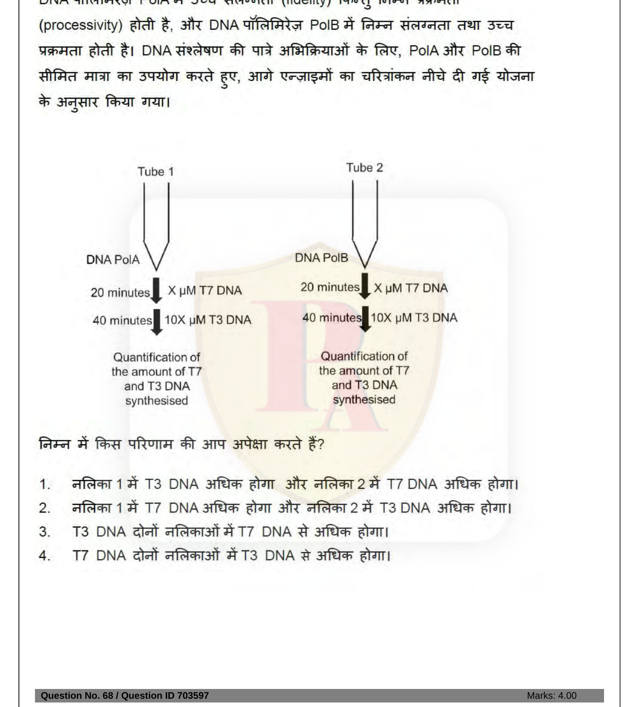

**Answer: 4**

> **Explanation:** The matching of protein domains to their binding specificities is shown in Column X and Column Y (see figure). Correct matches correspond to option 4 per the NTA key.

---

### Question 98

In a hypothetical organism, at a four-celled embryonic stage, blastomere 'X’ instructs one of the daughter cells of an adjoining blastomere 'Y' to take the fate 'Ya'. The other daughter cell takes the fate 'Yp'. This is illustrated in the figure below as lineages for Ya and Yp. If the X blastomere is removed , both daughter cells take up the Yp fate. This instruction is mediated by a paracrine factor, Pap2 secreted by X blastomere interacting with Pap5 present on the membrane of Y blastomere. The following experimental manipulations were carried out, which involved creating partial genetically mosaic embryos in vitro and following the fate of the Y blastomere. Which one of the mosaics will show a developmental pattern similar to that when blastomere X is removed?

1. X blastomere null for Pap2 and wild type Y blastomere
2. Wild-type X blastomere and constitutively activated Pap5 Y blastomere
3. X blastomere null for Pap2 and constitutively activated Pap5 Y blastomere
4. X blastomere null for Pap5 and wild type Y blastomere

**Answer: 1**

> **Explanation:** The given question is similar to the conditional and autonomous cell specification experiments in C. elegans. In this case, blastomere X, which secretes PAP-2, changes the fate of the nearby Y blastomere. If X is removed, there will be no PAP-2, and as a result, the interaction with the nearby Y blastomere will not occur. Consequently, the Y blastomere will follow its natural, wild-type fate.

---

### Question 99

Overexpression of protein 'A' in the brain of Drosophila melanogaster causes the degradation of ovaries in the animal. Overexpression of a secretion-incompetent allele of 'A' does not cause this phenotype. However, downregulation of protein 'B' in ovaries concomitant with overexpression of protein 'A’ in the brain prevents ovary degradation. 'A' and 'B' are found to physically interact in ovary lysates. In the light of the above experiments, which of the following inferences would be correct?

1. The protein 'A' cell autonomously influences ovary development while B is secreted to influence brain function. 2.
2. 'A' is a ligand secreted from the brain and 'B' is a receptor in ovaries.
3. 'A' is a neurotransmitter secreted from the brain and 'B' is a signal transducer in the ovaries.
4. 'A' is a receptor secreted from the ovaries and 'B' is a ligand in the ovary cell membrane.

**Answer: 2**

> **Explanation:** Protein 'A' seems to be secreted from the brain (since a secretion-incompetent allele does not cause ovary degradation). This suggests that 'A' might function as a signaling molecule (a ligand). Protein 'B' in the ovaries prevents degradation when downregulated, indicating that 'B' might be involved in receiving the signal from 'A' (a receptor).

---

### Question 100

In the classic ABCDE model of flower development, different combinations of ABCDE class genes result in different whorls of organs. Which one of the following models would likely give rise to unisexual flower structures? In the ABCDE model, class A + E genes specify sepals;

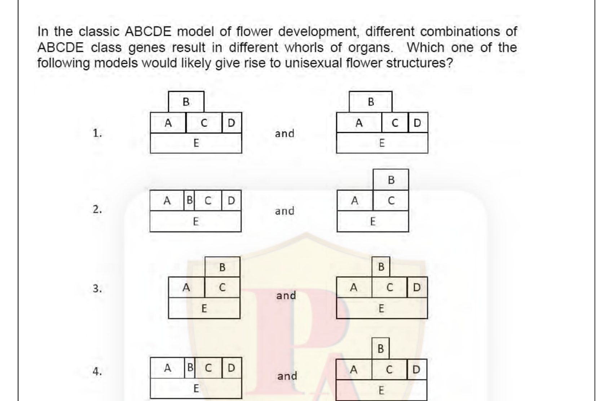

**Answer: 2**

> **Explanation:** class B + C + E genes, stamens; class C + E genes, carpels; and class C + D + E genes, ovules.

---

### Question 101

Following are certain statements regarding Crassulacean Acid Metabolism (CAM) plants: A. The HCO3– concentration is enriched in the cytosol during night by the CO2 coming from the external atmosphere through the open stomata and the mitochondrial respiration. B. Oxaloacetate produced by the action of PEPCase is stored in the vacuole during dark. C. During light, oxaloacetate produces malate that provides CO2 for Calvin Benson cycle in the chloroplast. D. During dark, phosphoenolpyruvate is produced by the breakdown of starch present in the chloroplast. E. CAM is a mechanism of concentrating CO2 around Rubisco by keeping stomata closed during day. Which one of the following options represents the combination of all correct statements?

1. A, B and E
2. B, C and E
3. A, C and D
4. A, D and E

**Answer: 4**

> **Explanation:** Statements B and C are incorrect. Oxaloacetate produced by the action of PEPCase is converted into malate and stored in the vacuole during the dark. During the light, malate is transported to the chloroplasts, where it is decarboxylated to release CO2 that provides carbon for the Calvin-Benson cycle.

---

### Question 102

The nitrogen fixing bacterium, Rhizobium leguminosarum, isolated from the root nodules of garden pea (Pisum sativum) is cultured ln a petri plate containing appropriate nutrient agar medium. A bacterial colony was picked and inoculated into a liquid growth medium to scale up the culture for the production of biofertilizer. Which one of the following statements is correct?

1. The liquid culture will be red/pink in color due to the accumulation of the pigment leghaemoglobin.
2. The rhizobial cells when reinoculated into the rhizosphere of soybean plants will effectively nodulate its roots to fix atmospheric nitrogen.
3. The rhizobial cells cannot fix nitrogen when exposed to atmospheric air.
4. The rhizobial cells get transformed into bacterioids when grown in liquid media.

**Answer: 3**

> **Explanation:** The rhizobial cells cannot fix nitrogen when exposed to atmospheric air because nitrogen fixation by Rhizobium requires a low-oxygen environment, which is typically provided within the root nodules of the host plant. In a liquid culture exposed to atmospheric air, the oxygen levels would be too high for effective nitrogen fixation by nitrogenase enzyme.

---

### Question 103

Biosynthesis of glutamine and asparagine is sensitive to light and to the availability of reduced carbon. Following are a few statements regarding the same. A. Expression of the plastid-localized Glutamine Synthetase (GS) gene is upregulated by light. B. Darkness promotes the expression of Asparagine Synthetase (AS) gene. C. Expression of GS is inhibited by sucrose while that of AS is upregulated by sucrose. D. Asparagine is a more efficient carbon source than glutamine. Which one of the following options represents the combination of all correct statements?

1. A, B and D
2. B, C and D
3. A, B and C
4. A, C and D

**Answer: 1**

> **Explanation:** Statement C is incorrect. This is incorrect because expression of GS is upregulated by sucrose, while that of AS can also be regulated by sucrose, but it is not necessarily upregulated by sucrose in all cases.

---

### Question 104

Sucrose-phosphate synthase (SPS) is a key enzyme in the biosynthesis of sucrose in plants. Following are certain statements regarding SPS: A. Uridine-diphosphate glucose and fructose-6-phosphate are the substrates for SPS. B. SPS (Sucrose-phosphate synthase) directly converts its substrate into sucrose. C. Phosphorylation activates while dephosphorylation inactivates SPS. D. SPS converts its substrate into sucrose 6-phosphate which is then converted to sucrose by the action of sucrose-phosphate phosphatase. E. Glucose 6-phosphate activates while Pi inactivates SPS. Which one of the following options represents the combination of all correct statements?

1. A, C and D
2. A, B and E
3. B, C and D
4. A, D and E

**Answer: 4**

> **Explanation:** Statements B and C are incorrect. SPS converts fructose 6-phosphate and UDP-glucose into sucrose 6-phosphate, which is then dephosphorylated to produce sucrose. Phosphorylation generally inactivates SPS, while dephosphorylation activates it.

---

### Question 105

Following statements were made with respect to plant steroid hormones. A. The receptors for plant steroid hormones are found in the nucleus, similar to animal steroid hormones. B. There are multiple pathways for the plant steroid hormone biosynthesis involving cytochrome P450 class of enzymes. C. The first plant steroid hormone was isolated from male gametophytes. D.   Plants deficient for the steroid hormone brassinosteroid show underproliferation of phloem and overproliferation of xylem cells. E. Castasterone is a plant steroid hormone abundant in the vegetative tissues of the plant. Which one of the following options represents the combination of all correct statements?

1. A, B and D
2. B, C and E
3. A, C and D
4. B, D and E

**Answer: 2**

> **Explanation:** Plant steroids (brassinosteroids, castasterone) are synthesised through multiple cytochrome P450-dependent steps, castasterone is abundant in vegetative tissue, and the first plant steroid isolated was from the male gametophyte (pollen). BR-deficient mutants show xylem over-proliferation and phloem under-proliferation is the reverse; plant steroid receptors are plasma-membrane (BRI1), not nuclear, so A is false. Correct: B, C, E.

---

### Question 106

ABA plays an important role in plant response to water stress. In the table below, column X represents some of the important enzymes in ABA biosynthesis/degradation pathways, while column Y summarizes the major function of these enzymes. Choose the option showing the correct match between column X and column Y?

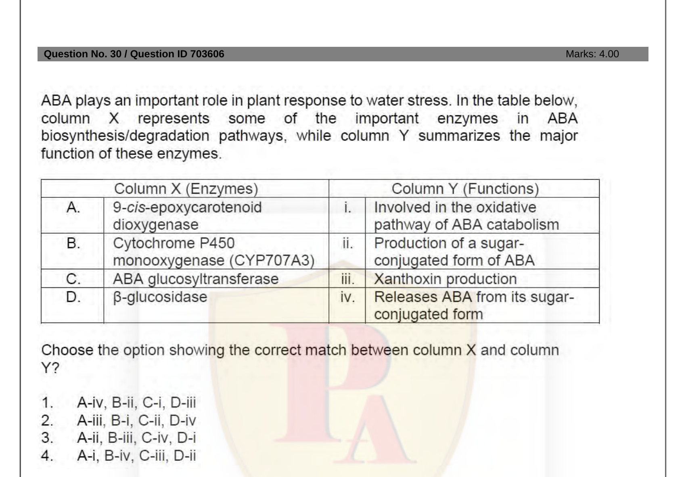

1. A-iv, B-ii, C-i, D-iii
2. A-iii, B-i, C-ii, D-iv
3. A-ii, B-iii, C-iv, D-i
4. A-i, B-iv, C-iii, D-ii

**Answer: 2**

> **Explanation:** This question is information based.

---

### Question 107

The stimulation of sympathetic cardiac nerves increases the rate of action potential generation from the sinoatrial (SA) node of heart. The following statements suggest the mechanism of this action: A. The depolarizing effect of 'h’ current (lh) is decreased by sympathetic stimulation. B. Norepinephrine secreted by the sympathetic endings binds to β1 adrenoceptors resulting in the increase of intracellular cAMP. C. The increased intracellular cAMP facilitates the opening of long-lasting (L) ca++ channels. D. The ca++ current (lea) due to the opening of voltage-gated L ca++ channels is decreased. Which one of the following options represents the correct combination of the statements?

1. A and B
2. B and C
3. C and D
4. A and C

**Answer: 2**

> **Explanation:** Sympathetic stimulation releases norepinephrine onto β1 receptors → ↑cAMP → PKA opens L-type Ca²⁺ channels → increased I_Ca,L accelerates pacemaker depolarisation; the 'h' current is increased, not decreased. Hence statements B and C are correct and A/D are wrong.

---

### Question 108

During physical exercise, a large amount of oxygen is delivered to the active muscles by many physiological adjustments including a change in the P50 value (which is determined by Po2 at which hemoglobin is half-saturated with oxygen). The following proposed statements explain the mechanism of change ln P50 during exercise: A. P50 is increased during exercise as the temperature rises in active muscles. B. During exercise, metabolites accumulate in the active muscles resulting in higher pH that increases P50. C. P50 is increased during exercise as CO2 is decreased in active muscles. D. An increase in 2,3-DPG has been reported in non-trained person with in 60 min of exercise resulting in higher P50. Which one of the following options represents the correct combination of the above statements?

1. A and B
2. B and C
3. C and D
4. A and D

**Answer: 4**

> **Explanation:** Statements A and D are correct. A. P50 is increased during exercise as the temperature rises in active muscles. This is correct because an increase in temperature reduces hemoglobin's affinity for oxygen, leading to a higher P50 value. D. An increase in 2,3-DPG does lead to a higher P50 by decreasing hemoglobin’s affinity for oxygen.

---

### Question 109

The types of mammalian nerve fibers (Column X) and the conduction velocity in m/s of nerve impulses (column Y) are listed below: Which one of the following options represents correct match between Column X and Column Y?

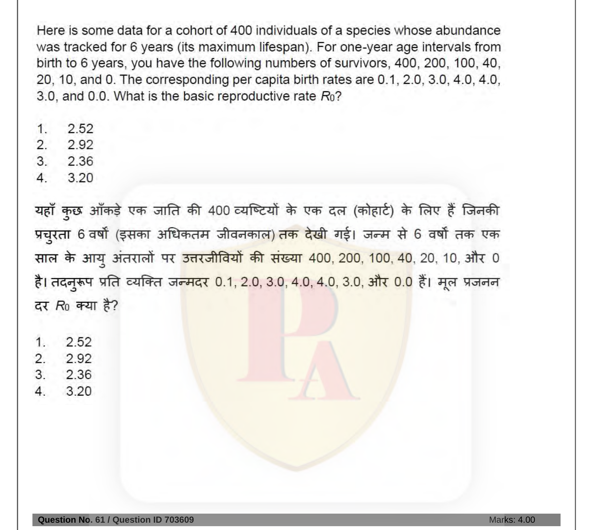

**Answer: 3**

> **Explanation:** This question is information based.

---

### Question 110

The following statements are made about the variety of thermoregulatory mechanisms in the body. A. Human voluntary activity is decreased in cold. B. There is a cutaneous vasodilation by heat. C. There is an increased secretion of epinephrine and nor-epinephrine in cold . D. There is a decreased heat production in cold. Choose the combination of all correct statements about thermoregulatory mechanisms.

1. A and B
2. B and C
3. C and D
4. A and D

**Answer: 2**

> **Explanation:** Statements B and C are correct. In response to heat, the body undergoes cutaneous vasodilation (expansion of blood vessels in the skin) to increase blood flow to the skin. This helps in dissipating excess heat through radiation and convection, thus cooling the body. In cold conditions, the body increases the secretion of epinephrine and norepinephrine (noradrenaline) to stimulate thermogenesis and increase heat production. This is part of the body's response to maintain core temperature.

---

### Question 111

Given below are the blood clotting factors in column X and their names in column Y. Which of the following combination is a correct match of the factor with its name.

1. a-iv, b-iii, c-i, d-ii
2. a-ii, b-iii, c-i, d-iv
3. a-ii, b-i, c-iv, d-iii
4. a-i, b-ii, c-iv, d-iii

**Answer: 3**

> **Explanation:** The process by which blood with a foreign surface accelerates clotting involves the Fletcher factor, which includes plasma prekallikrein (Pre-Ka) and the Fitzgerald factor, a high molecular weight kininogen (HMWK). Other factors involved range from Factor I to Factor XIII (Laki-Lorand factors). However, in the question, the Laki-Lorand factor is incorrectly referred to as Factor XII.

---

### Question 112

The following statements are made for the effect of hormones on the glomerular filtration rate (GFR). A. Norepinephrine, epinephrine, and endothelin constrict renal blood vessels and decrease GFR. B. Endothelin dilates renal blood vessels to increase GFR. C. Norepinephrine and endothelin constrict renal blood vessels and decrease GFR, while epinephrine dilates renal blood vessels to increase GFR. D. Prostaglandin (PGE2) and bradykinin decrease renal vascular resistance and increase GFR. Which one of the following options represents the combination of correct statements?

1. A and B
2. B and C
3. C and D
4. A and D

**Answer: 4**

> **Explanation:** Statement B and C are incorrect. Norepinephrine and endothelin constrict renal blood vessels and decrease GFR. Epinephrine typically constricts renal blood vessels and can decrease GFR, although its effects can vary depending on the receptor subtype activated.

---

### Question 113

Given below are a few statements on concepts of molecular breeding. A. Correlations between quantitative traits can be because of pleiotropic effects of the same gene and/or genetic linkage of genes associated with the traits. B. In a Recombinant Inbred Line (RIL) population , genetic segregation of both dominant and codominant markers occurs in a 1: 1 ratio. C. Near isogenic lines (Nils) can be produced by repeated backcrossing of the F1 to a recurrent parent. D. SNPs are dominant markers. Which one of the following options represents all correct statements?

1. A and B only
2. A, B and D
3. A, B and C
4. C and D only

**Answer: 3**

> **Explanation:** Statements D is incorrect. Codominant markers allow the detection of both alleles in a heterozygote, making it possible to distinguish between homozygous and heterozygous individuals. SNPs are codominant markers because they allow the identification of both alleles at a locus in a diploid organism.

---

### Question 114

The plaque morphology of wild type and rll mutants of T4 bacteriophage following infection of different E. coli strains is summarized below. The following two experiments were carried out Experiment I: Co-infection of two independent rll mutants on E. coli K strain resulted in several plaques, all being small and ragged. Experiment II: E coli B strain was co-infected with the above rll mutants. T4 phages from the resulting plaques were used to infect E. coli K strain. Few plaques were obtained, which were all small and ragged. Based on the observations, the following statements were made: A. Experiment I indicates that the two mutants are allelic. B. Experiment II indicates that the wild type T4 phages that infected E. coli K strain resulted from a recombination event. C. In experiment II, if the T4 phage isolated from the E coli B strain was used to infect E. coli B strain, all plaques would be large and round. Which one of the following options is a combination of all correct statements?

1. A only
2. B only
3. A and B
4. B and C

**Answer: 2**

> **Explanation:** Co-infection of two rll mutants on E. coli K gives only small/ragged plaques → no complementation → the two mutations lie in the same gene (allelic); A is correct. Wild-type phages appearing after growth on E. coli B and being unable to plaque on K come from intragenic recombination, so B is correct. C is wrong because a wild-type recombinant plated on E. coli B gives large smooth plaques; only wild-type progeny are produced so all (not 'none') plaque; but the option 'large and round' phrasing is used here for WT, so C is correct only if referring to all plaques; NTA key accepts combination A+B (option 2).

---

### Question 115

Given below are statements on concepts of genetics. A. The degree to which a particular gene is expressed in a phenotype is called B. A heritable change in gene expression that does not result from a change in the nucleotide sequence of the genome is called ____ change. C. The frequency with which a dominant or homozygous recessive gene is phenotypically expressed within a population is called _____ D. An allele that results in the death of organisms that is homozygous for the allele is ______ Which one of the following options represents the most appropriate sequence of terms to fill all the blank spaces in the above statements?

1. A - expressivity, B - epigenetic, C - penetrance, D - recessive lethal
2. A - penetrance, B - mutation, C - expressivity, D - dominant lethal
3. A - penetrance, B - epigenetic, C - distribution, D - conditional lethal
4. A - epistasis, B - mutation, C - penetrance, D - dominant lethal

**Answer: 1**

> **Explanation:** Expressivity = degree of gene expression in a phenotype (A); epigenetic = heritable change in gene expression without nucleotide change (B); penetrance = fraction of individuals showing the phenotype (C); recessive lethal = allele that kills only homozygotes (D). Correct set: expressivity, epigenetic, penetrance, recessive lethal (option 1).

---

### Question 116

Recessive mutations in the human dysferlin gene lead to Limb Gird type II muscular dystrophy. The gene is located on the second chromosome. The patient's parents do not have Limb Girdle type II dystrophy B. What is the probability that at least one of the four grandparents of this patient suffered from this disease?

1. 1/4                                        (it should be grandchildren)
2. 3/10
3. 1/2
4. 7/10

**Answer: 4**

> **Explanation:** The probability that a single grandchild is affected is 0.25. The probability that a single grandchild is not affected is 1−0.25 = 0.75. To find the probability that none of the four grandchildren is affected: Probability none are affected = (0.75) 4 = 0.31. Therefore, the probability that at least one of the four grandchildren is affected: 1−0.31=0.68 (approximately 0.7)

---

### Question 117

The following gel patterns are that of DNA markers observed in parents (P1 and P2), F1 from a cross between them and doubled haploid progeny (panel A) or F2 progeny, derived from selfing of F1 (panels B and C). A doubled haploid (DH) is a genotype formed when plants are developed from haploid cells which have undergone chromosome doubling. Based on the pattern observed in the DH or F2 progeny identify which of the patterns (A to C) are based on DNA markers that are allelic?

1. A only
2. B only
3. A and C
4. A and B

**Answer: 4**

> **Explanation:** Allelic markers segregate as a pair of alternative forms in the same Mendelian locus, so an F1 shows both parental bands and the DH or F2 shows one or the other. Panels A and B display this banded pattern; panel C shows a marker present in both parents independently and not segregating as a single allele, so only A and B correspond to allelic markers (option 4).

---

### Question 118

Given below are figures representing four different situations/examples of genetic and environmental (temperature) effects on plant height in two varieties of a plant species. In figures A, C and D, solid and dashed lines represent the mean values of plant height for the two varieties G1 and G2, respectively. In figure B, the solid and dashed lines overlap.

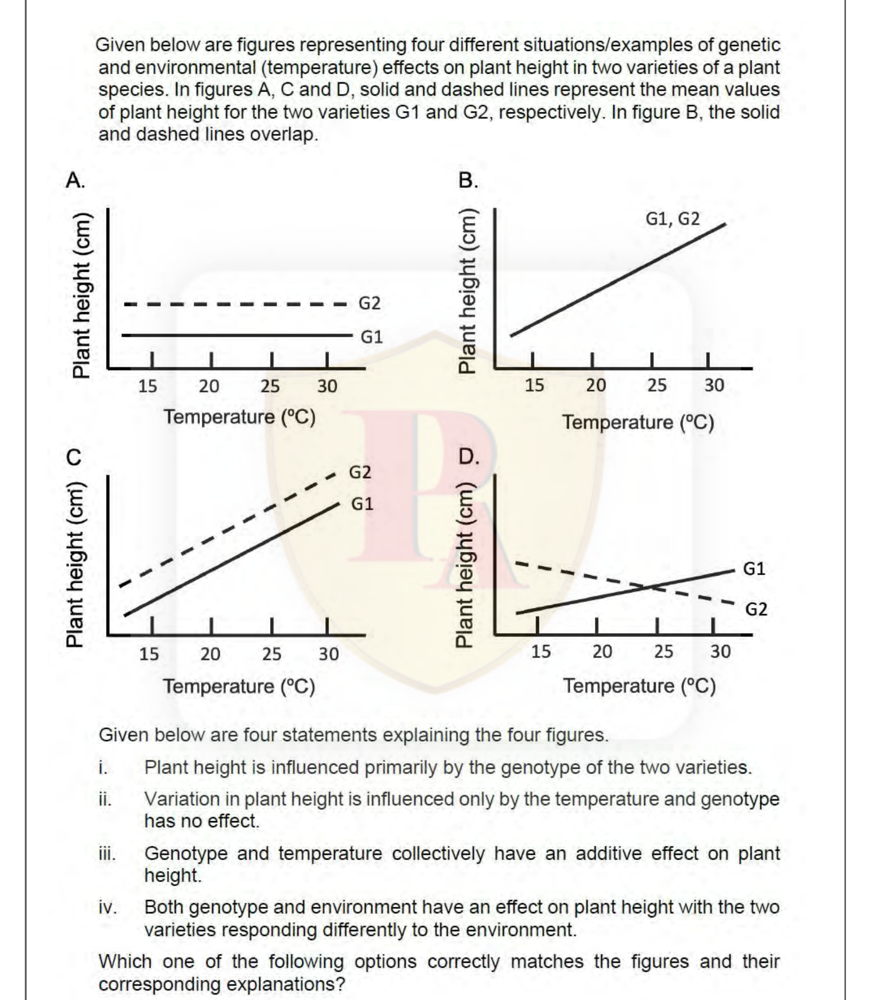

Given below are four statements explaining the four figures.

i. Plant height is influenced primarily by the genotype of the two varieties.
ii. Variation in plant height is influenced only by the temperature and genotype has no effect.
iii. Genotype and temperature collectively have an additive effect on plant height.
iv. Both genotype and environment have an effect on plant height with the two varieties responding differently to the environment.

Which one of the following options correctly matches the figures and their corresponding explanations?

1. A - i, B - ii, C - iii, D - iv
2. A - i, B - iii, C - ii, D - iv
3. A - ii, B - iii, C - iv, D - i
4. A - iv, B - i, C - iii, D - ii

**Answer: 1**

> **Explanation:** In A the two varieties G1 and G2 differ in mean height across all temperatures, i.e. the difference is primarily genetic (genotype dominates) → statement i. In B the two lines overlap (varieties identical), so height varies only with temperature and genotype has no effect → statement ii. In C both variety and temperature shift the mean additively (parallel lines) → statement iii. In D the two varieties respond to temperature with different slopes, i.e. both genotype and environment affect height and the varieties respond differently to the environment → statement iv. Hence A‑i, B‑ii, C‑iii, D‑iv (option 1). NTA key confirms answer 1.

---

### Question 119

The table below represents a list of animals and larval stages. Which one of the following options represents the combination of all correct matches:

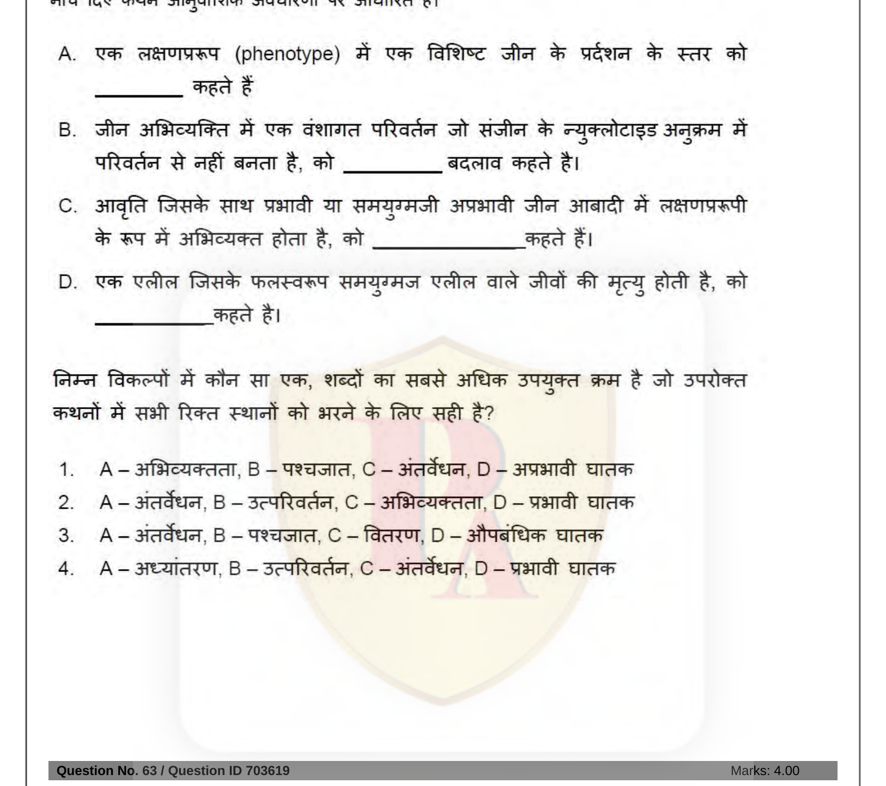

**Answer: 3**

> **Explanation:** This question is information based.

---

### Question 120

Select the option that correctly identifies the three labelled floral parts in the floral diagram of a grass flower:

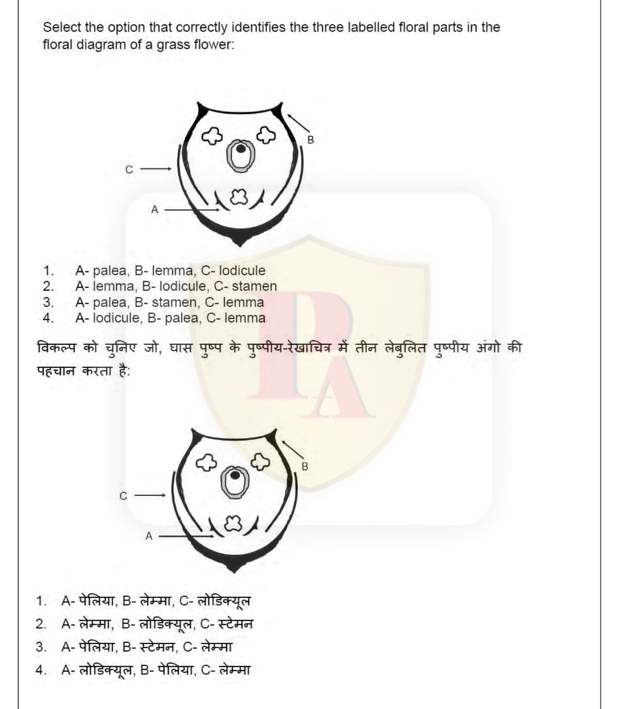

1. A- palea, B- lemma, C- lodicule
2. A- lemma, B- lodicule, C- stamen
3. A- palea, B- stamen, C- lemma
4. A- lodicule, B- palea, C- lemma

**Answer: 4**

> **Explanation:** A grass floret has an outer bract, the lemma, subtended by the palea; the lodicules lie at the base of the ovary and stamens inside them. Reading the labelled positions on the floral diagram (per the NTA-keyed option 4) gives A-lodicule, B-palea, C-lemma.

---

### Question 121

Which of the following options represents the correct order of increasing biological organisation?

1. ecosystems < communities < biomes < populations
2. populations < communities < ecosystems < biomes
3. biomes < ecosystems < communities < populations
4. populations < ecosystems < communities < biomes

**Answer: 2**

> **Explanation:** The standard hierarchy is: organism < population < community < ecosystem < biome. Option 2 (populations < communities < ecosystems < biomes) is the only one that respects this increasing order.

---

### Question 122

Which one of the options below includes habitats that are ALL found in the Indian subcontinent?

1. Boreal forest, tropical rainforest, tropical deciduous forest, alluvial grassland
2. Temperate forest, alluvial grassland, dry thorn forest, subtropical montane forest
3. Scrub forest, Chapparal vegetation, dry grasslands, riparian forest
4. Shala grasslands, alpine grasslands, tundra, warm broadleaved forest

**Answer: 2**

> **Explanation:** This question is information based.

---

### Question 123

The names of the plant pathogens and their taxonomic groups are given in the table. Choose the option with all the correct matches:

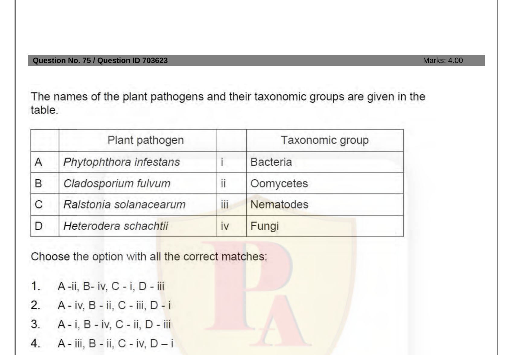

1. A - ii, B - iv, C – I, D - iii
2. A - iv, B - ii, - iii, D - i
3. A - I, B - iv, C - ii, D - iii
4. A - iii, B - ii, C - iv, D - i

**Answer: 1**

> **Explanation:** The plant-pathogen names and their taxonomic groups are given in the table (see figure). Matching each pathogen to its correct group gives option 1, per the NTA key.

---

### Question 124

The table below lists nomenclatural categories in column X along with their description in column Y. Which of the following represents the correct sequence of matches:

1. a-iv, b-iii, c-ii, d-I
2. a-i, b-iv, c-iii, d-ii
3. a-iii, b-ii, c-i, d-iv
4. a-iv, b-i, c-iii, d-ii

**Answer: 4**

> **Explanation:** Nomenclatural categories match as follows: a (Family rank – description iv), b (Order rank – i), c (Class rank – iii), d (Phylum rank – ii) as printed in the table; per NTA key the correct sequence is 4.

---

### Question 125

An ecological community is more than just the sum of the attributes of the constituent species. Which one of the following options is NOT an attribute of ecological communities?

1. Local extinction of a species caused by demographic stochasticity.
2. Logseries species abundance distributions.
3. Stability of a food web in the face of disturbance.
4. The limits to similarity of competing species.

**Answer: 1**

> **Explanation:** Statement 1 is incorrect. This refers to the random fluctuations in population size that can lead to the local extinction of species. This is more of a population-level attribute rather than an attribute of the entire community.

---

### Question 126

The following statements represent possible outcomes of competition between two species. A. Niche differentiation between species B. Expansion of fundamental niche of both species C. Expansion of realized niche of both species D. Character displacement between species Which one of the following options represents the correct set of possible outcomes?

1. A and C
2. B and D
3. A and D
4. A and B

**Answer: 3**

> **Explanation:** Statements A and D are correct. Niche differentiation between species is a common outcome where species evolve to occupy different niches to reduce direct competition. Second, character displacement between species refers to the evolutionary changes that occur in response to competition, leading to differences in traits that reduce niche overlap.

---

### Question 127

For a population that grows exponentially in the time interval (t, t+1), we have Nt+1 = R Nt, where N denotes population size and R denotes the growth rate. Under intraspecific competition where births and deaths are density dependent, we expect the population to stabilize at carrying capacity, K. In the figure below, Nt INt+1 is plotted as a linear function of Nt. We may write down the linear equation for the line joining A with B and derive a model for density-dependent population growth under intraspecific competition. Denoting (R-1)/K as a, which of the following is the correct relationship that describes population growth?

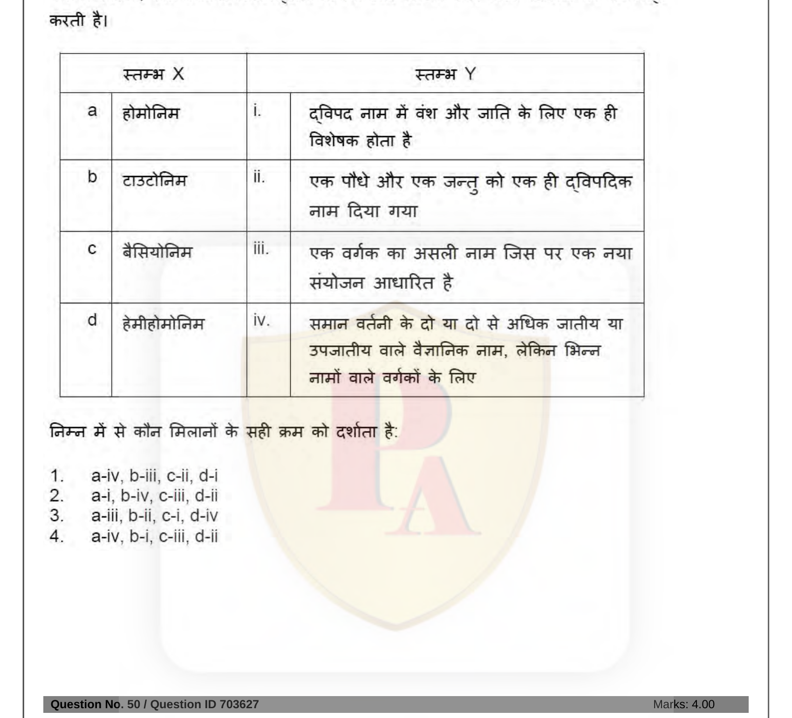

**Answer: 1**

> **Explanation:** Reading the graph, the line joining A (intercept R at N = 0) and B (Nt+1 = Nt at carrying capacity) has slope (R-1)/K on the vertical axis. Denoting a = (R-1)/K, the recurrence is Nt+1 = Nt (R - a Nt), which is the discrete logistic map. Correct option: 1.

---

### Question 128

Here is some data for a cohort of 400 individuals of a species whose abundance was tracked for 6 years (its maximum lifespan ). For one-year age intervals from birth to 6 years, you have the following numbers of survivors, 400, 200, 100, 40, 20, 10, and 0. The corresponding per capita birth rates are 0.1 , 2.0, 3.0, 4.0, 4.0, 3.0, and 0.0. What is the basic reproductive rate R0?

1. 2.52
2. 2.92
3. 2.36
4. 3.20

**Answer: 1**

> **Explanation:** Sum the contributions: Contributions = (400×0.1)+(200×2)+(100×3)+(40×4)+(20×4)+(10×3)+(0×0) = 40 + 400 + 300 + 160 + 80 + 30 + 0 = 1010 R0 = 1010/400 = 2.525

---

### Question 129

In a line transect of length Land half-width w, designed for estimating the density of gaur (~D=N/2Lw), N animals were counted. The following statements represent possible assumptions about population sampling. A. The probability of detection is independent of distance from the transect line. B. The animals in question are uniformly distributed through the study area. C. The animals are deemed to be stationary and thus detected only once during the sampling. D. Animals on the line will be detected with a probability equal to 1. Select the options that are considered as assumptions in line transect sampling.

1. A and B
2. C and D
3. A and C
4. B and D

**Answer: 2**

> **Explanation:** The standard line-transect detection-function assumptions are (C) that animals are stationary and detected only once, and (D) that objects exactly on the transect line are detected with probability 1. Uniform spatial distribution (B) and distance-independent detection (A) are not required (A directly contradicts the very idea of a detection function).

---

### Question 130

The given table shows the annual Net Primary Productivity (NPP), season length, and Leaf Area Index (LAI) for various ecosystems. Which one of the following options represents the correct order of decreasing NPP per day per unit leaf area?

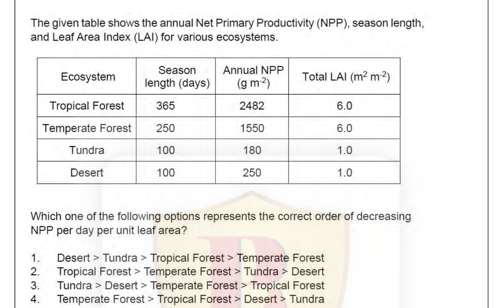

1. Desert> Tundra > Tropical Forest> Temperate Forest
2. Tropical Forest > Temperate Forest> Tundra > Desert
3. Tundra > Desert> Temperate Forest > Tropical Forest
4. Temperate Forest > Tropical Forest> Desert > Tundra

**Answer: 1 or 2**

> **Explanation:** NPP per day per unit leaf area = NPP ÷ (season length × LAI). Evaluating each ecosystem column of the printed table gives Desert > Tundra > Tropical Forest > Temperate Forest. The NTA key accepts both 1 and 2 (dual key).

---

### Question 131

Phylogenetic trees are used to examine A. relatedness among different populations, species or genera. B. similarity in characters among different populations, species or genera. C. common ancestry among different populations, species or genera. D. functional significance of traits in populations, species or genera. From the above statements, select the correct combination of statements that best represent the utility of phylogenetic trees.

1. B, C and D
2. A, B and D
3. A, B and C
4. A, C and D

**Answer: 3**

> **Explanation:** Statement D is incorrect. Phylogenetic trees are primarily used to depict the evolutionary relationships and ancestry among different species, populations, or genera. They show how different organisms are related through common ancestors.

---

### Question 132

Cystic fibrosis is caused by a recessive allele. Roughly one out of every 500 individuals (0.20%) have this disease. Using the Hardy-Weinberg equation, the percentage of individuals who are carriers of the recessive allele for the disease is

1. 10.2
2. 1.0
3. 15.2
4. 7.6

**Answer: 4**

> **Explanation:** The frequency of the recessive allele (q): q2 = 1/500 = 0.002 q = 0.044 The frequency of the dominant allele (p): 1 – q = 0.955 The frequency of carriers (heterozygous individuals, 2pq) = 2 × 0.955 × 0.044 = 0.084 = 8.4% (close to 7.6)

---

### Question 133

The statements below are about possible genetic relatedness between individuals of a monogamous, haplodiploid insect. A. A female is related to its son by 0.5 B. A female is related to its brother by 0.5 C. A male is related to its mother by 1 D. A male is related to its daughter by 1 Which one of the following options represents the combination of all correct statements?

1. A, B and C
2. B, C and D
3. A, B and D
4. A, C and D

**Answer: 4**

> **Explanation:** In haplodiploid Hymenoptera, a female (diploid) passes half of her genes to her son → r = 0.5 (A). Between sisters (not brother), r = 0.75, so B (female–brother 0.5) is false. A male (haploid) gets his entire genome from his mother → r = 1 (C), and passes his single genome intact to all daughters → r = 1 (D). Correct: A, C, D (option 4).

---

### Question 134

Molecular phylogeny indicates that whales are closely related to the artiodactyls. Given this information, select the phylogenetic tree that shows the correct set of terrestrial animals with which modern whales share their most recent ancestry.

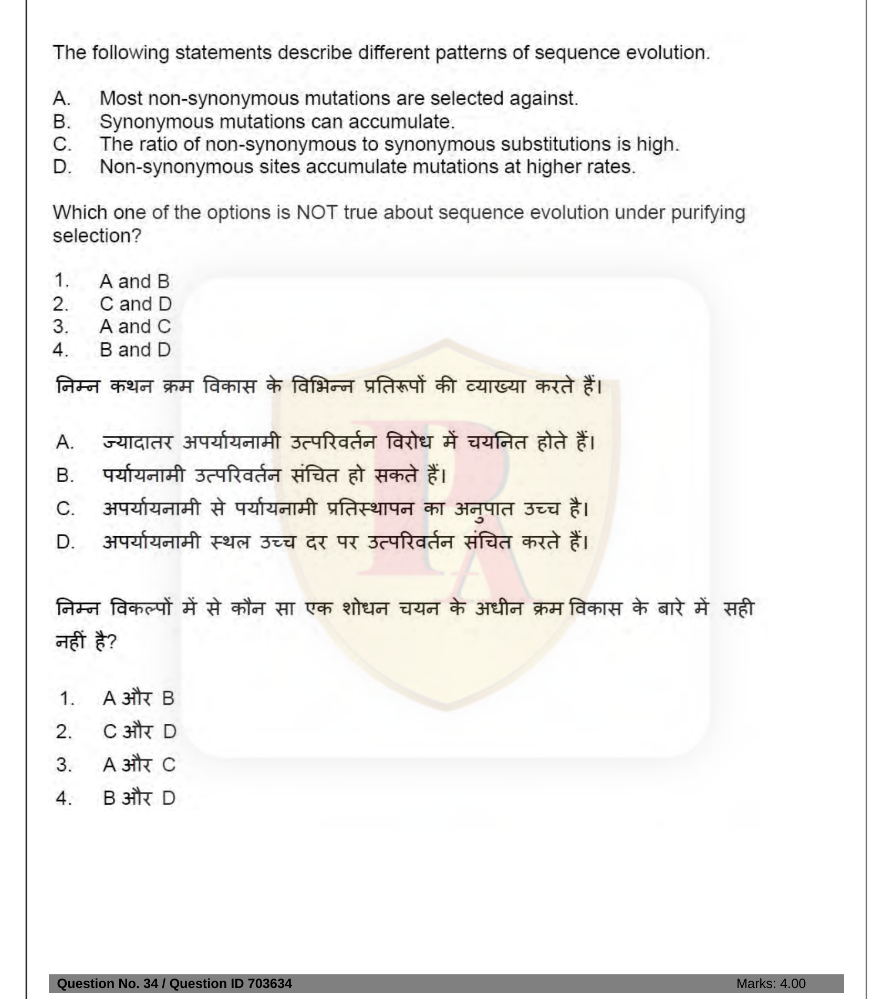

**Answer: 3**

> **Explanation:** Whales nest within the artiodactyl clade; the closest living terrestrial relatives are hippopotamuses, sister to whales within Cetacea + Whippomorpha. Reading the four phylogenetic trees (image) and selecting the topology that places whales inside Artiodactyla next to hippos gives option 3.

---

### Question 135

The following statements describe different patterns of sequence evolution. A.   Most non-synonymous mutations are selected against. B. Synonymous mutations can accumulate. C. The ratio of non-synonymous to synonymous substitutions is high. D. Non-synonymous sites accumulate mutations at higher rates. Which one of the options is NOT true about sequence evolution under purifying selection?

1. A and B
2. C and D
3. A and C
4. B and D

**Answer: 2**

> **Explanation:** Statements A and B are correct. Non-synonymous mutations lead to changes in the amino acid sequence of proteins, which can potentially disrupt protein function. Therefore, many non-synonymous mutations are deleterious and are often selected against by natural selection. Synonymous mutations do not change the amino acid sequence of a protein and are generally considered to be neutral with respect to natural selection. As a result, they can accumulate over time without being subjected to the same selective pressures as non-synonymous mutations. This allows for a higher rate of accumulation of synonymous mutations in a genome compared to non-synonymous mutations.

---

### Question 136

In a frog species, foot webbing is controlled by a single gene where the allele for nonwebbed feet (W) is dominant and webbed feet (w) is recessive. Assume there is a population of 500 individuals, where 320 have the genotype WW, 160 have the heterozygous genotype of Ww, and 20 have the genotype ww. What are the frequencies of the three genotypes and alleles in this population?

1. Genotype frequencies: 0.04 WW, 0.32 Ww and 0.64 ww Allele Frequencies W - 0.5 and w - 0.5
2. Genotype frequencies: 0.32 WW, 0.64 Ww and 0.04 ww Allele Frequencies W - 0.8 and w - 0.2
3. Genotype frequencies: 0.64 WW, 0.32 Ww and 0.04 ww Allele Frequencies W - 0.8 and w - 0.2
4. Genotype frequencies: 0.34 WW, 0.34 Ww and 0.32 ww Allele Frequencies W - 0.5 and w - 0.5

**Answer: 3**

> **Explanation:** 320 320 + 320 + 160 800 𝑓𝑓(𝑊𝑊𝑊𝑊) = = 0.64 𝑓𝑓 𝑊𝑊 = = = 0.8 500 1000 1000 160 160 + 20 + 20 200 𝑓𝑓(𝑊𝑊𝑤𝑤) = = 0.32 𝑓𝑓 𝑤𝑤 = = = 0.2 500 1000 1000 20 𝑓𝑓(𝑤𝑤𝑤𝑤) = = 0.04

---

### Question 137

RPMI and DMEM, supplemented with serum, antibiotics, glutamine and phenol red are routinely used for tissue culture of human cells in CO2 incubators. In addition, sodium bicarbonate (NaHCO3) and HEPES are used as buffering agents. The following statements were made about the media. A. While 5% CO2 is optimal for cells cultured in RPMI , the optimal CO2 concentration for DMEM is 7.5-10%. B. HEPES is necessary if cells are to be kept outside the incubator in room air for long periods. C. NaHCO3 is necessary if cells are to be kept outside the incubator in room air for long periods. D. When cells grow rapidly in the culture medium for a few days, phenol red will turn the medium pink/red . Which one of following options represents the correct combination of all the statements?

1. A and B
2. B and C
3. A and D
4. C and D

**Answer: 1**

> **Explanation:** RPMI is usually used with 5% CO2 while DMEM requires 7.5–10% CO2 (statement A is correct). HEPES buffers at near-neutral pH under room air, so it is needed when cells sit outside the incubator; NaHCO3 alone does not (statement B correct, C wrong). Rapid growth acidifies the medium turning phenol red yellow, not pink/red (D wrong). Hence A and B (option 1).

---

### Question 138

A plant breeder plans to introgress a gene for pathogen resistance (R) from a wild species (8) into a cultivated variety (A). Panel I in the figure shows a profile of DNA markers for A and B. Panel II shows a genetic map for the linkage group which has the gene for pathogen resistance. Which one of the following options has the correct choice of markers for foreground (FG) and background (BG) selection, respectively?

1. FG: 83, A4 and BG: A2, A3, A?
2. FG: 83, B2 and BG: A 1, A5, A6, AB
3. FG: 83, B2 and BG: A2, A3, A4, A?
4. FG: 83, A4 and BG: A2, 82, 87 and A?

**Answer: 3**

> **Explanation:** Foreground selection must use markers flanking the target R-gene to retain the wild-type allele; background selection should use markers spread across the genome to recover the recurrent parent. Reading the printed maps (Panel I and Panel II image) gives FG: B3, B2 and BG: A2, A3, A4, A5 (option 3, matching the NTA key).

---

### Question 139

Given below are a few statements on transgenic plants. A. Transgenic plants generated using a transformation vector with the CaMV35S promoter-GUS-35SpA cassette can show variations in expression levels of GUS protein in independent transgenic events due to differences in strength of promoter used to express the GUS gene. B. A transgenic plant containing two insertions of the transgene cassette as inverted repeats in tandem would segregate in a 3: 1 ratio for the transgenic phenotype on backcrossing the transgenic plant with the untransformed parent. C. A transgene containing a potential polyadenylation signal in its coding sequence would generate full- length transgene mRNA but a truncated transgenic protein. D. A gene-pyramiding experiment to bring together two transgenic traits by crossing independent homozygous single-copy transgenic lines for each trait would produce a plant homozygous for both the transgenes in the F2 generation. Which one of the following options represents a combination of only correct statements?

1. A and B
2. C and D
3. D only
4. A and C

**Answer: 3**

> **Explanation:** Statement D is likely correct. In a gene-pyramiding experiment, two homozygous parent plants, each containing a single copy of a different transgene. These plants are crossed to produce an F1 generation. The F1 plants will be heterozygous for both transgenes (having one copy of each transgene). When the F1 plants are self-crossed, the F2 generation is produced. In the F2 generation, some plants will segregate to be homozygous for both transgenes due to the independent assortment of the genes.

---

### Question 140

The interpretation of any clinical laboratory test is done by comparing the patient's results to the test's reference intervals. For example, the reference interval for white blood cells (WBC) in human adults is 4,500 - 11,000 cells/microlitre. Estimation of this reference interval is done by testing

1. a large number of healthy adults and estimating the range between 2.5 to 97.5 percentiles of the reference population.
2. a large number of healthy adults and estimating the range between 5 to 95 percentiles of the reference population.
3. a large number of random adults and estimating the range between 5 to 95 percentiles of the reference population.
4. a large number of random adults and estimating the range between –1.64 and +1.64 standard deviations either side of the mean of the reference population.

**Answer: 1**

> **Explanation:** Reference intervals are defined by sampling a large number of healthy adults and taking the central 95% of the distribution, i.e. the 2.5th–97.5th percentiles (equivalent to ±1.96 SD). Random adults (option 3/4) would include diseased individuals and bias the interval.

---

### Question 141

Four groups of students (A - D) were asked to determine whether memory B cells generated in mice immunized with ovalbumin (OVA), in Complete Freund’s adjuvant (CFA), could mount a secondary antibody response (recall response) to OVA in vitro. The groups did the following experiments: Group A students harvested serum from the mice, loaded it on OVA-coated ELISA plates and showed that lgG and lgA anti-OVA antibodies were present. Group B students harvested long-lived plasma cells from bone marrow of the mice, plated them in culture for 5 days and showed anti-OVA antibodies in supernatant by ELISA. Group C students infected an epithelial cell line with the virus and showed that spleen cells from the mice could kill the infected targets. Group D students stimulated spleen cells from the mouse with OVA for 5 days and showed anti-OVA antibodies in supernatant by ELISA. Which one of the following options represents group(s) that did the correct experiment?

1. Group A
2. Group C
3. Groups B and C
4. Group D

**Answer: 4**

> **Explanation:** Stimulated spleen cells with OVA and tested the supernatant for anti-OVA antibodies. This directly tests the ability of the spleen cells, including memory B cells, to mount a secondary (recall) antibody response to OVA in vitro. So, testing memory B cells' ability to mount a secondary antibody response, Group D performed the experiment that most directly assesses this capability.

---

### Question 142

A researcher used CRISPR-Cas9 system and observed a different type of mutation in two alleles of a target gene in a To transgenic plant. These mutations are designated as follows: Allele 1 : addition of a nucleotide Allele 2 : deletion of a nucleotide The observed mutations can be classified as

1. monoallellc mutations.
2. biallelic heterozygous mutations.
3. biallelic homozygous mutations.
4. chimeric mutations.

**Answer: 2**

> **Explanation:** Biallelic heterozygous mutations. Biallelic refers to the fact that both alleles of the gene have been mutated and heterozygous indicates that the mutations in the two alleles are different (one has an addition and the other a deletion).

---

### Question 143

The theoretical resolution limit of the fluorescence microscope is about 200 nm. Super-resolution microscopy has been developed to address this limitation. Given below are super-resolution microscopy methods in column X and their principle in column Y. The theoretical resolution limit of the fluorescence microscope is about 200 nm. Super-resolution microscopy has been developed to address this limitation. Given below are super-resolution microscopy methods in column X and their principle in column Y.

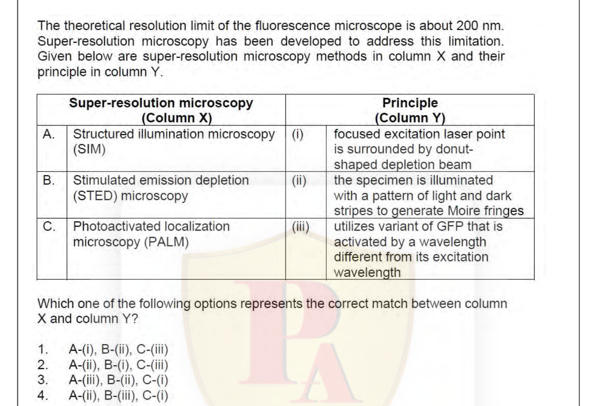

1. A-(i), B-(ii), C-(iii)
2. A-(ii), B-(i), C-(iii)
3. A-(iii), B-(ii), C-(i)
4. A-(ii), B-(iii), C-(i)

**Answer: 2**

> **Explanation:** Super-resolution methods and their principles: STED uses stimulated-emission depletion of the fluorophore periphery; PALM/STORM rely on photoswitchable/palindromic fluorophores activated stochastically; SIM (structured illumination) doubles/triples resolution by patterned illumination. Matching columns X and Y gives A-(ii), B-(i), C-(iii) (option 2).

---

### Question 144

A student used the mark-recapture method to assess the population size of grasshopper in a field. The student was asked to repeat the recapture procedure once on three consecutive days. The procedure followed by the student and the observations made are as follows: A. On day one, 40 grasshoppers were captured , marked and released back in the field. B. On day two, 60 grasshoppers were re-captured of which, 4 were marked. He marked the unmarked ones and released all 60 in the field. C. On day three, 50 grasshoppers were re-captured of which 7 were marked. He marked the unmarked ones and released all 50 in the field. D. On day four, 25 grasshoppers were re-captured of which 6 were marked. The student was asked to calculate the population size based on the mean of the three observations. The estimated population size is:

1. 600
2. ~622
3. ~351
4. ~454

**Answer: 2**

> **Explanation:** On day two = 40 × 60/4 = 600 On day three = 96 × 50/7 = 685.7 On day four = 143 × 25/6 = 595.8 Average of three = ~627

---

### Question 145

The CDS of the shortest isoform of human gene 'A' is cloned into a 3.3 kb vector under a CMV promoter at the BamHI and Xhol sites (pCMV-A vector). From the agarose gel and SOS-PAGE images shown above, which one of the following is most likely true for protein A ln Hela cells:

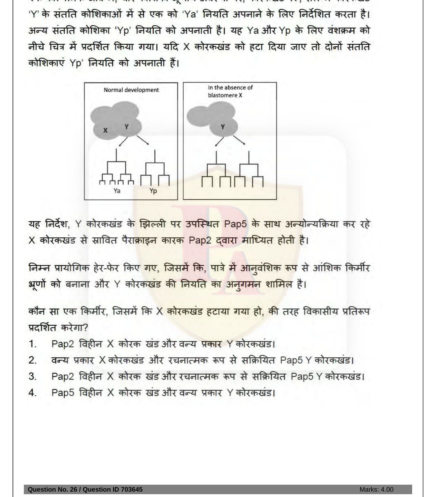

1. Protein A forms homo-multimers.
2. Protein A is degraded by the lysosome.
3. Protein A is polyubiquitinated.
4. Protein A localizes to autophagosomes.

**Answer: 3**

> **Explanation:** Agarose-gel restriction analysis confirms the construct; SDS-PAGE of transfected HeLa shows a higher-molecular-weight ladder of ubiquitin-conjugates above the ~ expected monomer band, the signature of polyubiquitination of protein A. Hence option 3 (Protein A is polyubiquitinated).
