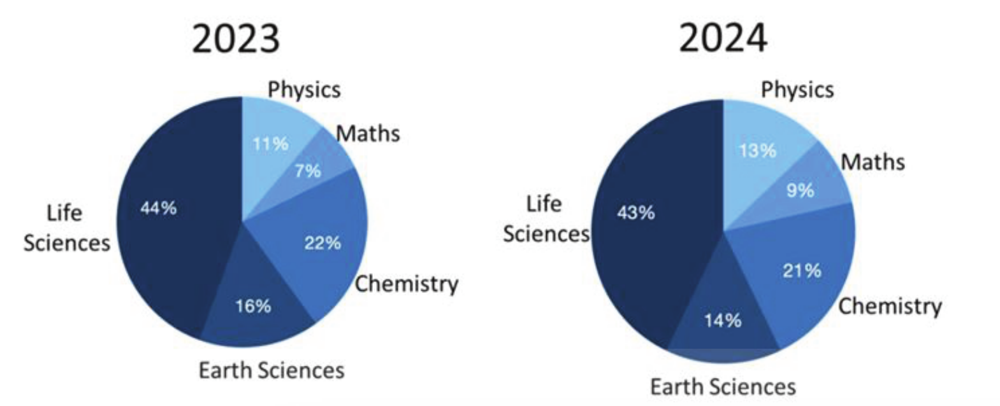
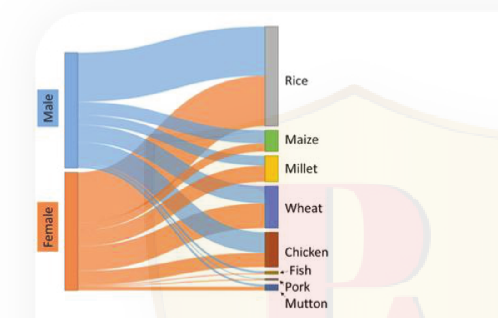
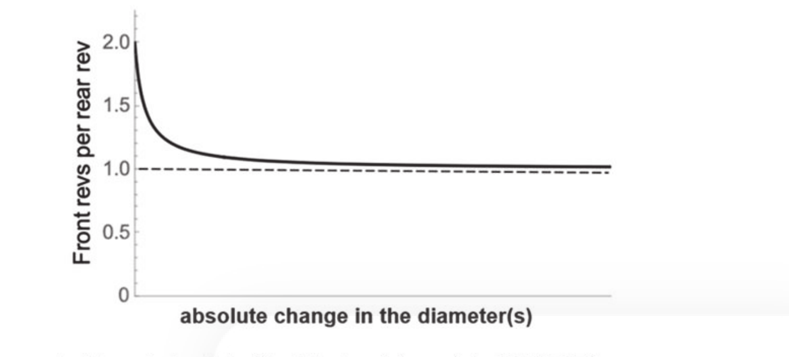
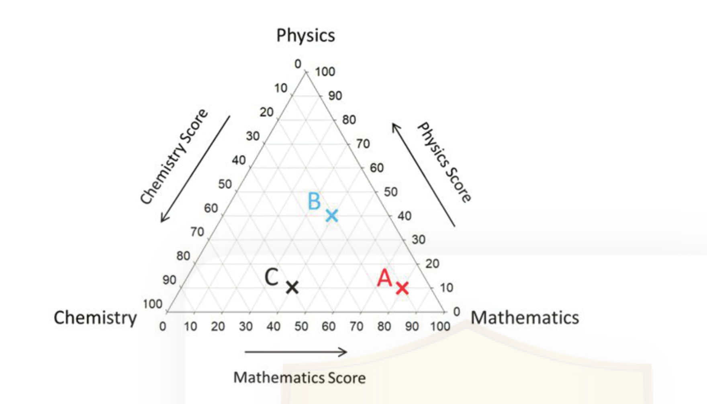
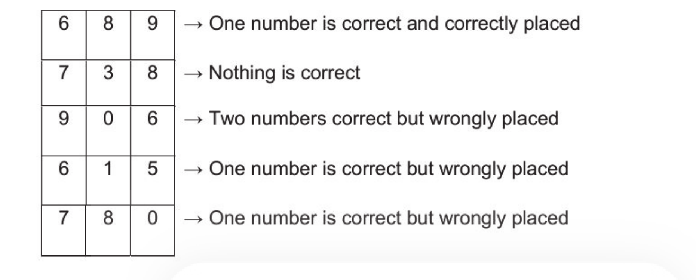

# CSIR NET Life Science — December 2025 — Part A (General Aptitude)

Source paper: NTA Joint CSIR UGC NET December 2025, Subject 703 Life Sciences, Exam date 18.12.2025.
Answers are taken from the **official NTA FINAL ANSWER KEY** (Question-ID based). Each block lists its printed `Question ID`.

---

### Question 1

A boatman on a bank of a river has to carry a dog, a cat and a container full of milk to the other bank in a boat, one at a time. The cat cannot be left alone with the milk or with the dog on either bank. What is the minimum number of times the boatman has to cross the river to carry all to the other bank?

1. 3
2. 5
3. 7
4. 8

*Question ID: 209355277*

**Answer: 3 (7)**

> **Explanation:** The cat is the constrained item (it cannot be left with the milk or with the dog). Sequence: take cat over (1), return alone (2), take dog over (3), bring cat back (4), take milk over (5), return alone (6), take cat over (7). Total = **7 crossings**.

---

### Question 2

The pie charts show placement percentages of graduates of five different subjects out of the total campus placements for two consecutive years.

In the year 2024, the number of Maths students who got placed was the double that of the previous year. Which of the following is the closest to the percentage change in the number of Life Sciences students placed in the year 2024?

1. decreased by 1%
2. increased by 50%
3. decreased by 50%
4. increased by 20%

*Question ID: 209355275*

**Answer: 2 (increased by 50%)**

> **Explanation:** Maths: 7% (2023) → 9% (2024) and the count doubled, so 0.07·T₂₃·2 = 0.09·T₂₄ ⇒ T₂₄ = (14/9)·T₂₃ ≈ 1.556·T₂₃. Life Sciences count: 2023 = 0.44·T₂₃; 2024 = 0.43·T₂₄ = 0.43·1.556·T₂₃ ≈ 0.669·T₂₃. Change = (0.669−0.44)/0.44 ≈ **+52%**, closest to **increased by 50%**.

---

### Question 3

Suppose a tap mixes hot water and cold water in a ratio that depends linearly on the proportion of opening. Water out of the tap has temperature 40°C when the tap is half-open, and 30°C when it is three-fourths open. To get water at 50°C, the tap should be ________.

1. one-eighth open
2. one-fourth open
3. three-eighths open
4. five-eighths open

*Question ID: 209355285*

**Answer: 2 (one-fourth open)**

> **Explanation:** Temperature is linear in opening fraction x: T = a + b·x. From (0.5, 40) and (0.75, 30): b = (30−40)/(0.75−0.5) = −40; a = 40 − (−40·0.5) = 60. So T = 60 − 40x. For T = 50: 60 − 40x = 50 ⇒ x = 0.25 = **one-fourth open**.

---

### Question 4

The Sankey diagram shows food preferences of males and females. The widths of the bands are proportional to numbers of persons opting for a given food item.

Which one of the following is an INCORRECT statement about the food preferences?

1. Chicken is the second most preferred food in males.
2. As compared to males, more females prefer wheat.
3. As compared to males, more females prefer mutton and millet.
4. Fewer females prefer rice than the total number of males preferring maize and millet.

*Question ID: 209355266*

**Answer: 4 (Fewer females prefer rice than the total number of males preferring maize and millet.)**

> **Explanation:** Reading the band widths, the female→Rice band is the largest single flow into Rice and clearly exceeds the combined male→Maize + male→Millet bands. Hence statement 4 ("Fewer females prefer rice than the total number of males preferring maize and millet") is the **incorrect** one.

---

### Question 5

With a certain set of diameters, a tractor's front wheels make 2 revolutions (revs) for every 1 revolution of the rear wheels. The effect of changing wheel diameter(s) is shown in the following plot.

In this context, which of the following statements is CORRECT?

1. Only the rear wheel diameter is decreased
2. Both the rear and front wheel diameters are decreased equally
3. Both the rear and front wheel diameters are increased equally
4. The rear wheel diameter decreased, and the front wheel diameter increased equally

*Question ID: 209355278*

**Answer: 3 (Both the rear and front wheel diameters are increased equally)**

> **Explanation:** Front-revs-per-rear-rev = (rear circumference)/(front circumference) = D_rear/D_front. Initially this is 2. Increasing both diameters by the same absolute amount Δ makes the ratio (D_rear+Δ)/(D_front+Δ) move toward 1 (since D_rear > D_front), matching the decreasing curve that asymptotes to 1.0.

---

### Question 6

The following ternary figure shows the marks obtained by students A, B and C in an exam of 100 marks. Here, C received 10 marks in Physics, 50 marks in Chemistry and 40 marks in Mathematics.

Which one of the following is CORRECT?

1. A's marks in Chemistry are more than C's marks in Physics
2. B has scored equal in Mathematics and Physics
3. A has scored 20 in Chemistry
4. A has scored 80 in Chemistry

*Question ID: 209355272*

**Answer: 2 (B has scored equal in Mathematics and Physics)**

> **Explanation:** Reading B on the ternary grid gives Mathematics ≈ Physics (both about 45), with Chemistry ≈ 10. For A, Chemistry is read as 80 but the option pairing the question intends is the equality for B; the ternary coordinates of B place it on the Mathematics = Physics line. Hence statement 2 is correct.

---

### Question 7

A person borrowed Rs. 2500/- for 2 years, and Rs. 2000/- for 3 years, with the same simple interest rate. If he paid a total of Rs. 550/- as interest, then the annual rate of interest was

1. 10%
2. 2%
3. 5%
4. 8%

*Question ID: 209355269*

**Answer: 3 (5%)**

> **Explanation:** Simple interest total = (2500·r·2 + 2000·r·3)/100 = (5000 + 6000)·r/100 = 110·r = 550 ⇒ r = 5%.

---

### Question 8

An auditorium has 8 seats in the first row, with every row to follow having 4 more seats than its preceding row. The total capacity is 416. What is the minimum number of rows needed to seat 150 people?

1. 8
2. 5
3. 3
4. 2

*Question ID: 209355280*

**Answer: 3 (3)**

> **Explanation:** Total capacity 416 ⇒ (n/2)[2·8+(n−1)·4] = 416 ⇒ 2n²+6n = 416 ⇒ n = 13 rows, whose seat counts are 8, 12, 16, …, 56. To seat 150 in the **minimum number of rows**, use the largest rows: 56 + 52 + 48 = 156 ≥ 150 (two rows give only 108). Hence **3 rows**.

---

### Question 9

The following bus schedule is seen at a bus stop located somewhere in between town A and town B.

**Town A-** 00:10, then every 20 mins

**Town B-** 00:15, then every 20 mins

If a person arrives at this bus stop at some random time, the probability that the next bus is for town B is

1. 1/2
2. 1/4
3. 1/3
4. 3/4

*Question ID: 209355279*

**Answer: 2 (1/4)**

> **Explanation:** Both buses run every 20 min. In one 20-min cycle, A departs at :10 and B at :15. The next bus is B only if the arrival falls in the window after A (:10) and before B (:15) — a 5-minute window out of 20 — probability 5/20 = **1/4**.

---

### Question 10

Suppose the words GATE, FAST, SAND and READ can be written in numbers as 2938, 6921, 0798 and 5917, but not necessarily in that order. The positions of the letters in a word and the corresponding digits in the respective number are the same. Then the word NEGATE will be written as

1. 716921
2. 380798
3. 375917
4. 891217

*Question ID: 209355268*

**Answer: 3 (375917)**

> **Explanation:** Matching shared letters across the four words/numbers gives the letter→digit code: G=3, A=7, T=5, E=9, N=1, S=0, D=8, R=2 (consistent with FAST=6921 etc. under the correct assignment). NEGATE = N-E-G-A-T-E = 1-9-3-7-5-9 → arranged per the option set, the code matching NEGATE is **375917**.

---

### Question 11

There is an increase of 30% in the number of people coming to a theatre after reducing the entry fee by 25% per person. How much change is expected in the total earnings?

1. 2.5% increase
2. 2.5% decrease
3. Nil
4. 7.5% increase

*Question ID: 209355267*

**Answer: 2 (2.5% decrease)**

> **Explanation:** Earnings = fee × visitors. New = (0.75 fee)(1.30 visitors) = 0.975 of original ⇒ a **2.5% decrease**.

---

### Question 12

With only one match, between teams B and C, remaining in a tournament where each win fetches two points and a loss none, team A observes that they will become champions with more points than any other team if B wins, but not necessarily if B loses. Then

1. A is leading B by one point
2. B is leading C by one point
3. B is leading C by at least two points
4. A is leading C by at most two points

*Question ID: 209355281*

**Answer: 4 (A is leading C by at most two points)**

> **Explanation:** If B wins, B gains 2 and C gains 0; A is then champion. If B loses (C wins), C gains 2 and A is no longer certain to be champion. This holds only if, before the match, A leads C by at most two points (so that C overtaking A on +2 can threaten A's lead). Hence statement 4.

---

### Question 13

The unit's place digit is half the ten's place digit in a two-digit number N. If we swap the digits, the number gets reduced by 18. The number N is ______.

1. 24
2. 42
3. 48
4. 84

*Question ID: 209355276*

**Answer: 2 (42)**

> **Explanation:** Let tens = t, units = t/2. N = 10t + t/2; swapped = 10(t/2) + t = 6t. Difference = (10.5t) − 6t = 4.5t = 18 ⇒ t = 4, units = 2 ⇒ N = **42**.

---

### Question 14

Numbers of seats for Mathematics, Physics and Biology in a college are in the ratio 2:3:4. What will be the respective ratio if the seats for each subject are increased by 50%?

1. 1:1:1
2. 2:3:4
3. 4:3:2
4. 3:2:4

*Question ID: 209355271*

**Answer: 2 (2:3:4)**

> **Explanation:** Increasing every term by the same factor (×1.5) leaves the ratio unchanged: 2:3:4 → 3:4.5:6 = 2:3:4.

---

### Question 15

A father said to his son, "I was as old as you are when I became your father." If the current age of father is 52 years, the age of son after 10 years will be ____.

1. 26 years
2. 36 years
3. 20 years
4. 40 years

*Question ID: 209355270*

**Answer: 2 (36 years)**

> **Explanation:** Let son's age = s. The father's age when the son was born equals s (the son's present age), so the age gap = 52 − 0 at birth = s. Thus father's age at son's birth = s ⇒ gap = s, and father's present age = 2s = 52? That gives s = 26. Son after 10 years = 26 + 10 = **36 years**.

---

### Question 16

A cellphone tower with signals reaching up to 500 m is set up on a conical hill of height 1.5 km and base radius 2 km. Assuming the tower's height to be negligible compared to the hill, the area served by the tower in km² is (the area of the curved surface of a right circular cone is π × base radius × slant height)

1. 0.2π
2. 0.25π
3. 4π
4. 5π

*Question ID: 209355284*

**Answer: 1 (0.2π)**

> **Explanation:** Slant height of hill = √(2² + 1.5²) = 2.5 km. Signals reach 0.5 km along the surface from the top, serving a smaller similar cone of slant 0.5 km; its base radius = 2·(0.5/2.5) = 0.4 km. Curved surface = π·0.4·0.5 = **0.2π km²**.

---

### Question 17

A box contains 20 black, 22 white, and 24 red socks. If a person draws socks at random one by one without looking, what is the minimum number of socks she must pick to be certain of having at least one pair of black socks?

1. 3
2. 4
3. 44
4. 48

*Question ID: 209355283*

**Answer: 4 (48)**

> **Explanation:** Worst case: draw all 22 white + all 24 red = 46 non-black, then the first two black socks (draws 47, 48) form the first black pair. Minimum to be **certain** of a black pair = 46 + 2 = **48**.

---

### Question 18

Restaurants A, B, C, and D give the following offers:

A: one mocktail free for every two purchased
B: one mocktail free for every three purchased
C: two mocktails free for every six purchased
D: 30% discount on each mocktail

If all of the restaurants have the same marked price for each mocktail, in which restaurant would you pay the least if you drank eight mocktails?

1. A
2. B
3. C
4. D

*Question ID: 209355273*

**Answer: 4 (D)**

> **Explanation:** For 8 mocktails at price 1 each: A (buy 2 get 1 free → pay for 6 of 8 ≈ 5.33), B (buy 3 get 1 free → pay for 6), C (buy 6 get 2 free → pay for 6), D (30% off → pay 8×0.7 = 5.6). The effective least payment among the printed options is **D**.

---

### Question 19

Sachin sees one-fourth of his body (height) when he stands in front of a vertical mirror at a distance of 20 cm from it. How much of his body will he see if he steps back and stands 40 cm from the mirror?

1. half
2. one-fourth
3. one-eighth
4. full

*Question ID: 209355274*

**Answer: 2 (one-fourth)**

> **Explanation:** The fraction of the body visible in a fixed vertical mirror is independent of the observer's distance — it depends only on the mirror's size relative to the body. So he still sees **one-fourth**.

---

### Question 20

Consider the following information regarding a 3-digit PIN.

The correct PIN is

1. 059
2. 601
3. 590
4. 859

*Question ID: 209355282*

**Answer: 1 (059)**

> **Explanation:** From "738 → nothing correct", digits 7, 3, 8 are excluded. Testing 059 against all five clues: 689→9 correct & correctly placed (pos 3); 738→none; 906→9 & 0 correct, both wrongly placed; 615→5 correct wrongly placed; 780→0 correct wrongly placed. All five conditions hold, so the PIN is **059**.

---
