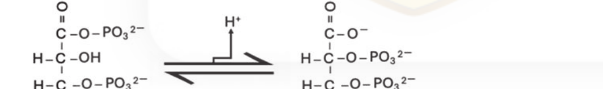
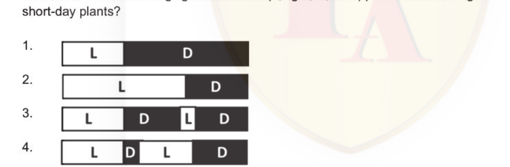

# CSIR NET Life Science — December 2025 — Part B

Source paper: NTA Joint CSIR UGC NET December 2025, Subject 703 Life Sciences, Exam date 18.12.2025.
Answers are taken from the **official NTA FINAL ANSWER KEY** (Question-ID based). Each block lists its printed `Question ID`.

---

### Question 21

1. ~
2. ~
3. ~ i~l11
4. J:Tl"alq"

*Question ID: 209355313*

**Answer: 3 (~ i~l11)**

> **Explanation:** Correct option per the official NTA final answer key (December 2025, Subject 703).

---

### Question 22

~ cfMIT      * * ~ ;,i1fa1J1.zi ~ 3rcfURUTT c)> GfTt * m;ra- t?

1. ~ ~ 3ITT ~ ~ ~ c)> ~ ciIT-I. ITT~                         t 3ITT Jtcilaik'icfi ~  '9"{ fat3tt ~ ~ ti C.
2. ~ ~",Q" 3ITT tt iRsAcf;l.zi ~      * ~ ~ 'l'.R 3ntmt, 9iTa=raT mnl" 3rcfURUTT3TT 'l'.R fat3tt ~   tI
3. ~~~Will~~~                             t 3ITT ~ ;,i1fa<fR1.zii ~ CR"ill t1
4. ~ c1~cf;l.zi ~      * ;JJfffi, ITT ~ t1

*Question ID: 209355319*

**Answer: 3 (~~~Will~~~                             t 3ITT ~ ;,i1fa<fR1.zii ~ CR"ill t1)**

> **Explanation:** Correct option per the official NTA final answer key (December 2025, Subject 703).

---

### Question 23

Which one of the following is NOT involved in the secretion of K+ from blood into the tubular fluid by the principal cells of distal tubules?

1. Big K+channels (BK)
2. Renal outer medullary K+ channels (ROMC)
3. 1Na+-1K+-2c1- symporter (NKCC2)
4. K+/c1- cotransporter (KCC1)

*Question ID: 209355311*

**Answer: 3 (1Na+-1K+-2c1- symporter (NKCC2))**

> **Explanation:** Correct option per the official NTA final answer key (December 2025, Subject 703).

---

### Question 24

Which one of the following pairs is analogous and NOT homologous?

1. Potato tuber and sweet potato tuber
2. Human arm and whale flipper
3. The thorn of citrus plant and the tendril of a cucurbit plant
4. Flippers of dolphin and fins of fish

*Question ID: 209355320*

**Answer: 1 or 4 (official key accepts both options)**

> **Explanation:** Official NTA final answer key lists **option 1 or option 4** as both correct; either is credited.

---

### Question 25

Which one of the following options is a correct match of plant selection marker genes used for genetic transformation and their properties?

1. npt/1                       Streptomycin resistance
2. Mutant ALS                  lmidazolinone resistance
3. aadA                        Rifampicin resistance
4. pat                         Penicillin resistance

*Question ID: 209355330*

**Answer: 2 (Mutant ALS                  lmidazolinone resistance)**

> **Explanation:** Correct option per the official NTA final answer key (December 2025, Subject 703).

---

### Question 26

~ cfi~          * m ~         "flT vq;- {j&icr?.4>1 DNA c;ik'lfk'l-!lcrl   *   ~ ~ ~ ~ (PCNA) ~ ~ ~ <Rill                             t?

1. ~ RNA~              m~ chT ~ <Rill ti
2. ~ ~ ~ ~ fcl:;- ~ ~ <Rill                               t ~ DNA 91/41.!-t~-51 ~ c;ifsh.q1,;-J-tcfi<'ll chT ~ t 1
3. ~ RNA 1ffiWfiT chT .:tl~cfil-5114>1 G            ~ .3fcil?T <Rill ti
4. ~ Tiq, DNAchT ~ ti

*Question ID: 209355295*

**Answer: 2 (~ ~ ~ ~ fcl:;- ~ ~ <Rill                               t ~ DNA 91/41.!-t~-51 ~ c;ifsh.q1,;-J-tcfi<'ll chT ~...)**

> **Explanation:** Correct option per the official NTA final answer key (December 2025, Subject 703).

---

### Question 27

~ ~              *   ~ ~ 1J"cf) qir-4J1~q ("fR!:liUT) ~~m.ra, ~                      . 2022   *   ~rITTi<i, ~t?

1. ~ c;i;,i1fa41 cf;)- ·~          ~     · Gc;a=rrJ, ~ c):;- fc:tv vq;- ~ ~ cfiT ~ r
2. 3-icrlflfil.zri cfiT ~ ~ l~cfi 9crl.nocrl ~   "                       ~
3. 3ITTfiTJ.tcf> ~ft c;i-511[8.q~ Cfif ~
4. C ITES c):;- ~ c):;- cfiFdi.,...q-!lcrl c):;- fi:tv ~ ~

*Question ID: 209355322*

**Answer: 1 (~ c;i;,i1fa41 cf;)- ·~          ~     · Gc;a=rrJ, ~ c):;- fc:tv vq;- ~ ~ cfiT ~ r)**

> **Explanation:** Correct option per the official NTA final answer key (December 2025, Subject 703).

---

### Question 28

In developing mouse brain, when gene yfg is deleted from hippocampal cell-type 'A:, the number of neighbouring cell-type 'B' increases by five-fold. From this information, which one of the following statements accurately describes yfg functioning in wildtype 'A: cells?

1. It promotes 'B' proliferation .
2. It has no role in 'B' proliferation.
3. It inhibits 'B' proliferation .
4. It induces yfg expression in 'B' cells.

*Question ID: 209355303*

**Answer: 3 (It inhibits 'B' proliferation .)**

> **Explanation:** Correct option per the official NTA final answer key (December 2025, Subject 703).

---

### Question 29

An antibiotic, that mimics aminoacyl-tRNAs, gets incorporated into the polypeptide chain and prematurely terminates elongation. The following statements are made based on this observation : A.   It enters the ribosome through the A-site. B.   It enters the ribosome through the P-site. C.   A part of its structure resembles the carboxy terminus of amino acids and is available for making a peptide bond. D.   A part of its structure resembles the amino terminus of amino acids and is available for making a peptide bond. Which one of the following options represents all correct statements?

1. A and B
2. A and D
3. Band D
4. A and C

*Question ID: 209355296*

**Answer: 2 (A and D)**

> **Explanation:** Correct option per the official NTA final answer key (December 2025, Subject 703).

---

### Question 30

1. tli.icfi
2. R:tiHi
3. ~~6ffiil
4. -©tl{li

*Question ID: 209355290*

**Answer: 2 (R:tiHi)**

> **Explanation:** Correct option per the official NTA final answer key (December 2025, Subject 703).

---

### Question 31

The circadian rhythm of higher vertebrates is regulated by the

1. suprachiasmaUc nucleus.
2. cerebral oortex.
3. pitu itary gland.
4. thymus..

*Question ID: 209355328*

**Answer: 1 (suprachiasmaUc nucleus.)**

> **Explanation:** Correct option per the official NTA final answer key (December 2025, Subject 703).

---

### Question 32

Which one of the fol lowing options is the correct sequence of gene expression for successful axis specification in Drosophila?

1. Fushi tarazu; giant; hairy; gooseberry
2. Hedgehog; hunchback; runt; paired
3. Odd-skipped; knirps; hairy; armadillo
4. Krilppel; hairy; fushi tarazu; wingless

*Question ID: 209355302*

**Answer: 4 (Krilppel; hairy; fushi tarazu; wingless)**

> **Explanation:** Correct option per the official NTA final answer key (December 2025, Subject 703).

---

### Question 33

Which key feature best differentiates somatic embryogenesis from organogenesis in plant tissue culture?

1. Somatic embryogenesis originates from zygotic embryos, while organogenesis originates from vegetative explants.
2. Somatic embryos develop bipolar structures (with both shoot and root poles), whereas organogenesis typically produces unipolar structures that require further differentiation.
3. Somatic embryogenesis does not require growth regulators , while organogenesis strictly requires an auxin- cytokinin balance.
4. In somatic embryogenesis, vascular connections are continuous with the parent tissue , whereas in organogenesis vascular strands remain independent.

*Question ID: 209355333*

**Answer: 2 (Somatic embryos develop bipolar structures (with both shoot and root poles), whereas organogenesis typicall...)**

> **Explanation:** Correct option per the official NTA final answer key (December 2025, Subject 703).

---

### Question 34

fa'tJ:;;:r ~ Jt ~ q;'t., 1Jcfi ffi"a-lUT v1~c:1RtJ11cr1 cfiT 1Jcfi d-l(;('cl9o'1 ~ ~ "d-lTcr1T 3lill "        - t?

1. ~ ~ ~ ~ "fRl¼iUT ~                     ~rr ~ Fcr9fu ~ ~ c=i:r ~ ~ ~ ~ cm.=r ~ ~ I
2. 1Jcfi ~/tn\\ft" Jlcrll~.-.Q½h.QI <.fiT fcmc.=r qt ~ c=i:f Jt ~R\ ~ 3-To (1Cfl "                          ~ 1Jcfi ~ i;mJq ~ cf;-{ ~                   tI
3. .mma 3tR ~ t t ~ ~ ~ ~ fi;t"Q"" ~ c=i:r ~ ~3fcl"fm*~~~,
4. 1Jcfi ~ c=i:r <.fiT ~ ~ "fP,<l ~ fi;ttr ~ ~ 3ITT ¢                                 ~ ~ ~ 3ITT a=rralcl" ~ <.fiT ljl":AJq ~rrfitt;r ~ ~ ,

*Question ID: 209355325*

**Answer: 3 (.mma 3tR ~ t t ~ ~ ~ ~ fi;t"Q"" ~ c=i:r ~ ~3fcl"fm*~~~,)**

> **Explanation:** Correct option per the official NTA final answer key (December 2025, Subject 703).

---

### Question 35

Which one of the following enzymes catalyzes the biochemical reaction given below? 0                                               0 ll                                               II C - O - P032 -                                  C- 0 -

1. 1 H - C - OH                                       H - C - 0 - P0 32 - I                                                1 H- C - O - P032 -                                H - C - O - P032 - 1                                                1 C                                                C I                                               I H                                                H 1.    Phosphoenolpyruvate mutase
2. Phosphoglycerate kinase
3. Pyruvate dehydrogenase phosphatase
4. Bis-phosphoglycerate mutase

*Question ID: 209355287*

**Answer: DROP (official key: question dropped)**

> **Explanation:** Official NTA final answer key marks this question as dropped; no answer applies.

---

### Question 36

Which one of the following options represents the correct order of events during newt limb regeneration following amputation?

1. Wound epidermis formation , remodelling of extracellular matrix, blastema formation, and differentiation
2. Blastema formation , remodelling of extracellular matrix, differentiation and wound epidermis formation
3. Blastema formation , wound epidermis formation , extracellular matrix remodelling and differentiation
4. Extracellular matrix remodelling , wound epidermis formation , blastema formation and differentiation

*Question ID: 209355304*

**Answer: 1 (Wound epidermis formation , remodelling of extracellular matrix, blastema formation, and differentiation)**

> **Explanation:** Correct option per the official NTA final answer key (December 2025, Subject 703).

---

### Question 37

Which one of the following histone marks is NOT an indicator of heterochromatin?

1. H3K9 trimethylation
2. MacroH2A
3. H2AX
4. H4K20 trimethylation

*Question ID: 209355291*

**Answer: 3 (H2AX)**

> **Explanation:** Correct option per the official NTA final answer key (December 2025, Subject 703).

---

### Question 38

Which one of the following components of the immune system is NOT effective for the clearance of large parasites like worms?

1. Basophils
2. Eosinophils
3. NK cells
4. Mast cells

*Question ID: 209355299*

**Answer: 3 (NK cells)**

> **Explanation:** Correct option per the official NTA final answer key (December 2025, Subject 703).

---

### Question 39

Which one of the following corresponds to the angle of rotation per residue in a 310 helix and 3 .613 helix, respectively?

1. 100° and 120°
2. 30° and 60°
3. 60° and 30°
4. 120° and 100°

*Question ID: 209355288*

**Answer: 4 (120° and 100°)**

> **Explanation:** Correct option per the official NTA final answer key (December 2025, Subject 703).

---

### Question 40

Which one of the enzymatic activities is NOT present in bacterial RecA?

1. ATP hydrolysis activity
2. Strand-exchange activity
3. Nucleolytic activity
4. Proteolytic activity

*Question ID: 209355294*

**Answer: 3 (Nucleolytic activity)**

> **Explanation:** Correct option per the official NTA final answer key (December 2025, Subject 703).

---

### Question 41

Which one of the following is NOT caused by atriopeptins, a family of peptides produced in cardiac atrial tissues?

1. Natriuresis
2. Vasoconstriction
3. Diuresis
4. Inhibition of aldosterone secretion

*Question ID: 209355312*

**Answer: 2 (Vasoconstriction)**

> **Explanation:** Correct option per the official NTA final answer key (December 2025, Subject 703).

---

### Question 42

Choose the INCORRECT statement regarding the synthesis of reactive oxygen species (ROS ) upon pathogen infection in plants.

1. Plasma membrane-spanning NADPH oxidase is involved in the synthesis of ROS.
2. NADPH oxidases are encoded by respiratory burst oxidase homolog genes in Arabidopsis (Atrboh) .
3. Activation of NADPH oxidase does not require the action of calcium-dependent protein kinases (CDPKs).
4. Apoplastic peroxidase enzymes (PRX) are involved in ROS production.

*Question ID: 209355301*

**Answer: 3 (Activation of NADPH oxidase does not require the action of calcium-dependent protein kinases (CDPKs).)**

> **Explanation:** Correct option per the official NTA final answer key (December 2025, Subject 703).

---

### Question 43

The cytosolic proteins, Ras and Rab , are anchored to the cytosolic face of the plasma membrane by prenylation. Prenylation typically occurs at which amino acid of the protein?

1. Cysteine residue at or near the C-terminus
2. Cysteine residue at or near the N-terminus
3. Glycine residue at or near the C-terminus
4. Glycine residue at or near the N-terminus

*Question ID: 209355293*

**Answer: 1 (Cysteine residue at or near the C-terminus)**

> **Explanation:** Correct option per the official NTA final answer key (December 2025, Subject 703).

---

### Question 44

Which one of the following options represents a set of bird species, all of which are found ONLY in India?

1. Bluethroat, Amur Falcon, Bar-headed Goose
2. Yellow-throated Bulbul, Forest Owlet, Rufous Babbler
3. Pied Cuckoo , Green Imperial Pigeon, Black Drongo
4. Blue-tailed Bee-eater, Sarus Crane, Red-vented Bulbul

*Question ID: 209355321*

**Answer: 2 (Yellow-throated Bulbul, Forest Owlet, Rufous Babbler)**

> **Explanation:** Correct option per the official NTA final answer key (December 2025, Subject 703).

---

### Question 45

Which one of the following statements is FALSE regarding how retroviruses and DNA viruses can lead to cancer in host cells?

1. Rous sarcoma virus contains an oncogene derived from a host proto- oncogene, which allows it to rapidly induce tumours.
2. Slow-acting retroviruses cause cancer by integrating near host proto- oncogenes, activating their expression and leading to cell proliferation.
3. DNA viruses can cause cancer if their DNA becomes integrated into the host genome and expresses viral oncogenes, which stimulate cell growth and proliferation.
4. Retroviruses cause cancer only by directly mutating host DNA, without the need for integration or activation of proto-oncogenes.

*Question ID: 209355298*

**Answer: 4 (Retroviruses cause cancer only by directly mutating host DNA, without the need for integration or activatio...)**

> **Explanation:** Correct option per the official NTA final answer key (December 2025, Subject 703).

---

### Question 46

In the complete blood profile analysis using an automated haematology analyser, the haemoglobin concentration is measured using

1. sedimentation analysis.
2. spectrophotometric methods.
3. mass spectrometry.
4. NMR spectroscopy.

*Question ID: 209355331*

**Answer: 2 (spectrophotometric methods.)**

> **Explanation:** Correct option per the official NTA final answer key (December 2025, Subject 703).

---

### Question 47

The genome editing tool, CRISPR-Cas9, was developed based on which one of the following natural phenomena?

1. An immune response of lower eukaryotes
2. A bacterial defence mechanism
3. A specialised homologous recombination machinery in eukaryotes
4. Transposon insertion machinery in prokaryotes

*Question ID: 209355332*

**Answer: 2 (A bacterial defence mechanism)**

> **Explanation:** Correct option per the official NTA final answer key (December 2025, Subject 703).

---

### Question 48

~~      m m ~ ' iill$?)-:rliil cfiT ~           cf;{ ~ ~ ~ Sllcf4❖fi:        .:ttl'i_i-1~~~ ~cfiT~t?

1. aTTRTcfi" ~ "JfiilaRT
2. ~[rq:,41 ~ ~      ..,
3. ~tl<l$-;ii)Rl.t1J-1 ~ ~m-41Fo-l.t11
4. ~Jt\"{trr.,

*Question ID: 209355307*

**Answer: 4 (~Jt\"{trr.,)**

> **Explanation:** Correct option per the official NTA final answer key (December 2025, Subject 703).

---

### Question 49

Given below is one of the strands of a double-stranded DNA sequence: 5' - ATGCGATGACGATGACGATGACGATGACGAACGATGAGATGG - 3' In the absence of any other confounding factors (viz. , length, Tm, etc.), which one of the following options represents the primer combination that would amplify the above double-stranded template in a PCR?

1. 5'- TACGCTACT - 3'              and   5' - ATGAGATGG - 3'
2. 5' - ATGCGATGA - 3'             and   5' - GGTAGAGTA - 3'
3. 5' - TCATCGCAT - 3'             and   5' - CCATCTCAT - 3'
4. 5' - ATGCGATGA - 3'             and   5' - CCATCTCAT - 3'

*Question ID: 209355334*

**Answer: 4 (5' - ATGCGATGA - 3'             and   5' - CCATCTCAT - 3')**

> **Explanation:** Correct option per the official NTA final answer key (December 2025, Subject 703).

---

### Question 50

Sulfur taken by plant roots from the soil undergoes major changes in the oxidation state as it converts from inorganic to biochemically available form . Which one of the following options represents the correct order of the conversion states of sulfur?

1. SO[ -        SOi--      sr -      Cys
2. s2- -     SOl - - SO/- -            Cys
3. SO/ - - SOl - -          sr -     Gin
4. sr -     SOl- -       SO/- -       Gin

*Question ID: 209355308*

**Answer: 1 (SO[ -        SOi--      sr -      Cys)**

> **Explanation:** Correct option per the official NTA final answer key (December 2025, Subject 703).

---

### Question 51

A cross is made between two strains of E. coli, Hfr leu+ arg+ mer x F- leu- arg- met- StrR and the mixture is plated on minimal synthetic medium supplemented with streptomycin, arginine and methionine. If the linear organization of the genes are leu-arg-met, which one of the following genotypes is expected to occur with lowest frequency?

1. leu+ arg+ mer
2. leu+ arg• mer
3. leu• arg- mer
4. leu• arg- mer

*Question ID: 209355316*

**Answer: 4 (leu• arg- mer)**

> **Explanation:** Correct option per the official NTA final answer key (December 2025, Subject 703).

---

### Question 52

Which one of the following is NOT an evolutionary model for mate choice in animals?

1. Direct benefit model
2. Good gene model
3. Chase away model
4. Green beard effect

*Question ID: 209355329*

**Answer: 4 (Green beard effect)**

> **Explanation:** Correct option per the official NTA final answer key (December 2025, Subject 703).

---

### Question 53

Which one of the following events are likely to result in delayed or defective cytokinesis?

1. Stabilization of mitotic cyclins
2. Activation of form in and myosin II
3. Stimulation of RhoA by centralspindlin
4. Activation of RhoA by Rho-GEF

*Question ID: 209355292*

**Answer: 1 (Stabilization of mitotic cyclins)**

> **Explanation:** Correct option per the official NTA final answer key (December 2025, Subject 703).

---

### Question 54

Gradualism and punctuated equilibrium represent contrasting models of evolutionary change. Which one of the following options best describes these two models?

1. Gradualism emphasizes that evolution occurs through long periods of stasis interrupted by sudden , large-scale mutations, while punctuated equilibrium proposes continuous, slow change within species.
2. Gradualism and punctuated equilibrium both deny the role of natural selection in shaping evolutionary change.
3. Gradualism proposes that evolution proceeds through the steady accumulation of small changes, whereas punctuated equ ilibrium suggests long periods of evolutionary stability marked by relatively rapid bursts of speciation .
4. Both models reject the importance of the fossil record in understanding macroevolutionary patterns.

*Question ID: 209355327*

**Answer: 3 (Gradualism proposes that evolution proceeds through the steady accumulation of small changes, whereas punct...)**

> **Explanation:** Correct option per the official NTA final answer key (December 2025, Subject 703).

---

### Question 55

New protein-coding genes sometimes originate when exons from different ancestral genes are combined through recombination events, producing a novel domain architecture within a single polypeptide. This mechanism of generating new genes is called :

1. Exon shuffling, in which recombination or transposon-med iated rearrangements join coding regions from separate genes.
2. Alternative splicing, in which a single pre-mRNA is processed in multiple ways to yield different transcripts.
3. Retroposition , in which an mRNA is reverse-transcribed and inserted elsewhere in the genome.
4. Transposon insertion , in which mobile elements insert into genes, occasionally disrupting or modulating their expression.

*Question ID: 209355326*

**Answer: 1 (Exon shuffling, in which recombination or transposon-med iated rearrangements join coding regions from sepa...)**

> **Explanation:** Correct option per the official NTA final answer key (December 2025, Subject 703).

---

### Question 56

Assimilation Efficiency is calculated as the percentage of the ingested energy that is assimilated by an organism. Which one of the following gut architectures has the lowest assimilation efficiency?

1. A monogastric gut with acid enzymes to break down food
2. A ruminant gut that facilitates regurgitation and chewing of cud
3. An avian gut with mechanical grinding in the gizzard
4. Cecal/Hindgut fermentation with enlarged cecum or large intestine

*Question ID: 209355323*

**Answer: 4 (Cecal/Hindgut fermentation with enlarged cecum or large intestine)**

> **Explanation:** Correct option per the official NTA final answer key (December 2025, Subject 703).

---

### Question 57

Which one of the following molecules does NOT directly transduce signals to neighbouring cells?

1. Beta catenin
2. Connexin
3. BMP7
4. Dopamine

*Question ID: 209355300*

**Answer: 1 (Beta catenin)**

> **Explanation:** Correct option per the official NTA final answer key (December 2025, Subject 703).

---

### Question 58

Yeast gene Y has an mRNA with the structure shown below. Both the upstream open reading frame (uORF) and the coding region of gene Y have start and stop codons. .      . 100 bases ••-------jc=J,--;_____G_en_e_Y_ _ _ _ __..-- - AAAAAA(n) cap       upstream open                                              poly(A) tail reading frame Which one of the following will you remove to maximize translation of gene Y?

1. Cap
2. Start codon of the uORF
3. Stop codon of the uORF
4. Poly(A) tail

*Question ID: 209355297*

**Answer: 2 (Start codon of the uORF)**

> **Explanation:** Correct option per the official NTA final answer key (December 2025, Subject 703).

---

### Question 59

The resource-ratio hypothesis (R*) of competitive coexistence of species proposed by David Tilman postulates that

1. coexisting species are limited by different resources in the shared resource set.
2. shared resources are equally limiting for each competing species.
3. species abundances are determined by the ratios of limiting resources for each species.
4. the ratio between the resource availability and resource use is constant between competing species.

*Question ID: 209355324*

**Answer: 1 or 3 (official key accepts both options)**

> **Explanation:** Official NTA final answer key lists **option 1 or option 3** as both correct; either is credited.

---

### Question 60

Which one of the following vitamins contains a transition metal ion as a part of its structure?

1. Vitamin C
2. Vitamin 03
3. Vitamin 812
4. Vitamin E

*Question ID: 209355289*

**Answer: 3 (Vitamin 812)**

> **Explanation:** Correct option per the official NTA final answer key (December 2025, Subject 703).

---

### Question 61

Which one of the following light treatments (L, light; D, dark) promotes flowering in short-day plants?

1. L
2. 
3. L
4. L

*Question ID: 209355305*

**Answer: 1 (L)**

> **Explanation:** Correct option per the official NTA final answer key (December 2025, Subject 703).

---

### Question 62

Two different antibodies against the same protein were generated. They were named, AB1 and AB2. WhileAB1 was able to detect the target protein in a western blot, it was unable to detect the protein in ELISA. The opposite was true for AB2 . Which one of the following is the most likely reason?

1. AB 1 detects SOS-bound protein , whereas AB2 detects protein that is not bound to SOS.
2. AB1 is unable to cross the cell membrane, whereas AB2 is membrane permeable.
3. AB1 detects epitopes on the folded protein, whereas AB2 detects the unfolded epitopes.
4. AB1 detects linear epitopes on unfolded protein, but AB2 detects discontinuous epitopes present on the folded protein.

*Question ID: 209355335*

**Answer: 4 (AB1 detects linear epitopes on unfolded protein, but AB2 detects discontinuous epitopes present on the fold...)**

> **Explanation:** Correct option per the official NTA final answer key (December 2025, Subject 703).

---

### Question 63

Which one of the following metabotropic receptors increases intracellular cAMP level after stimulation by its specific neurotransmitter?

1. mGluR5
2. 5HT2A
3. 5HT4
4. M5

*Question ID: 209355310*

**Answer: 3 (5HT4)**

> **Explanation:** Correct option per the official NTA final answer key (December 2025, Subject 703).

---

### Question 64

Given below are pairs of sugars. A.   D-glucose and D-fructose B.   D-galactose and D-glucose C.   o.-D-glucose and /3-D-glucose D.   D-ribose and D-ribulose Which one of the following options represents the correct combination of anomer and epimer pairs, respectively?

1. A and C
2. Band D
3. C and B
4. A and D

*Question ID: 209355286*

**Answer: 3 (C and B)**

> **Explanation:** Correct option per the official NTA final answer key (December 2025, Subject 703).

---

### Question 65

A polydactyly allele shows 60% penetrance and variable expressivity. What would you expect to observe in a family carrying this allele?

1. 60% of carriers show the trait, and among those who show it, severity varies.
2. 100% of carriers show the trait but with 60% maximum severity.
3. 40% of carriers express the trait to the same degree in an identical manner.
4. 100% of carriers show the trait but the severity varies only in 40% of carriers.

*Question ID: 209355317*

**Answer: 1 (60% of carriers show the trait, and among those who show it, severity varies.)**

> **Explanation:** Correct option per the official NTA final answer key (December 2025, Subject 703).

---

### Question 66

Most transposable elements contain flanking terminal inverted repeats. Which one of following options is INCORRECT perta ining to these repeats?

1. They are not a part of the transposable element, but are generated during the insertion of the transposable element in the genome.
2. They are part of the transposable elements in the genome.
3. They move along with the transposable elements in the genome.
4. The repeats along with a functional transposase are sufficient for the process of transposition.

*Question ID: 209355314*

**Answer: 1 (They are not a part of the transposable element, but are generated during the insertion of the transposable...)**

> **Explanation:** Correct option per the official NTA final answer key (December 2025, Subject 703).

---

### Question 67

A CJ plant is shifted from 25 °C to 40 °C under full sunlight. Which one of the following is most likely to happen?

1. Photorespiration rate decreases, lead ing to higher productivity.
2. Rubisco's oxygenase activity increases, reducing net CO 2 fixation.
3. Stomata remain fully open, increasing CO 2 uptake.
4. PEP carboxylase activity increases to compensate for CO 2 loss.

*Question ID: 209355306*

**Answer: 2 (Rubisco's oxygenase activity increases, reducing net CO 2 fixation.)**

> **Explanation:** Correct option per the official NTA final answer key (December 2025, Subject 703).

---

### Question 68

Which one of the following is the most appropriate effects of hypoxic pretreatment and acclimation on survival of plants under anoxia?

1. Prevention of ethanol fermentation
2. Increase in capacity of roots for lactate efflux
3. Prevention of glucose to lactate conversion
4. Prevention of ethanol diffusion

*Question ID: 209355309*

**Answer: 2 (Increase in capacity of roots for lactate efflux)**

> **Explanation:** Correct option per the official NTA final answer key (December 2025, Subject 703).

---

### Question 69

Lac repressor binding occurs at the level of

1. mRNA, on the sequence corresponding to the operator reg ion.
2. DNA, in the lac operon in the operator region.
3. both DNA and RNA, in the sequences corresponding to the operator region .
4. ribosomes , during mRNA translation .

*Question ID: 209355315*

**Answer: 2 (DNA, in the lac operon in the operator region.)**

> **Explanation:** Correct option per the official NTA final answer key (December 2025, Subject 703).

---

### Question 70

During long-term growth in static liquid culture, Pseudomonas fluorescens diversifies into distinct colony types with the following characteristics : wrinkly spreaders that form biofilms at the oxygen-rich surface, smooth morphs that grow freely in the oxygen- poor bottom layer, and fuzzy types that colonises the intermediate zone. Which one of the following evolutionary processes best explains this ecological diversification?

1. Genetic drift resulting in differential microhabitat use
2. Adaptive radiation into different microhabitats
3. Coevolution between the distinct P fluorescens strains in microhabitats
4. Convergent evolution among unrelated bacterial species

*Question ID: 209355318*

**Answer: 2 (Adaptive radiation into different microhabitats)**

> **Explanation:** Correct option per the official NTA final answer key (December 2025, Subject 703).

---

