# CSIR NET Life Science — December 2025 — Part C

Source paper: NTA Joint CSIR UGC NET December 2025, Subject 703 Life Sciences, Exam date 18.12.2025.
Answers are taken from the **official NTA FINAL ANSWER KEY** (Question-ID based). Each block lists its printed `Question ID`.

---

### Question 71

A 86 mouse (H-2b haplotype) was crossed with a C8A mouse (H-2k haplotype) to generate F1 progeny. The following skin transplant experiments were then performed : A.   Graft from 86 mouse to CBA mouse 8.   Graft from F1 mouse to 86 parent C.   Graft from F1 mouse to CBA parent D.   Graft from F1 mouse to F1 mouse E.   Graft from 86 mouse to F1 mouse Which one of the following options represents all recipients in which the graft is tolerated?

1. A
2. Band C
3. D
4. E

*Question ID: 209355405*

**Answer: 4 (E)**

> **Explanation:** Correct option per the official NTA final answer key (December 2025, Subject 703).

---

### Question 72

In a monogamous haplodiploid social insect colony, sterile workers assist the queen in producing additional sisters instead of reproducing themselves . According to Hamilton's rule , altruistic behaviour is favoured when the genetic benefit to relatives (weighted by coefficient of relatedness, r) exceeds the cost, 'c' to the actor. If a worker helps the queen raise three daughters instead of producing two of her own, then based on Hamilton's rule , will helping behaviour evolve? (assume, genetic unit, which is the number of offsprings weighted by r as a measure of inclusive fitness]

1. =                            = Yes , because rb 2.25 genetic units and c 1 genetic unit
2. No, because rb = 0.375 genetic units and c = 1 genetic unit
3. Yes , but only if r < 0.1 , indicating weaker kin selection.
4. No, because kin selection cannot operate in haplodiploid species.

*Question ID: 209355398*

**Answer: 1 (=                            = Yes , because rb 2.25 genetic units and c 1 genetic unit)**

> **Explanation:** Correct option per the official NTA final answer key (December 2025, Subject 703).

---

### Question 73

The following statements describe some of the features of Quartz Crystal Microbalance (QCM) biosensors: A.    A QCM biosensor is built with thin disc-shaped piezoelectric material which is connected to metal electrodes on the opposite faces . B.    If an AC voltage is applied on the quartz crystal , it produces an oscillation at a stable resonant frequency which is not determined by the applied AC voltage. C.    The surface of the quartz crystal is functionalized with a specific receptor that can bind to the target analyte. D.    As the mass on the surface of the crystal is increased , the resonant frequency of crystal increases in a predictable, quantitative way following Sauerbrey equation. Which one of the following options represents a combination of all correct statements?

1. A, Band C
2. B, C and D
3. Band D only
4. A and Conly

*Question ID: 209355406*

**Answer: 4 (A and Conly)**

> **Explanation:** Correct option per the official NTA final answer key (December 2025, Subject 703).

---

### Question 74

In a polluted aquatic environment, bacteria are chronically exposed to low concentrations of multiple antibiotics released from pharmaceutical effluents. Over time, resistant colonies appear even when the antibiotic concentration remains constant. To determine whether resistance arises through induced mutation (a physiological response to antibiotics) or random mutation followed by selection , an ecologist performs a fluctuation test similar to that of Luria and Delbr0ck (1943) using replicate bacterial cultures . Which one of the following outcomes would best support the conclusion that antibiotic resistance arises by random mutation followed by selection, rather than by induction?

1. Each replicate culture yields nearly the same number of resistant colonies after exposure to the antibiotic.
2. Different replicate cultures show large fluctuations in the number of resistant colonies, even though each was treated identically.
3. Resistant colonies appear only after antibiotic addition.
4. The number of resistant colonies increases predictably and proportionally with exposure time in every replicate culture.

*Question ID: 209355397*

**Answer: 2 (Different replicate cultures show large fluctuations in the number of resistant colonies, even though each ...)**

> **Explanation:** Correct option per the official NTA final answer key (December 2025, Subject 703).

---

### Question 75

Two Sanger sequencing reactions were carried out using the same DNA template and primer. The sequencing gels are shown below: R<ia«lon l           lt<!ac on2 A     G     T      C   A    G    T      C ■ Lane A of the reaction 2 gel shows the absence of lower bands and accumulation of higher bands (represented by a black thick band). The following reasons are predicted: A.   The template DNA does not contain the base A near its 5' -region. B.   The processivity of the Sequenase enzyme is very high. C.   In the second reaction, the concentration of ddATP is very low. D.   In the second reaction, the concentration of ddTTP is very high. Which one of the following options represents the correct reason(s)?

1. A, B, and D
2. Band C
3. D only
4. Conly

*Question ID: 209355409*

**Answer: 4 (Conly)**

> **Explanation:** Correct option per the official NTA final answer key (December 2025, Subject 703).

---

### Question 76

A protein with a binding pocket containing amino acid residues, Asp (pKa = 4.0), and His (pKa = 6.5) interacts with a ligand at pH 7.0 at 25 °C. The binding affinity of the ligand increases 10-fold upon 'His' protonation. Assuming 'His' protonation is the sole contributor to the enhanced binding, calculate the fraction of 'His' residue protonation and the change in the binding free energy corresponding to the enhanced affinity (R = 1.987 cal/mol/K).

1. 0.48 and - 3.61 kcal/mol
2. 0. 76 and -2.46 kcal/mol
3. 0.96 and - 1.63 kcal/mol
4. 0.24 and - 1.36 kcal/mol

*Question ID: 209355339*

**Answer: 4 (0.24 and - 1.36 kcal/mol)**

> **Explanation:** Correct option per the official NTA final answer key (December 2025, Subject 703).

---

### Question 77

Signalling pathways that are important for tumorigenesis and cancer include those involved in cell proliferation and cell growth. The following statements were made regarding pathways and molecules involved in cancer: A.   Abnormal activation of the Pl3-kinase/Akt pathway is involved in dysregulated growth. B.   Bcl2 overexpression and enhanced apoptosis lead to efficient clearance of damaged cancer cells. C.   Loss of p53 can allow cells with damaged DNA to escape apoptosis and continue to proliferate. D.   Inhibition of the Rho family GTPase RhoC leads to enhanced actin-based cell motility and facilitates metastasis. Which one of the following options represents the combination of all correct statements?

1. A and B
2. AandC
3. Band C
4. C and D

*Question ID: 209355355*

**Answer: 2 (AandC)**

> **Explanation:** Correct option per the official NTA final answer key (December 2025, Subject 703).

---

### Question 78

Given below are few hormones (Column X) and their specific inhibitors (Column Y). Column X                           Column Y A.    Growth hormone                 i.      Mifepristone B.    Progestogens                   ii.     lnhibin B C.    Parathormone                   iii.    Somatostatin D.    Follicle-stimulating           iv.     High calcium levels hormone Which one of the following combinations correctly matches the hormones with their inhibitors?

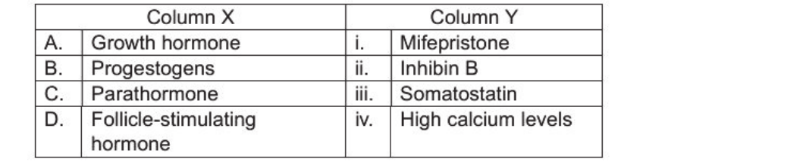

1. A - i;          8 - ii ;     C - iv;          D - iii
2. A - iii ;       8 - i;       C - iv ;         0 -i i
3. A - iv;         8 - ii ;     C - iii;         D-i
4. A - iii ;       8 - iv;      C - i;           D - ii

*Question ID: 209355376*

**Answer: 2 (A - iii ;       8 - i;       C - iv ;         0 -i i)**

> **Explanation:** Correct option per the official NTA final answer key (December 2025, Subject 703).

---

### Question 79

The following statements are made with respect to signal transduction events in phytohormone signalling in plants: A.    Autophosphorylation of a histidine residue in the receiver domain of the response regulator is important for signal transduction through the two- component system. B.    Phosphorylation of a conserved aspartate residue in the transmitter domain of the histidine kinase is important for the two-component system. C.    CYTOKININ RESPONSE 1 (CRE1 ), a cytokinin receptor, functions as an Arabidopsis histid ine-containing phosphotransfer (AHP) factor. D.    In Arabidopsis, pseudo-AHP, called AHP6, acts as an inhibitor of cytokinin signall ing. E.    ETR1 , an ethylene receptor in Arabidopsis , has histidine kinase activity and a receiver domain. Which one of the following options is a combination of all correct statements?

1. A and C
2. Band D
3. C and E
4. D and E

*Question ID: 209355358*

**Answer: 4 (D and E)**

> **Explanation:** Correct option per the official NTA final answer key (December 2025, Subject 703).

---

### Question 80

Which one of the following statements about evolution of the vertebrate brain is most accurate?

1. The relative size of the neocortex in primates is primarily determined by the absolute size of the brain and not by social or ecological pressures .
2. Increased brain size in birds and mammals is always accompanied by longer lifespans and slower reproductive rates, without exceptions.
3. Brain regions can evolve independently in response to specific ecological or behavioural demands, rather than all regions scaling uniformly with overall brain size.
4. The cerebellum , involved in motor coordination, has remained largely unchanged throughout vertebrate evolution because motor function is highly conserved.

*Question ID: 209355401*

**Answer: 3 (Brain regions can evolve independently in response to specific ecological or behavioural demands, rather th...)**

> **Explanation:** Correct option per the official NTA final answer key (December 2025, Subject 703).

---

### Question 81

Given below are a few statements about meiosis in animal cells. A.   Failure of the chiasma formation leads to non-disjunction in meiosis I. B.   Meiotic cohesin Rec8 ensures mono-orientation of sister chromatids in meiosis II. C.   Crossover interference reduces clustering of recombination sites. D.   Residual double-strand breaks arrest meiosis at metaphase. Which one of the following options has all the correct statements?

1. A and B only
2. A, C and D
3. A, Band C
4. B and C only

*Question ID: 209355344*

**Answer: DROP (official key: question dropped)**

> **Explanation:** Official NTA final answer key marks this question as dropped; no answer applies.

---

### Question 82

The taxon cycle is the predicted, progressive ecological and evolutionary changes in the descendants of founding populations. Taking the case of insular biotas, the figure below can be used to conceptualize and predict species types (a , b, c, d , e , f, g, h) in insu lar biotas based on fundamental capacities to evolve , immigrate and persist. b                                                     d Q) ;;,- a                                                                                0 ✓                            ~ ✓ ✓ g         ✓                          ,...h .... ....

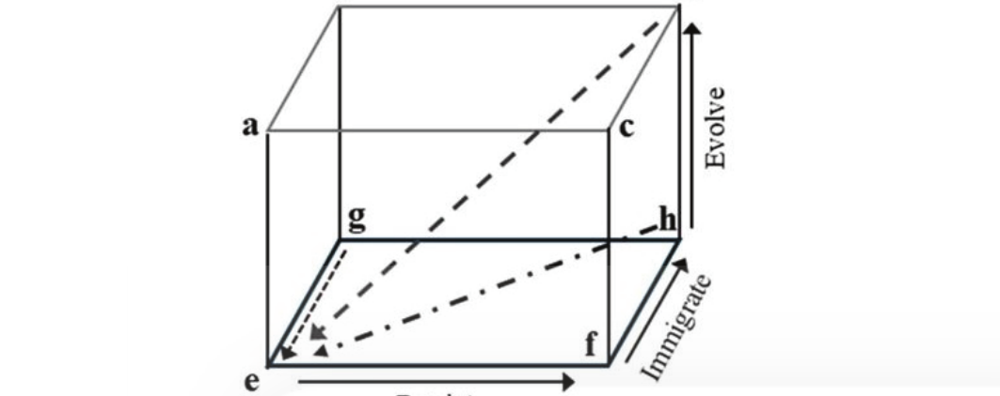
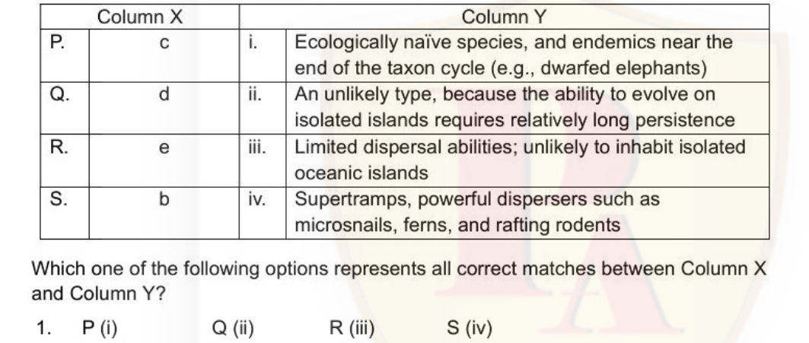

1. I I           ✓ ,& I I ✓ ....                              e, e ...   ,' ,' k ✓ ,... . ....                              -~ ~ . . .~ Persist The table below has species types (Column X) and the possible traits (Column Y) associated with each type. Column X                                                          Column Y P.              C            i.                    Ecologica lly na"ive species , and endemics near the end of the taxon cycle (e.g. , dwarfed elephants) Q.                 d            ii.                   An unlikely type, because the ability to evolve on isolated islands requires relative ly long persistence R.              e            iii.                  Limited dispersal abilities ; unlikely to inhabit isolated oceanic islands S.              b            iv.                   Supertramps, powerful dispersers such as microsnails, ferns , and rafting rodents Which one of the following options represents all correct matches between Column X and Column Y? 1.        P (i)              Q (ii)                            R (iii)           S (iv)
2. P (iv)             Q (i)                             R (ii)            s (i ii)
3. P (ii)             Q (iii)                           R (iv)            s (i)
4. P (ii i)           Q (iv)                            R (i)             s (ii)

*Question ID: 209355390*

**Answer: 4 (P (ii i)           Q (iv)                            R (i)             s (ii))**

> **Explanation:** Correct option per the official NTA final answer key (December 2025, Subject 703).

---

### Question 83

Chromatin immunoprecipitation (ChlP) and RT-PCR were performed to investigate the activation of expression of a particular gene, results of which are shown below. X, Y and Z indicate ChlP with antibodies for specific proteins , and 'RNA' shows gene expression at the indicated time points. 0      1      2        3      4       5          Time - -                                   X - - -                                 y -                                     z - - - -                               RNA Based on the results, choose the option that correctly identifies the X, Y and Z proteins.

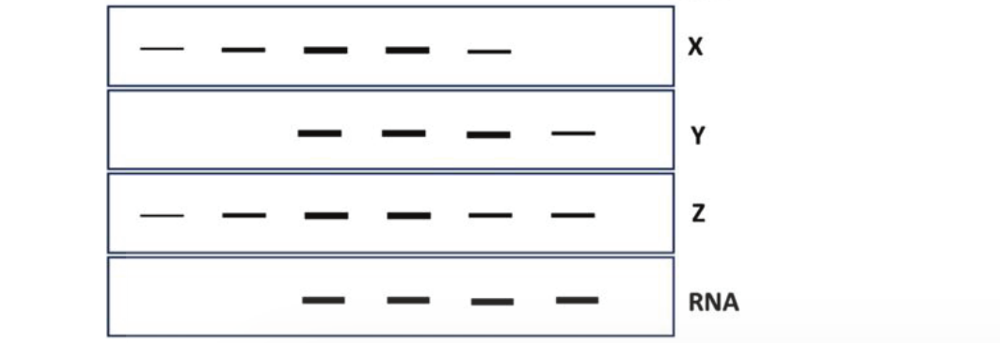

1. X:H4K8Ac                Y: TBP             Z: H3K9Ac
2. X: TBP                  Y:H4K8Ac           Z:H3K9Ac
3. X: H4K8Ac               Y: H3K9Ac          Z: TBP
4. X: H3K9Ac               Y:TBP              Z:H4K8Ac

*Question ID: 209355347*

**Answer: 1 (X:H4K8Ac                Y: TBP             Z: H3K9Ac)**

> **Explanation:** Correct option per the official NTA final answer key (December 2025, Subject 703).

---

### Question 84

The physiological regulation of plasma osmolality by osmotically active neurons (osmoreceptors) in the organum vasculosum of lamina terminalis (OVLT) of hypothalamus is described in the following statements: A.   In hyperosmolal state, the non-selective cationic channels in the osmoreceptor membrane becomes active causing hyperpolarization of receptor cells. B.   In hyperosmolal state, shrinkage of osmoreceptor cells occurs. C.   Activated osmoreceptors send action potentials to the supraoptic nucleus (SON) and paraventricular nucleus (PVN) to release arginine vasopressin (AVP). D.   In hypoosmolal state, the stretching of osmoreceptor membrane causes inactivation of transient receptor vanilloid protein 4 (TRVP4) resulting in the activation of osmoreceptors. Which one of the following options represents a combination of all correct statements?

1. A and B
2. Band C
3. C and D
4. A and D

*Question ID: 209355373*

**Answer: 2 (Band C)**

> **Explanation:** Correct option per the official NTA final answer key (December 2025, Subject 703).

---

### Question 85

The following statements are made about body temperature regulation in humans: A.   Lactic acid and potassium ions are less concentrated in sweat while sweating little than while sweating a lot. B.   When the temperature of the surroundings becomes greater than that of the skin, body loses heat by conduction . C.   When heat is applied directly to the pre-optic area of hypothalamus by inserting a thermode in the brain , the animal begins to sweat profusely. D.   Chemical thermogenesis through thyroid gland stimulation requires weeks of exposure to cold temperature. Which one of the following options represents the combination of all correct statements?

1. C and D
2. Band C
3. A and B
4. A and D ns 2. 2 3. 3 4. 4

*Question ID: 209355377*

**Answer: 1 (C and D)**

> **Explanation:** Correct option per the official NTA final answer key (December 2025, Subject 703).

---

### Question 86

Given below are statements on the citric acid cycle and urea cycle, which have shared metabolic intermediates. A.    Oxaloacetate is converted to aspartate . B.    Fumarate is a citric acid cycle intermediate. C.    Arginosuccinate is cleaved to fumarate and arginine. D.    Aspartate combines with citrulline to produce argininosuccinate in the mitochondrial matrix. Which one of the following options represents the combination of all correct statements?

1. A and D only
2. B and C only
3. A, C and D
4. A, Band C

*Question ID: 209355336*

**Answer: 4 (A, Band C)**

> **Explanation:** Correct option per the official NTA final answer key (December 2025, Subject 703).

---

### Question 87

The table below gives life history characteristics of an endangered grassland bird in two geographically distinct populations. Assume that the species follows a logistic growth model, calculate the population growth rate (dN/dt) for both populations. Population               No. of                 births/year      deaths/year      Carrying individuals            (8)              (D)              capacity (N)                                                      (K) Rajasthan (R)            120                   42                6                240 Maharashtra (M)          300                   96                6                375 Based on this data, which one of the following options gives the combination of correct inferences that can be drawn about the growth rate in both populations?

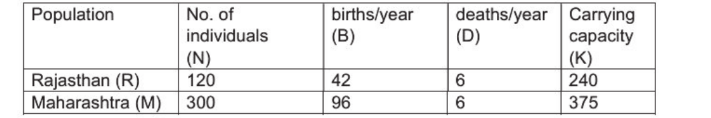

1. Both populations are growing           AND      (dN/dt)M > (dN/dt)R
2. Both populations are declining         AND      (dN/dt)M < (dN/dt)R
3. Both populations are growing           AND      (dN/dt)R = (dN/dt)M
4. Both populations are declining         AND      (dN/dt)M > (dN/dt)R

*Question ID: 209355393*

**Answer: 3 (Both populations are growing           AND      (dN/dt)R = (dN/dt)M)**

> **Explanation:** Correct option per the official NTA final answer key (December 2025, Subject 703).

---

### Question 88

The table below lists conditions (Column X) and their evolutionary/behavioural outcome (Column Y). Column X                                      Column Y A      Cooperative breeding mediated by            Eusocial species such as naked mole kin selection without physiological         rats SU   ression of re roduction B      Hormonal reproductive suppression ii        High paternity certainty, low risk of in nonbreeding females mediated             cuckoldry b a ression C      Biparental care                     iii     Delayed dispersal and breeding of offs rin such as in social birds Which one of the options below is a correct match between al l terms of Column X and Column Y?

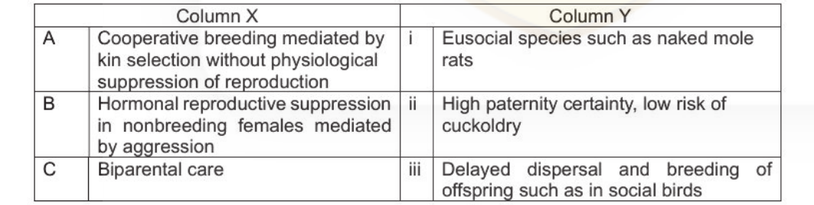

1. A-ii           8-i             C-iii
2. A-i            8-ii            C-iii
3. A-ii           8-iii           C-i
4. A-iii          B-i             C-ii 4. 4

*Question ID: 209355400*

**Answer: 4 (A-iii          B-i             C-ii 4. 4)**

> **Explanation:** Correct option per the official NTA final answer key (December 2025, Subject 703).

---

### Question 89

Dynamic Light Scattering measurements of a protein encapsulated inside AOT /isooctane reverse micelles suspended in n-heptane at 10 °C and 1 atm show an average hydrodynamic diameter of 17 nm, while the empty micelles have an average diameter of 11 nm. Calculate the approximate hydrodynamic radius of the encapsulated protein, assuming spherical geometry of the protein and the reverse micelle and that the protein only occupies the aqueous core of the micelle .

1. 8.60 nm
2. 7.60 nm
3. 3.00 nm
4. 6.60 nm

*Question ID: 209355410*

**Answer: 2 (7.60 nm)**

> **Explanation:** Correct option per the official NTA final answer key (December 2025, Subject 703).

---

### Question 90

A lambda bacteriophage integrated into the genome of E. coli and became lysogenic. Upon UV irradiation, it is expected that the lytic cycle will be induced. Due to mutations that have occurred as a result of UV irradiation, you find that the lambda bacteriophage remains in the lysogenic state and lysis is impaired. Mutations in the following genes have been proposed to explain this observation. A.   cl gene, protease cleavage site B.   ell gene, DNA binding site C.   RecA gene of E. coli D.   RuvA gene of E.coli Which one of the following options represents all correct statements?

1. A and B
2. Band D
3. A and C
4. C and D

*Question ID: 209355351*

**Answer: 3 (A and C)**

> **Explanation:** Correct option per the official NTA final answer key (December 2025, Subject 703).

---

### Question 91

The following constructs, A or B, have been introduced into two different cultures of eukaryotic cells. Promoter Construct A: -   -   - -~ ~                                      p Promoter ► /oxP   ~ loxN ~ Poly-A site Cre recombinase can act upon loxP-loxP and loxN-loxN sites . The following outcomes have been predicted on the types of fluorescence emitted by the cells upon induction of Cre-recombinase: A.   The cells transfected with construct A wil l yield three types of cel ls: each type expressing either red or green or yellow fluorescence . B.   The cells transfected with construct B will yield three types of cells : each type expressing either red or green or yellow fluorescence. C.   The cells transfected with construct A will yield two types of cells: each type expressing either red or green fluorescence. D.   The cells transfected with construct B will yield two types of fluorescent cells: each type expressing either red or yellow fluorescence. Which one of the following options represents the combination of all correct statements?

1. Aand D
2. Aand B
3. Band C
4. C and D

*Question ID: 209355349*

**Answer: 1 (Aand D)**

> **Explanation:** Correct option per the official NTA final answer key (December 2025, Subject 703).

---

### Question 92

Some features of Transcranial Direct Current Stimulation (tDCS) are stated below: A.   The membrane potential of neurons is modulated by applying a weak electrical current between two electrodes placed on the scalp. B.   Neurons under the anode become depolarized, and neurons under the cathode become hyperpolarized during tDCS. C.   tDCS can disrupt neuronal activity and create a "virtual lesion" via anodal stimulation. D.   Neuronal activity is decreased in regions below the anode and increased in regions below the cathode. Which one of the following options represents the combination of all correct statements?

1. A, Band C
2. B, C and D
3. C and D only
4. A and B only

*Question ID: 209355408*

**Answer: 4 (A and B only)**

> **Explanation:** Correct option per the official NTA final answer key (December 2025, Subject 703).

---

### Question 93

In an in vitro translation reaction , the 43S pre-initiation complex {PIC) was incubated with the in vitro transcribed and capped mRNA for Gene X, followed by addition of the 60S subunit. As a control , mRNA for Gene Y isolated from cells was incubated in the same reaction . The mRNA for Gene Y was bound to the 80S ribosomes and polyribosomes , while mRNA of Gene X remained unbound . In a parallel experiment, mRNAs for both Gene X and Gene Y were found to be associated in vivo with 80S and polyribosomes. The following statements were made to explain the above observation. A.   The in vitro system was globally defective for 80S assembly. B.   Gene X mRNA has a sequence or structural feature that specifically prevents 80S assembly in vitro. C.   Gene X mRNA lacks a start codon. D.   Gene X mRNA requires other cellular factors which are absent in the in vitro mix to permit initiation. E.   The in vitro assay preferentially degrades Gene X mRNA. Which one of the following options represents all correct statements?

1. A and B
2. Band C
3. Band D
4. D and E

*Question ID: 209355353*

**Answer: 3 (Band D)**

> **Explanation:** Correct option per the official NTA final answer key (December 2025, Subject 703).

---

### Question 94

The figure below shows a life cycle graph and the corresponding popu lation projection matrix that is invariant over time for a population with four successive classes (1-4). All contributions to class 1 from other classes is via fecundity. 2 10 0.2    2   10     2 0.-2-0.- 0.3 0.2     0     0 0.3             0.3              03                   0    0.3 0.1     0 V V V . V 0.2            0.2               0.1             0.1 0     0   0.3 0.1 Given this life cycle, no resource limitation , and initial numbers of individuals n1 = 95, m = 5, m = 15, and n4 = 4 in the four classes, consider the following statements regarding the future popu lation states in a long-term simulation of population growth: A.    The population will grow and attain a stable class distribution . B.    The population will grow but the number of individua ls in each class will be proportional to the initial numbers. C.    The popu lation will grow but numbers of individuals in the classes will fluctuate disproportionately over time . D.    The popu lation will grow at a fixed growth rate and all classes wi ll grow at the same rates. Which one of the following options represents a combination of all correct outcomes?

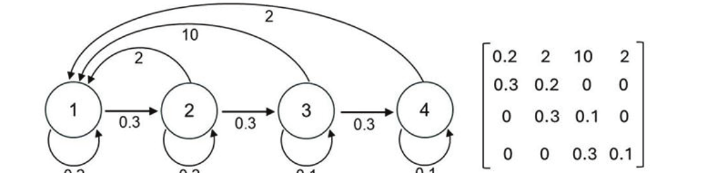

1. A and D
2. A and C
3. Band D
4. Band C

*Question ID: 209355391*

**Answer: 1 (A and D)**

> **Explanation:** Correct option per the official NTA final answer key (December 2025, Subject 703).

---

### Question 95

Researchers attempted genetic manipulation of the metabolic pathway shown below for enhanced production of "D". However, increased expression of gene "N" did not result in increased production of "D" in any transgenic line. Levels of "E" were similar in transgenic as well as untransformed plants. gene K A                 y                   z l   gene M          l gene N E                   D The following hypotheses were proposed for explaining the observed results . A.   Feedback inhibition of "N" by "D" B.   Epistasis of gene N over gene M C.   Substrate limitation for "N" D.   Feedback inhibition of "M" by "E" Which one of the following options lists all factors that, either independently or in combination , could explain the above results?

1. A and B
2. A and C
3. C and D
4. Band D

*Question ID: 209355404*

**Answer: 2 (A and C)**

> **Explanation:** Correct option per the official NTA final answer key (December 2025, Subject 703).

---

### Question 96

In a systematic ecological survey of lepidopterans in a moist deciduous forest, a tota l of 197 species were recorded with 6814 individuals . The relative abundance data are presented below. 40 ~ 30 ·o  C1) 0.. "'20 0 ~ 10 0

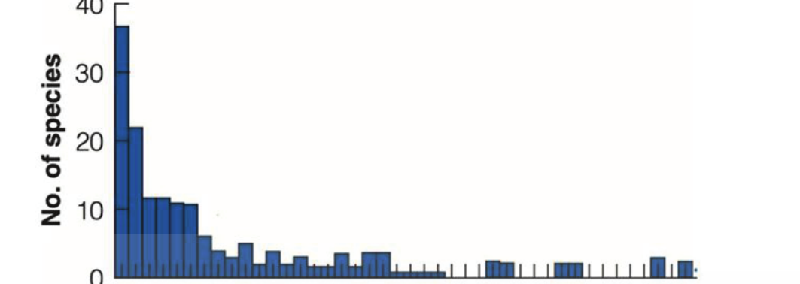

1. 10         20          30        40 No. of individuals represented in sample Keeping the above pattern in mind, which one of the statements below is correct? 1.         Most species are common and are represented by a large number of individuals.
2. Most species are rare and few species are common , represented by a large number of individuals.
3. Most species are common and few species are rare, represented by few individuals.
4. Common and rare species are evenly present, with an equa l representation of individuals.

*Question ID: 209355394*

**Answer: 2 (Most species are rare and few species are common , represented by a large number of individuals.)**

> **Explanation:** Correct option per the official NTA final answer key (December 2025, Subject 703).

---

### Question 97

Recombination between two genes in Neurospora crassa yielded equal numbers of parental ditype (PD) and tetratype (TT), and 12 times as many TT as non-parental ditype (NPD). What is the distance between the genes in map units (mu)?

1. 6 mu
2. 7 mu
3. 14 mu
4. 28 mu

*Question ID: 209355378*

**Answer: 4 (28 mu)**

> **Explanation:** Correct option per the official NTA final answer key (December 2025, Subject 703).

---

### Question 98

Following statements were made regarding the theory of symbiogenesis in the origin of eukaryotic cells . A.   Mitochondria and chloroplasts have typically their own circular DNA, similar to bacterial DNA. B.   Mitochondria and chloroplasts are surrounded by a single membrane like other organelles. C.   Division of mitochondria and chloroplasts occurs synchronously with the division of nuclear genome. D.   Ribosomes in mitochondria and chloroplasts are similar to those found in prokaryotes. E.   Genetic analysis shows that mitochondrial DNA is closely related to certain proteobacteria. Which one of the following options has all the correct statements?

1. A, B, C, D and E
2. A, C and E only
3. A, D and E only
4. A, C, D and E only

*Question ID: 209355342*

**Answer: 3 (A, D and E only)**

> **Explanation:** Correct option per the official NTA final answer key (December 2025, Subject 703).

---

### Question 99

Rhododendron arboreum of the family Ericaceae represents one of the ancient tree species of the genus showing extreme disjunction in the Indian subcontinent. It is represented by two sub-species viz., ssp. arboreum Smith in the forests of north- eastern India (temperate) and spp. nilagiricum distributed in the southern Western Ghats (tropical) of India with no distribution in the intervening plains. The following are some of the biogeographical theories that explain distribution of flora and fauna in the Indian subcontinent A.   Island biogeography theory - The mountains function as isolated islands, promoting speciation. B.   Satpura Hypothesis - Species migrated between the Himalayas and the Western Ghats along a cooler, wetter corridor formed by the Satpura mountain range during periods of glacial expansion C.   The Noah's Ark hypothesis/ 'Out of India' hypothesis - the Indian subcontinent is a remnant of the ancient supercontinent Gondwana, that acted as an isolated "ark" for millions of years , giving rise to some modern plant and mammalian groups Which one of the combinations of biogeographical models explain the distribution of R. arboreum?

1. A and C only
2. A, Band C
3. A and B only
4. B and C only

*Question ID: 209355389*

**Answer: 3 (A and B only)**

> **Explanation:** Correct option per the official NTA final answer key (December 2025, Subject 703).

---

### Question 100

The following statements are made regarding colchicine treatment in plants for inducing polyploidy. A.        In colchicine-treated cells, sister chromatids cannot separate during anaphase, leading to chromosome doubling when the nucleus reforms. B.        Colchicine stimulates endoreduplication in the treated cells , bypassing cytokinesis to yield polyploid cells in a process called "C-mitosis". C.        In sterile interspecific hybrids, colchicine treatment may restore fertility by converting them into amphipolyploids. D.        Colchicine treatment during meiosis has no effect, as it only acts on mitotic cells . E.        Colchicine binds to tubulin and prevents spindle fibre formation during mitosis. Which one of the following options represents a combination of all correct statements?

1. A, C and E only
2. B and C only
3. A, B, C and E
4. A, B, D and E

*Question ID: 209355402*

**Answer: 1 (A, C and E only)**

> **Explanation:** Correct option per the official NTA final answer key (December 2025, Subject 703).

---

### Question 101

Nitrogen cycling is a critical ecosystem process. The table below lists the names of the processes (Column X) and nature of the reactions (Column Y) in the nitrogen cycle. Column X                                        Column Y A.      Ammonification          i.         Conversion of N2 to NH3 B.      Nitrogen fixation       ii.        Hydrolysis of protein and oxidation of amino acids C.      Nitrification           iii.       Reduction of NQ3- to N20 and N2 D.      Den itrification        iv.        Oxidation of NH3 to N02- and from N02- to NQ3- Which one of the following options represents all correct matches between Column X and Column Y?

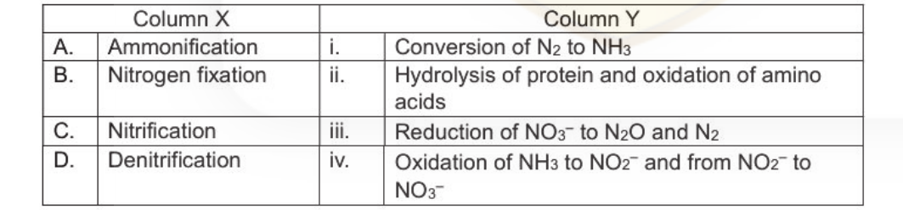

1. A (i)             B (ii)          C (iv)        D (iii)
2. A (ii)            B (i)           C (iv)        D (iii)
3. A(iv)             B (i)           C (iii)       D (ii)
4. A(ii)             B (iv)          C (iii)       D (i)

*Question ID: 209355392*

**Answer: 2 (A (ii)            B (i)           C (iv)        D (iii))**

> **Explanation:** Correct option per the official NTA final answer key (December 2025, Subject 703).

---

### Question 102

In eukaryotes, many cells can assemble a spindle in the absence of centrosomes as in the case of plant cells during mitosis, and animal cells during meiosis in females . In this context, centrosome-free mitotic extracts from frog oocytes, when supplied with beads covered with DNA, are sufficient to assemble the mitotic spindle. Listed below are a few proteins that could be involved in spindle assembly in such a setting: A.   Ran GTPase B.   Ran-GEF C.   TPX2 D.   Myosin V Which one of the following options has all proteins that are directly involved in controlling spindle assembly without centrosomes?

1. A only
2. A and B only
3. A, B, and C only
4. A, B, C, and D

*Question ID: 209355343*

**Answer: 3 (A, B, and C only)**

> **Explanation:** Correct option per the official NTA final answer key (December 2025, Subject 703).

---

### Question 103

Most vascular plants face two broad challenges that affect their growth, reproduction and evolutionary success. One major challenge (Stress) includes shortages of resources such as light, water, nutrients or other physicochemical limitations. A second major challenge (D isturbance) includes factors such as grazing, diseases, storms, frost, erosion, and fire. When cross tabulated , we get the following table: Intensity of Disturbance                       lntensitv of Stress Low                          High Low                             I                           Ill Hiah                           II                           IV The outcomes of this cross tabulation can be seen as fundamental life history strategies. Based on the above information, which one of the following statements is correct?

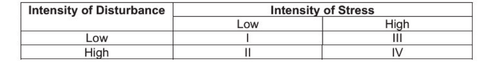

1. Conditions of low stress and low disturbance, result in a strategy that aims to maximize competitiveness and results in plants with small biomass, rapid reproduction and are short-lived .
2. Conditions of high stress and low disturbance result in plants that are slow growing , attaining low- to medium-biomass, with low reproductive output and are long-lived.
3. Conditions of low stress and high disturbance results in plants that are robust in terms of biomass, with low growth rates and slow reproduction.
4. Conditions of high stress and high disturbance results in small plants that can rapidly grow, have high reproductive output and are long-lived .

*Question ID: 209355395*

**Answer: 2 (Conditions of high stress and low disturbance result in plants that are slow growing , attaining low- to me...)**

> **Explanation:** Correct option per the official NTA final answer key (December 2025, Subject 703).

---

### Question 104

The following statements are made regarding bioremediation and phytoremediation. A.   Phytovolatilization can reduce soil contamination but may create secondary pollution in the atmosphere. B.   In rhizofiltration. plants are effective only if their roots are exposed to contaminated soil. C.   Phytostabilization reduces contaminant mobility, but the total pollutant load in the soil remains unchanged. D.   Bioventing involves the injection of air or oxygen into soil to stimulate aerobic microbial degradation. E.   During in situ bioaugmentation, the remediation is achieved by physically removing contaminated soil for off-site treatment and replacing it with decontaminated soil. Which one of the following options represents a combination of all INCORRECT statements?

1. Band E only
2. B, C and E
3. A, C and D
4. A and D only

*Question ID: 209355403*

**Answer: 1 (Band E only)**

> **Explanation:** Correct option per the official NTA final answer key (December 2025, Subject 703).

---

### Question 105

The following statements are made regarding phenolic biosynthesis in plants. A.   The lignans and flavonoids have abundant methylated carboxyl groups , compared to methylated hydroxyl groups. B.   Cells producing lignans and flavonoids have a very high demand for S- adenosylmethionine. C.   The majority of methylation reactions involved in the formation of phenolics are catalyzed by 0-methyltransferases. D.   The catechol-0-methyltransferase (COMT) has strict substrate specificity. Which one of the following options represents the combination of all correct statements?

1. A and B
2. Band C
3. C and D
4. A and D

*Question ID: 209355370*

**Answer: 2 (Band C)**

> **Explanation:** Correct option per the official NTA final answer key (December 2025, Subject 703).

---

### Question 106

Experiments addressing axes patterning in amphibian embryos are listed in column X and the observations are listed in column Y. Column X                                       Column Y A.   Grafting of dorsal blastopore lip from   i.       Rescue of dorsal development donor early gastrula into presumptive ventra l epidermis of host early gastrula B. Injection of noggin mRNA into UV-          ii.      Induction of secondary head treated Xenopus embryos                             structures C. Injection of morpholinos to inhibit        iii.     Formation of a secondary embryo BMPs 2, 4, and 7 D. Grafting of anterior archenteron roof      iv.      Enlarged neural tube from late gastrula into the blastocoel of early gastrula Which one of the following options represents all correct matches between column X and column Y?

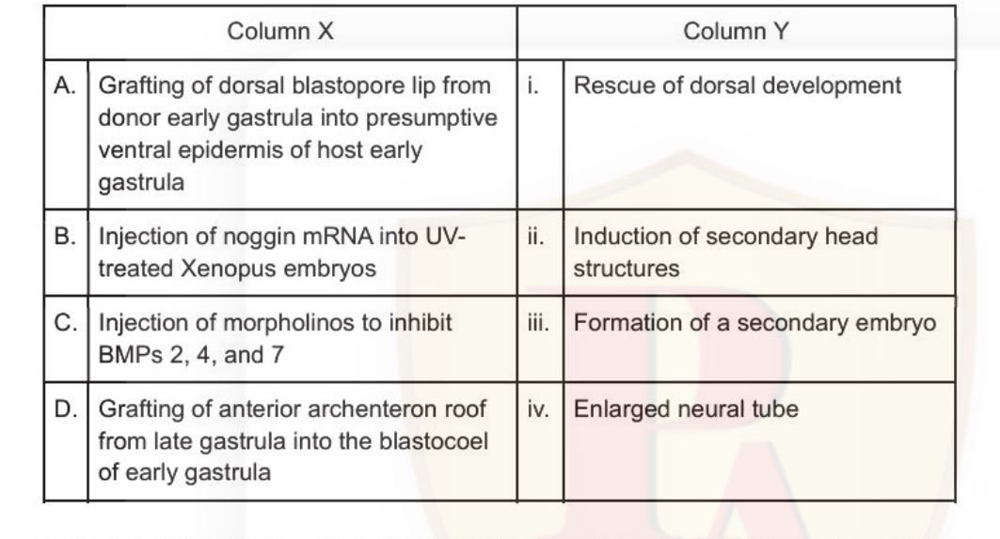

1. A- iii ,       B- i,          C- iv,            D- ii
2. A- ii,         B - iii,       C - iv,           D-i
3. A- iv,         B - i,         C-ii,             D - iii
4. A- iii ,       B - ii,        C- iv,            D-i

*Question ID: 209355363*

**Answer: 1 (A- iii ,       B- i,          C- iv,            D- ii)**

> **Explanation:** Correct option per the official NTA final answer key (December 2025, Subject 703).

---

### Question 107

In a plant heterozygous for a reciprocal translocation involving chromosome P (ABCDEFGH) and chromosome Q (123456), meiosis I produces a quadrivalent as shown in the figure, which after meiosis 11 results in gametes of types labelled X, Y and Z. Gamete types Quadrivalent                    ,... _____ X   ,...                  y               z .... '+------ A • ..------➔ .• ·i .l 'l ·i I! I~ l B                     B C       <             C            < ____. Meiosis II                                                   d E F 5 • • 3 6" •• E F 6" 4• • 3 6 •           •. 0   ,   2   3"        a   :r       2   f      2    :r 2'                                     ,r ' ,, H   g                 H   ,r       I   g "                     1' "           1' Which one of the following combinations correctly represents the segregation pattern of gametes that arise from the quadrivalent configuration as shown in the diagram?

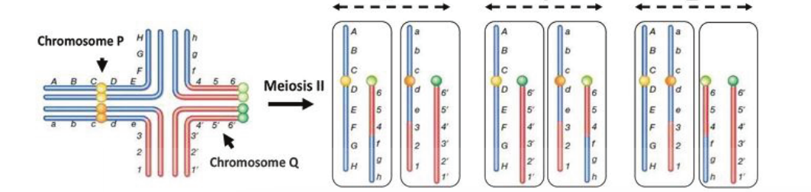

1. X = Alternate          Y = Adjacent II                Z = Adjacent I
2. X = Adjacent 11        Y = Alternate                  Z = Adjacent I
3. X = Adjacent I         Y = Adjacent II                Z = Alternate
4. X = Adjacent I         Y = Alternate                  Z = Adjacent II

*Question ID: 209355379*

**Answer: 4 (X = Adjacent I         Y = Alternate                  Z = Adjacent II)**

> **Explanation:** Correct option per the official NTA final answer key (December 2025, Subject 703).

---

### Question 108

The following statements are put forth about hormonal changes during normal pregnancy in humans . A.   Pituitary secretion of FSH and LH increases. B.   Aldosterone secretion increases. C.   Glucocorticoid secretion decreases. D.   Thyroxine secretion increases . Which one of the following options has a combination of all correct statements?

1. A and B
2. C and D
3. A and C
4. Band D

*Question ID: 209355374*

**Answer: 4 (Band D)**

> **Explanation:** Correct option per the official NTA final answer key (December 2025, Subject 703).

---

### Question 109

Following statements are made regarding abscisic acid (ABA) signalling during water stress in plants. A.   ABA causes membrane depolarization by decreasing cytosolic calcium levels. B.   ABA causes alkalinisation of the cytosol which stimulates opening of K+ efflux channels . C.   ABA inhibits the activity of the plasma membrane W-ATPase which results in membrane depolarization. D.   During stomatal closure , ABA induces reorganization of tubulin cytoskeleton mediated by Rho GTPases. E.   ABA induced membrane depolarization occur by release of calcium from endoplasmic reticulum and vacuoles. Which one of the following options is a combination of all correct statements?

1. A, B, D and E
2. B, C and E
3. A, B, C and D
4. C, D and E

*Question ID: 209355368*

**Answer: 2 (B, C and E)**

> **Explanation:** Correct option per the official NTA final answer key (December 2025, Subject 703).

---

### Question 110

Column X lists different types of ion channels and column Y defines the nature/ property of these channels. Column X                                  Column Y A    Channelrhodopsin                   i        Voltaqe-qated B    Shaker-related                     ii       Mechano-sensitive ootassium channels C    Piezo ion channel                  iii      Liqand-qated D    Acetvlcholine receptor             iv       Liqht driven Which one of the following options represents all correct matches between Column X and Column Y?

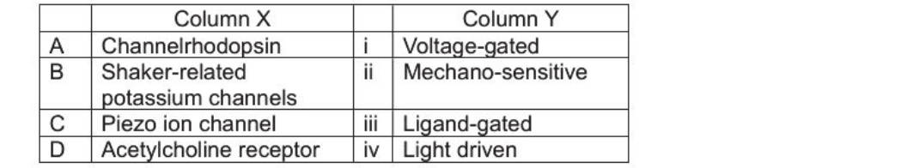

1. A{iii)     B (i)     C (iv)     D (ii)
2. A(i)       B (ii)    C (iv)     D (iii)
3. A(iv)      B (iii)   C (ii)     D (i)
4. A(iv)      B (i)     C (ii)     D (iii)

*Question ID: 209355345*

**Answer: 4 (A(iv)      B (i)     C (ii)     D (iii))**

> **Explanation:** Correct option per the official NTA final answer key (December 2025, Subject 703).

---

### Question 111

The table below gives different eras (Column X) and periods of the geological time scale (Column Y). Column X                                  Column Y A.      Ordovician                        i.   Mesozoic B.      Permian                          ii.   Cenozoic C.      Paleogene                       iii.   Paleozoic D.      Cretaceous Which one of the following options represents all correct matches of Column X and Column Y?

1. A - i;               B - ii;              C - iii ;          0 - ii
2. A-iii;               B-iii;               C-ii;              0-i
3. A-ii ;               B-i ;                C-iii;             0-iii
4. A - ii ;             B - iii;             C - i;             0 -i

*Question ID: 209355396*

**Answer: 2 (A-iii;               B-iii;               C-ii;              0-i)**

> **Explanation:** Correct option per the official NTA final answer key (December 2025, Subject 703).

---

### Question 112

The following statements were made about major histocompatibility complex (MHC) molecules: A.   Multiple MHC-1molecules can be expressed on a single cell. B.   MHC-1 molecules exhibit greater diversity than antibodies. C.   MHC-1 haplotypes inherited from the mother and father and expressed on a given cell are codominant. D.   All MHC-1 molecules on a given cell express the same endogenous peptide. E.   MHC-1molecules are present on platelets. Which one of the following options represents the combination of al l correct statements?

1. A, Band C
2. A , C and E
3. Band D
4. C, D and E

*Question ID: 209355356*

**Answer: 2 (A , C and E)**

> **Explanation:** Correct option per the official NTA final answer key (December 2025, Subject 703).

---

### Question 113

The following statements are made wrth respect to the major classes of heat shock proteins (HSP) in plants. A.   Cytosolic HSP100 is essential while the chloroplast HSP100 / Clp~ family protein is not essential for heat stress response . B.   Proteins of HSP90 family are exclusively localized in the nucleus. C.   Members of HSP60 protein family, chaperon ins, are abundant even at normal temperatures. D.   The C-terminal domain of small HSPs is homologous to a-crystallins, proteins found in vertebrate eye lens. Which one of the following options is a combination of all correct statements?

1. A and C
2. Band D
3. A and B
4. C and D

*Question ID: 209355371*

**Answer: 4 (C and D)**

> **Explanation:** Correct option per the official NTA final answer key (December 2025, Subject 703).

---

### Question 114

The following statements are made regarding photosynthesis in a mutant maize (C4 plant) that lacks functional bundle sheath chloroplasts : A.   Photorespiration would remain low due to PEP carboxylase activity. B.   Calvin cycle would be severely comprom ised , reducing sugar production. C.   Carbon fixation would shift entirely to mesophyll cells without yield penalty. D.   CO2 concentration around Rubisco would increase dramatically. Which one of the following options is a combination of all INCORRECT statements?

1. A and B only
2. A , Band C
3. C and D only
4. A , C and D

*Question ID: 209355366*

**Answer: 4 (A , C and D)**

> **Explanation:** Correct option per the official NTA final answer key (December 2025, Subject 703).

---

### Question 115

Given below are different types of mapping populations in plants (Column X) and their characteristic features (Column Y). Column X                               Column Y A.       F2 mapping population         i.     1:0 segregation ratio of dominant markers B        Backcross population          ii.    1: 1 segregation ratio for both dominant      and    co-dominant markers C.       Rlls                          iii.   Recombination is represented onlv from the male source D.       F1DH                          iv.    3: 1 phenotypic segregation ratio of dominant markers Which one of the following options is the correct match between all terms of Column X and Column Y?

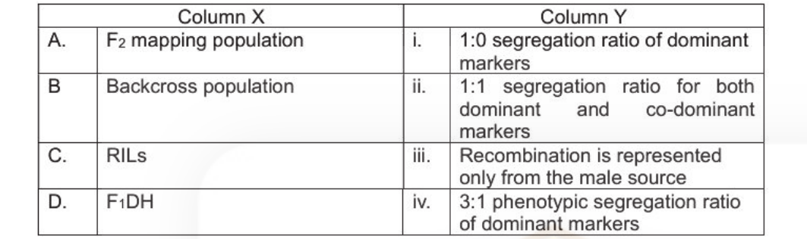

1. A-iv       B-i     C-ii   D-iii
2. A-ii       B-iii   C-i    D-iv
3. A-i        B-ii    C-iv   D-iii
4. A-iii      B-iv    C-ii   D-i

*Question ID: 209355382*

**Answer: 1 (A-iv       B-i     C-ii   D-iii)**

> **Explanation:** Correct option per the official NTA final answer key (December 2025, Subject 703).

---

### Question 116

A eukaryotic protein, 'X' activates a target gene by increasing its transcription when an inducer is added. The results of the experiments are shown in the table below. Experiment                    Results without inducer      Results with inducer lmmunofluorescence of         No colocalization with       Colocalization with DAPI protein 'X'                   DAPI Electrophoretic Mobility      No binding to probe          No binding to probe Shift Assay (EMSA)            derived from the             derived from the promoter of the target       promoter of the target gene                         gene Chromatin                     Low acetylation              High acetylation immunoprecipitation of the promoter of the target gene Which one of the following options is the correct mechanism of protein X-mediated transcriptional activation of the target gene upon addition of the inducer?

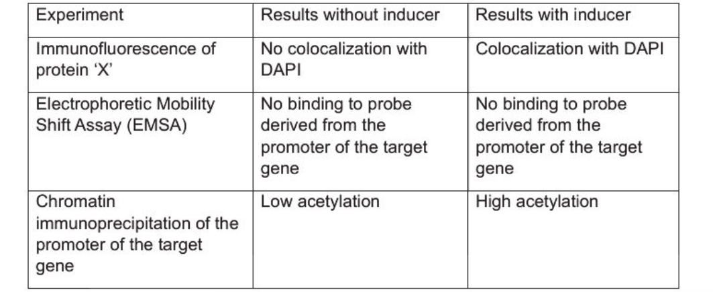

1. It acts in the cytoplasm as part of a signal transduction cascade.
2. It moves to the nucleus and acts as a coactivator.
3. It remains in the nucleus and acts as a chromatin modifier.
4. It moves to the cytoplasm and acts as a repressor.

*Question ID: 209355352*

**Answer: 2 (It moves to the nucleus and acts as a coactivator.)**

> **Explanation:** Correct option per the official NTA final answer key (December 2025, Subject 703).

---

### Question 117

The following statements were made about host-pathogen interactions during influenza virus infection: A.    Entry of the virus is mediated by the interaction of the HA-protein of the virus with sialic acid receptors on the airway epithelium. B.    CTLs are primed in the thymus to kill respiratory epithelial cells that present viral antigens on MHC-I molecules. C.    CTLs are primed in the thymus to kill respiratory epithelial cells that present viral antigens on MHC-II molecules. D.    Viral neuraminidase is required for the release of mature viruses from infected cells. Which one of the following options represents the combination of all correct statements?

1. A and C
2. A, Band D
3. B and D only
4. A and D only

*Question ID: 209355354*

**Answer: 4 (A and D only)**

> **Explanation:** Correct option per the official NTA final answer key (December 2025, Subject 703).

---

### Question 118

To test if viral proteins are transported between Golgi stacks in vesicles or are released into the cytosol by one Golgi stack and taken up by another, viral protein transport was examined between Golgi stacks of infected and uninfected cells. Which one of the following experimental designs would best distinguish these two hypotheses?

1. Test whether viral protein transport happens in the presence of antibodies depleting clathrin in acceptor Golgi stacks
2. Test whether viral protein transport happens in the presence of antibodies depleting COPII in acceptor Golgi stacks
3. Test whether viral protein transport happens in the presence of protease in the assay mix.
4. Test whether viral protein transport happens when either donor or acceptor Golgi stacks are treated with detergents sequentially 4. 4

*Question ID: 209355346*

**Answer: 3 (Test whether viral protein transport happens in the presence of protease in the assay mix.)**

> **Explanation:** Correct option per the official NTA final answer key (December 2025, Subject 703).

---

### Question 119

lmmunoprecipitation (IP) of protein X from cell lysate using anti-X antibody, followed by RT-PCR for mRNA-Y, indicates the presence of protein X-mRNA-Y complex in vivo. To confirm this interaction , recombinant protein X and in vitro transcribed mRNA-Y are incubated, followed by affinity purification of protein X. However, mRNA-Y was not present in the eluates containing X but rather in the unbound fraction. Given below are a few statements to explain the observations. A.    Protein X and mRNA-Y are expressed at the same level in the cell , so the interaction is robust. B.    Protein X and mRNA-Y physically interact via a bridge protein/co-factor absent in the purified protein X. C.    mRNA-Y binds to the antibody used in the immunoprecipitation. D.    The mRNA binding domain of the recombinant protein X may have an altered conformation . Which one of the following is a combination of all correct statements?

1. A and B
2. Band D
3. Conly
4. C and D

*Question ID: 209355362*

**Answer: 2 (Band D)**

> **Explanation:** Correct option per the official NTA final answer key (December 2025, Subject 703).

---

### Question 120

Given below are mechanisms that can facilitate major evolutionary transitions, such as the transition from genes to genomes, from unicellular to multicellular organisms, or from individuals to colonies. A.    Conflict mediation mechanisms maintain cooperation within emergent units. 8.    Reduced genetic relatedness among cooperating units accelerates these transitions . C.    Division of labour evolves when specialisation increases group-level fitness more than individua l fitness losses. D.    Transitions are irreversible once higher-level individuality is achieved. Which one of the following options is a combination of all correct statements?

1. 8 and C
2. A, C, and D
3. A and C only
4. C and D only

*Question ID: 209355388*

**Answer: 3 (A and C only)**

> **Explanation:** Correct option per the official NTA final answer key (December 2025, Subject 703).

---

### Question 121

The table below lists taxonomic groups (Column X) and their morphological features (Column Y). Column X                                     Column Y A.    Crustacea                             i.     Two pairs of antennae 8.    Chelicerata                           ii.    Antennae absent C.    Phoronida                             iii.   Presence of lophophore Which one of the following options represents all correct matches between Column X and Column Y?

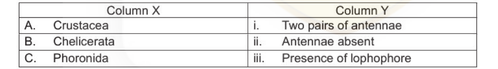

1. A-ii           8-iii         C-i
2. A-iii          8-i           C-ii
3. A- i           8 - iii       C - ii
4. A-i            8-ii          C-iii

*Question ID: 209355386*

**Answer: 4 (A-i            8-ii          C-iii)**

> **Explanation:** Correct option per the official NTA final answer key (December 2025, Subject 703).

---

### Question 122

In amphibians and fish, the cells of the organizer ultimately contribute to - (i) pharyngeal endoderm, (ii) head mesoderm, (iii) dorsal mesoderm, and (iv) dorsal blastopore lip. The following statements are made about the function of the organizer and its derivatives: A.   The pharyngeal endoderm and pre-chordal plate prevent formation of forebrain and midbrain. B.   The organizer has the ability to dorsalize the ectoderm and induce formation of the neural tube . C.   The dorsal mesoderm inhibits induction of the hindbrain and trunk. D.   The organizer tissue possesses the ability to dorsalize the surrounding mesoderm into somite-forming mesoderm. Which one of the following options is a combination of all correct statements?

1. A and C
2. B and D only
3. A, Band D
4. B, C and D

*Question ID: 209355361*

**Answer: 2 (B and D only)**

> **Explanation:** Correct option per the official NTA final answer key (December 2025, Subject 703).

---

### Question 123

Given below are a few statements related to inheritance biology: A.   A crossover is the breakage of two DNA molecules at the same position and their rejoining in two reciprocal recombinant combinations. B.   Crossing over takes place at the four-chromatid stage. C.   As the distance between two genes increases, the recombination frequencies move closer to 50%. D.   Percentage of recombinants between two genes can be used as a quantitative index of the accurate physical distance between them. Which one of the following options is a combination of all correct statements?

1. A and C only
2. B and D only
3. A, BandC
4. B, C and D

*Question ID: 209355380*

**Answer: 3 (A, BandC)**

> **Explanation:** Correct option per the official NTA final answer key (December 2025, Subject 703).

---

### Question 124

The following statements were made regarding cell fate specification of trophoblast and inner cel l mass (ICM) during mammalian embryogenesis: A.   Oct4 represses Cdx2 expression , enabling some cells to become ICM . B.   Cdx2 synthesized by the trophoblast cells activate Oct4 and Nanog. C.   Expression of Nanog allows cells of the ICM to retain their pluripotency. D.   YAP binds to TEAD4 and represses Cdx2 in the trophoblast cells. Which one of the following options correctly represent events that determine the fate of trophoblasts and ICM?

1. A and B
2. Band C
3. C and D
4. A and C

*Question ID: 209355360*

**Answer: 4 (A and C)**

> **Explanation:** Correct option per the official NTA final answer key (December 2025, Subject 703).

---

### Question 125

A newly discovered small mammal from Madagascar lays eggs, has a cloaca, and shows electroreception through its snout. Molecular phylogenetics places it basal to all other living mammals. Based on these characters , which one of the following groups can it be assigned to?

1. Eutheria (placental mammals)
2. Metatheria (marsupials)
3. Prototheria (monotremes)
4. Theria (marsupials + placentals)

*Question ID: 209355387*

**Answer: 3 (Prototheria (monotremes))**

> **Explanation:** Correct option per the official NTA final answer key (December 2025, Subject 703).

---

### Question 126

Circular genomic DNA isolated from actively replicating stages of organisms, P and Q were digested with a restriction enzyme that cuts both genomes only once. The electron-micrographs of the digested DNAs are shown below: Organism P                             Organism Q Origina l molecules------- Bubbles--0-                                   ---~O>---- -------<>--                         ----<>-- --------c:::=:>                     ------c::::=::> -------<:=::>-                      -<=>- > H- forms   ::>>--=======                       ::, The following comments are made on the number of replication origins and directionality of the replication fork(s) : A.    In organism P there are two replication origins, and replication is bidirectional. B.    In organism P there is one replication origin , and replication is bidirectional. C.    In organism Q there is one replication origin, and replication is bidirectional. D.    In organism Q there is one replication origin, and replication is unidirectional. Which one of the following options represents the combination of all correct statements?

1. A and C
2. A and D
3. Band C
4. Band D

*Question ID: 209355348*

**Answer: 4 (Band D)**

> **Explanation:** Correct option per the official NTA final answer key (December 2025, Subject 703).

---

### Question 127

Conjugation experiments were performed by mixing four different auxotrophic strains (P, Q, Rand S) of E. coli in different combinations. The generation of prototrophs in each of these combinations on appropriate minimal selection media is given below: Combination of strains No. of orototroohs obtained P and Q                20 Sand R                 1000 P and R                0 P and S                1000 Based on the above data, the following statements were made: A.   Strains P and Rare F- strains. B.   Strain Q is a F+ strain. C.   Strain S is a Hfr strain. D.   Strains P and R are F+ and F- strains, respectively. E.   Strains P and Rare both Hfr strains. Which one of the following options represents a combination of all correct statements?

1. A, C and D
2. A, Band D
3. B, CandE
4. A, Band C

*Question ID: 209355383*

**Answer: 4 (A, Band C)**

> **Explanation:** Correct option per the official NTA final answer key (December 2025, Subject 703).

---

### Question 128

Following statements are made regarding sex determination in plants. A.   In Silene latifolia, females are homogametic (XX) and males are heterogametic (XY). B.   Papaya (Garica papaya) shows trioecy, but its sex determination is not associated with sex chromosomes. C.   All dioecious plants with separate sexes possess heteromorphic sex chromosomes. D.   Plant sex chromosomes are ancient, and their Y chromosomes are highly degenerated, much like those in mammals. E.   Unlike animals, dosage compensation is generally weak or absent in plant sex chromosome systems. Which one of the following combinations contains all INCORRECT statements?

1. A, C and E
2. B, C and D
3. Aand D
4. Band E

*Question ID: 209355365*

**Answer: 2 (B, C and D)**

> **Explanation:** Correct option per the official NTA final answer key (December 2025, Subject 703).

---

### Question 129

The following experimental observations are made when a small ligand binds with nanomolar affinity in a deep hydrophobic pocket of the partner protein. A.   The ligand forms a hydrogen bond with a backbone carbonyl oxygen upon binding . B.   Several nonpolar groups in proteins form a hydrophobic network due to the conformational change, leading to the displacement of buried water molecules to the surface. C.   A negatively charged side chain of an amino acid located near the binding site is desolvated. D.   The desolvated sidechain of an amino acid located near the binding site does not form a salt bridge with the ligand. Which one of the following options represents the combination of all correct statement(s) that explain(s) net stabilisation of the ligand:protein complex?

1. A and B
2. Band D
3. C and D
4. Aonly

*Question ID: 209355337*

**Answer: 1 (A and B)**

> **Explanation:** Correct option per the official NTA final answer key (December 2025, Subject 703).

---

### Question 130

In T4 phage, a mutation in the rll locus gives rise to large and round plaques. The wild type plaques are small and ragged . Ten independent mutants (M1 to M10) in the rll locus were isolated. In order to test whether the mutations affected the same protein coding regions, E. coli cells were infected with two mutant phages at a time. The plaques obtained from such infection were either small and ragged (+) or large and round (-). The results obtained from all combinations of infection involving the ten mutants is summarized below: M1     M2      M3      M4      MS      M6     M7      MB      M9      M10 M1     -      +       -       -       +       +      +       +       +       - M2            -       +       +       -      -       -       -       -       + M3                    -       -       +       +      +       +       +       - M4                            -       +       +      +       +       +       - MS                                    -       -      -       -       -       + M6                                           -       -       -       -       + M7                                                   -       -       -       + MB                                                           -       -       + M9                                                                   -       + M10                                                                          - The following conclusions were drawn from the above observations: A.     The mutants map to two complementation groups. B.     M1 and M10 are mutations in two different genes. C.     Each complementation group is represented by S mutants. Which one of the following options represents a combination of correct statement(s)?

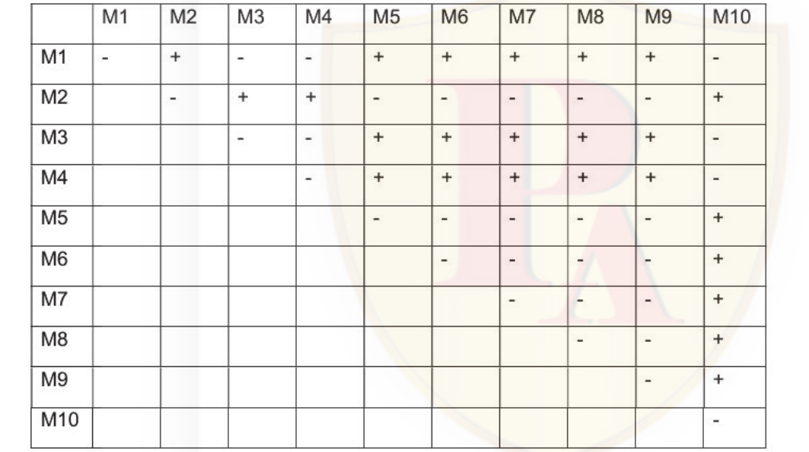

1. A only
2. B only
3. A and B
4. Band C

*Question ID: 209355381*

**Answer: 1 (A only)**

> **Explanation:** Correct option per the official NTA final answer key (December 2025, Subject 703).

---

### Question 131

The following are four biological processes that occur inside a living cell. A.   Spontaneous cis-trans isomerization of praline in proteins B.   Co-translational protein folding C.   a -helix formation D.   Hydrogen bond formation in free water Which one of the following options represents the slowest to fastest order of the timescale for these processes?

1. D>C>B>A
2. A> B > C > D
3. D > C >A> B
4. C > B > D >A

*Question ID: 209355338*

**Answer: 2 (A> B > C > D)**

> **Explanation:** Correct option per the official NTA final answer key (December 2025, Subject 703).

---

### Question 132

Given below are the different stages of Arabidopsis embryogenesis (Column X) and their characteristic patterns of cell division (Column Y). Column X                                           Column Y A.    Zygotic             (i)      Formation of an 8-cell embryo , exhibiting radial symmetry and undergoing additional cell division to create the protoderm B.    Globular           (ii)      Polarized growth of cells followed by a symmetric transverse division giving rise to a small apical cell and an elongated basal cell C.    Heart              (iii)     Cell elongation and cellular differentiation processes throughout the embryonic axis with visible distinction between the adaxial and abaxial tissue of the cotyledons D.    Torpedo            (iv)      Focused cell division forming two cotyledons, giving bilateral symmetry to the embryo Which one of the following options represents the correct match between Column X and Column Y?

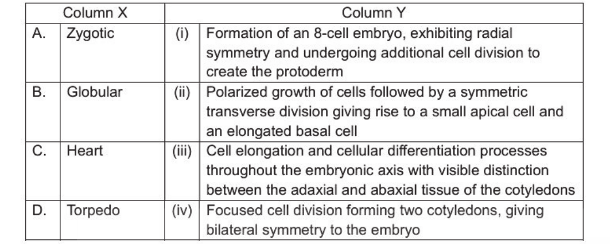

1. A(i)       B (ii)   C (iii)      D (iv)
2. A (ii)     B (i)    C (iv)       D (iii)
3. A (ii)     B (i)    C (iii)      D (iv)
4. A(i)       B (iv)   C (ii)       D (iii)

*Question ID: 209355364*

**Answer: 2 (A (ii)     B (i)    C (iv)       D (iii))**

> **Explanation:** Correct option per the official NTA final answer key (December 2025, Subject 703).

---

### Question 133

A 20-bp GC-rich promoter undergoes a conformational transition between the 8-form to Z-form of DNA, involving bases 6 to 13. The rest of the bases always remain in the 8-form . The 8- to Z-DNA transition occurs with a half-life of 2 s, and Z- to B-DNA transition has a half-life of 6 s. If the cognate transcription factor requires 10 continuous B-DNA base pairs for binding , for how many seconds in a 20 s window can the transcription factor remain bound to the promoter, assuming steady-stale conditions?

1. 4s
2. 5s
3. 10 s
4. 15 s

*Question ID: 209355340*

**Answer: 2 (5s)**

> **Explanation:** Correct option per the official NTA final answer key (December 2025, Subject 703).

---

### Question 134

Antibiotic resistant strains of various pathogenic bacteria are a serious concern for human health. The following table has the names of important bacteria (Column X), specific strains of which can cause serious illnesses (Column Y). Column X                                          Column Y A.      Specific strains of                 i.     Re-emerged as a significant community- Enterobacteriaceae                         and hospital-acquired infection due to Methicillin resistance B       Specific strains of                 ii.    Multi-drug resistant (MOR) strains found Rickettsia                                 in humans and food, suggesting a potential for broader spread C.      Salmonella and Klebsiella           iii.   A type of bacteria that is difficult to treat pneumoniae                                 due to resistance to multiple antibiotics, mainly Carbapenem D.      Staphylococcus aureus               iv.    The causative agent of murine typhus , which has shown transmission via organ transplants. Which one of the options below is the correct match between all terms of Column X and Column Y?

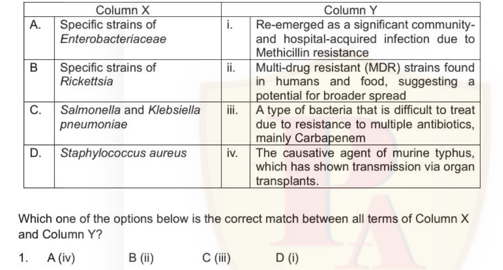

1. A(iv)           B (ii)         C (iii)            D (i)
2. A (ii)          B (i)          C (iv)             D (iii)
3. A (iii)         B (iv)         C (ii)             D (i)
4. A(i)            B (iii)        C (i)              D (ii)

*Question ID: 209355384*

**Answer: 3 (A (iii)         B (iv)         C (ii)             D (i))**

> **Explanation:** Correct option per the official NTA final answer key (December 2025, Subject 703).

---

### Question 135

ENZ function prevents premature differentiation of mouse neural stem cells. Kinase inhibitor treatment differentiates these cells prematurely. This is prevented if a specific serine-to-aspartate (S to D) mutation is introduced in ENZ. Based on this information, which one of the following statements is INCORRECT?

1. The specific serine to aspartate substitution has the same effect as phosphorylation of ENZ on neural stem cell differentiation .
2. The specific serine may be the site of ENZ phosphorylation.
3. The serine-to-aspartate mutation is expected to yield the same results as an asparagine substitution.
4. The serine-to-aspartate mutation is expected to yield the same results as a glutamic acid substitution.

*Question ID: 209355350*

**Answer: 3 (The serine-to-aspartate mutation is expected to yield the same results as an asparagine substitution.)**

> **Explanation:** Correct option per the official NTA final answer key (December 2025, Subject 703).

---

### Question 136

A certain trait in a species is governed by variation at the AB locus that has two alleles (A, B) that give rise to three genotypes, AA, AB and BB. A sample of 1000 individuals of the species were genotyped and the data is given in the table below: Genotype         Number of individuals AA                  400 AB                  400 BB                  200 Assume that each genotype is represented equally in males and females and mating is random . If the parents were randomly drawn from the sample of 1000 individuals given above, which one of the following options gives all correct values of the offspring genotype frequencies?

1. AA: 0.4;        AB : 0.4;     BB: 0.2
2. AA: 0.6;        AB: 0.2;      BB: 0.2
3. AA: 0.16;       AB: 0.16 ;    BB: 0.04
4. AA: 0.36;       AB : 0.48;    BB : 0.16

*Question ID: 209355399*

**Answer: 4 (AA: 0.36;       AB : 0.48;    BB : 0.16)**

> **Explanation:** Correct option per the official NTA final answer key (December 2025, Subject 703).

---

### Question 137

Given below are a few statements regarding Aquaporin-mediated water transport in plants. A.   The activity of aquaporins is regulated by altered pH and Ca 2 + concentration as well as phosphorylation. B.   Aquaporin activity is also regulated by reactive oxygen species. C.   Aquaporins are restricted only to epidermis and endodermal cells and not present in xylem parenchyma. D.   Aquaporins do not mediate influx of boric acid and salicylic acid into cytosol. Which one of the following options represents the combination of all correct statements?

1. A and B
2. Band C
3. C and D
4. A and D

*Question ID: 209355369*

**Answer: 1 (A and B)**

> **Explanation:** Correct option per the official NTA final answer key (December 2025, Subject 703).

---

### Question 138

The following graph represents the enzyme kinetics observed for an enzyme (E) in the presence of 2 different inhibitors, P and Q , each at two different concentrations (x-axis - 1/v; 1/(moles/min); y-axis - 1/[S]; 1/µM). 8 7 c2! _/                     Pl/ /. .. ..                , ', Pl {0.5 µM) P2 (1 µM) 6 £/                 ,, / Ql (0.5 µM) ' Ql 5          P~/

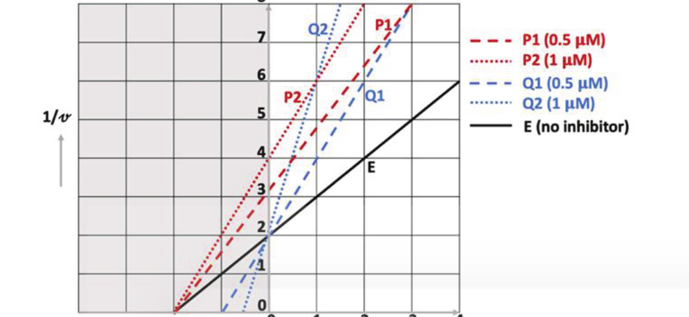

1. . ; ,           I / / i / V       Q2 (lµM) E (no inhibitor) V    I l                                    4 .... _:✓              / : / 3/ / / ., /: r / IVE . . 'IV ., : / : / 2. ,..,, 1 :', /4          .1. ,_. jY        II I :' : 0 0                1                    2              3   4 1/[S]              - Based on the graph , what is the substrate concentration (in µM) at which both inhibitors achieve 50% inhibition? 1.   0.333
2. 0.5
3. 1.0
4. 2.0

*Question ID: 209355341*

**Answer: 3 (1.0)**

> **Explanation:** Correct option per the official NTA final answer key (December 2025, Subject 703).

---

### Question 139

The following statements are made regarding the functioning of phytochromes A and B during light signaling in plants. A.   Phytochrome B (PhyB) lacks nuclear localization signal (NLS) and after perceiving light, it takes hours for nuclear import. B.   Phytochrome A (PhyA) contains NLS and its nuclear import occurs rapidly. C.   PFR form of PhyA depends on FAR-RED ELONGATED HYPOCOTYL 1 (FHY1) and its homolog FHL for nuclear import. D.   PFR form of PhyB depends on FHY1 and its homolog FHL for nuclear import. Which one of the following options represents all correct statement(s)?

1. A and B
2. Conly
3. A and C
4. D only

*Question ID: 209355359*

**Answer: 2 (Conly)**

> **Explanation:** Correct option per the official NTA final answer key (December 2025, Subject 703).

---

### Question 140

The following statements propose some of the similarities and differences between classic non-peptide neurotransmitters (CNN) and peptide neurotransmitters (PN): A.   CNN are synthesized at the presynaptic terminal while PN are synthesized in the cell body. B.   PN receptors are confined to the specific synapse at which PN is released like that of CNN. C.   When one neuron (containing both CNN and PN) is stimulated at low frequency, both PN and CNN are released from the presynaptic terminal , but al higher frequencies , only CNN is released. D.   The typical action of CNN has short latency and short duration (milliseconds) whi le PN action may have long latency and may persist for long duration (seconds). Which one of the following options represents a combination of all correct statements?

1. A and B
2. Band C
3. C and D
4. A and D

*Question ID: 209355372*

**Answer: 4 (A and D)**

> **Explanation:** Correct option per the official NTA final answer key (December 2025, Subject 703).

---

### Question 141

During development, yfg expression is regulated by proteins E, F and G, which are abundant and have long half-lives. After a "specific stage of development", the protein E is activated by a single short wave of phosphorylation. This leads to the following events: •    Phosphorylated E activates F. •    Active F activates G. •    Active G promotes yfg expression. •    Active F completely inhibits E, and active G completely inhibits F function. Which one of the following describes the expression of yfg soon after the "specific stage of development'' is reached?

1. Continuously transcribing
2. One pulse of transcription
3. Transcription not initiated
4. Multiple pulses of transcription

*Question ID: 209355357*

**Answer: 1 (Continuously transcribing)**

> **Explanation:** Correct option per the official NTA final answer key (December 2025, Subject 703).

---

### Question 142

Given below are statements about ion transport proteins in pancreatic duct cells which influence the composition of pancreatic juice. A.   Primary Cl·/HCQ3· exchanger is located on the luminal side. B.   CFTR is located primarily on the basolateral side. C.   Na•- bicarbonate cotransporter is located on the basolateral side. D.   Na•/hydrogen exchanger-1 is located on the luminal side. Which one of the following options has a combination of all correct statements?

1. A and B
2. C and D
3. A and C
4. Band D

*Question ID: 209355375*

**Answer: 3 (A and C)**

> **Explanation:** Correct option per the official NTA final answer key (December 2025, Subject 703).

---

### Question 143

Given below are names of plants (Column X} and the habitats (Column Y} in which they naturally occur. Column X                               Column Y A      Myristica fatua             i     Eastern Himalayas B      Strobilanthes kunthiana     ii    Nilgiris C      Madhuca indica              iii   Fresh water swamp forests D      Rhododendron                iv    Central India pendulum Which one of the following options is a correct match of all terms between Column X and Column Y?

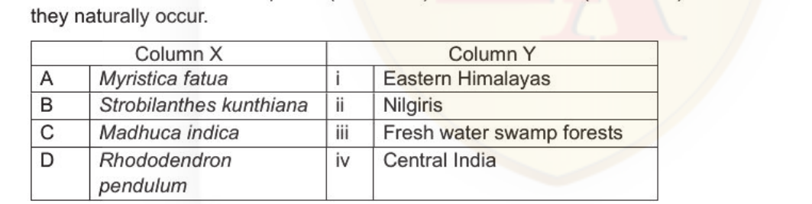

1. A-ii    B-i     C-iii   D-iv
2. A-iv    B-iii   C-ii    D-i
3. A-iii   B-ii    C-iv    D-i
4. A-iii   B-iv    C-i     D-ii

*Question ID: 209355385*

**Answer: 3 (A-iii   B-ii    C-iv    D-i)**

> **Explanation:** Correct option per the official NTA final answer key (December 2025, Subject 703).

---

### Question 144

Beyond its primary role in reducing atmospheric nitrogen to ammonia during symbiotic nitrogen fixation, the nitrogenase enzyme complex is also capable of catalyzing other reactions. Listed below are some reactions. A.   Acetylene reduction (C2H2---, C2H4) B.   H2 production (2W ---, H2) C.   ATP hydrolysis (ATP---, ADP+ Pi) D.   Oxidized ferredoxin to Reduced Ferredoxin E.   NAO reduction (NAD+ + W---, NADH) Which one of the following options represents the combination of reactions that are NOT catalysed by the nitrogenase enzyme complex?

1. Band C
2. D and E
3. A and C
4. Band D

*Question ID: 209355367*

**Answer: 2 (D and E)**

> **Explanation:** Correct option per the official NTA final answer key (December 2025, Subject 703).

---

### Question 145

In standard or batch cultures, cells are grown in a fixed volume of medium. As they grow, nutrients are consumed and metabolites accumulate. Eventually, cultures may stop growing because of nutrient depletion and accumulation of toxic products. The following procedures may prolong the life of batch cultures: A.   Gradual addition of fresh medium and increasing volume of the culture B.   Replacing a constant fraction with an equal volume of fresh medium C.   Occasional removal of used medium and reducing growth factors in the medium D.   Intermittently adding serum and growth factors to the medium Which one of the following combinations will ensure healthy growth of cells in culture?

1. A and B
2. Band C
3. C and D
4. A and D

*Question ID: 209355407*

**Answer: 1 (A and B)**

> **Explanation:** Correct option per the official NTA final answer key (December 2025, Subject 703).

---

