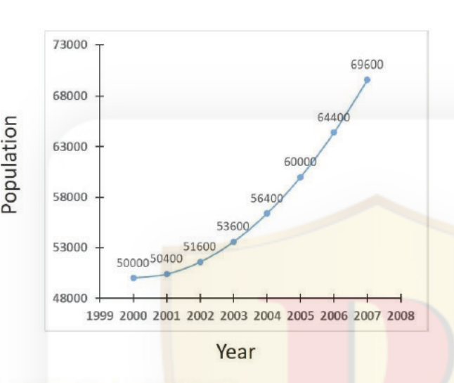
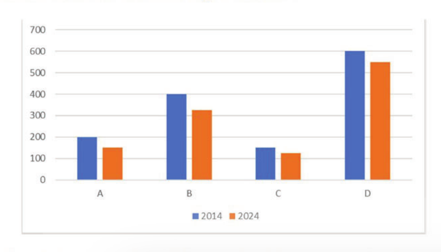

# CSIR UGC NET June 2025 — Life Sciences — Part A

Exam date: 28/07/2025 · Shift 1 · Subject: Life Sciences
Section as printed: **PART - A** (Q.1 – Q.20)

Answers are taken from the **NTA FINAL ANSWER KEY** (`csirnet.nta.ac.in/images/FINAL_KEY_CSIR_JUNE_2025.pdf`, page 3, Subject (703) LIFE SCIENCES), matched to each question by its printed `Question ID`.

---

### Question 1

On a spherical balloon of 10 cm radius, a circular colour patch has an area of 25 cm². If the balloon is uniformly expanded to a sphere of 50 cm radius, the area of the colour patch in cm² would be

1. 125
2. 625
3. 50
4. 500

**Answer: 2 (625)**

> **Explanation:** Printed Question ID 835594672 → NTA final key correct option **2**. The patch is a fixed piece of the balloon's surface, so its area scales as the square of the radius: 25 × (50/10)² = 25 × 25 = 625 cm².

---

### Question 2

Average age of 20 students of a class is 10 years. Average age of these students together with their five teachers is 14. The age of Ramesh Sir, one of their five teachers, is exactly the same as the average age of all their five teachers. The sum of the ages (in years) of all the students and Ramesh Sir is

1. 214
2. 224
3. 230
4. 241

**Answer: 3 (230)**

> **Explanation:** Printed Question ID 835594663 → NTA final key correct option **3**. Total of 25 people = 14 × 25 = 350, so the five teachers total 350 − 200 = 150 and average 30. Ramesh Sir's age = 30, giving 200 + 30 = 230 years.

---

### Question 3

A pilgrim starts walking for a journey of 115 km. On the first day he covers 7 km, the next day 9 km, and likewise keeps adding 2 km everyday till he reaches 15 km per day which he maintains for the rest of the journey. How many days in all will he take to complete the journey?

1. 7
2. 8
3. 9
4. 10

**Answer: 3 (9)**

> **Explanation:** Printed Question ID 835594660 → NTA final key correct option **3**. Days 1–5 form the arithmetic series 7 + 9 + 11 + 13 + 15 = 55 km (he reaches 15 km/day on day 5). The remaining 115 − 55 = 60 km are covered at 15 km/day = 4 more days, so 5 + 4 = 9 days.

---

### Question 4

A 2 cm wide wooden strip is to be fixed on a photo of 40 cm × 30 cm size all along its four sides. What is the minimum length of the wooden strip required?

1. 124 cm
2. 128 cm
3. 132 cm
4. 140 cm

**Answer: 3 (132 cm)**

> **Explanation:** Printed Question ID 835594658 → NTA final key correct option **3**. The strip is fixed on the photo, lying inside its boundary, so it occupies a 2 cm border. The length of a strip is measured along its centre line, which is set 1 cm in from each edge: a rectangle of (40 − 2) × (30 − 2) = 38 × 28. Perimeter = 2(38 + 28) = **132 cm**.

---

### Question 5

The population of a town over the years 2000-2007 is shown in the given figure.

It can be inferred that during 2000-2007,

1. the population increased linearly
2. the rate of increase of the population increased linearly
3. the rate of increase of the rate of increase of the population increased linearly
4. the population increased exponentially

**Answer: 2 (the rate of increase of the population increased linearly)**

> **Explanation:** Printed Question ID 835594661 → NTA final key correct option **2**. The year-on-year increments are 400, 1200, 2000, 2800, 3600, 4400, 5200 — an arithmetic progression with common difference 800. So the *rate of increase* itself grows linearly, which is option 2. (The increments are not constant, ruling out 1; the second difference is constant, so the curve is quadratic rather than exponential, ruling out 4.)

---

### Question 6

If any 9 papers are drawn from a both side printed book, the sum of their page numbers can NEVER be _______.

1. 9×(9+1)/2
2. divisible by 3
3. 179
4. 171

**Answer: 1 (9×(9+1)/2)**

> **Explanation:** Printed Question ID 835594666 → NTA final key correct option **1**. A "paper" of a both-side printed book is a leaf carrying the consecutive pair (2k−1, 2k), whose page numbers sum to 4k − 1. Nine papers therefore sum to 4Σk − 9 ≡ 3 (mod 4), and the smallest case (k = 1…9) is 171. Testing the options: 45 ≡ 1 (mod 4) and is below the minimum, so it can NEVER occur; 171 ≡ 3 and 179 ≡ 3 are both attainable; and "divisible by 3" is satisfied by 171 itself. Hence option 1.

---

### Question 7

Which of the following is true?

1. π^π^π < e^e^e < 3^3^3
2. π^π^π < 3^3^3 < e^e^e
3. 3^3^3 < e^e^e < π^π^π
4. e^e^e < 3^3^3 < π^π^π

**Answer: 4 (e^e^e < 3^3^3 < π^π^π)**

> **Explanation:** Printed Question ID 835594669 → NTA final key correct option **4**. These are power towers, evaluated top-down: 3^(3³) = 3²⁷ ≈ 7.6 × 10¹²; e^(e^e) = e^15.15 ≈ 3.8 × 10⁶; π^(π^π) = π^36.46 ≈ 1.3 × 10¹⁸. Hence e^(e^e) < 3^(3³) < π^(π^π). The ordering is **not** simply by base — although the function x^x^x is increasing for x > 1/e, here the *exponent* of 3, namely 3³ = 27, is far larger than e^e ≈ 15.15, which pushes 3^(3³) above e^(e^e) while π^(π^π) with exponent ≈ 36.5 stays the largest.

---

### Question 8

The areas (in km²) under forests in four countries A, B, C and D for the years 2014 and 2024 are shown in the given bar chart:

The minimum percentage of deforestation during 2014-2024 was in country

1. A
2. B
3. C
4. D

**Answer: 4 (D)**

> **Explanation:** Printed Question ID 835594662 → NTA final key correct option **4**. Reading the bars: A 200→150 = 25%; B 400→325 = 18.75%; C 150→125 = 16.7%; D 600→550 = 8.3%. Country D shows the smallest proportional loss, hence the minimum percentage of deforestation.

---

### Question 9

A block of marble 5 m × 4 m × 2 m in size is cut into rectangular tiles of 1 m x 0.5 m size having thickness of 10 cm. Assuming 10% wastage in cutting, how many tiles will be made?

1. 240
2. 360
3. 480
4. 720

**Answer: 4 (720)**

> **Explanation:** Printed Question ID 835594659 → NTA final key correct option **4**. Block volume = 5 × 4 × 2 = 40 m³. Usable volume after 10% wastage = 36 m³. Each tile = 1 × 0.5 × 0.1 = 0.05 m³. 36 / 0.05 = 720 tiles.

---

### Question 10

What is the remainder when 2023²⁰²⁴ + 2025²⁰²⁴ is divided by 2024?

1. 0
2. 2
3. 223
4. 2023

**Answer: 2 (2)**

> **Explanation:** Printed Question ID 835594664 → NTA final key correct option **2**. Work modulo 2024: 2023 ≡ −1 and 2025 ≡ +1. Both exponents are even (2024), so (−1)²⁰²⁴ + (1)²⁰²⁴ = 1 + 1 = 2.

---

### Question 11

If there is rainfall in a village, flowers will bloom. If flowers bloom, celebrations will definitely take place. Flowers did not bloom. Which of the following is certain?

1. Celebrations took place
2. Celebrations did not take place
3. It did not rain
4. It rained too much

**Answer: 3 (It did not rain)**

> **Explanation:** Printed Question ID 835594670 → NTA final key correct option **3**. Rain → bloom → celebrations. "Flowers did not bloom" denies the consequent of the first conditional, so by modus tollens it did not rain. Celebrations cannot be concluded either way, since blooming is only a sufficient condition for them.

---

### Question 12

MAN is to CROWD is as TREE is to _______

1. FOREST
2. FRUIT
3. BRANCH
4. ROOT

**Answer: 1 (FOREST)**

> **Explanation:** Printed Question ID 835594671 → NTA final key correct option **1**. A crowd is a collection of many man; a forest is a collection of many tree. The relation is individual → aggregate.

---

### Question 13

A man on a cycle is travelling on a terrain whose height (h) vs distance (d) can be described by a function 10 d⁴ − 5d² in a certain unit (h can be negative). Starting at d = 0, the cycle will have the maximum velocity without pedaling at:

1. d = 1 /2
2. d = 2
3. d = 1
4. d = √2

**Answer: 1 (d = 1 /2)**

> **Explanation:** Printed Question ID 835594673 → NTA final key correct option **1**. Rolling without pedalling, speed is greatest where the terrain is lowest, i.e. at the minimum of h(d) = 10d⁴ − 5d². Setting dh/dd = 40d³ − 10d = 10d(4d² − 1) = 0 gives d = 0 or d = ½. The second derivative d²h/dd² = 120d² − 10 is −10 at d = 0 (a local maximum) and +20 at d = ½ (a genuine minimum, h = −1.25). So the lowest point reached is at **d = 1/2**.

---

### Question 14

∛0.99 is closest to

1. 0.33
2. 0.14
3. 0.99
4. 0.45

**Answer: 3 (0.99)**

> **Explanation:** Printed Question ID 835594657 → NTA final key correct option **3**. By the binomial approximation (1 − x)ⁿ ≈ 1 − nx for small x, ∛0.99 = (1 − 0.01)^(1/3) ≈ 1 − 0.01/3 ≈ 0.9967, which is closest to 0.99.

---

### Question 15

In a box there are 4 white balls and 6 black balls. A ball is drawn at random. If it is white, it is put back along with two more white balls in the box. If it is black, it is put back in the box and then two black balls are thrown out of the box. Now a ball is drawn again at random from the box. Then, what is the probability that it is black?

1. 1/2
2. 1/3
3. 1/4
4. 1/5

**Answer: 1 (1/2)**

> **Explanation:** Printed Question ID 835594674 → NTA final key correct option **1**. Condition on the first draw. White first (p = 4/10): box becomes 6W + 6B = 12, P(black) = 6/12 = 1/2. Black first (p = 6/10): box becomes 4W + 4B = 8, P(black) = 4/8 = 1/2. Total probability = (4/10)(1/2) + (6/10)(1/2) = 1/2.

---

### Question 16

If a map is placed in such a manner that east becomes southeast, then what will northeast become?

1. North
2. East
3. West
4. South

**Answer: 2 (East)**

> **Explanation:** Printed Question ID 835594656 → NTA final key correct option **2**. East rotating to south-east is a 45° clockwise turn of the map. Northeast moved 45° clockwise becomes East.

---

### Question 17

The sixth largest three-digit odd number among those with all digits distinct is

1. 989
2. 987
3. 973
4. 971

**Answer: 3 (973)**

> **Explanation:** Printed Question ID 835594667 → NTA final key correct option **3**. Listing three-digit odd numbers with all distinct digits in decreasing order from 987: 987, 985, 983, 981, 975, 973 … — 973 is the sixth.

---

### Question 18

A fresh water tap fills a fish tank in 40 minutes. The same tank is filled by a salt water tap in 120 minutes. If both the taps are open, how many minutes will it take to fill the tank?

1. 45 minutes
2. 30 minutes
3. 25 minutes
4. 20 minutes

**Answer: 2 (30 minutes)**

> **Explanation:** Printed Question ID 835594665 → NTA final key correct option **2**. Combined rate = 1/40 + 1/120 = 3/120 + 1/120 = 4/120 = 1/30, so the tank fills in 30 minutes.

---

### Question 19

"Amit is a businessman, so he must be rich". From which of the following statements does the implication follow?

1. Only businessmen are rich
2. If one is not a businessman, he cannot be rich
3. All businessmen are rich
4. Some businessmen are rich

**Answer: 3 (All businessmen are rich)**

> **Explanation:** Printed Question ID 835594668 → NTA final key correct option **3**. The inference "Amit is a businessman, therefore rich" is valid only under the universal premise that every businessman is rich. "Only businessmen are rich" (option 1) states the converse and does not license the deduction.

---

### Question 20

An empty plastic mug floats in a bucket of water. When a solid iron ball is kept in the mug it doesn't sink. When the ball is put in the water it sinks. Compared to when the ball is in water, the water level in the bucket when the ball is in the mug is

1. the same
2. higher
3. lower
4. higher or lower depending on the surface area of the ball.

**Answer: 2 (higher)**

> **Explanation:** Printed Question ID 835594675 → NTA final key correct option **2**. With the ball in the floating mug, the mug must displace water weighing the ball's full weight, i.e. volume m/ρ_water. With the ball sunk, it displaces only its own volume m/ρ_iron. Since iron is denser than water, m/ρ_water > m/ρ_iron, so the water level is higher when the ball is in the mug.
