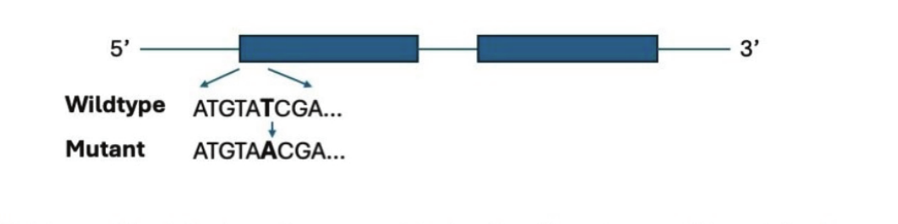

# CSIR UGC NET June 2025 — Life Sciences — Part B

Exam date: 28/07/2025 · Shift 1 · Subject: Life Sciences
Section as printed: **PART - B** (Q.21 – Q.70)

Answers are taken from the **NTA FINAL ANSWER KEY** (`csirnet.nta.ac.in/images/FINAL_KEY_CSIR_JUNE_2025.pdf`, page 3, Subject (703) LIFE SCIENCES), matched to each question by its printed `Question ID`.

---

### Question 21

Which one of the following enzymes can unwind short stretches of DNA helix immediately ahead of a replication fork?

1. Helicase
2. Topoisomerase
3. DNA polymerase
4. DNA gyrase

**Answer: 4 (DNA gyrase)**

> **Explanation:** Printed Question ID 835594684 → NTA final key correct option **4**. DNA gyrase is a type II topoisomerase that introduces negative supercoils, relieving the positive torsional stress generated immediately ahead of the fork and thereby allowing short stretches of helix to be unwound. Helicase unwinds at the fork itself rather than ahead of it.

---

### Question 22

Which one of the following is an example of asymmetric cell division in plants?

1. Formation of stomatal guard cells from a guard mother cell
2. First mitotic division of a microspore
3. First mitotic division of a megaspore
4. Cell division in the root elongation zone

**Answer: 2 (First mitotic division of a microspore)**

> **Explanation:** Printed Question ID 835594694 → NTA final key correct option **2**. The first mitotic division of the microspore is asymmetric, producing a small generative cell and a large vegetative (tube) cell that differ in size and fate. Guard mother cell division is symmetric, and the root elongation zone divides to produce files of equivalent cells.

---

### Question 23

Which one of the following are NOT glial cells?

1. Schwann cells
2. Ependymal cells
3. Satellite cells of nervous system
4. Basket cells

**Answer: 4 (Basket cells)**

> **Explanation:** Printed Question ID 835594700 → NTA final key correct option **4**. Basket cells are GABAergic **neurons** of the cerebellar molecular layer, not glia. Schwann cells (PNS myelination), ependymal cells (CSF lining) and satellite cells (PNS support) are all genuine glial subtypes.

---

### Question 24

A 16S rRNA gene-based maximum-likelihood tree of soil isolates shows a long branch at the node connecting a clade of Actinobacteria to a clade of Proteobacteria. Which artefact is most likely to be present here?

1. Compositional heterogeneity causing long-branch attraction
2. Homoplasy in peptidoglycan cross-link pattern
3. Inaccurate rooting due to midpoint placement causing long-branch attraction
4. Over-parametrization of the GTR+G model

**Answer: 1 (Compositional heterogeneity causing long-branch attraction)**

> **Explanation:** Printed Question ID 835594708 → NTA final key correct option **1**. Actinobacteria are markedly GC-rich relative to Proteobacteria, so the two clade sequences differ strongly in nucleotide composition. Maximum-likelihood under a stationary model misreads this shared compositional bias as homology, artificially lengthening the connecting branch — the classic long-branch attraction artefact caused by compositional heterogeneity.

---

### Question 25

Which one of the following carotenoids is NOT involved in the nonphotochemical quenching of chlorophyll fluorescence in plants?

1. Zeaxanthin
2. Violaxanthin
3. Antheraxanthin
4. Canthaxanthin

**Answer: 4 (Canthaxanthin)**

> **Explanation:** Printed Question ID 835594697 → NTA final key correct option **4**. Energy-dependent quenching runs on the xanthophyll cycle violaxanthin → antheraxanthin → zeaxanthin. Canthaxanthin is a ketocarotenoid of some bacteria and fungi and does not participate in the plant xanthophyll cycle.

---

### Question 26

Steroidogenic acute regulatory protein (StAR) facilitates transfer of cholesterol in which of the following sub-cellular organelles?

1. Nucleus
2. Golgi bodies
3. Mitochondria
4. Endoplasmic reticulum

**Answer: 3 (Mitochondria)**

> **Explanation:** Printed Question ID 835594702 → NTA final key correct option **3**. StAR shuttles cholesterol from the outer to the inner mitochondrial membrane, where CYP11A1 (P450scc) performs the side-chain cleavage that is the rate-limiting step of steroidogenesis.

---

### Question 27

Which one of the following is the correct chronological order of major eras from oldest to youngest?

1. Proterozoic → Archean → Phanerozoic
2. Archean → Proterozoic → Phanerozoic
3. Archean → Phanerozoic → Proterozoic
4. Proterozoic → Phanerozoic → Archean

**Answer: 2 (Archean → Proterozoic → Phanerozoic)**

> **Explanation:** Printed Question ID 835594718 → NTA final key correct option **2**. The Precambrian eons run Archean (~4.0–2.5 Ga), then Proterozoic (~2.5 Ga–541 Ma), then the Phanerozoic (541 Ma to present).

---

### Question 28

Tomato plants in a subtropical field began to show progressive wilting, interveinal chlorosis, and root rot. The subsequent laboratory analysis indicated coenocytic hyphae along with the presence of thick-walled oospores. Additionally, the disease progressed rapidly in humid conditions. Which one of the following organisms is NOT likely to be responsible for the infection?

1. *Pythium aphanidermatum*
2. *Phytophthora nicotianae*
3. *Fusarium oxysporum*
4. *Phytophthora infestans*

**Answer: 3 (Fusarium oxysporum)**

> **Explanation:** Printed Question ID 835594710 → NTA final key correct option **3**. Coenocytic (aseptate) hyphae and thick-walled **oospores** are diagnostic of the oomycetes (Pythium, Phytophthora). *Fusarium oxysporum* is a true fungus with septate hyphae that produces macro/microconidia and chlamydospores, not oospores, so it does not fit the description.

---

### Question 29

Which one of the following statements about glycosaminoglycans (GAGs) is INCORRECT?

1. GAGs are distinguished by their sugars, the type of linkage between the sugars, and the number and location of sulphate groups.
2. They are one of the most anionic molecules made by animal cells.
3. They are branched polysaccharides, usually made up of repeating units of a sulphated amino sugar and a uronic acid.
4. Severe loss of GAGs can lead to premature aging.

**Answer: 3 (They are branched polysaccharides, usually made up of repeating units of a sulphated amino sugar and a uronic acid.)**

> **Explanation:** Printed Question ID 835594690 → NTA final key correct option **3**. The repeating disaccharide (amino sugar + uronic acid) description and the anionic character are correct, but GAG chains are **unbranched** linear polymers. The statement is therefore the incorrect one because of the word "branched".

---

### Question 30

In the classical metapopulation model as articulated by Richard Levins (1969, 1970), the metapopulation is considered to be a collection of subpopulations occupying different patches. Which one of the following conditions should be met for a population to be considered as a metapopulation?

1. Individual subpopulations should have realistic chances of extinction and recolonization.
2. The dynamics of the subpopulations should be dependent on each other.
3. Recolonization of a patch after extinction should be mainly through dispersal from the mainland patch.
4. Population dynamics in the various patches should be synchronous.

**Answer: 1 (Individual subpopulations should have realistic chances of extinction and recolonization.)**

> **Explanation:** Printed Question ID 835594712 → NTA final key correct option **1**. The Levins model is precisely a balance between local extinction (rate p) and recolonization (rate m) of patches, so subpopulations must be capable of both going extinct and being re-founded. Option 3 describes the mainland-island variant, and dynamics must be asynchronous (option 4 is wrong) so that not all patches crash together.

---

### Question 31

In a study on honey bee foraging, researchers investigated how dopamine release in the mushroom bodies affects the bee's ability to learn floral odours associated with a nectar reward. Which of Tinbergen's Four Questions does this study primarily address?

1. What is the evolutionary origin of odour-based learning in hymenopterans?
2. How does floral odour learning improve foraging efficiency and reproductive success?
3. What mechanism underlies the association between floral odour and reward in bees?
4. How does floral odour learning change over the lifespan of a honey bee?

**Answer: 3 (What mechanism underlies the association between floral odour and reward in bees?)**

> **Explanation:** Printed Question ID 835594716 → NTA final key correct option **3**. Tinbergen's four questions separate causation (mechanism), development (ontogeny), function (adaptive value) and evolution (phylogeny). Tracing a neurotransmitter (dopamine) in a defined brain region (mushroom bodies) as the cause of learning is a **mechanism/causation** question, which is option 3. Option 2 is function, option 4 development, option 1 phylogeny.

---

### Question 32

The subclasses of terpenes that are generally volatile and often stored in glandular hairs or secretory cavities of leaves and fruits of herb and spice plants are

1. monoterpenes and sesquiterpenes
2. sesquiterpenes and triterpenes
3. diterpenes and triterpenes
4. triterpenes and tetraterpenes

**Answer: 1 (monoterpenes and sesquiterpenes)**

> **Explanation:** Printed Question ID 835594698 → NTA final key correct option **1**. Monoterpenes (C10) and sesquiterpenes (C15) are small enough to be volatile and are the principal components of essential oils, characteristically sequestered in glandular trichomes and secretory cavities of Lamiaceae, Apiaceae and citrus. The larger di-, tri- and tetraterpenes are non-volatile.

---

### Question 33

A student exposed a plant to a herbicide that blocks electron transport both in Photosystem II and Photosystem I. What is the likely outcome?

1. Increased production of NADPH and ATP
2. Only ATP would be produced but not NADPH
3. Neither ATP nor NADPH would be produced
4. The Calvin cycle would operate more efficiently

**Answer: 3 (Neither ATP nor NADPH would be produced)**

> **Explanation:** Printed Question ID 835594696 → NTA final key correct option **3**. Linear electron flow from water through PSII and PSI to NADP⁺ generates both the proton gradient for photophosphorylation and the reducing power for NADPH. Blocking both photosystems abolishes the whole chain, so neither ATP nor NADPH is made (and the Calvin cycle therefore stops, ruling out option 4).

---

### Question 34

The Cre-lox system is used to successfully delete a gene specifically in T cells in mice. Which one of the following options is correct?

1. Lox P recombination sequences were introduced in tandem at the 5' end of the gene.
2. Lox P recombination sequences were introduced at the 3' end of the gene.
3. Mutant Lox P sites were introduced on either side of the gene and mice were infected with bacteriophage P1 to provide Cre recombinase.
4. Mice containing Lox P sites on both 5' and 3' ends of the gene were mated with mice that are transgenic for Cre recombinase under control of an inducible promoter.

**Answer: 4 (Mice containing Lox P sites on both 5' and 3' ends of the gene were mated with mice that are transgenic for Cre recombinase under control of an inducible promoter.)**

> **Explanation:** Printed Question ID 835594720 → NTA final key correct option **4**. Conditional knockout requires the gene flanked by loxP sites ("floxed") at both ends, crossed to a line expressing Cre. Tissue specificity comes from the Cre promoter. Options 1 and 2 place loxP sites only at one end so no excision is possible; option 3 invokes P1 phage transduction, which is not how Cre is delivered.

---

### Question 35

Which one of the following phytopathogenic bacteria is predominantly transmitted through insects?

1. *Xanthomonas oryzae*
2. *Ralstonia solanacearum*
3. *Xylella fastidiosa*
4. *Pseudomonas syringae*

**Answer: 3 (Xylella fastidiosa)**

> **Explanation:** Printed Question ID 835594688 → NTA final key correct option **3**. *Xylella fastidiosa* is a xylem-limited bacterium spread almost exclusively by xylem-feeding sharpshooter leafhoppers and spittlebugs; it cannot be moved effectively by water or contact. The other three are principally epiphytic/soil-borne and spread by rain splash, tools and seed.

---

### Question 36

Ectopic expression of the Vestigial protein in developing eye, antennae and leg discs of Drosophila converts the normal structure into wing tissue. Which one of the following statements is true based on the above information?

1. Vestigial expression is essential for wing development.
2. Cells in the eye, antennae and leg discs are incompetent for wing tissue specification.
3. Vestigial is downstream of the same Hox genes in all developing segments.
4. Leg and wing discs originate from distinct embryonic precursors.

**Answer: 1 (Vestigial expression is essential for wing development.)**

> **Explanation:** Printed Question ID 835594693 → NTA final key correct option **1**. That providing Vestigial alone is sufficient to switch appendage fate to wing shows it is the master determinant, and therefore required for, wing development. Option 2 is contradicted outright: the discs clearly *are* competent, since they were converted to wing.

---

### Question 37

Which one of the following features differentiates bacteria from archaea?

1. Presence of a cell wall made up of peptidoglycan
2. Absence of a nuclear membrane
3. Presence of a single circular chromosome
4. Presence of multi-cistronic operons

**Answer: 1 (Presence of a cell wall made up of peptidoglycan)**

> **Explanation:** Printed Question ID 835594682 → NTA final key correct option **1**. Peptidoglycan (murein) is unique to bacterial walls; archaea use pseudomurein or S-layers. Both domains lack a nuclear membrane, both typically have a single circular chromosome, and both use polycistronic operons, so options 2–4 do not distinguish them.

---

### Question 38

Which one of the following relationships correctly represents the narrow sense heritability? (V_A - additive variance, V_D - dominance variance, V_I - interaction variation, V_GE - genotype x environmental variance, V_T - total variance)

1. V_A / V_T
2. V_A / V_GE
3. V_A+V_D+V_I / V_T
4. V_D / V_T

**Answer: 1 (V_A / V_T)**

> **Explanation:** Printed Question ID 835594704 → NTA final key correct option **1**. Narrow-sense heritability h² is the fraction of total phenotypic variance attributable to **additive** genetic variance alone: h² = V_A/V_T. Option 3, which also includes dominance and interaction variance, is broad-sense heritability (H²).

---

### Question 39

The activation of Cdk2 in vertebrates is dependent on

1. dissociation of the inhibitory subunit
2. association with cyclin A
3. inactivation of CAK
4. activity of Wee1 kinase

**Answer: 2 (association with cyclin A)**

> **Explanation:** Printed Question ID 835594680 → NTA final key correct option **2**. Cdk2 pairs with cyclin E at the G1/S transition and with cyclin A during S phase; cyclin binding is the prerequisite for activity. CAK must be *active* (not inactivated) to phosphorylate the activating threonine, and Wee1 adds inhibitory phosphates, so options 3 and 4 would prevent rather than promote activation.

---

### Question 40

Two temperature-sensitive mutants of *Escherichia coli* were mated with each other and none of the resulting exconjugants showed the wild-type phenotype. These mutations are:

1. Allelic
2. Non-allelic
3. Recessive
4. Dominant-negative

**Answer: 1 (Allelic)**

> **Explanation:** Printed Question ID 835594706 → NTA final key correct option **1**. A complementation test: if the two lesions were in different genes, the recipient would receive a wild-type copy of each and prototrophy would be restored. Since no exconjugant reverted, the mutations must lie in the **same** gene, i.e. they are allelic and fail to complement.

---

### Question 41

For a given organism, which one of these life history attributes is associated with the broadest range of environmental tolerance?

1. Survival
2. Growth
3. Reproduction
4. Fecundity

**Answer: 1 (Survival)**

> **Explanation:** Printed Question ID 835594713 → NTA final key correct option **1**. The classical result (e.g. Rohde, Pörtner and colleagues on *C. elegans*) is that the thermal limits for **survival** are wider than those for growth, and narrower still for reproduction and fecundity. Organisms can persist outside the window in which they can successfully reproduce, so survival spans the broadest range.

---

### Question 42

*Drosophila melanogaster* has 4 pairs of chromosomes. There is no recombination in males of this species. What is the number of possible combinations of chromosomes in gametes of males?

1. Four
2. Eight
3. Sixteen
4. Thirty-two

**Answer: 3 (Sixteen)**

> **Explanation:** Printed Question ID 835594707 → NTA final key correct option **3**. Independent assortment alone yields 2ⁿ combinations with n = 4 haploid chromosome pairs, i.e. 2⁴ = 16. The absence of male crossing-over in Drosophila removes extra *within-chromosome* diversity but does not change the count of whole-chromosome combinations.

---

### Question 43

A transcript of a gene is shown below, with lines showing introns and rectangles showing exons. A mutation from 'T' at the 6ᵗʰ nucleotide position to 'A' in the 1ˢᵗ exon of the transcript is isolated.

Which one of the following options accurately describes the outcome of this mutation?

1. Gain of function
2. Loss of function
3. No change
4. Formation of an altered protein

**Answer: 2 (Loss of function)**

> **Explanation:** Printed Question ID 835594705 → NTA final key correct option **2**. Reading the first exon in frame from the ATG start: ATG TAT CGA → Met-Tyr-Arg. The T→A change at position 6 gives ATG TAA CGA, and **TAA is a stop codon**. Translation terminates immediately after the initiator methionine, so essentially no protein product is made — a null, i.e. loss of function.

---

### Question 44

The levels of which one of the following parameters of blood are measured to check cardiac damage?

1. Creatine
2. Creatine kinase
3. Peroxidase
4. Urea

**Answer: 2 (Creatine kinase)**

> **Explanation:** Printed Question ID 835594721 → NTA final key correct option **2**. The MB isoform of creatine kinase (CK-MB) is released into the blood when myocardial cells are damaged and is a standard enzymatic marker of infarction, along with troponin. Creatine itself and urea are not injury markers.

---

### Question 45

Which of the following features establishes stromatolites as a source of early evidence for life on earth?

1. Fossilized bones that have been deeply embedded in a silica-rich matrix
2. Layered accretion structures that have been formed as a result of mineral precipitation
3. Biogenic laminated structures that have been influenced by phototrophic microbial mats
4. Conical limestone mounds that were created by reduced volcanic geothermal activity

**Answer: 3 (Biogenic laminated structures that have been influenced by phototrophic microbial mats)**

> **Explanation:** Printed Question ID 835594717 → NTA final key correct option **3**. What makes stromatolites evidence of *life* is that their lamination is produced by trapping and binding sediment and precipitating carbonate in cyanobacterial (phototrophic) microbial mats. Option 2 describes the layered form but omits the biological origin, which is the whole point.

---

### Question 46

Which one of the following does NOT promote aging in humans?

1. Increased oxidative stress
2. Defects in DNA repair enzymes
3. Activation of telomerase
4. Reduced biosynthesis of leukotrienes

**Answer: 3 (Activation of telomerase)**

> **Explanation:** Printed Question ID 835594692 → NTA final key correct option **3**. Telomerase activation restores telomere length and delays replicative senescence, so it counteracts rather than promotes aging. Oxidative damage and defective DNA repair are established accelerators of aging.

---

### Question 47

In the catalytic triad of trypsin protease, serine forms a hydrogen bond with the histidine side chain. What will be the effect of this interaction on the pKₐ of the serine side chain?

1. The pKₐ decreases because the hydrogen bonding with histidine stabilises serine side chain's protonated state.
2. The pKₐ increases because the hydrogen bonding with histidine stabilises serine side chain's deprotonated state.
3. The pKₐ decreases because the hydrogen bonding with histidine stabilises serine side chain's deprotonated state.
4. The pKₐ increases because the hydrogen bonding with histidine stabilises serine side chain's protonated state.

**Answer: 3 (The pKₐ decreases because the hydrogen bonding with histidine stabilises serine side chain's deprotonated state.)**

> **Explanation:** Printed Question ID 835594677 → NTA final key correct option **3**. Histidine acts as a general base and accepts the serine hydroxyl proton, stabilising the resulting alkoxide (deprotonated) form. Anything that stabilises the conjugate base lowers the pKₐ, which is why the catalytic serine's pKₐ falls from ~13 to a value compatible with nucleophilic attack.

---

### Question 48

Which one of the following would be most suitable to study early embryogenesis event using live microscopy of unstained *C. elegans* embryos?

1. Confocal microscope
2. Fluorescence microscope
3. Differential Interference Contrast microscope
4. Super-resolution microscope

**Answer: 3 (Differential Interference Contrast microscope)**

> **Explanation:** Printed Question ID 835594725 → NTA final key correct option **3**. The embryos are *live* and *unstained*, so fluorescence and confocal modalities need a fluorophore and would add phototoxicity. DIC (Nomarski) gives high-contrast optical sectioning of transparent living specimens with ordinary transmitted light, and the *C. elegans* lineage was famously mapped this way.

---

### Question 49

Which one of the following statements about human papillomavirus is correct?

1. The viral structural protein-encoding genes occasionally integrate into the host genome, leading to cervical cancer.
2. The viral protein E7 promotes Rb binding to the E2F, which allows uncontrolled entry into the S Phase of the cell cycle.
3. The viral protein E6 binds to p53 and prevents its degradation.
4. They infect cervical epithelial cells and maintain themselves in a latent phase as extrachromosomal plasmids.

**Answer: 4 (They infect cervical epithelial cells and maintain themselves in a latent phase as extrachromosomal plasmids.)**

> **Explanation:** Printed Question ID 835594691 → NTA final key correct option **4**. HPV establishes persistent infection of the cervical epithelium with the genome maintained as an extrachromosomal circular episome. Options 2 and 3 invert the true biology: E7 **disrupts** Rb–E2F by degrading Rb, and E6 **promotes** degradation of p53 via E6AP rather than protecting it; option 1 wrongly implicates the structural L1/L2 genes instead of E6/E7.

---

### Question 50

Which one of the following options best represents cholesterol distribution as a percentage of total membrane lipid in a typical animal cell?

1. lysosomal membrane > smooth ER > plasma membrane > inner mitochondrial membrane
2. smooth ER > plasma membrane > lysosomal membrane > inner mitochondrial membrane
3. plasma membrane > lysosomal membrane > smooth ER > inner mitochondrial membrane
4. plasma membrane > inner mitochondrial membrane > smooth ER > lysosomal membrane

**Answer: 3 (plasma membrane > lysosomal membrane > smooth ER > inner mitochondrial membrane)**

> **Explanation:** Printed Question ID 835594681 → NTA final key correct option **3**. Cholesterol enriches the limiting membranes of the secretory/endocytic route in the order plasma membrane (~40–50 mol%) > lysosomal membrane > ER membranes, and is nearly absent from the inner mitochondrial membrane, which must stay permeability-barrier-like for respiration.

---

### Question 51

The heterotrimeric G-protein signaling component that is uniquely present in the plant lineage is

1. GTPase-accelerating protein
2. G-protein-coupled receptor
3. regulator of G-protein signaling
4. extra-large Gα subunit

**Answer: 4 (extra-large Gα subunit)**

> **Explanation:** Printed Question ID 835594689 → NTA final key correct option **4**. The XLG (extra-large Gα) proteins, which carry additional N-terminal GTPase and cysteine-rich domains, are found only in plants. The other components — GPCRs (even if atypical), GAPs and RGS proteins — occur across eukaryotes.

---

### Question 52

Why might a plant species evolve cleistogamous flowers in addition to chasmogamous ones?

1. To avoid inbreeding depression, a characteristic feature of cleistogamy
2. To ensure cross-pollination, a key objective of cleistogamy
3. To increase reproductive success in response to uncertainty in pollination
4. To enhance the phenomenon of pollinator attraction

**Answer: 3 (To increase reproductive success in response to uncertainty in pollination)**

> **Explanation:** Printed Question ID 835594715 → NTA final key correct option **3**. Cleistogamous flowers never open and self-pollinate, guaranteeing seed set when pollinators or conditions make outcrossing unreliable — the "reproductive assurance" benefit of a mixed cleistogamy/chasmogamy strategy. Options 1, 2 and 4 all describe the opposite: cleistogamy *causes* inbreeding, eliminates cross-pollination, and does not attract pollinators.

---

### Question 53

If 19% of the nucleotides in a genome are "A", what percent are "C", "G", and "T"?

1. C = 31%, G = 31%, and T = 19%
2. C = 19%, G = 19%, and T = 31%
3. C = 31%, G = 19%, and T = 31%
4. C = 19%, G = 31%, and T = 31%

**Answer: 1 (C = 31%, G = 31%, and T = 19%)**

> **Explanation:** Printed Question ID 835594687 → NTA final key correct option **1**. By Chargaff's rules A = T and G = C. A = 19% gives T = 19%, so A + T = 38% and G + C = 62%, hence C = G = 31%.

---

### Question 54

According to the Oparin-Haldane hypothesis, which one of the following statements best describes the Earth's early atmosphere?

1. Rich in oxygen and nitrogen
2. Composed primarily of carbon dioxide and oxygen
3. Reducing atmosphere with gases such as methane and ammonia
4. Similar to the current atmosphere of Earth

**Answer: 3 (Reducing atmosphere with gases such as methane and ammonia)**

> **Explanation:** Printed Question ID 835594719 → NTA final key correct option **3**. Oparin and Haldane proposed a **reducing** atmosphere (CH₄, NH₃, H₂O, H₂) with essentially no free oxygen, in which UV discharges could drive abiotic synthesis of organic molecules — the premise tested by the Miller–Urey experiment.

---

### Question 55

Which of the following chemical modifications of uridine residue occur after transcription of tRNA?

1. Ribothymidine and pseudouridine
2. Ribothymidine and N3-methyluridine
3. N3-methyluridine and pseudouridine
4. Pseudouridine and N1-Methylpseudouridine

**Answer: 1 (Ribothymidine and pseudouridine)**

> **Explanation:** Printed Question ID 835594679 → NTA final key correct option **1**. Two of the most abundant and conserved tRNA modifications are the isomerisation of uridine to **pseudouridine** (Ψ) and the methylation of uridine at C5 to give **ribothymidine** (T, m⁵U) — the TΨC arm of every tRNA carries exactly these. N1-methylpseudouridine is a modification introduced into synthetic mRNA, not a canonical tRNA modification.

---

### Question 56

Which one of the following is NOT a microbe-associated molecular pattern (MAMP) of phytopathogens?

1. flg22, a 22 amino-acid peptide
2. pep13, a 13 amino-acid peptide
3. elf26, a 26 amino-acid peptide
4. systemin, an 18 amino-acid peptide

**Answer: 4 (systemin, an 18 amino-acid peptide)**

> **Explanation:** Printed Question ID 835594699 → NTA final key correct option **4**. flg22 (flagellin), elf26 (EF-Tu) and the fungal/chitin-associated peptides are pathogen-derived MAMPs perceived by PRRs. **Systemin** is an 18-residue **endogenous** plant peptide hormone of Solanaceae released after wounding to trigger jasmonate-dependent defence, so it is a damage-associated signal, not a microbe-associated pattern.

---

### Question 57

Which one of the following datasets (expressed as mean ± SD) is most likely to follow a Gaussian (normal) distribution, considering that the data cannot have any negative values?

1. 296 ± 190 picomolar concentration of insulin in human blood samples
2. 58 ± 45 number of a particular species of bacteria in the rhizosphere
3. 160 ± 20 mg/dL of blood cholesterol concentration in human athletes
4. 4 ± 8 number of insects caught in a trap from an agricultural field

**Answer: 3 (160 ± 20 mg/dL of blood cholesterol concentration in human athletes)**

> **Explanation:** Printed Question ID 835594724 → NTA final key correct option **3**. A normal distribution is symmetric about the mean, so it can only approximate non-negative data if the mean is many standard deviations above zero. Options 1 (296/190 ≈ 1.6 SD), 2 (58/45 ≈ 1.3 SD) and 4 (4/8 = 0.5 SD) all put substantial probability mass below zero, whereas 160/20 = 8 SD is comfortably positive and has a low coefficient of variation.

---

### Question 58

Which one of the following habitats harbors the critically endangered Great Indian Bustard (*Ardeotis nigriceps*)?

1. Sal forests of Madhya Pradesh
2. Desert grasslands of Rajasthan
3. Shola grasslands of southern India
4. Terai grasslands of northeastern India

**Answer: 2 (Desert grasslands of Rajasthan)**

> **Explanation:** Printed Question ID 835594709 → NTA final key correct option **2**. The Great Indian Bustard survives only in arid and semi-arid grassland/scrub, principally the Desert National Park region of Jaisalmer, Rajasthan (with a remnant population in Gujarat). The Terai grasslands hold the swamp deer and one-horned rhino; sholas are the southern Indian montane grasslands.

---

### Question 59

Under the current rules of taxonomy, which one of the following organismal lineages can legitimately receive genus names either under the ICN or under the ICNP, based on the authors' choice?

1. Chlorophyta (Green algae)
2. Bacillariophyta (Diatoms)
3. Cyanobacteria (Blue-green algae)
4. Mycetozoa (Slime moulds)

**Answer: 3 (Cyanobacteria (Blue-green algae))**

> **Explanation:** Printed Question ID 835594711 → NTA final key correct option **3**. Cyanobacteria are prokaryotes, so their names are governed by the ICNP — but because they were traditionally treated as "blue-green algae", many of the same taxa also have names published under the ICN (e.g. *Nostoc* Vaucher under the ICN vs *Nostoc* Link under the ICNP). This dual history is exactly the case in which authors may legitimately place a genus under either code. Green algae, diatoms and slime moulds are eukaryotes and fall under the ICN alone.

---

### Question 60

Which one of the following statements depicts the correct function of TFIIB?

1. It binds to the TATA box and helps in the proper positioning of RNA pol II.
2. It plays an important role in the elongation phase of transcription.
3. It forms the transcription initiation complex by interacting with RNA pol II and TBP.
4. It acts as a coactivator that facilitates the binding of enhancers to the promoter.

**Answer: 3 (It forms the transcription initiation complex by interacting with RNA pol II and TBP.)**

> **Explanation:** Printed Question ID 835594685 → NTA final key correct option **3**. TFIIB is the bridge factor: it contacts the TBP–DNA complex and recruits the Pol II–TFIIF assembly, positioning the active-site cleft over the start point and helping form the pre-initiation complex. Option 1 is wrong because the TATA box is bound by TBP, not TFIIB.

---

### Question 61

All of the following are covered by lipid monolayers, EXCEPT

1. lipid droplet
2. very low-density lipoprotein
3. endocytic vesicles
4. chylomicrons

**Answer: 3 (endocytic vesicles)**

> **Explanation:** Printed Question ID 835594683 → NTA final key correct option **3**. Lipid droplets, VLDL and chylomicrons are neutral-lipid cores coated by a **monolayer** of phospholipids (with perilipins/apolipoproteins). Endocytic vesicles are ordinary membrane-bound compartments and therefore have a lipid **bilayer**.

---

### Question 62

Which one of the following proteins is responsible for the permeability of Mg²⁺ through the tight junctions of tubular cells in the thick ascending limb of Henle?

1. Claudin - 2
2. ZO - 1
3. Claudin - 16
4. ZO - 3

**Answer: 3 (Claudin - 16)**

> **Explanation:** Printed Question ID 835594701 → NTA final key correct option **3**. Claudin-16 (paracellin-1) forms the cation-selective paracellular pore for Mg²⁺ (and Ca²⁺) in the thick ascending limb; its mutation causes familial hypomagnesemia with hypercalciuria and nephrocalcinosis. Claudin-2 is a cation/water channel of the proximal tubule, and ZO-1/ZO-3 are cytoplasmic scaffolding proteins, not channels.

---

### Question 63

Which of the following statements indicates the relationship between basal metabolic rate and body size for organisms within a taxonomic group?

1. Basal metabolic rate increases linearly with body size
2. Weight-specific basal metabolic rate is independent of body size
3. Weight-specific basal metabolic rate decreases non-linearly with body size
4. Basal metabolic rate increases non-linearly with body size.

**Answer: 3 or 4**

> **Explanation:** Printed Question ID 835594714 → the NTA FINAL answer key records this question as accepting **either option 3 or option 4** ("3 or 4"). Both statements describe the same allometric reality, BMR = aM^b with b ≈ 0.75 < 1: absolute BMR rises with body size but **non-linearly** (option 4), and consequently mass-specific BMR = aM^(b−1) **declines non-linearly** with body size (option 3). Candidates answering either were awarded the mark.

---

### Question 64

The reactions of the urea cycle occur in two different cellular compartments and generate the following intermediates.

A. Argininosuccinate
B. Citrulline
C. Ornithine

Which intermediate(s) must be transported across the mitochondrial inner membrane?

1. A and B
2. B and C
3. A and C
4. A only

**Answer: 2 (B and C)**

> **Explanation:** Printed Question ID 835594678 → NTA final key correct option **2**. Carbamoyl phosphate synthesis and the formation of citrulline occur in the matrix; citrulline must exit to the cytosol (via the ornithine–citrulline carrier), where argininosuccinate is made and cleaved. Ornithine must then re-enter the matrix to restart the cycle. Argininosuccinate, arginine and fumarate stay cytosolic, so only **B and C** cross.

---

### Question 65

Which one of the following is the correct arrangement of amino acid dipeptides in increasing order of the area of allowed regions in the Ramachandran map?

1. Gly-Gly < Pro-Pro < Ala-Ala ~ Phe-Phe
2. Phe-Phe < Ala-Ala < Pro-Pro ~ Gly-Gly
3. Pro-Pro < Phe-Phe ~ Ala-Ala < Gly-Gly
4. Ala-Ala < Phe-Phe < Gly-Gly < Pro-Pro

**Answer: 3 (Pro-Pro < Phe-Phe ~ Ala-Ala < Gly-Gly)**

> **Explanation:** Printed Question ID 835594676 → NTA final key correct option **3**. Proline's pyrrolidine ring locks φ near −60° and clashes with the preceding residue, so Pro-Pro has the **most restricted** allowed area. Glycine, whose side chain is just H, has by far the **largest** allowed region (it is the only residue with strongly populated positive φ). Bulky Phe and small Ala are intermediate and comparable, giving Pro-Pro < Phe-Phe ~ Ala-Ala < Gly-Gly.

---

### Question 66

Which one of the following biofuels is classified as a first-generation biofuel?

1. Cellulosic ethanol
2. Bio-ethanol
3. Lignin-based biofuels
4. Algal biofuels

**Answer: 2 (Bio-ethanol)**

> **Explanation:** Printed Question ID 835594723 → NTA final key correct option **2**. First-generation biofuels come from food-crop sugars and starches — sugar/starch-derived **bio-ethanol** and biodiesel from vegetable oils. Cellulosic and lignin-based fuels are second-generation (lignocellulosic), and algal fuels are third-generation.

---

### Question 67

Ribosomes attach to the endoplasmic reticulum via

1. differing surface ribosomal protein composition that allow it to interact with polar headgroups on the ER lipid bilayer.
2. 5'UTR of mRNA being translated that directs the localization of the ribosomes to the ER.
3. the translated nascent chain which carries a signal allowing interaction with SRP-receptor on the ER.
4. tethered mRNAs that interact with rRNA.

**Answer: 3 (the translated nascent chain which carries a signal allowing interaction with SRP-receptor on the ER.)**

> **Explanation:** Printed Question ID 835594686 → NTA final key correct option **3**. Ribosomes reach the ER co-translationally: the emerging **signal peptide** of the nascent chain is bound by SRP, which targets the ribosome–nascent chain complex to the SRP receptor and then the translocon. There is no ribosome-intrinsic ER address (options 1, 2, 4).

---

### Question 68

Which one of the following molecules is transported into enterocytes from intestinal lumen by GLUT5?

1. Glucose
2. Galactose
3. Fructose
4. Lactose

**Answer: 3 (Fructose)**

> **Explanation:** Printed Question ID 835594703 → NTA final key correct option **3**. GLUT5 on the apical brush border of small-intestinal enterocytes is the facilitative **fructose** transporter. Glucose and galactose enter via SGLT1 (Na⁺-coupled), and lactose must first be hydrolysed by lactase.

---

### Question 69

Mutation of homeotic genes often results in which one of the following developmental defects in *Drosophila*?

1. Polarity defects in every segment along the A-P axis
2. Absence of every other segment along the A-P axis
3. Transformation of one segment into another
4. Absence of a group of contiguous segments

**Answer: 3 (Transformation of one segment into another)**

> **Explanation:** Printed Question ID 835594695 → NTA final key correct option **3**. Homeotic (Hox) selector genes specify segment identity, so their mutation **homeotically transforms** one segment into the fate of another — *Antennapedia* growing legs in place of antennae, *bithorax* a second pair of wings. Segment *number* and polarity defects arise from gap, pair-rule and segment-polarity genes instead (options 1, 2, 4).

---

### Question 70

In the circular synteny maps of Poaceae family, providing insights into the origin and evolution of grass genomes, which one of the following genomes should represent the "innermost" circle?

1. *Arabidopsis thaliana* chromosomes (n = 5)
2. maize chromosomes (n = 10)
3. rice chromosomes (n = 12)
4. ancestral chromosomes (n = 12)

**Answer: 4 (ancestral chromosomes (n = 12))**

> **Explanation:** Printed Question ID 835594722 → NTA final key correct option **4**. In the rye-grass-type/ancestral circular synteny diagrams, the reference **ancestral grass genome with n = 12** is drawn as the innermost circle, with the extant, rearranged genomes (maize after its polyploidy, rice, sorghum) placed in successive outer rings so that shared blocks can be traced back to the ancestor. *Arabidopsis* is not a grass and would not appear at the centre.
