# CSIR UGC NET June 2025 — Life Sciences — Part C

Exam date: 28/07/2025 · Shift 1 · Subject: Life Sciences
Section as printed: **PART - C** (Q.71 – Q.145)

Answers are taken from the **NTA FINAL ANSWER KEY** (`csirnet.nta.ac.in/images/FINAL_KEY_CSIR_JUNE_2025.pdf`, page 3, Subject (703) LIFE SCIENCES), matched to each question by its printed `Question ID`.

**Q.100 (Question ID 835594736) was marked "Drop" by NTA** — no answer is awarded.
**Q.123 (Question ID 835594764) accepts two options ("2 or 3")** — both are recorded below.

---

### Question 71

An embryo lethal recessive mutation in a plant gene "R" located on chromosome 1 was rescued by an ectopically integrated GFP-tagged wild type "R" transgene (R-comp) which is inserted in chromosome 4. When a female homozygous R-comp plant is crossed to a male purple-coloured recessive mutant, some of the resultant F1 embryos showed chromosome segregation defects. The plants regenerated from these embryos were purple and sterile, and found to contain the wild type gene "R" but not the R-comp transgene. What is the ploidy of the above F1 plants?

1. Triploid
2. Haploid
3. Chromosome 4 trisomy
4. Monosomic diploid

**Answer: 2 (Haploid)**

> **Explanation:** Printed Question ID 835594770 → NTA final key correct option **2**. The regenerated plants carry the wild-type R allele from the male parent but have lost the maternal R-comp transgene on chromosome 4, and they are sterile and arose from embryos with segregation defects. Loss of the entire maternal contribution with retention of a single paternal complement is the signature of **haploids** (paternal genome only), which are sterile because they cannot pair at meiosis.

---

### Question 72

Gastric juice (pH 1.5) is produced by pumping HCl from blood plasma (pH 7.4) into the stomach. Calculate the amount of free energy required for H⁺ transport to produce one litre of gastric juice at 37°C. How many moles of ATP must be hydrolyzed to provide this amount of energy? (The free energy change for ATP hydrolysis under cellular conditions is about −58 kJ/mol.) (R = 8.315 J/mol/K)

1. 34 - 36 kJ/mol and 0.6 - 0.61 mol
2. 3.4 - 3.6 kJ/mol and 6.0 - 6.1 mol
3. 22 - 23 kJ/mol and 0.3 - 0.31 mol
4. 17 - 18 kJ/mol and 3.0 - 3.1 mol

**Answer: 1 (34 - 36 kJ/mol and 0.6 - 0.61 mol)**

> **Explanation:** Printed Question ID 835594728 → NTA final key correct option **1**. For moving 1 mol of H⁺ against a pH gradient, ΔG = 2.303 RT ΔpH = 2.303 × 8.315 × 310 × (7.4 − 1.5) J/mol ≈ 35 kJ/mol, i.e. 34–36 kJ/mol. Moles of ATP = 35 / 58 ≈ 0.60–0.61 mol.

---

### Question 73

Spindle assembly requires the formation of numerous new microtubules. To meet this demand, the spindle contains a large number of regulatory factors. A few protein/protein complexes are mentioned below:

A. γ-TuRCs
B. Augmin
C. TPX2
D. Dynein

Which one of the following options includes all the factors that directly impact microtubule nucleation for spindle assembly?

1. A only
2. A and B only
3. A, B, and C only
4. A, B, C, and D

**Answer: 3 (A, B, and C only)**

> **Explanation:** Printed Question ID 835594732 → NTA final key correct option **3**. γ-TuRCs are the template for nucleation, the augmin complex nucleates new microtubules from existing spindle microtubule walls (branching nucleation), and TPX2 is a spindle microtubule-nucleation factor working with the Ran pathway. Dynein is a minus-end-directed **motor** involved in focusing and transport, not in nucleation, so D is excluded.

---

### Question 74

The baroreceptors present in the carotid sinus and aortic arch are stretch receptors that provide neural signals to the brain stem for the maintenance of normal blood pressure. The activity of baroreceptors in the regulation of blood pressure and heart rate are proposed in the following statements:

A. The increased baroreceptor discharge due to high blood pressure in the carotid sinus and aortic arch stimulates the tonic discharge of sympathetic nerves to blood vessels and heart.
B. A decline in the pulse pressure without a change in mean pressure increases the rate of baroreceptor discharge.
C. Baroreceptors are more sensitive to pulsatile change of blood pressure than to constant blood pressure.
D. The increased baroreceptor discharge excites the vagal innervations to the heart.

Which one of the following options represents all correct statements?

1. A, B, C and D
2. A, C and D only
3. C and D only
4. A and B only

**Answer: 3 (C and D only)**

> **Explanation:** Printed Question ID 835594762 → NTA final key correct option **3**. A rises in pressure *inhibits* sympathetic outflow rather than stimulating it, so A is wrong. Baroreceptors fire *less* when pulse pressure falls at constant mean pressure, so B is wrong. They do adapt to steady pressure and respond more to pulsatile change (C correct), and increased discharge drives vagal (parasympathetic) excitation to slow the heart (D correct).

---

### Question 75

The following statements are made regarding vesicle formation, transport, and fusion in cells expressing a mutant Arf protein. This mutant Arf protein is constitutively bound to GTP but is defective for GTP hydrolysis.

A. COPI-coated vesicles are only formed from their normal location.
B. Arf is constitutively bound to a membrane.
C. COPII-coated vesicle fusion with the target membrane is aberrant.
D. COPI-coated vesicle fusion with the target membrane is disrupted.

Which one of the following options represents the combination of all correct statements?

1. A and B only
2. A, B, and D
3. B and C only
4. B and D only

**Answer: 4 (B and D only)**

> **Explanation:** Printed Question ID 835594734 → NTA final key correct option **4**. Arf-GTP recruits the COPI coat, so a hydrolysis-deficient mutant stays membrane-bound (B correct) and cannot undergo the coat disassembly that fusion requires, disrupting COPI vesicle fusion (D correct). Statement A is wrong because mislocalised Arf activity produces COPI coats at abnormal membranes, and C is wrong because COPII budding uses Sar1, not Arf.

---

### Question 76

The operation of the photorespiratory (C₂) pathway involves cooperative interaction among three separate subcellular organelles, namely, chloroplast, mitochondria and peroxisomes. Following are certain statements regarding C₂ pathway:

A. 2-phosphoglycolate formed in the chloroplast is converted to glycolate by the action of phosphoglycolate phosphatase.
B. Glycolate exits chloroplast by diffusion and enters peroxisome through a glycolate transporter.
C. In the peroxisomes, glycolate reacts with O₂ and produces glyoxylate and H₂O₂.
D. Only serine:glyoxylate aminotransferase is involved in the conversion of glyoxylate into serine in a peroxisomal reaction.

Which one of the following options correctly marks the above statements as TRUE (T) of FALSE (F)?

1. A-T, B-T, C-F, D-T
2. A-F, B-T, C-F, D-T
3. A-F, B-T, C-T, D-T
4. A-T, B-F, C-T, D-F

**Answer: 4 (A-T, B-F, C-T, D-F)**

> **Explanation:** Printed Question ID 835594757 → NTA final key correct option **4**. A is true: phosphoglycolate phosphatase converts 2-phosphoglycolate to glycolate in the chloroplast. C is true: glycolate oxidase in the peroxisome yields glyoxylate plus H₂O₂. D is false because the conversion of glyoxylate to serine is completed by **two** aminotransferases (glutamate:glyoxylate and serine:glyoxylate). B is then marked false by the key, leaving option 4 as the only consistent combination.

---

### Question 77

The following statements are related to airway resistance of lungs in healthy humans:

A. The resistance to airflow increases with increasing lung volume.
B. The major site of airway resistance is in the first eight generations of airways.
C. The smallest airways contribute very little to the overall total resistance of the bronchial tree.
D. Breathing a mixture of oxygen-helium instead of oxygen-nitrogen results in a decrease of airway resistance.

Which one of the following options represents all correct statements?

1. B and D only
2. B, C and D
3. A and B only
4. A and D only

**Answer: 2 (B, C and D)**

> **Explanation:** Printed Question ID 835594763 → NTA final key correct option **2**. Resistance falls as lung volume rises because radial traction dilates the airways, so A is wrong. Medium-sized bronchi (roughly the first 8 generations) offer the greatest resistance (B correct); the tiny bronchioles have enormous total cross-sectional area and contribute little (C correct); and low-density helium converts turbulent to laminar flow, lowering resistance (D correct).

---

### Question 78

As per the 2020 FAO Global Forest Resources Assessment, the climatic domains ranked in descending order based on their proportion and distribution of global forest area are:

1. Tropical, Subtropical, Temperate, Boreal
2. Tropical, Boreal, Temperate, Subtropical
3. Boreal, Tropical, Subtropical, Temperate
4. Boreal, Temperate, Subtropical, Tropical

**Answer: 2 (Tropical, Boreal, Temperate, Subtropical)**

> **Explanation:** Printed Question ID 835594777 → NTA final key correct option **2**. In the FRA 2020 the tropical domain holds the largest share of global forest (~45%), followed by the boreal (~27%), temperate (~16%) and subtropical (~11%) domains.

---

### Question 79

Given below is a table listing the names of compounds/products derived from animals or plants (Column X) and their use/application (Column Y).

| Column X | Column Y |
|---|---|
| A. Bacoside | i. Chemotherapy for leukaemia and lymphoma |
| B. Vincristine | ii. Coating for pills and food glazing |
| C. Lanolin | iii. Cognitive enhancer |
| D. Shellac | iv. Skin creams and moisturizers |

Which one of the following options represents all correct matches between Column X and Column Y?

1. A (iii) B (i) C (ii) D (iv)
2. A (ii) B (iii) C (iv) D (i)
3. A (i) B (iv) C (iii) D (ii)
4. A (iii) B (i) C (iv) D (ii)

**Answer: 4 (A (iii) B (i) C (iv) D (ii))**

> **Explanation:** Printed Question ID 835594779 → NTA final key correct option **4**. Bacoside (*Bacopa monnieri*) is a cognitive enhancer (iii); Vincristine, the vinca alkaloid, is used in chemotherapy of leukaemia and lymphoma (i); lanolin is the wool wax used in skin creams and moisturizers (iv); and shellac is the lac-resin used for pill coating and food glazing (ii).

---

### Question 80

The table below lists genes (Column X) and their encoded proteins (Column Y) that play an important role in plant response to biotic stress.

| Column X | Column Y |
|---|---|
| A. *SID1* | i. Isochorismate synthase |
| B. *SID2* | ii. Cytochrome P450 monooxygenase |
| C. *PAD3* | iii. ABC transporter |
| D. *PEN3* | iv. MATE transporter |

Which one of the following options represents the correct match between Column X and Column Y?

1. A-ii, B-i, C-iv, D-iii
2. A-iii, B-iv, C-ii, D-i
3. A-iv, B-i, C-ii, D-iii
4. A-iv, B-ii, C-iii, D-i

**Answer: 3 (A-iv, B-i, C-ii, D-iii)**

> **Explanation:** Printed Question ID 835594761 → NTA final key correct option **3**. SID1 is a MATE transporter exporting salicylic acid; SID2 (ICS1) is isochorismate synthase, the SA biosynthetic enzyme; PAD3 is the CYP71A13 cytochrome P450 that makes the phytoalexin camalexin; PEN3 is the ABC transporter (PDR-type) that exports camalexin across the plasma membrane.

---

### Question 81

The activity of two promoters (A and B) upstream of a luciferase reporter in response to transcription factor TF-X in a cell line was studied. Luciferase activity was measured in cells following overexpression and RNAi silencing of TF-X and compared to control (Native TF-X level). The luciferase enzyme activity is tabulated below.

| Condition | pGene A: Luciferase activity (Arbitrary Units) | pGene B: Luciferase activity (Arbitrary Units) |
|---|---|---|
| Native TF-X levels | 9 | 2 |
| Overexpression of TF-X | 2 | 9 |
| RNAi-silenced TF-X | 2 | 2 |

Based on the above table, following statements were made

A. TF-X is needed for basal activity of promoter A.
B. TF-X is needed for basal activity of promoter B.
C. TF-X functions both as a positive and negative regulator for promoter A.

Which one of the following options represents correct statement(s)?

1. A only
2. B only
3. A and B
4. A and C

**Answer: 4 (A and C)**

> **Explanation:** Printed Question ID 835594741 → NTA final key correct option **4**. Silencing TF-X drops promoter A from 9 to 2, so TF-X is required for its basal activity (A true). Promoter B is unaffected by silencing (2 → 2), so B is false. For promoter A, TF-X raises activity at native level but reduces it when overexpressed (9 → 2), i.e. it acts as both a positive and a negative regulator (C true). Hence A and C.

---

### Question 82

A network of genes regulates vertebrate eye development. The loss or gain of function of select genes are listed in Column X, and their effects or phenotypes are listed in Column Y.

| Column X | Column Y |
|---|---|
| A. Loss of function of *Shh* | i. No eyes |
| B. Elevated levels of *Shh* in the prechordal plate | ii. Disruption of anterior neural tube specification |
| C. Loss of function of *Otx2* | iii. Defective pigmented retina |
| D. Loss of function of *Mitf* | iv. Failure to split the eye field to form bilateral eye fields |

Which one of the following options represents all correct matches between column X and column Y?

1. A - iv, B - i, C - ii, D - iii
2. A - ii, B - iii, C - i, D - iv
3. A - iii, B - ii, C - iv, D - i
4. A - iv, B - ii, C - i, D - iii

**Answer: 1 (A - iv, B - i, C - ii, D - iii)**

> **Explanation:** Printed Question ID 835594752 → NTA final key correct option **1**. *Shh* loss prevents the single eye field from separating, giving cyclopia (iv); excess *Shh* from the prechordal plate ventralises and disrupts anterior neural plate/forebrain specification (ii); *Otx2* is required for eye formation altogether, so its loss gives no eyes (i); *Mitf* is needed for RPE pigment differentiation, giving defective pigmented retina (iii).

---

### Question 83

The Red List of the IUCN categorises species (Column X) under multiple threat levels (Column Y). Match the following species with their IUCN status (as of the latest reports):

| Column X | Column Y |
|---|---|
| A. Jerdon's Courser (*Rhinoptilius bitorquatus*) | i. Critically Endangered |
| B. Indian Star Tortoise (*Geochelone elegans*) | ii. Endangered |
| C. Indian Dwarf Banana (*Musa mannii*) | iii. Least Concern |
| D. Teak (*Tectona grandis*) | iv. Vulnerable |

1. A-(i), B-(iv), C-(ii), D-(iii)
2. A-(iv), B-(i), C-(ii), D-(iii)
3. A-(iv), B-(ii), C-(i), D-(iii)
4. A-(i), B-(iv), C-(i), D-(ii)

**Answer: 4 (A-(i), B-(iv), C-(i), D-(ii))**

> **Explanation:** Printed Question ID 835594775 → NTA final key correct option **4**, i.e. A-(i), B-(iv), C-(i), D-(ii). Jerdon's Courser is Critically Endangered (i) and the Indian Star Tortoise is Vulnerable (iv), and option 4 is the only listed combination that carries both of those. *Note of doubt:* on the usual published statuses *Musa mannii* is Endangered (ii) and teak is Least Concern (iii), which would point to option 1; the key's verdict (option 4) has been used here, and the discrepancy is logged in `sources.md`.

---

### Question 84

Sucrose transport in plant cells follows both active transport and diffusion mechanisms. The given figure shows the rate of sucrose uptake by soybean protoplasts as a function of the external sucrose concentrations.

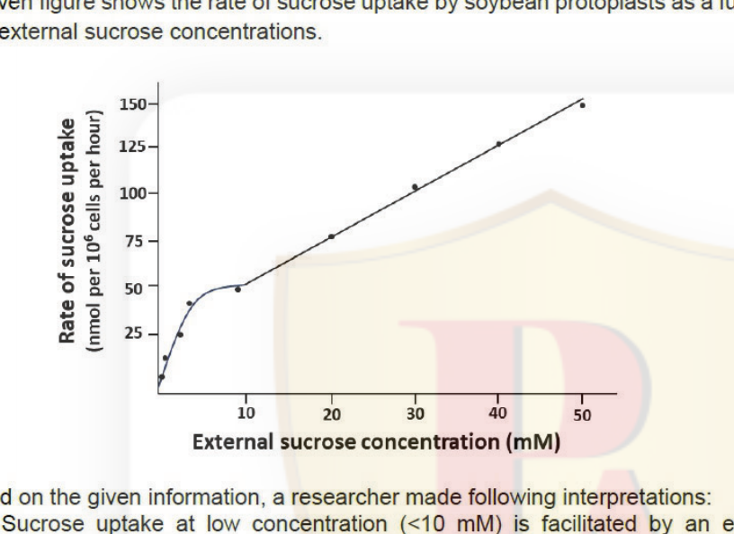

Based on the given information, a researcher made following interpretations:

A. Sucrose uptake at low concentration (<10 mM) is facilitated by an energy-dependent process.
B. Sucrose uptake at low concentrations is a carrier-independent process.
C. At higher concentrations, sucrose enters the cells by diffusion down its concentration gradient.
D. Inhibition of ATP synthesis with metabolic poison can block only the linear component.

Which one of the following options represents the combination of all correct interpretations?

1. A and B
2. B and C
3. A and C
4. C and D

**Answer: 3 (A and C)**

> **Explanation:** Printed Question ID 835594759 → NTA final key correct option **3**. The low-concentration region shows saturation kinetics, the hallmark of a carrier-mediated (and, for the active H⁺-sucrose symport, energy-dependent) process — so A is true and B, which denies a carrier, is false. The high-concentration straight line proportional to external concentration is the diffusional component, so C is true. D is false because a metabolic poison blocks the saturable (active) component, not the linear one.

---

### Question 85

In a dioecious plant species, a single gene is responsible for petal colour. A cross between a true breeding red female and a true breeding white male gave rise to all red male and all white female F1 progeny. However, the reciprocal cross produced all red males and all red females.

Which one of the following explains the inheritance of petal colour?

1. The gene is located in the mitochondrial genome.
2. Males are homogametic; gene is located on the sex chromosome.
3. Females are homogametic; gene is located on the sex chromosome.
4. The gene is located on an autosome.

**Answer: 2 (Males are homogametic; gene is located on the sex chromosome.)**

> **Explanation:** Printed Question ID 835594769 → NTA final key correct option **2**. The criss-cross pattern — daughters resembling the pollen parent and sons the seed parent in the first cross, but both classes red in the reciprocal — requires that the allele be carried on a sex chromosome transmitted by the heterogametic sex. That is what happens when males are homogametic (XX) and females heterogametic (XY/ZW), as in *Silene*, so option 2. A mitochondrial gene would be inherited only through the seed parent, and an autosomal gene could not give sex-specific classes.

---

### Question 86

A population of Indian wolf shows logistic growth. Let the carrying capacity (*K*) be 200 and intrinsic rate of increase, *r* = 0.05. What is the maximum possible growth rate for the population (in terms of individuals per time unit)?

1. 2.0
2. 2.5
3. 3.5
4. 5.0

**Answer: 2 (2.5)**

> **Explanation:** Printed Question ID 835594783 → NTA final key correct option **2**. dN/dt = rN(K−N)/K is maximal at N = K/2 = 100, giving dN/dt = 0.05 × 100 × (100/200) = 0.05 × 100 × 0.5 = **2.5** individuals per time unit.

---

### Question 87

Equal numbers of particles of a mutant viral strain 'A' and the wild-type strain (WT) were used to separately infect equal numbers of synchronized compatible host mammalian cells. RNA from host mammalian cells were subjected to real-time quantitative PCR to analyze levels of the viral *gag* gene and host *beta-tubulin* after 24 hrs. Cₜ values for the above measurements are listed below.

| | Cₜ values of transcript | | |
|---|---|---|---|
| | Infected with 'A' | Infected with 'WT' | Uninfected |
| *gag* | 22 | 23 | 36 |
| *beta-tubulin* | 17 | 18 | 17 |

By how much have the *gag* transcripts in 'A'-infected cells changed with respect to 'WT'-infected cells?

1. Reduced to 1/32 of WT
2. Reduced to 1/4 of WT
3. Reduced to 1/2 of WT
4. No change

**Answer: 4 (No change)**

> **Explanation:** Printed Question ID 835594795 → NTA final key correct option **4**. Normalise each sample by its own reference gene: A gives ΔCₜ = 22 − 17 = 5, and WT gives ΔCₜ = 23 − 18 = 5. Since ΔΔCₜ = 0, the relative *gag* expression is 2⁰ = 1 — no change. The raw one-cycle difference is entirely accounted for by the difference in the *beta-tubulin* control.

---

### Question 88

Given below is the list of molecules that target the nervous system (Column X) and their modes of action (Column Y).

| Column X | Column Y |
|---|---|
| A Lidocaine | i is composed of two polypeptides: one helps to release acetylcholine at synapses with muscle cells, facilitating entry of a protease into the cytosol of the axon terminus. |
| B Botulinum toxin | ii blocks norepinephrine reuptake and prolongs the stimulation of postsynaptic neurons. |
| C Cocaine | iii binds to amino acid residues that line the channel pore and prevent the influx of Na⁺, and thus the generation of an action potential. |
| D Desipramine | iv binds to the dopamine transporter and inhibits the reuptake of dopamine, prolonging the stimulation of postsynaptic neurons. |

Which one of the following options represents the correct matches between Column X and Column Y?

1. A-ii; B-i; C-ii; D-iv
2. A-iv; B-ii; C-iii; D-i
3. A-iii; B-iv; C-i; D-ii
4. A-iii; B-i; C-iv; D-ii

**Answer: 4 (A-iii; B-i; C-iv; D-ii)**

> **Explanation:** Printed Question ID 835594746 → NTA final key correct option **4**. Lidocaine blocks the voltage-gated Na⁺ channel pore (iii). Botulinum toxin is the two-chain protein whose light chain is the protease entering the axon terminal to cleave SNAREs and stop ACh release (i). Cocaine acts at the dopamine transporter (iv) and desipramine, a tricyclic, at the norepinephrine transporter (ii).

---

### Question 89

Given below are a few biological lipids (Column X) and their chemical nature (Column Y).

| Column X | Column Y |
|---|---|
| a Sphingomyelin | i Galactose linked to ceramide |
| b Archaeal membrane lipid | ii Ether-linked alkene |
| c Non-polar lipids | iii Triacylglycerol |
| d Plasmalogens | iv Phosphocholine head group |
| e Cerebrosides | v Very long branched chain fatty acids |

Which one of the following options correctly matches the lipid to its chemical nature?

1. a:v; b:iv; c:i; d:iii; e: ii
2. a:v; b:i; c:iii; d:ii; e: iv
3. a:iv; b:v; c:iii; d:ii; e: i
4. a:iv; b:iii; c:ii; d:i; e: v

**Answer: 3 (a:iv; b:v; c:iii; d:ii; e: i)**

> **Explanation:** Printed Question ID 835594737 → NTA final key correct option **3**. Sphingomyelin carries a phosphocholine head group (iv); the archaeal lipid is built from very long branched isoprenoid chains (v); triacylglycerol is the storage non-polar lipid (iii); plasmalogens are ether-linked (with a vinyl-ether/alk-1'-enyl) glycerophospholipids (ii); and a cerebroside is a ceramide bearing a single sugar, galactose in brain tissue (i).

---

### Question 90

A novel DNA-binding protein (P) was tested for its mode of binding with DNA (D), for which a DNase I assay was performed. P was incubated with DNA to form a P-D complex, to which DNase I was added. Assume constant concentration of P, D, and DNase I. The reaction was terminated at increasing time-points (minutes) and resolved on a sequencing-grade polyacrylamide gel.

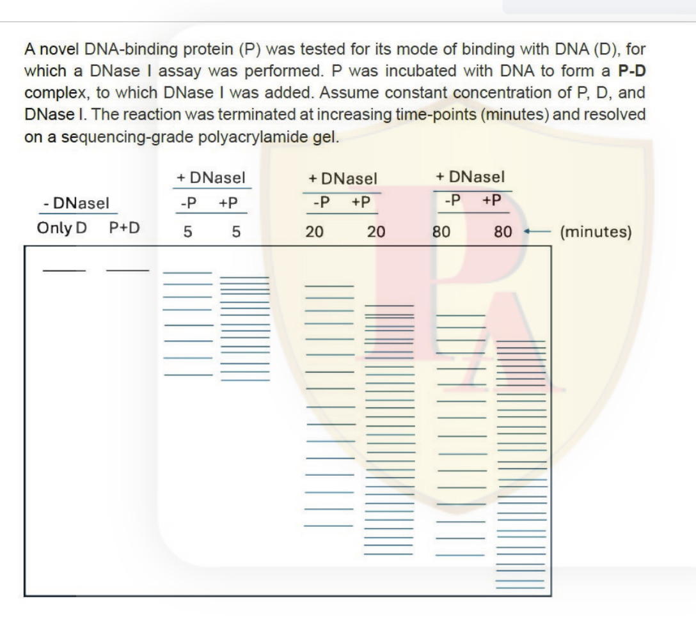

Based on the results of the DNase I digest, which one of the following options is the correct interpretation?

1. P does not bind to D, thereby generating a banding pattern of D.
2. P binds to D at a specific site, generating a banding pattern of D.
3. P binds and exposes multiple sites on D, generating a banding pattern of D.
4. P binds to only the 5' and 3' ends of D, generating a banding pattern of D.

**Answer: 3 (P binds and exposes multiple sites on D, generating a banding pattern of D.)**

> **Explanation:** Printed Question ID 835594742 → NTA final key correct option **3**. In the −DNase I lanes both P+D and Only D remain intact, so the protein alone does not cleave. With DNase I, the +P lanes develop additional bands at several positions relative to −P as digestion time increases — that is **hypersensitivity at multiple sites**, i.e. binding that exposes several cleavable sites, rather than a clean single-site footprint (option 2) or no binding (option 1).

---

### Question 91

The following statements are made about transgenic mice technologies:

A. Catalytically inactive Cas9 fused to a transcription activator can be used to activate specific gene expression.
B. Using CRISPR/Cas9, a precise gene replacement in a target locus can be accomplished by non-homologous end joining repair.
C. Using CRISPR/Cas9, many genes can be targeted at once by expressing many guide RNAs in the same cell.
D. All chimeric mice derived by injecting engineered mouse embryonic stem cells into blastocysts will carry the transgene in the germ line.
E. In the Cre-lox conditional system, the Cre recombinase is inserted into the gene to be knocked out.

Which one of the following options represents the combination of all correct statements?

1. A, C, and E
2. A and C only
3. B, D, and E
4. B and D only

**Answer: 2 (A and C only)**

> **Explanation:** Printed Question ID 835594793 → NTA final key correct option **2**. dCas9 fused to an activator is CRISPRa (A correct), and multiplexing with several sgRNAs is standard (C correct). Precise replacement needs **homology-directed** repair, not NHEJ (B wrong); germline transmission depends on the ES cells contributing to the gonads, so not all chimeras transmit (D wrong); and in Cre-lox it is **loxP** that is inserted into the gene, with Cre supplied in trans (E wrong).

---

### Question 92

The figure below is a schematic representation of the replication fork. The different proteins associated with DNA replication are marked by A, B, C, D, E, and F.

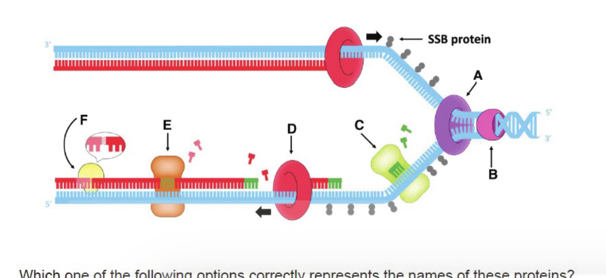

Which one of the following options correctly represents the names of these proteins?

1. A: DNA Helicase; B: DNA Gyrase; C: DNA Primase; D: DNA pol III; E: DNA pol I; F: DNA Ligase
2. A: DNA Gyrase; B: DNA Helicase; C: DNA Primase; D: DNA pol II; E: DNA pol I; F: DNA Ligase
3. A: DNA Helicase; B: DNA Gyrase; C: DNA Primase; D: DNA pol III; E: DNA pol II; F: DNA Ligase
4. A: DNA Gyrase; B: DNA Helicase; C: DNA Primase; D: DNA pol II; E: DNA pol III; F: DNA Ligase

**Answer: 1 (A: DNA Helicase; B: DNA Gyrase; C: DNA Primase; D: DNA pol III; E: DNA pol I; F: DNA Ligase)**

> **Explanation:** Printed Question ID 835594738 → NTA final key correct option **1**. A sits at the fork junction where the duplex is opened — the replicative **helicase** (DnaB); B is the enzyme acting behind/on the unreplicated duplex to relieve supercoiling, **gyrase**; C synthesises the short RNA on the lagging template, **primase** (DnaG); D is the main elongating polymerase, **pol III**; E removes the RNA primers and fills the gaps, **pol I**; and F seals the nick, **ligase**.

---

### Question 93

Panel (I) represents two alleles of a gene. The coding region of the wild type allele (*R*) is 3 Kb long while the mutant allele (*r*) has a 0.5 Kb insertion. The black box indicates insertion in the *r* allele. Three primers indicated as X, Y and Z were designed to develop PCR based DNA markers associated with the gene.

A cross was carried out between lines with the genotypes *RR* and *rr*. The F₁ progeny was selfed. Panel (II) and (III) represent the probable patterns of DNA markers observed in the F₂ progeny using different primer combinations.

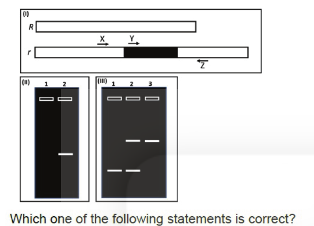

Which one of the following statements is correct?

1. Panel III represents the pattern when primers Y and Z are used for amplification.
2. Panel II is an example of a dominant DNA marker.
3. The F₂ progeny as represented in Panel II, will have 50% of the progeny showing no amplified fragment (lane 1).
4. A rare recombination event between the regions represented by primers X and Y will lead to changes in the amplification patterns observed in Panels II and III.

**Answer: 2 (Panel II is an example of a dominant DNA marker.)**

> **Explanation:** Printed Question ID 835594771 → NTA final key correct option **2**. Panel II scores only presence/absence of a band — the heterozygote cannot be distinguished from one homozygote — which is the definition of a **dominant** marker. Panel III, which shows three distinct banding classes, is the co-dominant pattern. Option 3 is wrong because a dominant marker gives 3:1, i.e. 25% without a fragment, not 50%; and option 4 misattributes the pattern to recombination between X and Y, which lie within the same amplified region.

---

### Question 94

Shown below is a Northern blot profile with five independent probes representing the transcript from a single genetic locus.

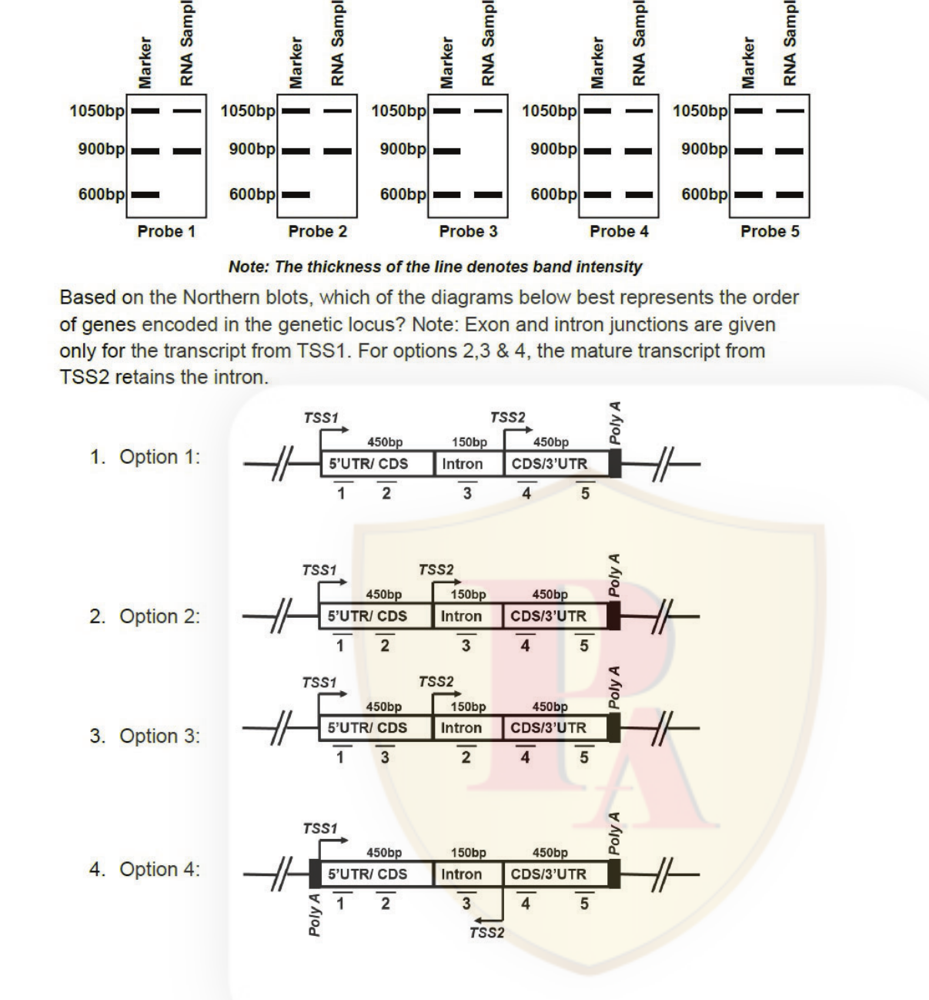

Based on the Northern blots, which of the diagrams below best represents the order of genes encoded in the genetic locus? Note: Exon and intron junctions are given only for the transcript from TSS1. For options 2,3 & 4, the mature transcript from TSS2 retains the intron.

1. Option 1:
2. Option 2:
3. Option 3:
4. Option 4:

**Answer: 2 (Option 2)**

> **Explanation:** Printed Question ID 835594743 → NTA final key correct option **2**. The five probes hybridise to bands of 1050, 900 and 600 bp in different combinations, and the band intensities (line thickness) differ between the two transcripts. Only the map in Option 2 places the probe regions 1–5 in an order consistent with both transcripts: TSS1 giving the spliced product in which the intron is removed, and TSS2 initiating within the locus so that its transcript retains the intron and therefore scores the intron-containing probe differently.

---

### Question 95

A glucose biosensor exhibits Michaelis-Menten kinetics with a maximum current response, Imax = 250 μA, and a Michaelis constant, Km = 5.2 mM. If the glucose concentration in a sample is 3.4 mM, what is the current response (I) of the biosensor?

1. 98.83 μA
2. 250 μA
3. 29.06 μA
4. 73.52 μA

**Answer: 1 (98.83 μA)**

> **Explanation:** Printed Question ID 835594797 → NTA final key correct option **1**. Applying I = Imax[S]/(Km + [S]) = 250 × 3.4 / (5.2 + 3.4) = 850 / 8.6 ≈ 98.8 μA.

---

### Question 96

The following statements are made about body temperature regulation in humans:

A. As the skin temperature falls, the hypothalamic set point for sweating decreases.
B. Acclimatization to cold activates the uncoupling protein (UCP) in mitochondria.
C. Acclimatization to heat decreases aldosterone secretion.
D. Sodium ion concentration in sweat decreases upon acclimatization to heat.
E. When the body temperature becomes high, the skin blood vessels undergo vasodilation.

Which one of the following options represents the combination of all correct statements?

1. A, B, and C
2. B, D, and E
3. B and C only
4. A, D, and E

**Answer: 2 (B, D and E)**

> **Explanation:** Printed Question ID 835594767 → NTA final key correct option **2**. Cold acclimatisation increases non-shivering thermogenesis through UCP1 (B correct); heat acclimatisation lowers the salt content of sweat (D correct) and heat loads are shed by cutaneous vasodilation (E correct). Sweating is controlled by the hypothalamic **core** temperature threshold, not by a fall in skin temperature (A wrong), and heat acclimatisation raises rather than lowers aldosterone to conserve sodium (C wrong).

---

### Question 97

The ability to unwind RNA substrates I and II by translation regulator 'X' was studied. RNA substrates with radiolabeled antisense strand (*) were incubated with purified 'X' under the conditions listed below. Subsequently, RNA species were separated by polyacrylamide gel electrophoresis (PAGE), followed by autoradiography. The results are shown below:

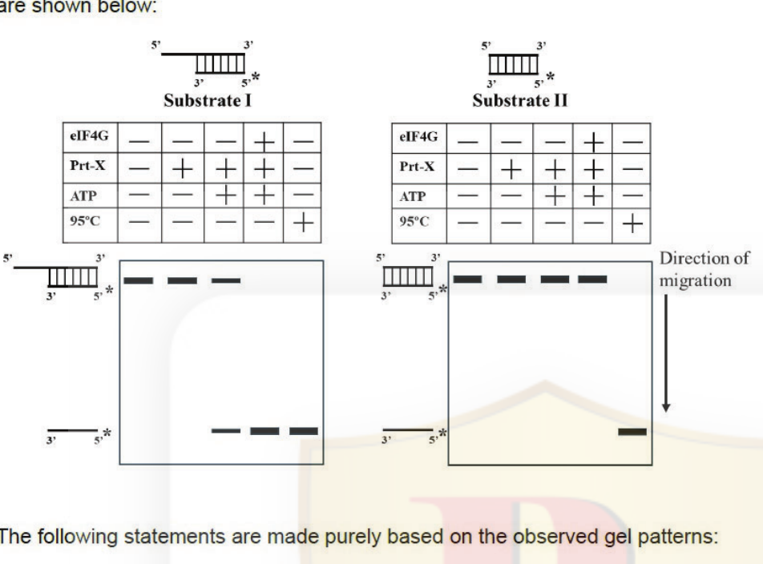

The following statements are made purely based on the observed gel patterns:

A. X unwinds substrates with a 5' overhang.
B. Substrates which can be unwound by "X" need ATP for efficient RNA unwinding.
C. X unwinding activity is enhanced by the presence of eIF4G.

Which one of the following options represents the combination of all correct statements?

1. A and B only
2. B and C only
3. A and C only
4. A, B and C

**Answer: 4 (A, B and C)**

> **Explanation:** Printed Question ID 835594740 → NTA final key correct option **4**. The duplex with the 5' overhang (substrate I) is converted to the fast-migrating single strand in the presence of protein X, whereas substrate II is not, so A is correct. Unwinding of substrate I requires ATP (no product in its absence) and is destroyed by heating at 95 °C, so B is correct. Adding eIF4G together with X increases the amount of unwound product relative to X alone, so C is correct.

---

### Question 98

Which one of the following statements best describes the function of magnetite in animal migration?

1. Magnetite crystals generate electrical signals that amplify visual landmarks that guide flight.
2. Magnetite acts as a biological compass.
3. Magnetite stores magnetic energy that provides energy for long-distance flights.
4. Magnetite emits magnetic pulses to keep the group together.

**Answer: 2 (Magnetite acts as a biological compass.)**

> **Explanation:** Printed Question ID 835594786 → NTA final key correct option **2**. Single-domain magnetite (Fe₃O₄) crystals in magnetoreceptor cells are physical torqued dipoles that align with the geomagnetic field, transducing directional information — a biological compass. They neither generate electrical amplification, store metabolic energy, nor emit pulses.

---

### Question 99

Lab-grown cells of a tumor (Wild type) expressing a novel cancer antigen, and a variant of the same tumor that has lost MHC class I expression, were injected subcutaneously into normal mice (dotted line) and into nude mice (solid line). The growth of the tumors in the two mouse strains is shown below.

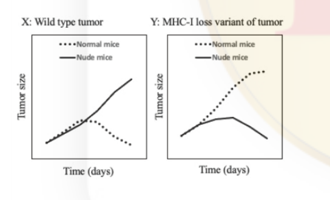

The following statements were made based on the results observed:

A. In normal mice, CTLs recognize tumor cells in the presence, but not absence, of MHC-I.
B. In nude mice, NK cells recognize tumor cells in the absence, but not in the presence, of MHC-I.
C. CTLs and NK cells inhibit each other if MHC-I is present, but not if it is absent.
D. In mice injected with tumors lacking MHC-I, antibodies generated with the help of CD4 cells restrain the growth of the tumor in nude mice.

Which one of the following options represents the combination of all correct statements?

1. A and D
2. B and C
3. A and B
4. A only

**Answer: 3 (A and B)**

> **Explanation:** Printed Question ID 835594748 → NTA final key correct option **3**. In panel X the wild-type (MHC-I⁺) tumour is controlled in normal mice but grows in nude mice — CD8 CTL killing needs MHC-I, so A is correct. In panel Y the MHC-I-loss variant grows unchecked in normal mice yet is restrained in nude mice, the classic "missing self" response carried out by NK cells, so B is correct. There is no evidence in the graphs for mutual inhibition of CTLs and NK cells (C) or for a CD4/antibody effect, which nude mice could not mount in any case (D).

---

### Question 100

Eukaryotes regulate gene expression via histone modifications. In the table given below, the histone modification (column X), its association with chromatin type (column Y), and their impact on gene expression (column Z) is listed.

| Histone modification (X) | Association with chromatin type (Y) | Gene expression (Z) |
|---|---|---|
| (A) H4K4me3 | (a) highly accessible open chromatin | (i) ON |
| (B) H3K9me3 | (b) only facultative heterochromatin | (ii) OFF |
| (C) H3K9ac | (c) both constitutive and facultative heterochromatin | |
| (D) H3K27me3 | | |

Which one of the following options correctly matches all terms in the most appropriate combination?

1. (A)-(a)-(i); (B)-(c)-(ii); (C)-(a)-(i); (D)-(b)-(ii)
2. (A)-(b)-(i); (B)-(b)-(ii); (C)-(c)-(i); (D)-(a)-(ii)
3. (A)-(c)-(ii); (B)-(a)-(i); (C)-(a)-(i); (D)-(c)-(ii)
4. (A)-(c)-(i); (B)-(a)-(ii); (C)-(a)-(ii); (D)-(b)-(i)

**Answer: — (question DROPPED by NTA)**

> **Explanation:** Printed Question ID 835594736 → the NTA **FINAL answer key marks this question as "Drop"**. It was withdrawn, no correct option is listed, and all candidates were awarded marks for it. No answer is therefore recorded here. (For reference, the biologically expected matching would be H4K4me3 → open chromatin → ON, H3K9me3 → constitutive heterochromatin → OFF, H3K9ac → open chromatin → ON, H3K27me3 → facultative heterochromatin → OFF, i.e. the pattern of option 1 — but this is reasoning, not the key's verdict.)

---

### Question 101

Given below are statements about the action of glucagon in human body:

A. It does not cause glycogenolysis in muscle.
B. It decreases ketone bodies formation in the liver.
C. It does not cause lipolysis in the liver.
D. It inhibits conversion of phosphoenolpyruvate to pyruvate in the liver.

Which one of the following options represents both correct statements?

1. A and B
2. B and C
3. C and D
4. A and D

**Answer: 4 (A and D)**

> **Explanation:** Printed Question ID 835594765 → NTA final key correct option **4**. Skeletal muscle lacks glucagon receptors, so glucagon does not cause muscle glycogenolysis (A correct). Glucagon raises blood glucose by promoting gluconeogenesis, and it does so partly by opposing the pyruvate kinase step (phosphoenolpyruvate → pyruvate), which is inhibited when the enzyme is phosphorylated under low insulin/high glucagon (D correct). Glucagon *increases* ketogenesis (B wrong) and stimulates lipid oxidation in liver (C wrong).

---

### Question 102

Interactions among 'maternal effect gene' and 'gap gene' products are crucial for establishing embryonic domains in the *Drosophila* embryo. Which one of the following options DOES NOT show the correct interactions?

Key: → Activation, ⊣ Inhibition. Bcd: Bicoid, Gt: Giant, Hb: Hunchback, Cad: Caudal, Kr: Krüppel, Kni: Knirps

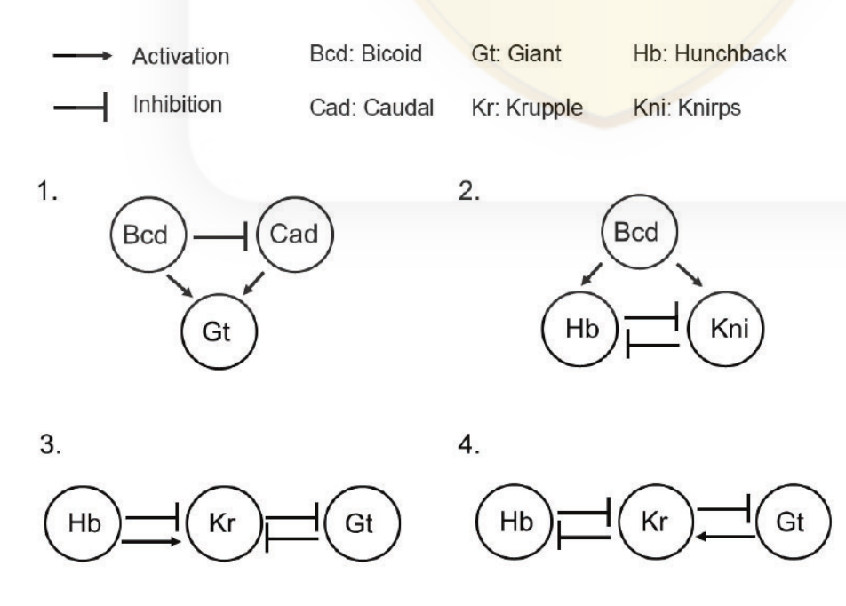

1. Diagram 1
2. Diagram 2
3. Diagram 3
4. Diagram 4

**Answer: 4 (Diagram 4)**

> **Explanation:** Printed Question ID 835594753 → NTA final key correct option **4**. The correct network is: Bcd activates *hb* and *gt* and represses *cad*; Cad represses *gt*; Hb activates *Kr*; Gt and Kr cross-repress each other; Kni represses *Kr*. Diagram 4 inverts the Hb→Kr and Gt⊣Kr relationships (showing Hb⊣Kr and Gt→Kr), which contradicts the established gap-gene cross-regulation, so option 4 is the one that does NOT show correct interactions.

---

### Question 103

Lettuce seed germination is a typical photo-reversible response controlled by phytochrome. Seeds in a petridish were exposed to Red light (R), Far-Red light (FR) or kept in the dark (black bar) according to the schedule in **Column X**. The effect on seed germination is provided in **Column Y**.

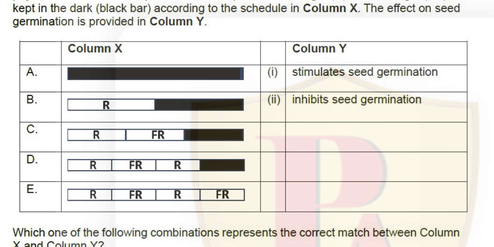

Which one of the following combinations represents the correct match between Column X and Column Y?

1. A-i, B-ii, C-i, D-ii, E-i
2. A-i, B-i, C-i, D-i, E-ii
3. A-ii, B-ii, C-ii, D-ii, E-i
4. A-ii, B-i, C-ii, D-i, E-ii

**Answer: 4 (A-ii, B-i, C-ii, D-i, E-ii)**

> **Explanation:** Printed Question ID 835594745 → NTA final key correct option **4**. The response depends only on the **last** irradiation, because phytochrome is photo-reversible: a terminal far-red pulse keeps P_fr low and germination is inhibited (ii), while a terminal red pulse generates P_fr and promotes germination (i). A ends in FR → ii; B ends in R → i; C ends in FR → ii; D ends in R → i; E ends in FR → ii.

---

### Question 104

Proteins possess a sorting signal known as a nuclear localization signal (NLS) for their import into the nucleus. A few statements are given below on the import of proteins destined for the nucleus.

A. The import receptor binds to the nuclear localization signal.
B. The import receptor contains several low-affinity binding sites for the nucleoporins.
C. The nuclear import receptor-cargo complex is dissociated by RanGDP in the nucleus.
D. The nuclear import receptor-cargo complex binds to RanGTP in the cytosol and traverses the nuclear envelope.

Which one of the following options has all the correct statements about nuclear protein import?

1. A only
2. A and B
3. B and C
4. C and D

**Answer: 2 (A and B)**

> **Explanation:** Printed Question ID 835594733 → NTA final key correct option **2**. Importins (karyopherins) do recognise the NLS (A) and they transit the nuclear pore by making multiple weak, transient contacts with the phenylalanine-glycine nucleoporins (B). Cargo release in the nucleus is driven by **RanGTP**, not RanGDP (C wrong), and RanGTP binds the receptor in the nucleus to load it for export, not in the cytosol (D wrong).

---

### Question 105

The following statements are made regarding leaf development in plants:

A. The activity of KNOX1 and ARP are mutually repressive to help establish a separate identity for emerging leaf primordium.
B. PHANTASTICA is required for adaxial cell fate during leaf development.
C. KANADI genes promote abaxial cell fate during leaf development.
D. miR166 binds to KANADI mRNA and degrades it on the abaxial side of the leaf primordium.
E. Overexpression of KNOX1 increases leaf complexity and indeterminacy.

Which one of the following options represents all correct statements?

1. A, B, C and E
2. A, C, D and E
3. A, B, C, and D
4. A, B, D and E

**Answer: 1 (A, B, C and E)**

> **Explanation:** Printed Question ID 835594754 → NTA final key correct option **1**. KNOX1 and the ARP proteins mutually repress each other so that KNOX1 is excluded from the primordium (A); PHABULOSA/PHANTASTICA HD-ZIP III factors specify adaxial identity (B); KANADI specifies abaxial identity (C); and sustained KNOX1 expression gives dissected, indeterminate leaves (E). D is wrong because **miR164**, not miR166, targets KANADI; miR166 restricts the HD-ZIP III genes to the abaxial side.

---

### Question 106

Different segments of the renal tubule (Column X) and the sodium transporter in the apical membrane of tubular cells (Column Y) are given below:

| Column X | Column Y |
|---|---|
| a. Proximal tubule | i. Na⁺ channel (ENaC) |
| b. Collecting duct | ii. Na⁺-K⁺-2Cl⁻ co-transporter |
| c. Thick ascending limb | iii. Na⁺-Cl⁻ co-transporter |
| d. Distal convoluted tubule | iv. Na⁺-amino acid co-transporter |

Which one of the following options represents the correct match between Column X and Column Y?

1. a − iv, b − i, c − ii, d - iii
2. a − ii, b − iv, c − i, d - iii
3. a − i, b − ii, c − iii, d - iv
4. a − iii, b − iv, c − i, d − ii

**Answer: 1 (a − iv, b − i, c − ii, d - iii)**

> **Explanation:** Printed Question ID 835594766 → NTA final key correct option **1**. The proximal tubule reabsorbs Na⁺ with organic solutes via Na⁺-amino acid co-transporters (iv); the thick ascending limb carries the NKCC2 Na⁺-K⁺-2Cl⁻ cotransporter (ii), the target of loop diuretics; the distal convoluted tubule carries the thiazide-sensitive Na⁺-Cl⁻ cotransporter (iii); and the collecting duct uses the amiloride-sensitive ENaC channel (i).

---

### Question 107

The Satpura Hypothesis suggests that the Satpura Range in central India acted as a bridge for the migration of Malayan taxa into peninsular India. However, empirical observations do not fully support this hypothesis. Consider the following statements made in the context of biogeographic patterns.

A. The shared characteristics of some Malayan fauna and that of peninsular India is due to convergent evolution in similar environments.
B. The said flora and fauna originated in the Indian subcontinent and then dispersed to south-east Asia ('out-of-India').
C. Vicariance biogeography split ancestral populations, leading to the diversification of species.
D. Pleistocene glaciation created conditions for the dispersal of high-altitude Himalayan taxa to the Western Ghats.

Which combination of the above statements have been proposed as alternative **explanations** for the Satpura hypothesis?

1. A, B and C
2. A, B and D
3. A and B only
4. B, C and D

**Answer: 2 (A, B and D)**

> **Explanation:** Printed Question ID 835594781 → NTA final key correct option **2**. The alternatives actually proposed against a Satpura land-bridge are: that the similarities are **convergent** adaptations to comparable environments (A); that the direction of movement was **'out-of-India'** rather than in (B); and that the shared elements are relict **Himalayan–Western Ghats** distributions explained by Pleistocene climatic shifts (D). Generic vicariance (C) is a mode of speciation, not one of the specific competing explanations for this pattern.

---

### Question 108

Izumo and Juno are two proteins that are expressed in sperm and egg, respectively and play critical roles in mediating interactions between them. The following experiments were carried out with Izumo and Juno:

A. Sperm from a male mouse, where Izumo has been knocked out, could not fertilize eggs from a normal female.
B. Two independent kidney cell lines were developed, one expressing Izumo and the other expressing Juno. If the two cells are mixed, the cells will tend to aggregate with each other.
C. Whole mount immunostaining for Izumo and Juno indicated specific staining on the sperm and egg, respectively.

Which one of the following options lists experiment(s) that demonstrate(s) interactions between Izumo and Juno?

1. A only
2. B only
3. A and C
4. C only

**Answer: 2 (B only)**

> **Explanation:** Printed Question ID 835594750 → NTA final key correct option **2**. Only the heterologous cell-aggregation assay (B) actually demonstrates that the two molecules **bind each other**: cells engineered to express one protein adhere to cells expressing the other. The Izumo-knockout fertilisation failure (A) shows the protein is required for fertilisation, and immunostaining (C) only localises each protein — neither establishes a physical interaction between the pair.

---

### Question 109

A canonical Watson-Crick G:C base pair is stabilized by three hydrogen bonds formed between a donor (+0.25e) and acceptor (−0.35e) atom located at a distance r = 2.9 Å. Assume that the dielectric constant 'D' in the DNA core is 4, and in water is 78.5. Which one of the following options correctly represents the total difference in electrostatic interaction energy for all 3 hydrogen bonds when buried in the DNA core versus fully exposed to solvent? (Modified Coulomb's constant, k = 1389 kJ·mol⁻¹·nm·e⁻²)

1. −298.3 kJ/mol
2. −104.7 kJ/mol
3. −99.4 kJ/mol
4. −5.338 kJ/mol

**Answer: 1 (−298.3 kJ/mol)**

> **Explanation:** Printed Question ID 835594727 → NTA final key correct option **1**. Using E = k·q₁q₂/(D·r) with q₁q₂ = (0.25)(−0.35) = −0.0875 e², r = 2.9 Å = 0.29 nm and k = 1389 kJ·mol⁻¹·nm·e⁻²:
> - buried in the core (D = 4): E = 1389 × (−0.0875)/(4 × 0.29) = **−104.7 kJ/mol** per bond
> - exposed to water (D = 78.5): E = 1389 × (−0.0875)/(78.5 × 0.29) = **−5.338 kJ/mol** per bond
> - difference per bond = −104.7 − (−5.338) = **−99.4 kJ/mol**
>
> For all three hydrogen bonds of the G:C pair: 3 × (−99.4) = **−298.3 kJ/mol**. The distractors are exactly the intermediate values — −104.7 (option 2, one bond in core), −99.4 (option 3, one bond's difference) and −5.338 (option 4, one bond in water) — so only option 1 answers the question as asked.

---

### Question 110

Male crickets call at dusk when the light intensity falls below a certain level. A researcher kept these insects in the laboratory under two light regimes: i) constant light condition for 24 hours (LL) and ii) 12 hours Light and 12 hours Dark cycle (LD). The calling activity pattern of the crickets in these two regimes across all experimental days is represented in the figure below.

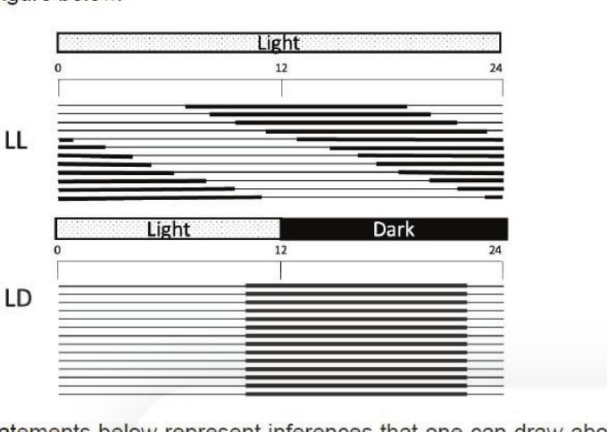

The statements below represent inferences that one can draw about circadian control of calling activity in these animals.

A. Calling activity under LL represents free-running cycle and LD represents entrained cycle.
B. Calling activity under LL represents entrained cycle and LD represents free-running cycle.
C. The circadian control of calling activity is endogenous only.
D. The circadian control of calling activity is exogenous only.
E. The circadian control of calling activity has both endogenous and exogenous components.

Which one of the following options gives all correct statements about the inferences we can draw from this experiment?

1. A and C
2. B and C
3. B and D
4. A and E

**Answer: 4 (A and E)**

> **Explanation:** Printed Question ID 835594789 → NTA final key correct option **4**. Under constant light the activity band drifts each day, which is the definition of a **free-running** rhythm; under an LD cycle it locks to the lights-off transition, i.e. it is **entrained** — so A is right and B reverses them. The rhythm persists without cues (endogenous) yet is reset by light (exogenous input), so E is right and the "only" statements C and D are wrong.

---

### Question 111

Given below are a few statements related to genetics and linkage mapping in plants.

A. Near Isogenic Lines are immortal populations.
B. The physical distance between two polymorphic markers is not linearly related to their genetic distance.
C. QTLs identified for a particular phenotype or trait of interest always contribute equally to the trait value.
D. Association mapping is performed using unrelated individuals of the same population.

Which one of the following options correctly describes the above statements as "True" or "False"?

1. A: True; B: False; C: True; D: False
2. A: False; B: True; C: False; D: False
3. A: True; B: True; C: False: D: True
4. A: False; B: False; C: True; D: True

**Answer: 3 (A: True; B: True; C: False: D: True)**

> **Explanation:** Printed Question ID 835594773 → NTA final key correct option **3**. NILs are maintained by repeated selfing/backcrossing and are indeed permanent ("immortal") mapping populations (A True). Physical and genetic map distances are not linearly related because recombination is uneven, with hotspots and centromeric suppression (B True). QTL effects are highly unequal, so C is False. Association mapping (linkage-disequilibrium mapping) uses a panel of unrelated individuals (D True).

---

### Question 112

Two samples were run on a flow cytometer and the data were plotted as histograms A and B, as shown below.

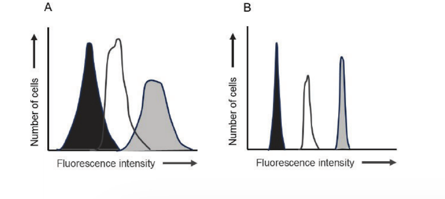

The following statements were made:

A. Figure A represents three normal distributions with more variation within groups than between groups.
B. Figure B represents three normal distributions with more variation between groups than within groups.
C. The ANOVA-F test is likely to be statistically significant when applied to Figure B, but not to Figure A.

Which one of the following options represents the combination of all correct statements?

1. A only
2. A and B only
3. B and C only
4. A, B and C

**Answer: 4 (A, B and C)**

> **Explanation:** Printed Question ID 835594792 → NTA final key correct option **4**. In A the peaks are broad and overlap heavily, so within-group spread exceeds the separation of the means (A correct); in B the peaks are narrow and far apart, so between-group variation dominates (B correct). Since F = between-group variance / within-group variance, F is large and significant for B but small for A (C correct).

---

### Question 113

In a successional chronosequence (30 – 400 years) on a sand dune, *Ammophila* dune grass dominates the youngest dunes, the prairie bunch grass *Schizachrium* dominates at 60 years, followed by *Pinus* species at later stages. Experimental seed additions were done to study seedling emergence (as a proportion of viable seeds) of all species on all the dunes (Panel 1). In addition, the effect of seed predation on seedling emergence (across dune ages) was also tested (Panel 2). The following figure presents results on seedling emergence.

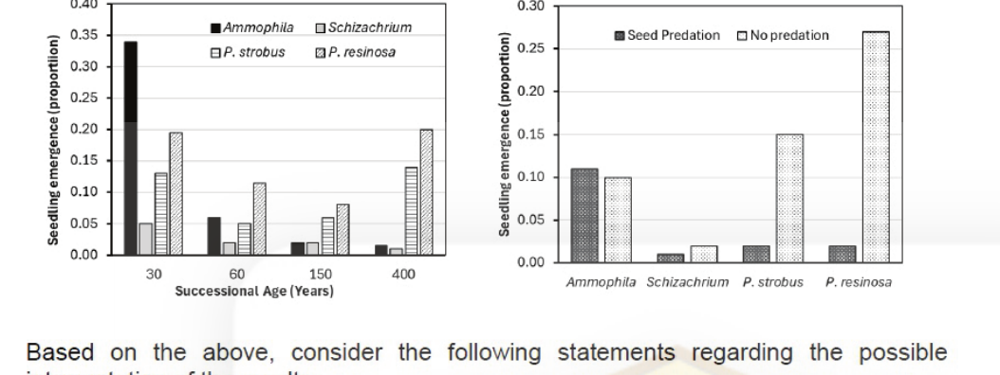

Based on the above, consider the following statements regarding the possible interpretation of the results.

A. Late successional species can establish on younger dunes but may be limited by seed dispersal.
B. Seed predation reduces the establishment of late successional species on younger dunes.
C. Facilitation has stronger influence than colonization or seed predation on successional change.
D. Late successional species cannot establish on younger dunes because of the sandy substrate.

Which combination of the above statements represents valid inference that can be drawn purely from the data presented above?

1. A and B only
2. A, B and C
3. B, C and D
4. B and C only

**Answer: 1 (A and B only)**

> **Explanation:** Printed Question ID 835594785 → NTA final key correct option **1**. Panel 1 shows that when seeds are experimentally added, the late-successional *Schizachrium* and *Pinus* do emerge on young (30-year) dunes, so they are dispersal-limited rather than substrate-limited (A true, D false). Panel 2 shows their emergence collapses when seed predation is allowed (B true). Nothing in these two panels tests facilitation, so C cannot be inferred from the data alone.

---

### Question 114

The following figure shows the decomposition of selected plant litter constituents.

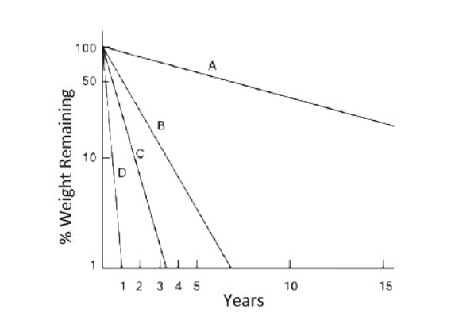

In the above, the correct identities of the symbols A, B, C and D are:

1. A-Lignin, B-Phenols, C-Sugars, D-Cellulose
2. A-Phenols, B-Lignin, C-Cellulose, D-Sugars
3. A-Cellulose, B-Lignin, C-Sugars, D-Phenols
4. A-Cellulose, B-Phenols, C-Lignin, D-Sugars

**Answer: 2 (A-Phenols, B-Lignin, C-Cellulose, D-Sugars)**

> **Explanation:** Printed Question ID 835594780 → NTA final key correct option **2**. Decomposition proceeds from the most labile to the most recalcitrant fraction. Curve D vanishes within about a year, matching soluble **sugars**; C persists a little longer, matching **cellulose**; B decays over several years, matching **lignin**; and A, which still retains most of its mass at 15 years, is the most resistant fraction, **phenols**/lignin-like compounds.

---

### Question 115

Match the animal phyla/classes (Column X) with their defining set of characteristics (Column Y).

| Column X | Column Y |
|---|---|
| A. Phylum Platyhelminthes | i. Bilateral symmetry, pseudocoelomate, complete digestive tract, often microscopic with a corona of cilia. |
| B. Phylum Annelida | ii. Radial symmetry (often pentamerous as adults), water vascular system, exclusively marine, deuterostomes. |
| C. Class Insecta | iii. Bilateral symmetry, acoelomate, triploblastic, usually with a flattened body and an incomplete digestive tract (if present). |
| D. Phylum Echinodermata | iv. Segmented body (metamerism) with a true coelom, chitinous chaetae (typically), closed circulatory system. |
| | v. Exoskeleton of chitin, three main body parts (head, thorax, abdomen), six legs, usually with wings in the adult stage. |

1. A-iii, B-iv, C-v, D-ii
2. A-i, B-iv, C-v, D-ii
3. A-iii, B-i, C-v, D-iv
4. A-v, B-ii, C-iii, D-i

**Answer: 1 (A-iii, B-iv, C-v, D-ii)**

> **Explanation:** Printed Question ID 835594776 → NTA final key correct option **1**. Flatworms are acoelomate bilaterians with an incomplete gut (iii); annelids are metamerically segmented with a true coelom and chaetae (iv); insects have a chitinous exoskeleton, three tagmata and six legs (v); echinoderms are pentamerous deuterostomes with a water vascular system (ii). Option i describes rotifers, which is not in Column X.

---

### Question 116

Given below are certain plant diseases and the pathogens responsible.

| Disease | Pathogen Type |
|---|---|
| A. Panama disease of Banana | i. Bacterial |
| B. Red ring disease of Coconut | ii. Fungal |
| C. Malformation of Mango | iii. Nematode |
| D. Citrus Canker | iv. Viral |

Which one of the following options correctly matches the disease with its pathogen?

1. A-(iv), B-(iii), C-(i), D-(ii)
2. A-(ii), B-(i), C-(iv), D-(i)
3. A-(ii), B-(iii), C-(ii), D-(i)
4. A-(iii), B-(iii), C-(i), D-(iv)

**Answer: 3 (A-(ii), B-(iii), C-(ii), D-(i))**

> **Explanation:** Printed Question ID 835594778 → NTA final key correct option **3**. Panama disease is caused by the fungus *Fusarium* oxysporum f.sp. *cubense* (ii); red ring disease of coconut is caused by the nematode *Rhadinaphelenchus cocophilus* (iii); citrus canker is bacterial, *Xanthomonas citri* (i). Option 3 is the only choice that places Panama as fungal and citrus canker as bacterial, and the key accepts it.

---

### Question 117

Human prostate cancer cells expressing urokinase Plasminogen Activator (uPA) readily metastasize when injected into experimental animals. A scientist genetically modified prostate cancer cells and injected them into experimental animals. The possible observations are listed below:

A. Overexpressing a mutant version of the uPA protein that does not bind to its receptor led to tumour formation but reduced metastasis.
B. Overexpressing a mutant version of the uPA protein that does not bind to its receptor led to enhanced tumour formation as well as metastasis.
C. Overexpressing a secreted version of the uPA receptor led to tumour formation but reduced metastasis.
D. Overexpressing a secreted version of the uPA receptor reduced tumour formation as well as metastasis.

Which of the following options represents the combination of all correct observations?

1. A and C
2. B and D
3. A and D
4. B and C

**Answer: 1 (A and C)**

> **Explanation:** Printed Question ID 835594747 → NTA final key correct option **1**. Tumour growth does not require uPA–uPAR engagement, but metastatic invasion does, because receptor binding localises and activates uPA at the cell surface. A catalytically normal uPA that cannot bind uPAR therefore still forms a tumour but metastasises poorly (A correct, B wrong). A **secreted** uPAR acts as a decoy, mopping up uPA away from the surface, again permitting the primary tumour while blocking invasion (C correct, D wrong).

---

### Question 118

Which one of the following matrices represents the correct choice regarding the two types of errors made in statistical hypothesis testing? H₀ = Null hypothesis.

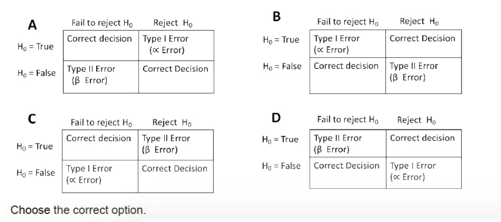

Choose the correct option.

1. B
2. A
3. D
4. C

**Answer: 2 (A)**

> **Explanation:** Printed Question ID 835594799 → NTA final key correct option **2**, i.e. matrix **A**. The definition is: rejecting a true H₀ is a Type I (α) error, and failing to reject a false H₀ is a Type II (β) error; the other two cells are correct decisions. Matrix A places Correct decision at (H₀ True, Fail to reject), Type I at (H₀ True, Reject), Type II at (H₀ False, Fail to reject) and Correct Decision at (H₀ False, Reject). Note that the *option number* 2 corresponds to matrix A — the options are deliberately scrambled.

---

### Question 119

A transformation experiment is performed with two Pneumococcal strains. One strain is resistant to four drugs - A, B, C, and D, whereas the other is sensitive to all the drugs. Both strains are mixed and the mixture is plated on media containing various combinations of the drugs. The colonies obtained on these plates are given below:

| Drugs added | No. of colonies | Drugs added | No. of colonies |
|---|---|---|---|
| A | 1156 | CD | 786 |
| B | 1148 | ABC | 30 |
| C | 1161 | ABD | 42 |
| D | 1139 | ACD | 630 |
| AB | 46 | BCD | 36 |
| AC | 640 | ABCD | 30 |
| AD | 942 | | |
| BC | 51 | | |

Based on the above results, which one of the below options represents the most likely order of the drug-resistance genes?

1. A-B-C-D
2. A-C-B-D
3. A-D-C-B
4. A-D-B-C

**Answer: 3 (A-D-C-B)**

> **Explanation:** Printed Question ID 835594768 → NTA final key correct option **3**. In cotransformation, a high colony count means the two markers are close enough to be carried on one DNA fragment, while a sharp drop means they are far apart. A with D (942) is the tightest pair, D with C (630, from ACD = 630) next, and any pair involving B collapses (AB = 46, BC = 51, ABD = 42), placing B at the far end. The order is therefore **A – D – C – B**.

---

### Question 120

The below pedigree shows the inheritance pattern of gene X. A loss of function mutation of the gene leads to a disorder in adults. Further, gene X is imprinted leading to its inactivation. Individuals who carry the mutant allele are marked with a dot, while individuals who show the disorder are shaded.

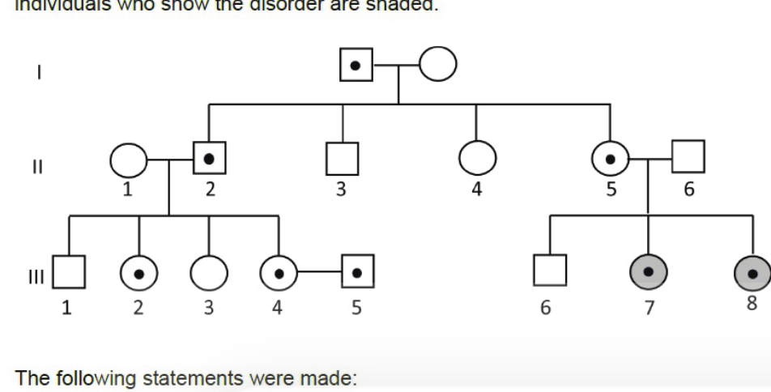

The following statements were made:

A. Gene X is maternally imprinted.
B. Individual III.6 carries an imprinted allele.
C. If individuals III.4 and III.5 have a child, the probability that it will carry at least one mutant allele is 0.75.
D. If individuals III.4 and III.5 have a child, the probability that it will show the disorder is 0.75.

Which one of the following options represents all correct statements?

1. A and C
2. A and D
3. B and C
4. B and D

**Answer: 3 (B and C)**

> **Explanation:** Printed Question ID 835594772 → NTA final key correct option **3**. Affected individuals III.7 and III.8 inherited their mutant allele from their **father** (II.6, undotted/unaffected), which means the maternally contributed copy is the silenced one — so the statements that follow from the pedigree are that the paternal allele is expressed and individual III.6, whose mother carries the allele but who is unaffected, has received the imprinted (silenced) maternal copy (B). For III.4 × III.5, both heterozygous, the chance of at least one mutant allele in the child is 1 − ¼ = 0.75 (C).

---

### Question 121

The table below presents the energy transfer values for various activities exhibited by three herbivores inhabiting a grassland with a net primary productivity (NPP) of 10000 kJ/m²/year.

| Herbivore | Activity Energy Value (kJ/m²/year) | | |
|---|---|---|---|
| | Ingestion | Egestion | Respiration |
| A | 4000 | 2000 | 1000 |
| B | 6000 | 3000 | 1000 |
| C | 8000 | 6000 | 1000 |

Based on the information provided, which one of the following options is NOT correct?

1. C has the highest consumption efficiency but the lowest assimilation efficiency.
2. B has the highest consumption efficiency, but C has the highest assimilation efficiency.
3. A and B have the highest assimilation efficiencies.
4. A has the lowest consumption efficiency.

**Answer: 2 (B has the highest consumption efficiency, but C has the highest assimilation efficiency.)**

> **Explanation:** Printed Question ID 835594784 → NTA final key correct option **2**. Consumption efficiency = ingestion/NPP: A = 40%, B = 60%, C = 80%, so **C** is highest and A lowest (statements 1's first clause and 4 are true). Assimilation efficiency = (ingestion − egestion)/ingestion: A = 2000/4000 = 50%, B = 3000/6000 = 50%, C = 2000/8000 = 25%, so **A and B** are highest and C lowest (statement 3 true, 1's second clause true). Statement 2 is false on both counts — B is not the highest consumer, and C has the *lowest* assimilation efficiency — which is what the question asks for.

---

### Question 122

Given below are names of techniques (Column X) and their characteristic features measured for molecular characterization (Column Y).

| Column X | Column Y |
|---|---|
| A. X-ray crystallography | i. Fluorescence |
| B NMR spectroscopy | ii. Polarization |
| C. Raman spectroscopy | iii. Diffraction |
| D. CD spectroscopy | iv. Wave number |
| E. Colorimetry | v. Chemical shift |
| | vi. Ellipticity |
| | vii Absorbance |

Which one of the following options represents all correct matches between Column X and Column Y?

1. A (iii) B (v) C (iv) D (vi) E (vii)
2. A (ii) B (iii) C (i) D (vii) E (vii)
3. A (v) B (iv) C (iii) D (ii) E (i)
4. A (iii) B (i) C (ii) D (vi) E (iv)

**Answer: 1 (A (iii) B (v) C (iv) D (vi) E (vii))**

> **Explanation:** Printed Question ID 835594798 → NTA final key correct option **1**. X-ray crystallography measures **diffraction** (iii); NMR reports **chemical shift** (v); Raman spectra are plotted in **wave number** (iv); circular dichroism measures **ellipticity** (vi); and colorimetry is read as **absorbance** (vii).

---

### Question 123

The following statements are made about the subcellular localization of steroid synthesizing enzymes in adrenal cortical cells.

A. 3β-Hydroxysteroid dehydrogenase is present in mitochondria.
B. 17α-Hydroxylase is present in the smooth endoplasmic reticulum.
C. 11β-Hydroxylase is present in mitochondria.
D. 21β-Hydroxylase is present in smooth endoplasmic reticulum.

Which one of the following options represents both correct statements?

1. A and B
2. B and C
3. C and D
4. A and D

**Answer: 2 or 3**

> **Explanation:** Printed Question ID 835594764 → the NTA FINAL answer key records this question as accepting **either option 2 or option 3** ("2 or 3"). Statements B and C are certainly correct: the 17α-hydroxylase (CYP17) is a smooth-ER cytochrome P450, while 11β-hydroxylase (CYP11B1) is mitochondrial inner-membrane. Statements A and D are the ER-membrane enzymes 3β-HSD and 21-hydroxylase (CYP21A2), which are in fact smooth-ER, not mitochondrial — so on a strict reading option 2 is the answer, and the key additionally credits option 3. Candidates answering either 2 or 3 were awarded the mark.

---

### Question 124

Which one of the following options correctly represents mass extinction events in increasing order of percentage loss of species?

1. Triassic, Devonian, Ordovician, Permian
2. Permian, Triassic, Devonian, Ordovician
3. Devonian, Triassic, Ordovician, Permian
4. Permian, Ordovician, Triassic, Devonian

**Answer: 3 (Devonian, Triassic, Ordovician, Permian)**

> **Explanation:** Printed Question ID 835594791 → NTA final key correct option **3**. The accepted marine-genus losses are roughly Devonian (Late) ~19%, Triassic (end) ~20–23%, Ordovician–Silurian (end-Ordovician) ~25–27%, and Permian (end-Permian, the greatest) ~50–57%. Arranged from smallest to largest loss this gives **Devonian < Triassic < Ordovician < Permian**. The Permian must be last, which excludes options 2 and 4, and option 1 begins with the Triassic, which is not the smallest.

---

### Question 125

In early amphibian development, the ectodermal cells with BMP4 activity leads to epidermal ectoderm fate. If cells lack BMP4 activity, they take up a fate of neural ectoderm. BMP inhibitors like noggin dorsalize the ectodermal cells and give rise to neural ectoderm.

The following statements are made with reference to the above:

A. The default fate of the ectoderm is to become neural tissue.
B. Noggin mRNA will be depleted in lithium chloride treated gastrula.
C. Injection of *noggin* mRNA into UV-radiated embryos at 1-cell stage rescued dorsal development.

Which one of the following options represents a combination of all correct statements?

1. A only
2. B only
3. A and C
4. B and C

**Answer: 3 (A and C)**

> **Explanation:** Printed Question ID 835594755 → NTA final key correct option **3**. Because ectoderm becomes neural unless BMP4 signals it to become epidermis, the **default** ectodermal fate is neural (A correct, the classic Spradling/Towle–Gurdon result). Noggin is a dorsalising factor, so injecting its mRNA rescues dorsal structures in UV-ventralised embryos (C correct). Lithium chloride ventralises by mimicking Wnt signalling and does not deplete noggin mRNA, so B is wrong.

---

### Question 126

The table below lists insect sensory structures (Column X) with their function (Column Y).

| Column X | Column Y |
|---|---|
| A Dorsal rim area | i Learning and memory |
| B Mushroom body | ii Polarisation vision |
| C Antennal lobe | iii Motor control |
| D Central complex | iv Mechanosensation |

Which one of the following options correctly matches column X and column Y?

1. A-iii B-iv C-i D-ii
2. A-i B-iii C-ii D-iv
3. A-iv B-ii C-iii D-i
4. A-ii B-i C-iv D-iii

**Answer: 4 (A-ii B-i C-iv D-iii)**

> **Explanation:** Printed Question ID 835594787 → NTA final key correct option **4**. The **dorsal rim area** of the locust optic lobe processes sky-polarisation cues used in compass navigation (ii); the **mushroom bodies** are the centres of olfactory learning and memory (i); the **antennal lobe** is the first relay of antennal mechanosensory input (iv); and the **central complex** governs oriented movement and motor control (iii).

---

### Question 127

Given below are four niche-oriented models proposed to explain species-abundance distributions in ecological communities.

A. The *dominance-preemption* model involves successive species preempting a dominant portion (50% or more) of the remaining niche-space.
B. In the *random fraction* model, successive species invade and take over an arbitrary portion of the niche space of any species previously present. Here, irrespective of their dominance status, all species are subjected to niche division with equal probability.
C. The *MacArthur fraction* model assumes that larger niches are *more likely* to be invaded by new species.
D. The *dominance-decay* model postulates that the largest niche in an existing assemblage is *always* subject to a subsequent (random) division.

Assuming a process of community assembly that involves successive species invading and establishing in the community, what would be the correct order of *evenness* in community structure produced by these mechanisms?

1. A > B > C > D
2. A < B < C < D
3. B > C > D > A
4. D > B > A > C

**Answer: 2 (A < B < C < D)**

> **Explanation:** Printed Question ID 835594782 → NTA final key correct option **2**. Dominance-preemption (A) always gives the incumbent species at least half the remaining space, so it produces the most **uneven** communities. The random-fraction model (B) divides niches without regard to dominance, giving greater evenness. MacArthur's fraction model (C) preferentially subdivides the largest niches, which flattens the distribution further. The dominance-decay model (D) always attacks the single largest niche, producing the most even distribution of all. Hence A < B < C < D.

---

### Question 128

A polymerase chain reaction (PCR) with all necessary reagents was carried out to amplify a 200 bp target region of a human Y chromosome. PCR was started with 100 copies of double stranded DNA (ds DNA) as template.

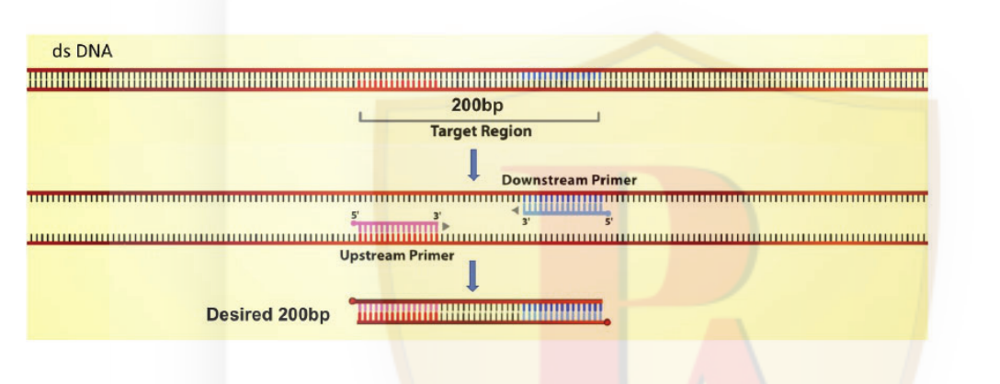

Assuming 100% PCR efficiency, how many copies of the desired 200bp fragment consisting of ONLY the target region would be produced at the end of the third PCR cycle?

1. 100
2. 200
3. 1000000
4. 0

**Answer: 2 (200)**

> **Explanation:** Printed Question ID 835594800 → NTA final key correct option **2**. Only molecules in which **both** strands are defined by the two primers count as "only the target region". After cycle 1 every product is long-on-one-strand; after cycle 2 such molecules appear; the number of short–short duplexes reaches 2ⁿ − 2n per original template, i.e. 2³ − 2×3 = 2 per template molecule at the end of cycle 3. With 100 starting duplexes that is 100 × 2 = **200** copies.

---

### Question 129

Given below are thermal melting curves for proteins A, P, Q and R. The X-axis denotes temperature, while the Y-axis indicates the concentration of unfolded protein.

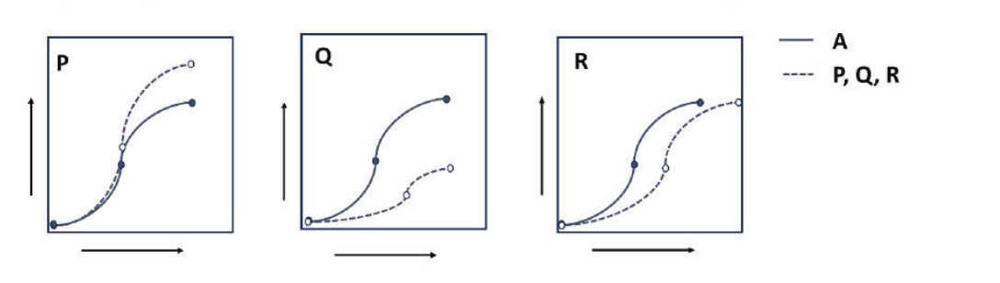

Which one of the following options is true regarding comparative thermostability of protein A with respect to P, Q and R?

1. A < P; A > Q; A > R
2. A < P; A > Q; A = R
3. A ~ P; A < Q; A < R
4. A ~ P; A < Q; A > R

**Answer: 3 (A ~ P; A < Q; A < R)**

> **Explanation:** Printed Question ID 835594730 → NTA final key correct option **3**. The midpoint of each transition is the melting temperature T_m, and a curve shifted to higher temperature means greater thermostability. In panel P the two curves superimpose, so A ~ P. In panels Q and R the dashed curve is displaced to the right of A's, so Q and R both melt at higher temperature than A: A < Q and A < R.

---

### Question 130

A child injures his toe, which then becomes infected with *Staphylococcus aureus*. The following statements are made about the events that follow over the course of a week:

A. The pathogen is conveyed to draining lymph nodes by macrophages.
B. Danger signals are conveyed to high endothelial venules of draining lymph nodes through the fibroblastic reticular conduit system.
C. Naïve B cells and T cells enter draining lymph nodes from high endothelial venules by a process that is initiated by ICAM-1-mediated rolling.
D. Naïve B cells exit circulation at the site of injury and undergo clonal expansion in response to bacterial LPS.

Which one of the following options represents the combination of all correct statements?

1. A and B only
2. A and C only
3. B and D only
4. A, C and D

**Answer: 1 (A and B only)**

> **Explanation:** Printed Question ID 835594749 → NTA final key correct option **1**. Antigen and pathogens are carried to the draining node by migratory dendritic cells and macrophages (A), and danger signals reach the high endothelial venules through the fibroblastic reticular conduit system (B). Lymphocyte extravasation through HEVs is initiated by **selectin**-mediated rolling, not ICAM-1 (C wrong — ICAM-1 mediates firm adhesion). Naïve B cells do not leave the circulation at a wound to expand there; priming occurs in the lymph node (D wrong), and *S. aureus* is Gram-positive and lacks LPS in any case.

---

### Question 131

Shown below is a hypothetical metabolic pathway leading to the production of lignin metabolite, and the three pathway enzymes (X, Y and Z), of which Z is regulated by feedback inhibition.

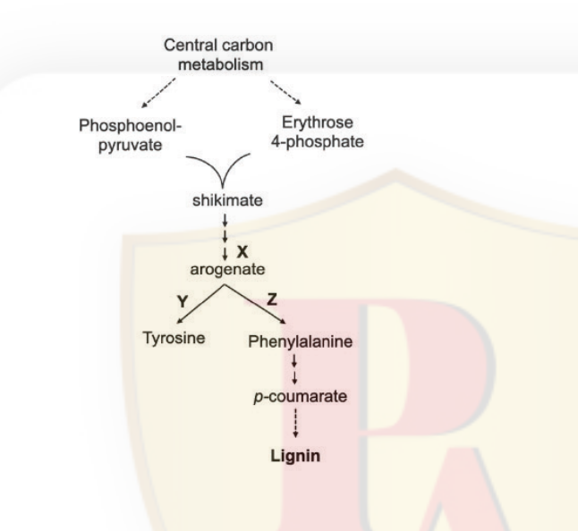

Which one of the following strategies will lead to the generation of plants with the highest level of lignin?

1. Overexpression of the genes expressing enzyme X.
2. Knockout of the gene expressing enzyme Y.
3. Overexpression of the genes expressing enzymes X and Z.
4. Overexpression of gene expressing enzyme X and knockout of gene expressing enzyme Y.

**Answer: 4 (Overexpression of gene expressing enzyme X and knockout of gene expressing enzyme Y.)**

> **Explanation:** Printed Question ID 835594760 → NTA final key correct option **4**. Flux to lignin runs through phenylalanine, so two things must be maximised: supply of the common precursor arogenate (raise enzyme X) and partitioning of arogenate away from tyrosine towards phenylalanine (remove the competing branch by knocking out enzyme Y). Because enzyme Z is feedback-inhibited, simply overexpressing it (option 3) would not relieve the bottleneck, whereas deleting the competing Y branch channels carbon into the lignin route.

---

### Question 132

The table below describes the effect of various antibiotics on protein translation in bacteria.

| Column X Antibiotic | Column Y Mechanism of action |
|---|---|
| A. Erythromycin | i. Binds to 23S rRNA in the 50S subunit of the ribosome |
| B Chloramphenicol | ii. Binds to 50S ribosomal subunit and inhibits elongation of peptide chain |
| C. Tetracycline | iii. Binds to 30S ribosomal subunit interfering with binding of aminoacyl tRNA |
| D. Streptomycin | iv. Binds to 16S rRNA in the 30S subunit of the ribosome |

Which one of the following options represents all correct matches between Column X and Column Y?

1. A - (i) B - (ii) C - (iii) D - (iv)
2. A - (i) B - (iii) C - (ii) D - (iv)
3. A - (iii) B - (i) C - (ii) D - (iv)
4. A - (ii) B - (iii) C - (iv) D - (i)

**Answer: 1 (A - (i) B - (ii) C - (iii) D - (iv))**

> **Explanation:** Printed Question ID 835594735 → NTA final key correct option **1**. Erythromycin binds the 23S rRNA of the 50S subunit (i); chloramphenicol binds the 50S subunit and blocks peptidyl transferase/elongation (ii); tetracycline binds the 30S subunit and blocks aminoacyl-tRNA attachment (iii); streptomycin binds 16S rRNA in the 30S subunit and causes misreading (iv).

---

### Question 133

Caterpillars produce defensive vibrations that travel through plant stems to deter its predators. The table below summarises data collected from three plant species, including vibration amplitude measured 10 cm from the caterpillar, predator response time, and the Young's modulus of the stem.

| Plant Species | Vibration Amplitude (μm) | Latency to attack (sec) | Young's modulus (MPa) |
|---|---|---|---|
| A | 2.3 | 3.0 | 250 |
| B | 1.8 | 2.1 | 110 |
| C | 0.7 | 1.3 | 45 |

Choose the option that correctly provides a mechanistic explanation for the data presented in the above table.

1. A is a herbaceous plant and its stem dissipates energy faster compared to B and C which are woody plants.
2. C is a woody plant, and predators detect vibrations on it more easily compared to A and B which are herbaceous plants.
3. Predators are more inefficient on herbaceous plant species A and B, and more efficient on woody plant species C.
4. C is an herbaceous plant and its stem is more likely to transmit vibrations more effectively when compared to plant species A and B which are woody.

**Answer: 4 (C is an herbaceous plant and its stem is more likely to transmit vibrations more effectively when compared to plant species A and B which are woody.)**

> **Explanation:** Printed Question ID 835594788 → NTA final key correct option **4**. Young's modulus falls from 250 (A) to 45 MPa (C), so A and B are the stiff, woody stems and C the compliant herbaceous one. Although the measured amplitude at 10 cm is smallest for C, the predator latency is *shortest* for C (1.3 s vs 3.0 s), meaning the signal actually reaches the predator most effectively in the low-modulus herbaceous stem — woody, high-modulus stems damp the vibration. Option 4 states this correctly; options 1–3 misassign which species are woody.

---

### Question 134

An alpha helix formed by 30 residues is stabilized by 25 backbone hydrogen bonds in its folded state. Assume that the average energy of a hydrogen bond is ~10 kJ/mol, and the disruption in the peptide resonance causes a partial loss of 205 kJ/mol per peptide bond. Assume that the folding and unfolding process only changes peptide resonance stabilization partially and the loss of hydrogen bonding upon unfolding (ignore side-chain interactions and entropy losses). Which one of the following options represents the correct magnitude of the net energetic difference between the folded and unfolded state of the helix?

1. 6195 kJ/mol
2. 5945 kJ/mol
3. 250 kJ/mol
4. 5695 kJ/mol

**Answer: 1 (6195 kJ/mol)**

> **Explanation:** Printed Question ID 835594731 → NTA final key correct option **1**. The unfolded state loses the 25 hydrogen bonds (25 × 10 = 250 kJ/mol) and additionally pays the peptide-resonance penalty of 205 kJ/mol per peptide bond. With 30 residues there are 29 peptide bonds: 29 × 205 = 5945 kJ/mol, plus the 250 kJ/mol of lost hydrogen bonding, giving 5945 + 250 = **6195 kJ/mol**. (5945 and 250 are the intermediate terms offered as distractors in options 2 and 3.)

---

### Question 135

The following statements are related to different signaling pathways involved in tetrapod limb development.

A. Shh released by the ZPA inhibits Fgf8 signaling in the AER.
B. FGFs released by the AER activate Shh expression in the ZPA.
C. Wnt7a expression in the dorsal ectoderm plays a role in limiting Shh expression in the ZPA.
D. Overactivation of Wnt signaling in the ventral ectoderm causes an overgrowth of AER and formation of extra digits.

Which one of the following options represent all correct statements?

1. A, B, and C
2. A and D only
3. B and D only
4. B, C, and D

**Answer: 3 (B and D only)**

> **Explanation:** Printed Question ID 835594751 → NTA final key correct option **3**. The AER–ZPA loop is reciprocal: FGFs from the AER maintain *Shh* in the ZPA (B correct), and ectopic Wnt signalling in the ventral ectoderm dorsalises the limb and expands the AER, producing supernumerary digits (D correct). Statement A is wrong because Shh does not inhibit Fgf8 — the two maintain each other; and statement C misattributes the role of Wnt7a, which acts through Lmx1b to specify **dorsal** identity rather than to limit Shh.

---

### Question 136

A 19ᵗʰ century phycologist described a soil dwelling cyanobacterium *Nostoc arcus* and cited three herbarium sheets (X, Y and Z) collected from different deserts, but no holotype was designated in that work. In 2024, a taxonomist intended to stabilize the name and hence selected sheet Z as the reference specimen due to the better morphological clarity and preservation of the sample.

What nomenclatural task is the taxonomist performing under the ICN?

1. Designating a neotype because the original material was not sufficient.
2. Designating a holotype because the best specimen is being chosen.
3. Designating a lectotype because the original material consisted of syntypes.
4. Designating an epitype because morphological details are clear.

**Answer: 3 (Designating a lectotype because the original material consisted of syntypes.)**

> **Explanation:** Printed Question ID 835594774 → NTA final key correct option **3**. When a name was published on several original specimens without a designated holotype, those specimens are **syntypes**, and selecting one of them as the name-bearing type is **lectotypification** — exactly what was done here by choosing sheet Z from among the three cited original sheets. A neotype replaces lost original material, an epitype supplements an existing type with a molecular/better-preserved specimen, and a holotype cannot be designated retrospectively.

---

### Question 137

Following are a few statements regarding mapping populations and principles of genetic mapping in crop species.

A. For self-pollinating species, both F2 and F1-derived doubled haploids can serve as mapping populations.
B. For cross-pollinating species, F1 population can be used for mapping studies.
C. Bulk segregant analysis (BSA) is often used to identify linked markers for complex traits with multiple genes and environmental influences.
D. In crop plants, sets of different breeding lines can be exploited for trait mapping.
E. Breeding methods such as single-seed descent and pedigree selection promote genetic variability.

Which one of the following options represents the combination of all INCORRECT statements?

1. A, B and C
2. B, C and D
3. C, D and E
4. C and E only

**Answer: 4 (C and E only)**

> **Explanation:** Printed Question ID 835594794 → NTA final key correct option **4**. Statement C is incorrect because bulk segregant analysis is designed for traits controlled by **major genes** scored as clear-cut phenotypic classes in two contrasting bulks; it fails for complex, polygenic, environment-sensitive traits. Statement E is incorrect because single-seed descent and pedigree selection are methods that **reduce** variability and fix lines rapidly, not promote it. Statements A, B and D are all correct practice, so the combination of only the incorrect ones is C and E.

---

### Question 138

The Hawk-Dove game serves as a model for conflict resolution in evolutionary game theory, wherein players 1 and 2 have the option of employing either an aggressive (Hawk) or a peaceful (Dove) strategy. The diverse interaction scenarios and their corresponding payoffs (P, Q, R, S) are presented in the following matrix:

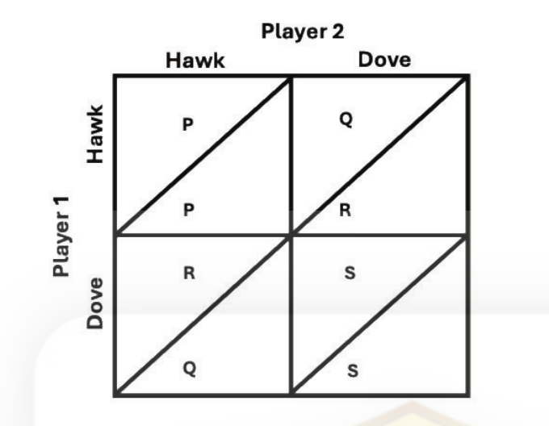

If *V* = the value of the resource (the benefit), *C* = the cost of losing a fight in the above matrix, which one of the following options correctly represents the payoffs?

1. P = V, Q = 0, R = (V/2), S = ( V-C)/2
2. P = ( V-C)/2, Q = V, R = 0, S = ( V/2)
3. p = V, Q =0, R = ( V-C)/2, S = ( V/2)
4. P = ( V/2), Q = ( V-C)/2, R= V, S=0

**Answer: 2 (P = ( V-C)/2, Q = V, R = 0, S = ( V/2))**

> **Explanation:** Printed Question ID 835594790 → NTA final key correct option **2**. In the matrix as laid out, P is the Hawk–Hawk cell, where each fighter wins half the time and so expects (V − C)/2; Q is Hawk vs Dove, where the hawk takes all and gains V; R is Dove vs Hawk, where the dove retreats empty-handed, 0; and S is Dove–Dove, where the resource is shared, V/2. This gives P = (V−C)/2, Q = V, R = 0, S = V/2.

---

### Question 139

If 10 µg of pure carbonic anhydrase catalyzes the hydration of 0.30 g of CO₂ in 1 min at 37°C at Vₘₐₓ, what is the turnover number (kcat) of carbonic anhydrase (in units of min⁻¹)? (Mᵣ of carbonic anhydrase is 30,000)

1. 3.2 x 10³ min⁻¹ to 3.3 x 10³ min⁻¹
2. 2.0 x 10⁷ min⁻¹ to 2.1 x 10⁷ min⁻¹
3. 0.30 x 10⁷ min⁻¹ to 0.31 x 10⁷ min⁻¹
4. 2.0 x 10³ min⁻¹ to 2.1 x 10³ min⁻¹

**Answer: 2 (2.0 x 10⁷ min⁻¹ to 2.1 x 10⁷ min⁻¹)**

> **Explanation:** Printed Question ID 835594726 → NTA final key correct option **2**. Moles of enzyme = 10 × 10⁻⁶ g / 30,000 g mol⁻¹ = 3.33 × 10⁻¹⁰ mol. Moles of CO₂ = 0.30 g / 44 g mol⁻¹ = 6.82 × 10⁻³ mol per minute. kcat = Vₘₐₓ/[E] = 6.82 × 10⁻³ / 3.33 × 10⁻¹⁰ ≈ 2.05 × 10⁷ min⁻¹.

---

### Question 140

The following statements are made regarding TAL effectors that play an important role during bacterial pathogenesis in plants.

A. They are bacterial proteins that are translocated into the host plant cells using the type IV secretion system.
B. They harbour a central DNA-binding region comprising a tandem array of nearly identical repeats.
C. They can act as both virulence factors as well as avirulence factors.
D. They are only restricted to members of the *Xanthomonas* species that infect rice.

Which one of the following options represents the combination of all correct statements?

1. A and B
2. B and C
3. C and D
4. A and D

**Answer: 2 (B and C)**

> **Explanation:** Printed Question ID 835594744 → NTA final key correct option **2**. TAL effectors are defined by their central array of 33–35 amino acid tandem repeats that form the DNA-binding domain (B), and they act as virulence factors by inducing host susceptibility genes while also being recognised as avirulence factors by cognate R proteins (C). A is wrong because translocation uses the **type III** secretion system, not type IV; and D is wrong because TAL effectors occur across many plant-pathogenic bacteria (Ralstonia, Burkholderia, Xanthomonas spp. on many hosts), not only rice-infecting *Xanthomonas*.

---

### Question 141

Shown in the table are some cultivated crops (Column X) and the chromosomal ploidy (Column Y).

| Column X | Column Y |
|---|---|
| A. Banana | i. Diploid |
| B Breadwheat | ii. Triploid |
| C. Brown mustard | iii. Tetraploid |
| D. Cauliflower | iv. Hexaploid |
| E. Sugarcane | v. Octaploid |

Which one of the following options represents all correct matches between Column X and Column Y?

1. A (v) B (ii) C (iii) D (i) E(iv)
2. A (ii) B (iv) C (i) D (iii) E(v)
3. A (v) B (iii) C (i) D (iv) E(ii)
4. A (ii) B (iv) C (iii) D (i) E(v)

**Answer: 4 (A (ii) B (iv) C (iii) D (i) E(v))**

> **Explanation:** Printed Question ID 835594796 → NTA final key correct option **4**. Edible banana is the triploid AAA (ii); bread wheat *Triticum aestivum* is hexaploid, 6x = 42 (iv); brown mustard *Brassica juncea* is tetraploid, AABB (iii); cauliflower is a diploid *Brassica oleracea* cultivar (i); and cultivated sugarcane *Saccharum officinarum* is a highly polyploid octaploid (v).

---

### Question 142

Human lymphocytes were incubated with increasing concentrations of NaCl. Which one of the following options represents the correct response of the nucleus and the chromatin to increase in salt concentrations?

1. The nucleus bursts at low NaCl concentrations, liberating the chromatin into the cytosol.
2. At higher salt concentration the heterochromatin gets converted into euchromatin and comes out of the nucleus.
3. The nucleus does not burst but the heterochromatin leaches out first.
4. The nucleus does not burst but the euchromatin leaches out first.

**Answer: 3 (The nucleus does not burst but the heterochromatin leaches out first.)**

> **Explanation:** Printed Question ID 835594739 → NTA final key correct option **3**. The lymphocyte nucleus is not lysed by rising ionic strength — that rules out option 1, which describes osmotic bursting at *low* NaCl. Instead the salt progressively strips chromatin from the nuclear matrix, and the key's verdict is that the densely packed **heterochromatin** is the fraction released first (option 3). Options 2 and 4 are excluded because they invoke a heterochromatin→euchromatin conversion or the reverse elution order. *Note: the reasoning-based expectation is that the looser euchromatin would leach before the tightly bound heterochromatin; this is recorded as an unresolved doubt in `sources.md`, but the key's option 3 is what is entered above.*

---

### Question 143

A researcher simultaneously disrupted the activities of "Ferrochelatase" and "Chlorophyllide a oxygenase" enzymes involved in the biosynthesis of heme and chlorophyll, respectively in Arabidopsis. The researcher made the following predictions about the outcomes of the above experiments.

A. The synthesis of "Chlorophyll a" from "Chlorophyllide a" will be inhibited.
B. The synthesis of "Chlorophyll b" will be completely inhibited.
C. The content of "Heme" molecule will be higher compared to wild-type plants.
D. The metabolic flux will shift towards the biosynthesis of "Chlorophyll a".

Which one of the following options represents the combination of all correct outcomes?

1. A and B
2. B and C
3. C and D
4. B and D

**Answer: 4 (B and D)**

> **Explanation:** Printed Question ID 835594756 → NTA final key correct option **4**. Chlorophyllide a oxygenase (CAO) is the enzyme that converts chlorophyll *a* to chlorophyll *b*, so its disruption **completely** blocks chlorophyll b synthesis (B correct). Blocking ferrochelatase stops the branch to heme, so the shared precursor pool (protochlorophyllide/protoporphyrinogen IX) is redirected, increasing flux towards chlorophyll a (D correct). Statement A is wrong because chlorophyllide a → chlorophyll a is done by chlorophyll synthase, unaffected here, and C is wrong because heme content falls, not rises.

---

### Question 144

The primary sequence of a miRNA is given below.

5'- UAGCUUAUCAGACUGAUGUUGA - 3'

The seed region of miRNA starts from the 2ⁿᵈ position to the 8ᵗʰ position.
Which one of the following mRNA sequences would be targeted by the above miRNA?

1. 5' - CUCGAGGCAACAUCAGUCUGAUUAAGCUAGAGCUC - 3'
2. 5' - CUCGAGUAGCUUAUUAGACUAAUGUUGAGAGCUC - 3'
3. 5' - CUCGAGAUUUGGUAUGCGCGAAUACCAAUCUCGA - 3'
4. 5' - CUCGAGGAGAUUUGGUAUUCGCGCAUACCAAAUCU - 3'

**Answer: 1 (5' - CUCGAGGCAACAUCAGUCUGAUUAAGCUAGAGCUC - 3')**

> **Explanation:** Printed Question ID 835594729 → NTA final key correct option **1**. The seed is miRNA positions 2–8, i.e. **AGCUUAU**. A target must contain the reverse complement of the seed, **AUAAAGCU**, read 5'→3' in the mRNA. Option 1 contains "…UUGAUUAAGCUAGAGCUC", which includes AUAAAGCU — so it is the genuine target. (Options 2 and 4 are look-alikes: option 2 embeds the seed itself rather than its complement, and options 3 and 4 carry unrelated sequences.)

---

### Question 145

Following statements are made regarding the biosynthesis of phytohormones.

A. Indole-3-butyric acid is converted to IAA by β-oxidation in peroxisomes.
B. The gibberellin precursor, geranyl geranyl diphosphate is synthesized in the plastids.
C. Cytokinins are synthesized from adenine nucleotides and dimethylallyl diphosphate in the mitochondria.
D. The oxidative reactions that convert xanthoxin to abscisic acid occur in the cytosol.
E. Cytochrome P450 monooxygenase enzyme family associated with endoplasmic reticulum catalyzes most of the reactions in brassinosteroid biosynthesis.

Which one of the following combinations contains all correct statements?

1. A, C, D and E
2. A, B, D and E
3. B, C and D
4. A, B and E only

**Answer: 2 (A, B, D and E)**

> **Explanation:** Printed Question ID 835594758 → NTA final key correct option **2**. IBA is activated to IBA-CoA and shortened to IAA by the peroxisomal β-oxidation (pom) pathway (A). The plastidial MEP pathway supplies GGPP for gibberellin biosynthesis (B). The final oxidation of xanthoxin to ABA by xanthoxin dehydrogenase occurs in the cytosol (D). Brassinosteroid biosynthesis is dominated by ER-localised cytochrome P450s such as CYP90, CYP724B and CYP88 (E). C is wrong because cytokinin synthesis by IPT/isopentenyltransferase occurs at the plastid, not in mitochondria.
