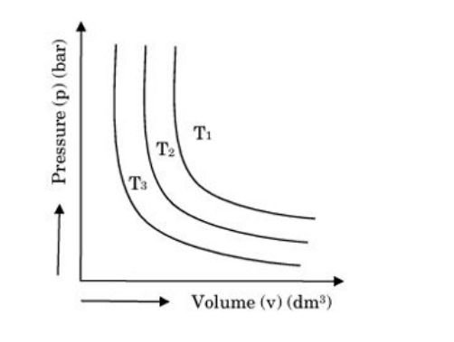
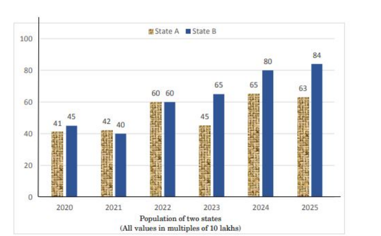
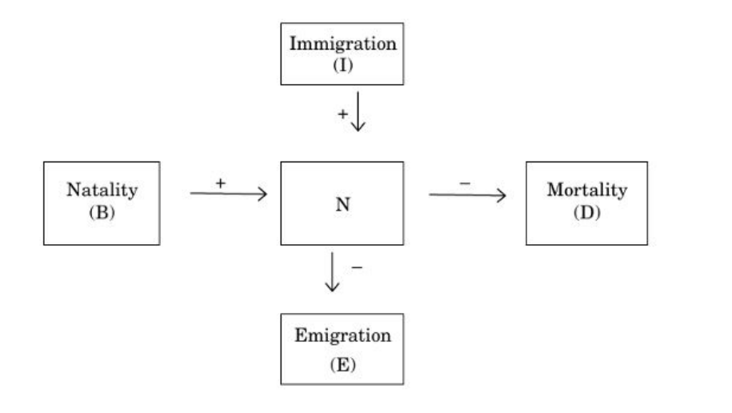
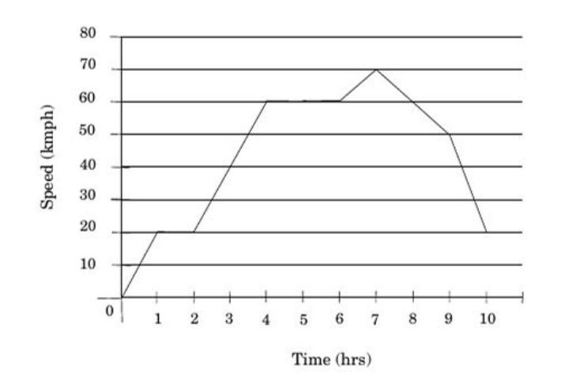
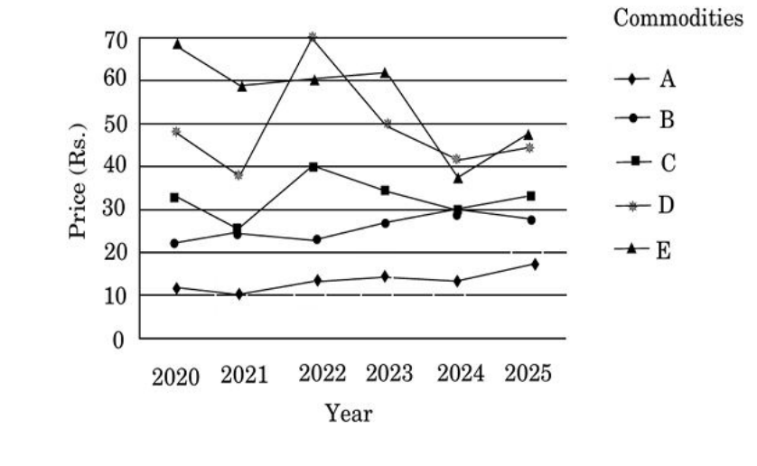

# CSIR-UGC NET June 2026 — Life Sciences (703), Shift-I (17 July 2026)
## Part A (General Aptitude) — Questions 1–20

Global numbering: Part A = Q1–Q20. Each question carries its printed NTA `Question ID`
(from the official response sheet) and the correct option from the NTA **Final Answer Key**
(see `sources.md`).

---

### Question 1

*Question ID: 458908851*

Following given graph is from Boyle's Law, representing graph of pressure, $p$ vs volume $v$, of a gas at different temperatures. Identify the correct relationship between $T_1, T_2$ and $T_3$.

1. $T_1 < T_2 < T_3$
2. $T_1 > T_2 > T_3$
3. $T_1 = T_2 = T_3$
4. $T_1 > T_2 < T_3$

**Answer: 2 ($T_1 > T_2 > T_3$)**

> **Explanation:** For a fixed amount of gas, $pV = nRT$, so an isotherm further from the
> origin corresponds to a higher temperature (larger $pV$ product). The curve $T_1$ lies
> farthest out and $T_3$ nearest the origin, hence $T_1 > T_2 > T_3$.

---

### Question 2

*Question ID: 458908852*

The chart gives the population of 2 states from 2020 to 2025. For which state and in which year, there is highest rise in population percentage in comparison with the previous year?

1. State B – 2022
2. State B – 2021
3. State A – 2023
4. State A – 2024

**Answer: 1 (State B – 2022)**

> **Explanation:** Percentage rises over the previous year: State B 2022 = (60−40)/40 = **+50%**;
> State A 2024 = (65−45)/45 ≈ +44%; State B 2021 and State A 2023 are declines. The largest
> rise is State B in 2022.

---

### Question 3

*Question ID: 458908853*

Immigration, Natality, Morality and Emigration changes 'N'

In this figure, N is designated to

1. Age pyramids
2. Population Growth
3. Population Density
4. Population Interactions

**Answer: 3 (Population Density)**

> **Explanation:** This is the standard population-attributes diagram in which natality (B) and
> immigration (I) increase and mortality (D) and emigration (E) decrease the central quantity N,
> which represents **population density**. (The stem prints "Morality"; the diagram box reads
> "Mortality (D)" — transcribed verbatim.)

---

### Question 4

*Question ID: 458908854*

Which of the following options does not correctly match with given statement?

For body moving in a circular path it is observed that a larger force is needed if:

1. the speed v of the body is increased
2. the radius r of the circle is decreased
3. the mass m of the body is increased
4. the mass m of the body is decreased

**Answer: 4 (the mass m of the body is decreased)**

> **Explanation:** Centripetal force $F = \dfrac{mv^2}{r}$. $F$ increases when $v$ increases,
> $r$ decreases, or $m$ increases. Decreasing $m$ reduces $F$, so option 4 does **not** match.

---

### Question 5

*Question ID: 458908855*

This graph shows the speed of a car in its journey of 10 hours. Which of the following statements is correct for the journey shown by the graph?

1. The average speed of the car is 40 kmph
2. Distance covered in 4–6 hrs slot is 80 km
3. Distance covered in 6–8 hrs slot is 120 km
4. The highest acceleration rate achieved during the journey is 20 kmph

**Answer: DROPPED by NTA**

> **Explanation:** The NTA Final Answer Key marks this question **DROP** (no credit / no penalised
> answer). No option is to be treated as correct. (For reference, checking the graph: option 2's
> "80 km" and option 3's "120 km" are both inconsistent with the plotted areas, and option 4
> mislabels an acceleration as "kmph" — one reason such a question is withdrawn.)

---

### Question 6

*Question ID: 458908856*

From the following statement decide which of the arguments is a 'strong' argument and which is a 'weak' argument.
Statement I : Should taxes on colour television be increased further?
Argument I : Yes. Colour television is a luxury item and only rich people buy it.
Argument II : No. Televisions are bought by the poor too.

1. If only argument (I) is strong
2. If only argument (II) is strong
3. If neither (I) nor (II) is strong
4. If both (I) and (II) is strong

**Answer: 3 (If neither (I) nor (II) is strong)**

> **Explanation:** Both arguments rest on an irrelevant factual claim about who buys televisions
> rather than on the merits of the tax policy, so neither is a strong argument.

---

### Question 7

*Question ID: 458908857*

Identify the wrong term in the following series.

ALARM, LARMA, ARMAL, RAMLA, MALAR

1. LARMA
2. ARMAL
3. RAMLA
4. MALAR

**Answer: 3 (RAMLA)**

> **Explanation:** Each term is the previous term rotated left by one letter:
> ALARM → LARMA → ARMAL → **RMALA** → MALAR. The fourth term should be RMALA, so RAMLA is wrong.

---

### Question 8

*Question ID: 458908858*

In a coded language BLOOD is coded as 15, LOGICAL is coded as 21 DIRECTION is coded as 27 then which will be the code of REMEMBERING

1. 36
2. 33
3. 30
4. 39

**Answer: 2 (33)**

> **Explanation:** The code is 3 × (number of letters): BLOOD (5)→15, LOGICAL (7)→21,
> DIRECTION (9)→27. REMEMBERING has 11 letters → 3 × 11 = **33**.

---

### Question 9

*Question ID: 458908859*

I am standing at the centre of a circular field. I go down south to the edge of the field and then turning left I walk along the boundary of the filed equal to three-eighths of its circumference of field. Then I turn west and go across to the opposite point on the boundary. In which direction am I from the starting point.

1. North-West
2. South-West
3. North
4. West

**Answer: accepts options 1 and 2** (key marks "1,2")

> **Explanation:** The NTA Final Answer Key accepts **both option 1 (North-West) and option 2
> (South-West)** as correct for this question; either is scored as right.

---

### Question 10

*Question ID: 458908860*

Read the information given below:
(i) In a family of six persons A, B, C, D, E and F, there are two married couples
(ii) D is grandmother of A and mother of B
(iii) C is wife of B and mother of F
(iv) F is the granddaughter of E
Who among the following is one of the couples

1. C, D
2. D, E
3. E, B
4. A, C

**Answer: 2 (D, E)**

> **Explanation:** The two married couples are B–C (given) and D–E. D is the grandmother/mother
> link and, with F being E's granddaughter, E must be D's spouse. Hence D–E is a couple.

---

### Question 11

*Question ID: 458908861*

Five persons A, B, C, D and E are travelling to five different places viz., Hyderabad, Bangalore, Dehradun, Delhi and Pune using different mode of transport viz., Bike, Bus, Car, Flight and Train, not necessarily in the same order. A is not travelling to Pune and is going by flight. D is not travelling to Hyderabad and is going by Bike. B is going to Bangalore. C is going to Delhi by Car. One who is going to Dehradun is going by Bus. Which of the following combination is correct?

1. B – Bangalore – Car
2. E – Dehradun – Bus
3. D – Pune – Train
4. A – Dehradun – Flight

**Answer: 2 (E – Dehradun – Bus)**

> **Explanation:** C→Delhi→Car, A→Flight, D→Bike, B→Bangalore. Dehradun is reached by Bus, and
> the only person without an assigned mode is E, so E→Dehradun→Bus.

---

### Question 12

*Question ID: 458908862*

The above graph shows mid-year prices of some commodities. Which of the following statements is correct based on the above data

1. The price increase immediately follow a price decline only twice in this period is for the commodities C
2. During this period, commodity D exhibited net overall increase
3. During this period, commodity B exhibited net overall decrease
4. The number of commodities that experienced a price decline for two or more consecutive years is 2

**Answer: 4 (The number of commodities that experienced a price decline for two or more consecutive years is 2)**

> **Explanation:** Reading the series, only commodities **C** (2022→2023→2024) and **D**
> (2022→2023→2024) show declines in two or more consecutive years — a count of 2, so statement 4
> is correct. D ends lower than it started (not a net increase) and B ends higher (not a net
> decrease), ruling out 2 and 3.

---

### Question 13

*Question ID: 458908863*

In an election between 2 candidates, Baljit gets 60% of the total valid votes. If the total votes were 15,000, what is the number of valid votes that the other candidate Vicky gets if 10% of the total votes were declared invalid?

1. 5000
2. 5400
3. 5500
4. 5800

**Answer: 2 (5400)**

> **Explanation:** Valid votes = 15,000 × 90% = 13,500. Vicky gets 40% of valid votes =
> 0.40 × 13,500 = **5,400**.

---

### Question 14

*Question ID: 458908864*

Find the number which when added to the terms of 3:5 gives the new ratio as 5:6?

1. 5
2. 6
3. 7
4. 8

**Answer: 3 (7)**

> **Explanation:** $\dfrac{3+x}{5+x} = \dfrac{5}{6} \Rightarrow 6(3+x) = 5(5+x) \Rightarrow 18+6x = 25+5x$
> $\Rightarrow x = 7$.

---

### Question 15

*Question ID: 458908865*

Four friends are wearing digital clocks. They have set a timer for drinking water. The timers have been set by them to ring after 30 minute, 1 hour, 1.5 hour and 1 hour 45 minute respectively. If their timer rang together at 12:00 noon. Find out the time when will they ring together again

1. 6:00 am
2. 3:00 am
3. 9:00 am
4. 10:00 am

**Answer: 3 (9:00 am)**

> **Explanation:** Intervals in minutes: 30, 60, 90, 105. LCM = 1260 minutes = 21 hours.
> 12:00 noon + 21 h = **9:00 am** the next day.

---

### Question 16

*Question ID: 458908866*

A startup Science lab of nine employees pay its employees between 25,000 per month to 75,000 per month. The median salary of the lab is 55,000 per month. The highest earning employee got a device patent in the name of company, to appreciate the achievement she got a 25% hike in her salary. After this hike what would be the new median salary of the company?

1. 68,750/-
2. Median will increase by 25%
3. Median will decrease by 25%
4. 55,000/-

**Answer: 4 (55,000/-)**

> **Explanation:** With nine salaries the median is the 5th value in order. Raising the single
> highest salary does not change the middle (5th) value, so the median stays **55,000/-**.

---

### Question 17

*Question ID: 458908867*

A circular dart board consist of three lines passing through the centre such that the circular region is divided into six equal parts. If the area of the circular board is $144\pi$ square cm then find the perimeter of the any one region.

1. $4(\pi+4)$
2. $4(\pi+6)$
3. $4(\pi+3)$
4. $4(\pi+2)$

**Answer: 2 ($4(\pi+6)$)**

> **Explanation:** Area $= \pi r^2 = 144\pi \Rightarrow r = 12$ cm. Each of the six equal sectors
> has central angle $60^\circ$, so its arc $= \frac{60}{360}\cdot 2\pi r = \frac{1}{6}\cdot 24\pi = 4\pi$.
> Perimeter of one sector $= \text{arc} + 2r = 4\pi + 24 = 4(\pi+6)$.

---

### Question 18

*Question ID: 458908868*

For a certain sum, the simple interest in 2 years at 8% per annum is Rs. 90 more than the simple interest in 1.5 years at the rate of 10% per annum for the same sum. Find the sum.

1. Rs. 9,000
2. Rs. 9,500
3. Rs. 8,000
4. Rs. 9,200

**Answer: 1 (Rs. 9,000)**

> **Explanation:** $SI_1 = P\cdot 8\cdot 2/100 = 0.16P$; $SI_2 = P\cdot 10\cdot 1.5/100 = 0.15P$.
> Difference $= 0.01P = 90 \Rightarrow P = 9{,}000$.

---

### Question 19

*Question ID: 458908869*

Consider the following conditions for two numbers
(A) their sum is 24
(B) the sum of 7 times of one number and 5 times of other number is 146.
Find the bigger number from the two.

1. 10
2. 11
3. 14
4. 13

**Answer: 4 (13)**

> **Explanation:** $x+y=24$ and $7x+5y=146$. Substituting $y=24-x$: $7x+5(24-x)=146 \Rightarrow 2x=26$
> $\Rightarrow x=13$, $y=11$. The bigger number is **13**.

---

### Question 20

*Question ID: 458908870*

Mohan gave 25% of certain amount to Ram. From the money received Ram spent 20% on fee payment, and 35% on buying books. After the expenses, he is left with Rs. 2700/-. How much money Mohan had?

1. Rs. 16,000
2. Rs. 20,000
3. Rs. 24,000
4. Rs. 30,000

**Answer: 3 (Rs. 24,000)**

> **Explanation:** Ram receives $0.25M$ and spends $20\%+35\% = 55\%$, keeping $45\%$. So
> $0.45 \times 0.25M = 0.1125M = 2700 \Rightarrow M = 24{,}000$.
