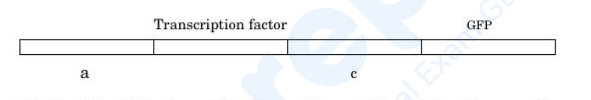
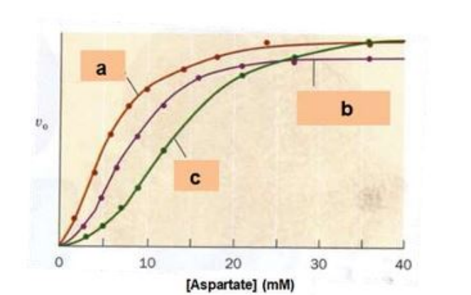
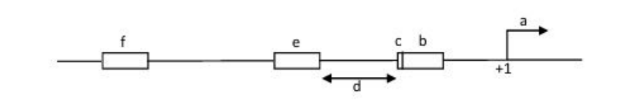
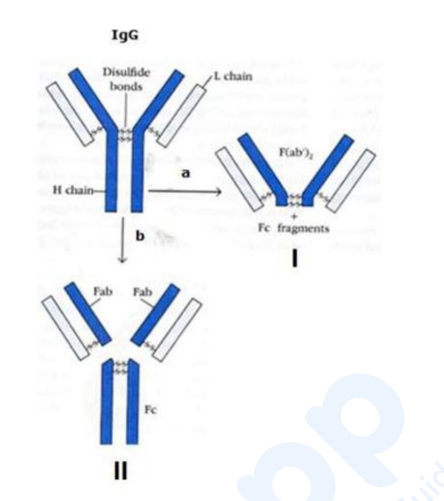

# CSIR-UGC NET June 2026 — Life Sciences (703), Shift-I (17 July 2026)
## Part C — Questions 71–145

Global numbering: Part C = Q71–Q145 (Question ID 458908921–458908995). Each question carries
its printed NTA `Question ID` (from the official response sheet) and the correct option from
the NTA **Final Answer Key** (see `sources.md`).

---
### Question 71

*Question ID: 458908921*

Which mass spectrometer should be used for performing MS/MS/MS and MSn experiments?

1. Fourier Transform Ion Cyclotron Resonance Spectrometer (FTICR)
2. TOF
3. qTOF
4. TOF-TOF

**Answer: 1 (Fourier Transform Ion Cyclotron Resonance Spectrometer (FTICR))**

> **Explanation:** Only an ion trap such as **FTICR** can repeatedly isolate and fragment stored ions in the same cell, enabling MS/MS/MS and general MSn experiments.

---

### Question 72

*Question ID: 458908922*

Which of the following conditions must be used to separate two proteins with following characteristics?
Protein    Molecular weight (in kDa)    pI
A          115                           5.1
B          115                           7.0

1. 10% PAGE for IEF pH 3-12 and 20% SDS-PAGE
2. 4% PAGE for IEF pH 3-12 and 10% SDS-PAGE
3. 4% PAGE for IEF pH 3-12 and 20% SDS-PAGE
4. 12% PAGE for IEF pH 3-12 and 10% SDS-PAGE

**Answer: 2 (4% PAGE for IEF pH 3-12 and 10% SDS-PAGE)**

> **Explanation:** The proteins have identical mass (115 kDa) but different pI (5.1 vs 7.0), so mass-based SDS-PAGE cannot resolve them; separation must exploit charge by isoelectric focusing over a broad pH 3-12 gradient in a low-percentage (4%) gel, with 10% SDS-PAGE as the matching size check.

---

### Question 73

*Question ID: 458908923*

Tetramethyl silane (TMS) is used as an internal standard in proton NMR studies because:
A. None of the protons in this compound are identical
B. TMS is insoluble in most organic liquids
C. TMS gives a single peak
D. TMS is inert
Choose the correct answer from the options given below:

1. A, B, and C only
2. B, C, and D only
3. A and C only
4. C and D only

**Answer: 4 (C and D only)**

> **Explanation:** TMS is used because all twelve protons are equivalent so it gives a **single sharp peak (C)** and because it is chemically **inert (D)**; statements A and B are false (the protons are identical and TMS is soluble in organic solvents).

---

### Question 74

*Question ID: 458908924*

Which of the following statement regarding translation in bacteria is correct?

1. UAG is recognized by RF1, UGA by RF2, and UAA by both RF1 and RF2.
2. UAG is recognized by RF1 and RF2, UGA by RF2, and UAA by RF1.
3. UAG is recognized by RF2, UGA by RF1, and UAA by both RF1 and RF2.
4. UAG is recognized by RF1, UGA by both RF1 and RF2, and UAA by RF2.

**Answer: 1 (UAG is recognized by RF1, UGA by RF2, and UAA by both RF1 and RF2)**

> **Explanation:** Release factor specificity is: **RF1 recognizes UAG (and UAA); RF2 recognizes UGA (and UAA)** - so UAG by RF1, UGA by RF2 and UAA by both, as in option 1.

---

### Question 75

*Question ID: 458908925*

The family of prokaryotes that possess remarkable metabolic flexibility and can use variety of metal electron acceptors such as uranium, neptunium, selenium, tellurite, and vanadate etc. are:

1. Shewanellaceae
2. Vibrionaceae
3. Enterobacteriaceae
4. Pasteurellaceae

**Answer: 1 (Shewanellaceae)**

> **Explanation:** **Shewanellaceae** (e.g. Shewanella oneidensis) are famous for respiratory versatility, reducing metals/metalloids such as Fe, Mn, U(VI), Np, Se, Te and V as terminal electron acceptors.

---

### Question 76

*Question ID: 458908926*

Shown below is a diagram of a biosensor:

Which of the following strategies would result in a better biosensor?

1. Use of constitutive promoter at 'a' and inducible promoter at 'c'.
2. Use of constitutive promoter at 'c' and inducible promoter at 'a'.
3. Use of repressive promoters at 'a' and 'c'.
4. Use of constitutive promoters at 'a' and 'c'.

**Answer: 1 (Use of constitutive promoter at 'a' and inducible promoter at 'c')**

> **Explanation:** A good biosensor expresses the sensing element (transcription factor) continuously, so its promoter at 'a' should be **constitutive**, while the reporter GFP is placed under an **inducible** promoter at 'c' that fires only when the analyte-activated TF is present. Constitutive GFP (option 4) or repressed elements (option 3) give no signal change; swapping the promoters (option 2) makes the sensor itself inducible and the readout constant.

---

### Question 77

*Question ID: 458908927*

You are required to make 50 ml TE buffer (pH 8) containing 50 mM Tris-chloride (Tris-Cl) and 10 mM EDTA. You are given a stock solution of 2 M Tris-chloride and 0.5 M EDTA, calculate the volume required from the stock in each case for making TE buffer.

1. 1.0 ml Tris-Cl and 2.0 ml EDTA
2. 1.25 ml Tris-Cl and 1.0 ml EDTA
3. 1.0 ml Tris-Cl and 1.25 ml EDTA
4. 2.0 ml Tris-Cl and 1.0 ml EDTA

**Answer: 2 (1.25 ml Tris-Cl and 1.0 ml EDTA)**

> **Explanation:** Dilution equation: Tris $V_1 = 50\,\text{mL}\times 50\,\text{mM} / 2000\,\text{mM} = 1.25$ mL; EDTA $V_1 = 50\times 10 / 500 = 1.0$ mL. Hence **1.25 mL Tris-Cl and 1.0 mL EDTA**.

---

### Question 78

*Question ID: 458908928*

Which of the following statement is correct for histidine biosynthesis in eukaryotes?

1. Transcriptional attenuation takes place because of pairing between leader regions 1 and 2.
2. Transcriptional attenuation takes place because of the formation of termination loops between leader regions 3 and 4.
3. Antitermination loop is formed between leader regions 2 and 3.
4. Transcriptional attenuation will not take place.

**Answer: 4 (Transcriptional attenuation will not take place)**

> **Explanation:** Transcriptional attenuation of the his leader is a prokaryotic operon mechanism; eukaryotes have no his operon leader-region attenuation, so **no transcriptional attenuation takes place** in eukaryotic histidine biosynthesis.

---

### Question 79

*Question ID: 458908929*

Which of the following is a free-living anaerobic nitrogen fixer?

1. Clostridium
2. Azotobacter
3. Calothrix
4. Nostoc

**Answer: 1 (Clostridium)**

> **Explanation:** **Clostridium** is a free-living anaerobic N2 fixer; Azotobacter is free-living but aerobic, and Calothrix/Nostoc are (micro)aerophilic cyanobacteria.

---

### Question 80

*Question ID: 458908930*

Which of the following statement is INCORRECT about classical MHC genes?

1. MHC Class I genes encode proteins that present cytosolic peptide antigens to CD8+ T cells.
2. Proteins encoded by MHC Class III genes do not play a direct role in presenting antigen to T cells.
3. Glycoproteins encoded by MHC Class II genes primarily present exogenous peptide antigen to CD4+ T cells.
4. MHC Class III gene products are predominantly expressed on macrophages, dendritic cells, and B cells.

**Answer: 4 (MHC Class III gene products are predominantly expressed on macrophages, dendritic cells, and B cells)**

> **Explanation:** MHC class III gene products (complement components, TNF, etc.) are **secreted proteins**, not surface glycoproteins predominantly expressed on macrophages, dendritic cells and B cells - option 4 is the incorrect statement.

---

### Question 81

*Question ID: 458908931*

Which would be the fractional saturation of Myoglobin when the partial pressure of O2 is 30 torr?

1. 0.91 − 0.92
2. 0.84 − 0.85
3. 0.95 − 0.96
4. 0.88 − 0.89

**Answer: 1 (0.91 − 0.92)**

> **Explanation:** Myoglobin follows a hyperbolic binding curve $Y = pO_2/(pO_2 + P_{50})$ with $P_{50} \approx 2.8$ torr: $Y = 30/(30+2.8) \approx 0.915$, i.e. **0.91-0.92**.

---

### Question 82

*Question ID: 458908932*

Aspartate transcarbamoylase catalyzes the reaction between carbamoyl phosphate and aspartate to form N-carbamoyl aspartate. Following plot represents the rate of reaction vs increasing concentration of aspartate. ATP and CTP are the allosteric effectors of the enzyme. Identify the curves which are obtained in the presence of ATP or CTP.

1. a : ATP, b : No effectors, c : CTP
2. a : No effectors, b : ATP, c : CTP
3. a : ATP, b : CTP, c : No effectors
4. a : No effectors, b : CTP, c : ATP

**Answer: 1 (a : ATP, b : No effectors, c : CTP)**

> **Explanation:** ATP is the positive allosteric effector of ATCase, shifting the rate-vs-aspartate curve left/up to the more hyperbolic trace **a**; CTP is the negative effector, shifting it right to the more sigmoidal, lower trace **c**; the middle curve **b** is the no-effector control.

---

### Question 83

*Question ID: 458908933*

Standard reduction potential of the half reactions of NADH oxidation by O2 are the following:
NAD+ + 2H+ + 2e- ⇌ NADH      ε'º = - 0.315 V
And ½O2 + 2H+ + 2e- ⇌ H2O      ε'º = - 0.815 V
What would be the standard free energy change (ΔG'º) for overall reaction?
½O2 + NADH + H+ ⇌ H2O + NAD+ (1 Faraday = 96485 J.V-1 mol-1)

1. -142 kJ mol-1
2. -218 kJ mol-1
3. 500 kJ mol-1
4. -1130 kJ mol-1

**Answer: DROPPED by NTA**

> **Explanation:** The NTA Final Answer Key marks this question **DROP**. (The printed second half-reaction potential, O2/H2O = -0.815 V, is wrong - the tabulated value is +0.815 V - which is a likely reason for withdrawal; with the corrected value dG' = -nFdE' = -2 x 96485 x 1.130 ~ -218 kJ/mol.)

---

### Question 84

*Question ID: 458908934*

Given below are two statements:
Statement I: The lambda repressor cl acts at the OL and OR operators to block immediate early genes.
Statement II: Cro binds to the same operator as the lambda repressor but with different affinities to establish lysogeny.
In the light of the above statements, choose the correct answer from the options given below:

1. Both Statement I and Statement II are correct
2. Both Statement I and Statement II are incorrect
3. Statement I is correct but Statement II is incorrect
4. Statement I is incorrect but Statement II is correct

**Answer: 3 (Statement I is correct but Statement II is incorrect)**

> **Explanation:** Statement I is correct: the cl product acts at OL and OR to repress immediate-early (cro etc.) transcription. Statement II is wrong: although Cro binds the same operators with different affinities, it is the **repressor (cl)**, not Cro, that establishes **lysogeny**; Cro establishes the lytic program.

---

### Question 85

*Question ID: 458908935*

Rhodopsin, the photosensitive GPCR in rod cells comprises the protein linked to 11-cis retina. The presence of light induces:

1. Isomerization of the 11-cis retinal moiety to all-trans retinal
2. Isomerization of trans retinal moiety to all-cis retinal
3. Polymerization of 11-cis retinal moiety and trans retinal
4. Breakdown of 11-cis retinal moiety to small components which further couples with GPCR

**Answer: 1 (Isomerization of the 11-cis retinal moiety to all-trans retinal)**

> **Explanation:** Vision begins when light **isomerizes the 11-cis retinal** covalently bound to opsin **to all-trans retinal**, triggering the conformational activation of the GPCR.

---

### Question 86

*Question ID: 458908936*

" Nitrogen Narcosis", also called as "raptures of the depth", can occur during deep sea diving due to compressed nitrogen. The mechanism behind this is:

1. It dissolves cytosolic proteins of cardiac cells.
2. It dissolves fatty substances in neurons.
3. It enhances neuronal excitability.
4. Excess calcium secreted out of cardiac cells.

**Answer: 2 (It dissolves fatty substances in neurons)**

> **Explanation:** At depth, elevated pN2 increases N2 solubility in the lipid (fatty) content of neuronal membranes, disturbing membrane protein function - the classic lipid-solubility explanation of nitrogen narcosis.

---

### Question 87

*Question ID: 458908937*

Which of the following statement about vitamin D3 in INCORRECT?

1. Cholecalciferol (Vitamin D3) is formed in the skin.
2. Cholecalciferol is converted to 1,25-hydroxycholecalciferol in the skin.
3. Calcium ion concentration controls the formation of 1,25-dihydroxycholecalciferol.
4. 1,25-dihydrocholecalciferol is formed in the liver.

**Answer: 2 (Cholecalciferol is converted to 1,25-hydroxycholecalciferol in the skin)**

> **Explanation:** The incorrect statement is option 2: cholecalciferol is **not** converted to 1,25-dihydroxycholecalciferol in the skin - it is 25-hydroxylated in the liver and then 1-hydroxylated in the kidney; skin is where cholecalciferol is formed from 7-dehydrocholesterol.

---

### Question 88

*Question ID: 458908938*

UDP Glucuronyl tranferase is involved in which of the following function?

1. In spleen, for conversion of biliverdin to bilirubin
2. In liver, for metabolizing bilirubin
3. In liver, for metabolizing glucose
4. In kidney, for transfer of bilirubin to liver

**Answer: 2 (In liver, for metabolizing bilirubin)**

> **Explanation:** UDP-glucuronyl transferase (UGT1A1) is the hepatic enzyme that **conjugates bilirubin** with glucuronic acid in the liver, making it water-soluble for excretion.

---

### Question 89

*Question ID: 458908939*

Which of the following transcription factor is involved in the functioning of phytochrome receptors in plants?

1. PIF
2. WRKY
3. SEUSS
4. STM

**Answer: 1 (PIF)**

> **Explanation:** **PIF** (phytochrome-interacting factor) transcription factors are direct partners of phytochrome: light-activated phyB imports PIFs and triggers their phosphorylation/degradation, driving de-etiolation gene expression.

---

### Question 90

*Question ID: 458908940*

The protein yields of five bacterial cultures are 3, 5, 2, 4 and 1 mg/ml, respectively. The standard error of the mean in the ungrouped data is:

1. 0.55
2. 0.71
3. 0.22
4. 0.33

**Answer: 2 (0.71)**

> **Explanation:** Mean = 3; deviations 0, +2, -1, +1, -2; sum of squares = 10; sample variance = 10/(5-1) = 2.5; SD = 1.58; SEM = SD/sqrt(5) = 1.58/2.236 ~ **0.71**.

---

### Question 91

*Question ID: 458908941*

Which of the following type of structural proteins in plant cell walls are implicated in the growth, nutrition, and guidance of pollen tubes through stylar tissues?

1. Arabinogalactan proteins
2. Glycine-rich proteins
3. Hydroxyproline-rich glycoproteins
4. Proline-rich proteins

**Answer: 1 (Arabinogalactan proteins)**

> **Explanation:** **Arabinogalactan proteins (AGPs)** are the cell-wall proteoglycans implicated in pollen-tube growth, nutrition and guidance through the style.

---

### Question 92

*Question ID: 458908942*

The cellulose microfibrils are synthesized by the enzyme cellulose synthase in which part of the plant cell?

1. Cytosol
2. Endoplasmic reticulum
3. Golgi apparatus
4. Plasma membrane

**Answer: accepts options 3 and 4** (key marks "3,4")

> **Explanation:** The NTA Final Answer Key accepts **both option 3 (Golgi apparatus) and option 4 (Plasma membrane)**. Cellulose synthase catalytic subunits are assembled in the Golgi, and the active enzyme complex sits in the plasma membrane synthesising the microfibril - hence the dual key.

---

### Question 93

*Question ID: 458908943*

Which of the following is NOT a precursor for the biosynthesis of IAA?

1. Indole
2. Indole-3-glycerol phosphate
3. Tryptophan
4. Mevalonic acid

**Answer: 4 (Mevalonic acid)**

> **Explanation:** IAA is made from tryptophan, and also via indole and indole-3-glycerol phosphate (tryptophan-independent routes); **mevalonic acid** is the terpenoid-pathway precursor and is not an auxin precursor.

---

### Question 94

*Question ID: 458908944*

Identify the type of ecological succession based on gross production (P) and community respiration (R) relationship when P>R.

1. Allogenic
2. Autotrophic
3. Heterotrophic
4. Secondary

**Answer: 2 (Autotrophic)**

> **Explanation:** When gross production exceeds community respiration (P/R > 1), the system is building biomass - characteristic of **autotrophic** (early/positive) succession.

---

### Question 95

*Question ID: 458908945*

The activity of which enzyme of C3 pathway will be maximally inhibited when a plant is suddenly brought to dark from light?

1. Hexokinase
2. Fructose-1,6-bisphosphatase
3. Transketolase
4. ATP synthase

**Answer: 2 (Fructose-1,6-bisphosphatase)**

> **Explanation:** Calvin-cycle enzymes activated by the light-driven thioredoxin system - notably **fructose-1,6-bisphosphatase** - lose activation and are strongly inhibited when a plant is shifted to darkness.

---

### Question 96

*Question ID: 458908946*

Which of the following diagnostic techniques(/s) use radiofrequency?
A. Magnetic Resonance Imaging
B. X-Ray
C. Positron Emission Tomography
D. Ultrasound
Choose the most appropriate answer from the options given below:

1. A and B Only
2. A and C Only
3. A, B, and C Only
4. D Only

**Answer: DROPPED by NTA**

> **Explanation:** The NTA Final Answer Key marks this question **DROP**. (MRI does use radiofrequency pulses, but the option set leaves ambiguity over the other modalities - e.g. PET is a nuclear-medicine technique, ultrasound is sound, X-ray is ionising radiation - and no listed combination was settled as correct.)

---

### Question 97

*Question ID: 458908947*

Local anaesthetics like Procaine and Tetracaine act by:
A. Blocking the sodium channels
B. Exciting the sodium channels
C. Reducing membrane excitability
D. Increasing the membrane threshold
Choose the most appropriate answer from the options given below:

1. A and B Only
2. A, B, and C Only
3. A and C Only
4. D Only

**Answer: 3 (A and C Only)**

> **Explanation:** Local anaesthetics **block voltage-gated sodium channels (A)**, which **reduces membrane excitability (C)**; they do not excite Na+ channels, and option D's phrasing is not a mechanism of these drugs.

---

### Question 98

*Question ID: 458908948*

If X ray treatment with 1000 roentgens (R) increases the mutation rate of a gene by 2%, what approximate percent increase in mutation rate of the gene would be expected if the organism is treated with X ray doses of 500 R in three independent rounds of treatment or 1500 R in a single treatment?

1. 3% increase in both the rounds of treatment.
2. 6% increase in fragmented rounds compared to ~3% in single round.
3. 9% increase in both the rounds of treatment.
4. 6% increase in fragmented rounds compared to ~9% in single round.

**Answer: 1 (3% increase in both the rounds of treatment)**

> **Explanation:** Mutation induction by X-rays in this dose range is proportional to total dose, and fractionation does not change the total: 3 x 500 R = 1500 R and a single 1500 R both deliver 1.5 x 1000 R, so ~1.5 x 2% = **3% increase in both cases**.

---

### Question 99

*Question ID: 458908949*

Which of the following statement is correct regarding heterodimeric transcription factor NF-κB in resting cells?

1. It is composed of p50 and p65 subunits bound to I-κBa in the cytosol.
2. It is composed of p50 and p65 subunits bound to I-κBa in the nucleus.
3. It is composed of p53 and p65 subunits bound to I-κBa in the cytosol.
4. It is composed of p21 and p65 subunits bound to I-κBa in the nucleus.

**Answer: 1 (It is composed of p50 and p65 subunits bound to I-κBa in the cytosol)**

> **Explanation:** In resting cells the NF-kB heterodimer **p50/p65 is held in the cytosol by I-kB-alpha**; stimulation degrades I-kBa and frees the dimer to enter the nucleus.

---

### Question 100

*Question ID: 458908950*

A typical NGS-based exome sequence experiment aims to achieve 100X coverage for a eukaryotic genome of 50 Mb. What is the minimum amount of sequence data needed to achieve this goal?

1. 500 Mb
2. 5 Gb
3. 50 Gb
4. 500 Gb

**Answer: 2 (5 Gb)**

> **Explanation:** Data needed = genome (exome) size x coverage = 50 Mb x 100 = 5,000 Mb = **5 Gb**.

---

### Question 101

*Question ID: 458908951*

The rate of synonymous site substitutions in a particular gene was higher than the rate of non-synonymous substitutions. Which of the following statement best describes the mode of evolution operating on this gene?

1. It is undergoing positive selection.
2. It is undergoing diversifying selection.
3. It is evolving neutrally.
4. It is undergoing negative selection.

**Answer: 4 (It is undergoing negative selection)**

> **Explanation:** Synonymous substitutions exceeding non-synonymous ones (dN/dS < 1) is the signature of **negative (purifying) selection** removing amino-acid-changing mutations.

---

### Question 102

*Question ID: 458908952*

Match the labels (a-f) with the different components of a bacterial promoter as given below:

1. a: translation start site, b: extended −10, c: −10, d: spacer, e: −35, f: UP element
2. a: transcription start site, b: extended −10, c: −10, d: spacer, e: −35, f: UP element
3. a: translation start site, b: −10, c: extended −10, d: spacer, e: −35, f: UP element
4. a: transcription start site, b: −10, c: extended −10, d: spacer, e: −35, f: UP element

**Answer: 4 (a: transcription start site, b: −10, c: extended −10, d: spacer, e: −35, f: UP element)**

> **Explanation:** Reading the map from the start point: **a** is the transcription start site at +1; **b** is the -10 element immediately upstream of it; **c** is the extended -10 motif just 5' of the -10; **d** is the spacer; **e** is the -35 box; **f** is the upstream (UP) element - the arrangement of option 4.

---

### Question 103

*Question ID: 458908953*

Which of the following is not a targeted therapy routinely used to treat cancer patients?

1. Palbociclib
2. Imatinib
3. Doxorubicin
4. Herceptin

**Answer: 3 (Doxorubicin)**

> **Explanation:** **Doxorubicin** is a classical cytotoxic anthracycline (topoisomerase II poison/DNA intercalator), not a targeted agent; palbociclib (CDK4/6), imatinib (BCR-ABL) and Herceptin (HER2) are all targeted therapies.

---

### Question 104

*Question ID: 458908954*

Which of the following combination do not represent the functional attributes of a grassland ecosystem?

1. nutrient cycling and energy flow
2. macroconsumers and microconsumers
3. homeostasis, and diversity in time and space
4. food chain and development of ecosystem

**Answer: 2 (macroconsumers and microconsumers)**

> **Explanation:** Functional attributes of an ecosystem are the processes: energy flow, nutrient cycling, homeostatic regulation, food chains/webs, decomposition and development. The consumer categories 'macroconsumers and microconsumers' are a **structural/taxonomic** description, not a functional attribute.

---

### Question 105

*Question ID: 458908955*

As per Woesse's three-domain classification, which of the following cannot be used to differentiate between Eubacteria, Archaea and Eukaryota?

1. Sensitivity to antibiotics
2. Structure of membrane lipids
3. Sequence of rRNA
4. Type of locomotion

**Answer: 4 (Type of locomotion)**

> **Explanation:** Woese's three-domain scheme rests on rRNA sequence, membrane-lipid chemistry (ester vs ether), antibiotic sensitivity of translation and cell-wall type; **type of locomotion** is not a criterion separating the domains.

---

### Question 106

*Question ID: 458908956*

Cancer cells de-emphasize oxidative phosphorylation even when oxygen is plentiful, taking up glucose in large quantity. This phenomenon is explained by:

1. Glycolysis is the most efficient way of ATP production required by the cancer cells to proliferate.
2. Despite the inefficient way of ATP production, glycolysis subsequently leads to the production of intermediate metabolites essential for the synthesis of proteins and nucleic acids that enable cellular proliferation.
3. Warburg effect states oxidative phosphorylation is preferred by the cancer cells under aerobic condition. Under anaerobic condition glycolysis is the only option for cancer cells for energy production.
4. Oxidative phosphorylation is the most efficient way to manage energy production, hence cancer cells do not de-emphasize but switch to oxidative phosphorylation despite glucose availability.

**Answer: 2 (Despite the inefficient way of ATP production, glycolysis subsequently leads to the production of intermediate metabolites essential for the synthesis of proteins and nucleic acids that enable cellular proliferation)**

> **Explanation:** The Warburg effect is explained by option 2: even though glycolysis yields far less ATP per glucose, the high glycolytic flux supplies **intermediate metabolites for biosynthesis of proteins, lipids and nucleic acids** that proliferating tumour cells need.

---

### Question 107

*Question ID: 458908957*

A female mouse, homozygous for 'a' allele of the Igf2 gene, is crossed to a male which is homozygous for 'b' allele of this gene. Which of the following statement best describes the most appropriate outcome regarding the expression of Igf2 in the F1 progeny?

1. Igf2 locus is maternally imprinted, hence allele 'b' will be expressed.
2. Igf2 locus is maternally imprinted, hence allele 'a' will be expressed.
3. Igf2 locus is paternally imprinted, hence allele 'b' will be expressed.
4. Igf2 locus is paternally imprinted, hence allele 'a' will be expressed.

**Answer: accepts options 1 and 3** (key marks "1,3")

> **Explanation:** The NTA Final Answer Key accepts **both option 1 and option 3**. Igf2 is paternally expressed (maternally imprinted), so the paternal 'b' allele is expressed; the key also credits option 1's phrasing.

---

### Question 108

*Question ID: 458908958*

SOCS-2 is a negative regulator of cytokine signaling. socs-2 knockout mice were phenotypically larger in size as compared to the wild type. Their lifespan was not affected. This defect is, therefore, due to:

1. Downregulated cytokine signaling and elevated levels of growth hormones
2. Reduced SOCS-2 levels which could potentially promotes cytokine signaling
3. Elevated cytokine signaling which could play a significant role in regulating cell growth
4. Inhibition of mTOR pathway which is associated with cell size

**Answer: 3 (Elevated cytokine signaling which could play a significant role in regulating cell growth)**

> **Explanation:** SOCS-2 normally restrains cytokine/GH-STAT signalling; knocking it out **elevates cytokine signalling**, and since these pathways regulate cell growth this produces larger animals without lifespan defects.

---

### Question 109

*Question ID: 458908959*

Which of the following best describes how cDNA library is synthesized from human liver tissue?

1. Use of oligo dT primers with reverse transcriptase followed by amplification with random hexamers
2. Use of random hexamers with Taq polymerase followed by amplification with oligo dT primers
3. Use of oligo dT primers with Taq polymerase and amplification with random hexamers
4. Use of random hexamers with reverse transcriptase followed by amplification with oligo dT primers

**Answer: 1 (Use of oligo dT primers with reverse transcriptase followed by amplification with random hexamers)**

> **Explanation:** A cDNA library starts from mRNA: **oligo-dT primes reverse transcriptase** at the poly(A) tail, and the resulting cDNA is then amplified using **random hexamers** - the combination in option 1.

---

### Question 110

*Question ID: 458908960*

An E.coli seqA- strain was constructed by an investigator. To make the E.coli seqA- lacZ+ strain, the lacZgene can be transferred by:

1. Generalized transduction mediated via P1 phage
2. Generalized transduction mediated via λ phage
3. Specialized transduction mediated via P1 phage
4. Specialized transduction mediated via P22 phage

**Answer: 1 (Generalized transduction mediated via P1 phage)**

> **Explanation:** lacZ+ is moved into a seqA- strain by **generalized transduction with phage P1**, the classic E. coli generalized-transducing phage; lambda performs specialized transduction, and P22 does not infect this E. coli strain.

---

### Question 111

*Question ID: 458908961*

Which of the following parameter best assesses the efficacy of a conjugate vaccine against SARS-CoV-2?

1. Cytokine levels in blood
2. IgM and IgG antibody titers
3. IgA and IgD antibody titers
4. IgE antibody titer

**Answer: 2 (IgM and IgG antibody titers)**

> **Explanation:** Conjugate vaccines work by inducing T-dependent responses and immunological memory, so their efficacy is best assessed by the **IgM and (especially) IgG antibody titers**.

---

### Question 112

*Question ID: 458908962*

The following statements are related to the regulation of the enzyme nitrate reductase.
A. Light, carbohydrate levels, and other environmental factors activate the enzymes by dephosphorylation.
B. Light, carbohydrate levels, and other environmental factors inactivate the enzymes by dephosphorylation.
C. Darkness and Mg2+ inactivate the enzyme by phosphorylation.
D. Darkness and Mg2+ activate the enzyme by dephosphorylation.
Choose the correct answer from the options given below:

1. A and C Only
2. A and D Only
3. B and C Only
4. B and D Only

**Answer: 1 (A and C Only)**

> **Explanation:** Nitrate reductase is activated in the light/with carbohydrate supply by **dephosphorylation (A)** and inactivated in darkness by Mg2+-dependent **phosphorylation (C)**; the reverse statements B and D are wrong.

---

### Question 113

*Question ID: 458908963*

The fluidity of plasma membrane can be increased by introduction of:

1. cis unsaturation in fatty acid chains
2. trans unsaturation in fatty acid chains
3. longer fatty acid chains
4. saturation in fatty acid chains

**Answer: 1 (cis unsaturation in fatty acid chains)**

> **Explanation:** **cis double bonds** kink acyl chains, prevent tight packing and lower the transition temperature, increasing membrane fluidity; trans bonds, longer chains and saturation all decrease it.

---

### Question 114

*Question ID: 458908964*

Given below are two statements:
Statement I: Catabolite repressor protein (CRP) regulates both arabinose and lactose operons.
Statement II: Both ara and lac operon will be switched on when E. coli are grown in a medium containing arabinose and lactose.
In the light of the above statements, choose the correct answer from the options given below:

1. Both Statement I and Statement II are correct
2. Both Statement I and Statement II are incorrect
3. Statement I is correct but Statement II is incorrect
4. Statement I is incorrect but Statement II is correct

**Answer: 3 (Statement I is correct but Statement II is incorrect)**

> **Explanation:** Statement I is correct - cAMP-CRP is a positive regulator of both the lac and ara operons. Statement II is incorrect as phrased: simply supplying arabinose and lactose does not guarantee both operons switch on - full induction additionally requires the **absence of glucose** (high cAMP-CRP), a condition the statement never specifies.

---

### Question 115

*Question ID: 458908965*

An enzyme has KM of 16 μM in the absence of a competitive inhibitor and KMapp of 24 μM in the presence of 6 μM of the inhibitor. Calculate Ki.

1. 8 μM
2. 4 μM
3. 6 μM
4. 12 μM

**Answer: 4 (12 μM)**

> **Explanation:** For competitive inhibition $K_M^{app} = K_M(1 + [I]/K_i)$: 24 = 16(1 + 6/Ki) gives 1 + 6/Ki = 1.5, so 6/Ki = 0.5 and **Ki = 12 uM**.

---

### Question 116

*Question ID: 458908966*

Treatment of IgG with enzymes / chemicals gives rise to different products I and II. Find 'a' and 'b' in the schematic given below that yields the indicated products.

1. a: pepsin; b: papain
2. a: papain; b: pepsin
3. a: mercaptoethanol; b: pepsin
4. a: papain; b: mercaptoethanol

**Answer: 1 (a: pepsin; b: papain)**

> **Explanation:** Cut at site **a** (hinge, below the disulfides) yields the paired F(ab')2 fragment - that is **pepsin**; cut at site **b** (above the light-chain disulfide) yields separate Fab and Fc - that is **papain**.

---

### Question 117

*Question ID: 458908967*

Which of the following rate equation is correct when malonate is added to a stereospecific dehydrogenation of succinate to fumarate catalyzed by succinate dehydrogenase?

1. v = Vmax[S] / (KM + [S])
2. v = Vmax[S] / (KM(1+[I]/Ki) + [S])
3. v = Vmax(1+[I]/Ki).[S] / (KM + [S])
4. v = Vmax[S] / (KM + [S](1+[I]/Ki))

**Answer: 2 (v = Vmax[S] / (KM(1+[I]/Ki) + [S]))**

> **Explanation:** Malonate is a classic **competitive** inhibitor of succinate dehydrogenase, so only the KM term is modified: $v = \dfrac{V_{max}[S]}{K_M(1+[I]/K_i) + [S]}$.

---

### Question 118

*Question ID: 458908968*

A protein with four identical subunits shows:

1. Cyclic C4 and Dihedral D2 symmetry
2. Cyclic C2 and Icosahedral symmetry
3. Cyclic C3 and Octahedral symmetry
4. Cyclic C3 and Icosahedral symmetry

**Answer: 1 (Cyclic C4 and Dihedral D2 symmetry)**

> **Explanation:** A homotetramer has two standard architectures: a ring with **cyclic C4** symmetry or a tetrahedral-like arrangement with **dihedral D2** symmetry; C3-based and icosahedral options are inconsistent with four subunits.

---

### Question 119

*Question ID: 458908969*

Match List I with List II
List I: A. Facilitation model; B. Initial floristic model; C. Tolerance model; D. Inhibition model
List II: I. Species traits are more important than the prevailing environment; II. One group of species may secrete allelochemicals to prevent others to come; III. A species creates favourable environment for the next to come; IV. Proposed by Connell and Slatyer
Choose the correct answer from the options given below:

1. A-III, B-I, C-IV, D-II
2. A-II, B-IV, C-I, D-III
3. A-I, B-IV, C-II, D-III
4. A-IV, B-II, C-III, D-I

**Answer: 1 (A-III, B-I, C-IV, D-II)**

> **Explanation:** Facilitation model - a species modifies the environment making it favourable for the next (A-III); initial floristic composition - which species arrive first determines the course, i.e. species traits dominate (B-I); tolerance - Connell and Slatyer's alternative to facilitation/inhibition (C-IV); inhibition - early species block later ones via allelochemicals etc. (D-II).

---

### Question 120

*Question ID: 458908970*

Analyze the sequence below:
ATG AAG TCA AAT CGA
A change in the underlined C to G would result in:

1. Silent mutation
2. Frame shift mutation
3. Non sense mutation
4. Missense mutation

**Answer: 3 (Non sense mutation)**

> **Explanation:** TCA codes Ser; changing the underlined C to G gives **TGA, a stop codon** - a nonsense mutation. The reading frame is untouched, so it is not a frameshift.

---

### Question 121

*Question ID: 458908971*

Flower color and pollen grain shapes are linked in sweet peas. Purple (F) is dominant to red (f) flower color and long pollen grains (L) are dominant to round pollen grains (l). If the parental genotype is FL/fl, what would be the recombinant genotype in the gametes?

1. FL and fl
2. Ff and Ll
3. Fl and fL
4. FF and ll

**Answer: 3 (Fl and fL)**

> **Explanation:** With linked FL / fl chromosomes, the parental gametes are FL and fl; **recombinants are Fl and fL**, produced by crossing-over between the two loci.

---

### Question 122

*Question ID: 458908972*

Given below are two statements:
Statement I: In metazoans, cyclin D in G1 phase binds to CDK4 and CDK6, but do not show a strong stage-dependent fluctuation.
Statement II: Cyclin E in metazoans is a S/G2 cyclin, which binds to CDK2 to trigger S/G2 transition.
In the light of the above statements, choose the correct answer from the options given below:

1. Both Statement I and Statement II are true
2. Both Statement I and Statement II are false
3. Statement I is true but Statement II is false
4. Statement I is false but Statement II is true

**Answer: 3 (Statement I is true but Statement II is false)**

> **Explanation:** Statement I is true: cyclin D binds CDK4/6 in G1 and its level tracks extracellular signals rather than showing strong cell-cycle-stage fluctuation. Statement II is false: cyclin E is the **G1/S** cyclin that binds CDK2 to trigger the Start/S transition, not an S/G2 cyclin.

---

### Question 123

*Question ID: 458908973*

BRCA1 loss of function mutations are associated with ovarian and breast cancer. The best-known mechanism to cause transformation of cells due to loss of BRCA1 is:

1. BRCA1 is essential for homologous recombination repair. Loss of BRCA1 leads to genomic instability leading to cancer.
2. BRCA1 is essential for nucleotide excision repair. Pyrimidine dimers caused due to UV exposure cannot be repaired with loss of BRCA1.
3. BRCA1 is essential for base excision repair. Spontaneous deamination of cytosine and uracil due to carcinogen cannot be repaired in cells lacking BRCA1.
4. BRCA1 is essential for non-homologous end joining (NHEJ) pathway. Loss of BRCA1, thus, leads to genomic instability due to loss of NHEJ activity.

**Answer: 1 (BRCA1 is essential for homologous recombination repair. Loss of BRCA1 leads to genomic instability leading to cancer)**

> **Explanation:** BRCA1 is essential for error-free **homologous recombination** repair of double-strand breaks; its loss forces error-prone repair and genomic instability, the best-known route to transformation.

---

### Question 124

*Question ID: 458908974*

The contributing genome in fertile allopolyploid species may be quantitatively different under which of the following condition?

1. Polyploids created by hybridization between different species
2. Polyploids created by chromosome duplication within a species
3. Polyploids created by hybridization within same species
4. The univalent solitary chromosome yields aneuploid cells during anaphase of first meiotic division

**Answer: 1 (Polyploids created by hybridization between different species)**

> **Explanation:** In an allopolyploid formed **between different species**, the two parental genomes can differ quantitatively (different sizes, repeat content, gene numbers), so the contributing genomes may be quantitatively different; within-species (auto)polyploids duplicate an identical genome.

---

### Question 125

*Question ID: 458908975*

Given below are two statements:
Statement I: To analyze rolling circle replication, Southern blotting is performed under non-denaturing conditions.
Statement II: UV crosslinking primarily involves pyrimidine nucleotides.
In the light of the above statements, choose the correct answer from the options given below:

1. Both Statement I and Statement II are correct
2. Both Statement I and Statement II are incorrect
3. Statement I is correct but Statement II is incorrect
4. Statement I is incorrect but Statement II is correct

**Answer: 1 (Both Statement I and Statement II are correct)**

> **Explanation:** Both statements are correct: rolling-circle replication generates single-stranded and branched intermediates whose native shape must be preserved, so Southern analysis is run **non-denaturing**; and UV crosslinking of labelled probes to target works through **pyrimidine** (thymidine) photodimers.

---

### Question 126

*Question ID: 458908976*

The half-life of a radionucleotide with a decay constant of 2 x 10-2 min-1 is:

1. 0.35 min
2. 3.46 min
3. 34.50 min
4. 346.50 min

**Answer: 3 (34.50 min)**

> **Explanation:** $t_{1/2} = \ln 2 / \lambda = 0.693 / (2\times10^{-2}\ \text{min}^{-1}) \approx 34.6$ min, matching **34.50 min**.

---

### Question 127

*Question ID: 458908977*

Given below are two statements:
Statement I: Ca2+ activates pyruvate dehydrogenase kinase.
Statement II: Pyruvate dehydrogenase activity is unaffected by cAMP.
In the light of the above statements, choose the correct answer from the options given below:

1. Both Statement I and Statement II are correct
2. Both Statement I and Statement II are incorrect
3. Statement I is correct but Statement II is incorrect
4. Statement I is incorrect but Statement II is correct

**Answer: 4 (Statement I is incorrect but Statement II is correct)**

> **Explanation:** Statement I is wrong: Ca2+ **inhibits** the pyruvate dehydrogenase kinase (and Ca2+ activates the phosphatase), which is how contraction activates PDH. Statement II is right: PDH is regulated by phosphorylation/allostery, not by cAMP.

---

### Question 128

*Question ID: 458908978*

Match List I with List II
List I / List II
A. Glycine / I. Imidazole side chain
B. Threonine / II. Sulfhydryl side chain
C. Cysteine / III. Uncharged polar side chain
D. Histidine / IV. Non polar side chain
Choose the correct answer from the options given below:

1. A-IV, B-III, C-II, D-I
2. A-III, B-IV, C-I, D-II
3. A-II, B-IV, C-III, D-I
4. A-IV, B-II, C-III, D-I

**Answer: 1 (A-IV, B-III, C-II, D-I)**

> **Explanation:** Glycine has the smallest, non-polar side chain (A-IV); threonine is uncharged polar (B-III); cysteine carries the sulfhydryl (C-II); histidine the imidazole (D-I).

---

### Question 129

*Question ID: 458908979*

Which of the following statement is correct for F1-component of ATP synthase?

1. It has tetrahedral symmetry.
2. It has dihedral symmetry.
3. It has pseudo-three-fold symmetry.
4. It has pseudo-four-fold symmetry.

**Answer: 3 (It has pseudo-three-fold symmetry)**

> **Explanation:** The F1 sector is an alpha3beta3 hexamer arranged around the gamma stalk - it exhibits **pseudo-three-fold symmetry** (the three a/b pairs repeat with 120' rotational symmetry but the subunits are not equivalent in the presence of gamma).

---

### Question 130

*Question ID: 458908980*

Which of the following event is NOT associated with jaundice?

1. Increased hemolysis, excess unconjugated bilirubin can appear in plasma
2. Blockage of intra hepatic biliary canaliculi
3. Blockage of bile duct
4. Enhanced breakdown of bilirubin

**Answer: 4 (Enhanced breakdown of bilirubin)**

> **Explanation:** Jaundice reflects excess plasma bilirubin from overproduction (hemolysis), impaired conjugation or blocked excretion (canalicular or bile-duct block). **Enhanced breakdown (conjugation/clearance) of bilirubin would lower, not raise, its level**, so it is not associated with jaundice.

---

### Question 131

*Question ID: 458908981*

Match List I with List II
List I: A. Prolactin; B. Insulin; C. Oxytocin; D. Dopamine
List II: I. Posterior pituitary; II. Hypothalamus; III. Anterior pituitary; IV. Pancreas
Choose the correct answer from the options given below:

1. A-III, B-IV, C-I, D-II
2. A-IV, B-III, C-II, D-I
3. A-III, B-IV, C-II, D-I
4. A-I, B-III, C-II, D-IV

**Answer: 1 (A-III, B-IV, C-I, D-II)**

> **Explanation:** Prolactin is secreted by the anterior pituitary (A-III); insulin by the pancreas (B-IV); oxytocin is released from the posterior pituitary (C-I); dopamine is a hypothalamic hormone (PIF) (D-II).

---

### Question 132

*Question ID: 458908982*

Regular chewing of bubble gum containing sucrose results in tooth decay because

1. Sucrose in bubble gum causes a decrease in pH and the acid erodes tooth enamel
2. Sucrose in bubble gum causes an increase in pH and alkalinity attacks tooth enamel
3. Sucrose in bubble gum causes no change in pH and promotes mechanical damage of tooth enamel
4. Sucrose in bubble gum causes no changes in pH and promote thermogenic damage of tooth enamel

**Answer: 1 (Sucrose in bubble gum causes a decrease in pH and the acid erodes tooth enamel)**

> **Explanation:** Oral bacteria metabolise sucrose to organic **acids, lowering plaque pH**; the acid demineralises (erodes) enamel - the mechanism in option 1.

---

### Question 133

*Question ID: 458908983*

A researcher ligated a DNA sequence with adaptors and phosphorylated the ends using T4 DNA polynucleotide kinase, as shown:
Which of the following is the correct product?

1. [diagram]
2. [diagram]
3. [diagram]
4. [diagram]

**Answer: 3**

> **Explanation:** T4 polynucleotide kinase phosphorylates only free **5'-OH** ends - here the adapter's 5' terminus - and DNA ligase seals 5'P to 3'OH. The product therefore carries the newly added phosphates on the outer adapter 5' ends with the insert's original 5'-P/3'-OH geometry retained, exactly as drawn in **option 3**.

---

### Question 134

*Question ID: 458908984*

Two populations get geographically separated but during the initial stage of speciation they remain connected through gene flow. Which of the following best describes this mode of speciation?

1. Allopatric
2. Parapatric
3. Polyploid
4. Chromosomal speciation

**Answer: 2 (Parapatric)**

> **Explanation:** Geographically adjacent populations that diverge while maintaining gene flow at their shared boundary undergo **parapatric** speciation.

---

### Question 135

*Question ID: 458908985*

Which type of hypersensitivity is elicited in individuals injected intradermally with a filtrate derived from a mycobacterial culture?

1. Type 1
2. Type 2
3. Type 3
4. Type 4

**Answer: 4 (Type 4)**

> **Explanation:** The tuberculin-type intradermal reaction to mycobacterial filtrate (PPD) is a T-cell-mediated **type IV (delayed-type) hypersensitivity**.

---

### Question 136

*Question ID: 458908986*

Fresh LB medium was inoculated with 4000 bacterial cells. After 12 hours, the cell numbers reached to 256000. Considering that the bacteria exponentially multiply by binary fission, the generation time of bacteria is:

1. 30 min
2. 1 hour
3. 1.5 hours
4. 2 hours

**Answer: 4 (2 hours)**

> **Explanation:** 256000/4000 = 64 = 2^6, so 6 generations in 12 h: generation time = 12/6 = **2 hours**.

---

### Question 137

*Question ID: 458908987*

Which of the following is INCORRECT regarding the mRNA decay in eukaryotes?

1. An exonuclease removes the poly(A) tail of mRNA.
2. Decapping enzyme Dcp1/Dcp2 removes 5' m7G cap leaving mRNA with a 5' monophosphate.
3. RNase E binds to 5' monophosphate of mRNA and cleaves it as an endonuclease.
4. A 5'-3' exonuclease, Xrn1 completely digests 5'-mono phosphorylated mRNA.

**Answer: 3 (RNase E binds to 5' monophosphate of mRNA and cleaves it as an endonuclease)**

> **Explanation:** Statement 3 is the incorrect one for eukaryotes: **RNase E is the bacterial 5'-monophosphate-sensing endonuclease**; in eukaryotes the decapped mRNA is degraded by the 5'-3' exonuclease Xrn1, and no RNase E step exists.

---

### Question 138

*Question ID: 458908988*

The common herbicide, paraquat, kills plants by disrupting:

1. Amino acid synthesis
2. Carotenoid biosynthesis
3. Photosynthetic electron flow
4. Fatty acid synthesis

**Answer: 3 (Photosynthetic electron flow)**

> **Explanation:** Paraquat accepts electrons from photosystem I (at ferredoxin) and shuttles them to O2, generating superoxide and blocking normal **photosynthetic electron flow**.

---

### Question 139

*Question ID: 458908989*

Which of the following nitrogen fixing legumes is NOT an amide exporter?

1. Pea
2. Clove
3. Broad bean
4. Soyabean

**Answer: 4 (Soyabean)**

> **Explanation:** Pea, clover('Clove' as printed) and broad bean are amide (glutamine/asparagine) exporters; **soybean** transports fixed nitrogen mainly as ureides (allantoin/allantoic acid).

---

### Question 140

*Question ID: 458908990*

Match List I with List II
List I (Secondary metabolites) / List II (Terpene type)
A. Pyrethroids / I. Triterpenes
B. Limonoids / II. Diterpenes
C. Gibberellins / III. Monoterpenes
D. Carotenoids / IV. Tetraterpenes
Choose the correct answer from the options given below:

1. A-IV, B-III, C-II, D-I
2. A-II, B-IV, C-I, D-III
3. A-III, B-I, C-II, D-IV
4. A-III, B-II, C-I, D-IV

**Answer: 3 (A-III, B-I, C-II, D-IV)**

> **Explanation:** Pyrethroids are monoterpenoid esters (A-III); limonoids are triterpenoids (B-I); gibberellins are diterpenoids (C-II); carotenoids are tetraterpenoids (D-IV).

---

### Question 141

*Question ID: 458908991*

The Shannon-Weiner diversity index (H') for four different forest types are 4.78, 2.71. 2.96, and 3.62. Arrange the Simpson's concentration of dominance (CD) values of 0.04, 0.72, 0.68, and 0.06 as per the H' values.

1. 4.78 - 0.04, 2.71 - 0.72, 2.96 - 0.68, 3.62 - 0.06
2. 4.78 - 0.72, 2.71 - 0.04, 2.96 - 0.06, 3.62 - 0.68
3. 4.78 - 0.04, 2.71 - 0.06, 2.96 - 0.68, 3.62 - 0.72
4. 4.78 - 0.72, 2.71 - 0.68, 2.96 - 0.06, 3.62 - 0.04

**Answer: 1 (4.78 - 0.04, 2.71 - 0.72, 2.96 - 0.68, 3.62 - 0.06)**

> **Explanation:** Diversity (H') and concentration of dominance (CD) are inversely related, so the highest H' pairs with the lowest CD: 4.78-0.04, 2.71-0.72, 2.96-0.68, 3.62-0.06.

---

### Question 142

*Question ID: 458908992*

In relation to atmospheric gas composition and global warming:
A. The atmosphere contains about 380 ppm CO2 by volume.
B. The concentration of CH4 is about 1000 times less than that of CO2 in the atmosphere but at least 20 times as potent at retaining heat.
C. Ozone is more potent at retaining heat and is more in concentration compared to CO2.
D. Nitrogen oxides are more potent and persistent, and are in equal concentration compared to CO2.
Choose the correct answer from the options given below:

1. A and B Only
2. B and C Only
3. A and C Only
4. A and D Only

**Answer: 1 (A and B Only)**

> **Explanation:** A and B are correct: ~380 ppm CO2, and CH4 ~1000x scarcer yet ~20x more heat-retentive per molecule. Ozone and nitrogen oxides are far less abundant than CO2, so C and D fail.

---

### Question 143

*Question ID: 458908993*

Given below are two statements:
Statement I: Vapour Pressure Deficit (VPD) is the difference between the partial pressure of water vapour at saturation and the actual vapour pressure.
Statement II: VPD is a measure of moisture relation because evaporation tend to be proportional to VPD rather than to relative humidity.
In the light of the above statements, choose the correct answer from the options given below:

1. Both Statement I and Statement II are correct
2. Both Statement I and Statement II are incorrect
3. Statement I is correct but Statement II is incorrect
4. Statement I is incorrect but Statement II is correct

**Answer: 1 (Both Statement I and Statement II are correct)**

> **Explanation:** Both statements are correct: VPD is saturation minus actual vapour pressure, and evaporative water loss scales with VPD rather than relative humidity.

---

### Question 144

*Question ID: 458908994*

How will the photosynthesis be affected, if the atmospheric CO2 concentration is doubled and temperature remains the same?

1. Photorespiration increases.
2. Decrease in carboxylation by RubisCo.
3. Calvin Cycle stops.
4. Increased carbon fixation by RubisCo.

**Answer: 4 (Increased carbon fixation by RubisCo)**

> **Explanation:** Doubling CO2 at the same temperature raises the substrate at Rubisco's carboxylation site, so **carbon fixation by Rubisco increases** (and photorespiration falls); the Calvin cycle does not stop.

---

### Question 145

*Question ID: 458908995*

Which of the following Cas enzymes can be used to target specific genomic loci without creating nick or break?

1. Cas9
2. dCas9
3. SpCas9
4. Cas12

**Answer: 2 (dCas9)**

> **Explanation:** **dCas9** - the nuclease-dead Cas9 whose RuvC and HNH catalytic domains are mutated - still binds its guide-targeted genomic locus but cuts nothing, the basis of CRISPRi/a and imaging tools.

---
